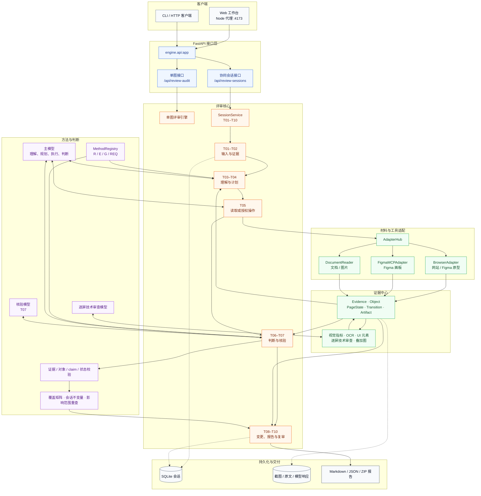

# 《智能设计系统与管理策略》课程项目仓库

**核心命题：交互方案评审 Skill**

项目将交互设计评审拆成一条可追溯的流程：读取链接、Figma 画板、原型或文档，
理解目标与要求，规划检查，在授权范围内执行操作，核验证据并生成带版本和缺口的报告。

当前定位是**证据可追溯的 AI 辅助交互评审 MVP**，不是替代真实用户测试或业务决策的
自动验收系统。它能判断静态设计是否符合明确要求，也能记录部分实际交互路径；没有观察
到的动态行为必须保留为证据不足。

## 当前状态

| 模块 | 状态 | 说明 |
| --- | --- | --- |
| 方法 | `0.2-method-draft` | 24 条 R 判据、24 条执行补充、E01–E08、T01–T10 |
| 单图引擎 | 可运行 | 截图、OCR/UI 感知、视觉指标、判据匹配和报告 |
| 协同会话引擎 | 可运行 | 多材料、多页面/状态、证据、事件重查、报告版本 |
| 输入入口 | 可运行 | 网站、Figma 画板、Figma 原型、文档、图片 |
| Figma 画板 | 已验证 | 当前使用 Figma 桌面本地 MCP；目标文件需在桌面端打开 |
| 网站/原型操作 | 可运行 | 受动作、时间、授权和模型预算限制 |
| 前端工作台 | 可用 | `frontend/session.html`，通过本地 Node 代理访问后端 |
| 效果验收 | 部分完成 | 已有契约和真实联调记录，仍需独立样本校准准确率、漏报和误报 |

## 项目架构

系统分为旧单图接口和协同会话接口两条路径。协同路径以证据为中心：工具只负责读取或
执行动作，模型负责语义判断，程序负责状态、权限、证据引用、覆盖和报告版本。



图中的边界对应代码边界：

- `SessionService` 负责 T01–T10 流程、事件和重查，不直接读取文件或操作页面。
- `AdapterHub` 负责网站、Figma 和文档入口；工具失败不能自动升级为产品缺陷。
- `EvidenceStore` 中的截图、原文、节点、控件和动作结果，是后续判断的唯一可引用来源。
- 模型只能基于当前证据输出结构化提案；程序校验对象、证据版本、权限和 claim。
- `partial` 表示覆盖不完整，不代表方案不合格；未观察到的路径不能从漏报推断已修复。

## 最终分工

终期目标是：用户提供链接和设计目的，AI 自己读取或操作方案，通过多轮交流检查流程、
目标和跨职能要求，形成有证据的评审。A 对方法和执行架构负责，B/C 负责实现与联调，
D 负责独立测试、回归和归档。

| 负责人 / 任务 | 主责工作 | 最终交付 |
| --- | --- | --- |
| A1 原判据库修订 | 逐条修订 24 条判据的适用条件、检查方法、弃权条件和去重边界 | 版本化判据库、逐条变更对照和保留/修改理由 |
| A2 新场景适配 | 定义多页流程、同页状态、实际操作、目标吻合和跨职能要求的方法 | 检查对象、上下文、证据、判定条件和正反例 |
| A3 方法执行架构 | 定义三类入口到理解、规划、判断、核验、复审和报告的 T01–T10 路径 | 架构图、步骤规格、输入输出、失败处理和 AI/程序分工 |
| A4 评审交互与评价 | 定义提问、讨论、变更重查、结束条件、严重度和效果评价口径 | 会话状态与变更规则、人工决定规则和可测试验收标准 |
| B1 三类入口接入 | 实现网站、Figma 画板和 Figma 原型读取/操作及异常处理 | 可运行适配器、真实日志、前后状态和权限失败记录 |
| B2 方法与评审实现 | 实现材料关联、任务/状态恢复、判据执行、跨页和目标核对、证据绑定 | 引擎代码、接口契约、自动化测试和可追溯判断依据 |
| B3 会话与复审实现 | 保存目标、事实、计划、发现和未决，处理补充、异议、范围变化和重查 | 可恢复会话、事件幂等、受影响重查和报告版本 |
| C1 输入与运行交互 | 实现链接/材料入口、任务沟通、阶段进度、访问异常和动作授权 | 可操作界面、真实引擎联调和用户状态反馈 |
| C2 对话与证据交互 | 实现共享目标、问答/异议、证据定位、问题审核和冲突处理 | 对话与结构化结果联动，变更实际触发 B 重评 |
| C3 版本与交付交互 | 实现暂存恢复、方案版本、逐问题复审和报告导出 | 真实浏览器全流程测试和一致的版本交付 |
| D1 测试设计与执行 | 覆盖三类入口、方法适配、跨页/状态、目标/要求、多轮交流与异常 | 隔离参考、用例、脚本、原始输入和结果 |
| D2 效果与缺陷回归 | 测准确性、一致性、效率、健壮性和体验，记录提问质量、盲从和恢复问题 | 条件明确的结果表、缺陷复现、修复前后和回归 |
| D3 归档与统稿 | 统一代码、方法、判据版本、证据、数据包、文档和报告引用 | 可复现交付、密钥检查、未完成项和限制说明 |

最终排期：

| 时间 | 安排 |
| --- | --- |
| 第 1 天 | A 提交判据修订、方法架构和交互流程开发稿；B/C 验证入口并确认契约；D 建立测试覆盖 |
| 第 2–5 天 | A 完善方法规格；B/C 并行实现；D 同步测试入口、接口、完整会话和效果，缺陷当天回流 |
| 第 6 天 | 跑完整会话、修复关键缺陷并回归，不再新增大功能 |
| 第 7 天 | 验收、归档、录屏和终期报告，确认定稿后提交 |

业务取舍由使用者决定，专家意见不能自动升级为正式要求。D 的独立参考不进入 AI 输入；
测试通过、模型可调用或接口返回成功，都不等于评审效果已验收。

## 快速开始

### 1. 环境要求

- 64 位 Python 3.11 或 3.12
- Node.js，仅启动前端时需要
- Figma 桌面端，仅读取 Figma 材料时需要
- 至少一个支持视觉输入的模型供应商 Key

Windows PowerShell 从仓库根目录执行：

```powershell
py -3.12 -m venv .venv
.\.venv\Scripts\Activate.ps1
python -m pip install --upgrade pip
python -m pip install -r requirements-session.txt
python -m playwright install chromium
```

Figma 静态画板不依赖 Chromium；网站和 Figma 原型操作需要。

### 2. 配置模型

```powershell
Copy-Item .\config\reviewer.example.toml .\config\reviewer.toml
```

编辑 `config/reviewer.toml`。使用千问的示例：

```toml
[providers.qwen]
enabled = true
api_key = "填写自己的 Key"
reasoning_model = "qwen3.8-max-0902"

[screen_review]
provider = "qwen"
reasoning_model = "qwen3.8-max-0902"
ui_perception_model = "qwen3.8-flash"
ocr_model = "qwen3.8-flash"
```

主会话模型和逐屏审查模型都必须支持图片输入。只配置一个供应商时，两处保持一致。

`config/reviewer.toml` 和 `.env` 已加入 `.gitignore`，不会提交。不要在浏览器、请求体、
Markdown 或日志中写入 Key。

如果需要使用任意 OpenAI 兼容视觉服务，在仓库根目录创建 `.env`：

```dotenv
REVIEW_PROVIDER=generic
REVIEW_MODEL=视觉模型名
REVIEW_BASE_URL=https://服务地址/v1
REVIEW_API_KEY=服务 Key
```

会话请求 JSON 中的 `provider` 也要同步改成 `"generic"`。

### 3. 验证并启动 API

```powershell
python -m engine validate-config
python -m engine validate-criteria
python -m engine session-capabilities
python -m engine serve --host 127.0.0.1 --port 8000
```

另开终端检查：

```powershell
$base = "http://127.0.0.1:8000"
Invoke-RestMethod "$base/healthz"
Invoke-RestMethod "$base/api/review-sessions/capabilities"
```

Swagger：`http://127.0.0.1:8000/docs`

`python -m engine serve` 会加载仓库根目录 `.env`。直接运行 `uvicorn engine.api:app`
时，需要自行设置环境变量或 `REVIEW_CONFIG`。

本地 API 没有额外访问鉴权，因此只绑定 `127.0.0.1`。`REVIEW_API_KEY` 是模型供应商 Key，
不是本服务的访问令牌。

### 4. 启动前端工作台

先保持后端运行，再开一个终端：

```powershell
$env:ENGINE_URL = "http://127.0.0.1:8000"
$env:PORT = "4173"
node .\frontend\server.mjs
```

打开 `http://127.0.0.1:4173/session.html`。

如果后端换端口：

```powershell
node .\frontend\server.mjs --engine http://127.0.0.1:8001
```

前端只代理 `/healthz`、`/api/criteria`、`/api/review-audit*` 和
`/api/review-sessions*`。直接跨域调用后端时，需要把前端来源加入 `CORS_ORIGINS`。

## API 接入

协同评审是异步流程：

```text
创建会话
  -> 开始运行
  -> 轮询快照
  -> 必要时回答问题或授权动作
  -> 导出报告
```

`202 Accepted` 只表示任务已接收，不表示评审完成。`completed` 也只表示本轮结束，
报告仍可能是 `partial`。

### 1. 创建会话

以下示例使用一段内联需求文档：

```powershell
$base = "http://127.0.0.1:8000"
$requestBody = @{
    purpose = "检查该界面的任务入口、状态表达、可读性和误操作风险。"
    provider = "qwen"
    auto_run = $false
    sources = @(
        @{
            kind = "document"
            title = "评审要求"
            role = "design_brief"
            evidence_kind = "requirement"
            content = "用户需要在三步内完成保存，并能明确看到成功或失败反馈。"
        }
    )
    limits = @{
        max_actions = 0
        max_checks = 32
        max_model_calls = 40
        max_images_per_call = 8
        max_seconds = 600
    }
} | ConvertTo-Json -Depth 10

$session = Invoke-RestMethod `
  -Method Post `
  -Uri "$base/api/review-sessions" `
  -ContentType "application/json; charset=utf-8" `
  -Body $requestBody

$id = $session.session_id
$session | ConvertTo-Json -Depth 8
```

实际设计材料可添加为 `website`、`figma_board`、`figma_prototype`、`document` 或 `image`。
材料角色使用 `design_brief`、`product_spec`、`design`、`implementation` 或
`expert_opinion`。Figma 请求示例见
[`docs/examples/frame-1000006800-review-session.json`](docs/examples/frame-1000006800-review-session.json)：

```powershell
$session = Invoke-RestMethod `
  -Method Post `
  -Uri "$base/api/review-sessions" `
  -ContentType "application/json; charset=utf-8" `
  -InFile ".\docs\examples\frame-1000006800-review-session.json"
```

### 2. 运行和轮询

`auto_run=false` 时，创建不会调用收费模型。开始执行：

```powershell
Invoke-RestMethod -Method Post -Uri "$base/api/review-sessions/$id/run"
```

轮询增量：

```powershell
$latest = $session
do {
    Start-Sleep -Seconds 2
    $update = Invoke-RestMethod `
      "$base/api/review-sessions/$id/updates?after_sequence=$($latest.sequence)"
    if ($update.changed) {
        $latest = $update.snapshot
        Write-Host "$($latest.status) / $($latest.active_phase)"
    }
} while ($latest.status -in @("created", "reading", "planning", "checking", "rechecking"))
```

无变化时 `updates` 返回 `changed=false`、`snapshot=null`。

主要状态：

- `completed`：本轮结束，可能是 `partial`。
- `awaiting_input`：需要回复、补材料或授权动作。
- `cancelled`：用户终止。
- `report_completeness=partial`：存在未执行、缺证、访问失败或覆盖缺口。

### 3. 回复、补材料或授权

状态为 `awaiting_input` 时，读取最新快照中的 `context_version` 和 `questions`：

```powershell
$questionId = $latest.questions[0].question_id
$eventBody = @{
    event_id = "reply-001"
    expected_context_version = $latest.context_version
    type = "reply"
    actor = "member-name"
    payload = @{
        text = "目标用户是驾驶员，主要用于行驶中快速操作。"
        question_id = $questionId
    }
} | ConvertTo-Json -Depth 10

Invoke-RestMethod `
  -Method Post `
  -Uri "$base/api/review-sessions/$id/events" `
  -ContentType "application/json" `
  -Body $eventBody
```

生命周期事件包括 `reply`、`change_goal`、`change_scope`、`add_sources`、
`review_finding`、`authorize_action`、`resume`、`cancel`、`finish`、`recheck`、
`confirm_recheck` 和 `resolve_conflict`。

`expected_context_version` 过期会返回 `409`。重新读取会话，不要重放旧事件。

### 4. 导出报告

```powershell
Invoke-WebRequest "$base/api/review-sessions/$id/export" -OutFile ".\review.md"
Invoke-WebRequest "$base/api/review-sessions/$id/export?format=summary" -OutFile ".\review-summary.md"
Invoke-WebRequest "$base/api/review-sessions/$id/export?format=audit" -OutFile ".\review-audit.md"
Invoke-WebRequest "$base/api/review-sessions/$id/structured-report" -OutFile ".\review.json"
Invoke-WebRequest "$base/api/review-sessions/$id/package" -OutFile ".\review-package.zip"
```

ZIP 包包含人审报告、审计报告、结构化 JSON、阶段文件、方法原文、证据附件和
`SHA256SUMS.txt`。

### 5. 接口速查

| 方法和路径 | 用途 |
| --- | --- |
| `GET /healthz` | 配置、供应商和本地运行时健康检查 |
| `GET /api/criteria` | 单图判据元数据 |
| `POST /api/review-audit` | 旧单图接口，`multipart/form-data` |
| `POST /api/review-audit/base64` | 旧单图 JSON 接口 |
| `GET /api/review-sessions/capabilities` | 方法、模型和工具能力 |
| `POST /api/review-sessions` | 创建协同评审会话 |
| `POST /api/review-sessions/{id}/run` | 开始或继续运行 |
| `GET /api/review-sessions/{id}` | 当前完整快照 |
| `GET /api/review-sessions/{id}/updates` | 增量轮询 |
| `POST /api/review-sessions/{id}/events` | 回复、补材料、授权、审核和复审 |
| `GET /api/review-sessions/{id}/reports/{version}` | 历史报告版本 |
| `GET /api/review-sessions/{id}/export` | 人审、摘要或审计 Markdown |
| `GET /api/review-sessions/{id}/structured-report` | 完整结构化报告 |
| `GET /api/review-sessions/{id}/package` | 可移动报告包 ZIP |
| `GET /api/review-sessions/{id}/artifacts/{artifact_id}` | 本会话证据附件 |

统一错误结构：

```json
{
  "error": {
    "code": "context_version_conflict",
    "message": "上下文版本已变化，请重新读取会话。",
    "retryable": false,
    "details": {}
  }
}
```

旧单图接口：

```powershell
curl.exe -X POST "$base/api/review-audit" `
  -F "image=@.\screen.png" `
  -F "design_goal=用户需要完成保存并看到结果" `
  -F "platform=web"
```

接口字段和返回结构见 [`docs/b-engine.md`](docs/b-engine.md)。

## 材料与运行配置

### Figma 桌面 MCP

作者当前使用的 Figma 读取方式必须在本机重新准备：

```toml
[tools.figma_mcp]
enabled = true
url = "http://127.0.0.1:3845/mcp"
bearer_token = ""
snapshot_root = "out/figma-snapshots"
```

使用前：

1. 安装并登录 Figma 桌面端。
2. 打开要评审的设计文件，保持目标标签页处于激活状态。
3. 在 Figma 中启用桌面 MCP。
4. 启动 Python API，并在请求中使用真实 Figma URL 和节点 ID。

桌面 MCP 不接受 `fileKey`，不能凭任意链接切换文件。读取结果只对应当前打开的桌面文件，
证据中会记录 `file_identity_verified=false`。远程 MCP 需要单独授权，不能复用本地桌面
MCP 配置。

### 网站和原型

网站和原型依赖快速开始中安装的 Playwright Chromium。

本地或内网测试地址默认被拦截。只有明确授权测试本机服务时，才启用：

```toml
[tools.browser]
allow_local_network = true
```

网站默认阻止非只读请求；危险动作和跨域导航仍需单独授权。

### 存储

```toml
[sessions]
storage_dir = "out/sessions"
method_root = "方法专家开发交付-v0.2"
```

相对路径以仓库根目录为基准。`out/` 不入 Git，历史会话、SQLite 数据和证据不会自动同步。
共享结果时使用 `/package` 导出的 ZIP。

## 评审引擎

### 技术路径

```text
材料
  -> T02 读取与证据登记
  -> T03 目标、要求、意见和冲突理解
  -> T04 检查计划与证据需求
  -> T05 读取局部画面或执行授权动作
  -> T06 逐项判断
  -> T07 证据核验
  -> T08 问答、补充、业务决定和重查
  -> T09 报告与保存
  -> T10 新版复审
```

模型负责语义理解、适用性判断、问题解释和动作提案。程序负责原文引用、证据 ID、对象 ID、
状态刷新、动作目标核对、授权、claim 校验、覆盖矩阵、版本和报告生成。

评审模式包括 `materials`、`design`、`runtime` 和 `mixed`。静态设计符合不能写成真实运行
通过；实际用户理解仍需观察或用户研究证据。

### 感知与确定性检查

会话层会为有效截图计算视觉指标、元素、文本块、可读性、密度、风格和显著性代理，并生成
元素框、显著性和流程图叠加。Figma 文本节点、DOM 控件和连线几何保留原始证据。

逐屏技术审查是全局流程评审的补充。每个完整界面单独执行 OCR、UI 元素识别、视觉统计和
屏内规则检查；屏内候选不会自动等同于跨屏流程问题。

详见 [`docs/perception-and-semantic-chain.md`](docs/perception-and-semantic-chain.md)。

### 报告与证据

报告分三层：

- `report-showcase.md`：面向设计、策划和负责人；
- `report-summary.md`：一页结论与缺口；
- `report-details.md`：完整阶段、检查、证据和模型调用审计。

机器可读输出包括 `report.json`、`process.json`、`checks.json`、`evidence.json`、
`findings.json`、`coverage.json`、阶段文件、原始响应和方法文件哈希。

详见 [`docs/report-format.md`](docs/report-format.md)。

### 验证与评价

```powershell
python -m pytest -q
python -m engine session-evaluate <session_id> <labels.json>
python -m engine session-batch-evaluate <manifest.json>
```

评分结果 1.1 版分别记录问题预测条数、命中参考数和命中预测数。一条有两处独立证据的发现可命中两个参考；无分母的比率返回 `null`。计数示例和本地回归结果见 [D 的三项修复复测](docs/D-三项修复复测.md)。
评价指标、独立标注和验收方法见
[`docs/interaction-review-engine-audit-2026-11-03.md`](docs/interaction-review-engine-audit-2026-11-03.md)。

### 已知边界

- 自动探索受动作数、时间、权限和模型预算限制。
- 未观察到的路径必须标为缺口，不能从漏报推断已修复。
- 正式材料冲突需要明确业务决定，模型不能代用户裁决。
- 分支结果和严重度仍依赖模型语义判断，需要独立样本校准。
- 未配置独立 verifier 时，T07 仍是主模型自检。

## 文档与示例

| 内容 | 入口 |
| --- | --- |
| 协同评审方案与 T01–T10 | [`协同交互评审方案-v0.1-场景输入流程与技术路径.md`](协同交互评审方案-v0.1-场景输入流程与技术路径.md) |
| 终期开发与验收计划 | [`docs/2026-11-01-a-acceptance-and-b-plan.md`](docs/2026-11-01-a-acceptance-and-b-plan.md) |
| 会话后端实现与 API 契约 | [`docs/b-session-implementation.md`](docs/b-session-implementation.md) |
| 模型配置 | [`docs/config-setup.md`](docs/config-setup.md) |
| 感知与语义链 | [`docs/perception-and-semantic-chain.md`](docs/perception-and-semantic-chain.md) |
| 报告格式 | [`docs/report-format.md`](docs/report-format.md) |
| Figma 多界面接入记录 | [`docs/wushanshi-figma-integration.md`](docs/wushanshi-figma-integration.md) |
| 引擎审查与有效性边界 | [`docs/interaction-review-engine-audit-2026-11-03.md`](docs/interaction-review-engine-audit-2026-11-03.md) |
| Flex 原型请求 | [`docs/examples/flex-review-session.json`](docs/examples/flex-review-session.json) |
| 多材料请求 | [`docs/examples/multimaterial-review-session.json`](docs/examples/multimaterial-review-session.json) |
| Figma 画板请求 | [`docs/examples/frame-1000006800-review-session.json`](docs/examples/frame-1000006800-review-session.json) |

## 当前成果

- [D 本轮完整验收与最新结果](docs/D-最终验收收尾.md)
- [D 42 项工程与方法验收](docs/D-42项工程验收.md)
- [D 新样本关键任务验收](docs/D-新样本独立验收.md)
- [D 后续迭代交接](docs/D-后续迭代交接.md)
- [D 新版工作台续测与修复记录](docs/D-新版工作台续测.md)
- [D 迭代日志](docs/D-迭代日志.md)
- [六人识别与数据收尾](docs/D-数据收尾结果.md)
- [体验数据与模拟测试](docs/D-体验数据与模拟测试.md)
- [阶段性报告](docs/D-阶段性报告.md)
- [D 数据收尾材料](deliverables/2026-10-22-d-data-closeout.zip)
- [角色试用页单案例报告](deliverables/2026-10-21-character-trial/report-showcase.md)
- [机器可读单案例结果](deliverables/2026-10-21-character-trial/report.json)

当前 MVP 已覆盖单图、多材料、Figma 画板和部分原型/网站操作。进度与联调记录分别归档，
不把“接口能调通”写成“评审效果已验收”。

## 仓库结构

```text
.
├── README.md
├── engine/                         # 单图与会话评审引擎
├── frontend/                       # 会话评审工作台与本地 API 代理
├── docs/                           # 配置、API、报告、测试与审查文档
├── tests/                          # 契约、接口和回归测试
├── config/
│   └── reviewer.example.toml       # 本地配置模板
├── 判据库_v1.json                  # 单图判据库
├── 方法专家开发交付-v0.2/           # A 的方法与执行补充
├── deliverables/                   # 已验收或归档成果
├── materials/                      # 课程资料
├── reference/skills/               # 同类开源 Skill 参考
├── requirements.txt
├── requirements-session.txt
└── requirements-perception.txt
```

## 历史资料

中期四人分工、早期排期和 Vibe Coding 过程已不再是当前实现说明。原内容保留在 Git 历史中；
当前开发范围以终期计划、方法交付和本 README 为准。

## 同类开源 Skill

- [refactoring-ui-plugin](https://github.com/gnurio/refactoring-ui-plugin)
- [material-design-3-ui-skill](https://github.com/skydashnet/material-design-3-ui-skill)
- [design_skill](https://github.com/grapeot/design_skill)
- [ai-friendly-web-design-skill](https://github.com/ianho7/ai-friendly-web-design-skill)
