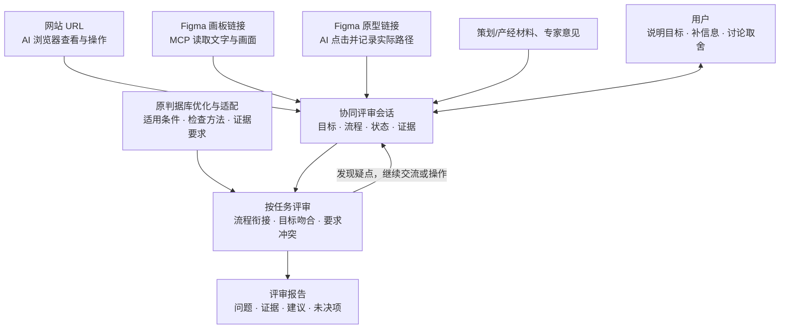

# 《智能设计系统与管理策略》课程项目仓库

**核心命题**：交互方案评审skill

## 终期开发计划 · 协同交互方案评审

更新：2026-10-28。只有一次、一周的开发周期。以下为待实现与验收的任务，不代表当前 MVP 已具备全部能力。

### 任务

**用户给链接和设计目的，AI 自己读取或操作方案，通过多轮交流，检查流程、目标和跨职能要求，形成有证据的评审。** 复用现有单图 MVP，不要求用户先整理截图或手工评完方案。

### 架构草图

具体评审方法与编排由 A 先定，B/C 细化实现。



本质为不同应用场景下的评审方式。可以利用 AI 运行环境已有的 MCP、浏览器操作能力，但不能假定当前 Python 服务已经具备这些能力，接入与权限需要实测。

### 任务与验收

| 负责人 / 任务 | 必须完成的工作 | 交付与完成标准 |
| --- | --- | --- |
| A1 原判据库修订 | 逐条检查现有 24 条判据，结合 D 已发现的问题修正适用条件、检查方法、报问题/弃权条件和去重边界，保留来源与编号关系 | 版本化判据库及逐条变更对照；说明保留、修改、拆分或停用的理由；已有单图能力仍有方法依据 |
| A2 新场景适配 | 为多页流程、同页状态、实际操作、目标吻合和跨职能要求定义评审方法；明确复用哪些旧判据、扩展哪些、新增哪些 | 每项方法有检查对象、所需上下文、证据、判定条件和正反例；区分静态可见、文档描述与操作验证；不把个案业务规则直接塞进通用判据 |
| A3 方法执行架构 | 定义三类入口到材料理解、任务规划、判据选择/执行、证据核验、综合判断、复审和报告的技术路径及 AI/程序分工 | 架构/流程图及步骤规格；每步输入输出、选择理由、失败处理明确；B/C 不必重设计如何利用判据做评审 |
| A4 评审交互与评价 | 定义何时提问、如何澄清/讨论、目标或材料变化后重查什么、如何结束；制定严重度、未决、冲突及效果评价口径 | 用户/AI 流程、会话状态/变更规则和验收标准；B/C 可实现，D 可测试；A 随开发和测试修订方法，不交库后退出 |
| B1 三类入口接入 | 实现网站浏览与操作、Figma MCP 读取、原型操作；保留文字/画面/节点和动作结果；处理访问、登录和工具异常 | 可运行接入代码及真实日志；不把打开链接当作已检查、不把静态图当操作；权限失败明确返回 |
| B2 方法与评审实现 | 按 A 的架构实现材料分块关联、任务/状态恢复、判据适用与执行、跨页/目标/要求核对、证据绑定与问题整理 | 引擎代码、输入输出契约和自动化测试；执行范围、判据版本、判断依据和未知项可追溯，覆盖上述评审能力 |
| B3 会话与复审实现 | 保存目标、事实、计划、发现和未决；处理补充/异议/范围变化；重查受影响部分，生成可恢复的报告版本 | 会话编排、存储与重评代码及回归；回复实际改变下游，旧证据不充当新版事实，漏报不自动等于解决 |
| C1 输入与运行交互 | 按 A 的流程实现链接/材料入口、任务沟通、阶段进度、访问异常和操作授权，并接真实引擎 | 可操作界面及联调记录；用户不先手工整理流程，知道 AI 正在读什么、做什么、等待什么 |
| C2 对话与证据交互 | 实现共享目标/范围、问答/异议/补材料、跨页证据定位、问题审核和严重度/冲突处理 | 对话与结构化结果联动；用户可看依据并表达取舍，变更调用 B 重评，不只改显示或增加聊天框 |
| C3 版本与交付交互 | 实现会话暂存/恢复、方案版本与逐问题复审、报告导出；保留模型判断、人工决定和未决项 | 真实浏览器全流程测试；刷新/恢复/导出一致，不丢上下文、不误标来源或解决状态 |
| D1 测试设计与执行 | 使用 Page 2 原始材料和网站测试环境，覆盖三种入口、方法适配、跨页/状态、目标/要求、多轮交流及异常；准备隔离的参考与期望 | 用例、测试脚本、原始输入/版本和结果；分别定位读取、判断、会话与界面故障，不把正常用户交流视为答案泄漏 |
| D2 效果与缺陷回归 | 测准确性、一致性、效率、健壮性和体验；复用旧单图回归；记录提问质量、范围变化、盲从、证据错误和恢复问题 | 分母与条件明确的结果表；缺陷有复现、期望、修复前后和回归；离线程序通过不等于 AI 效果通过 |
| D3 归档与统稿 | 统一代码/方法/判据版本、运行证据、数据包、使用文档、录屏与报告引用；各成员提供自己的主责内容 | 交付可复现且来源一致；密钥/权限检查通过；未完成和限制如实列出，不以材料数量代替验收 |

A 保留方法论责任，并新增架构与流程主责。B/C 校核模型、工具、接口和交互的可行性并细化实现；改变核心方法时与 A 对齐。D 的独立参考不进入 AI 输入，真实业务取舍由使用者决定。

### 排期

| 时间 | 本次开发周期内的安排 |
| --- | --- |
| 第 1 天 | A 给判据修订/适配清单、方法架构和交互流程的开发稿；B/C 实测三种入口并校核契约；D 据任务表建立测试覆盖。当天确认依赖、负责人和验收口径 |
| 第 2–5 天 | A 完善版本化判据与步骤/交互规格；B/C 并行完成各项实现；D 同步测入口、接口、完整会话和效果，缺陷当天回流 |
| 第 6 天 | 跑完整会话、修关键缺陷、回归；不再新增大功能 |
| 第 7 天 | 验收、归档、录屏与终期报告；确认定稿后才提交 |

### 本周验收

- A 的原判据修订、新场景适配、执行架构与交互规则。
- 网站、Figma 画板、Figma 原型的读取/操作、证据记录和异常处理均通过测试。
- 覆盖跨页衔接、状态切换、原始目标、跨职能要求与意见；用户补信息、改关注点或质疑后，AI 更新判断而非复述。
- 发现有原文、节点/画面或操作记录；区分设计描述、实际观察和未知，不编造未检查路径。
- 会话可保存、恢复、导出；D 同时测效果、交流成本与旧能力回归。源码、判据、测试材料和录屏对齐同一版本。

网站使用只读范围或测试账号；购买、发送、删除等实际副作用须另获确认。读取画板不改源稿；原型操作与修改 Figma 设计分开。缺访问权或关键材料时询问用户。

## 当前可提交成果

- **D 最新交付（10 月 22 日）**：[六人识别与数据收尾](docs/D-数据收尾结果.md) · [新版完整材料](deliverables/2026-10-22-d-data-closeout.zip) · [体验数据与模拟测试](docs/D-体验数据与模拟测试.md) · [阶段性报告](docs/D-阶段性报告.md) · [完整材料下载](docs/D-发布索引.md) · [被试填写工具](deliverables/2026-10-22-participant-tool.zip) · [明鉴试用包](deliverables/2026-10-22-mingjian-local-trial.zip)
- **单案例引用口径**：[D 复核勘误](docs/D-单案例复核勘误.md)。原始归档保留；引用下方报告时须同时采用勘误中的计数、覆盖范围、耗时与证据限制。
- **最新单样本审查报告**：
  [商业手游角色试用页综合报告](deliverables/2026-10-21-character-trial/report-showcase.md)
- **案例交接页**：
  [2026-10-21-character-trial](deliverables/2026-10-21-character-trial/README.md)
- **机器可读结果**：
  [report.json](deliverables/2026-10-21-character-trial/report.json)
- **过程与耗时**：
  [manifest.json](deliverables/2026-10-21-character-trial/manifest.json)

该报告包含成果截图、原型参考、过程叠加图、各阶段输入输出、指标解释、判据相关性、目标检查和源数据文件索引。此单样本结果用于 MVP 效果展示，不代表统计意义上的召回率或误报率。

## 快速交接

### 1. 环境

```powershell
py -3.11 -m venv .venv
.\.venv\Scripts\Activate.ps1
python -m pip install -r requirements.txt
```

开发与测试：

```powershell
python -m pip install -r requirements-dev.txt
```

可选本地模型路径需要 64 位 Python 3.11+ 和至少 16 GB 显存，依赖见
[`requirements-perception.txt`](requirements-perception.txt)。

### 2. 千问 AI 平台 API Key

我用的是千问 AI 平台 API Key，如果有更好的平台可以换源，需要有以下能力的模型
- 视觉理解：`qwen3.8-flash`
- 综合推理：`qwen3.8-max-0902`
- 判据相关性：文本向量、文本重排、多模态向量和多模态重排
- GUI 操作辅助：`gui-plus`

平台入口：

- [千问 AI 平台](https://www.qianwenai.com/)
- [模型列表](https://www.qianwenai.com/models)
- [API Key 文档](https://platform.qianwenai.com/docs/developer-guides/administration/api-keys)

获取 Key 后创建本地配置：

```powershell
Copy-Item .\config\reviewer.example.toml .\config\reviewer.toml
```

在 `config/reviewer.toml` 的 `providers.qwen.api_key` 中填写 Key。配置文件包含密钥，请勿提交。完整说明见
[`docs/config-setup.md`](docs/config-setup.md)。

### 3. 启动前检查

```powershell
python -m engine validate-config
python -m engine validate-criteria
python -m pytest -q
```

### 4. 分阶段运行

```powershell
python -m engine stage-init .\screen.png `
  --reference .\prototype.png `
  --goal-file .\design-goal.txt `
  --platform game

python -m engine stage <run_dir> ocr
python -m engine stage <run_dir> ui
python -m engine stage <run_dir> reference_ui
python -m engine stage <run_dir> goal
python -m engine stage <run_dir> metrics
python -m engine stage <run_dir> relevance
python -m engine stage <run_dir> audit
python -m engine stage <run_dir> report
python -m engine stage <run_dir> narrative
```

每一步的状态、耗时、模型、token 使用量、原始响应和解析结果都会写入运行目录。完整说明见
[`docs/staged-workflow.md`](docs/staged-workflow.md)。

### 5. 归档验收成果

- `deliverables/<日期>-<case-slug>/`：验收后计划提交的完整成果。
- 已验收运行不得原地覆盖；重跑必须建立新的 `run-id`。
- 命名和归档规则见 [`deliverables/README.md`](deliverables/README.md)。

## B 引擎（交互评审 API）

核心分析链和 C 的接入契约见 [`docs/b-engine.md`](docs/b-engine.md)。
升级后的感知、判据相关性、可计算参数和评估方案见
[`docs/b-engine-v2-plan.md`](docs/b-engine-v2-plan.md)，模型 Key 填写方式见
[`docs/config-setup.md`](docs/config-setup.md)。
分阶段运行、缓存和本地验收方式见
[`docs/staged-workflow.md`](docs/staged-workflow.md)。

```powershell
python -m pip install -r requirements.txt
python -m engine validate-config
python -m engine validate-criteria
python -m engine serve --port 8000
```

主要接口为 `POST /api/review-audit`，健康检查为 `GET /healthz`，接口文档位于 `http://127.0.0.1:8000/docs`。

### 协同会话后端（B 开发版）

已新增独立的 `/api/review-sessions` 接口、版本化方法加载、证据/状态/路径记录、问答事件、重查和报告存储；旧单图接口保留。原型执行支持画布截图、坐标映射、点击前目标核对、滚动和无效果判定；报告包含实际状态轨迹，评审委托与原始设计目的分开。C 界面尚未接入，新工具效果仍需 D 验收。三类入口的实际读取/操作和权限状态以运行证据为准，配置存在不等于接入已通过。

2026-11-02 继续推进 B2/B3：增加 PDF/DOCX/文本/网页文档读取与原始文件留存；AI 分别提取原设计目的、正式要求、专家意见和材料冲突，再生成逐项适用性/取证计划。动作规划读取计划中的缺项；判断与报告关联要求原文和方案/表现证据。补充与明确业务决定会触发重新理解和重查，不把专家建议自动升级为要求，也不把业务取舍当作实现修复。联调输入见 [`docs/examples/multimaterial-review-session.json`](docs/examples/multimaterial-review-session.json)，是合成开发材料，不作工具准确率成绩。

真实 Figma 多界面材料也已接入：策划案按正式要求读取，交互案按方案证据读取；长流程画板会保留全文索引并自动展开核心界面图。示例见 [`docs/examples/wushanshi-figma-review-session.json`](docs/examples/wushanshi-figma-review-session.json)，本次接入记录与边界见 [`docs/wushanshi-figma-integration.md`](docs/wushanshi-figma-integration.md)。千问权限恢复后完成 45 项判断，确认一条“排序布局与策划规则不一致”的候选发现；其余动态行为保留待验证，不作为产品验收成绩。

当前会话引擎加载 A 的 `0.2-method-draft`：24 条 R、24 条执行补充、E01–E08，以及 T01–T10 技术路径。报告输出分为面向人的精准报告、逐步审计报告和机器可读 JSON：人审版突出结论、目标对应、关键发现与缺口；审计版保留全量检查输入输出、模型响应和原始附件。格式说明见 [`docs/report-format.md`](docs/report-format.md)。API 新增 `/structured-report` 和 `/package`，CLI 使用 `session-export ... --package --zip`。

会话评审不是纯提示词：当前已接回确定性的视觉指标、Figma/DOM 结构、可读性、密度、风格和显著性代理，并保留原始分析 JSON 与叠加图。感知与语义分工见 [`docs/perception-and-semantic-chain.md`](docs/perception-and-semantic-chain.md)。

当前引擎代码审查、技术路线反推和有效性边界见
[`docs/interaction-review-engine-audit-2026-11-03.md`](docs/interaction-review-engine-audit-2026-11-03.md)。

```powershell
python -m pip install -r requirements-session.txt
python -m playwright install chromium
python -m engine session-capabilities
```

模型 Key 只写入被忽略的 `config/reviewer.toml`。当前使用 Figma 桌面本地 MCP：在桌面端 `Ctrl+K` 搜索 `MCP`，启用服务后配置 `http://127.0.0.1:3845/mcp`；无需复制 Codex 凭据。远程服务的客户端准入限制单列说明。启动、API 契约、CLI、限制和准备材料见 [`docs/b-session-implementation.md`](docs/b-session-implementation.md)，可创建但不会自动调用模型的请求示例见 [`docs/examples/flex-review-session.json`](docs/examples/flex-review-session.json)。


## 仓库结构

```
.
├── README.md
├── config/                # 模型配置模板与字段说明
├── deliverables/          # 验收后计划提交的审查成果
│   └── 2026-10-21-character-trial/
├── docs/                  # 架构、配置、分阶段运行与 API 文档
├── engine/                # B 引擎代码
├── materials/             # 课程资料
├── reference/
│   └── skills/            # 4 个同类开源 skill
├── tests/                 # 单元与接口测试
├── 判据库_v1.json         # A 方法专家交付的 24 条判据
├── requirements.txt
├── requirements-dev.txt
└── requirements-perception.txt
```

## 当前进度

以下为 10 月 21–22 日的 MVP 成果与验证记录；终期开发按上方计划推进。

D 已完成本轮数据收尾：6 人 P01 五秒识别、18 条原话与 Codex 辅助判分，Q1 页面目的 2/6、Q2 入口位置 0/6、Q3 入口文字 4/6。1 条真实工具体验、3 个 AI 操作角色和 AI 模拟共识按来源分别汇总。原回答、逐题理由、设备记录和计算结果均进入[新版完整材料](deliverables/2026-10-22-d-data-closeout.zip)。

接下来整合成员信息和主责章节，统一课程总稿并准备演示。B、C 的完整模型联调在配置就绪后接续。[在线阅读数据收尾结果](docs/D-数据收尾结果.md)。

### 本轮体验与修复记录

2026 年 10 月 22 日，D 已收到 1 位真实使用者的体验记录，三项均为 4/5 分；使用后补填的 1 秒计时单列。新增 3 个 AI 角色的实际模拟界面操作、四份原生导出与截图；AI 角色评分单独归档。

本轮修复了更新任务目标后模拟评审沿用旧描述的问题，保留人工审核和旧版本。前端 10/10、导出核对 12/12、D 汇总程序 86/86、实际数据导入 8/8 均通过。修复代码及中文记录已纳入仓库。

两位真实评审原始选择已保存；AI 模拟共识形成 25 个通用参考问题和 2 个目标建议，完成 42 项复核。按 AI 模拟参考对照，已有 24 条模型发现覆盖 25/25 个参考问题，错误发现 0/24。

[体验与修复记录](docs/D-体验数据与模拟测试.md)可直接阅读与下载。六人识别已补入[当前数据结果](docs/D-数据收尾结果.md)，D 接续合稿和演示准备。

### 10 月 21 日进度留档

2026 年 10 月 21 日，D 已完成 10 张开发图的评审，形成 24 项具体发现；P01 新口径评审另有 2 项目标建议。累计保存 14 次 Codex 视觉评审，新增 9 次运行的 167/167 项结构检查全部通过。

25 条作者候选已完成逐项对照：22 条完整对应、1 条范围收敛、1 条部分对应、1 条判定依据不同；S08 另发现 1 项持续提示问题。前期程序修复的最新回归为 64/64，S03 与 S07 修复回放各通过 14/14 项检查。

C 已交付 `frontend/` 与课程报告初稿。D 完成 9/9 项前端测试、8/8 项 S07 保存结果适配核对，以及 11/11 项模拟操作与字段保存核对，四轮导出和刷新恢复记录均已归档。

[D 阶段性报告](docs/D-阶段性报告.md)与[本轮开发测试总览](docs/D-本轮开发测试总览.md)汇总结果；[发布索引](docs/D-发布索引.md)提供完整材料和逐文件定位。两位评审者标注、P01 五秒识别、工具计时和问卷材料已经备齐，接续按[真人执行清单](docs/D-真人材料执行清单.md)回收记录并统稿。

## 中期汇报 · 四人分工（历史）

以下保留中期的范围、职责与排期，不作为当前终期任务的执行依据。

**v1 范围**：界面截图 + 第①层通用交互原则 + 四段式意见（原则 → 检测 → 描述 → 建议）。
规范溯源、场景专项不做，留给 v2/v3。

### A · 方法专家

**判据库 v1**（大）
把启发式评审的判据整理成引擎能直接调用的条目：判据内容、出处、适用界面类型。先做第①层通用交互原则 20–30 条。
→ 交给 B 接引擎。**完成标志**：B 能直接用它给一张截图产出带出处的意见。

**方法五要素拆解**（中）
输入 / 过程（7 步）/ 输出 / 决策点（评估性·方向性·解释性·边界性）/ 痛点（时间·认知·一致性·遗漏），并挑出关键决策点与最痛痛点。

**五维评估方案**（中）
准确性、一致性、可解释性、效率、体验，每维定一个可执行指标；信度用与资深设计师对照的召回率 / 误报率。
→ 交给 D 落成测试。

**报告**：I.2 项目定义 · II.1 五要素 · II.2 AI 能力映射 · III.3 评估框架

### B · Vibe Coder（引擎）

**核心分析链**（大）
截图 → 多模态视觉理解 → 判据库匹配 → 逐条检测 → 四段式意见。这是 Skill 的"心脏"。
**完成标志**：一张图进，一份带证据锚点和判据出处的问题清单出。

**输入输出契约**（中）
各环节的入参、返回字段和取值范围定死，并处理模型输出不稳定的情况。
→ 交给 C 做界面、D 做统计。

**报告**：III.1 架构选择（含双维度评分）· III.4 设计文档概述 · IV.1 MVP 边界 · IV.2 前两轮

### C · Vibe Coder（交互集成）

**界面与评审流程**（大）
上传截图 → 问题清单 → 人工干预 → 导出评审报告。
**完成标志**：不碰代码的人也能自己跑完一整遍。

**四个 HITL 节点**（中）
确认设计目标 / 确认·驳回发现 / 严重度校准 / 复审闭环。用户的修改要能回流触发重算，而不只是改显示。

**报告**：III.2 人机协同设计 · IV.2 第三轮 · IV.3 MVP 现状与已知问题

### D · 测试与文档

**测试方案与数据**（中）
10 条界面样本 + 20–30 条专家参考标注；与 2 位资深设计师人工评审对照，定好召回率 / 误报率的算法。
→ 依赖 A 的评估方案。

**测试执行与汇总**（大）
效率计时、6–8 人的瞬时识别小实验、主观体验问卷，汇总成一张结果表。
→ 交给 A 写 III.3。

**归档与统稿**（大）
收拢四人的对话日志与关键提示词。各节初稿由主责人写，D 只统稿不代写。

**报告**：I.1 小组信息 · III.3 量化结果 · IV.3 运行日志 · V Vibe Coding 总结 · 附录

### 依赖与并行

- **判据库是唯一的硬前置**：B 和 C 在它交付前用 mock 数据推进，不要等。
- 三条线可并行：A（方法）· B+C（技术）· D（测试准备）。
- 收口只在两处：10/20 测试执行、10/22 统稿。

### 顺序

| 时间 | 交什么 |
| --- | --- |
| 10/16 五 | 判据库骨架（A）· 最小闭环：1 张图→1 条意见（B）· 界面骨架 mock（C）· 日志模板 + 模拟数据（D） |
| 10/17 六 | 判据库 20–30 条（A）· 引擎接真实判据库（B）· 界面接真实后端（C）· 测试方案（D） |
| 10/18 日 | 五要素拆解定稿（A）· 四段式打磨（B）· 四个 HITL 节点（C）· 样本 + 参考标注（D） |
| 10/19 一 | 报告 II / III 初稿（A 主笔，D 汇总） |
| 10/20 二 | 测试执行（D 牵头，A 当资深设计师） |
| 10/21 三 | 报告 IV / V 初稿 + 录屏 |
| 10/22 四 | 统稿提交（20:00 前） |

## 相关链接

**同类开源 Skill**（本地副本见 `reference/skills/`）

- [refactoring-ui-plugin](https://github.com/gnurio/refactoring-ui-plugin) — 把《Refactoring UI》拆成 10 个原子技能 + 1 个 meta 技能
- [material-design-3-ui-skill](https://github.com/skydashnet/material-design-3-ui-skill) — 以 M3 官方规范为 source of truth，要求先核对官方指南再断言
- [design_skill](https://github.com/grapeot/design_skill) — "确定性工具给事实，模型给判断"
- [ai-friendly-web-design-skill](https://github.com/ianho7/ai-friendly-web-design-skill) — 输出带严重度分级
- [knowledge-work-plugins](https://github.com/anthropics/knowledge-work-plugins) — Anthropic 官方 Design Plugin，可作参照

**同类产品**

- [UX Audit AI](https://uxaudit.tech)
- [Heustrics](https://heustrics.com)
- [Attention Insight](https://attentioninsight.com)
