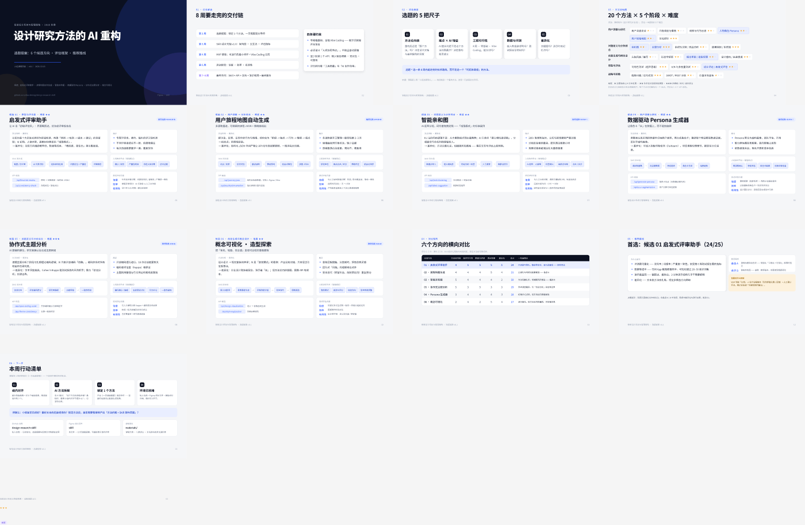

# 设计研究方法的 AI 重构 — 课程项目仓库

《智能设计系统与管理策略》（2026 秋季）课程项目工作仓库。

**核心命题**：把一种经典设计研究方法（用户访谈、亲和图、旅程地图、启发式评估……）重构为
AI 可执行、人可协同的 **Skill**，并进一步封装为可调用的 **API**。

## 交付物与时间线

| 周次 | 交付物 |
| --- | --- |
| 第 2 周 | 选题提案（一页，锁定一个方法） |
| 第 3 周 | Skill 设计文档 v1.0（架构图 / 交互流 / 评估指标） |
| 第 4 周 | MVP 原型（可运行的最小闭环 + Vibe Coding 日志） |
| 第 6 周 | 测试报告（信度 / 效率 / 有用性） |
| 第 8 周 | 最终交付：可运行 Skill 及/或 API + 文档 + 演示视频 + 最终报告 |

## 仓库结构

```
.
├── docs/                  # 选题提案、设计文档、测试报告
├── materials/             # 课程资料（大纲、讲义、方法池附件）
├── extracted/             # 课程 PDF 的文本提取结果（本地用，不入库）
└── README.md
```

## 当前进度

- [x] 通读课程大纲、讲义与方法池附件
- [x] 选题提案 v0.1（6 个候选方向 + 评估框架 + 推荐路线）→ `docs/00-选题提案.md`
- [x] 选题扩展 v0.2（交互设计流程支点：评估类五切面 + 产出与交付类五方向）→ `docs/01-交互设计流程选题扩展.md`
- [x] 选题扩展 v0.3（游戏交互设计工作流：五个交接边界 + 三个重点候选）→ `docs/02-游戏交互设计工作流选题.md`
- [x] Figma 演示文档（第 1 页：课程方法池选题；第 2 页：交互设计流程选题扩展；第 3 页：游戏交互工作流选题）
- [ ] 组内对齐，锁定 1 个方法
- [ ] 一页选题提案提交导师

## 相关链接

- Figma 演示文件：https://www.figma.com/design/dAWQ1dG8pOh5RBHa3CFZ7t/skill

演示文档共 13 页（封面 → 任务解读 → 评估框架 → 方法池地图 → 6 个候选方向 → 对比矩阵 → 推荐路线 → 行动清单）：


