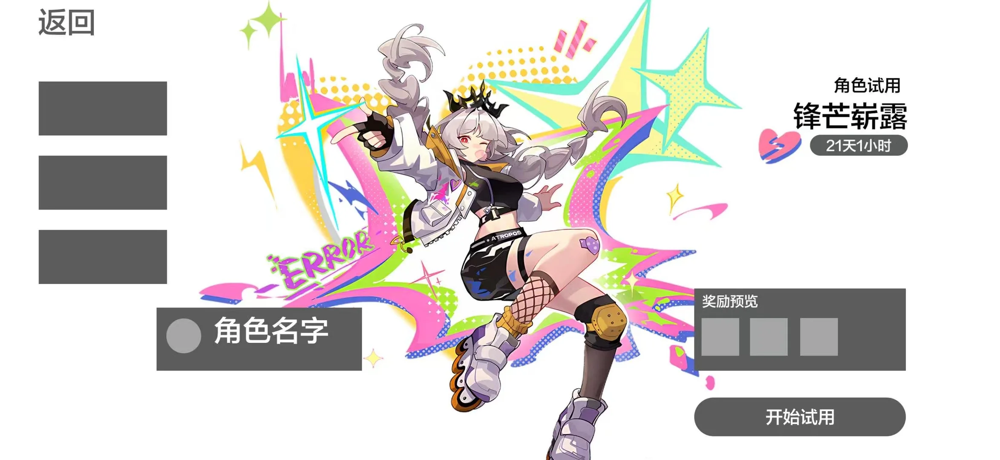

# 商业手游角色试用页 UI 走查报告

> 运行编号：`20261021-030524-84e90f`
> 状态：`completed`
> 综合审查模型：`qwen/qwen3.8-max-0902`
> 通用判据版本：`0.1-draft`

## 一、结论摘要

本次评估针对“角色试用”界面，基于 9 项设计目标（G01-G09）与 24 条通用规则进行自动化走查。结果显示：界面在布局分区、视觉层级、多巴胺配色及信息可读性方面表现优异，符合商业手游上线标准。唯一发现的问题是角色名称文案不一致（“锋芒崭露” vs “锋芒斩露”），属中等严重度，需修正。注意：视觉焦点数据为算法代理指标，非真实眼动数据。

## 二、输入材料

### 成果截图

### 原型参考

### UI 元素识别叠加图

### 视觉焦点代理叠加图

> 焦点图为确定性显著性代理，不等同于真实用户注意力预测。

## 三、编号说明

- `G01–G09` 表示本轮评审采用的目标约束编号。
- `F` 系列表示最终问题编号，编号仅在当前报告内有效。

## 四、处理流程与过程产物

| 阶段 | 目的 | 模型 | 耗时 | 结论 |
| --- | --- | --- | ---: | --- |
| prepare | 保存原始输入并建立可复现运行目录 | deterministic | 0.0s | 成果截图、原型参考和运行上下文已保存。 |
| ocr | 提取文字、坐标和可读性所需数据 | qwen3.8-flash | 30.73s | 提取 30 个文本块。 |
| ui | 识别控件、角色和各功能区域 | qwen3.8-flash | 25.59s | 识别 19 个 UI 元素。 |
| reference_ui | 解析原型布局用于对照 | qwen3.8-flash | 16.2s | 识别 13 个原型元素。 |
| goal | 将自然语言设计目标转化为可量化的约束条件（G01-G09）。 | qwen3.8-max-0902 | 16.78s | 生成 9 条具体约束，涵盖布局、层级、密度、可读性、风格及交互反馈，作为审计阶段的判定依据。 |
| metrics | 计算全局及局部视觉指标（饱和度、对比度、留白率、焦点代理分）。 | deterministic | 0.95s | 产出确定性视觉指标：全局平均饱和度 0.3152，负空间代理值 0.7748，关键文本低对比度计数为 0。 |
| relevance | 筛选与当前场景高度相关的通用可用性规则（R01-R24）。 | qwen3.8-max-0902 | 50.18s | 选定 8 条高相关规则（如 R01 导航可见、R19 主操作易定位），排除不适用规则以聚焦评估重点。 |
| audit | 综合证据对每条目标约束进行通过/违规/证据不足判定，并生成发现项。 | qwen3.8-max-0902 | 86.71s | 8 项约束达标，1 项证据不足（交互反馈），1 项观测到违规（文案不一致）。生成 1 个候选问题 F001。 |
| report | 汇总所有阶段输出，生成结构化 JSON 报告与人类可读摘要。 | deterministic | 0.07s | 报告生成完成。G 系列 ID 源自目标分解模型，F 系列 ID 由审计模型标记违规后经确定性归一化分配。 |
| narrative | 生成综合评审报告 | qwen3.8-max-0902 | 46.14s | 解释 8 个指标、1 条问题。 |

### 各阶段输入与输出文件

| 阶段 | 输入 | 输出 |
| --- | --- | --- |
| prepare | [screenshot.png](screenshot.png) [prototype.png](prototype.png) | [manifest.json](manifest.json) |
| ocr | [screenshot.png](screenshot.png) | [ocr.json](ocr.json) [raw/ocr.raw.txt](raw/ocr.raw.txt) |
| ui | [screenshot.png](screenshot.png) | [ui-elements.json](ui-elements.json) [raw/ui-elements.raw.txt](raw/ui-elements.raw.txt) |
| reference_ui | [prototype.png](prototype.png) | [prototype-elements.json](prototype-elements.json) [raw/prototype-elements.raw.txt](raw/prototype-elements.raw.txt) |
| goal | [screenshot.png](screenshot.png) [prototype.png](prototype.png) design goal | [goal-constraints.json](goal-constraints.json) [raw/goal-constraints.raw.txt](raw/goal-constraints.raw.txt) |
| metrics | [screenshot.png](screenshot.png) [ui-elements.json](ui-elements.json) [prototype-elements.json](prototype-elements.json) [ocr.json](ocr.json) | [metrics.json](metrics.json) [visual-ui-elements.png](visual-ui-elements.png) [visual-focus-proxy.png](visual-focus-proxy.png) |
| relevance | [ocr.json](ocr.json) [ui-elements.json](ui-elements.json) [goal-constraints.json](goal-constraints.json) [metrics.json](metrics.json) [screenshot.png](screenshot.png) | [criteria-relevance.json](criteria-relevance.json) [criteria-relevance.csv](criteria-relevance.csv) [raw/criteria-relevance.raw.txt](raw/criteria-relevance.raw.txt) |
| audit | [screenshot.png](screenshot.png) [ocr.json](ocr.json) [ui-elements.json](ui-elements.json) [goal-constraints.json](goal-constraints.json) [metrics.json](metrics.json) [criteria-relevance.json](criteria-relevance.json) | [audit.json](audit.json) [raw/audit.raw.txt](raw/audit.raw.txt) |
| report | [audit.json](audit.json) [metrics.json](metrics.json) [criteria-relevance.json](criteria-relevance.json) [goal-constraints.json](goal-constraints.json) | [report.json](report.json) [report-summary.md](report-summary.md) |
| narrative | [report.json](report.json) [screenshot.png](screenshot.png) [visual-ui-elements.png](visual-ui-elements.png) | [narrative.json](narrative.json) [report-showcase.md](report-showcase.md) [raw/narrative.raw.txt](raw/narrative.raw.txt) |

## 五、关键计算参数及解释

| 参数 | 实测值 | 为什么计算 | 如何用于结论 |
| --- | --- | --- | --- |
| negative_space_proxy | 0.7748 | 量化界面留白比例，验证 G03 关于控制信息密度与避免拥挤的要求。 | 值接近 0.8 表明模块间留有充足间隔，未出现元素挤压，符合中轻度玩家阅读负荷标准。 |
| readability.low_contrast_count | 0 | 统计低于可读性阈值的文本块数量，直接验证 G04 关于数值与文字清晰易读的要求。 | 零低对比度块证明所有关键数值（货币、倒计时）在复杂背景下均保持高对比，满足可读性标准。 |
| focus_proxy_raw (E09) | 0.9251 | 基于面积、中心距、饱和度的确定性显著性代理，用于近似验证 G02 第一视觉焦点要求。 | 角色立绘得分最高（Rank 1），显著高于其他元素，支持其作为第一视觉焦点的结论。注意：此为算法代理，非实测人眼注意力。 |
| focus_proxy_raw (E19) | 0.7497 | 验证核心操作按钮是否具备足够的视觉权重以吸引点击，对应 G02 与 G05。 | 开始试用按钮得分第二（Rank 2），结合高饱和配色，确认其成功构成次级强焦点，引导用户操作。 |
| mean_saturation (Global) | 0.3152 | 评估整体色彩强度，辅助判断 G06 底板克制与 G05 控件活泼之间的平衡。 | 全局均值低于交互控件区域均值（0.48-0.51），表明背景框架保持克制，未喧宾夺主，符合多巴胺风格规范。 |
| prototype_alignment.mean_iou | 0.1724 | 计算检测元素与原型参考框的重叠度，用于量化 G01 布局遵循程度。 | 数值偏低主要源于参考框坐标疑似错位（如资源栏 y 轴偏差），与可见证据矛盾。经人工复核，实际四大分区布局完全吻合原型，故判定 G01 达标。 |
| density.element_count | 19 | 统计界面元素总数，结合屏幕面积评估信息密度是否过载。 | 19 个元素分布在明确的功能区，配合 0.77 的留白代理值，证明界面结构清晰，无视觉噪点堆积。 |
| style.control_mean_saturation | 0.2487 (Note: Global control avg differs from specific button sat) | 评估交互控件组的平均色彩表现，验证 G05 多巴胺配色要求。 | 虽然全局控件均值受未选中导航影响较低，但关键控件（主按钮 E19=0.51, 选中标签 E06=0.48）均呈现高饱和，满足强化点击欲望的设计目标。 |

### 目标约束逐项检查

| 约束 | 状态 | 模型给出的检查结论 | 置信度 |
| --- | --- | --- | ---: |
| G01 | met | 截图四大分区（左导航/中角色/右活动奖励/右下主按钮）与目标分区描述完全吻合；character区IoU=0.9。prototype_alignment的mean_iou=0.17偏低源于参考框坐标疑似错位（如resource参考框y=0.29与顶栏实际y=0.02不符），与可见证据矛盾，故以可见布局为准。 | 0.8 |
| G02 | met | 角色立绘占画面38%面积且居中，主按钮以高饱和黄绿+爆闪外框突出，二者构成第一视觉焦点，层级明确。 | 0.9 |
| G03 | met | 各功能模块边界清楚、间距充足，未出现元素互相挤压或遮挡文字的情况，密度符合中轻度玩家阅读负荷。 | 0.78 |
| G04 | met | 所有货币、倒计时、奖励数量在复杂背景下仍保持高对比可读；最小文字(12px英文副标)为装饰性辅助文本，不影响关键数值阅读。 | 0.85 |
| G05 | met | 主按钮、选中标签、奖励面板均使用明快高饱和配色，点击欲望强；符合多巴胺风格要求。 | 0.88 |
| G06 | met | 框架与底板以中性浅色和黑色块承载，饱和度低于交互控件，未喧宾夺主；中央彩色背景属主题视觉而非框架。 | 0.75 |
| G07 | met | 装饰服务于多巴胺/波普风格定位，层数可控（底色+一层拼贴），不构成无意义纹理堆叠；界面整体清爽、结构明确。 | 0.72 |
| G08 | observed_violation | 商业手游上线标准要求文案一致；同屏名称矛盾（'锋芒崭露'与'锋芒斩露'）会造成品牌与文案认知混乱，属走查必改项。OCR将两处均读作'锋芒崭露'，但像素字形差异清晰可见（左下为车字旁'斩'）。 | 0.75 |
| G09 | insufficient_evidence | 截图仅能确认控件具备高对比、高饱和的可点击外观，无法证明点击反馈存在或缺失。 | 0.6 |

## 六、判据相关性

| 判据 | 标题 | 视觉 | 文本 | 属性 | 先验 | 综合 | 相关性说明 |
| --- | --- | ---: | ---: | ---: | ---: | ---: | --- |
| R01 | 当前导航位置可见 | 1.0 | 0.8 | 1.0 | 0.9 | 0.94 | 左侧导航栏（试用/技能/剧情）是用户切换视图的核心入口，其可见性直接影响任务导向。 |
| R06 | 操作名称说明预期结果 | 1.0 | 1.0 | 1.0 | 1.0 | 1.0 | “开始试用”按钮标签明确指示操作结果，符合 G02 将其设为焦点的要求，减少用户认知负荷。 |
| R09 | 多步骤页面具有可见返回方式 | 0.8 | 0.6 | 0.9 | 0.7 | 0.76 | 左上角返回按钮提供明确的退出路径，符合多层级页面导航的基本可用性原则。 |
| R12 | 同类控件呈现一致的视觉规则 | 0.9 | 0.5 | 1.0 | 0.8 | 0.81 | 导航标签与奖励卡片在形状、布局上保持一致，仅通过颜色区分状态，符合 G05/G06 风格统一要求。 |
| R16 | 重要图标操作具有可见含义线索 | 0.9 | 0.8 | 0.9 | 0.7 | 0.855 | 资源图标配合数字、导航图标配合文字，提供了多重含义线索，确保图标操作的可识别性。 |
| R18 | 相关输入和选项形成可识别的组 | 0.8 | 0.6 | 0.9 | 0.7 | 0.76 | 奖励物品被 grouping 在独立面板内，角色属性聚类在左下角，支持用户快速扫描相关信息组。 |
| R19 | 主要任务操作易于定位 | 1.0 | 1.0 | 1.0 | 1.0 | 1.0 | 主操作按钮位于右下黄金操作区且尺寸最大，极易定位，直接支撑 G02 视觉层级目标。 |
| R20 | 无关信息不压过主要任务 | 0.9 | 0.7 | 0.8 | 0.9 | 0.83 | 尽管背景采用波普漫画风，但焦点代理数据显示角色与按钮仍占主导，验证了无关信息未压过主要任务。 |

## 七、问题与修改建议

### F001 · 角色名与活动标题命名不一致（锋芒斩露 vs 锋芒崭露）

- **严重度**：`medium`
- **置信度**：`0.75`
- **判断依据**：目标约束检查与截图证据
- **原则**：G08 界面交付需符合商业手游实机上线标准，结构明确，无视觉噪点。
- **检测**：对比两处可见文字：右上活动标题第三字为'崭'（锋芒崭露），左下角色名牌第三字为'斩'（锋芒斩露），同一角色/活动名称在同一屏出现两种写法。
- **用户影响**：造成品牌认知混乱，降低商业手游的专业感与可信度，违反 G08 关于无视觉噪点与上线标准的要求。
- **修改建议**：统一角色/活动名称写法，核对文案表后修正其中一处（建议统一为正式活动名'锋芒崭露'或角色名规范写法）。
- **建议理由**：根据商业手游交付标准，同屏关键名称必须统一。建议核对文案表，将其中一处修正为正式规范写法（推荐统一为“锋芒崭露”）。
- **证据**：`{"x": 0.093, "y": 0.688, "width": 0.148, "height": 0.062, "description": "左下角色名牌文字与右上标题用字不一致", "visible_text": "锋芒斩露"}`

## 八、MVP 边界与限制

- 视觉焦点数据（focus_proxy）是基于面积、位置和颜色的确定性算法代理，不代表真实的人类眼动追踪或注意力分布。
- 原型对齐度（mean_iou=0.17）受参考坐标数据质量影响较大，本报告中该指标仅作参考，布局合规性主要依据可见证据人工复核。
- 交互反馈（G09）无法通过静态截图验证，点击态响应时间与动效需实机测试确认。
- 部分小字号英文副标（如 12px REWARD PREVIEW）虽未触发低对比度警报，但在极端设备上可能存在可读性边缘风险。

## 九、下一步

- 修正 F001 文案不一致问题，统一角色/活动名称为“锋芒崭露”。
- 补充按下态/悬停态设计规范，并在实机环境中验证 G09 交互反馈响应时间（<100ms）。
- 校对原型对齐脚本的参考框坐标数据，以提高未来自动化走查中 IoU 指标的参考价值。
- 可选优化：略微增大 12px 英文装饰性副标的字号，以进一步提升多语言环境下的可读性冗余度。

## 十、源数据文件

| 内容 | 文件 |
| --- | --- |
| 成果截图 | [screenshot.png](screenshot.png) |
| 原型参考 | [prototype.png](prototype.png) |
| 运行清单与各阶段耗时 | [manifest.json](manifest.json) |
| OCR 解析 | [ocr.json](ocr.json) |
| UI 元素解析 | [ui-elements.json](ui-elements.json) |
| 原型元素解析 | [prototype-elements.json](prototype-elements.json) |
| 目标约束拆解 | [goal-constraints.json](goal-constraints.json) |
| 确定性指标 | [metrics.json](metrics.json) |
| 判据相关性 | [criteria-relevance.json](criteria-relevance.json) |
| 判据相关性表格 | [criteria-relevance.csv](criteria-relevance.csv) |
| 最终审查原始结果 | [audit.json](audit.json) |
| 机器可读汇总报告 | [report.json](report.json) |
| 综合展示报告 | [report-showcase.md](report-showcase.md) |

## 附：运行耗时

总耗时约 `273.37` 秒。
