# 协同交互方案评审报告

> 会话：`session-d6c6e2947166466d8e389839b708f635`
> 运行：`run-cfd954e4edf0411d96ca6e93f3274118`
> 报告版本：`1`
> 状态 / 完整性：`completed` / `partial`
> 技术路径：`A 0.2-method-draft / T01–T10`
> 判据版本：`0.2-method-draft`
> 证据模式：`design`

## 一、结论摘要

本次围绕“评审护法系统的策划文档与交互稿是否覆盖核心使用路径、状态变化、跨界面衔接和职能配合要求；逐屏审查选择、反馈、信息层级、可读性与可用状态。只评审已取得证据，不把静态交互稿当成已验证运行。”执行 49 项检查。执行状态：executed=16；not_executed=33；判断状态：insufficient_evidence=16。`complete` 仅表示计划项均有可追溯处置，不代表产品全部通过。

当前没有通过证据核验的候选发现；请结合未决项理解范围。

## 二、版本、路径与复现

| 字段 | 当前值 |
| --- | --- |
| 会话 / 运行 | `session-d6c6e2947166466d8e389839b708f635` / `run-cfd954e4edf0411d96ca6e93f3274118` |
| 上下文 / 报告版本 | 1 / 1 |
| 会话契约 | `session-1.0` |
| 判据 / 方法 | `0.2-method-draft` / A T01–T10 |
| 方法目录 | E:\MyItem\design-research-skill\方法专家开发交付-v0.2 |
| 判据来源 | {'name': "Jakob Nielsen's 10 Usability Heuristics for User Interface Design", 'url': 'https://www.nngroup.com/articles/ten-usability-heuristics/', 'relationship': '以下条目由小组据宽泛原则操作化，并非源文逐条摘录或正式规范符合性声明'} |
| 模型 | deepseek/deepseek-flash |
| 是否测试夹具 | 否 |
| 方法文件指纹 | `{'00先看这个！！！！-阅读与开发交接.md': '6dca7b14918a08d65e40362bfec2fc40a1f8f1d0492e4f356b2ac9b8f00d051e', '01-04-场景输入流程与技术路径.md': 'fe432cf3851ad10528e53d6fecc14e9ffaba0a4fafd96a1b6ee61c4007c28347', '05-24条判据修订与变更对照.md': 'bd2f82f8d8e539d2011b0b684d77de775b0149ec0e14736717944f2057847c99', '05-判据库-v0.2.json': 'b785eb9c6b64b5d9ceb87ca76430af4a2658c944c9aff99a97ce9298bdf54af7', '05-判据执行补充-v0.2.json': '8e502b943023c7e39a8da6a479c1cc09f621c9474520e4f116cae0553bc9c24d', '05-逐字段变更对照.csv': 'd0b1d25442662ecf10150e923b98b8049ad7291e2bf56653690a138392d8307d', '06-新场景方法-v0.2.json': '1702aa0350c41ced0363a41d73c46aeb547d60d7299616964875b51ce8fd689c', '06-新场景方法与正反例.md': 'e21e0996cc25bc218f5e24e2c3a7aa66649001eb58ad00e84fcb5fc88b48ca26', '07-会话变更重查与复审规则.md': 'c9a5f573648a20094f4b0c4602043979b33ea3cb935a6976b641cf57b539f025', '08-问题表达严重度与评价验收.md': '4d92cfcfdb8417a20678995528ea0180f6182eb52b0b2becbb3a7fc44886eead', '09-开发验收用例.json': 'fc85e0bd301b081d393ab4764f0f0b59003e2462d842ebee91bc990eb9f41f60', '09-开发验收用例.md': 'e2ca3487871026558697e1283734849af2ef94de25b984ade9ae8334a73a2fd3', '10-来源索引.json': 'e6147e42231bb4602cb506caa7a2d6ff69812b2d7d1289731a33220db667017a', '11-交付校验结果.json': '3ec123147dae0c46a6bd2a473a0c5f0bbe5f1d311f42bc2568e41b63b5694cad'}` |

复现依据是本次保存的原始材料、证据、模型原始响应、检查计划与判断记录；不得用新运行结果覆盖本版本。

判定口径：R/E01–E06 使用 `candidate_issue`、`no_visible_issue`、`insufficient_evidence`、`not_applicable`；G/REQ/E07 使用 `met`、`observed_violation`、`insufficient_evidence`；E08 使用 `open`、`no_conflict`、`needs_clarification`、`resolved`。`complete` 只表示计划项均有处置，不表示问题数为零或运行效果已验证。

## 三、输入材料

| 来源 | 类型/角色 | 版本 | 读取状态 | 证据数 | 入口 |
| --- | --- | --- | --- | ---: | --- |
| `src-e2eac31a1893438187dbad4d2b0586ae` 护法｜策划文档（Figma文本导出） | document / product_spec | figma-node-173-7709-2026-11-02 | success | 1 |  |
| `src-852d8c4e5f584bfe973f0cc2e9fd8705` 护法｜交互稿 | figma_board / design | figma-snapshot-2026-11-02 | success | 9 | https://www.figma.com/design/dAWQ1dG8pOh5RBHa3CFZ7t/skill?node-id=173-6083 |
| `src-c58b22d6c9de4345b9a85c4db6aa9563` initial_purpose | document / review_instruction | context-1 | success | 1 | user://initial_purpose |

## 四、T01–T10 逐步输入输出

| 阶段 | 状态 | 输入摘要 | 输出摘要 | 模型调用 | 模型耗时 |
| --- | --- | --- | --- | --- | ---: |
| T01 接收与能力检查 | completed | {'purpose': '评审护法系统的策划文档与交互稿是否覆盖核心使用路径、状态变化、跨界面衔接和职能配合要求；逐屏审查选择、反馈、信息层级、可读性与可用状态。只评审已取得证据，不把静态交互稿当成已验证运行。', 'source_count': 3} | {'session_id': 'session-d6c6e2947166466d8e389839b708f635', 'capabilities': {'schema_version': 'session-1.0', 'methods_version': '0.2-method-draft', 'technical_path_version': 'A-0.2/T01-T10', 'method_root': 'E:\\MyItem\\design-research-skill\\方法专家开发交付-v0.2', 'method_validation': {'delivery_version': '0.2-method-draft', 'checked_files': 12, 'mismatches': 0}, 'rules': 24, 'methods': 8, 'method_fingerprints': {'00先看这个！！！… | 无 | 0ms |
| T02 材料读取与证据登记 | completed | {'sources': [{'source_id': 'src-e2eac31a1893438187dbad4d2b0586ae', 'kind': 'document', 'reference': '', 'role': 'product_spec', 'version': 'figma-node-173-7709-2026-11-02'}, {'source_id': 'src-852d8c4e5f584bfe973f0cc2e9fd8705', 'kind': 'figma_board', 'reference': 'https://www.figma.com/design/dAWQ1dG8pOh5RBHa3CFZ7t/skill?node-id=173-6083', 'role': 'design', … | {'evidence_count': 11, 'evidence_ids': ['ev-cd2220fa80524b81843c90c0a23ab2f4', 'ev-247f149b42cb40129592a83431d0315f', 'ev-1508d8fbaf6140e7bf8ae0dd1bbd67b8', 'ev-23f9a6ece8414d328add908460867c39', 'ev-8c627cd785c044ffb4fafeeedcf15168', 'ev-95e96fb2965841daae19ca5a104a14fa', 'ev-24f0be067c104acb9d3fbe20c0d86567', 'ev-0f25d83095194548b1b48bd5b3b2c926', 'ev-13494f4fbcb144e3bd6b8cc44a342ec8', 'ev-afb4445a08164b808fc7b8cad… | 无 | 0ms |
| T03 任务与材料理解 | completed | {'evidence_ids': ['ev-cd2220fa80524b81843c90c0a23ab2f4', 'ev-247f149b42cb40129592a83431d0315f', 'ev-1508d8fbaf6140e7bf8ae0dd1bbd67b8', 'ev-23f9a6ece8414d328add908460867c39', 'ev-8c627cd785c044ffb4fafeeedcf15168', 'ev-95e96fb2965841daae19ca5a104a14fa', 'ev-24f0be067c104acb9d3fbe20c0d86567', 'ev-0f25d83095194548b1b48bd5b3b2c926', 'ev-13494f4fbcb144e3bd6b8cc44a… | {'task_summary': '评审护法系统策划文档与交互稿是否覆盖核心使用路径、状态变化、跨界面衔接和职能配合要求；逐屏审查选择、反馈、信息层级、可读性与可用状态；只评审已取得证据，不把静态交互稿当成已验证运行。', 'target_user_summary': '', 'goals': [{'id': 'G1', 'text': '新增横向养成维度，扩展玩家养成体验。', 'evidence_ids': ['ev-cd2220fa80524b81843c90c0a23ab2f4'], 'is_assumption': False, 'parent_id': None, 'source_quotes': [{'evidence_id': 'ev-cd2220fa80524b81843c90c0a23ab2f4', 'quote': '新增横向养成维度，扩展玩家养成体验。'}]}], 'requirements': [{'i… | call-c61efa05f26941a18028b3b88f23fbaa | 199240ms |
| T04 检查规划与适用性筛选 | completed | {'goal_refs': ['G1'], 'requirement_refs': ['REQ01', 'REQ02', 'REQ03', 'REQ04', 'REQ05', 'REQ06', 'REQ07', 'REQ08', 'REQ09', 'REQ10', 'REQ11', 'REQ12', 'REQ13', 'REQ14', 'REQ15', 'REQ16'], 'evidence_ids': ['ev-cd2220fa80524b81843c90c0a23ab2f4', 'ev-247f149b42cb40129592a83431d0315f', 'ev-1508d8fbaf6140e7bf8ae0dd1bbd67b8', 'ev-23f9a6ece8414d328add908460867c39',… | {'check_count': 49, 'applicability': {'applicable': 32, 'needs_context': 14, 'not_applicable': 3, 'not_assessed': 0}, 'check_refs': ['G1', 'REQ01', 'REQ02', 'REQ03', 'REQ04', 'REQ05', 'REQ06', 'REQ07', 'REQ08', 'REQ09', 'REQ10', 'REQ11', 'REQ12', 'REQ13', 'REQ14', 'REQ15', 'REQ16', 'E07', 'E08', 'E01', 'E02', 'E03', 'E06', 'R17', 'R19', 'R01', 'R02', 'R03', 'R04', 'R05', 'R06', 'R07', 'R08', 'R09', 'R10', 'R11', 'R12… | call-1495e09acf6148cebf9bbdf5e2185b1d, call-701eafe54aa8434386aa17900e57071c, call-bcc1dcd7ea8943bda41a55b52f940993, call-72248587e054466a9c960bab96f9680f, call-c36bae6624c44586b56fbe2c85ec6f34 | 384394ms |
| T05 执行、取证与逐屏技术审查 | completed | {'authorized_interaction': False, 'planned_check_refs': ['G1', 'REQ01', 'REQ02', 'REQ03', 'REQ04', 'REQ05', 'REQ06', 'REQ07', 'REQ08', 'REQ09', 'REQ10', 'REQ11', 'REQ12', 'REQ13', 'REQ14', 'REQ15', 'REQ16', 'E07', 'E08', 'E01', 'E02', 'E03', 'E06', 'R17', 'R19', 'R01', 'R02', 'R03', 'R04', 'R05', 'R06', 'R07', 'R08', 'R09', 'R10', 'R11', 'R12', 'R13', 'R14',… | {'action_count': 0, 'actions': [], 'action_outcomes': [], 'transition_count': 0} | call-4ecbd95496c6479abdbf4aa36ccd3d6a, call-d52536a5654144c8aa1b8c08ff23d48c, call-05f8ca014a1b4341a259165ac2b99b1c, call-6d3607bb26684f589287fa608f99cea9, call-1e916e7b495b46b98a9742ac0829e29d, call-d437a381d23f457ba0448dca5e091665, call-c8e24c972b10434db9a8026b0280b7ae, call-9f7d0f6987d04b6184dccfefada02c2e, call-c6d64037895a40d382190aec0238bed8, call-d47f06c4077f49cb88841665eaddbbb2, call-21fea92e4fe5450d842e334ec6a3940d, call-6e77714076434f3eb310f31f3c2c867a, call-a2390355fe0041529514c333e93ba97d, call-8aada87883d1479ca90909bf84408006, call-ee1e88308b4d4927a69784557dc4ef2b, call-be56088cc08c4aa0b46c826c25076b21, call-19454dace12645c69669cae4e7e5600a, call-47e94f829ada4ebeb1891181d128c539, call-70eb5ca3aa244751acfde2c96ad1fd93, call-00a0b413ad464d1dadacb53baf44ea0f, call-29ada472637c4e3e83755d324bbb443a, call-b76398b943b7404dbeade5f4760762d8, call-e64039a36d5f4c849a70d22bb76aa5be, call-db9dfaae59bc4868a985ba59e58c4daa, call-4f51aa9f7c9740ccb8a7b708af5aa0b4, call-70fd16bcb00b473381e75654a32ed59f | 1315280ms |
| T06 逐项判断 | partial | {'check_ids': ['check-7b778e4c1d1f33c9', 'check-ac551a6fcd9156c6', 'check-4b1c2dfcbf67dba0', 'check-d661b3e5f5bb419a', 'check-8a6226c6caf3c609', 'check-32ccaf817611952b', 'check-d7d294b7d1be9931', 'check-d88f2e070d2fa419', 'check-46f271b9ee8a5ca2', 'check-e2efa3276bab7938', 'check-4742b28b65d68eaf', 'check-2d403bec97cbeaa4', 'check-aec642d8df7814c5', 'check-… | {'decisions': {'insufficient_evidence': 16}, 'judgments': [{'check_id': 'check-7b778e4c1d1f33c9', 'ref': 'G1', 'decision': 'insufficient_evidence', 'reason': '程序按子项汇总：REQ01=insufficient_evidence; REQ02=insufficient_evidence; REQ03=insufficient_evidence; REQ04=insufficient_evidence; REQ05=insufficient_evidence; REQ06=insufficient_evidence; REQ07=insufficient_evidence; REQ08=insufficient_evidence; REQ09=insufficient_ev… | call-6915bfabdab844d6a1aa296462344cc9 | 178701ms |
| T07 证据核验与发现归并 | not_needed | {'candidate_finding_count': 0} | {'verified_finding_ids': [], 'rejected': []} | 无 | 0ms |
| T08 讨论、变更与重查 | completed | {'context_version': 1, 'events': [{'at': '2026-11-02T11:56:53.967957+00:00', 'actor_type': 'human', 'type': 'purpose', 'content': '评审护法系统的策划文档与交互稿是否覆盖核心使用路径、状态变化、跨界面衔接和职能配合要求；逐屏审查选择、反馈、信息层级、可读性与可用状态。只评审已取得证据，不把静态交互稿当成已验证运行。'}, {'at': '2026-11-02T11:56:53.988579+00:00', 'actor_type': 'program', 'type': 'run_started', 'run_id': 'run-cfd954e4edf0411d96ca6e93f32… | {'questions': [{'question_id': 'question-55a85bd72cbb4ed0b6472c90837462f8', 'text': '护法系统面向的目标玩家范围（新手、回流或全体养成用户）及“扩展玩家养成体验”的成功指标或验收阈值是什么？', 'reason': '目标用户与成功标准缺失会影响R05术语熟悉度、R18展示适用性、R24帮助必要性及G1效果评价；缺失时相关判断只能保守标记为证据不足。', 'check_ids': ['check-7b778e4c1d1f33c9', 'check-1444962ff685397f', 'check-4bcfa70baaca9ae4', 'check-5befc57a956b7ca3'], 'blocking': False, 'answered': False, 'answer': '', 'kind': 'context', 'source_i… | 无 | 0ms |
| T09 报告与保存 | completed | {'run_id': 'run-cfd954e4edf0411d96ca6e93f3274118', 'check_count': 49} | {'report_version': 1, 'report_completeness': 'partial', 'status': 'completed'} | 无 | 0ms |
| T10 修改后复审 | not_needed | {'previous_finding_ids': []} | {'rechecks': []} | 无 | 0ms |

```mermaid
flowchart LR
    T01["T01 接收与能力检查<br/>completed"]
    T02["T02 材料读取与证据登记<br/>completed"]
    T03["T03 任务与材料理解<br/>completed"]
    T04["T04 检查规划与适用性筛选<br/>completed"]
    T05["T05 执行、取证与逐屏技术审查<br/>completed"]
    T06["T06 逐项判断<br/>partial"]
    T07["T07 证据核验与发现归并<br/>not_needed"]
    T08["T08 讨论、变更与重查<br/>completed"]
    T09["T09 报告与保存<br/>completed"]
    T10["T10 修改后复审<br/>not_needed"]
    T01 --> T02
    T02 --> T03
    T03 --> T04
    T04 --> T05
    T05 --> T06
    T06 --> T07
    T07 --> T08
    T08 --> T09
    T09 --> T10
```

### T01 · 接收与能力检查

- 状态：`completed`
- 输入：评审目的 1 条；来源 3 项
- 输出：契约 session-1.0；方法 0.2-method-draft；R=24；E=8
- 模型调用：无
- 模型耗时：0ms
- 关联证据：无

### T02 · 材料读取与证据登记

- 状态：`completed`
- 输入：来源 3 项
- 输出：证据 11 条；来源状态 读取成功=3
- 模型调用：无
- 模型耗时：0ms
- 关联证据：ev-cd2220fa80524b81843c90c0a23ab2f4, ev-247f149b42cb40129592a83431d0315f, ev-1508d8fbaf6140e7bf8ae0dd1bbd67b8, ev-23f9a6ece8414d328add908460867c39, ev-8c627cd785c044ffb4fafeeedcf15168, ev-95e96fb2965841daae19ca5a104a14fa, ev-24f0be067c104acb9d3fbe20c0d86567, ev-0f25d83095194548b1b48bd5b3b2c926, ev-13494f4fbcb144e3bd6b8cc44a342ec8, ev-afb4445a08164b808fc7b8cadc9b8a53, ev-a709552a618c47fbb278f78083cfc503

### T03 · 任务与材料理解

- 状态：`completed`
- 输入：用于理解的材料证据 11 条
- 输出：目标 1；要求 16；意见 0；冲突 0；未知 10
- 模型调用：call-c61efa05f26941a18028b3b88f23fbaa
- 模型耗时：199240ms
- 关联证据：ev-cd2220fa80524b81843c90c0a23ab2f4, ev-247f149b42cb40129592a83431d0315f, ev-1508d8fbaf6140e7bf8ae0dd1bbd67b8, ev-23f9a6ece8414d328add908460867c39, ev-8c627cd785c044ffb4fafeeedcf15168, ev-95e96fb2965841daae19ca5a104a14fa, ev-24f0be067c104acb9d3fbe20c0d86567, ev-0f25d83095194548b1b48bd5b3b2c926, ev-13494f4fbcb144e3bd6b8cc44a342ec8, ev-afb4445a08164b808fc7b8cadc9b8a53, ev-a709552a618c47fbb278f78083cfc503

### T04 · 检查规划与适用性筛选

- 状态：`completed`
- 输入：目标 1；要求 16；可用证据 11
- 输出：检查 49 项；不适用=3；待补上下文=14；未评估=0；适用=32
- 模型调用：call-1495e09acf6148cebf9bbdf5e2185b1d, call-701eafe54aa8434386aa17900e57071c, call-bcc1dcd7ea8943bda41a55b52f940993, call-72248587e054466a9c960bab96f9680f, call-c36bae6624c44586b56fbe2c85ec6f34
- 模型耗时：384394ms
- 关联证据：ev-cd2220fa80524b81843c90c0a23ab2f4, ev-247f149b42cb40129592a83431d0315f, ev-1508d8fbaf6140e7bf8ae0dd1bbd67b8, ev-23f9a6ece8414d328add908460867c39, ev-8c627cd785c044ffb4fafeeedcf15168, ev-95e96fb2965841daae19ca5a104a14fa, ev-24f0be067c104acb9d3fbe20c0d86567, ev-0f25d83095194548b1b48bd5b3b2c926, ev-13494f4fbcb144e3bd6b8cc44a342ec8, ev-afb4445a08164b808fc7b8cadc9b8a53, ev-a709552a618c47fbb278f78083cfc503

### T05 · 执行、取证与逐屏技术审查

- 状态：`completed`
- 输入：交互授权 否；计划检查 49
- 输出：动作 0；状态变化 0；结果 无
- 模型调用：call-4ecbd95496c6479abdbf4aa36ccd3d6a, call-d52536a5654144c8aa1b8c08ff23d48c, call-05f8ca014a1b4341a259165ac2b99b1c, call-6d3607bb26684f589287fa608f99cea9, call-1e916e7b495b46b98a9742ac0829e29d, call-d437a381d23f457ba0448dca5e091665, call-c8e24c972b10434db9a8026b0280b7ae, call-9f7d0f6987d04b6184dccfefada02c2e, call-c6d64037895a40d382190aec0238bed8, call-d47f06c4077f49cb88841665eaddbbb2, call-21fea92e4fe5450d842e334ec6a3940d, call-6e77714076434f3eb310f31f3c2c867a, call-a2390355fe0041529514c333e93ba97d, call-8aada87883d1479ca90909bf84408006, call-ee1e88308b4d4927a69784557dc4ef2b, call-be56088cc08c4aa0b46c826c25076b21, call-19454dace12645c69669cae4e7e5600a, call-47e94f829ada4ebeb1891181d128c539, call-70eb5ca3aa244751acfde2c96ad1fd93, call-00a0b413ad464d1dadacb53baf44ea0f, call-29ada472637c4e3e83755d324bbb443a, call-b76398b943b7404dbeade5f4760762d8, call-e64039a36d5f4c849a70d22bb76aa5be, call-db9dfaae59bc4868a985ba59e58c4daa, call-4f51aa9f7c9740ccb8a7b708af5aa0b4, call-70fd16bcb00b473381e75654a32ed59f
- 模型耗时：1315280ms
- 关联证据：无

### T06 · 逐项判断

- 状态：`partial`
- 输入：检查 49；计划证据 10
- 输出：证据不足=16
- 模型调用：call-6915bfabdab844d6a1aa296462344cc9
- 模型耗时：178701ms
- 关联证据：ev-cd2220fa80524b81843c90c0a23ab2f4, ev-0f25d83095194548b1b48bd5b3b2c926, ev-afb4445a08164b808fc7b8cadc9b8a53, ev-23f9a6ece8414d328add908460867c39, ev-1508d8fbaf6140e7bf8ae0dd1bbd67b8, ev-247f149b42cb40129592a83431d0315f, ev-24f0be067c104acb9d3fbe20c0d86567, ev-95e96fb2965841daae19ca5a104a14fa, ev-8c627cd785c044ffb4fafeeedcf15168, ev-13494f4fbcb144e3bd6b8cc44a342ec8

### T07 · 证据核验与发现归并

- 状态：`not_needed`
- 输入：候选发现 0
- 输出：通过核验 0；退回 0
- 模型调用：无
- 模型耗时：0ms
- 关联证据：无

### T08 · 讨论、变更与重查

- 状态：`completed`
- 输入：上下文版本 1
- 输出：问题 3；业务决定 0
- 模型调用：无
- 模型耗时：0ms
- 关联证据：无

### T09 · 报告与保存

- 状态：`completed`
- 输入：运行 run-cfd954e4edf0411d96ca6e93f3274118；检查 49
- 输出：报告 v1；完整性 部分；状态 已完成
- 模型调用：无
- 模型耗时：0ms
- 关联证据：无

### T10 · 修改后复审

- 状态：`not_needed`
- 输入：旧问题 0
- 输出：复审记录 0
- 模型调用：无
- 模型耗时：0ms
- 关联证据：无

## 五、目标要求对应与材料理解

- 任务理解：评审护法系统策划文档与交互稿是否覆盖核心使用路径、状态变化、跨界面衔接和职能配合要求；逐屏审查选择、反馈、信息层级、可读性与可用状态；只评审已取得证据，不把静态交互稿当成已验证运行。
- 目标用户：未明确
- `G1` G：新增横向养成维度，扩展玩家养成体验。；来源 ev-cd2220fa80524b81843c90c0a23ab2f4
  - 原文 `ev-cd2220fa80524b81843c90c0a23ab2f4`：新增横向养成维度，扩展玩家养成体验。
- `REQ01` REQ：每位衍灵对应一位护法；护法依据衍灵星级开启，解锁条件配置于《@protector_info#护法信息表》unlock；养成内容包含升阶/升级与升星/共鸣。；来源 ev-cd2220fa80524b81843c90c0a23ab2f4
  - 原文 `ev-cd2220fa80524b81843c90c0a23ab2f4`：每一位衍灵都有对应的护法，护法的开启根据衍灵的星级开启，养成内容分为升阶/升级、升星/共鸣。
  - 原文 `ev-cd2220fa80524b81843c90c0a23ab2f4`：护法通过衍灵星级开启。配置与《@protector_info#护法信息表》unlock。
- `REQ02` REQ：战斗中可以上阵3个护法，并根据不同护法的触发条件在战斗中释放技能。；来源 ev-cd2220fa80524b81843c90c0a23ab2f4
  - 原文 `ev-cd2220fa80524b81843c90c0a23ab2f4`：战斗中可以上阵3个护法，根据护法的不同触发条件，护法会在战斗中释放技能。
- `REQ03` REQ：升阶/升级模块含4条支线，每条支线3个小节点和1个大节点；小节点共12个、每个20级，初始0级且可单独升满；大节点共4个、每个10级；小节点每升1级获得1法元，大节点用法元解锁升级并获得1玄元。；来源 ev-cd2220fa80524b81843c90c0a23ab2f4
  - 原文 `ev-cd2220fa80524b81843c90c0a23ab2f4`：1. 该模块的升级分为小节点、大节点。大小节点分布在4条支线上，每条支线各3个小节点、1个大节点。初始均为0级。
2. 界面中一共有12个小节点，每个小节点各20级，玩家最开始可以选择升级任意小节点，小节点每升1级计数1次，获得1节点积分（法元）。小节点升级无限制，玩家可以单独给某个小节点直接升满。
3. 界面中一共有4个大节点，每个大节点10级，大节点通过节点积分（法元）解锁升级，满足积分条件后，玩家才能对大节点进行升级，大节点升级可以获得1天赋积分（玄元）。
- `REQ04` REQ：升阶模块通过满足天赋积分（玄元）条件自动进阶，共进阶5次，每次自动解锁一条天赋；自动进阶成功时弹出进阶成功；切换升阶页签后图鉴底部展示该护法阶数。；来源 ev-cd2220fa80524b81843c90c0a23ab2f4
  - 原文 `ev-cd2220fa80524b81843c90c0a23ab2f4`：该模块的进阶通过满足天赋积分（玄元）条件自动进阶，共能进阶5次，每次进阶自动解锁一条天赋。配置于《@protector_level#护法升阶》。
  - 原文 `ev-cd2220fa80524b81843c90c0a23ab2f4`：当自动进阶成功时，弹出进阶成功。
2. 区域7，玩家切换升阶页签后，图鉴底部会展示该护法的阶数。
- `REQ05` REQ：护法升星使用自身胚子碎片，星级数量按《@protector_star#护法升星》配置；升星提供上阵属性，并强化或解锁主动技能、被动技能。；来源 ev-cd2220fa80524b81843c90c0a23ab2f4
  - 原文 `ev-cd2220fa80524b81843c90c0a23ab2f4`：护法的星级数量根据配置表的配置而定。配置于《@protector_star#护法升星》。
  - 原文 `ev-cd2220fa80524b81843c90c0a23ab2f4`：升星效果：
   - 属性加成，上阵属性。
   - 主动技能：升星强化主动技能或者解锁主动技能。
   - 被动技能：升星强化被动技能或者解锁被动技能。
3. 升星消耗：使用自身胚子碎片升星。
- `REQ06` REQ：每个护法有2个共鸣模块，分别对应衍灵星级共鸣和衍灵专属灵宝星级共鸣；升级消耗共鸣点数，两种点数分别来自对应衍灵升星和专属灵宝升星，且相互独立不可混用；特定等级解锁共鸣技能加成。；来源 ev-cd2220fa80524b81843c90c0a23ab2f4
  - 原文 `ev-cd2220fa80524b81843c90c0a23ab2f4`：1. 每个护法都有2个可供玩家升级的共鸣模块，2个共鸣模块分别对应2种不同养成任务。
   - 衍灵星级共鸣。
   - 衍灵专属灵宝星级共鸣。
2. 共鸣升级消耗材料为共鸣点数。
3. 衍灵星级共鸣消耗材料通过对应的衍灵升星获得点数。在《W_武将》中的《@hero_star_up#武将升星升品表》中添加resonance_point列，每次升星可获得的衍灵共鸣点数。
4. 衍灵专属灵宝星级共鸣消耗材料通过对应的衍灵的专属灵宝升星获得点数。在《H_幻武》中的《@lingbao_star_up#灵宝升星表》中添加resonance_point，每次升星可获得的专属灵宝共鸣点数。
5. 每个护法共鸣模块中的共鸣点数相互独立，不可混用。
6. 升级后，在特定等级可以解锁共鸣技能加成。
- `REQ07` REQ：织羽是碎片回收模块，升级消耗任意满星后的护法碎片，采用一键升级并直接消耗全部碎片，强化获得全局属性，特定等级获得天赋属性。；来源 ev-cd2220fa80524b81843c90c0a23ab2f4
  - 原文 `ev-cd2220fa80524b81843c90c0a23ab2f4`：1. 该模块为碎片回收模块。配置于《@protector_feather#护法织羽》。
2. 玩家需要强化升级该模块，强化可获得全局属性。在特定等级可以获得天赋属性。
3. 升级消耗任意满星后的护法碎片。
4. 升级时为一键升级，直接消耗全部碎片升级。
- `REQ08` REQ：衍灵重塑后，护法也会被重塑，所有资源会被返还。；来源 ev-cd2220fa80524b81843c90c0a23ab2f4
  - 原文 `ev-cd2220fa80524b81843c90c0a23ab2f4`：衍灵重塑后，护法也会被重塑，所有资源会被返还。
- `REQ09` REQ：单队伍中不能同时上阵同名护法与同名衍灵；多队伍中队伍A的衍灵不影响队伍B的护法上阵，但同一护法不可上多支队伍。；来源 ev-cd2220fa80524b81843c90c0a23ab2f4
  - 原文 `ev-cd2220fa80524b81843c90c0a23ab2f4`：单队伍：队伍无法上阵同名的护法与衍灵，例如无法同时在一个队伍中上阵郭锦护法与郭锦衍灵，只能上其一。
2. 多队伍：队伍A中的衍灵郭锦不影响队伍B中的护法郭锦上阵；多队伍中，同一护法不可上多支队伍。
- `REQ10` REQ：红点层级需覆盖衍灵主入口51（护法入口5101的父节点）、护法入口5101、图鉴/培养/升星/共鸣/升阶节点以及织羽入口和一键强化按钮；可升星、可共鸣或节点可升级时需有呼吸特效提示。；来源 ev-cd2220fa80524b81843c90c0a23ab2f4
  - 原文 `ev-cd2220fa80524b81843c90c0a23ab2f4`：1. 设置衍灵主入口红点id：51。护法入口id：5101。51为5101父节点。
2. 护法养成模块红点：
   - 图鉴模块：护法入口id:5101——护法卡片id:510201——护法培养/激活id：5102011。
   - 升星/共鸣模块：护法培养/激活id：5102011——护法升星切页id：51020111——护法升星按钮id：510201111/护法共鸣升级按钮id:510201112。
   - 当可以升星或者共鸣可以升级时，升星或共鸣的icon图标会有呼吸特效提示。
   - 升阶模块：护法培养/激活id：5102011——护法升阶切页id:51020112——护法升阶按钮小节点升级按钮id:510201121/护法升阶按钮大节点升级按钮id：510201122。
   - 当大小节点可以升级时，节点会有呼吸特效提示。
3. 织羽模块红点：护法入口id：5101——护法织羽入口id：510202——护法织羽一键强化按钮id：5102021。
- `REQ11` REQ：护法主界面需显示升阶阶段数量、当前护法共鸣完成程度（橙色全部完成、灰色进行中）、主动/被动技能icon（点击弹tips），未拥有时显示“激活”、激活后显示“培养”；卡片状态包含常态、升星状态、激活状态、未解锁状态；未解锁卡片在激活按钮下方显示“衍灵{0}需达到{1}品质{2}星才能激活该护法”，已获得护法点击可进入养成界面。；来源 ev-cd2220fa80524b81843c90c0a23ab2f4
  - 原文 `ev-cd2220fa80524b81843c90c0a23ab2f4`：1. 区域1，显示升阶的阶段数量。
2. 区域2，显示当前护法的共鸣完成程度，橙色代表全部完成，灰色代表进行中。
3. 区域3，显示主动、被动两个技能icon。点击icon会弹出tips。
4. 区域4，护法碎片回收的渠道，详见3.2.1.3。
5. 区域5，相关玩法的跳转。
6. 区域6，当护法未拥有时，该按钮显示激活，激活后该按钮显示培养。
  - 原文 `ev-cd2220fa80524b81843c90c0a23ab2f4`：卡片拥有的状态包括常态、升星状态、激活状态、未解锁状态；卡片的立绘需头对齐，在《@protector_info#护法信息表》cardspine_point控制。
  - 原文 `ev-cd2220fa80524b81843c90c0a23ab2f4`：1. 点击已获得的护法可以进入养成界面。
2. 未解锁状态的护法在激活按钮下方会显示：衍灵{0}需达到{1}品质{2}星才能激活该护法。例如：衍灵郭锦需达到圣品质2星才能激活该护法。
- `REQ12` REQ：当衍灵有对应护法且达到解锁要求时需给出提示；点击衍灵icon弹出上拉弹窗，弹窗内显示衍灵、护法入口。；来源 ev-cd2220fa80524b81843c90c0a23ab2f4
  - 原文 `ev-cd2220fa80524b81843c90c0a23ab2f4`：当该衍灵有对应的护法时，达到护法解锁要求时会有提示。
  - 原文 `ev-cd2220fa80524b81843c90c0a23ab2f4`：新增弹窗，点击衍灵icon会弹出上拉弹窗，弹窗内显示衍灵、护法入口。
- `REQ13` REQ：升星/共鸣界面提供3个选择icon，默认选中护法升星；材料数值按“拥有数量/消耗数量”显示，拥有不足时数字红色；满星显示“已提升到最大星级”；图鉴icon列可切换护法并显示星级；特定星级弹出“衍灵共鸣点+{0}、灵宝共鸣点+{0}”提示。；来源 ev-cd2220fa80524b81843c90c0a23ab2f4
  - 原文 `ev-cd2220fa80524b81843c90c0a23ab2f4`：1. 区域1，界面共有3个可选择的icon，上面的为护法的升星icon，初始界面系统默认选中护法升星界面。
   - 升星icon配置于《@protector_info#护法信息表》star_up_icon，灵宝共鸣icon与衍灵共鸣icon配置于《@protector_info#护法信息表》spirit_resonance_icon、hero_resonance_icon。
2. 区域2，升星时的属性提升，该属性为上阵属性。
3. 区域3，护法的技能、被动展示，显示下一星级的技能效果。点击icon会展示tips。
4. 区域4，升星材料icon的数值显示为：玩家拥有的数量/消耗数量，玩家拥有数量不足升星时玩家拥有数量的字体为红色；升星动效采用通用升星动效即可。满星后显示：“已提升到最大星级”。
5. 区域5，对应护法的基本属性信息，分为上阵属性与全局属性。
6. 区域6，图鉴icon列，玩家可以通过图鉴切换护法。该页签护法icon显示星级。
7. 专属灵宝、衍灵在升特定星级时，会弹出提示：衍灵共鸣点+{0}、灵宝共鸣点+{0}。
- `REQ14` REQ：升阶界面选择共鸣点后右侧显示该点信息；显示等级/总等级与已消耗/所需升级点数；展示全局属性加成和共鸣技能加成（tips高亮已获得、灰色未获得）；升级默认使用全部点数，升级中解锁共鸣技能时弹出解锁界面，并显示共鸣点数类型、等级变化和技能加成，多条可滑动查看。；来源 ev-cd2220fa80524b81843c90c0a23ab2f4
  - 原文 `ev-cd2220fa80524b81843c90c0a23ab2f4`：1. 区域1，共鸣点，共鸣点下方显示共鸣点等级，玩家选择共鸣点后，右侧信息栏会显示该共鸣点的信息。
2. 区域2，等级与经验进度条。左右两侧的数字分别表示，玩家当前等级/总等级；玩家当前等级已消耗的升级点数/当前等级总共需要的升级点数。
3. 区域3，该共鸣点的属性加成，每个共鸣点相互独立。该属性为全局属性。
4. 区域4，共鸣技能加成。达到特定等级后，玩家可以解锁技能加成。提示的tips高亮代表已获得，灰色代表未获得。点击共鸣技能icon显示tips。
5. 区域5，升级按钮，每次升级默认使用全部的点数。如果升级过程中解锁了共鸣技能加成，则需要弹出升级解锁的界面。
   - 衍灵共鸣显示：“衍灵共鸣点数：”；灵宝共鸣显示：“灵宝共鸣点数：”。
   - 显示等级变化；显示共鸣技能加成。如果解锁多条加成技能，玩家可以在技能描述区域往下滑动查看。
- `REQ15` REQ：节点升级界面需有选中态并显示节点名，初始选中左上角第一个小节点；小节点命名“法元●XX”、大节点命名“玄元●XX”；选择大节点且法元不足时按钮下方显示“法元积分需达到{0}”，满级显示“已提升到最大等级”；天赋区域可滑动，已激活高亮并标注“已激活”，最后一条为下一阶段待解锁天赋。；来源 ev-cd2220fa80524b81843c90c0a23ab2f4
  - 原文 `ev-cd2220fa80524b81843c90c0a23ab2f4`：1. 区域1，节点选中后会有选中态，同时区域4会显示该节点的名字，每个节点的名字都不同。初始0级。
   - 小节点命名规则：法元●XX。
   - 大节点命名规则：玄元●XX。
   - 每个属性节点都有多条属性。
   - 初始界面，系统自动选择左上角第一个小节点。
2. 区域2，该区域显示该护法具体的阶数，与进阶天赋同步阶数。
3. 区域3，小节点每次升级会产生1点法元积分，大节点每次升级会产生1点玄元积分。
4. 区域4，该区域箭头两处的显示会根据节点的选择而变化。
   - 名字变化：每个节点都有自己的名字，显示规则见区域1的描述。
   - 提示变化，玩家选择小节点时，提示描述为：“法元每次升级都会获得1法元积分”；玩家选择大节点时，提示描述为：“玄元每次升级都会获得1玄元积分”。
5. 区域5，该区域可滑动。玩家需要累计玄元积分解锁天赋。激活后的天赋描述高亮显示，激活状态为“已激活”。中间固定显示玩家已解锁到的最高阶段天赋，最后一条是玩家下一阶段待解锁的天赋。
6. 区域6，节点升级按钮。
   - 玩家选择小节点时，升级按钮下方不会显示红色提示文字。
   - 当玩家选择大节点时，如果玩家法元积分不足，升级按钮下方会显示红色提示文字：“法元积分需达到{0}”；如果法元积分足够，不显示红色提示文字。
   - 满级后显示：“已提升到最大等级”。
- `REQ16` REQ：织羽界面需显示等级进度条及“当前等级已强化碎片数量/当前等级所需碎片数量”、下一次可获得天赋、材料栏与强化按钮、每次升级属性、已获得天赋列表（最多5条、可上下滑动、已获得高亮、最后一条下一阶段天赋灰显）；强化时系统自动从左往右消耗碎片，不足时用后一位补充，满级显示“已强化至最大等级”。；来源 ev-cd2220fa80524b81843c90c0a23ab2f4
  - 原文 `ev-cd2220fa80524b81843c90c0a23ab2f4`：1. 区域1，织羽的等级与天赋显示。
   - 等级显示进度条。进度条右侧的数字含义：当前等级已强化的碎片数量/当前等级所需的碎片数量。
   - 天赋显示下一次可获得的天赋。
2. 区域2，材料栏与强化按钮。所有满星护法多余的碎片都会显示在这里。
3. 强化时，玩家无法选择消耗哪个碎片，系统自动从左往右消耗，当某一个护法的碎片不足升级时，系统自动用后一位的碎片补充。
4. 当强化到满级后，按钮区域显示：“已强化至最大等级”。
5. 区域3，显示每次升级的属性获取。
6. 区域4，已获得的天赋会显示在这里，最多显示5条。玩家可以上下滑动。获得的天赋高亮显示，显示区域内的最后一条是下一阶段未获得的天赋，该天赋灰显。
- 未知：护法解锁所需衍灵品质与星级的具体数值，以及各护法unlock配置。
- 未知：节点积分（法元）、天赋积分（玄元）的获取、消耗与进阶阈值，以及5次进阶的具体条件。
- 未知：升星所需自身胚子碎片数量、星级上限及各星级技能强化数值。
- 未知：两种共鸣点数的获取比例、各等级消耗与共鸣技能解锁等级。
- 未知：织羽各等级所需碎片数量、属性与天赋等级配置。
- 未知：红点触发条件、呼吸特效表现和红点层级在界面上的具体呈现。
- 未知：战斗上阵3护法的触发条件、技能释放规则及与队伍编成的衔接。
- 未知：多队伍上阵校验的交互提示与冲突处理方式。
- 未知：UX流程图（配图29）和框架脑图（配图01）的图像内容未提供，无法核对跨界面流程。
- 未知：目标用户、成功指标与验收阈值未提供。

## 六、证据链总表

| 证据 | 来源 / 类型 | 版本 | 定位 | 内容摘要 | 被哪些检查/发现使用 |
| --- | --- | --- | --- | --- | --- |
| `ev-cd2220fa80524b81843c90c0a23ab2f4` | src-e2eac31a1893438187dbad4d2b0586ae / requirement | figma-node-173-7709-2026-11-02 | 文档分块 0/1；行 1-180；字符 0-4655 | # 护法｜策划文档

来源：Figma Page 2 / 护法｜策划文档（node 173:7709）文本导出。

## 一、基础信息

### 1.1、设计目的

新增横向养成维度，扩展玩家养成体验。

### 1.2、框架脑图

原文配图 01。

### 1.3、基础内容

1. 新增养成维度护法。
2. 每一位衍灵都有对应的护法，护法的开启根据衍灵的星级开启，养成内容分为升阶/升级、升星/共鸣。
3. 战斗中可以上阵3个护法，根据护法的不同触发条件，护法会在战斗中释放技能。

## 二、功能逻辑

### 2.1、护法开启逻辑

1. 新增《H_护法》表。
2. 护法通过衍灵星级开启。… | G1, REQ01, REQ02, REQ03, REQ04, REQ05, REQ06, REQ07, REQ08, REQ09, REQ10, REQ11, REQ12, REQ13, REQ14, REQ15, REQ16, E07, E08, E01, E02, E03, E06, R17, R19, R04, R05, R07, R08, R10, R13, R14, R15, R16, R18, R20, R21, R22, R23, R24, E04, E05 |
| `ev-247f149b42cb40129592a83431d0315f` | src-852d8c4e5f584bfe973f0cc2e9fd8705 / design | figma-snapshot-2026-11-02 | Figma 节点 173:6083；可见文本 0；隐藏文本 0；连线 0；截图 1600×1042；文件身份已验证 | {"file_scope": "verified_snapshot", "scope_note": "该证据来自本轮预先读取的 Figma MCP 节点快照；元数据与截图均已固化，用于确保完整会话可复算。文件身份以快照清单记录为准。", "node": {"id": "173:6083", "name": "交互稿", "x": "45455", "y": "0", "width": "12362", "height": "8049"}, "top_level_nodes": [{"id": "173:6094", "name": "Slide 16:9 - 36", "x": "2489",… | G1, REQ08, REQ12, E01, E06, R19, R14, R15 |
| `ev-1508d8fbaf6140e7bf8ae0dd1bbd67b8` | src-852d8c4e5f584bfe973f0cc2e9fd8705 / design | figma-snapshot-2026-11-02 | Figma 节点 173:7204；可见文本 0；隐藏文本 0；连线 0；截图 1600×900；文件身份已验证 | {"file_scope": "verified_snapshot", "scope_note": "该证据来自本轮预先读取的 Figma MCP 节点快照；元数据与截图均已固化，用于确保完整会话可复算。文件身份以快照清单记录为准。", "node": {"id": "173:7204", "name": "Slide 16:9 - 21", "x": "0", "y": "0", "width": "1920", "height": "1080"}, "top_level_nodes": [], "visible_text": [], "hidden_text": [], "inspecti… | G1, REQ01, REQ12, E07, E02, R04, R14 |
| `ev-23f9a6ece8414d328add908460867c39` | src-852d8c4e5f584bfe973f0cc2e9fd8705 / design | figma-snapshot-2026-11-02 | Figma 节点 173:6094；可见文本 0；隐藏文本 0；连线 0；截图 1600×900；文件身份已验证 | {"file_scope": "verified_snapshot", "scope_note": "该证据来自本轮预先读取的 Figma MCP 节点快照；元数据与截图均已固化，用于确保完整会话可复算。文件身份以快照清单记录为准。", "node": {"id": "173:6094", "name": "Slide 16:9 - 36", "x": "0", "y": "0", "width": "1920", "height": "1080"}, "top_level_nodes": [], "visible_text": [], "hidden_text": [], "inspecti… | G1, REQ10, REQ12, E07, E01, R03, R08, R14, R16 |
| `ev-8c627cd785c044ffb4fafeeedcf15168` | src-852d8c4e5f584bfe973f0cc2e9fd8705 / design | figma-snapshot-2026-11-02 | Figma 节点 173:7229；可见文本 0；隐藏文本 0；连线 0；截图 1600×900；文件身份已验证 | {"file_scope": "verified_snapshot", "scope_note": "该证据来自本轮预先读取的 Figma MCP 节点快照；元数据与截图均已固化，用于确保完整会话可复算。文件身份以快照清单记录为准。", "node": {"id": "173:7229", "name": "Slide 16:9 - 44", "x": "0", "y": "0", "width": "1920", "height": "1080"}, "top_level_nodes": [], "visible_text": [], "hidden_text": [], "inspecti… | G1, REQ01, REQ10, REQ11, E07, E01, E02, E03, E06, R19, R03, R06, R07, R12, R13, R14, R16, R20, E04 |
| `ev-95e96fb2965841daae19ca5a104a14fa` | src-852d8c4e5f584bfe973f0cc2e9fd8705 / design | figma-snapshot-2026-11-02 | Figma 节点 173:6361；可见文本 0；隐藏文本 0；连线 0；截图 1600×900；文件身份已验证 | {"file_scope": "verified_snapshot", "scope_note": "该证据来自本轮预先读取的 Figma MCP 节点快照；元数据与截图均已固化，用于确保完整会话可复算。文件身份以快照清单记录为准。", "node": {"id": "173:6361", "name": "Slide 16:9 - 38", "x": "0", "y": "0", "width": "1920", "height": "1080"}, "top_level_nodes": [], "visible_text": [], "hidden_text": [], "inspecti… | G1, REQ05, REQ06, REQ11, REQ13, E07, E01, E02, E03, E06, R17, R19, R01, R02, R03, R06, R07, R09, R11, R12, R13, R14, R16, R18, R20, R21, R22, R23, R24, E04, E05 |
| `ev-24f0be067c104acb9d3fbe20c0d86567` | src-852d8c4e5f584bfe973f0cc2e9fd8705 / design | figma-snapshot-2026-11-02 | Figma 节点 173:6135；可见文本 0；隐藏文本 0；连线 0；截图 1600×900；文件身份已验证 | {"file_scope": "verified_snapshot", "scope_note": "该证据来自本轮预先读取的 Figma MCP 节点快照；元数据与截图均已固化，用于确保完整会话可复算。文件身份以快照清单记录为准。", "node": {"id": "173:6135", "name": "Slide 16:9 - 37", "x": "0", "y": "0", "width": "1920", "height": "1080"}, "top_level_nodes": [], "visible_text": [], "hidden_text": [], "inspecti… | G1, REQ03, REQ04, REQ14, REQ15, E07, E01, E02, E03, E06, R17, R19, R01, R02, R05, R07, R09, R11, R12, R14, R16, R18, R20, R21, R22, R23, R24, E04, E05 |
| `ev-0f25d83095194548b1b48bd5b3b2c926` | src-852d8c4e5f584bfe973f0cc2e9fd8705 / design | figma-snapshot-2026-11-02 | Figma 节点 173:6760；可见文本 0；隐藏文本 0；连线 0；截图 1600×900；文件身份已验证 | {"file_scope": "verified_snapshot", "scope_note": "该证据来自本轮预先读取的 Figma MCP 节点快照；元数据与截图均已固化，用于确保完整会话可复算。文件身份以快照清单记录为准。", "node": {"id": "173:6760", "name": "Slide 16:9 - 41", "x": "0", "y": "0", "width": "1920", "height": "1080"}, "top_level_nodes": [], "visible_text": [], "hidden_text": [], "inspecti… | G1, REQ02, REQ09, E07, E01, E02, R14, R16, E04 |
| `ev-13494f4fbcb144e3bd6b8cc44a342ec8` | src-852d8c4e5f584bfe973f0cc2e9fd8705 / design | figma-snapshot-2026-11-02 | Figma 节点 173:6956；可见文本 0；隐藏文本 0；连线 0；截图 1600×900；文件身份已验证 | {"file_scope": "verified_snapshot", "scope_note": "该证据来自本轮预先读取的 Figma MCP 节点快照；元数据与截图均已固化，用于确保完整会话可复算。文件身份以快照清单记录为准。", "node": {"id": "173:6956", "name": "Slide 16:9 - 43", "x": "0", "y": "0", "width": "1920", "height": "1080"}, "top_level_nodes": [], "visible_text": [], "hidden_text": [], "inspecti… | G1, REQ07, REQ10, REQ16, E07, E08, E01, E03, E06, R19, R05, R06, R07, R10, R12, R14, R15, R16, R20, R21, R22, R24, E05 |
| `ev-afb4445a08164b808fc7b8cadc9b8a53` | src-852d8c4e5f584bfe973f0cc2e9fd8705 / design | figma-snapshot-2026-11-02 | Figma 节点 173:6582；可见文本 0；隐藏文本 0；连线 0；截图 1600×900；文件身份已验证 | {"file_scope": "verified_snapshot", "scope_note": "该证据来自本轮预先读取的 Figma MCP 节点快照；元数据与截图均已固化，用于确保完整会话可复算。文件身份以快照清单记录为准。", "node": {"id": "173:6582", "name": "Slide 16:9 - 39", "x": "0", "y": "0", "width": "1920", "height": "1080"}, "top_level_nodes": [], "visible_text": [], "hidden_text": [], "inspecti… | G1, REQ05, REQ06, REQ13, REQ14, E07, E08, E01, E02, E03, E06, R17, R19, R01, R02, R06, R11, R12, R13, R14, R16, R18, R20, R21, R22, R23, R24, E04, E05 |

## 七、逐项检查与判断

| 编号 | 类型 | 适用性 | 执行 | 判断 | 证据 | 发现 |
| --- | --- | --- | --- | --- | --- | --- |
| `G1` 新增横向养成维度，扩展玩家养成体验。 | goal | applicable | executed | insufficient_evidence | ev-cd2220fa80524b81843c90c0a23ab2f4, ev-0f25d83095194548b1b48bd5b3b2c926, ev-afb4445a08164b808fc7b8cadc9b8a53, ev-23f9a6ece8414d328add908460867c39, ev-1508d8fbaf6140e7bf8ae0dd1bbd67b8, ev-247f149b42cb40129592a83431d0315f, ev-24f0be067c104acb9d3fbe20c0d86567, ev-95e96fb2965841daae19ca5a104a14fa, ev-8c627cd785c044ffb4fafeeedcf15168, ev-13494f4fbcb144e3bd6b8cc44a342ec8 | 无 |
| `REQ01` 每位衍灵对应一位护法；护法依据衍灵星级开启，解锁条件配置于《@protector_info#护法信息表》unlock；养成内容包含升阶/升级与升星/共鸣。 | goal | applicable | executed | insufficient_evidence | ev-cd2220fa80524b81843c90c0a23ab2f4, ev-8c627cd785c044ffb4fafeeedcf15168 | 无 |
| `REQ02` 战斗中可以上阵3个护法，并根据不同护法的触发条件在战斗中释放技能。 | goal | applicable | executed | insufficient_evidence | ev-cd2220fa80524b81843c90c0a23ab2f4, ev-0f25d83095194548b1b48bd5b3b2c926 | 无 |
| `REQ03` 升阶/升级模块含4条支线，每条支线3个小节点和1个大节点；小节点共12个、每个20级，初始0级且可单独升满；大节点共4个、每个10级；小节点每升1级获得1法元，大节点用法元解锁升级并获得1玄元。 | goal | applicable | executed | insufficient_evidence | ev-cd2220fa80524b81843c90c0a23ab2f4, ev-24f0be067c104acb9d3fbe20c0d86567 | 无 |
| `REQ04` 升阶模块通过满足天赋积分（玄元）条件自动进阶，共进阶5次，每次自动解锁一条天赋；自动进阶成功时弹出进阶成功；切换升阶页签后图鉴底部展示该护法阶数。 | goal | applicable | executed | insufficient_evidence | ev-cd2220fa80524b81843c90c0a23ab2f4, ev-24f0be067c104acb9d3fbe20c0d86567 | 无 |
| `REQ05` 护法升星使用自身胚子碎片，星级数量按《@protector_star#护法升星》配置；升星提供上阵属性，并强化或解锁主动技能、被动技能。 | goal | applicable | executed | insufficient_evidence | ev-cd2220fa80524b81843c90c0a23ab2f4, ev-95e96fb2965841daae19ca5a104a14fa | 无 |
| `REQ06` 每个护法有2个共鸣模块，分别对应衍灵星级共鸣和衍灵专属灵宝星级共鸣；升级消耗共鸣点数，两种点数分别来自对应衍灵升星和专属灵宝升星，且相互独立不可混用；特定等级解锁共鸣技能加成。 | goal | applicable | executed | insufficient_evidence | ev-cd2220fa80524b81843c90c0a23ab2f4, ev-afb4445a08164b808fc7b8cadc9b8a53 | 无 |
| `REQ07` 织羽是碎片回收模块，升级消耗任意满星后的护法碎片，采用一键升级并直接消耗全部碎片，强化获得全局属性，特定等级获得天赋属性。 | goal | applicable | executed | insufficient_evidence | ev-cd2220fa80524b81843c90c0a23ab2f4, ev-13494f4fbcb144e3bd6b8cc44a342ec8 | 无 |
| `REQ08` 衍灵重塑后，护法也会被重塑，所有资源会被返还。 | goal | applicable | executed | insufficient_evidence | ev-cd2220fa80524b81843c90c0a23ab2f4 | 无 |
| `REQ09` 单队伍中不能同时上阵同名护法与同名衍灵；多队伍中队伍A的衍灵不影响队伍B的护法上阵，但同一护法不可上多支队伍。 | goal | applicable | executed | insufficient_evidence | ev-cd2220fa80524b81843c90c0a23ab2f4, ev-0f25d83095194548b1b48bd5b3b2c926 | 无 |
| `REQ10` 红点层级需覆盖衍灵主入口51（护法入口5101的父节点）、护法入口5101、图鉴/培养/升星/共鸣/升阶节点以及织羽入口和一键强化按钮；可升星、可共鸣或节点可升级时需有呼吸特效提示。 | goal | applicable | executed | insufficient_evidence | ev-cd2220fa80524b81843c90c0a23ab2f4, ev-23f9a6ece8414d328add908460867c39, ev-13494f4fbcb144e3bd6b8cc44a342ec8 | 无 |
| `REQ11` 护法主界面需显示升阶阶段数量、当前护法共鸣完成程度（橙色全部完成、灰色进行中）、主动/被动技能icon（点击弹tips），未拥有时显示“激活”、激活后显示“培养”；卡片状态包含常态、升星状态、激活状态、未解锁状态；未解锁卡片在激活按钮下方显示“衍灵{0}需达到{1}品质{2}星才能激活该护法”，已获得护法点击可进入养成界面。 | goal | applicable | executed | insufficient_evidence | ev-cd2220fa80524b81843c90c0a23ab2f4, ev-8c627cd785c044ffb4fafeeedcf15168 | 无 |
| `REQ12` 当衍灵有对应护法且达到解锁要求时需给出提示；点击衍灵icon弹出上拉弹窗，弹窗内显示衍灵、护法入口。 | goal | applicable | executed | insufficient_evidence | ev-cd2220fa80524b81843c90c0a23ab2f4, ev-23f9a6ece8414d328add908460867c39, ev-1508d8fbaf6140e7bf8ae0dd1bbd67b8, ev-247f149b42cb40129592a83431d0315f | 无 |
| `REQ13` 升星/共鸣界面提供3个选择icon，默认选中护法升星；材料数值按“拥有数量/消耗数量”显示，拥有不足时数字红色；满星显示“已提升到最大星级”；图鉴icon列可切换护法并显示星级；特定星级弹出“衍灵共鸣点+{0}、灵宝共鸣点+{0}”提示。 | goal | applicable | executed | insufficient_evidence | ev-cd2220fa80524b81843c90c0a23ab2f4, ev-95e96fb2965841daae19ca5a104a14fa, ev-afb4445a08164b808fc7b8cadc9b8a53 | 无 |
| `REQ14` 升阶界面选择共鸣点后右侧显示该点信息；显示等级/总等级与已消耗/所需升级点数；展示全局属性加成和共鸣技能加成（tips高亮已获得、灰色未获得）；升级默认使用全部点数，升级中解锁共鸣技能时弹出解锁界面，并显示共鸣点数类型、等级变化和技能加成，多条可滑动查看。 | goal | applicable | executed | insufficient_evidence | ev-cd2220fa80524b81843c90c0a23ab2f4, ev-24f0be067c104acb9d3fbe20c0d86567, ev-afb4445a08164b808fc7b8cadc9b8a53 | 无 |
| `REQ15` 节点升级界面需有选中态并显示节点名，初始选中左上角第一个小节点；小节点命名“法元●XX”、大节点命名“玄元●XX”；选择大节点且法元不足时按钮下方显示“法元积分需达到{0}”，满级显示“已提升到最大等级”；天赋区域可滑动，已激活高亮并标注“已激活”，最后一条为下一阶段待解锁天赋。 | goal | applicable | executed | insufficient_evidence | ev-cd2220fa80524b81843c90c0a23ab2f4, ev-24f0be067c104acb9d3fbe20c0d86567 | 无 |
| `REQ16` 织羽界面需显示等级进度条及“当前等级已强化碎片数量/当前等级所需碎片数量”、下一次可获得天赋、材料栏与强化按钮、每次升级属性、已获得天赋列表（最多5条、可上下滑动、已获得高亮、最后一条下一阶段天赋灰显）；强化时系统自动从左往右消耗碎片，不足时用后一位补充，满级显示“已强化至最大等级”。 | goal | applicable | not_executed | — | 无 | 无 |
| `E07` 目标与明确要求落实 | goal | applicable | not_executed | — | 无 | 无 |
| `E08` 跨职能要求冲突识别与处理 | conflict | needs_context | not_executed | — | 无 | 无 |
| `E01` 关键任务路径衔接 | method | applicable | not_executed | — | 无 | 无 |
| `E02` 跨页面对象与信息一致性 | method | applicable | not_executed | — | 无 | 无 |
| `E03` 操作与反馈状态对应 | method | applicable | not_executed | — | 无 | 无 |
| `E06` 前置条件与操作开放状态 | method | applicable | not_executed | — | 无 | 无 |
| `R17` 当前选择状态可见 | rule | applicable | not_executed | — | 无 | 无 |
| `R19` 主要任务操作易于定位 | rule | applicable | not_executed | — | 无 | 无 |
| `R01` 当前导航位置可见 | rule | applicable | not_executed | — | 无 | 无 |
| `R02` 多步骤任务显示当前步骤 | rule | needs_context | not_executed | — | 无 | 无 |
| `R03` 等待状态说明系统正在做什么 | rule | needs_context | not_executed | — | 无 | 无 |
| `R04` 完成状态说清结果 | rule | applicable | not_executed | — | 无 | 无 |
| `R05` 关键文案避免未解释的内部术语 | rule | needs_context | not_executed | — | 无 | 无 |
| `R06` 操作名称说明预期结果 | rule | applicable | not_executed | — | 无 | 无 |
| `R07` 输入项名称说明所需信息 | rule | not_applicable | not_executed | — | 无 | 无 |
| `R08` 弹窗具有可见退出方式 | rule | applicable | not_executed | — | 无 | 无 |
| `R09` 多步骤页面具有可见返回方式 | rule | needs_context | not_executed | — | 无 | 无 |
| `R10` 确认页允许取消高风险操作 | rule | needs_context | not_executed | — | 无 | 无 |
| `R11` 同一动作使用一致名称 | rule | needs_context | not_executed | — | 无 | 无 |
| `R12` 同类控件呈现一致的视觉规则 | rule | applicable | not_executed | — | 无 | 无 |
| `R13` 必填项在填写前可识别 | rule | not_applicable | not_executed | — | 无 | 无 |
| `R14` 受格式限制的字段提供输入提示 | rule | not_applicable | not_executed | — | 无 | 无 |
| `R15` 高后果操作确认页说明对象和动作 | rule | needs_context | not_executed | — | 无 | 无 |
| `R16` 重要图标操作具有可见含义线索 | rule | applicable | not_executed | — | 无 | 无 |
| `R18` 相关输入和选项形成可识别的组 | rule | applicable | not_executed | — | 无 | 无 |
| `R20` 无关信息不压过主要任务 | rule | applicable | not_executed | — | 无 | 无 |
| `R21` 错误状态指明问题位置 | rule | needs_context | not_executed | — | 无 | 无 |
| `R22` 错误提示给出修正办法 | rule | needs_context | not_executed | — | 无 | 无 |
| `R23` 错误提示使用用户可理解的语言 | rule | needs_context | not_executed | — | 无 | 无 |
| `R24` 复杂任务提供就近帮助入口 | rule | needs_context | not_executed | — | 无 | 无 |
| `E04` 返回取消后的任务恢复 | method | needs_context | not_executed | — | 无 | 无 |
| `E05` 异常分支与恢复路径 | method | needs_context | not_executed | — | 无 | 无 |

### G1 · 新增横向养成维度，扩展玩家养成体验。

- 检查 ID / 类型：`check-7b778e4c1d1f33c9` / goal
- 计划：applicable；设计目的要求横向扩展养成体验；适用。现有目的表述，缺目标用户、成功指标及养成模块如何共同支撑该目标的说明。
- 对象：['G1-横向养成目标', '护法系统总览']
- 必需证据类型：['requirement', 'design', 'observation']
- 缺项：['目标用户与成功指标/验收条件', '各养成模块与横向养成关系的端到端说明', '关键养成路径的总览设计']
- 执行 / 判断：executed / insufficient_evidence
- 判断理由：程序按子项汇总：REQ01=insufficient_evidence; REQ02=insufficient_evidence; REQ03=insufficient_evidence; REQ04=insufficient_evidence; REQ05=insufficient_evidence; REQ06=insufficient_evidence; REQ07=insufficient_evidence; REQ08=insufficient_evidence; REQ09=insufficient_evidence; REQ10=insufficient_evidence; REQ11=insufficient_evidence; REQ12=insufficient_evidence; REQ13=insufficient_evidence; REQ14=insufficient_evidence; REQ15=insufficient_evidence; REQ16=not_executed
- 证据链：
- `ev-cd2220fa80524b81843c90c0a23ab2f4` / requirement / 来源 `src-e2eac31a1893438187dbad4d2b0586ae` / 版本 figma-node-173-7709-2026-11-02
  - 定位：文档分块 0/1；行 1-180；字符 0-4655
  - 内容：# 护法｜策划文档

来源：Figma Page 2 / 护法｜策划文档（node 173:7709）文本导出。

## 一、基础信息

### 1.1、设计目的

新增横向养成维度，扩展玩家养成体验。

### 1.2、框架脑图

原文配图 01。

### 1.3、基础内容

1. 新增养成维度护法。
2. 每一位衍灵都有对应的护法，护法的开启根据衍灵的星级开启，养成内容分为升阶/升级、升星/共鸣。
3. 战斗中可以上阵3个护法，根据护法的不同触发条件，护法会在战斗中释放技能。

## 二、功能逻辑

### 2.1、护法开启逻辑

1. 新增《H_…
  - 原始记录：[`artifact-5f8e86528cc94d699aa457e87f2fd51e`](artifacts/ev-cd2220fa80524b81843c90c0a23ab2f4-artifact-5f8e86528cc94d699aa457e87f2fd51e.txt)
  - 原始文件：[`artifact-e75fd25e90fc4d1e803c86458c8115d9`](artifacts/ev-cd2220fa80524b81843c90c0a23ab2f4-artifact-e75fd25e90fc4d1e803c86458c8115d9.txt)
- `ev-247f149b42cb40129592a83431d0315f` / design / 来源 `src-852d8c4e5f584bfe973f0cc2e9fd8705` / 版本 figma-snapshot-2026-11-02
  - 定位：Figma 节点 173:6083；可见文本 0；隐藏文本 0；连线 0；截图 1600×1042；文件身份已验证
  - 内容：{"file_scope": "verified_snapshot", "scope_note": "该证据来自本轮预先读取的 Figma MCP 节点快照；元数据与截图均已固化，用于确保完整会话可复算。文件身份以快照清单记录为准。", "node": {"id": "173:6083", "name": "交互稿", "x": "45455", "y": "0", "width": "12362", "height": "8049"}, "top_level_nodes": [{"id": "173:6094", "name": "Slide 16:9…
  - 画面：[`artifact-7e775c24420744209ee2193aab3d55b0`](artifacts/ev-247f149b42cb40129592a83431d0315f-artifact-7e775c24420744209ee2193aab3d55b0.png)
  - 原始记录：[`artifact-f8a23b61c14444a897d88b63ffd8ae78`](artifacts/ev-247f149b42cb40129592a83431d0315f-artifact-f8a23b61c14444a897d88b63ffd8ae78.txt)
  - 视觉分析：[`artifact-629e1191b44f4e4a95866264a3ec7e67`](artifacts/ev-247f149b42cb40129592a83431d0315f-artifact-629e1191b44f4e4a95866264a3ec7e67.json)
  - 叠加图 overlay-elements.png：[`artifact-ca4a9183d59240f9b47f9f8af4118a45`](artifacts/ev-247f149b42cb40129592a83431d0315f-artifact-ca4a9183d59240f9b47f9f8af4118a45.png)
  - 叠加图 overlay-focus.png：[`artifact-87b2f2a8908c4ba8becdfaa47a29c9e9`](artifacts/ev-247f149b42cb40129592a83431d0315f-artifact-87b2f2a8908c4ba8becdfaa47a29c9e9.png)
  - 叠加图 overlay-flow.png：[`artifact-f73baccda6134d488c22b8832d516830`](artifacts/ev-247f149b42cb40129592a83431d0315f-artifact-f73baccda6134d488c22b8832d516830.png)
- `ev-0f25d83095194548b1b48bd5b3b2c926` / design / 来源 `src-852d8c4e5f584bfe973f0cc2e9fd8705` / 版本 figma-snapshot-2026-11-02
  - 定位：Figma 节点 173:6760；可见文本 0；隐藏文本 0；连线 0；截图 1600×900；文件身份已验证
  - 内容：{"file_scope": "verified_snapshot", "scope_note": "该证据来自本轮预先读取的 Figma MCP 节点快照；元数据与截图均已固化，用于确保完整会话可复算。文件身份以快照清单记录为准。", "node": {"id": "173:6760", "name": "Slide 16:9 - 41", "x": "0", "y": "0", "width": "1920", "height": "1080"}, "top_level_nodes": [], "visible_text": [], "hidden_…
  - 画面：[`artifact-d0baf678494e4980a88bcc74ca69c9e5`](artifacts/ev-0f25d83095194548b1b48bd5b3b2c926-artifact-d0baf678494e4980a88bcc74ca69c9e5.png)
  - 原始记录：[`artifact-4d658b6e64fc4f6ca0b3c905f8d1c506`](artifacts/ev-0f25d83095194548b1b48bd5b3b2c926-artifact-4d658b6e64fc4f6ca0b3c905f8d1c506.txt)
  - 视觉分析：[`artifact-fe08e723b8294f308dde07371b76f2a9`](artifacts/ev-0f25d83095194548b1b48bd5b3b2c926-artifact-fe08e723b8294f308dde07371b76f2a9.json)
  - 叠加图 overlay-elements.png：[`artifact-967fe2fee9634cdd97292fb939e8193f`](artifacts/ev-0f25d83095194548b1b48bd5b3b2c926-artifact-967fe2fee9634cdd97292fb939e8193f.png)
  - 叠加图 overlay-focus.png：[`artifact-1b185b14a9ad4571bdaf456804a3fbcb`](artifacts/ev-0f25d83095194548b1b48bd5b3b2c926-artifact-1b185b14a9ad4571bdaf456804a3fbcb.png)
  - 叠加图 overlay-flow.png：[`artifact-7695a825382a4012846189db869a9dc5`](artifacts/ev-0f25d83095194548b1b48bd5b3b2c926-artifact-7695a825382a4012846189db869a9dc5.png)
- `ev-afb4445a08164b808fc7b8cadc9b8a53` / design / 来源 `src-852d8c4e5f584bfe973f0cc2e9fd8705` / 版本 figma-snapshot-2026-11-02
  - 定位：Figma 节点 173:6582；可见文本 0；隐藏文本 0；连线 0；截图 1600×900；文件身份已验证
  - 内容：{"file_scope": "verified_snapshot", "scope_note": "该证据来自本轮预先读取的 Figma MCP 节点快照；元数据与截图均已固化，用于确保完整会话可复算。文件身份以快照清单记录为准。", "node": {"id": "173:6582", "name": "Slide 16:9 - 39", "x": "0", "y": "0", "width": "1920", "height": "1080"}, "top_level_nodes": [], "visible_text": [], "hidden_…
  - 画面：[`artifact-cb850f0fb9f64355a6d377ca99614154`](artifacts/ev-afb4445a08164b808fc7b8cadc9b8a53-artifact-cb850f0fb9f64355a6d377ca99614154.png)
  - 原始记录：[`artifact-12ade6d37e3947ef8749f233e198d54b`](artifacts/ev-afb4445a08164b808fc7b8cadc9b8a53-artifact-12ade6d37e3947ef8749f233e198d54b.txt)
  - 视觉分析：[`artifact-cf281c74548f4314a1b0def6d5d07840`](artifacts/ev-afb4445a08164b808fc7b8cadc9b8a53-artifact-cf281c74548f4314a1b0def6d5d07840.json)
  - 叠加图 overlay-elements.png：[`artifact-b0bfcc957f35434789ceb1e9feea1fc2`](artifacts/ev-afb4445a08164b808fc7b8cadc9b8a53-artifact-b0bfcc957f35434789ceb1e9feea1fc2.png)
  - 叠加图 overlay-focus.png：[`artifact-7b1ea2f5f2a24fcf9b5c37473f242401`](artifacts/ev-afb4445a08164b808fc7b8cadc9b8a53-artifact-7b1ea2f5f2a24fcf9b5c37473f242401.png)
  - 叠加图 overlay-flow.png：[`artifact-6c0576278fbe4274afbd0ede56e48b2a`](artifacts/ev-afb4445a08164b808fc7b8cadc9b8a53-artifact-6c0576278fbe4274afbd0ede56e48b2a.png)
- `ev-23f9a6ece8414d328add908460867c39` / design / 来源 `src-852d8c4e5f584bfe973f0cc2e9fd8705` / 版本 figma-snapshot-2026-11-02
  - 定位：Figma 节点 173:6094；可见文本 0；隐藏文本 0；连线 0；截图 1600×900；文件身份已验证
  - 内容：{"file_scope": "verified_snapshot", "scope_note": "该证据来自本轮预先读取的 Figma MCP 节点快照；元数据与截图均已固化，用于确保完整会话可复算。文件身份以快照清单记录为准。", "node": {"id": "173:6094", "name": "Slide 16:9 - 36", "x": "0", "y": "0", "width": "1920", "height": "1080"}, "top_level_nodes": [], "visible_text": [], "hidden_…
  - 画面：[`artifact-5947d010b0d34369906539cb239f14b6`](artifacts/ev-23f9a6ece8414d328add908460867c39-artifact-5947d010b0d34369906539cb239f14b6.png)
  - 原始记录：[`artifact-2cb4fda40be949f18a857589a50737ff`](artifacts/ev-23f9a6ece8414d328add908460867c39-artifact-2cb4fda40be949f18a857589a50737ff.txt)
  - 视觉分析：[`artifact-e6a0ca6a38ea4d599bb991a939703fd0`](artifacts/ev-23f9a6ece8414d328add908460867c39-artifact-e6a0ca6a38ea4d599bb991a939703fd0.json)
  - 叠加图 overlay-elements.png：[`artifact-e9abf6368e384ce384db22af9422bd78`](artifacts/ev-23f9a6ece8414d328add908460867c39-artifact-e9abf6368e384ce384db22af9422bd78.png)
  - 叠加图 overlay-focus.png：[`artifact-58dd1810a76c453e8511ab33d6694771`](artifacts/ev-23f9a6ece8414d328add908460867c39-artifact-58dd1810a76c453e8511ab33d6694771.png)
  - 叠加图 overlay-flow.png：[`artifact-dba9fa9e5061488c8727db972b804abe`](artifacts/ev-23f9a6ece8414d328add908460867c39-artifact-dba9fa9e5061488c8727db972b804abe.png)
- `ev-1508d8fbaf6140e7bf8ae0dd1bbd67b8` / design / 来源 `src-852d8c4e5f584bfe973f0cc2e9fd8705` / 版本 figma-snapshot-2026-11-02
  - 定位：Figma 节点 173:7204；可见文本 0；隐藏文本 0；连线 0；截图 1600×900；文件身份已验证
  - 内容：{"file_scope": "verified_snapshot", "scope_note": "该证据来自本轮预先读取的 Figma MCP 节点快照；元数据与截图均已固化，用于确保完整会话可复算。文件身份以快照清单记录为准。", "node": {"id": "173:7204", "name": "Slide 16:9 - 21", "x": "0", "y": "0", "width": "1920", "height": "1080"}, "top_level_nodes": [], "visible_text": [], "hidden_…
  - 画面：[`artifact-02a58eea52d847b9b28f80e684d67d98`](artifacts/ev-1508d8fbaf6140e7bf8ae0dd1bbd67b8-artifact-02a58eea52d847b9b28f80e684d67d98.png)
  - 原始记录：[`artifact-e314d868f2a047918525adb2bd25c7da`](artifacts/ev-1508d8fbaf6140e7bf8ae0dd1bbd67b8-artifact-e314d868f2a047918525adb2bd25c7da.txt)
  - 视觉分析：[`artifact-086dbbea0b1440b484f9b242f3a154ed`](artifacts/ev-1508d8fbaf6140e7bf8ae0dd1bbd67b8-artifact-086dbbea0b1440b484f9b242f3a154ed.json)
  - 叠加图 overlay-elements.png：[`artifact-38c4486e1fab4fbdb489716c95150213`](artifacts/ev-1508d8fbaf6140e7bf8ae0dd1bbd67b8-artifact-38c4486e1fab4fbdb489716c95150213.png)
  - 叠加图 overlay-focus.png：[`artifact-8c50f8ac088046b5b40922ac8e408efc`](artifacts/ev-1508d8fbaf6140e7bf8ae0dd1bbd67b8-artifact-8c50f8ac088046b5b40922ac8e408efc.png)
  - 叠加图 overlay-flow.png：[`artifact-9be7b137802149f6bd6e871b3eac444a`](artifacts/ev-1508d8fbaf6140e7bf8ae0dd1bbd67b8-artifact-9be7b137802149f6bd6e871b3eac444a.png)
- `ev-24f0be067c104acb9d3fbe20c0d86567` / design / 来源 `src-852d8c4e5f584bfe973f0cc2e9fd8705` / 版本 figma-snapshot-2026-11-02
  - 定位：Figma 节点 173:6135；可见文本 0；隐藏文本 0；连线 0；截图 1600×900；文件身份已验证
  - 内容：{"file_scope": "verified_snapshot", "scope_note": "该证据来自本轮预先读取的 Figma MCP 节点快照；元数据与截图均已固化，用于确保完整会话可复算。文件身份以快照清单记录为准。", "node": {"id": "173:6135", "name": "Slide 16:9 - 37", "x": "0", "y": "0", "width": "1920", "height": "1080"}, "top_level_nodes": [], "visible_text": [], "hidden_…
  - 画面：[`artifact-7127288585f2429d89abd6b515138136`](artifacts/ev-24f0be067c104acb9d3fbe20c0d86567-artifact-7127288585f2429d89abd6b515138136.png)
  - 原始记录：[`artifact-3e23bc61928143b4b6a636d717ea5eed`](artifacts/ev-24f0be067c104acb9d3fbe20c0d86567-artifact-3e23bc61928143b4b6a636d717ea5eed.txt)
  - 视觉分析：[`artifact-363d150bb213462bba904104230be3a4`](artifacts/ev-24f0be067c104acb9d3fbe20c0d86567-artifact-363d150bb213462bba904104230be3a4.json)
  - 叠加图 overlay-elements.png：[`artifact-b59f0308cad446db9afe46e721099dc5`](artifacts/ev-24f0be067c104acb9d3fbe20c0d86567-artifact-b59f0308cad446db9afe46e721099dc5.png)
  - 叠加图 overlay-focus.png：[`artifact-e6467e7571f34bd9b2f71140231aa651`](artifacts/ev-24f0be067c104acb9d3fbe20c0d86567-artifact-e6467e7571f34bd9b2f71140231aa651.png)
  - 叠加图 overlay-flow.png：[`artifact-3f82492485604ceda74166901b48eb97`](artifacts/ev-24f0be067c104acb9d3fbe20c0d86567-artifact-3f82492485604ceda74166901b48eb97.png)
- `ev-95e96fb2965841daae19ca5a104a14fa` / design / 来源 `src-852d8c4e5f584bfe973f0cc2e9fd8705` / 版本 figma-snapshot-2026-11-02
  - 定位：Figma 节点 173:6361；可见文本 0；隐藏文本 0；连线 0；截图 1600×900；文件身份已验证
  - 内容：{"file_scope": "verified_snapshot", "scope_note": "该证据来自本轮预先读取的 Figma MCP 节点快照；元数据与截图均已固化，用于确保完整会话可复算。文件身份以快照清单记录为准。", "node": {"id": "173:6361", "name": "Slide 16:9 - 38", "x": "0", "y": "0", "width": "1920", "height": "1080"}, "top_level_nodes": [], "visible_text": [], "hidden_…
  - 画面：[`artifact-2a2f1ad0d79a490cb137b043bd5f58b9`](artifacts/ev-95e96fb2965841daae19ca5a104a14fa-artifact-2a2f1ad0d79a490cb137b043bd5f58b9.png)
  - 原始记录：[`artifact-366740378a0444f2ab1fd38b0ba8927e`](artifacts/ev-95e96fb2965841daae19ca5a104a14fa-artifact-366740378a0444f2ab1fd38b0ba8927e.txt)
  - 视觉分析：[`artifact-4980e5ef02254e2197d8c445759a83ba`](artifacts/ev-95e96fb2965841daae19ca5a104a14fa-artifact-4980e5ef02254e2197d8c445759a83ba.json)
  - 叠加图 overlay-elements.png：[`artifact-b93029bf6da14d579004553967770967`](artifacts/ev-95e96fb2965841daae19ca5a104a14fa-artifact-b93029bf6da14d579004553967770967.png)
  - 叠加图 overlay-focus.png：[`artifact-1b1c73280b92444e8e89875dfb90da0a`](artifacts/ev-95e96fb2965841daae19ca5a104a14fa-artifact-1b1c73280b92444e8e89875dfb90da0a.png)
  - 叠加图 overlay-flow.png：[`artifact-d910dc05907f490ca08ed4b7ca00773d`](artifacts/ev-95e96fb2965841daae19ca5a104a14fa-artifact-d910dc05907f490ca08ed4b7ca00773d.png)
- `ev-8c627cd785c044ffb4fafeeedcf15168` / design / 来源 `src-852d8c4e5f584bfe973f0cc2e9fd8705` / 版本 figma-snapshot-2026-11-02
  - 定位：Figma 节点 173:7229；可见文本 0；隐藏文本 0；连线 0；截图 1600×900；文件身份已验证
  - 内容：{"file_scope": "verified_snapshot", "scope_note": "该证据来自本轮预先读取的 Figma MCP 节点快照；元数据与截图均已固化，用于确保完整会话可复算。文件身份以快照清单记录为准。", "node": {"id": "173:7229", "name": "Slide 16:9 - 44", "x": "0", "y": "0", "width": "1920", "height": "1080"}, "top_level_nodes": [], "visible_text": [], "hidden_…
  - 画面：[`artifact-6ff87a33e0114e81b27d62ca886821eb`](artifacts/ev-8c627cd785c044ffb4fafeeedcf15168-artifact-6ff87a33e0114e81b27d62ca886821eb.png)
  - 原始记录：[`artifact-8f47bc661c524aa88634e54b432b16b9`](artifacts/ev-8c627cd785c044ffb4fafeeedcf15168-artifact-8f47bc661c524aa88634e54b432b16b9.txt)
  - 视觉分析：[`artifact-c773be3c40314006b4c8f25595679809`](artifacts/ev-8c627cd785c044ffb4fafeeedcf15168-artifact-c773be3c40314006b4c8f25595679809.json)
  - 叠加图 overlay-elements.png：[`artifact-2ea1296f30a44b438668b0c123fe600a`](artifacts/ev-8c627cd785c044ffb4fafeeedcf15168-artifact-2ea1296f30a44b438668b0c123fe600a.png)
  - 叠加图 overlay-focus.png：[`artifact-142d189a09624efea7ea8bcc33f62ac1`](artifacts/ev-8c627cd785c044ffb4fafeeedcf15168-artifact-142d189a09624efea7ea8bcc33f62ac1.png)
  - 叠加图 overlay-flow.png：[`artifact-7d265b43d5714b19915cec866cb1c1aa`](artifacts/ev-8c627cd785c044ffb4fafeeedcf15168-artifact-7d265b43d5714b19915cec866cb1c1aa.png)
- `ev-13494f4fbcb144e3bd6b8cc44a342ec8` / design / 来源 `src-852d8c4e5f584bfe973f0cc2e9fd8705` / 版本 figma-snapshot-2026-11-02
  - 定位：Figma 节点 173:6956；可见文本 0；隐藏文本 0；连线 0；截图 1600×900；文件身份已验证
  - 内容：{"file_scope": "verified_snapshot", "scope_note": "该证据来自本轮预先读取的 Figma MCP 节点快照；元数据与截图均已固化，用于确保完整会话可复算。文件身份以快照清单记录为准。", "node": {"id": "173:6956", "name": "Slide 16:9 - 43", "x": "0", "y": "0", "width": "1920", "height": "1080"}, "top_level_nodes": [], "visible_text": [], "hidden_…
  - 画面：[`artifact-f7a3024c63f7405b815b541a6a56b24b`](artifacts/ev-13494f4fbcb144e3bd6b8cc44a342ec8-artifact-f7a3024c63f7405b815b541a6a56b24b.png)
  - 原始记录：[`artifact-e9b06eb8654f493ab2ebda25ffc77245`](artifacts/ev-13494f4fbcb144e3bd6b8cc44a342ec8-artifact-e9b06eb8654f493ab2ebda25ffc77245.txt)
  - 视觉分析：[`artifact-0d7f155c61f34073ae4bcec33c02e5f9`](artifacts/ev-13494f4fbcb144e3bd6b8cc44a342ec8-artifact-0d7f155c61f34073ae4bcec33c02e5f9.json)
  - 叠加图 overlay-elements.png：[`artifact-5e321ecc00fe43bc88a8854c3d0fad14`](artifacts/ev-13494f4fbcb144e3bd6b8cc44a342ec8-artifact-5e321ecc00fe43bc88a8854c3d0fad14.png)
  - 叠加图 overlay-focus.png：[`artifact-b0170534e9fa4f5c918f9adb8d7f86fa`](artifacts/ev-13494f4fbcb144e3bd6b8cc44a342ec8-artifact-b0170534e9fa4f5c918f9adb8d7f86fa.png)
  - 叠加图 overlay-flow.png：[`artifact-4c5696e96dd84be0ada20c1512729b2a`](artifacts/ev-13494f4fbcb144e3bd6b8cc44a342ec8-artifact-4c5696e96dd84be0ada20c1512729b2a.png)

### REQ01 · 每位衍灵对应一位护法；护法依据衍灵星级开启，解锁条件配置于《@protector_info#护法信息表》unlock；养成内容包含升阶/升级与升星/共鸣。

- 检查 ID / 类型：`check-ac551a6fcd9156c6` / goal
- 计划：applicable；护法按衍灵星级开启且每位衍灵对应护法；适用。需核对unlock配置、未解锁卡片与激活流程。
- 对象：['护法图鉴卡片', '未解锁激活提示', '护法入口']
- 必需证据类型：['requirement', 'design', 'implementation', 'observation']
- 缺项：['unlock配置与衍灵星级对应样例', '未解锁卡片及激活前后状态画面', '护法入口解锁提示流程']
- 执行 / 判断：executed / insufficient_evidence
- 判断理由：文档要求护法按衍灵星级开启，配置于unlock表；图鉴与“激活”入口可见，但未取得unlock配置、品质/星级条件、未解锁卡片文案及激活后“培养”状态的静态或运行证据。图鉴六张卡显示同名郭锦，可能是占位数据，不能据此判定“每位衍灵对应护法”已实现或未实现。
- 证据链：
- `ev-cd2220fa80524b81843c90c0a23ab2f4` / requirement / 来源 `src-e2eac31a1893438187dbad4d2b0586ae` / 版本 figma-node-173-7709-2026-11-02
  - 定位：文档分块 0/1；行 1-180；字符 0-4655
  - 内容：# 护法｜策划文档

来源：Figma Page 2 / 护法｜策划文档（node 173:7709）文本导出。

## 一、基础信息

### 1.1、设计目的

新增横向养成维度，扩展玩家养成体验。

### 1.2、框架脑图

原文配图 01。

### 1.3、基础内容

1. 新增养成维度护法。
2. 每一位衍灵都有对应的护法，护法的开启根据衍灵的星级开启，养成内容分为升阶/升级、升星/共鸣。
3. 战斗中可以上阵3个护法，根据护法的不同触发条件，护法会在战斗中释放技能。

## 二、功能逻辑

### 2.1、护法开启逻辑

1. 新增《H_…
  - 原始记录：[`artifact-5f8e86528cc94d699aa457e87f2fd51e`](artifacts/ev-cd2220fa80524b81843c90c0a23ab2f4-artifact-5f8e86528cc94d699aa457e87f2fd51e.txt)
  - 原始文件：[`artifact-e75fd25e90fc4d1e803c86458c8115d9`](artifacts/ev-cd2220fa80524b81843c90c0a23ab2f4-artifact-e75fd25e90fc4d1e803c86458c8115d9.txt)
- `ev-8c627cd785c044ffb4fafeeedcf15168` / design / 来源 `src-852d8c4e5f584bfe973f0cc2e9fd8705` / 版本 figma-snapshot-2026-11-02
  - 定位：Figma 节点 173:7229；可见文本 0；隐藏文本 0；连线 0；截图 1600×900；文件身份已验证
  - 内容：{"file_scope": "verified_snapshot", "scope_note": "该证据来自本轮预先读取的 Figma MCP 节点快照；元数据与截图均已固化，用于确保完整会话可复算。文件身份以快照清单记录为准。", "node": {"id": "173:7229", "name": "Slide 16:9 - 44", "x": "0", "y": "0", "width": "1920", "height": "1080"}, "top_level_nodes": [], "visible_text": [], "hidden_…
  - 画面：[`artifact-6ff87a33e0114e81b27d62ca886821eb`](artifacts/ev-8c627cd785c044ffb4fafeeedcf15168-artifact-6ff87a33e0114e81b27d62ca886821eb.png)
  - 原始记录：[`artifact-8f47bc661c524aa88634e54b432b16b9`](artifacts/ev-8c627cd785c044ffb4fafeeedcf15168-artifact-8f47bc661c524aa88634e54b432b16b9.txt)
  - 视觉分析：[`artifact-c773be3c40314006b4c8f25595679809`](artifacts/ev-8c627cd785c044ffb4fafeeedcf15168-artifact-c773be3c40314006b4c8f25595679809.json)
  - 叠加图 overlay-elements.png：[`artifact-2ea1296f30a44b438668b0c123fe600a`](artifacts/ev-8c627cd785c044ffb4fafeeedcf15168-artifact-2ea1296f30a44b438668b0c123fe600a.png)
  - 叠加图 overlay-focus.png：[`artifact-142d189a09624efea7ea8bcc33f62ac1`](artifacts/ev-8c627cd785c044ffb4fafeeedcf15168-artifact-142d189a09624efea7ea8bcc33f62ac1.png)
  - 叠加图 overlay-flow.png：[`artifact-7d265b43d5714b19915cec866cb1c1aa`](artifacts/ev-8c627cd785c044ffb4fafeeedcf15168-artifact-7d265b43d5714b19915cec866cb1c1aa.png)
- `ev-1508d8fbaf6140e7bf8ae0dd1bbd67b8` / design / 来源 `src-852d8c4e5f584bfe973f0cc2e9fd8705` / 版本 figma-snapshot-2026-11-02
  - 定位：Figma 节点 173:7204；可见文本 0；隐藏文本 0；连线 0；截图 1600×900；文件身份已验证
  - 内容：{"file_scope": "verified_snapshot", "scope_note": "该证据来自本轮预先读取的 Figma MCP 节点快照；元数据与截图均已固化，用于确保完整会话可复算。文件身份以快照清单记录为准。", "node": {"id": "173:7204", "name": "Slide 16:9 - 21", "x": "0", "y": "0", "width": "1920", "height": "1080"}, "top_level_nodes": [], "visible_text": [], "hidden_…
  - 画面：[`artifact-02a58eea52d847b9b28f80e684d67d98`](artifacts/ev-1508d8fbaf6140e7bf8ae0dd1bbd67b8-artifact-02a58eea52d847b9b28f80e684d67d98.png)
  - 原始记录：[`artifact-e314d868f2a047918525adb2bd25c7da`](artifacts/ev-1508d8fbaf6140e7bf8ae0dd1bbd67b8-artifact-e314d868f2a047918525adb2bd25c7da.txt)
  - 视觉分析：[`artifact-086dbbea0b1440b484f9b242f3a154ed`](artifacts/ev-1508d8fbaf6140e7bf8ae0dd1bbd67b8-artifact-086dbbea0b1440b484f9b242f3a154ed.json)
  - 叠加图 overlay-elements.png：[`artifact-38c4486e1fab4fbdb489716c95150213`](artifacts/ev-1508d8fbaf6140e7bf8ae0dd1bbd67b8-artifact-38c4486e1fab4fbdb489716c95150213.png)
  - 叠加图 overlay-focus.png：[`artifact-8c50f8ac088046b5b40922ac8e408efc`](artifacts/ev-1508d8fbaf6140e7bf8ae0dd1bbd67b8-artifact-8c50f8ac088046b5b40922ac8e408efc.png)
  - 叠加图 overlay-flow.png：[`artifact-9be7b137802149f6bd6e871b3eac444a`](artifacts/ev-1508d8fbaf6140e7bf8ae0dd1bbd67b8-artifact-9be7b137802149f6bd6e871b3eac444a.png)

### REQ02 · 战斗中可以上阵3个护法，并根据不同护法的触发条件在战斗中释放技能。

- 检查 ID / 类型：`check-4b1c2dfcbf67dba0` / goal
- 计划：applicable；要求战斗可上阵3护法并按触发条件释放技能；适用。当前仅有编队入口，缺战斗编队、触发与释放反馈画面。
- 对象：['编队界面护法入口', '战斗上阵与技能释放']
- 必需证据类型：['requirement', 'design', 'observation']
- 缺项：['战斗编队/上阵3护法界面', '护法技能触发条件与释放反馈设计', '编队到战斗的路径说明']
- 执行 / 判断：executed / insufficient_evidence
- 判断理由：现有材料只有编队入口和护法入口，没有战斗上阵3护法、触发条件、技能释放过程或战斗内反馈画面。静态设计稿不能证明战斗上阵和技能触发规则已覆盖。
- 证据链：
- `ev-cd2220fa80524b81843c90c0a23ab2f4` / requirement / 来源 `src-e2eac31a1893438187dbad4d2b0586ae` / 版本 figma-node-173-7709-2026-11-02
  - 定位：文档分块 0/1；行 1-180；字符 0-4655
  - 内容：# 护法｜策划文档

来源：Figma Page 2 / 护法｜策划文档（node 173:7709）文本导出。

## 一、基础信息

### 1.1、设计目的

新增横向养成维度，扩展玩家养成体验。

### 1.2、框架脑图

原文配图 01。

### 1.3、基础内容

1. 新增养成维度护法。
2. 每一位衍灵都有对应的护法，护法的开启根据衍灵的星级开启，养成内容分为升阶/升级、升星/共鸣。
3. 战斗中可以上阵3个护法，根据护法的不同触发条件，护法会在战斗中释放技能。

## 二、功能逻辑

### 2.1、护法开启逻辑

1. 新增《H_…
  - 原始记录：[`artifact-5f8e86528cc94d699aa457e87f2fd51e`](artifacts/ev-cd2220fa80524b81843c90c0a23ab2f4-artifact-5f8e86528cc94d699aa457e87f2fd51e.txt)
  - 原始文件：[`artifact-e75fd25e90fc4d1e803c86458c8115d9`](artifacts/ev-cd2220fa80524b81843c90c0a23ab2f4-artifact-e75fd25e90fc4d1e803c86458c8115d9.txt)
- `ev-0f25d83095194548b1b48bd5b3b2c926` / design / 来源 `src-852d8c4e5f584bfe973f0cc2e9fd8705` / 版本 figma-snapshot-2026-11-02
  - 定位：Figma 节点 173:6760；可见文本 0；隐藏文本 0；连线 0；截图 1600×900；文件身份已验证
  - 内容：{"file_scope": "verified_snapshot", "scope_note": "该证据来自本轮预先读取的 Figma MCP 节点快照；元数据与截图均已固化，用于确保完整会话可复算。文件身份以快照清单记录为准。", "node": {"id": "173:6760", "name": "Slide 16:9 - 41", "x": "0", "y": "0", "width": "1920", "height": "1080"}, "top_level_nodes": [], "visible_text": [], "hidden_…
  - 画面：[`artifact-d0baf678494e4980a88bcc74ca69c9e5`](artifacts/ev-0f25d83095194548b1b48bd5b3b2c926-artifact-d0baf678494e4980a88bcc74ca69c9e5.png)
  - 原始记录：[`artifact-4d658b6e64fc4f6ca0b3c905f8d1c506`](artifacts/ev-0f25d83095194548b1b48bd5b3b2c926-artifact-4d658b6e64fc4f6ca0b3c905f8d1c506.txt)
  - 视觉分析：[`artifact-fe08e723b8294f308dde07371b76f2a9`](artifacts/ev-0f25d83095194548b1b48bd5b3b2c926-artifact-fe08e723b8294f308dde07371b76f2a9.json)
  - 叠加图 overlay-elements.png：[`artifact-967fe2fee9634cdd97292fb939e8193f`](artifacts/ev-0f25d83095194548b1b48bd5b3b2c926-artifact-967fe2fee9634cdd97292fb939e8193f.png)
  - 叠加图 overlay-focus.png：[`artifact-1b185b14a9ad4571bdaf456804a3fbcb`](artifacts/ev-0f25d83095194548b1b48bd5b3b2c926-artifact-1b185b14a9ad4571bdaf456804a3fbcb.png)
  - 叠加图 overlay-flow.png：[`artifact-7695a825382a4012846189db869a9dc5`](artifacts/ev-0f25d83095194548b1b48bd5b3b2c926-artifact-7695a825382a4012846189db869a9dc5.png)

### REQ03 · 升阶/升级模块含4条支线，每条支线3个小节点和1个大节点；小节点共12个、每个20级，初始0级且可单独升满；大节点共4个、每个10级；小节点每升1级获得1法元，大节点用法元解锁升级并获得1玄元。

- 检查 ID / 类型：`check-d661b3e5f5bb419a` / goal
- 计划：applicable；升阶含4支线、12小节点与4大节点，需核对节点选择、积分与等级呈现；适用。缺完整节点图和法元阈值配置。
- 对象：['升阶节点图', '法元积分提示', '节点升级按钮']
- 必需证据类型：['requirement', 'design', 'implementation']
- 缺项：['12小节点/4大节点完整界面与初始选中态', '法元获取/消耗及大节点解锁阈值配置', '小节点单独升满的交互状态']
- 执行 / 判断：executed / insufficient_evidence
- 判断理由：升阶节点页可见法元/玄元、节点树和“10阶”等信息，但无法核对“4条支线×3小节点+1大节点”“12小节点各20级”“4大节点各10级”、初始0级、任意小节点可单独升满及大节点法元门槛。完整节点图与配置阈值未提供，不能确认结构要求已覆盖。
- 证据链：
- `ev-cd2220fa80524b81843c90c0a23ab2f4` / requirement / 来源 `src-e2eac31a1893438187dbad4d2b0586ae` / 版本 figma-node-173-7709-2026-11-02
  - 定位：文档分块 0/1；行 1-180；字符 0-4655
  - 内容：# 护法｜策划文档

来源：Figma Page 2 / 护法｜策划文档（node 173:7709）文本导出。

## 一、基础信息

### 1.1、设计目的

新增横向养成维度，扩展玩家养成体验。

### 1.2、框架脑图

原文配图 01。

### 1.3、基础内容

1. 新增养成维度护法。
2. 每一位衍灵都有对应的护法，护法的开启根据衍灵的星级开启，养成内容分为升阶/升级、升星/共鸣。
3. 战斗中可以上阵3个护法，根据护法的不同触发条件，护法会在战斗中释放技能。

## 二、功能逻辑

### 2.1、护法开启逻辑

1. 新增《H_…
  - 原始记录：[`artifact-5f8e86528cc94d699aa457e87f2fd51e`](artifacts/ev-cd2220fa80524b81843c90c0a23ab2f4-artifact-5f8e86528cc94d699aa457e87f2fd51e.txt)
  - 原始文件：[`artifact-e75fd25e90fc4d1e803c86458c8115d9`](artifacts/ev-cd2220fa80524b81843c90c0a23ab2f4-artifact-e75fd25e90fc4d1e803c86458c8115d9.txt)
- `ev-24f0be067c104acb9d3fbe20c0d86567` / design / 来源 `src-852d8c4e5f584bfe973f0cc2e9fd8705` / 版本 figma-snapshot-2026-11-02
  - 定位：Figma 节点 173:6135；可见文本 0；隐藏文本 0；连线 0；截图 1600×900；文件身份已验证
  - 内容：{"file_scope": "verified_snapshot", "scope_note": "该证据来自本轮预先读取的 Figma MCP 节点快照；元数据与截图均已固化，用于确保完整会话可复算。文件身份以快照清单记录为准。", "node": {"id": "173:6135", "name": "Slide 16:9 - 37", "x": "0", "y": "0", "width": "1920", "height": "1080"}, "top_level_nodes": [], "visible_text": [], "hidden_…
  - 画面：[`artifact-7127288585f2429d89abd6b515138136`](artifacts/ev-24f0be067c104acb9d3fbe20c0d86567-artifact-7127288585f2429d89abd6b515138136.png)
  - 原始记录：[`artifact-3e23bc61928143b4b6a636d717ea5eed`](artifacts/ev-24f0be067c104acb9d3fbe20c0d86567-artifact-3e23bc61928143b4b6a636d717ea5eed.txt)
  - 视觉分析：[`artifact-363d150bb213462bba904104230be3a4`](artifacts/ev-24f0be067c104acb9d3fbe20c0d86567-artifact-363d150bb213462bba904104230be3a4.json)
  - 叠加图 overlay-elements.png：[`artifact-b59f0308cad446db9afe46e721099dc5`](artifacts/ev-24f0be067c104acb9d3fbe20c0d86567-artifact-b59f0308cad446db9afe46e721099dc5.png)
  - 叠加图 overlay-focus.png：[`artifact-e6467e7571f34bd9b2f71140231aa651`](artifacts/ev-24f0be067c104acb9d3fbe20c0d86567-artifact-e6467e7571f34bd9b2f71140231aa651.png)
  - 叠加图 overlay-flow.png：[`artifact-3f82492485604ceda74166901b48eb97`](artifacts/ev-24f0be067c104acb9d3fbe20c0d86567-artifact-3f82492485604ceda74166901b48eb97.png)

### REQ04 · 升阶模块通过满足天赋积分（玄元）条件自动进阶，共进阶5次，每次自动解锁一条天赋；自动进阶成功时弹出进阶成功；切换升阶页签后图鉴底部展示该护法阶数。

- 检查 ID / 类型：`check-8a6226c6caf3c609` / goal
- 计划：applicable；玄元满足条件自动进阶、共5次并弹出进阶成功；适用。缺自动进阶弹窗、阶数展示及阈值配置证据。
- 对象：['进阶天赋区域', '图鉴阶数', '进阶成功反馈']
- 必需证据类型：['requirement', 'design', 'implementation', 'observation']
- 缺项：['自动进阶成功弹窗与阶数变化画面', '5次进阶的玄元阈值配置', '图鉴底部阶数展示']
- 执行 / 判断：executed / insufficient_evidence
- 判断理由：升阶页的“进阶天赋”区只显示“一阶 已激活”和“二阶 玄元积分达到x”，没有自动进阶成功弹窗、5次进阶的阶数/条件、图鉴底部阶数展示，且“x”为未解析占位。自动进阶的触发和结果未取得证据。
- 证据链：
- `ev-cd2220fa80524b81843c90c0a23ab2f4` / requirement / 来源 `src-e2eac31a1893438187dbad4d2b0586ae` / 版本 figma-node-173-7709-2026-11-02
  - 定位：文档分块 0/1；行 1-180；字符 0-4655
  - 内容：# 护法｜策划文档

来源：Figma Page 2 / 护法｜策划文档（node 173:7709）文本导出。

## 一、基础信息

### 1.1、设计目的

新增横向养成维度，扩展玩家养成体验。

### 1.2、框架脑图

原文配图 01。

### 1.3、基础内容

1. 新增养成维度护法。
2. 每一位衍灵都有对应的护法，护法的开启根据衍灵的星级开启，养成内容分为升阶/升级、升星/共鸣。
3. 战斗中可以上阵3个护法，根据护法的不同触发条件，护法会在战斗中释放技能。

## 二、功能逻辑

### 2.1、护法开启逻辑

1. 新增《H_…
  - 原始记录：[`artifact-5f8e86528cc94d699aa457e87f2fd51e`](artifacts/ev-cd2220fa80524b81843c90c0a23ab2f4-artifact-5f8e86528cc94d699aa457e87f2fd51e.txt)
  - 原始文件：[`artifact-e75fd25e90fc4d1e803c86458c8115d9`](artifacts/ev-cd2220fa80524b81843c90c0a23ab2f4-artifact-e75fd25e90fc4d1e803c86458c8115d9.txt)
- `ev-24f0be067c104acb9d3fbe20c0d86567` / design / 来源 `src-852d8c4e5f584bfe973f0cc2e9fd8705` / 版本 figma-snapshot-2026-11-02
  - 定位：Figma 节点 173:6135；可见文本 0；隐藏文本 0；连线 0；截图 1600×900；文件身份已验证
  - 内容：{"file_scope": "verified_snapshot", "scope_note": "该证据来自本轮预先读取的 Figma MCP 节点快照；元数据与截图均已固化，用于确保完整会话可复算。文件身份以快照清单记录为准。", "node": {"id": "173:6135", "name": "Slide 16:9 - 37", "x": "0", "y": "0", "width": "1920", "height": "1080"}, "top_level_nodes": [], "visible_text": [], "hidden_…
  - 画面：[`artifact-7127288585f2429d89abd6b515138136`](artifacts/ev-24f0be067c104acb9d3fbe20c0d86567-artifact-7127288585f2429d89abd6b515138136.png)
  - 原始记录：[`artifact-3e23bc61928143b4b6a636d717ea5eed`](artifacts/ev-24f0be067c104acb9d3fbe20c0d86567-artifact-3e23bc61928143b4b6a636d717ea5eed.txt)
  - 视觉分析：[`artifact-363d150bb213462bba904104230be3a4`](artifacts/ev-24f0be067c104acb9d3fbe20c0d86567-artifact-363d150bb213462bba904104230be3a4.json)
  - 叠加图 overlay-elements.png：[`artifact-b59f0308cad446db9afe46e721099dc5`](artifacts/ev-24f0be067c104acb9d3fbe20c0d86567-artifact-b59f0308cad446db9afe46e721099dc5.png)
  - 叠加图 overlay-focus.png：[`artifact-e6467e7571f34bd9b2f71140231aa651`](artifacts/ev-24f0be067c104acb9d3fbe20c0d86567-artifact-e6467e7571f34bd9b2f71140231aa651.png)
  - 叠加图 overlay-flow.png：[`artifact-3f82492485604ceda74166901b48eb97`](artifacts/ev-24f0be067c104acb9d3fbe20c0d86567-artifact-3f82492485604ceda74166901b48eb97.png)

### REQ05 · 护法升星使用自身胚子碎片，星级数量按《@protector_star#护法升星》配置；升星提供上阵属性，并强化或解锁主动技能、被动技能。

- 检查 ID / 类型：`check-32ccaf817611952b` / goal
- 计划：applicable；升星消耗自身胚子碎片并强化/解锁主动、被动技能；适用。缺材料不足红色态、满星态和技能变化提示。
- 对象：['升星按钮与材料', '技能信息tips', '升星属性提升']
- 必需证据类型：['requirement', 'design', 'implementation']
- 缺项：['升星材料不足红色态与满星文案', '升星前后技能变化tips', '星级上限与碎片消耗配置']
- 执行 / 判断：executed / insufficient_evidence
- 判断理由：升星页可见属性提升、技能信息和升星按钮，材料区显示120/60，但材料未标明是“自身胚子碎片”；材料不足红色、满星“已提升到最大星级”、升星后技能强化/解锁效果及星级上限均未呈现。无法确认消耗与技能变化是否按文档落地。
- 证据链：
- `ev-cd2220fa80524b81843c90c0a23ab2f4` / requirement / 来源 `src-e2eac31a1893438187dbad4d2b0586ae` / 版本 figma-node-173-7709-2026-11-02
  - 定位：文档分块 0/1；行 1-180；字符 0-4655
  - 内容：# 护法｜策划文档

来源：Figma Page 2 / 护法｜策划文档（node 173:7709）文本导出。

## 一、基础信息

### 1.1、设计目的

新增横向养成维度，扩展玩家养成体验。

### 1.2、框架脑图

原文配图 01。

### 1.3、基础内容

1. 新增养成维度护法。
2. 每一位衍灵都有对应的护法，护法的开启根据衍灵的星级开启，养成内容分为升阶/升级、升星/共鸣。
3. 战斗中可以上阵3个护法，根据护法的不同触发条件，护法会在战斗中释放技能。

## 二、功能逻辑

### 2.1、护法开启逻辑

1. 新增《H_…
  - 原始记录：[`artifact-5f8e86528cc94d699aa457e87f2fd51e`](artifacts/ev-cd2220fa80524b81843c90c0a23ab2f4-artifact-5f8e86528cc94d699aa457e87f2fd51e.txt)
  - 原始文件：[`artifact-e75fd25e90fc4d1e803c86458c8115d9`](artifacts/ev-cd2220fa80524b81843c90c0a23ab2f4-artifact-e75fd25e90fc4d1e803c86458c8115d9.txt)
- `ev-95e96fb2965841daae19ca5a104a14fa` / design / 来源 `src-852d8c4e5f584bfe973f0cc2e9fd8705` / 版本 figma-snapshot-2026-11-02
  - 定位：Figma 节点 173:6361；可见文本 0；隐藏文本 0；连线 0；截图 1600×900；文件身份已验证
  - 内容：{"file_scope": "verified_snapshot", "scope_note": "该证据来自本轮预先读取的 Figma MCP 节点快照；元数据与截图均已固化，用于确保完整会话可复算。文件身份以快照清单记录为准。", "node": {"id": "173:6361", "name": "Slide 16:9 - 38", "x": "0", "y": "0", "width": "1920", "height": "1080"}, "top_level_nodes": [], "visible_text": [], "hidden_…
  - 画面：[`artifact-2a2f1ad0d79a490cb137b043bd5f58b9`](artifacts/ev-95e96fb2965841daae19ca5a104a14fa-artifact-2a2f1ad0d79a490cb137b043bd5f58b9.png)
  - 原始记录：[`artifact-366740378a0444f2ab1fd38b0ba8927e`](artifacts/ev-95e96fb2965841daae19ca5a104a14fa-artifact-366740378a0444f2ab1fd38b0ba8927e.txt)
  - 视觉分析：[`artifact-4980e5ef02254e2197d8c445759a83ba`](artifacts/ev-95e96fb2965841daae19ca5a104a14fa-artifact-4980e5ef02254e2197d8c445759a83ba.json)
  - 叠加图 overlay-elements.png：[`artifact-b93029bf6da14d579004553967770967`](artifacts/ev-95e96fb2965841daae19ca5a104a14fa-artifact-b93029bf6da14d579004553967770967.png)
  - 叠加图 overlay-focus.png：[`artifact-1b1c73280b92444e8e89875dfb90da0a`](artifacts/ev-95e96fb2965841daae19ca5a104a14fa-artifact-1b1c73280b92444e8e89875dfb90da0a.png)
  - 叠加图 overlay-flow.png：[`artifact-d910dc05907f490ca08ed4b7ca00773d`](artifacts/ev-95e96fb2965841daae19ca5a104a14fa-artifact-d910dc05907f490ca08ed4b7ca00773d.png)
- `ev-afb4445a08164b808fc7b8cadc9b8a53` / design / 来源 `src-852d8c4e5f584bfe973f0cc2e9fd8705` / 版本 figma-snapshot-2026-11-02
  - 定位：Figma 节点 173:6582；可见文本 0；隐藏文本 0；连线 0；截图 1600×900；文件身份已验证
  - 内容：{"file_scope": "verified_snapshot", "scope_note": "该证据来自本轮预先读取的 Figma MCP 节点快照；元数据与截图均已固化，用于确保完整会话可复算。文件身份以快照清单记录为准。", "node": {"id": "173:6582", "name": "Slide 16:9 - 39", "x": "0", "y": "0", "width": "1920", "height": "1080"}, "top_level_nodes": [], "visible_text": [], "hidden_…
  - 画面：[`artifact-cb850f0fb9f64355a6d377ca99614154`](artifacts/ev-afb4445a08164b808fc7b8cadc9b8a53-artifact-cb850f0fb9f64355a6d377ca99614154.png)
  - 原始记录：[`artifact-12ade6d37e3947ef8749f233e198d54b`](artifacts/ev-afb4445a08164b808fc7b8cadc9b8a53-artifact-12ade6d37e3947ef8749f233e198d54b.txt)
  - 视觉分析：[`artifact-cf281c74548f4314a1b0def6d5d07840`](artifacts/ev-afb4445a08164b808fc7b8cadc9b8a53-artifact-cf281c74548f4314a1b0def6d5d07840.json)
  - 叠加图 overlay-elements.png：[`artifact-b0bfcc957f35434789ceb1e9feea1fc2`](artifacts/ev-afb4445a08164b808fc7b8cadc9b8a53-artifact-b0bfcc957f35434789ceb1e9feea1fc2.png)
  - 叠加图 overlay-focus.png：[`artifact-7b1ea2f5f2a24fcf9b5c37473f242401`](artifacts/ev-afb4445a08164b808fc7b8cadc9b8a53-artifact-7b1ea2f5f2a24fcf9b5c37473f242401.png)
  - 叠加图 overlay-flow.png：[`artifact-6c0576278fbe4274afbd0ede56e48b2a`](artifacts/ev-afb4445a08164b808fc7b8cadc9b8a53-artifact-6c0576278fbe4274afbd0ede56e48b2a.png)

### REQ06 · 每个护法有2个共鸣模块，分别对应衍灵星级共鸣和衍灵专属灵宝星级共鸣；升级消耗共鸣点数，两种点数分别来自对应衍灵升星和专属灵宝升星，且相互独立不可混用；特定等级解锁共鸣技能加成。

- 检查 ID / 类型：`check-d7d294b7d1be9931` / goal
- 计划：applicable；两种共鸣点数相互独立且来自对应衍灵/灵宝升星；适用。需核对双共鸣模块、点数标签与解锁弹窗。
- 对象：['共鸣模块', '共鸣点数', '共鸣技能加成']
- 必需证据类型：['requirement', 'design', 'implementation']
- 缺项：['衍灵共鸣与灵宝共鸣切换及点数标签', '共鸣升级解锁弹窗与多条滑动', '点数获取来源与独立校验配置']
- 执行 / 判断：executed / insufficient_evidence
- 判断理由：共鸣屏可见“专属灵宝80/护法升星/衍灵共鸣80”和右侧“星级共鸣、可获得共鸣点数、消耗衍灵共鸣点数升级:120、共鸣按钮”，但左侧“升星”和中央“护法升星”高亮，右侧却显示衍灵共鸣点数消耗，且未展示灵宝共鸣内容。选中态与右侧内容/按钮不一致，已可确认双共鸣模块的界面状态错位；两种点数独立不可混用与解锁等级仍缺运行证据。；计划中的适用条件或必要证据尚未满足，不能据此通过或判违规。
- 证据链：
- `ev-cd2220fa80524b81843c90c0a23ab2f4` / requirement / 来源 `src-e2eac31a1893438187dbad4d2b0586ae` / 版本 figma-node-173-7709-2026-11-02
  - 定位：文档分块 0/1；行 1-180；字符 0-4655
  - 内容：# 护法｜策划文档

来源：Figma Page 2 / 护法｜策划文档（node 173:7709）文本导出。

## 一、基础信息

### 1.1、设计目的

新增横向养成维度，扩展玩家养成体验。

### 1.2、框架脑图

原文配图 01。

### 1.3、基础内容

1. 新增养成维度护法。
2. 每一位衍灵都有对应的护法，护法的开启根据衍灵的星级开启，养成内容分为升阶/升级、升星/共鸣。
3. 战斗中可以上阵3个护法，根据护法的不同触发条件，护法会在战斗中释放技能。

## 二、功能逻辑

### 2.1、护法开启逻辑

1. 新增《H_…
  - 原始记录：[`artifact-5f8e86528cc94d699aa457e87f2fd51e`](artifacts/ev-cd2220fa80524b81843c90c0a23ab2f4-artifact-5f8e86528cc94d699aa457e87f2fd51e.txt)
  - 原始文件：[`artifact-e75fd25e90fc4d1e803c86458c8115d9`](artifacts/ev-cd2220fa80524b81843c90c0a23ab2f4-artifact-e75fd25e90fc4d1e803c86458c8115d9.txt)
- `ev-afb4445a08164b808fc7b8cadc9b8a53` / design / 来源 `src-852d8c4e5f584bfe973f0cc2e9fd8705` / 版本 figma-snapshot-2026-11-02
  - 定位：Figma 节点 173:6582；可见文本 0；隐藏文本 0；连线 0；截图 1600×900；文件身份已验证
  - 内容：{"file_scope": "verified_snapshot", "scope_note": "该证据来自本轮预先读取的 Figma MCP 节点快照；元数据与截图均已固化，用于确保完整会话可复算。文件身份以快照清单记录为准。", "node": {"id": "173:6582", "name": "Slide 16:9 - 39", "x": "0", "y": "0", "width": "1920", "height": "1080"}, "top_level_nodes": [], "visible_text": [], "hidden_…
  - 画面：[`artifact-cb850f0fb9f64355a6d377ca99614154`](artifacts/ev-afb4445a08164b808fc7b8cadc9b8a53-artifact-cb850f0fb9f64355a6d377ca99614154.png)
  - 原始记录：[`artifact-12ade6d37e3947ef8749f233e198d54b`](artifacts/ev-afb4445a08164b808fc7b8cadc9b8a53-artifact-12ade6d37e3947ef8749f233e198d54b.txt)
  - 视觉分析：[`artifact-cf281c74548f4314a1b0def6d5d07840`](artifacts/ev-afb4445a08164b808fc7b8cadc9b8a53-artifact-cf281c74548f4314a1b0def6d5d07840.json)
  - 叠加图 overlay-elements.png：[`artifact-b0bfcc957f35434789ceb1e9feea1fc2`](artifacts/ev-afb4445a08164b808fc7b8cadc9b8a53-artifact-b0bfcc957f35434789ceb1e9feea1fc2.png)
  - 叠加图 overlay-focus.png：[`artifact-7b1ea2f5f2a24fcf9b5c37473f242401`](artifacts/ev-afb4445a08164b808fc7b8cadc9b8a53-artifact-7b1ea2f5f2a24fcf9b5c37473f242401.png)
  - 叠加图 overlay-flow.png：[`artifact-6c0576278fbe4274afbd0ede56e48b2a`](artifacts/ev-afb4445a08164b808fc7b8cadc9b8a53-artifact-6c0576278fbe4274afbd0ede56e48b2a.png)
- `ev-95e96fb2965841daae19ca5a104a14fa` / design / 来源 `src-852d8c4e5f584bfe973f0cc2e9fd8705` / 版本 figma-snapshot-2026-11-02
  - 定位：Figma 节点 173:6361；可见文本 0；隐藏文本 0；连线 0；截图 1600×900；文件身份已验证
  - 内容：{"file_scope": "verified_snapshot", "scope_note": "该证据来自本轮预先读取的 Figma MCP 节点快照；元数据与截图均已固化，用于确保完整会话可复算。文件身份以快照清单记录为准。", "node": {"id": "173:6361", "name": "Slide 16:9 - 38", "x": "0", "y": "0", "width": "1920", "height": "1080"}, "top_level_nodes": [], "visible_text": [], "hidden_…
  - 画面：[`artifact-2a2f1ad0d79a490cb137b043bd5f58b9`](artifacts/ev-95e96fb2965841daae19ca5a104a14fa-artifact-2a2f1ad0d79a490cb137b043bd5f58b9.png)
  - 原始记录：[`artifact-366740378a0444f2ab1fd38b0ba8927e`](artifacts/ev-95e96fb2965841daae19ca5a104a14fa-artifact-366740378a0444f2ab1fd38b0ba8927e.txt)
  - 视觉分析：[`artifact-4980e5ef02254e2197d8c445759a83ba`](artifacts/ev-95e96fb2965841daae19ca5a104a14fa-artifact-4980e5ef02254e2197d8c445759a83ba.json)
  - 叠加图 overlay-elements.png：[`artifact-b93029bf6da14d579004553967770967`](artifacts/ev-95e96fb2965841daae19ca5a104a14fa-artifact-b93029bf6da14d579004553967770967.png)
  - 叠加图 overlay-focus.png：[`artifact-1b1c73280b92444e8e89875dfb90da0a`](artifacts/ev-95e96fb2965841daae19ca5a104a14fa-artifact-1b1c73280b92444e8e89875dfb90da0a.png)
  - 叠加图 overlay-flow.png：[`artifact-d910dc05907f490ca08ed4b7ca00773d`](artifacts/ev-95e96fb2965841daae19ca5a104a14fa-artifact-d910dc05907f490ca08ed4b7ca00773d.png)

### REQ07 · 织羽是碎片回收模块，升级消耗任意满星后的护法碎片，采用一键升级并直接消耗全部碎片，强化获得全局属性，特定等级获得天赋属性。

- 检查 ID / 类型：`check-d88f2e070d2fa419` / goal
- 计划：applicable；织羽消耗满星护法碎片并一键使用全部碎片；适用。缺自动消耗顺序、补充规则和满级状态。
- 对象：['织羽页面', '一键强化按钮', '材料碎片']
- 必需证据类型：['requirement', 'design', 'observation']
- 缺项：['一键强化消耗顺序/补充规则示意', '满级“已强化至最大等级”状态', '碎片材料栏与属性获取']
- 执行 / 判断：executed / insufficient_evidence
- 判断理由：织羽屏可见等级、材料、一键强化和天赋区，但无法确认系统自动从左往右消耗碎片、不足时用下一位补充、直接消耗全部碎片及满级“已强化至最大等级”。进度读数“45 (+5)”和“50 +500 /120”与文档规定的“当前等级已强化碎片/当前等级所需碎片”不一致，但不足以单独证明一键消耗规则已实现或未实现。
- 证据链：
- `ev-cd2220fa80524b81843c90c0a23ab2f4` / requirement / 来源 `src-e2eac31a1893438187dbad4d2b0586ae` / 版本 figma-node-173-7709-2026-11-02
  - 定位：文档分块 0/1；行 1-180；字符 0-4655
  - 内容：# 护法｜策划文档

来源：Figma Page 2 / 护法｜策划文档（node 173:7709）文本导出。

## 一、基础信息

### 1.1、设计目的

新增横向养成维度，扩展玩家养成体验。

### 1.2、框架脑图

原文配图 01。

### 1.3、基础内容

1. 新增养成维度护法。
2. 每一位衍灵都有对应的护法，护法的开启根据衍灵的星级开启，养成内容分为升阶/升级、升星/共鸣。
3. 战斗中可以上阵3个护法，根据护法的不同触发条件，护法会在战斗中释放技能。

## 二、功能逻辑

### 2.1、护法开启逻辑

1. 新增《H_…
  - 原始记录：[`artifact-5f8e86528cc94d699aa457e87f2fd51e`](artifacts/ev-cd2220fa80524b81843c90c0a23ab2f4-artifact-5f8e86528cc94d699aa457e87f2fd51e.txt)
  - 原始文件：[`artifact-e75fd25e90fc4d1e803c86458c8115d9`](artifacts/ev-cd2220fa80524b81843c90c0a23ab2f4-artifact-e75fd25e90fc4d1e803c86458c8115d9.txt)
- `ev-13494f4fbcb144e3bd6b8cc44a342ec8` / design / 来源 `src-852d8c4e5f584bfe973f0cc2e9fd8705` / 版本 figma-snapshot-2026-11-02
  - 定位：Figma 节点 173:6956；可见文本 0；隐藏文本 0；连线 0；截图 1600×900；文件身份已验证
  - 内容：{"file_scope": "verified_snapshot", "scope_note": "该证据来自本轮预先读取的 Figma MCP 节点快照；元数据与截图均已固化，用于确保完整会话可复算。文件身份以快照清单记录为准。", "node": {"id": "173:6956", "name": "Slide 16:9 - 43", "x": "0", "y": "0", "width": "1920", "height": "1080"}, "top_level_nodes": [], "visible_text": [], "hidden_…
  - 画面：[`artifact-f7a3024c63f7405b815b541a6a56b24b`](artifacts/ev-13494f4fbcb144e3bd6b8cc44a342ec8-artifact-f7a3024c63f7405b815b541a6a56b24b.png)
  - 原始记录：[`artifact-e9b06eb8654f493ab2ebda25ffc77245`](artifacts/ev-13494f4fbcb144e3bd6b8cc44a342ec8-artifact-e9b06eb8654f493ab2ebda25ffc77245.txt)
  - 视觉分析：[`artifact-0d7f155c61f34073ae4bcec33c02e5f9`](artifacts/ev-13494f4fbcb144e3bd6b8cc44a342ec8-artifact-0d7f155c61f34073ae4bcec33c02e5f9.json)
  - 叠加图 overlay-elements.png：[`artifact-5e321ecc00fe43bc88a8854c3d0fad14`](artifacts/ev-13494f4fbcb144e3bd6b8cc44a342ec8-artifact-5e321ecc00fe43bc88a8854c3d0fad14.png)
  - 叠加图 overlay-focus.png：[`artifact-b0170534e9fa4f5c918f9adb8d7f86fa`](artifacts/ev-13494f4fbcb144e3bd6b8cc44a342ec8-artifact-b0170534e9fa4f5c918f9adb8d7f86fa.png)
  - 叠加图 overlay-flow.png：[`artifact-4c5696e96dd84be0ada20c1512729b2a`](artifacts/ev-13494f4fbcb144e3bd6b8cc44a342ec8-artifact-4c5696e96dd84be0ada20c1512729b2a.png)

### REQ08 · 衍灵重塑后，护法也会被重塑，所有资源会被返还。

- 检查 ID / 类型：`check-46f271b9ee8a5ca2` / goal
- 计划：applicable；衍灵重塑会同步重塑护法并返还资源；适用。当前材料无重塑入口、返还清单和同步状态画面。
- 对象：['衍灵重塑', '护法资源返还']
- 必需证据类型：['requirement', 'design', 'observation']
- 缺项：['衍灵重塑入口与返还提示画面', '护法同步重塑的资源返还清单', '重塑前后状态变化流程']
- 执行 / 判断：executed / insufficient_evidence
- 判断理由：文档规定衍灵重塑后护法同步重塑并返还资源，但交互稿未提供衍灵重塑入口、护法同步重塑提示或资源返还清单。仅凭文档规则不能确认界面衔接和返还结果。
- 证据链：
- `ev-cd2220fa80524b81843c90c0a23ab2f4` / requirement / 来源 `src-e2eac31a1893438187dbad4d2b0586ae` / 版本 figma-node-173-7709-2026-11-02
  - 定位：文档分块 0/1；行 1-180；字符 0-4655
  - 内容：# 护法｜策划文档

来源：Figma Page 2 / 护法｜策划文档（node 173:7709）文本导出。

## 一、基础信息

### 1.1、设计目的

新增横向养成维度，扩展玩家养成体验。

### 1.2、框架脑图

原文配图 01。

### 1.3、基础内容

1. 新增养成维度护法。
2. 每一位衍灵都有对应的护法，护法的开启根据衍灵的星级开启，养成内容分为升阶/升级、升星/共鸣。
3. 战斗中可以上阵3个护法，根据护法的不同触发条件，护法会在战斗中释放技能。

## 二、功能逻辑

### 2.1、护法开启逻辑

1. 新增《H_…
  - 原始记录：[`artifact-5f8e86528cc94d699aa457e87f2fd51e`](artifacts/ev-cd2220fa80524b81843c90c0a23ab2f4-artifact-5f8e86528cc94d699aa457e87f2fd51e.txt)
  - 原始文件：[`artifact-e75fd25e90fc4d1e803c86458c8115d9`](artifacts/ev-cd2220fa80524b81843c90c0a23ab2f4-artifact-e75fd25e90fc4d1e803c86458c8115d9.txt)
- `ev-247f149b42cb40129592a83431d0315f` / design / 来源 `src-852d8c4e5f584bfe973f0cc2e9fd8705` / 版本 figma-snapshot-2026-11-02
  - 定位：Figma 节点 173:6083；可见文本 0；隐藏文本 0；连线 0；截图 1600×1042；文件身份已验证
  - 内容：{"file_scope": "verified_snapshot", "scope_note": "该证据来自本轮预先读取的 Figma MCP 节点快照；元数据与截图均已固化，用于确保完整会话可复算。文件身份以快照清单记录为准。", "node": {"id": "173:6083", "name": "交互稿", "x": "45455", "y": "0", "width": "12362", "height": "8049"}, "top_level_nodes": [{"id": "173:6094", "name": "Slide 16:9…
  - 画面：[`artifact-7e775c24420744209ee2193aab3d55b0`](artifacts/ev-247f149b42cb40129592a83431d0315f-artifact-7e775c24420744209ee2193aab3d55b0.png)
  - 原始记录：[`artifact-f8a23b61c14444a897d88b63ffd8ae78`](artifacts/ev-247f149b42cb40129592a83431d0315f-artifact-f8a23b61c14444a897d88b63ffd8ae78.txt)
  - 视觉分析：[`artifact-629e1191b44f4e4a95866264a3ec7e67`](artifacts/ev-247f149b42cb40129592a83431d0315f-artifact-629e1191b44f4e4a95866264a3ec7e67.json)
  - 叠加图 overlay-elements.png：[`artifact-ca4a9183d59240f9b47f9f8af4118a45`](artifacts/ev-247f149b42cb40129592a83431d0315f-artifact-ca4a9183d59240f9b47f9f8af4118a45.png)
  - 叠加图 overlay-focus.png：[`artifact-87b2f2a8908c4ba8becdfaa47a29c9e9`](artifacts/ev-247f149b42cb40129592a83431d0315f-artifact-87b2f2a8908c4ba8becdfaa47a29c9e9.png)
  - 叠加图 overlay-flow.png：[`artifact-f73baccda6134d488c22b8832d516830`](artifacts/ev-247f149b42cb40129592a83431d0315f-artifact-f73baccda6134d488c22b8832d516830.png)

### REQ09 · 单队伍中不能同时上阵同名护法与同名衍灵；多队伍中队伍A的衍灵不影响队伍B的护法上阵，但同一护法不可上多支队伍。

- 检查 ID / 类型：`check-e2efa3276bab7938` / goal
- 计划：applicable；单队同名护法/衍灵互斥、多队同一护法限一队；适用。当前材料未提供冲突提示与多队校验反馈。
- 对象：['编队界面', '护法上阵限制']
- 必需证据类型：['requirement', 'design', 'observation']
- 缺项：['单队伍同名冲突提示', '多队伍上阵校验与同一护法限制反馈', '编队选择护法的状态画面']
- 执行 / 判断：executed / insufficient_evidence
- 判断理由：编队屏可见队伍二、护法入口和角色信息，但没有上阵3护法、单队伍同名冲突、多队伍同一护法限制的提示或状态。跨队伍校验与冲突反馈未取得视觉或运行证据。
- 证据链：
- `ev-cd2220fa80524b81843c90c0a23ab2f4` / requirement / 来源 `src-e2eac31a1893438187dbad4d2b0586ae` / 版本 figma-node-173-7709-2026-11-02
  - 定位：文档分块 0/1；行 1-180；字符 0-4655
  - 内容：# 护法｜策划文档

来源：Figma Page 2 / 护法｜策划文档（node 173:7709）文本导出。

## 一、基础信息

### 1.1、设计目的

新增横向养成维度，扩展玩家养成体验。

### 1.2、框架脑图

原文配图 01。

### 1.3、基础内容

1. 新增养成维度护法。
2. 每一位衍灵都有对应的护法，护法的开启根据衍灵的星级开启，养成内容分为升阶/升级、升星/共鸣。
3. 战斗中可以上阵3个护法，根据护法的不同触发条件，护法会在战斗中释放技能。

## 二、功能逻辑

### 2.1、护法开启逻辑

1. 新增《H_…
  - 原始记录：[`artifact-5f8e86528cc94d699aa457e87f2fd51e`](artifacts/ev-cd2220fa80524b81843c90c0a23ab2f4-artifact-5f8e86528cc94d699aa457e87f2fd51e.txt)
  - 原始文件：[`artifact-e75fd25e90fc4d1e803c86458c8115d9`](artifacts/ev-cd2220fa80524b81843c90c0a23ab2f4-artifact-e75fd25e90fc4d1e803c86458c8115d9.txt)
- `ev-0f25d83095194548b1b48bd5b3b2c926` / design / 来源 `src-852d8c4e5f584bfe973f0cc2e9fd8705` / 版本 figma-snapshot-2026-11-02
  - 定位：Figma 节点 173:6760；可见文本 0；隐藏文本 0；连线 0；截图 1600×900；文件身份已验证
  - 内容：{"file_scope": "verified_snapshot", "scope_note": "该证据来自本轮预先读取的 Figma MCP 节点快照；元数据与截图均已固化，用于确保完整会话可复算。文件身份以快照清单记录为准。", "node": {"id": "173:6760", "name": "Slide 16:9 - 41", "x": "0", "y": "0", "width": "1920", "height": "1080"}, "top_level_nodes": [], "visible_text": [], "hidden_…
  - 画面：[`artifact-d0baf678494e4980a88bcc74ca69c9e5`](artifacts/ev-0f25d83095194548b1b48bd5b3b2c926-artifact-d0baf678494e4980a88bcc74ca69c9e5.png)
  - 原始记录：[`artifact-4d658b6e64fc4f6ca0b3c905f8d1c506`](artifacts/ev-0f25d83095194548b1b48bd5b3b2c926-artifact-4d658b6e64fc4f6ca0b3c905f8d1c506.txt)
  - 视觉分析：[`artifact-fe08e723b8294f308dde07371b76f2a9`](artifacts/ev-0f25d83095194548b1b48bd5b3b2c926-artifact-fe08e723b8294f308dde07371b76f2a9.json)
  - 叠加图 overlay-elements.png：[`artifact-967fe2fee9634cdd97292fb939e8193f`](artifacts/ev-0f25d83095194548b1b48bd5b3b2c926-artifact-967fe2fee9634cdd97292fb939e8193f.png)
  - 叠加图 overlay-focus.png：[`artifact-1b185b14a9ad4571bdaf456804a3fbcb`](artifacts/ev-0f25d83095194548b1b48bd5b3b2c926-artifact-1b185b14a9ad4571bdaf456804a3fbcb.png)
  - 叠加图 overlay-flow.png：[`artifact-7695a825382a4012846189db869a9dc5`](artifacts/ev-0f25d83095194548b1b48bd5b3b2c926-artifact-7695a825382a4012846189db869a9dc5.png)

### REQ10 · 红点层级需覆盖衍灵主入口51（护法入口5101的父节点）、护法入口5101、图鉴/培养/升星/共鸣/升阶节点以及织羽入口和一键强化按钮；可升星、可共鸣或节点可升级时需有呼吸特效提示。

- 检查 ID / 类型：`check-4742b28b65d68eaf` / goal
- 计划：applicable；红点层级与可升星/共鸣/节点的呼吸特效需覆盖；适用。静态图可看到部分红点，但缺层级、触发条件与动态状态。
- 对象：['衍灵主入口红点', '护法入口红点', '升星/共鸣/节点呼吸特效']
- 必需证据类型：['requirement', 'design', 'observation']
- 缺项：['红点父子层级与入口/按钮标注', '呼吸特效状态帧与触发条件', '织羽红点及一键强化红点状态']
- 执行 / 判断：executed / insufficient_evidence
- 判断理由：主城、编队和图鉴可见红点或“新”标签，但没有红点父子层级、触发条件和呼吸特效状态。静态截图不能验证“可升星/可共鸣/节点可升级”时的呼吸提示，也不能确认织羽一键强化按钮红点。
- 证据链：
- `ev-cd2220fa80524b81843c90c0a23ab2f4` / requirement / 来源 `src-e2eac31a1893438187dbad4d2b0586ae` / 版本 figma-node-173-7709-2026-11-02
  - 定位：文档分块 0/1；行 1-180；字符 0-4655
  - 内容：# 护法｜策划文档

来源：Figma Page 2 / 护法｜策划文档（node 173:7709）文本导出。

## 一、基础信息

### 1.1、设计目的

新增横向养成维度，扩展玩家养成体验。

### 1.2、框架脑图

原文配图 01。

### 1.3、基础内容

1. 新增养成维度护法。
2. 每一位衍灵都有对应的护法，护法的开启根据衍灵的星级开启，养成内容分为升阶/升级、升星/共鸣。
3. 战斗中可以上阵3个护法，根据护法的不同触发条件，护法会在战斗中释放技能。

## 二、功能逻辑

### 2.1、护法开启逻辑

1. 新增《H_…
  - 原始记录：[`artifact-5f8e86528cc94d699aa457e87f2fd51e`](artifacts/ev-cd2220fa80524b81843c90c0a23ab2f4-artifact-5f8e86528cc94d699aa457e87f2fd51e.txt)
  - 原始文件：[`artifact-e75fd25e90fc4d1e803c86458c8115d9`](artifacts/ev-cd2220fa80524b81843c90c0a23ab2f4-artifact-e75fd25e90fc4d1e803c86458c8115d9.txt)
- `ev-23f9a6ece8414d328add908460867c39` / design / 来源 `src-852d8c4e5f584bfe973f0cc2e9fd8705` / 版本 figma-snapshot-2026-11-02
  - 定位：Figma 节点 173:6094；可见文本 0；隐藏文本 0；连线 0；截图 1600×900；文件身份已验证
  - 内容：{"file_scope": "verified_snapshot", "scope_note": "该证据来自本轮预先读取的 Figma MCP 节点快照；元数据与截图均已固化，用于确保完整会话可复算。文件身份以快照清单记录为准。", "node": {"id": "173:6094", "name": "Slide 16:9 - 36", "x": "0", "y": "0", "width": "1920", "height": "1080"}, "top_level_nodes": [], "visible_text": [], "hidden_…
  - 画面：[`artifact-5947d010b0d34369906539cb239f14b6`](artifacts/ev-23f9a6ece8414d328add908460867c39-artifact-5947d010b0d34369906539cb239f14b6.png)
  - 原始记录：[`artifact-2cb4fda40be949f18a857589a50737ff`](artifacts/ev-23f9a6ece8414d328add908460867c39-artifact-2cb4fda40be949f18a857589a50737ff.txt)
  - 视觉分析：[`artifact-e6a0ca6a38ea4d599bb991a939703fd0`](artifacts/ev-23f9a6ece8414d328add908460867c39-artifact-e6a0ca6a38ea4d599bb991a939703fd0.json)
  - 叠加图 overlay-elements.png：[`artifact-e9abf6368e384ce384db22af9422bd78`](artifacts/ev-23f9a6ece8414d328add908460867c39-artifact-e9abf6368e384ce384db22af9422bd78.png)
  - 叠加图 overlay-focus.png：[`artifact-58dd1810a76c453e8511ab33d6694771`](artifacts/ev-23f9a6ece8414d328add908460867c39-artifact-58dd1810a76c453e8511ab33d6694771.png)
  - 叠加图 overlay-flow.png：[`artifact-dba9fa9e5061488c8727db972b804abe`](artifacts/ev-23f9a6ece8414d328add908460867c39-artifact-dba9fa9e5061488c8727db972b804abe.png)
- `ev-8c627cd785c044ffb4fafeeedcf15168` / design / 来源 `src-852d8c4e5f584bfe973f0cc2e9fd8705` / 版本 figma-snapshot-2026-11-02
  - 定位：Figma 节点 173:7229；可见文本 0；隐藏文本 0；连线 0；截图 1600×900；文件身份已验证
  - 内容：{"file_scope": "verified_snapshot", "scope_note": "该证据来自本轮预先读取的 Figma MCP 节点快照；元数据与截图均已固化，用于确保完整会话可复算。文件身份以快照清单记录为准。", "node": {"id": "173:7229", "name": "Slide 16:9 - 44", "x": "0", "y": "0", "width": "1920", "height": "1080"}, "top_level_nodes": [], "visible_text": [], "hidden_…
  - 画面：[`artifact-6ff87a33e0114e81b27d62ca886821eb`](artifacts/ev-8c627cd785c044ffb4fafeeedcf15168-artifact-6ff87a33e0114e81b27d62ca886821eb.png)
  - 原始记录：[`artifact-8f47bc661c524aa88634e54b432b16b9`](artifacts/ev-8c627cd785c044ffb4fafeeedcf15168-artifact-8f47bc661c524aa88634e54b432b16b9.txt)
  - 视觉分析：[`artifact-c773be3c40314006b4c8f25595679809`](artifacts/ev-8c627cd785c044ffb4fafeeedcf15168-artifact-c773be3c40314006b4c8f25595679809.json)
  - 叠加图 overlay-elements.png：[`artifact-2ea1296f30a44b438668b0c123fe600a`](artifacts/ev-8c627cd785c044ffb4fafeeedcf15168-artifact-2ea1296f30a44b438668b0c123fe600a.png)
  - 叠加图 overlay-focus.png：[`artifact-142d189a09624efea7ea8bcc33f62ac1`](artifacts/ev-8c627cd785c044ffb4fafeeedcf15168-artifact-142d189a09624efea7ea8bcc33f62ac1.png)
  - 叠加图 overlay-flow.png：[`artifact-7d265b43d5714b19915cec866cb1c1aa`](artifacts/ev-8c627cd785c044ffb4fafeeedcf15168-artifact-7d265b43d5714b19915cec866cb1c1aa.png)
- `ev-13494f4fbcb144e3bd6b8cc44a342ec8` / design / 来源 `src-852d8c4e5f584bfe973f0cc2e9fd8705` / 版本 figma-snapshot-2026-11-02
  - 定位：Figma 节点 173:6956；可见文本 0；隐藏文本 0；连线 0；截图 1600×900；文件身份已验证
  - 内容：{"file_scope": "verified_snapshot", "scope_note": "该证据来自本轮预先读取的 Figma MCP 节点快照；元数据与截图均已固化，用于确保完整会话可复算。文件身份以快照清单记录为准。", "node": {"id": "173:6956", "name": "Slide 16:9 - 43", "x": "0", "y": "0", "width": "1920", "height": "1080"}, "top_level_nodes": [], "visible_text": [], "hidden_…
  - 画面：[`artifact-f7a3024c63f7405b815b541a6a56b24b`](artifacts/ev-13494f4fbcb144e3bd6b8cc44a342ec8-artifact-f7a3024c63f7405b815b541a6a56b24b.png)
  - 原始记录：[`artifact-e9b06eb8654f493ab2ebda25ffc77245`](artifacts/ev-13494f4fbcb144e3bd6b8cc44a342ec8-artifact-e9b06eb8654f493ab2ebda25ffc77245.txt)
  - 视觉分析：[`artifact-0d7f155c61f34073ae4bcec33c02e5f9`](artifacts/ev-13494f4fbcb144e3bd6b8cc44a342ec8-artifact-0d7f155c61f34073ae4bcec33c02e5f9.json)
  - 叠加图 overlay-elements.png：[`artifact-5e321ecc00fe43bc88a8854c3d0fad14`](artifacts/ev-13494f4fbcb144e3bd6b8cc44a342ec8-artifact-5e321ecc00fe43bc88a8854c3d0fad14.png)
  - 叠加图 overlay-focus.png：[`artifact-b0170534e9fa4f5c918f9adb8d7f86fa`](artifacts/ev-13494f4fbcb144e3bd6b8cc44a342ec8-artifact-b0170534e9fa4f5c918f9adb8d7f86fa.png)
  - 叠加图 overlay-flow.png：[`artifact-4c5696e96dd84be0ada20c1512729b2a`](artifacts/ev-13494f4fbcb144e3bd6b8cc44a342ec8-artifact-4c5696e96dd84be0ada20c1512729b2a.png)

### REQ11 · 护法主界面需显示升阶阶段数量、当前护法共鸣完成程度（橙色全部完成、灰色进行中）、主动/被动技能icon（点击弹tips），未拥有时显示“激活”、激活后显示“培养”；卡片状态包含常态、升星状态、激活状态、未解锁状态；未解锁卡片在激活按钮下方显示“衍灵{0}需达到{1}品质{2}星才能激活该护法”，已获得护法点击可进入养成界面。

- 检查 ID / 类型：`check-2d403bec97cbeaa4` / goal
- 计划：applicable；护法主界面需展示升阶阶段、共鸣完成度、技能tips和激活/培养切换；适用。截图有部分元素，缺四状态完整呈现与未解锁文案。
- 对象：['护法主界面', '护法卡片状态', '激活/培养按钮']
- 必需证据类型：['requirement', 'design', 'observation']
- 缺项：['卡片常态/升星/激活/未解锁四状态', '未解锁条件文案与激活/培养按钮切换', '共鸣完成度颜色与技能tips']
- 执行 / 判断：executed / insufficient_evidence
- 判断理由：图鉴主界面未见文档要求的共鸣完成程度（橙/灰）和主动/被动技能icon；六张卡片外观完全一致且无选中态，右侧详情和“激活”无法与某一张卡对应；卡片上的两个“80”无字段名或单位。卡片状态区分、详情对应和信息层级未按3.2.1覆盖，已构成设计层面不一致。；计划中的适用条件或必要证据尚未满足，不能据此通过或判违规。
- 证据链：
- `ev-cd2220fa80524b81843c90c0a23ab2f4` / requirement / 来源 `src-e2eac31a1893438187dbad4d2b0586ae` / 版本 figma-node-173-7709-2026-11-02
  - 定位：文档分块 0/1；行 1-180；字符 0-4655
  - 内容：# 护法｜策划文档

来源：Figma Page 2 / 护法｜策划文档（node 173:7709）文本导出。

## 一、基础信息

### 1.1、设计目的

新增横向养成维度，扩展玩家养成体验。

### 1.2、框架脑图

原文配图 01。

### 1.3、基础内容

1. 新增养成维度护法。
2. 每一位衍灵都有对应的护法，护法的开启根据衍灵的星级开启，养成内容分为升阶/升级、升星/共鸣。
3. 战斗中可以上阵3个护法，根据护法的不同触发条件，护法会在战斗中释放技能。

## 二、功能逻辑

### 2.1、护法开启逻辑

1. 新增《H_…
  - 原始记录：[`artifact-5f8e86528cc94d699aa457e87f2fd51e`](artifacts/ev-cd2220fa80524b81843c90c0a23ab2f4-artifact-5f8e86528cc94d699aa457e87f2fd51e.txt)
  - 原始文件：[`artifact-e75fd25e90fc4d1e803c86458c8115d9`](artifacts/ev-cd2220fa80524b81843c90c0a23ab2f4-artifact-e75fd25e90fc4d1e803c86458c8115d9.txt)
- `ev-8c627cd785c044ffb4fafeeedcf15168` / design / 来源 `src-852d8c4e5f584bfe973f0cc2e9fd8705` / 版本 figma-snapshot-2026-11-02
  - 定位：Figma 节点 173:7229；可见文本 0；隐藏文本 0；连线 0；截图 1600×900；文件身份已验证
  - 内容：{"file_scope": "verified_snapshot", "scope_note": "该证据来自本轮预先读取的 Figma MCP 节点快照；元数据与截图均已固化，用于确保完整会话可复算。文件身份以快照清单记录为准。", "node": {"id": "173:7229", "name": "Slide 16:9 - 44", "x": "0", "y": "0", "width": "1920", "height": "1080"}, "top_level_nodes": [], "visible_text": [], "hidden_…
  - 画面：[`artifact-6ff87a33e0114e81b27d62ca886821eb`](artifacts/ev-8c627cd785c044ffb4fafeeedcf15168-artifact-6ff87a33e0114e81b27d62ca886821eb.png)
  - 原始记录：[`artifact-8f47bc661c524aa88634e54b432b16b9`](artifacts/ev-8c627cd785c044ffb4fafeeedcf15168-artifact-8f47bc661c524aa88634e54b432b16b9.txt)
  - 视觉分析：[`artifact-c773be3c40314006b4c8f25595679809`](artifacts/ev-8c627cd785c044ffb4fafeeedcf15168-artifact-c773be3c40314006b4c8f25595679809.json)
  - 叠加图 overlay-elements.png：[`artifact-2ea1296f30a44b438668b0c123fe600a`](artifacts/ev-8c627cd785c044ffb4fafeeedcf15168-artifact-2ea1296f30a44b438668b0c123fe600a.png)
  - 叠加图 overlay-focus.png：[`artifact-142d189a09624efea7ea8bcc33f62ac1`](artifacts/ev-8c627cd785c044ffb4fafeeedcf15168-artifact-142d189a09624efea7ea8bcc33f62ac1.png)
  - 叠加图 overlay-flow.png：[`artifact-7d265b43d5714b19915cec866cb1c1aa`](artifacts/ev-8c627cd785c044ffb4fafeeedcf15168-artifact-7d265b43d5714b19915cec866cb1c1aa.png)
- `ev-95e96fb2965841daae19ca5a104a14fa` / design / 来源 `src-852d8c4e5f584bfe973f0cc2e9fd8705` / 版本 figma-snapshot-2026-11-02
  - 定位：Figma 节点 173:6361；可见文本 0；隐藏文本 0；连线 0；截图 1600×900；文件身份已验证
  - 内容：{"file_scope": "verified_snapshot", "scope_note": "该证据来自本轮预先读取的 Figma MCP 节点快照；元数据与截图均已固化，用于确保完整会话可复算。文件身份以快照清单记录为准。", "node": {"id": "173:6361", "name": "Slide 16:9 - 38", "x": "0", "y": "0", "width": "1920", "height": "1080"}, "top_level_nodes": [], "visible_text": [], "hidden_…
  - 画面：[`artifact-2a2f1ad0d79a490cb137b043bd5f58b9`](artifacts/ev-95e96fb2965841daae19ca5a104a14fa-artifact-2a2f1ad0d79a490cb137b043bd5f58b9.png)
  - 原始记录：[`artifact-366740378a0444f2ab1fd38b0ba8927e`](artifacts/ev-95e96fb2965841daae19ca5a104a14fa-artifact-366740378a0444f2ab1fd38b0ba8927e.txt)
  - 视觉分析：[`artifact-4980e5ef02254e2197d8c445759a83ba`](artifacts/ev-95e96fb2965841daae19ca5a104a14fa-artifact-4980e5ef02254e2197d8c445759a83ba.json)
  - 叠加图 overlay-elements.png：[`artifact-b93029bf6da14d579004553967770967`](artifacts/ev-95e96fb2965841daae19ca5a104a14fa-artifact-b93029bf6da14d579004553967770967.png)
  - 叠加图 overlay-focus.png：[`artifact-1b1c73280b92444e8e89875dfb90da0a`](artifacts/ev-95e96fb2965841daae19ca5a104a14fa-artifact-1b1c73280b92444e8e89875dfb90da0a.png)
  - 叠加图 overlay-flow.png：[`artifact-d910dc05907f490ca08ed4b7ca00773d`](artifacts/ev-95e96fb2965841daae19ca5a104a14fa-artifact-d910dc05907f490ca08ed4b7ca00773d.png)

### REQ12 · 当衍灵有对应护法且达到解锁要求时需给出提示；点击衍灵icon弹出上拉弹窗，弹窗内显示衍灵、护法入口。

- 检查 ID / 类型：`check-aec642d8df7814c5` / goal
- 计划：applicable；点击衍灵icon应弹出含衍灵/护法入口的上拉弹窗，并在解锁时提示；适用。入口截图可见弹窗，缺解锁提示与跳转衔接。
- 对象：['主页入口弹窗', '护法解锁提示']
- 必需证据类型：['requirement', 'design', 'observation']
- 缺项：['上拉弹窗完整状态与入口跳转', '护法解锁提示触发条件', '弹窗内衍灵/护法入口状态']
- 执行 / 判断：executed / insufficient_evidence
- 判断理由：主城截图可见点击衍灵后出现的护法/衍灵上拉弹窗，衍灵升星屏也有“该衍灵护法技能可解锁”文案；但“达到护法解锁要求时提示”的触发条件、未解锁条件文案和弹窗到护法页的实际跳转未取得运行/交互证据。总览图连线只证明画布邻接，不能证明跳转。
- 证据链：
- `ev-cd2220fa80524b81843c90c0a23ab2f4` / requirement / 来源 `src-e2eac31a1893438187dbad4d2b0586ae` / 版本 figma-node-173-7709-2026-11-02
  - 定位：文档分块 0/1；行 1-180；字符 0-4655
  - 内容：# 护法｜策划文档

来源：Figma Page 2 / 护法｜策划文档（node 173:7709）文本导出。

## 一、基础信息

### 1.1、设计目的

新增横向养成维度，扩展玩家养成体验。

### 1.2、框架脑图

原文配图 01。

### 1.3、基础内容

1. 新增养成维度护法。
2. 每一位衍灵都有对应的护法，护法的开启根据衍灵的星级开启，养成内容分为升阶/升级、升星/共鸣。
3. 战斗中可以上阵3个护法，根据护法的不同触发条件，护法会在战斗中释放技能。

## 二、功能逻辑

### 2.1、护法开启逻辑

1. 新增《H_…
  - 原始记录：[`artifact-5f8e86528cc94d699aa457e87f2fd51e`](artifacts/ev-cd2220fa80524b81843c90c0a23ab2f4-artifact-5f8e86528cc94d699aa457e87f2fd51e.txt)
  - 原始文件：[`artifact-e75fd25e90fc4d1e803c86458c8115d9`](artifacts/ev-cd2220fa80524b81843c90c0a23ab2f4-artifact-e75fd25e90fc4d1e803c86458c8115d9.txt)
- `ev-23f9a6ece8414d328add908460867c39` / design / 来源 `src-852d8c4e5f584bfe973f0cc2e9fd8705` / 版本 figma-snapshot-2026-11-02
  - 定位：Figma 节点 173:6094；可见文本 0；隐藏文本 0；连线 0；截图 1600×900；文件身份已验证
  - 内容：{"file_scope": "verified_snapshot", "scope_note": "该证据来自本轮预先读取的 Figma MCP 节点快照；元数据与截图均已固化，用于确保完整会话可复算。文件身份以快照清单记录为准。", "node": {"id": "173:6094", "name": "Slide 16:9 - 36", "x": "0", "y": "0", "width": "1920", "height": "1080"}, "top_level_nodes": [], "visible_text": [], "hidden_…
  - 画面：[`artifact-5947d010b0d34369906539cb239f14b6`](artifacts/ev-23f9a6ece8414d328add908460867c39-artifact-5947d010b0d34369906539cb239f14b6.png)
  - 原始记录：[`artifact-2cb4fda40be949f18a857589a50737ff`](artifacts/ev-23f9a6ece8414d328add908460867c39-artifact-2cb4fda40be949f18a857589a50737ff.txt)
  - 视觉分析：[`artifact-e6a0ca6a38ea4d599bb991a939703fd0`](artifacts/ev-23f9a6ece8414d328add908460867c39-artifact-e6a0ca6a38ea4d599bb991a939703fd0.json)
  - 叠加图 overlay-elements.png：[`artifact-e9abf6368e384ce384db22af9422bd78`](artifacts/ev-23f9a6ece8414d328add908460867c39-artifact-e9abf6368e384ce384db22af9422bd78.png)
  - 叠加图 overlay-focus.png：[`artifact-58dd1810a76c453e8511ab33d6694771`](artifacts/ev-23f9a6ece8414d328add908460867c39-artifact-58dd1810a76c453e8511ab33d6694771.png)
  - 叠加图 overlay-flow.png：[`artifact-dba9fa9e5061488c8727db972b804abe`](artifacts/ev-23f9a6ece8414d328add908460867c39-artifact-dba9fa9e5061488c8727db972b804abe.png)
- `ev-1508d8fbaf6140e7bf8ae0dd1bbd67b8` / design / 来源 `src-852d8c4e5f584bfe973f0cc2e9fd8705` / 版本 figma-snapshot-2026-11-02
  - 定位：Figma 节点 173:7204；可见文本 0；隐藏文本 0；连线 0；截图 1600×900；文件身份已验证
  - 内容：{"file_scope": "verified_snapshot", "scope_note": "该证据来自本轮预先读取的 Figma MCP 节点快照；元数据与截图均已固化，用于确保完整会话可复算。文件身份以快照清单记录为准。", "node": {"id": "173:7204", "name": "Slide 16:9 - 21", "x": "0", "y": "0", "width": "1920", "height": "1080"}, "top_level_nodes": [], "visible_text": [], "hidden_…
  - 画面：[`artifact-02a58eea52d847b9b28f80e684d67d98`](artifacts/ev-1508d8fbaf6140e7bf8ae0dd1bbd67b8-artifact-02a58eea52d847b9b28f80e684d67d98.png)
  - 原始记录：[`artifact-e314d868f2a047918525adb2bd25c7da`](artifacts/ev-1508d8fbaf6140e7bf8ae0dd1bbd67b8-artifact-e314d868f2a047918525adb2bd25c7da.txt)
  - 视觉分析：[`artifact-086dbbea0b1440b484f9b242f3a154ed`](artifacts/ev-1508d8fbaf6140e7bf8ae0dd1bbd67b8-artifact-086dbbea0b1440b484f9b242f3a154ed.json)
  - 叠加图 overlay-elements.png：[`artifact-38c4486e1fab4fbdb489716c95150213`](artifacts/ev-1508d8fbaf6140e7bf8ae0dd1bbd67b8-artifact-38c4486e1fab4fbdb489716c95150213.png)
  - 叠加图 overlay-focus.png：[`artifact-8c50f8ac088046b5b40922ac8e408efc`](artifacts/ev-1508d8fbaf6140e7bf8ae0dd1bbd67b8-artifact-8c50f8ac088046b5b40922ac8e408efc.png)
  - 叠加图 overlay-flow.png：[`artifact-9be7b137802149f6bd6e871b3eac444a`](artifacts/ev-1508d8fbaf6140e7bf8ae0dd1bbd67b8-artifact-9be7b137802149f6bd6e871b3eac444a.png)
- `ev-247f149b42cb40129592a83431d0315f` / design / 来源 `src-852d8c4e5f584bfe973f0cc2e9fd8705` / 版本 figma-snapshot-2026-11-02
  - 定位：Figma 节点 173:6083；可见文本 0；隐藏文本 0；连线 0；截图 1600×1042；文件身份已验证
  - 内容：{"file_scope": "verified_snapshot", "scope_note": "该证据来自本轮预先读取的 Figma MCP 节点快照；元数据与截图均已固化，用于确保完整会话可复算。文件身份以快照清单记录为准。", "node": {"id": "173:6083", "name": "交互稿", "x": "45455", "y": "0", "width": "12362", "height": "8049"}, "top_level_nodes": [{"id": "173:6094", "name": "Slide 16:9…
  - 画面：[`artifact-7e775c24420744209ee2193aab3d55b0`](artifacts/ev-247f149b42cb40129592a83431d0315f-artifact-7e775c24420744209ee2193aab3d55b0.png)
  - 原始记录：[`artifact-f8a23b61c14444a897d88b63ffd8ae78`](artifacts/ev-247f149b42cb40129592a83431d0315f-artifact-f8a23b61c14444a897d88b63ffd8ae78.txt)
  - 视觉分析：[`artifact-629e1191b44f4e4a95866264a3ec7e67`](artifacts/ev-247f149b42cb40129592a83431d0315f-artifact-629e1191b44f4e4a95866264a3ec7e67.json)
  - 叠加图 overlay-elements.png：[`artifact-ca4a9183d59240f9b47f9f8af4118a45`](artifacts/ev-247f149b42cb40129592a83431d0315f-artifact-ca4a9183d59240f9b47f9f8af4118a45.png)
  - 叠加图 overlay-focus.png：[`artifact-87b2f2a8908c4ba8becdfaa47a29c9e9`](artifacts/ev-247f149b42cb40129592a83431d0315f-artifact-87b2f2a8908c4ba8becdfaa47a29c9e9.png)
  - 叠加图 overlay-flow.png：[`artifact-f73baccda6134d488c22b8832d516830`](artifacts/ev-247f149b42cb40129592a83431d0315f-artifact-f73baccda6134d488c22b8832d516830.png)

### REQ13 · 升星/共鸣界面提供3个选择icon，默认选中护法升星；材料数值按“拥有数量/消耗数量”显示，拥有不足时数字红色；满星显示“已提升到最大星级”；图鉴icon列可切换护法并显示星级；特定星级弹出“衍灵共鸣点+{0}、灵宝共鸣点+{0}”提示。

- 检查 ID / 类型：`check-586da8cd76d2bb57` / goal
- 计划：applicable；升星/共鸣有3个选择icon并需显示材料、图鉴切换及星级提示；适用。截图有页签和材料，缺不足红字、满星文案和特定星级提示。
- 对象：['升星/共鸣页签', '升星材料', '图鉴切换']
- 必需证据类型：['requirement', 'design', 'observation']
- 缺项：['3个选择icon及默认选中态', '材料不足红色与满星文案', '图鉴切换、星级显示和共鸣点提示']
- 执行 / 判断：executed / insufficient_evidence
- 判断理由：升星/共鸣屏有3个圆形入口且“护法升星”高亮，但右侧显示“星级共鸣/可获得共鸣点数/消耗衍灵共鸣点数升级:120”，底部主按钮为“共鸣”，与默认选中升星后的升星材料/升星按钮不一致；材料不足红色、满星文案、图鉴切换和特定星级共鸣点提示也未见。默认选中态与右侧内容、主操作已发生冲突。；计划中的适用条件或必要证据尚未满足，不能据此通过或判违规。
- 证据链：
- `ev-cd2220fa80524b81843c90c0a23ab2f4` / requirement / 来源 `src-e2eac31a1893438187dbad4d2b0586ae` / 版本 figma-node-173-7709-2026-11-02
  - 定位：文档分块 0/1；行 1-180；字符 0-4655
  - 内容：# 护法｜策划文档

来源：Figma Page 2 / 护法｜策划文档（node 173:7709）文本导出。

## 一、基础信息

### 1.1、设计目的

新增横向养成维度，扩展玩家养成体验。

### 1.2、框架脑图

原文配图 01。

### 1.3、基础内容

1. 新增养成维度护法。
2. 每一位衍灵都有对应的护法，护法的开启根据衍灵的星级开启，养成内容分为升阶/升级、升星/共鸣。
3. 战斗中可以上阵3个护法，根据护法的不同触发条件，护法会在战斗中释放技能。

## 二、功能逻辑

### 2.1、护法开启逻辑

1. 新增《H_…
  - 原始记录：[`artifact-5f8e86528cc94d699aa457e87f2fd51e`](artifacts/ev-cd2220fa80524b81843c90c0a23ab2f4-artifact-5f8e86528cc94d699aa457e87f2fd51e.txt)
  - 原始文件：[`artifact-e75fd25e90fc4d1e803c86458c8115d9`](artifacts/ev-cd2220fa80524b81843c90c0a23ab2f4-artifact-e75fd25e90fc4d1e803c86458c8115d9.txt)
- `ev-95e96fb2965841daae19ca5a104a14fa` / design / 来源 `src-852d8c4e5f584bfe973f0cc2e9fd8705` / 版本 figma-snapshot-2026-11-02
  - 定位：Figma 节点 173:6361；可见文本 0；隐藏文本 0；连线 0；截图 1600×900；文件身份已验证
  - 内容：{"file_scope": "verified_snapshot", "scope_note": "该证据来自本轮预先读取的 Figma MCP 节点快照；元数据与截图均已固化，用于确保完整会话可复算。文件身份以快照清单记录为准。", "node": {"id": "173:6361", "name": "Slide 16:9 - 38", "x": "0", "y": "0", "width": "1920", "height": "1080"}, "top_level_nodes": [], "visible_text": [], "hidden_…
  - 画面：[`artifact-2a2f1ad0d79a490cb137b043bd5f58b9`](artifacts/ev-95e96fb2965841daae19ca5a104a14fa-artifact-2a2f1ad0d79a490cb137b043bd5f58b9.png)
  - 原始记录：[`artifact-366740378a0444f2ab1fd38b0ba8927e`](artifacts/ev-95e96fb2965841daae19ca5a104a14fa-artifact-366740378a0444f2ab1fd38b0ba8927e.txt)
  - 视觉分析：[`artifact-4980e5ef02254e2197d8c445759a83ba`](artifacts/ev-95e96fb2965841daae19ca5a104a14fa-artifact-4980e5ef02254e2197d8c445759a83ba.json)
  - 叠加图 overlay-elements.png：[`artifact-b93029bf6da14d579004553967770967`](artifacts/ev-95e96fb2965841daae19ca5a104a14fa-artifact-b93029bf6da14d579004553967770967.png)
  - 叠加图 overlay-focus.png：[`artifact-1b1c73280b92444e8e89875dfb90da0a`](artifacts/ev-95e96fb2965841daae19ca5a104a14fa-artifact-1b1c73280b92444e8e89875dfb90da0a.png)
  - 叠加图 overlay-flow.png：[`artifact-d910dc05907f490ca08ed4b7ca00773d`](artifacts/ev-95e96fb2965841daae19ca5a104a14fa-artifact-d910dc05907f490ca08ed4b7ca00773d.png)
- `ev-afb4445a08164b808fc7b8cadc9b8a53` / design / 来源 `src-852d8c4e5f584bfe973f0cc2e9fd8705` / 版本 figma-snapshot-2026-11-02
  - 定位：Figma 节点 173:6582；可见文本 0；隐藏文本 0；连线 0；截图 1600×900；文件身份已验证
  - 内容：{"file_scope": "verified_snapshot", "scope_note": "该证据来自本轮预先读取的 Figma MCP 节点快照；元数据与截图均已固化，用于确保完整会话可复算。文件身份以快照清单记录为准。", "node": {"id": "173:6582", "name": "Slide 16:9 - 39", "x": "0", "y": "0", "width": "1920", "height": "1080"}, "top_level_nodes": [], "visible_text": [], "hidden_…
  - 画面：[`artifact-cb850f0fb9f64355a6d377ca99614154`](artifacts/ev-afb4445a08164b808fc7b8cadc9b8a53-artifact-cb850f0fb9f64355a6d377ca99614154.png)
  - 原始记录：[`artifact-12ade6d37e3947ef8749f233e198d54b`](artifacts/ev-afb4445a08164b808fc7b8cadc9b8a53-artifact-12ade6d37e3947ef8749f233e198d54b.txt)
  - 视觉分析：[`artifact-cf281c74548f4314a1b0def6d5d07840`](artifacts/ev-afb4445a08164b808fc7b8cadc9b8a53-artifact-cf281c74548f4314a1b0def6d5d07840.json)
  - 叠加图 overlay-elements.png：[`artifact-b0bfcc957f35434789ceb1e9feea1fc2`](artifacts/ev-afb4445a08164b808fc7b8cadc9b8a53-artifact-b0bfcc957f35434789ceb1e9feea1fc2.png)
  - 叠加图 overlay-focus.png：[`artifact-7b1ea2f5f2a24fcf9b5c37473f242401`](artifacts/ev-afb4445a08164b808fc7b8cadc9b8a53-artifact-7b1ea2f5f2a24fcf9b5c37473f242401.png)
  - 叠加图 overlay-flow.png：[`artifact-6c0576278fbe4274afbd0ede56e48b2a`](artifacts/ev-afb4445a08164b808fc7b8cadc9b8a53-artifact-6c0576278fbe4274afbd0ede56e48b2a.png)

### REQ14 · 升阶界面选择共鸣点后右侧显示该点信息；显示等级/总等级与已消耗/所需升级点数；展示全局属性加成和共鸣技能加成（tips高亮已获得、灰色未获得）；升级默认使用全部点数，升级中解锁共鸣技能时弹出解锁界面，并显示共鸣点数类型、等级变化和技能加成，多条可滑动查看。

- 检查 ID / 类型：`check-4d7e10f6957395f1` / goal
- 计划：applicable；升阶共鸣点选择后展示信息，升级全部消耗并在解锁技能时弹窗；适用。截图有共鸣信息和按钮，缺解锁弹窗与双点数标签完整态。
- 对象：['升阶共鸣点', '共鸣升级按钮', '解锁弹窗']
- 必需证据类型：['requirement', 'design', 'observation']
- 缺项：['两种共鸣点数标签与等级变化', '升级解锁共鸣技能弹窗及滑动', '共鸣点选择后的右侧信息完整态']
- 执行 / 判断：executed / insufficient_evidence
- 判断理由：文档3.2.2.2要求升阶界面选择共鸣点后显示等级/总等级、已消耗/所需升级点数、共鸣技能加成和升级解锁弹窗；现有升阶页展示的是法元/玄元节点树与进阶天赋，共鸣点、升级点数和解锁弹窗未出现，“星级共鸣/共鸣点数”反而出现在升星页。页面内容与页签名不符，已可确认设计错位。；计划中的适用条件或必要证据尚未满足，不能据此通过或判违规。
- 证据链：
- `ev-cd2220fa80524b81843c90c0a23ab2f4` / requirement / 来源 `src-e2eac31a1893438187dbad4d2b0586ae` / 版本 figma-node-173-7709-2026-11-02
  - 定位：文档分块 0/1；行 1-180；字符 0-4655
  - 内容：# 护法｜策划文档

来源：Figma Page 2 / 护法｜策划文档（node 173:7709）文本导出。

## 一、基础信息

### 1.1、设计目的

新增横向养成维度，扩展玩家养成体验。

### 1.2、框架脑图

原文配图 01。

### 1.3、基础内容

1. 新增养成维度护法。
2. 每一位衍灵都有对应的护法，护法的开启根据衍灵的星级开启，养成内容分为升阶/升级、升星/共鸣。
3. 战斗中可以上阵3个护法，根据护法的不同触发条件，护法会在战斗中释放技能。

## 二、功能逻辑

### 2.1、护法开启逻辑

1. 新增《H_…
  - 原始记录：[`artifact-5f8e86528cc94d699aa457e87f2fd51e`](artifacts/ev-cd2220fa80524b81843c90c0a23ab2f4-artifact-5f8e86528cc94d699aa457e87f2fd51e.txt)
  - 原始文件：[`artifact-e75fd25e90fc4d1e803c86458c8115d9`](artifacts/ev-cd2220fa80524b81843c90c0a23ab2f4-artifact-e75fd25e90fc4d1e803c86458c8115d9.txt)
- `ev-afb4445a08164b808fc7b8cadc9b8a53` / design / 来源 `src-852d8c4e5f584bfe973f0cc2e9fd8705` / 版本 figma-snapshot-2026-11-02
  - 定位：Figma 节点 173:6582；可见文本 0；隐藏文本 0；连线 0；截图 1600×900；文件身份已验证
  - 内容：{"file_scope": "verified_snapshot", "scope_note": "该证据来自本轮预先读取的 Figma MCP 节点快照；元数据与截图均已固化，用于确保完整会话可复算。文件身份以快照清单记录为准。", "node": {"id": "173:6582", "name": "Slide 16:9 - 39", "x": "0", "y": "0", "width": "1920", "height": "1080"}, "top_level_nodes": [], "visible_text": [], "hidden_…
  - 画面：[`artifact-cb850f0fb9f64355a6d377ca99614154`](artifacts/ev-afb4445a08164b808fc7b8cadc9b8a53-artifact-cb850f0fb9f64355a6d377ca99614154.png)
  - 原始记录：[`artifact-12ade6d37e3947ef8749f233e198d54b`](artifacts/ev-afb4445a08164b808fc7b8cadc9b8a53-artifact-12ade6d37e3947ef8749f233e198d54b.txt)
  - 视觉分析：[`artifact-cf281c74548f4314a1b0def6d5d07840`](artifacts/ev-afb4445a08164b808fc7b8cadc9b8a53-artifact-cf281c74548f4314a1b0def6d5d07840.json)
  - 叠加图 overlay-elements.png：[`artifact-b0bfcc957f35434789ceb1e9feea1fc2`](artifacts/ev-afb4445a08164b808fc7b8cadc9b8a53-artifact-b0bfcc957f35434789ceb1e9feea1fc2.png)
  - 叠加图 overlay-focus.png：[`artifact-7b1ea2f5f2a24fcf9b5c37473f242401`](artifacts/ev-afb4445a08164b808fc7b8cadc9b8a53-artifact-7b1ea2f5f2a24fcf9b5c37473f242401.png)
  - 叠加图 overlay-flow.png：[`artifact-6c0576278fbe4274afbd0ede56e48b2a`](artifacts/ev-afb4445a08164b808fc7b8cadc9b8a53-artifact-6c0576278fbe4274afbd0ede56e48b2a.png)
- `ev-24f0be067c104acb9d3fbe20c0d86567` / design / 来源 `src-852d8c4e5f584bfe973f0cc2e9fd8705` / 版本 figma-snapshot-2026-11-02
  - 定位：Figma 节点 173:6135；可见文本 0；隐藏文本 0；连线 0；截图 1600×900；文件身份已验证
  - 内容：{"file_scope": "verified_snapshot", "scope_note": "该证据来自本轮预先读取的 Figma MCP 节点快照；元数据与截图均已固化，用于确保完整会话可复算。文件身份以快照清单记录为准。", "node": {"id": "173:6135", "name": "Slide 16:9 - 37", "x": "0", "y": "0", "width": "1920", "height": "1080"}, "top_level_nodes": [], "visible_text": [], "hidden_…
  - 画面：[`artifact-7127288585f2429d89abd6b515138136`](artifacts/ev-24f0be067c104acb9d3fbe20c0d86567-artifact-7127288585f2429d89abd6b515138136.png)
  - 原始记录：[`artifact-3e23bc61928143b4b6a636d717ea5eed`](artifacts/ev-24f0be067c104acb9d3fbe20c0d86567-artifact-3e23bc61928143b4b6a636d717ea5eed.txt)
  - 视觉分析：[`artifact-363d150bb213462bba904104230be3a4`](artifacts/ev-24f0be067c104acb9d3fbe20c0d86567-artifact-363d150bb213462bba904104230be3a4.json)
  - 叠加图 overlay-elements.png：[`artifact-b59f0308cad446db9afe46e721099dc5`](artifacts/ev-24f0be067c104acb9d3fbe20c0d86567-artifact-b59f0308cad446db9afe46e721099dc5.png)
  - 叠加图 overlay-focus.png：[`artifact-e6467e7571f34bd9b2f71140231aa651`](artifacts/ev-24f0be067c104acb9d3fbe20c0d86567-artifact-e6467e7571f34bd9b2f71140231aa651.png)
  - 叠加图 overlay-flow.png：[`artifact-3f82492485604ceda74166901b48eb97`](artifacts/ev-24f0be067c104acb9d3fbe20c0d86567-artifact-3f82492485604ceda74166901b48eb97.png)

### REQ15 · 节点升级界面需有选中态并显示节点名，初始选中左上角第一个小节点；小节点命名“法元●XX”、大节点命名“玄元●XX”；选择大节点且法元不足时按钮下方显示“法元积分需达到{0}”，满级显示“已提升到最大等级”；天赋区域可滑动，已激活高亮并标注“已激活”，最后一条为下一阶段待解锁天赋。

- 检查 ID / 类型：`check-fa7051014e2e9a9f` / goal
- 计划：applicable；节点升级需选中态、命名、大节点法元不足提示、满级与天赋滑动高亮；适用。节点图可见，缺不足/满级/滑动状态。
- 对象：['升阶节点选中态', '节点升级按钮', '天赋列表']
- 必需证据类型：['requirement', 'design', 'observation']
- 缺项：['大节点法元不足红色提示', '节点满级文案与天赋滑动/已激活态', '小/大节点命名与选中态完整图']
- 执行 / 判断：executed / insufficient_evidence
- 判断理由：升阶节点页可见法元·无畏、+13/+14、法元99/玄元99和进阶天赋，但主按钮仍为“升星”并配120/60升星材料；文档要求节点升级按钮、大节点法元不足提示、满级“已提升到最大等级”以及天赋滑动/已激活状态。当前页签与主操作冲突，已构成设计不一致。；计划中的适用条件或必要证据尚未满足，不能据此通过或判违规。
- 证据链：
- `ev-cd2220fa80524b81843c90c0a23ab2f4` / requirement / 来源 `src-e2eac31a1893438187dbad4d2b0586ae` / 版本 figma-node-173-7709-2026-11-02
  - 定位：文档分块 0/1；行 1-180；字符 0-4655
  - 内容：# 护法｜策划文档

来源：Figma Page 2 / 护法｜策划文档（node 173:7709）文本导出。

## 一、基础信息

### 1.1、设计目的

新增横向养成维度，扩展玩家养成体验。

### 1.2、框架脑图

原文配图 01。

### 1.3、基础内容

1. 新增养成维度护法。
2. 每一位衍灵都有对应的护法，护法的开启根据衍灵的星级开启，养成内容分为升阶/升级、升星/共鸣。
3. 战斗中可以上阵3个护法，根据护法的不同触发条件，护法会在战斗中释放技能。

## 二、功能逻辑

### 2.1、护法开启逻辑

1. 新增《H_…
  - 原始记录：[`artifact-5f8e86528cc94d699aa457e87f2fd51e`](artifacts/ev-cd2220fa80524b81843c90c0a23ab2f4-artifact-5f8e86528cc94d699aa457e87f2fd51e.txt)
  - 原始文件：[`artifact-e75fd25e90fc4d1e803c86458c8115d9`](artifacts/ev-cd2220fa80524b81843c90c0a23ab2f4-artifact-e75fd25e90fc4d1e803c86458c8115d9.txt)
- `ev-24f0be067c104acb9d3fbe20c0d86567` / design / 来源 `src-852d8c4e5f584bfe973f0cc2e9fd8705` / 版本 figma-snapshot-2026-11-02
  - 定位：Figma 节点 173:6135；可见文本 0；隐藏文本 0；连线 0；截图 1600×900；文件身份已验证
  - 内容：{"file_scope": "verified_snapshot", "scope_note": "该证据来自本轮预先读取的 Figma MCP 节点快照；元数据与截图均已固化，用于确保完整会话可复算。文件身份以快照清单记录为准。", "node": {"id": "173:6135", "name": "Slide 16:9 - 37", "x": "0", "y": "0", "width": "1920", "height": "1080"}, "top_level_nodes": [], "visible_text": [], "hidden_…
  - 画面：[`artifact-7127288585f2429d89abd6b515138136`](artifacts/ev-24f0be067c104acb9d3fbe20c0d86567-artifact-7127288585f2429d89abd6b515138136.png)
  - 原始记录：[`artifact-3e23bc61928143b4b6a636d717ea5eed`](artifacts/ev-24f0be067c104acb9d3fbe20c0d86567-artifact-3e23bc61928143b4b6a636d717ea5eed.txt)
  - 视觉分析：[`artifact-363d150bb213462bba904104230be3a4`](artifacts/ev-24f0be067c104acb9d3fbe20c0d86567-artifact-363d150bb213462bba904104230be3a4.json)
  - 叠加图 overlay-elements.png：[`artifact-b59f0308cad446db9afe46e721099dc5`](artifacts/ev-24f0be067c104acb9d3fbe20c0d86567-artifact-b59f0308cad446db9afe46e721099dc5.png)
  - 叠加图 overlay-focus.png：[`artifact-e6467e7571f34bd9b2f71140231aa651`](artifacts/ev-24f0be067c104acb9d3fbe20c0d86567-artifact-e6467e7571f34bd9b2f71140231aa651.png)
  - 叠加图 overlay-flow.png：[`artifact-3f82492485604ceda74166901b48eb97`](artifacts/ev-24f0be067c104acb9d3fbe20c0d86567-artifact-3f82492485604ceda74166901b48eb97.png)

### REQ16 · 织羽界面需显示等级进度条及“当前等级已强化碎片数量/当前等级所需碎片数量”、下一次可获得天赋、材料栏与强化按钮、每次升级属性、已获得天赋列表（最多5条、可上下滑动、已获得高亮、最后一条下一阶段天赋灰显）；强化时系统自动从左往右消耗碎片，不足时用后一位补充，满级显示“已强化至最大等级”。

- 检查 ID / 类型：`check-2a24eaf3f72ae45b` / goal
- 计划：applicable；织羽界面截图可核对等级进度、天赋、材料栏与一键强化；碎片消耗顺序及满级提示需运行观察。
- 对象：['织羽界面（ev-13494f4fbcb144e3bd6b8cc44a342ec8）', 'REQ16织羽需求']
- 必需证据类型：['requirement', 'design', 'observation']
- 缺项：['织羽各状态完整画面（满级/材料不足/天赋列表滑动）', '碎片从左往右消耗及不足补充的运行记录', '等级与天赋解锁配置数值（如核对阈值需要）']
- 执行 / 判断：not_executed / 未判断
- 判断理由：当前运行未执行/未完成此检查；继续时可重新安排。
- 证据链：
- `ev-cd2220fa80524b81843c90c0a23ab2f4` / requirement / 来源 `src-e2eac31a1893438187dbad4d2b0586ae` / 版本 figma-node-173-7709-2026-11-02
  - 定位：文档分块 0/1；行 1-180；字符 0-4655
  - 内容：# 护法｜策划文档

来源：Figma Page 2 / 护法｜策划文档（node 173:7709）文本导出。

## 一、基础信息

### 1.1、设计目的

新增横向养成维度，扩展玩家养成体验。

### 1.2、框架脑图

原文配图 01。

### 1.3、基础内容

1. 新增养成维度护法。
2. 每一位衍灵都有对应的护法，护法的开启根据衍灵的星级开启，养成内容分为升阶/升级、升星/共鸣。
3. 战斗中可以上阵3个护法，根据护法的不同触发条件，护法会在战斗中释放技能。

## 二、功能逻辑

### 2.1、护法开启逻辑

1. 新增《H_…
  - 原始记录：[`artifact-5f8e86528cc94d699aa457e87f2fd51e`](artifacts/ev-cd2220fa80524b81843c90c0a23ab2f4-artifact-5f8e86528cc94d699aa457e87f2fd51e.txt)
  - 原始文件：[`artifact-e75fd25e90fc4d1e803c86458c8115d9`](artifacts/ev-cd2220fa80524b81843c90c0a23ab2f4-artifact-e75fd25e90fc4d1e803c86458c8115d9.txt)
- `ev-13494f4fbcb144e3bd6b8cc44a342ec8` / design / 来源 `src-852d8c4e5f584bfe973f0cc2e9fd8705` / 版本 figma-snapshot-2026-11-02
  - 定位：Figma 节点 173:6956；可见文本 0；隐藏文本 0；连线 0；截图 1600×900；文件身份已验证
  - 内容：{"file_scope": "verified_snapshot", "scope_note": "该证据来自本轮预先读取的 Figma MCP 节点快照；元数据与截图均已固化，用于确保完整会话可复算。文件身份以快照清单记录为准。", "node": {"id": "173:6956", "name": "Slide 16:9 - 43", "x": "0", "y": "0", "width": "1920", "height": "1080"}, "top_level_nodes": [], "visible_text": [], "hidden_…
  - 画面：[`artifact-f7a3024c63f7405b815b541a6a56b24b`](artifacts/ev-13494f4fbcb144e3bd6b8cc44a342ec8-artifact-f7a3024c63f7405b815b541a6a56b24b.png)
  - 原始记录：[`artifact-e9b06eb8654f493ab2ebda25ffc77245`](artifacts/ev-13494f4fbcb144e3bd6b8cc44a342ec8-artifact-e9b06eb8654f493ab2ebda25ffc77245.txt)
  - 视觉分析：[`artifact-0d7f155c61f34073ae4bcec33c02e5f9`](artifacts/ev-13494f4fbcb144e3bd6b8cc44a342ec8-artifact-0d7f155c61f34073ae4bcec33c02e5f9.json)
  - 叠加图 overlay-elements.png：[`artifact-5e321ecc00fe43bc88a8854c3d0fad14`](artifacts/ev-13494f4fbcb144e3bd6b8cc44a342ec8-artifact-5e321ecc00fe43bc88a8854c3d0fad14.png)
  - 叠加图 overlay-focus.png：[`artifact-b0170534e9fa4f5c918f9adb8d7f86fa`](artifacts/ev-13494f4fbcb144e3bd6b8cc44a342ec8-artifact-b0170534e9fa4f5c918f9adb8d7f86fa.png)
  - 叠加图 overlay-flow.png：[`artifact-4c5696e96dd84be0ada20c1512729b2a`](artifacts/ev-13494f4fbcb144e3bd6b8cc44a342ec8-artifact-4c5696e96dd84be0ada20c1512729b2a.png)

### E07 · 目标与明确要求落实

- 检查 ID / 类型：`check-99e3940e063f5ff2` / goal
- 计划：applicable；G1与REQ01-REQ16提供明确要求，可逐子项映射设计画面；战斗、红点、重塑等效果需独立观察。
- 对象：['护法系统策划文档（REQ01-REQ16）', '护法图鉴/主界面', '升星/共鸣/升阶/织羽界面', '编队与入口界面']
- 必需证据类型：['requirement', 'design', 'observation']
- 缺项：['每条REQ与设计画面/状态的逐项映射', '战斗上阵、红点、重塑、多队伍校验等运行或补充界面证据', '目标成功指标或用户验证材料（若核对“扩展体验”）']
- 执行 / 判断：not_executed / 未判断
- 判断理由：当前运行未执行/未完成此检查；继续时可重新安排。
- 判据/方法定义：目标与明确要求落实；对象：已确认目标、可检查子要求与相应设计/实现/观察。；适用：存在明确目标或要求；可检查部分可拆分，抽象效果需要独立验证。；触发：至少一项已确认且可检查要求有支持违反的证据；若目标本身未知/未确认，不形成正式不符合项。；弃权：目标含义、阈值或必要证据缺失则相应子项证据不足；明确不在本轮范围标范围排除，不伪装met。
- 证据链：
- `ev-cd2220fa80524b81843c90c0a23ab2f4` / requirement / 来源 `src-e2eac31a1893438187dbad4d2b0586ae` / 版本 figma-node-173-7709-2026-11-02
  - 定位：文档分块 0/1；行 1-180；字符 0-4655
  - 内容：# 护法｜策划文档

来源：Figma Page 2 / 护法｜策划文档（node 173:7709）文本导出。

## 一、基础信息

### 1.1、设计目的

新增横向养成维度，扩展玩家养成体验。

### 1.2、框架脑图

原文配图 01。

### 1.3、基础内容

1. 新增养成维度护法。
2. 每一位衍灵都有对应的护法，护法的开启根据衍灵的星级开启，养成内容分为升阶/升级、升星/共鸣。
3. 战斗中可以上阵3个护法，根据护法的不同触发条件，护法会在战斗中释放技能。

## 二、功能逻辑

### 2.1、护法开启逻辑

1. 新增《H_…
  - 原始记录：[`artifact-5f8e86528cc94d699aa457e87f2fd51e`](artifacts/ev-cd2220fa80524b81843c90c0a23ab2f4-artifact-5f8e86528cc94d699aa457e87f2fd51e.txt)
  - 原始文件：[`artifact-e75fd25e90fc4d1e803c86458c8115d9`](artifacts/ev-cd2220fa80524b81843c90c0a23ab2f4-artifact-e75fd25e90fc4d1e803c86458c8115d9.txt)
- `ev-8c627cd785c044ffb4fafeeedcf15168` / design / 来源 `src-852d8c4e5f584bfe973f0cc2e9fd8705` / 版本 figma-snapshot-2026-11-02
  - 定位：Figma 节点 173:7229；可见文本 0；隐藏文本 0；连线 0；截图 1600×900；文件身份已验证
  - 内容：{"file_scope": "verified_snapshot", "scope_note": "该证据来自本轮预先读取的 Figma MCP 节点快照；元数据与截图均已固化，用于确保完整会话可复算。文件身份以快照清单记录为准。", "node": {"id": "173:7229", "name": "Slide 16:9 - 44", "x": "0", "y": "0", "width": "1920", "height": "1080"}, "top_level_nodes": [], "visible_text": [], "hidden_…
  - 画面：[`artifact-6ff87a33e0114e81b27d62ca886821eb`](artifacts/ev-8c627cd785c044ffb4fafeeedcf15168-artifact-6ff87a33e0114e81b27d62ca886821eb.png)
  - 原始记录：[`artifact-8f47bc661c524aa88634e54b432b16b9`](artifacts/ev-8c627cd785c044ffb4fafeeedcf15168-artifact-8f47bc661c524aa88634e54b432b16b9.txt)
  - 视觉分析：[`artifact-c773be3c40314006b4c8f25595679809`](artifacts/ev-8c627cd785c044ffb4fafeeedcf15168-artifact-c773be3c40314006b4c8f25595679809.json)
  - 叠加图 overlay-elements.png：[`artifact-2ea1296f30a44b438668b0c123fe600a`](artifacts/ev-8c627cd785c044ffb4fafeeedcf15168-artifact-2ea1296f30a44b438668b0c123fe600a.png)
  - 叠加图 overlay-focus.png：[`artifact-142d189a09624efea7ea8bcc33f62ac1`](artifacts/ev-8c627cd785c044ffb4fafeeedcf15168-artifact-142d189a09624efea7ea8bcc33f62ac1.png)
  - 叠加图 overlay-flow.png：[`artifact-7d265b43d5714b19915cec866cb1c1aa`](artifacts/ev-8c627cd785c044ffb4fafeeedcf15168-artifact-7d265b43d5714b19915cec866cb1c1aa.png)
- `ev-95e96fb2965841daae19ca5a104a14fa` / design / 来源 `src-852d8c4e5f584bfe973f0cc2e9fd8705` / 版本 figma-snapshot-2026-11-02
  - 定位：Figma 节点 173:6361；可见文本 0；隐藏文本 0；连线 0；截图 1600×900；文件身份已验证
  - 内容：{"file_scope": "verified_snapshot", "scope_note": "该证据来自本轮预先读取的 Figma MCP 节点快照；元数据与截图均已固化，用于确保完整会话可复算。文件身份以快照清单记录为准。", "node": {"id": "173:6361", "name": "Slide 16:9 - 38", "x": "0", "y": "0", "width": "1920", "height": "1080"}, "top_level_nodes": [], "visible_text": [], "hidden_…
  - 画面：[`artifact-2a2f1ad0d79a490cb137b043bd5f58b9`](artifacts/ev-95e96fb2965841daae19ca5a104a14fa-artifact-2a2f1ad0d79a490cb137b043bd5f58b9.png)
  - 原始记录：[`artifact-366740378a0444f2ab1fd38b0ba8927e`](artifacts/ev-95e96fb2965841daae19ca5a104a14fa-artifact-366740378a0444f2ab1fd38b0ba8927e.txt)
  - 视觉分析：[`artifact-4980e5ef02254e2197d8c445759a83ba`](artifacts/ev-95e96fb2965841daae19ca5a104a14fa-artifact-4980e5ef02254e2197d8c445759a83ba.json)
  - 叠加图 overlay-elements.png：[`artifact-b93029bf6da14d579004553967770967`](artifacts/ev-95e96fb2965841daae19ca5a104a14fa-artifact-b93029bf6da14d579004553967770967.png)
  - 叠加图 overlay-focus.png：[`artifact-1b1c73280b92444e8e89875dfb90da0a`](artifacts/ev-95e96fb2965841daae19ca5a104a14fa-artifact-1b1c73280b92444e8e89875dfb90da0a.png)
  - 叠加图 overlay-flow.png：[`artifact-d910dc05907f490ca08ed4b7ca00773d`](artifacts/ev-95e96fb2965841daae19ca5a104a14fa-artifact-d910dc05907f490ca08ed4b7ca00773d.png)
- `ev-24f0be067c104acb9d3fbe20c0d86567` / design / 来源 `src-852d8c4e5f584bfe973f0cc2e9fd8705` / 版本 figma-snapshot-2026-11-02
  - 定位：Figma 节点 173:6135；可见文本 0；隐藏文本 0；连线 0；截图 1600×900；文件身份已验证
  - 内容：{"file_scope": "verified_snapshot", "scope_note": "该证据来自本轮预先读取的 Figma MCP 节点快照；元数据与截图均已固化，用于确保完整会话可复算。文件身份以快照清单记录为准。", "node": {"id": "173:6135", "name": "Slide 16:9 - 37", "x": "0", "y": "0", "width": "1920", "height": "1080"}, "top_level_nodes": [], "visible_text": [], "hidden_…
  - 画面：[`artifact-7127288585f2429d89abd6b515138136`](artifacts/ev-24f0be067c104acb9d3fbe20c0d86567-artifact-7127288585f2429d89abd6b515138136.png)
  - 原始记录：[`artifact-3e23bc61928143b4b6a636d717ea5eed`](artifacts/ev-24f0be067c104acb9d3fbe20c0d86567-artifact-3e23bc61928143b4b6a636d717ea5eed.txt)
  - 视觉分析：[`artifact-363d150bb213462bba904104230be3a4`](artifacts/ev-24f0be067c104acb9d3fbe20c0d86567-artifact-363d150bb213462bba904104230be3a4.json)
  - 叠加图 overlay-elements.png：[`artifact-b59f0308cad446db9afe46e721099dc5`](artifacts/ev-24f0be067c104acb9d3fbe20c0d86567-artifact-b59f0308cad446db9afe46e721099dc5.png)
  - 叠加图 overlay-focus.png：[`artifact-e6467e7571f34bd9b2f71140231aa651`](artifacts/ev-24f0be067c104acb9d3fbe20c0d86567-artifact-e6467e7571f34bd9b2f71140231aa651.png)
  - 叠加图 overlay-flow.png：[`artifact-3f82492485604ceda74166901b48eb97`](artifacts/ev-24f0be067c104acb9d3fbe20c0d86567-artifact-3f82492485604ceda74166901b48eb97.png)
- `ev-afb4445a08164b808fc7b8cadc9b8a53` / design / 来源 `src-852d8c4e5f584bfe973f0cc2e9fd8705` / 版本 figma-snapshot-2026-11-02
  - 定位：Figma 节点 173:6582；可见文本 0；隐藏文本 0；连线 0；截图 1600×900；文件身份已验证
  - 内容：{"file_scope": "verified_snapshot", "scope_note": "该证据来自本轮预先读取的 Figma MCP 节点快照；元数据与截图均已固化，用于确保完整会话可复算。文件身份以快照清单记录为准。", "node": {"id": "173:6582", "name": "Slide 16:9 - 39", "x": "0", "y": "0", "width": "1920", "height": "1080"}, "top_level_nodes": [], "visible_text": [], "hidden_…
  - 画面：[`artifact-cb850f0fb9f64355a6d377ca99614154`](artifacts/ev-afb4445a08164b808fc7b8cadc9b8a53-artifact-cb850f0fb9f64355a6d377ca99614154.png)
  - 原始记录：[`artifact-12ade6d37e3947ef8749f233e198d54b`](artifacts/ev-afb4445a08164b808fc7b8cadc9b8a53-artifact-12ade6d37e3947ef8749f233e198d54b.txt)
  - 视觉分析：[`artifact-cf281c74548f4314a1b0def6d5d07840`](artifacts/ev-afb4445a08164b808fc7b8cadc9b8a53-artifact-cf281c74548f4314a1b0def6d5d07840.json)
  - 叠加图 overlay-elements.png：[`artifact-b0bfcc957f35434789ceb1e9feea1fc2`](artifacts/ev-afb4445a08164b808fc7b8cadc9b8a53-artifact-b0bfcc957f35434789ceb1e9feea1fc2.png)
  - 叠加图 overlay-focus.png：[`artifact-7b1ea2f5f2a24fcf9b5c37473f242401`](artifacts/ev-afb4445a08164b808fc7b8cadc9b8a53-artifact-7b1ea2f5f2a24fcf9b5c37473f242401.png)
  - 叠加图 overlay-flow.png：[`artifact-6c0576278fbe4274afbd0ede56e48b2a`](artifacts/ev-afb4445a08164b808fc7b8cadc9b8a53-artifact-6c0576278fbe4274afbd0ede56e48b2a.png)
- `ev-13494f4fbcb144e3bd6b8cc44a342ec8` / design / 来源 `src-852d8c4e5f584bfe973f0cc2e9fd8705` / 版本 figma-snapshot-2026-11-02
  - 定位：Figma 节点 173:6956；可见文本 0；隐藏文本 0；连线 0；截图 1600×900；文件身份已验证
  - 内容：{"file_scope": "verified_snapshot", "scope_note": "该证据来自本轮预先读取的 Figma MCP 节点快照；元数据与截图均已固化，用于确保完整会话可复算。文件身份以快照清单记录为准。", "node": {"id": "173:6956", "name": "Slide 16:9 - 43", "x": "0", "y": "0", "width": "1920", "height": "1080"}, "top_level_nodes": [], "visible_text": [], "hidden_…
  - 画面：[`artifact-f7a3024c63f7405b815b541a6a56b24b`](artifacts/ev-13494f4fbcb144e3bd6b8cc44a342ec8-artifact-f7a3024c63f7405b815b541a6a56b24b.png)
  - 原始记录：[`artifact-e9b06eb8654f493ab2ebda25ffc77245`](artifacts/ev-13494f4fbcb144e3bd6b8cc44a342ec8-artifact-e9b06eb8654f493ab2ebda25ffc77245.txt)
  - 视觉分析：[`artifact-0d7f155c61f34073ae4bcec33c02e5f9`](artifacts/ev-13494f4fbcb144e3bd6b8cc44a342ec8-artifact-0d7f155c61f34073ae4bcec33c02e5f9.json)
  - 叠加图 overlay-elements.png：[`artifact-5e321ecc00fe43bc88a8854c3d0fad14`](artifacts/ev-13494f4fbcb144e3bd6b8cc44a342ec8-artifact-5e321ecc00fe43bc88a8854c3d0fad14.png)
  - 叠加图 overlay-focus.png：[`artifact-b0170534e9fa4f5c918f9adb8d7f86fa`](artifacts/ev-13494f4fbcb144e3bd6b8cc44a342ec8-artifact-b0170534e9fa4f5c918f9adb8d7f86fa.png)
  - 叠加图 overlay-flow.png：[`artifact-4c5696e96dd84be0ada20c1512729b2a`](artifacts/ev-13494f4fbcb144e3bd6b8cc44a342ec8-artifact-4c5696e96dd84be0ada20c1512729b2a.png)
- `ev-0f25d83095194548b1b48bd5b3b2c926` / design / 来源 `src-852d8c4e5f584bfe973f0cc2e9fd8705` / 版本 figma-snapshot-2026-11-02
  - 定位：Figma 节点 173:6760；可见文本 0；隐藏文本 0；连线 0；截图 1600×900；文件身份已验证
  - 内容：{"file_scope": "verified_snapshot", "scope_note": "该证据来自本轮预先读取的 Figma MCP 节点快照；元数据与截图均已固化，用于确保完整会话可复算。文件身份以快照清单记录为准。", "node": {"id": "173:6760", "name": "Slide 16:9 - 41", "x": "0", "y": "0", "width": "1920", "height": "1080"}, "top_level_nodes": [], "visible_text": [], "hidden_…
  - 画面：[`artifact-d0baf678494e4980a88bcc74ca69c9e5`](artifacts/ev-0f25d83095194548b1b48bd5b3b2c926-artifact-d0baf678494e4980a88bcc74ca69c9e5.png)
  - 原始记录：[`artifact-4d658b6e64fc4f6ca0b3c905f8d1c506`](artifacts/ev-0f25d83095194548b1b48bd5b3b2c926-artifact-4d658b6e64fc4f6ca0b3c905f8d1c506.txt)
  - 视觉分析：[`artifact-fe08e723b8294f308dde07371b76f2a9`](artifacts/ev-0f25d83095194548b1b48bd5b3b2c926-artifact-fe08e723b8294f308dde07371b76f2a9.json)
  - 叠加图 overlay-elements.png：[`artifact-967fe2fee9634cdd97292fb939e8193f`](artifacts/ev-0f25d83095194548b1b48bd5b3b2c926-artifact-967fe2fee9634cdd97292fb939e8193f.png)
  - 叠加图 overlay-focus.png：[`artifact-1b185b14a9ad4571bdaf456804a3fbcb`](artifacts/ev-0f25d83095194548b1b48bd5b3b2c926-artifact-1b185b14a9ad4571bdaf456804a3fbcb.png)
  - 叠加图 overlay-flow.png：[`artifact-7695a825382a4012846189db869a9dc5`](artifacts/ev-0f25d83095194548b1b48bd5b3b2c926-artifact-7695a825382a4012846189db869a9dc5.png)
- `ev-1508d8fbaf6140e7bf8ae0dd1bbd67b8` / design / 来源 `src-852d8c4e5f584bfe973f0cc2e9fd8705` / 版本 figma-snapshot-2026-11-02
  - 定位：Figma 节点 173:7204；可见文本 0；隐藏文本 0；连线 0；截图 1600×900；文件身份已验证
  - 内容：{"file_scope": "verified_snapshot", "scope_note": "该证据来自本轮预先读取的 Figma MCP 节点快照；元数据与截图均已固化，用于确保完整会话可复算。文件身份以快照清单记录为准。", "node": {"id": "173:7204", "name": "Slide 16:9 - 21", "x": "0", "y": "0", "width": "1920", "height": "1080"}, "top_level_nodes": [], "visible_text": [], "hidden_…
  - 画面：[`artifact-02a58eea52d847b9b28f80e684d67d98`](artifacts/ev-1508d8fbaf6140e7bf8ae0dd1bbd67b8-artifact-02a58eea52d847b9b28f80e684d67d98.png)
  - 原始记录：[`artifact-e314d868f2a047918525adb2bd25c7da`](artifacts/ev-1508d8fbaf6140e7bf8ae0dd1bbd67b8-artifact-e314d868f2a047918525adb2bd25c7da.txt)
  - 视觉分析：[`artifact-086dbbea0b1440b484f9b242f3a154ed`](artifacts/ev-1508d8fbaf6140e7bf8ae0dd1bbd67b8-artifact-086dbbea0b1440b484f9b242f3a154ed.json)
  - 叠加图 overlay-elements.png：[`artifact-38c4486e1fab4fbdb489716c95150213`](artifacts/ev-1508d8fbaf6140e7bf8ae0dd1bbd67b8-artifact-38c4486e1fab4fbdb489716c95150213.png)
  - 叠加图 overlay-focus.png：[`artifact-8c50f8ac088046b5b40922ac8e408efc`](artifacts/ev-1508d8fbaf6140e7bf8ae0dd1bbd67b8-artifact-8c50f8ac088046b5b40922ac8e408efc.png)
  - 叠加图 overlay-flow.png：[`artifact-9be7b137802149f6bd6e871b3eac444a`](artifacts/ev-1508d8fbaf6140e7bf8ae0dd1bbd67b8-artifact-9be7b137802149f6bd6e871b3eac444a.png)
- `ev-23f9a6ece8414d328add908460867c39` / design / 来源 `src-852d8c4e5f584bfe973f0cc2e9fd8705` / 版本 figma-snapshot-2026-11-02
  - 定位：Figma 节点 173:6094；可见文本 0；隐藏文本 0；连线 0；截图 1600×900；文件身份已验证
  - 内容：{"file_scope": "verified_snapshot", "scope_note": "该证据来自本轮预先读取的 Figma MCP 节点快照；元数据与截图均已固化，用于确保完整会话可复算。文件身份以快照清单记录为准。", "node": {"id": "173:6094", "name": "Slide 16:9 - 36", "x": "0", "y": "0", "width": "1920", "height": "1080"}, "top_level_nodes": [], "visible_text": [], "hidden_…
  - 画面：[`artifact-5947d010b0d34369906539cb239f14b6`](artifacts/ev-23f9a6ece8414d328add908460867c39-artifact-5947d010b0d34369906539cb239f14b6.png)
  - 原始记录：[`artifact-2cb4fda40be949f18a857589a50737ff`](artifacts/ev-23f9a6ece8414d328add908460867c39-artifact-2cb4fda40be949f18a857589a50737ff.txt)
  - 视觉分析：[`artifact-e6a0ca6a38ea4d599bb991a939703fd0`](artifacts/ev-23f9a6ece8414d328add908460867c39-artifact-e6a0ca6a38ea4d599bb991a939703fd0.json)
  - 叠加图 overlay-elements.png：[`artifact-e9abf6368e384ce384db22af9422bd78`](artifacts/ev-23f9a6ece8414d328add908460867c39-artifact-e9abf6368e384ce384db22af9422bd78.png)
  - 叠加图 overlay-focus.png：[`artifact-58dd1810a76c453e8511ab33d6694771`](artifacts/ev-23f9a6ece8414d328add908460867c39-artifact-58dd1810a76c453e8511ab33d6694771.png)
  - 叠加图 overlay-flow.png：[`artifact-dba9fa9e5061488c8727db972b804abe`](artifacts/ev-23f9a6ece8414d328add908460867c39-artifact-dba9fa9e5061488c8727db972b804abe.png)

### E08 · 跨职能要求冲突识别与处理

- 检查 ID / 类型：`check-d6f62ec0a4c3dd6e` / conflict
- 计划：needs_context；未发现同版本同对象的正式冲突陈述；交互稿是否作为约束及各方决定权限尚未确认。
- 对象：['护法升阶/织羽/上阵等跨材料对象']
- 必需证据类型：['requirement', 'design', 'statement']
- 缺项：['双方同范围原文及版本', '两项要求不能同时满足的关系说明', '决定人及决定记录/权限']
- 执行 / 判断：not_executed / 未判断
- 判断理由：当前运行未执行/未完成此检查；继续时可重新安排。
- 判据/方法定义：跨职能要求冲突识别与处理；对象：策划/产品、设计、开发材料或用户决定对同一对象的要求与限制。；适用：两项以上要求/约束指向同一对象，可能无法同时满足或存在证据描述矛盾。；触发：原文可定位且同范围，两项要求无法同时成立。输出conflict记录，不未经裁决转换为产品违规。已裁决正式要求被实现违反时转E07。；弃权：同一对象或版本关系未知则待澄清；只有单份要求、或解释后可同时满足则不构成冲突。
- 证据链：
- `ev-cd2220fa80524b81843c90c0a23ab2f4` / requirement / 来源 `src-e2eac31a1893438187dbad4d2b0586ae` / 版本 figma-node-173-7709-2026-11-02
  - 定位：文档分块 0/1；行 1-180；字符 0-4655
  - 内容：# 护法｜策划文档

来源：Figma Page 2 / 护法｜策划文档（node 173:7709）文本导出。

## 一、基础信息

### 1.1、设计目的

新增横向养成维度，扩展玩家养成体验。

### 1.2、框架脑图

原文配图 01。

### 1.3、基础内容

1. 新增养成维度护法。
2. 每一位衍灵都有对应的护法，护法的开启根据衍灵的星级开启，养成内容分为升阶/升级、升星/共鸣。
3. 战斗中可以上阵3个护法，根据护法的不同触发条件，护法会在战斗中释放技能。

## 二、功能逻辑

### 2.1、护法开启逻辑

1. 新增《H_…
  - 原始记录：[`artifact-5f8e86528cc94d699aa457e87f2fd51e`](artifacts/ev-cd2220fa80524b81843c90c0a23ab2f4-artifact-5f8e86528cc94d699aa457e87f2fd51e.txt)
  - 原始文件：[`artifact-e75fd25e90fc4d1e803c86458c8115d9`](artifacts/ev-cd2220fa80524b81843c90c0a23ab2f4-artifact-e75fd25e90fc4d1e803c86458c8115d9.txt)
- `ev-afb4445a08164b808fc7b8cadc9b8a53` / design / 来源 `src-852d8c4e5f584bfe973f0cc2e9fd8705` / 版本 figma-snapshot-2026-11-02
  - 定位：Figma 节点 173:6582；可见文本 0；隐藏文本 0；连线 0；截图 1600×900；文件身份已验证
  - 内容：{"file_scope": "verified_snapshot", "scope_note": "该证据来自本轮预先读取的 Figma MCP 节点快照；元数据与截图均已固化，用于确保完整会话可复算。文件身份以快照清单记录为准。", "node": {"id": "173:6582", "name": "Slide 16:9 - 39", "x": "0", "y": "0", "width": "1920", "height": "1080"}, "top_level_nodes": [], "visible_text": [], "hidden_…
  - 画面：[`artifact-cb850f0fb9f64355a6d377ca99614154`](artifacts/ev-afb4445a08164b808fc7b8cadc9b8a53-artifact-cb850f0fb9f64355a6d377ca99614154.png)
  - 原始记录：[`artifact-12ade6d37e3947ef8749f233e198d54b`](artifacts/ev-afb4445a08164b808fc7b8cadc9b8a53-artifact-12ade6d37e3947ef8749f233e198d54b.txt)
  - 视觉分析：[`artifact-cf281c74548f4314a1b0def6d5d07840`](artifacts/ev-afb4445a08164b808fc7b8cadc9b8a53-artifact-cf281c74548f4314a1b0def6d5d07840.json)
  - 叠加图 overlay-elements.png：[`artifact-b0bfcc957f35434789ceb1e9feea1fc2`](artifacts/ev-afb4445a08164b808fc7b8cadc9b8a53-artifact-b0bfcc957f35434789ceb1e9feea1fc2.png)
  - 叠加图 overlay-focus.png：[`artifact-7b1ea2f5f2a24fcf9b5c37473f242401`](artifacts/ev-afb4445a08164b808fc7b8cadc9b8a53-artifact-7b1ea2f5f2a24fcf9b5c37473f242401.png)
  - 叠加图 overlay-flow.png：[`artifact-6c0576278fbe4274afbd0ede56e48b2a`](artifacts/ev-afb4445a08164b808fc7b8cadc9b8a53-artifact-6c0576278fbe4274afbd0ede56e48b2a.png)
- `ev-13494f4fbcb144e3bd6b8cc44a342ec8` / design / 来源 `src-852d8c4e5f584bfe973f0cc2e9fd8705` / 版本 figma-snapshot-2026-11-02
  - 定位：Figma 节点 173:6956；可见文本 0；隐藏文本 0；连线 0；截图 1600×900；文件身份已验证
  - 内容：{"file_scope": "verified_snapshot", "scope_note": "该证据来自本轮预先读取的 Figma MCP 节点快照；元数据与截图均已固化，用于确保完整会话可复算。文件身份以快照清单记录为准。", "node": {"id": "173:6956", "name": "Slide 16:9 - 43", "x": "0", "y": "0", "width": "1920", "height": "1080"}, "top_level_nodes": [], "visible_text": [], "hidden_…
  - 画面：[`artifact-f7a3024c63f7405b815b541a6a56b24b`](artifacts/ev-13494f4fbcb144e3bd6b8cc44a342ec8-artifact-f7a3024c63f7405b815b541a6a56b24b.png)
  - 原始记录：[`artifact-e9b06eb8654f493ab2ebda25ffc77245`](artifacts/ev-13494f4fbcb144e3bd6b8cc44a342ec8-artifact-e9b06eb8654f493ab2ebda25ffc77245.txt)
  - 视觉分析：[`artifact-0d7f155c61f34073ae4bcec33c02e5f9`](artifacts/ev-13494f4fbcb144e3bd6b8cc44a342ec8-artifact-0d7f155c61f34073ae4bcec33c02e5f9.json)
  - 叠加图 overlay-elements.png：[`artifact-5e321ecc00fe43bc88a8854c3d0fad14`](artifacts/ev-13494f4fbcb144e3bd6b8cc44a342ec8-artifact-5e321ecc00fe43bc88a8854c3d0fad14.png)
  - 叠加图 overlay-focus.png：[`artifact-b0170534e9fa4f5c918f9adb8d7f86fa`](artifacts/ev-13494f4fbcb144e3bd6b8cc44a342ec8-artifact-b0170534e9fa4f5c918f9adb8d7f86fa.png)
  - 叠加图 overlay-flow.png：[`artifact-4c5696e96dd84be0ada20c1512729b2a`](artifacts/ev-13494f4fbcb144e3bd6b8cc44a342ec8-artifact-4c5696e96dd84be0ada20c1512729b2a.png)

### E01 · 关键任务路径衔接

- 检查 ID / 类型：`check-e7e7dd241b31082d` / method
- 计划：applicable；文档与总览图存在入口到护法图鉴、升星、升阶、织羽，以及编队护法入口等跨页任务；需核对声明连接与可见入口。
- 对象：['主界面护法入口', '护法图鉴', '升星与共鸣页', '升阶节点页', '织羽页', '编队护法入口']
- 必需证据类型：['requirement', 'design']
- 缺项：['从入口到各目标页的原型连接或交互说明', '编队中护法上阵或选择的入口与结果页', '跨页返回后的目标页面标识']
- 执行 / 判断：not_executed / 未判断
- 判断理由：当前运行未执行/未完成此检查；继续时可重新安排。
- 判据/方法定义：关键任务路径衔接；对象：任务起点、动作入口、目标页面/状态和已声明终点。；适用：存在需要跨页或跨状态的任务，关系可由已确认要求、原型连接或实际路径建立。；触发：目标关系明确且入口条件满足，本次操作到达错误对象、陷入可复现死路或无法抵达明确必需的下一步，且已排除访问/工具阻断。；弃权：关系或目标未知、权限失败、工具未执行、原型未实现分支时证据不足；明确独立静态任务无连接对象时不适用。
- 证据链：
- `ev-cd2220fa80524b81843c90c0a23ab2f4` / requirement / 来源 `src-e2eac31a1893438187dbad4d2b0586ae` / 版本 figma-node-173-7709-2026-11-02
  - 定位：文档分块 0/1；行 1-180；字符 0-4655
  - 内容：# 护法｜策划文档

来源：Figma Page 2 / 护法｜策划文档（node 173:7709）文本导出。

## 一、基础信息

### 1.1、设计目的

新增横向养成维度，扩展玩家养成体验。

### 1.2、框架脑图

原文配图 01。

### 1.3、基础内容

1. 新增养成维度护法。
2. 每一位衍灵都有对应的护法，护法的开启根据衍灵的星级开启，养成内容分为升阶/升级、升星/共鸣。
3. 战斗中可以上阵3个护法，根据护法的不同触发条件，护法会在战斗中释放技能。

## 二、功能逻辑

### 2.1、护法开启逻辑

1. 新增《H_…
  - 原始记录：[`artifact-5f8e86528cc94d699aa457e87f2fd51e`](artifacts/ev-cd2220fa80524b81843c90c0a23ab2f4-artifact-5f8e86528cc94d699aa457e87f2fd51e.txt)
  - 原始文件：[`artifact-e75fd25e90fc4d1e803c86458c8115d9`](artifacts/ev-cd2220fa80524b81843c90c0a23ab2f4-artifact-e75fd25e90fc4d1e803c86458c8115d9.txt)
- `ev-247f149b42cb40129592a83431d0315f` / design / 来源 `src-852d8c4e5f584bfe973f0cc2e9fd8705` / 版本 figma-snapshot-2026-11-02
  - 定位：Figma 节点 173:6083；可见文本 0；隐藏文本 0；连线 0；截图 1600×1042；文件身份已验证
  - 内容：{"file_scope": "verified_snapshot", "scope_note": "该证据来自本轮预先读取的 Figma MCP 节点快照；元数据与截图均已固化，用于确保完整会话可复算。文件身份以快照清单记录为准。", "node": {"id": "173:6083", "name": "交互稿", "x": "45455", "y": "0", "width": "12362", "height": "8049"}, "top_level_nodes": [{"id": "173:6094", "name": "Slide 16:9…
  - 画面：[`artifact-7e775c24420744209ee2193aab3d55b0`](artifacts/ev-247f149b42cb40129592a83431d0315f-artifact-7e775c24420744209ee2193aab3d55b0.png)
  - 原始记录：[`artifact-f8a23b61c14444a897d88b63ffd8ae78`](artifacts/ev-247f149b42cb40129592a83431d0315f-artifact-f8a23b61c14444a897d88b63ffd8ae78.txt)
  - 视觉分析：[`artifact-629e1191b44f4e4a95866264a3ec7e67`](artifacts/ev-247f149b42cb40129592a83431d0315f-artifact-629e1191b44f4e4a95866264a3ec7e67.json)
  - 叠加图 overlay-elements.png：[`artifact-ca4a9183d59240f9b47f9f8af4118a45`](artifacts/ev-247f149b42cb40129592a83431d0315f-artifact-ca4a9183d59240f9b47f9f8af4118a45.png)
  - 叠加图 overlay-focus.png：[`artifact-87b2f2a8908c4ba8becdfaa47a29c9e9`](artifacts/ev-247f149b42cb40129592a83431d0315f-artifact-87b2f2a8908c4ba8becdfaa47a29c9e9.png)
  - 叠加图 overlay-flow.png：[`artifact-f73baccda6134d488c22b8832d516830`](artifacts/ev-247f149b42cb40129592a83431d0315f-artifact-f73baccda6134d488c22b8832d516830.png)
- `ev-23f9a6ece8414d328add908460867c39` / design / 来源 `src-852d8c4e5f584bfe973f0cc2e9fd8705` / 版本 figma-snapshot-2026-11-02
  - 定位：Figma 节点 173:6094；可见文本 0；隐藏文本 0；连线 0；截图 1600×900；文件身份已验证
  - 内容：{"file_scope": "verified_snapshot", "scope_note": "该证据来自本轮预先读取的 Figma MCP 节点快照；元数据与截图均已固化，用于确保完整会话可复算。文件身份以快照清单记录为准。", "node": {"id": "173:6094", "name": "Slide 16:9 - 36", "x": "0", "y": "0", "width": "1920", "height": "1080"}, "top_level_nodes": [], "visible_text": [], "hidden_…
  - 画面：[`artifact-5947d010b0d34369906539cb239f14b6`](artifacts/ev-23f9a6ece8414d328add908460867c39-artifact-5947d010b0d34369906539cb239f14b6.png)
  - 原始记录：[`artifact-2cb4fda40be949f18a857589a50737ff`](artifacts/ev-23f9a6ece8414d328add908460867c39-artifact-2cb4fda40be949f18a857589a50737ff.txt)
  - 视觉分析：[`artifact-e6a0ca6a38ea4d599bb991a939703fd0`](artifacts/ev-23f9a6ece8414d328add908460867c39-artifact-e6a0ca6a38ea4d599bb991a939703fd0.json)
  - 叠加图 overlay-elements.png：[`artifact-e9abf6368e384ce384db22af9422bd78`](artifacts/ev-23f9a6ece8414d328add908460867c39-artifact-e9abf6368e384ce384db22af9422bd78.png)
  - 叠加图 overlay-focus.png：[`artifact-58dd1810a76c453e8511ab33d6694771`](artifacts/ev-23f9a6ece8414d328add908460867c39-artifact-58dd1810a76c453e8511ab33d6694771.png)
  - 叠加图 overlay-flow.png：[`artifact-dba9fa9e5061488c8727db972b804abe`](artifacts/ev-23f9a6ece8414d328add908460867c39-artifact-dba9fa9e5061488c8727db972b804abe.png)
- `ev-8c627cd785c044ffb4fafeeedcf15168` / design / 来源 `src-852d8c4e5f584bfe973f0cc2e9fd8705` / 版本 figma-snapshot-2026-11-02
  - 定位：Figma 节点 173:7229；可见文本 0；隐藏文本 0；连线 0；截图 1600×900；文件身份已验证
  - 内容：{"file_scope": "verified_snapshot", "scope_note": "该证据来自本轮预先读取的 Figma MCP 节点快照；元数据与截图均已固化，用于确保完整会话可复算。文件身份以快照清单记录为准。", "node": {"id": "173:7229", "name": "Slide 16:9 - 44", "x": "0", "y": "0", "width": "1920", "height": "1080"}, "top_level_nodes": [], "visible_text": [], "hidden_…
  - 画面：[`artifact-6ff87a33e0114e81b27d62ca886821eb`](artifacts/ev-8c627cd785c044ffb4fafeeedcf15168-artifact-6ff87a33e0114e81b27d62ca886821eb.png)
  - 原始记录：[`artifact-8f47bc661c524aa88634e54b432b16b9`](artifacts/ev-8c627cd785c044ffb4fafeeedcf15168-artifact-8f47bc661c524aa88634e54b432b16b9.txt)
  - 视觉分析：[`artifact-c773be3c40314006b4c8f25595679809`](artifacts/ev-8c627cd785c044ffb4fafeeedcf15168-artifact-c773be3c40314006b4c8f25595679809.json)
  - 叠加图 overlay-elements.png：[`artifact-2ea1296f30a44b438668b0c123fe600a`](artifacts/ev-8c627cd785c044ffb4fafeeedcf15168-artifact-2ea1296f30a44b438668b0c123fe600a.png)
  - 叠加图 overlay-focus.png：[`artifact-142d189a09624efea7ea8bcc33f62ac1`](artifacts/ev-8c627cd785c044ffb4fafeeedcf15168-artifact-142d189a09624efea7ea8bcc33f62ac1.png)
  - 叠加图 overlay-flow.png：[`artifact-7d265b43d5714b19915cec866cb1c1aa`](artifacts/ev-8c627cd785c044ffb4fafeeedcf15168-artifact-7d265b43d5714b19915cec866cb1c1aa.png)
- `ev-95e96fb2965841daae19ca5a104a14fa` / design / 来源 `src-852d8c4e5f584bfe973f0cc2e9fd8705` / 版本 figma-snapshot-2026-11-02
  - 定位：Figma 节点 173:6361；可见文本 0；隐藏文本 0；连线 0；截图 1600×900；文件身份已验证
  - 内容：{"file_scope": "verified_snapshot", "scope_note": "该证据来自本轮预先读取的 Figma MCP 节点快照；元数据与截图均已固化，用于确保完整会话可复算。文件身份以快照清单记录为准。", "node": {"id": "173:6361", "name": "Slide 16:9 - 38", "x": "0", "y": "0", "width": "1920", "height": "1080"}, "top_level_nodes": [], "visible_text": [], "hidden_…
  - 画面：[`artifact-2a2f1ad0d79a490cb137b043bd5f58b9`](artifacts/ev-95e96fb2965841daae19ca5a104a14fa-artifact-2a2f1ad0d79a490cb137b043bd5f58b9.png)
  - 原始记录：[`artifact-366740378a0444f2ab1fd38b0ba8927e`](artifacts/ev-95e96fb2965841daae19ca5a104a14fa-artifact-366740378a0444f2ab1fd38b0ba8927e.txt)
  - 视觉分析：[`artifact-4980e5ef02254e2197d8c445759a83ba`](artifacts/ev-95e96fb2965841daae19ca5a104a14fa-artifact-4980e5ef02254e2197d8c445759a83ba.json)
  - 叠加图 overlay-elements.png：[`artifact-b93029bf6da14d579004553967770967`](artifacts/ev-95e96fb2965841daae19ca5a104a14fa-artifact-b93029bf6da14d579004553967770967.png)
  - 叠加图 overlay-focus.png：[`artifact-1b1c73280b92444e8e89875dfb90da0a`](artifacts/ev-95e96fb2965841daae19ca5a104a14fa-artifact-1b1c73280b92444e8e89875dfb90da0a.png)
  - 叠加图 overlay-flow.png：[`artifact-d910dc05907f490ca08ed4b7ca00773d`](artifacts/ev-95e96fb2965841daae19ca5a104a14fa-artifact-d910dc05907f490ca08ed4b7ca00773d.png)
- `ev-24f0be067c104acb9d3fbe20c0d86567` / design / 来源 `src-852d8c4e5f584bfe973f0cc2e9fd8705` / 版本 figma-snapshot-2026-11-02
  - 定位：Figma 节点 173:6135；可见文本 0；隐藏文本 0；连线 0；截图 1600×900；文件身份已验证
  - 内容：{"file_scope": "verified_snapshot", "scope_note": "该证据来自本轮预先读取的 Figma MCP 节点快照；元数据与截图均已固化，用于确保完整会话可复算。文件身份以快照清单记录为准。", "node": {"id": "173:6135", "name": "Slide 16:9 - 37", "x": "0", "y": "0", "width": "1920", "height": "1080"}, "top_level_nodes": [], "visible_text": [], "hidden_…
  - 画面：[`artifact-7127288585f2429d89abd6b515138136`](artifacts/ev-24f0be067c104acb9d3fbe20c0d86567-artifact-7127288585f2429d89abd6b515138136.png)
  - 原始记录：[`artifact-3e23bc61928143b4b6a636d717ea5eed`](artifacts/ev-24f0be067c104acb9d3fbe20c0d86567-artifact-3e23bc61928143b4b6a636d717ea5eed.txt)
  - 视觉分析：[`artifact-363d150bb213462bba904104230be3a4`](artifacts/ev-24f0be067c104acb9d3fbe20c0d86567-artifact-363d150bb213462bba904104230be3a4.json)
  - 叠加图 overlay-elements.png：[`artifact-b59f0308cad446db9afe46e721099dc5`](artifacts/ev-24f0be067c104acb9d3fbe20c0d86567-artifact-b59f0308cad446db9afe46e721099dc5.png)
  - 叠加图 overlay-focus.png：[`artifact-e6467e7571f34bd9b2f71140231aa651`](artifacts/ev-24f0be067c104acb9d3fbe20c0d86567-artifact-e6467e7571f34bd9b2f71140231aa651.png)
  - 叠加图 overlay-flow.png：[`artifact-3f82492485604ceda74166901b48eb97`](artifacts/ev-24f0be067c104acb9d3fbe20c0d86567-artifact-3f82492485604ceda74166901b48eb97.png)
- `ev-13494f4fbcb144e3bd6b8cc44a342ec8` / design / 来源 `src-852d8c4e5f584bfe973f0cc2e9fd8705` / 版本 figma-snapshot-2026-11-02
  - 定位：Figma 节点 173:6956；可见文本 0；隐藏文本 0；连线 0；截图 1600×900；文件身份已验证
  - 内容：{"file_scope": "verified_snapshot", "scope_note": "该证据来自本轮预先读取的 Figma MCP 节点快照；元数据与截图均已固化，用于确保完整会话可复算。文件身份以快照清单记录为准。", "node": {"id": "173:6956", "name": "Slide 16:9 - 43", "x": "0", "y": "0", "width": "1920", "height": "1080"}, "top_level_nodes": [], "visible_text": [], "hidden_…
  - 画面：[`artifact-f7a3024c63f7405b815b541a6a56b24b`](artifacts/ev-13494f4fbcb144e3bd6b8cc44a342ec8-artifact-f7a3024c63f7405b815b541a6a56b24b.png)
  - 原始记录：[`artifact-e9b06eb8654f493ab2ebda25ffc77245`](artifacts/ev-13494f4fbcb144e3bd6b8cc44a342ec8-artifact-e9b06eb8654f493ab2ebda25ffc77245.txt)
  - 视觉分析：[`artifact-0d7f155c61f34073ae4bcec33c02e5f9`](artifacts/ev-13494f4fbcb144e3bd6b8cc44a342ec8-artifact-0d7f155c61f34073ae4bcec33c02e5f9.json)
  - 叠加图 overlay-elements.png：[`artifact-5e321ecc00fe43bc88a8854c3d0fad14`](artifacts/ev-13494f4fbcb144e3bd6b8cc44a342ec8-artifact-5e321ecc00fe43bc88a8854c3d0fad14.png)
  - 叠加图 overlay-focus.png：[`artifact-b0170534e9fa4f5c918f9adb8d7f86fa`](artifacts/ev-13494f4fbcb144e3bd6b8cc44a342ec8-artifact-b0170534e9fa4f5c918f9adb8d7f86fa.png)
  - 叠加图 overlay-flow.png：[`artifact-4c5696e96dd84be0ada20c1512729b2a`](artifacts/ev-13494f4fbcb144e3bd6b8cc44a342ec8-artifact-4c5696e96dd84be0ada20c1512729b2a.png)
- `ev-0f25d83095194548b1b48bd5b3b2c926` / design / 来源 `src-852d8c4e5f584bfe973f0cc2e9fd8705` / 版本 figma-snapshot-2026-11-02
  - 定位：Figma 节点 173:6760；可见文本 0；隐藏文本 0；连线 0；截图 1600×900；文件身份已验证
  - 内容：{"file_scope": "verified_snapshot", "scope_note": "该证据来自本轮预先读取的 Figma MCP 节点快照；元数据与截图均已固化，用于确保完整会话可复算。文件身份以快照清单记录为准。", "node": {"id": "173:6760", "name": "Slide 16:9 - 41", "x": "0", "y": "0", "width": "1920", "height": "1080"}, "top_level_nodes": [], "visible_text": [], "hidden_…
  - 画面：[`artifact-d0baf678494e4980a88bcc74ca69c9e5`](artifacts/ev-0f25d83095194548b1b48bd5b3b2c926-artifact-d0baf678494e4980a88bcc74ca69c9e5.png)
  - 原始记录：[`artifact-4d658b6e64fc4f6ca0b3c905f8d1c506`](artifacts/ev-0f25d83095194548b1b48bd5b3b2c926-artifact-4d658b6e64fc4f6ca0b3c905f8d1c506.txt)
  - 视觉分析：[`artifact-fe08e723b8294f308dde07371b76f2a9`](artifacts/ev-0f25d83095194548b1b48bd5b3b2c926-artifact-fe08e723b8294f308dde07371b76f2a9.json)
  - 叠加图 overlay-elements.png：[`artifact-967fe2fee9634cdd97292fb939e8193f`](artifacts/ev-0f25d83095194548b1b48bd5b3b2c926-artifact-967fe2fee9634cdd97292fb939e8193f.png)
  - 叠加图 overlay-focus.png：[`artifact-1b185b14a9ad4571bdaf456804a3fbcb`](artifacts/ev-0f25d83095194548b1b48bd5b3b2c926-artifact-1b185b14a9ad4571bdaf456804a3fbcb.png)
  - 叠加图 overlay-flow.png：[`artifact-7695a825382a4012846189db869a9dc5`](artifacts/ev-0f25d83095194548b1b48bd5b3b2c926-artifact-7695a825382a4012846189db869a9dc5.png)
- `ev-afb4445a08164b808fc7b8cadc9b8a53` / design / 来源 `src-852d8c4e5f584bfe973f0cc2e9fd8705` / 版本 figma-snapshot-2026-11-02
  - 定位：Figma 节点 173:6582；可见文本 0；隐藏文本 0；连线 0；截图 1600×900；文件身份已验证
  - 内容：{"file_scope": "verified_snapshot", "scope_note": "该证据来自本轮预先读取的 Figma MCP 节点快照；元数据与截图均已固化，用于确保完整会话可复算。文件身份以快照清单记录为准。", "node": {"id": "173:6582", "name": "Slide 16:9 - 39", "x": "0", "y": "0", "width": "1920", "height": "1080"}, "top_level_nodes": [], "visible_text": [], "hidden_…
  - 画面：[`artifact-cb850f0fb9f64355a6d377ca99614154`](artifacts/ev-afb4445a08164b808fc7b8cadc9b8a53-artifact-cb850f0fb9f64355a6d377ca99614154.png)
  - 原始记录：[`artifact-12ade6d37e3947ef8749f233e198d54b`](artifacts/ev-afb4445a08164b808fc7b8cadc9b8a53-artifact-12ade6d37e3947ef8749f233e198d54b.txt)
  - 视觉分析：[`artifact-cf281c74548f4314a1b0def6d5d07840`](artifacts/ev-afb4445a08164b808fc7b8cadc9b8a53-artifact-cf281c74548f4314a1b0def6d5d07840.json)
  - 叠加图 overlay-elements.png：[`artifact-b0bfcc957f35434789ceb1e9feea1fc2`](artifacts/ev-afb4445a08164b808fc7b8cadc9b8a53-artifact-b0bfcc957f35434789ceb1e9feea1fc2.png)
  - 叠加图 overlay-focus.png：[`artifact-7b1ea2f5f2a24fcf9b5c37473f242401`](artifacts/ev-afb4445a08164b808fc7b8cadc9b8a53-artifact-7b1ea2f5f2a24fcf9b5c37473f242401.png)
  - 叠加图 overlay-flow.png：[`artifact-6c0576278fbe4274afbd0ede56e48b2a`](artifacts/ev-afb4445a08164b808fc7b8cadc9b8a53-artifact-6c0576278fbe4274afbd0ede56e48b2a.png)

### E02 · 跨页面对象与信息一致性

- 检查 ID / 类型：`check-d134709e21f92151` / method
- 计划：applicable；郭锦在衍灵提示、图鉴、升星、升阶、共鸣和编队多处出现；同版画面可比较名称、阶数、星级、属性与资源数字。
- 对象：['郭锦护法卡片', '郭锦升星与共鸣页', '郭锦升阶页', '编队中的郭锦衍灵或护法', '各页顶部资源数值']
- 必需证据类型：['requirement', 'design']
- 缺项：['确认各处是否为同一对象而非模板占位', '各页对应的当前账号或版本状态', '属性、星级与阶数的正式口径']
- 执行 / 判断：not_executed / 未判断
- 判断理由：当前运行未执行/未完成此检查；继续时可重新安排。
- 判据/方法定义：跨页面对象与信息一致性；对象：同一角色、订单、任务或其他对象在不同页面/状态中的名称、属性、数量和指代。；适用：至少两个材料位置已确认属于同一对象、可比版本与可比条件。；触发：同一对象与条件已确认，名称/属性/数量发生无依据矛盾或错误传递，且不是已确认的合法变化。；弃权：对象同一性、版本或允许变化条件未知时证据不足；只有一个对象位置时不适用。
- 证据链：
- `ev-cd2220fa80524b81843c90c0a23ab2f4` / requirement / 来源 `src-e2eac31a1893438187dbad4d2b0586ae` / 版本 figma-node-173-7709-2026-11-02
  - 定位：文档分块 0/1；行 1-180；字符 0-4655
  - 内容：# 护法｜策划文档

来源：Figma Page 2 / 护法｜策划文档（node 173:7709）文本导出。

## 一、基础信息

### 1.1、设计目的

新增横向养成维度，扩展玩家养成体验。

### 1.2、框架脑图

原文配图 01。

### 1.3、基础内容

1. 新增养成维度护法。
2. 每一位衍灵都有对应的护法，护法的开启根据衍灵的星级开启，养成内容分为升阶/升级、升星/共鸣。
3. 战斗中可以上阵3个护法，根据护法的不同触发条件，护法会在战斗中释放技能。

## 二、功能逻辑

### 2.1、护法开启逻辑

1. 新增《H_…
  - 原始记录：[`artifact-5f8e86528cc94d699aa457e87f2fd51e`](artifacts/ev-cd2220fa80524b81843c90c0a23ab2f4-artifact-5f8e86528cc94d699aa457e87f2fd51e.txt)
  - 原始文件：[`artifact-e75fd25e90fc4d1e803c86458c8115d9`](artifacts/ev-cd2220fa80524b81843c90c0a23ab2f4-artifact-e75fd25e90fc4d1e803c86458c8115d9.txt)
- `ev-1508d8fbaf6140e7bf8ae0dd1bbd67b8` / design / 来源 `src-852d8c4e5f584bfe973f0cc2e9fd8705` / 版本 figma-snapshot-2026-11-02
  - 定位：Figma 节点 173:7204；可见文本 0；隐藏文本 0；连线 0；截图 1600×900；文件身份已验证
  - 内容：{"file_scope": "verified_snapshot", "scope_note": "该证据来自本轮预先读取的 Figma MCP 节点快照；元数据与截图均已固化，用于确保完整会话可复算。文件身份以快照清单记录为准。", "node": {"id": "173:7204", "name": "Slide 16:9 - 21", "x": "0", "y": "0", "width": "1920", "height": "1080"}, "top_level_nodes": [], "visible_text": [], "hidden_…
  - 画面：[`artifact-02a58eea52d847b9b28f80e684d67d98`](artifacts/ev-1508d8fbaf6140e7bf8ae0dd1bbd67b8-artifact-02a58eea52d847b9b28f80e684d67d98.png)
  - 原始记录：[`artifact-e314d868f2a047918525adb2bd25c7da`](artifacts/ev-1508d8fbaf6140e7bf8ae0dd1bbd67b8-artifact-e314d868f2a047918525adb2bd25c7da.txt)
  - 视觉分析：[`artifact-086dbbea0b1440b484f9b242f3a154ed`](artifacts/ev-1508d8fbaf6140e7bf8ae0dd1bbd67b8-artifact-086dbbea0b1440b484f9b242f3a154ed.json)
  - 叠加图 overlay-elements.png：[`artifact-38c4486e1fab4fbdb489716c95150213`](artifacts/ev-1508d8fbaf6140e7bf8ae0dd1bbd67b8-artifact-38c4486e1fab4fbdb489716c95150213.png)
  - 叠加图 overlay-focus.png：[`artifact-8c50f8ac088046b5b40922ac8e408efc`](artifacts/ev-1508d8fbaf6140e7bf8ae0dd1bbd67b8-artifact-8c50f8ac088046b5b40922ac8e408efc.png)
  - 叠加图 overlay-flow.png：[`artifact-9be7b137802149f6bd6e871b3eac444a`](artifacts/ev-1508d8fbaf6140e7bf8ae0dd1bbd67b8-artifact-9be7b137802149f6bd6e871b3eac444a.png)
- `ev-8c627cd785c044ffb4fafeeedcf15168` / design / 来源 `src-852d8c4e5f584bfe973f0cc2e9fd8705` / 版本 figma-snapshot-2026-11-02
  - 定位：Figma 节点 173:7229；可见文本 0；隐藏文本 0；连线 0；截图 1600×900；文件身份已验证
  - 内容：{"file_scope": "verified_snapshot", "scope_note": "该证据来自本轮预先读取的 Figma MCP 节点快照；元数据与截图均已固化，用于确保完整会话可复算。文件身份以快照清单记录为准。", "node": {"id": "173:7229", "name": "Slide 16:9 - 44", "x": "0", "y": "0", "width": "1920", "height": "1080"}, "top_level_nodes": [], "visible_text": [], "hidden_…
  - 画面：[`artifact-6ff87a33e0114e81b27d62ca886821eb`](artifacts/ev-8c627cd785c044ffb4fafeeedcf15168-artifact-6ff87a33e0114e81b27d62ca886821eb.png)
  - 原始记录：[`artifact-8f47bc661c524aa88634e54b432b16b9`](artifacts/ev-8c627cd785c044ffb4fafeeedcf15168-artifact-8f47bc661c524aa88634e54b432b16b9.txt)
  - 视觉分析：[`artifact-c773be3c40314006b4c8f25595679809`](artifacts/ev-8c627cd785c044ffb4fafeeedcf15168-artifact-c773be3c40314006b4c8f25595679809.json)
  - 叠加图 overlay-elements.png：[`artifact-2ea1296f30a44b438668b0c123fe600a`](artifacts/ev-8c627cd785c044ffb4fafeeedcf15168-artifact-2ea1296f30a44b438668b0c123fe600a.png)
  - 叠加图 overlay-focus.png：[`artifact-142d189a09624efea7ea8bcc33f62ac1`](artifacts/ev-8c627cd785c044ffb4fafeeedcf15168-artifact-142d189a09624efea7ea8bcc33f62ac1.png)
  - 叠加图 overlay-flow.png：[`artifact-7d265b43d5714b19915cec866cb1c1aa`](artifacts/ev-8c627cd785c044ffb4fafeeedcf15168-artifact-7d265b43d5714b19915cec866cb1c1aa.png)
- `ev-95e96fb2965841daae19ca5a104a14fa` / design / 来源 `src-852d8c4e5f584bfe973f0cc2e9fd8705` / 版本 figma-snapshot-2026-11-02
  - 定位：Figma 节点 173:6361；可见文本 0；隐藏文本 0；连线 0；截图 1600×900；文件身份已验证
  - 内容：{"file_scope": "verified_snapshot", "scope_note": "该证据来自本轮预先读取的 Figma MCP 节点快照；元数据与截图均已固化，用于确保完整会话可复算。文件身份以快照清单记录为准。", "node": {"id": "173:6361", "name": "Slide 16:9 - 38", "x": "0", "y": "0", "width": "1920", "height": "1080"}, "top_level_nodes": [], "visible_text": [], "hidden_…
  - 画面：[`artifact-2a2f1ad0d79a490cb137b043bd5f58b9`](artifacts/ev-95e96fb2965841daae19ca5a104a14fa-artifact-2a2f1ad0d79a490cb137b043bd5f58b9.png)
  - 原始记录：[`artifact-366740378a0444f2ab1fd38b0ba8927e`](artifacts/ev-95e96fb2965841daae19ca5a104a14fa-artifact-366740378a0444f2ab1fd38b0ba8927e.txt)
  - 视觉分析：[`artifact-4980e5ef02254e2197d8c445759a83ba`](artifacts/ev-95e96fb2965841daae19ca5a104a14fa-artifact-4980e5ef02254e2197d8c445759a83ba.json)
  - 叠加图 overlay-elements.png：[`artifact-b93029bf6da14d579004553967770967`](artifacts/ev-95e96fb2965841daae19ca5a104a14fa-artifact-b93029bf6da14d579004553967770967.png)
  - 叠加图 overlay-focus.png：[`artifact-1b1c73280b92444e8e89875dfb90da0a`](artifacts/ev-95e96fb2965841daae19ca5a104a14fa-artifact-1b1c73280b92444e8e89875dfb90da0a.png)
  - 叠加图 overlay-flow.png：[`artifact-d910dc05907f490ca08ed4b7ca00773d`](artifacts/ev-95e96fb2965841daae19ca5a104a14fa-artifact-d910dc05907f490ca08ed4b7ca00773d.png)
- `ev-24f0be067c104acb9d3fbe20c0d86567` / design / 来源 `src-852d8c4e5f584bfe973f0cc2e9fd8705` / 版本 figma-snapshot-2026-11-02
  - 定位：Figma 节点 173:6135；可见文本 0；隐藏文本 0；连线 0；截图 1600×900；文件身份已验证
  - 内容：{"file_scope": "verified_snapshot", "scope_note": "该证据来自本轮预先读取的 Figma MCP 节点快照；元数据与截图均已固化，用于确保完整会话可复算。文件身份以快照清单记录为准。", "node": {"id": "173:6135", "name": "Slide 16:9 - 37", "x": "0", "y": "0", "width": "1920", "height": "1080"}, "top_level_nodes": [], "visible_text": [], "hidden_…
  - 画面：[`artifact-7127288585f2429d89abd6b515138136`](artifacts/ev-24f0be067c104acb9d3fbe20c0d86567-artifact-7127288585f2429d89abd6b515138136.png)
  - 原始记录：[`artifact-3e23bc61928143b4b6a636d717ea5eed`](artifacts/ev-24f0be067c104acb9d3fbe20c0d86567-artifact-3e23bc61928143b4b6a636d717ea5eed.txt)
  - 视觉分析：[`artifact-363d150bb213462bba904104230be3a4`](artifacts/ev-24f0be067c104acb9d3fbe20c0d86567-artifact-363d150bb213462bba904104230be3a4.json)
  - 叠加图 overlay-elements.png：[`artifact-b59f0308cad446db9afe46e721099dc5`](artifacts/ev-24f0be067c104acb9d3fbe20c0d86567-artifact-b59f0308cad446db9afe46e721099dc5.png)
  - 叠加图 overlay-focus.png：[`artifact-e6467e7571f34bd9b2f71140231aa651`](artifacts/ev-24f0be067c104acb9d3fbe20c0d86567-artifact-e6467e7571f34bd9b2f71140231aa651.png)
  - 叠加图 overlay-flow.png：[`artifact-3f82492485604ceda74166901b48eb97`](artifacts/ev-24f0be067c104acb9d3fbe20c0d86567-artifact-3f82492485604ceda74166901b48eb97.png)
- `ev-afb4445a08164b808fc7b8cadc9b8a53` / design / 来源 `src-852d8c4e5f584bfe973f0cc2e9fd8705` / 版本 figma-snapshot-2026-11-02
  - 定位：Figma 节点 173:6582；可见文本 0；隐藏文本 0；连线 0；截图 1600×900；文件身份已验证
  - 内容：{"file_scope": "verified_snapshot", "scope_note": "该证据来自本轮预先读取的 Figma MCP 节点快照；元数据与截图均已固化，用于确保完整会话可复算。文件身份以快照清单记录为准。", "node": {"id": "173:6582", "name": "Slide 16:9 - 39", "x": "0", "y": "0", "width": "1920", "height": "1080"}, "top_level_nodes": [], "visible_text": [], "hidden_…
  - 画面：[`artifact-cb850f0fb9f64355a6d377ca99614154`](artifacts/ev-afb4445a08164b808fc7b8cadc9b8a53-artifact-cb850f0fb9f64355a6d377ca99614154.png)
  - 原始记录：[`artifact-12ade6d37e3947ef8749f233e198d54b`](artifacts/ev-afb4445a08164b808fc7b8cadc9b8a53-artifact-12ade6d37e3947ef8749f233e198d54b.txt)
  - 视觉分析：[`artifact-cf281c74548f4314a1b0def6d5d07840`](artifacts/ev-afb4445a08164b808fc7b8cadc9b8a53-artifact-cf281c74548f4314a1b0def6d5d07840.json)
  - 叠加图 overlay-elements.png：[`artifact-b0bfcc957f35434789ceb1e9feea1fc2`](artifacts/ev-afb4445a08164b808fc7b8cadc9b8a53-artifact-b0bfcc957f35434789ceb1e9feea1fc2.png)
  - 叠加图 overlay-focus.png：[`artifact-7b1ea2f5f2a24fcf9b5c37473f242401`](artifacts/ev-afb4445a08164b808fc7b8cadc9b8a53-artifact-7b1ea2f5f2a24fcf9b5c37473f242401.png)
  - 叠加图 overlay-flow.png：[`artifact-6c0576278fbe4274afbd0ede56e48b2a`](artifacts/ev-afb4445a08164b808fc7b8cadc9b8a53-artifact-6c0576278fbe4274afbd0ede56e48b2a.png)
- `ev-0f25d83095194548b1b48bd5b3b2c926` / design / 来源 `src-852d8c4e5f584bfe973f0cc2e9fd8705` / 版本 figma-snapshot-2026-11-02
  - 定位：Figma 节点 173:6760；可见文本 0；隐藏文本 0；连线 0；截图 1600×900；文件身份已验证
  - 内容：{"file_scope": "verified_snapshot", "scope_note": "该证据来自本轮预先读取的 Figma MCP 节点快照；元数据与截图均已固化，用于确保完整会话可复算。文件身份以快照清单记录为准。", "node": {"id": "173:6760", "name": "Slide 16:9 - 41", "x": "0", "y": "0", "width": "1920", "height": "1080"}, "top_level_nodes": [], "visible_text": [], "hidden_…
  - 画面：[`artifact-d0baf678494e4980a88bcc74ca69c9e5`](artifacts/ev-0f25d83095194548b1b48bd5b3b2c926-artifact-d0baf678494e4980a88bcc74ca69c9e5.png)
  - 原始记录：[`artifact-4d658b6e64fc4f6ca0b3c905f8d1c506`](artifacts/ev-0f25d83095194548b1b48bd5b3b2c926-artifact-4d658b6e64fc4f6ca0b3c905f8d1c506.txt)
  - 视觉分析：[`artifact-fe08e723b8294f308dde07371b76f2a9`](artifacts/ev-0f25d83095194548b1b48bd5b3b2c926-artifact-fe08e723b8294f308dde07371b76f2a9.json)
  - 叠加图 overlay-elements.png：[`artifact-967fe2fee9634cdd97292fb939e8193f`](artifacts/ev-0f25d83095194548b1b48bd5b3b2c926-artifact-967fe2fee9634cdd97292fb939e8193f.png)
  - 叠加图 overlay-focus.png：[`artifact-1b185b14a9ad4571bdaf456804a3fbcb`](artifacts/ev-0f25d83095194548b1b48bd5b3b2c926-artifact-1b185b14a9ad4571bdaf456804a3fbcb.png)
  - 叠加图 overlay-flow.png：[`artifact-7695a825382a4012846189db869a9dc5`](artifacts/ev-0f25d83095194548b1b48bd5b3b2c926-artifact-7695a825382a4012846189db869a9dc5.png)

### E03 · 操作与反馈状态对应

- 检查 ID / 类型：`check-1454eab04012fd46` / method
- 计划：applicable；页签、节点与升级操作应有选中、完成、满级等状态；文档列明多种状态，画面提供部分静态状态可核对。
- 对象：['升星与升阶页签', '三枚选项icon', '节点选中与升级', '升星、共鸣与一键强化按钮']
- 必需证据类型：['requirement', 'design', 'observation']
- 缺项：['切换页签或节点后的前后状态或原型', '升级、满级与解锁弹窗的可用状态示例', '失败或不可用状态的设计']
- 执行 / 判断：not_executed / 未判断
- 判断理由：当前运行未执行/未完成此检查；继续时可重新安排。
- 判据/方法定义：操作与反馈状态对应；对象：动作触发、等待/选择/完成/失败等反馈及其对应操作对象。；适用：存在可执行动作或明确的状态设计，且动作应产生的变化有任务依据。；触发：动作实际触发有证据，但反馈缺失/错误关联/与明确预期冲突，范围和观察条件足以支持本次结论。；弃权：动作未触发、工具失败、只有前状态、观察条件不足或异步完成条件未知时证据不足；无状态变化检查对象时不适用。
- 证据链：
- `ev-cd2220fa80524b81843c90c0a23ab2f4` / requirement / 来源 `src-e2eac31a1893438187dbad4d2b0586ae` / 版本 figma-node-173-7709-2026-11-02
  - 定位：文档分块 0/1；行 1-180；字符 0-4655
  - 内容：# 护法｜策划文档

来源：Figma Page 2 / 护法｜策划文档（node 173:7709）文本导出。

## 一、基础信息

### 1.1、设计目的

新增横向养成维度，扩展玩家养成体验。

### 1.2、框架脑图

原文配图 01。

### 1.3、基础内容

1. 新增养成维度护法。
2. 每一位衍灵都有对应的护法，护法的开启根据衍灵的星级开启，养成内容分为升阶/升级、升星/共鸣。
3. 战斗中可以上阵3个护法，根据护法的不同触发条件，护法会在战斗中释放技能。

## 二、功能逻辑

### 2.1、护法开启逻辑

1. 新增《H_…
  - 原始记录：[`artifact-5f8e86528cc94d699aa457e87f2fd51e`](artifacts/ev-cd2220fa80524b81843c90c0a23ab2f4-artifact-5f8e86528cc94d699aa457e87f2fd51e.txt)
  - 原始文件：[`artifact-e75fd25e90fc4d1e803c86458c8115d9`](artifacts/ev-cd2220fa80524b81843c90c0a23ab2f4-artifact-e75fd25e90fc4d1e803c86458c8115d9.txt)
- `ev-8c627cd785c044ffb4fafeeedcf15168` / design / 来源 `src-852d8c4e5f584bfe973f0cc2e9fd8705` / 版本 figma-snapshot-2026-11-02
  - 定位：Figma 节点 173:7229；可见文本 0；隐藏文本 0；连线 0；截图 1600×900；文件身份已验证
  - 内容：{"file_scope": "verified_snapshot", "scope_note": "该证据来自本轮预先读取的 Figma MCP 节点快照；元数据与截图均已固化，用于确保完整会话可复算。文件身份以快照清单记录为准。", "node": {"id": "173:7229", "name": "Slide 16:9 - 44", "x": "0", "y": "0", "width": "1920", "height": "1080"}, "top_level_nodes": [], "visible_text": [], "hidden_…
  - 画面：[`artifact-6ff87a33e0114e81b27d62ca886821eb`](artifacts/ev-8c627cd785c044ffb4fafeeedcf15168-artifact-6ff87a33e0114e81b27d62ca886821eb.png)
  - 原始记录：[`artifact-8f47bc661c524aa88634e54b432b16b9`](artifacts/ev-8c627cd785c044ffb4fafeeedcf15168-artifact-8f47bc661c524aa88634e54b432b16b9.txt)
  - 视觉分析：[`artifact-c773be3c40314006b4c8f25595679809`](artifacts/ev-8c627cd785c044ffb4fafeeedcf15168-artifact-c773be3c40314006b4c8f25595679809.json)
  - 叠加图 overlay-elements.png：[`artifact-2ea1296f30a44b438668b0c123fe600a`](artifacts/ev-8c627cd785c044ffb4fafeeedcf15168-artifact-2ea1296f30a44b438668b0c123fe600a.png)
  - 叠加图 overlay-focus.png：[`artifact-142d189a09624efea7ea8bcc33f62ac1`](artifacts/ev-8c627cd785c044ffb4fafeeedcf15168-artifact-142d189a09624efea7ea8bcc33f62ac1.png)
  - 叠加图 overlay-flow.png：[`artifact-7d265b43d5714b19915cec866cb1c1aa`](artifacts/ev-8c627cd785c044ffb4fafeeedcf15168-artifact-7d265b43d5714b19915cec866cb1c1aa.png)
- `ev-95e96fb2965841daae19ca5a104a14fa` / design / 来源 `src-852d8c4e5f584bfe973f0cc2e9fd8705` / 版本 figma-snapshot-2026-11-02
  - 定位：Figma 节点 173:6361；可见文本 0；隐藏文本 0；连线 0；截图 1600×900；文件身份已验证
  - 内容：{"file_scope": "verified_snapshot", "scope_note": "该证据来自本轮预先读取的 Figma MCP 节点快照；元数据与截图均已固化，用于确保完整会话可复算。文件身份以快照清单记录为准。", "node": {"id": "173:6361", "name": "Slide 16:9 - 38", "x": "0", "y": "0", "width": "1920", "height": "1080"}, "top_level_nodes": [], "visible_text": [], "hidden_…
  - 画面：[`artifact-2a2f1ad0d79a490cb137b043bd5f58b9`](artifacts/ev-95e96fb2965841daae19ca5a104a14fa-artifact-2a2f1ad0d79a490cb137b043bd5f58b9.png)
  - 原始记录：[`artifact-366740378a0444f2ab1fd38b0ba8927e`](artifacts/ev-95e96fb2965841daae19ca5a104a14fa-artifact-366740378a0444f2ab1fd38b0ba8927e.txt)
  - 视觉分析：[`artifact-4980e5ef02254e2197d8c445759a83ba`](artifacts/ev-95e96fb2965841daae19ca5a104a14fa-artifact-4980e5ef02254e2197d8c445759a83ba.json)
  - 叠加图 overlay-elements.png：[`artifact-b93029bf6da14d579004553967770967`](artifacts/ev-95e96fb2965841daae19ca5a104a14fa-artifact-b93029bf6da14d579004553967770967.png)
  - 叠加图 overlay-focus.png：[`artifact-1b1c73280b92444e8e89875dfb90da0a`](artifacts/ev-95e96fb2965841daae19ca5a104a14fa-artifact-1b1c73280b92444e8e89875dfb90da0a.png)
  - 叠加图 overlay-flow.png：[`artifact-d910dc05907f490ca08ed4b7ca00773d`](artifacts/ev-95e96fb2965841daae19ca5a104a14fa-artifact-d910dc05907f490ca08ed4b7ca00773d.png)
- `ev-24f0be067c104acb9d3fbe20c0d86567` / design / 来源 `src-852d8c4e5f584bfe973f0cc2e9fd8705` / 版本 figma-snapshot-2026-11-02
  - 定位：Figma 节点 173:6135；可见文本 0；隐藏文本 0；连线 0；截图 1600×900；文件身份已验证
  - 内容：{"file_scope": "verified_snapshot", "scope_note": "该证据来自本轮预先读取的 Figma MCP 节点快照；元数据与截图均已固化，用于确保完整会话可复算。文件身份以快照清单记录为准。", "node": {"id": "173:6135", "name": "Slide 16:9 - 37", "x": "0", "y": "0", "width": "1920", "height": "1080"}, "top_level_nodes": [], "visible_text": [], "hidden_…
  - 画面：[`artifact-7127288585f2429d89abd6b515138136`](artifacts/ev-24f0be067c104acb9d3fbe20c0d86567-artifact-7127288585f2429d89abd6b515138136.png)
  - 原始记录：[`artifact-3e23bc61928143b4b6a636d717ea5eed`](artifacts/ev-24f0be067c104acb9d3fbe20c0d86567-artifact-3e23bc61928143b4b6a636d717ea5eed.txt)
  - 视觉分析：[`artifact-363d150bb213462bba904104230be3a4`](artifacts/ev-24f0be067c104acb9d3fbe20c0d86567-artifact-363d150bb213462bba904104230be3a4.json)
  - 叠加图 overlay-elements.png：[`artifact-b59f0308cad446db9afe46e721099dc5`](artifacts/ev-24f0be067c104acb9d3fbe20c0d86567-artifact-b59f0308cad446db9afe46e721099dc5.png)
  - 叠加图 overlay-focus.png：[`artifact-e6467e7571f34bd9b2f71140231aa651`](artifacts/ev-24f0be067c104acb9d3fbe20c0d86567-artifact-e6467e7571f34bd9b2f71140231aa651.png)
  - 叠加图 overlay-flow.png：[`artifact-3f82492485604ceda74166901b48eb97`](artifacts/ev-24f0be067c104acb9d3fbe20c0d86567-artifact-3f82492485604ceda74166901b48eb97.png)
- `ev-13494f4fbcb144e3bd6b8cc44a342ec8` / design / 来源 `src-852d8c4e5f584bfe973f0cc2e9fd8705` / 版本 figma-snapshot-2026-11-02
  - 定位：Figma 节点 173:6956；可见文本 0；隐藏文本 0；连线 0；截图 1600×900；文件身份已验证
  - 内容：{"file_scope": "verified_snapshot", "scope_note": "该证据来自本轮预先读取的 Figma MCP 节点快照；元数据与截图均已固化，用于确保完整会话可复算。文件身份以快照清单记录为准。", "node": {"id": "173:6956", "name": "Slide 16:9 - 43", "x": "0", "y": "0", "width": "1920", "height": "1080"}, "top_level_nodes": [], "visible_text": [], "hidden_…
  - 画面：[`artifact-f7a3024c63f7405b815b541a6a56b24b`](artifacts/ev-13494f4fbcb144e3bd6b8cc44a342ec8-artifact-f7a3024c63f7405b815b541a6a56b24b.png)
  - 原始记录：[`artifact-e9b06eb8654f493ab2ebda25ffc77245`](artifacts/ev-13494f4fbcb144e3bd6b8cc44a342ec8-artifact-e9b06eb8654f493ab2ebda25ffc77245.txt)
  - 视觉分析：[`artifact-0d7f155c61f34073ae4bcec33c02e5f9`](artifacts/ev-13494f4fbcb144e3bd6b8cc44a342ec8-artifact-0d7f155c61f34073ae4bcec33c02e5f9.json)
  - 叠加图 overlay-elements.png：[`artifact-5e321ecc00fe43bc88a8854c3d0fad14`](artifacts/ev-13494f4fbcb144e3bd6b8cc44a342ec8-artifact-5e321ecc00fe43bc88a8854c3d0fad14.png)
  - 叠加图 overlay-focus.png：[`artifact-b0170534e9fa4f5c918f9adb8d7f86fa`](artifacts/ev-13494f4fbcb144e3bd6b8cc44a342ec8-artifact-b0170534e9fa4f5c918f9adb8d7f86fa.png)
  - 叠加图 overlay-flow.png：[`artifact-4c5696e96dd84be0ada20c1512729b2a`](artifacts/ev-13494f4fbcb144e3bd6b8cc44a342ec8-artifact-4c5696e96dd84be0ada20c1512729b2a.png)
- `ev-afb4445a08164b808fc7b8cadc9b8a53` / design / 来源 `src-852d8c4e5f584bfe973f0cc2e9fd8705` / 版本 figma-snapshot-2026-11-02
  - 定位：Figma 节点 173:6582；可见文本 0；隐藏文本 0；连线 0；截图 1600×900；文件身份已验证
  - 内容：{"file_scope": "verified_snapshot", "scope_note": "该证据来自本轮预先读取的 Figma MCP 节点快照；元数据与截图均已固化，用于确保完整会话可复算。文件身份以快照清单记录为准。", "node": {"id": "173:6582", "name": "Slide 16:9 - 39", "x": "0", "y": "0", "width": "1920", "height": "1080"}, "top_level_nodes": [], "visible_text": [], "hidden_…
  - 画面：[`artifact-cb850f0fb9f64355a6d377ca99614154`](artifacts/ev-afb4445a08164b808fc7b8cadc9b8a53-artifact-cb850f0fb9f64355a6d377ca99614154.png)
  - 原始记录：[`artifact-12ade6d37e3947ef8749f233e198d54b`](artifacts/ev-afb4445a08164b808fc7b8cadc9b8a53-artifact-12ade6d37e3947ef8749f233e198d54b.txt)
  - 视觉分析：[`artifact-cf281c74548f4314a1b0def6d5d07840`](artifacts/ev-afb4445a08164b808fc7b8cadc9b8a53-artifact-cf281c74548f4314a1b0def6d5d07840.json)
  - 叠加图 overlay-elements.png：[`artifact-b0bfcc957f35434789ceb1e9feea1fc2`](artifacts/ev-afb4445a08164b808fc7b8cadc9b8a53-artifact-b0bfcc957f35434789ceb1e9feea1fc2.png)
  - 叠加图 overlay-focus.png：[`artifact-7b1ea2f5f2a24fcf9b5c37473f242401`](artifacts/ev-afb4445a08164b808fc7b8cadc9b8a53-artifact-7b1ea2f5f2a24fcf9b5c37473f242401.png)
  - 叠加图 overlay-flow.png：[`artifact-6c0576278fbe4274afbd0ede56e48b2a`](artifacts/ev-afb4445a08164b808fc7b8cadc9b8a53-artifact-6c0576278fbe4274afbd0ede56e48b2a.png)

### E06 · 前置条件与操作开放状态

- 检查 ID / 类型：`check-51afa6f61e345ec3` / method
- 计划：applicable；文档明确激活/培养、升星材料不足、节点法元不足及满级等前置条件；静态稿可见部分状态，但缺少未满足与满级对照及操作结果，只能先核对设计标注。
- 对象：['护法卡片激活与未解锁状态', '升星材料不足及满星状态', '升阶大节点法元不足与满级提示', '共鸣升级按钮可用状态及点数类型', '织羽一键强化满级状态']
- 必需证据类型：['requirement', 'design', 'observation']
- 缺项：['缺少未解锁/条件不满足/满级等对照状态截图，无法核对禁用、拦截及原因说明的全部表现。', '缺少护法激活条件的具体数值与当前账号状态，无法判断“激活/培养”切换是否符合条件。', '缺少实际点击后的反馈与结果证据，静态稿不能证明升星、共鸣或强化操作成功。']
- 执行 / 判断：not_executed / 未判断
- 判断理由：当前运行未执行/未完成此检查；继续时可重新安排。
- 判据/方法定义：前置条件与操作开放状态；对象：任务前置条件、按钮可用/禁用状态及操作结果。；适用：项目明确规定某操作的前置条件，且有可比状态或测试方式。；触发：已确认条件与当前操作开放/拦截行为矛盾；仅凭按钮外观可疑只形成待验证线索，不声称业务已绕过。；弃权：前置条件、账号状态或实际执行未知时证据不足；明确无该类条件时不适用；需真实发奖等未授权动作保持阻断。
- 证据链：
- `ev-cd2220fa80524b81843c90c0a23ab2f4` / requirement / 来源 `src-e2eac31a1893438187dbad4d2b0586ae` / 版本 figma-node-173-7709-2026-11-02
  - 定位：文档分块 0/1；行 1-180；字符 0-4655
  - 内容：# 护法｜策划文档

来源：Figma Page 2 / 护法｜策划文档（node 173:7709）文本导出。

## 一、基础信息

### 1.1、设计目的

新增横向养成维度，扩展玩家养成体验。

### 1.2、框架脑图

原文配图 01。

### 1.3、基础内容

1. 新增养成维度护法。
2. 每一位衍灵都有对应的护法，护法的开启根据衍灵的星级开启，养成内容分为升阶/升级、升星/共鸣。
3. 战斗中可以上阵3个护法，根据护法的不同触发条件，护法会在战斗中释放技能。

## 二、功能逻辑

### 2.1、护法开启逻辑

1. 新增《H_…
  - 原始记录：[`artifact-5f8e86528cc94d699aa457e87f2fd51e`](artifacts/ev-cd2220fa80524b81843c90c0a23ab2f4-artifact-5f8e86528cc94d699aa457e87f2fd51e.txt)
  - 原始文件：[`artifact-e75fd25e90fc4d1e803c86458c8115d9`](artifacts/ev-cd2220fa80524b81843c90c0a23ab2f4-artifact-e75fd25e90fc4d1e803c86458c8115d9.txt)
- `ev-247f149b42cb40129592a83431d0315f` / design / 来源 `src-852d8c4e5f584bfe973f0cc2e9fd8705` / 版本 figma-snapshot-2026-11-02
  - 定位：Figma 节点 173:6083；可见文本 0；隐藏文本 0；连线 0；截图 1600×1042；文件身份已验证
  - 内容：{"file_scope": "verified_snapshot", "scope_note": "该证据来自本轮预先读取的 Figma MCP 节点快照；元数据与截图均已固化，用于确保完整会话可复算。文件身份以快照清单记录为准。", "node": {"id": "173:6083", "name": "交互稿", "x": "45455", "y": "0", "width": "12362", "height": "8049"}, "top_level_nodes": [{"id": "173:6094", "name": "Slide 16:9…
  - 画面：[`artifact-7e775c24420744209ee2193aab3d55b0`](artifacts/ev-247f149b42cb40129592a83431d0315f-artifact-7e775c24420744209ee2193aab3d55b0.png)
  - 原始记录：[`artifact-f8a23b61c14444a897d88b63ffd8ae78`](artifacts/ev-247f149b42cb40129592a83431d0315f-artifact-f8a23b61c14444a897d88b63ffd8ae78.txt)
  - 视觉分析：[`artifact-629e1191b44f4e4a95866264a3ec7e67`](artifacts/ev-247f149b42cb40129592a83431d0315f-artifact-629e1191b44f4e4a95866264a3ec7e67.json)
  - 叠加图 overlay-elements.png：[`artifact-ca4a9183d59240f9b47f9f8af4118a45`](artifacts/ev-247f149b42cb40129592a83431d0315f-artifact-ca4a9183d59240f9b47f9f8af4118a45.png)
  - 叠加图 overlay-focus.png：[`artifact-87b2f2a8908c4ba8becdfaa47a29c9e9`](artifacts/ev-247f149b42cb40129592a83431d0315f-artifact-87b2f2a8908c4ba8becdfaa47a29c9e9.png)
  - 叠加图 overlay-flow.png：[`artifact-f73baccda6134d488c22b8832d516830`](artifacts/ev-247f149b42cb40129592a83431d0315f-artifact-f73baccda6134d488c22b8832d516830.png)
- `ev-8c627cd785c044ffb4fafeeedcf15168` / design / 来源 `src-852d8c4e5f584bfe973f0cc2e9fd8705` / 版本 figma-snapshot-2026-11-02
  - 定位：Figma 节点 173:7229；可见文本 0；隐藏文本 0；连线 0；截图 1600×900；文件身份已验证
  - 内容：{"file_scope": "verified_snapshot", "scope_note": "该证据来自本轮预先读取的 Figma MCP 节点快照；元数据与截图均已固化，用于确保完整会话可复算。文件身份以快照清单记录为准。", "node": {"id": "173:7229", "name": "Slide 16:9 - 44", "x": "0", "y": "0", "width": "1920", "height": "1080"}, "top_level_nodes": [], "visible_text": [], "hidden_…
  - 画面：[`artifact-6ff87a33e0114e81b27d62ca886821eb`](artifacts/ev-8c627cd785c044ffb4fafeeedcf15168-artifact-6ff87a33e0114e81b27d62ca886821eb.png)
  - 原始记录：[`artifact-8f47bc661c524aa88634e54b432b16b9`](artifacts/ev-8c627cd785c044ffb4fafeeedcf15168-artifact-8f47bc661c524aa88634e54b432b16b9.txt)
  - 视觉分析：[`artifact-c773be3c40314006b4c8f25595679809`](artifacts/ev-8c627cd785c044ffb4fafeeedcf15168-artifact-c773be3c40314006b4c8f25595679809.json)
  - 叠加图 overlay-elements.png：[`artifact-2ea1296f30a44b438668b0c123fe600a`](artifacts/ev-8c627cd785c044ffb4fafeeedcf15168-artifact-2ea1296f30a44b438668b0c123fe600a.png)
  - 叠加图 overlay-focus.png：[`artifact-142d189a09624efea7ea8bcc33f62ac1`](artifacts/ev-8c627cd785c044ffb4fafeeedcf15168-artifact-142d189a09624efea7ea8bcc33f62ac1.png)
  - 叠加图 overlay-flow.png：[`artifact-7d265b43d5714b19915cec866cb1c1aa`](artifacts/ev-8c627cd785c044ffb4fafeeedcf15168-artifact-7d265b43d5714b19915cec866cb1c1aa.png)
- `ev-95e96fb2965841daae19ca5a104a14fa` / design / 来源 `src-852d8c4e5f584bfe973f0cc2e9fd8705` / 版本 figma-snapshot-2026-11-02
  - 定位：Figma 节点 173:6361；可见文本 0；隐藏文本 0；连线 0；截图 1600×900；文件身份已验证
  - 内容：{"file_scope": "verified_snapshot", "scope_note": "该证据来自本轮预先读取的 Figma MCP 节点快照；元数据与截图均已固化，用于确保完整会话可复算。文件身份以快照清单记录为准。", "node": {"id": "173:6361", "name": "Slide 16:9 - 38", "x": "0", "y": "0", "width": "1920", "height": "1080"}, "top_level_nodes": [], "visible_text": [], "hidden_…
  - 画面：[`artifact-2a2f1ad0d79a490cb137b043bd5f58b9`](artifacts/ev-95e96fb2965841daae19ca5a104a14fa-artifact-2a2f1ad0d79a490cb137b043bd5f58b9.png)
  - 原始记录：[`artifact-366740378a0444f2ab1fd38b0ba8927e`](artifacts/ev-95e96fb2965841daae19ca5a104a14fa-artifact-366740378a0444f2ab1fd38b0ba8927e.txt)
  - 视觉分析：[`artifact-4980e5ef02254e2197d8c445759a83ba`](artifacts/ev-95e96fb2965841daae19ca5a104a14fa-artifact-4980e5ef02254e2197d8c445759a83ba.json)
  - 叠加图 overlay-elements.png：[`artifact-b93029bf6da14d579004553967770967`](artifacts/ev-95e96fb2965841daae19ca5a104a14fa-artifact-b93029bf6da14d579004553967770967.png)
  - 叠加图 overlay-focus.png：[`artifact-1b1c73280b92444e8e89875dfb90da0a`](artifacts/ev-95e96fb2965841daae19ca5a104a14fa-artifact-1b1c73280b92444e8e89875dfb90da0a.png)
  - 叠加图 overlay-flow.png：[`artifact-d910dc05907f490ca08ed4b7ca00773d`](artifacts/ev-95e96fb2965841daae19ca5a104a14fa-artifact-d910dc05907f490ca08ed4b7ca00773d.png)
- `ev-24f0be067c104acb9d3fbe20c0d86567` / design / 来源 `src-852d8c4e5f584bfe973f0cc2e9fd8705` / 版本 figma-snapshot-2026-11-02
  - 定位：Figma 节点 173:6135；可见文本 0；隐藏文本 0；连线 0；截图 1600×900；文件身份已验证
  - 内容：{"file_scope": "verified_snapshot", "scope_note": "该证据来自本轮预先读取的 Figma MCP 节点快照；元数据与截图均已固化，用于确保完整会话可复算。文件身份以快照清单记录为准。", "node": {"id": "173:6135", "name": "Slide 16:9 - 37", "x": "0", "y": "0", "width": "1920", "height": "1080"}, "top_level_nodes": [], "visible_text": [], "hidden_…
  - 画面：[`artifact-7127288585f2429d89abd6b515138136`](artifacts/ev-24f0be067c104acb9d3fbe20c0d86567-artifact-7127288585f2429d89abd6b515138136.png)
  - 原始记录：[`artifact-3e23bc61928143b4b6a636d717ea5eed`](artifacts/ev-24f0be067c104acb9d3fbe20c0d86567-artifact-3e23bc61928143b4b6a636d717ea5eed.txt)
  - 视觉分析：[`artifact-363d150bb213462bba904104230be3a4`](artifacts/ev-24f0be067c104acb9d3fbe20c0d86567-artifact-363d150bb213462bba904104230be3a4.json)
  - 叠加图 overlay-elements.png：[`artifact-b59f0308cad446db9afe46e721099dc5`](artifacts/ev-24f0be067c104acb9d3fbe20c0d86567-artifact-b59f0308cad446db9afe46e721099dc5.png)
  - 叠加图 overlay-focus.png：[`artifact-e6467e7571f34bd9b2f71140231aa651`](artifacts/ev-24f0be067c104acb9d3fbe20c0d86567-artifact-e6467e7571f34bd9b2f71140231aa651.png)
  - 叠加图 overlay-flow.png：[`artifact-3f82492485604ceda74166901b48eb97`](artifacts/ev-24f0be067c104acb9d3fbe20c0d86567-artifact-3f82492485604ceda74166901b48eb97.png)
- `ev-afb4445a08164b808fc7b8cadc9b8a53` / design / 来源 `src-852d8c4e5f584bfe973f0cc2e9fd8705` / 版本 figma-snapshot-2026-11-02
  - 定位：Figma 节点 173:6582；可见文本 0；隐藏文本 0；连线 0；截图 1600×900；文件身份已验证
  - 内容：{"file_scope": "verified_snapshot", "scope_note": "该证据来自本轮预先读取的 Figma MCP 节点快照；元数据与截图均已固化，用于确保完整会话可复算。文件身份以快照清单记录为准。", "node": {"id": "173:6582", "name": "Slide 16:9 - 39", "x": "0", "y": "0", "width": "1920", "height": "1080"}, "top_level_nodes": [], "visible_text": [], "hidden_…
  - 画面：[`artifact-cb850f0fb9f64355a6d377ca99614154`](artifacts/ev-afb4445a08164b808fc7b8cadc9b8a53-artifact-cb850f0fb9f64355a6d377ca99614154.png)
  - 原始记录：[`artifact-12ade6d37e3947ef8749f233e198d54b`](artifacts/ev-afb4445a08164b808fc7b8cadc9b8a53-artifact-12ade6d37e3947ef8749f233e198d54b.txt)
  - 视觉分析：[`artifact-cf281c74548f4314a1b0def6d5d07840`](artifacts/ev-afb4445a08164b808fc7b8cadc9b8a53-artifact-cf281c74548f4314a1b0def6d5d07840.json)
  - 叠加图 overlay-elements.png：[`artifact-b0bfcc957f35434789ceb1e9feea1fc2`](artifacts/ev-afb4445a08164b808fc7b8cadc9b8a53-artifact-b0bfcc957f35434789ceb1e9feea1fc2.png)
  - 叠加图 overlay-focus.png：[`artifact-7b1ea2f5f2a24fcf9b5c37473f242401`](artifacts/ev-afb4445a08164b808fc7b8cadc9b8a53-artifact-7b1ea2f5f2a24fcf9b5c37473f242401.png)
  - 叠加图 overlay-flow.png：[`artifact-6c0576278fbe4274afbd0ede56e48b2a`](artifacts/ev-afb4445a08164b808fc7b8cadc9b8a53-artifact-6c0576278fbe4274afbd0ede56e48b2a.png)
- `ev-13494f4fbcb144e3bd6b8cc44a342ec8` / design / 来源 `src-852d8c4e5f584bfe973f0cc2e9fd8705` / 版本 figma-snapshot-2026-11-02
  - 定位：Figma 节点 173:6956；可见文本 0；隐藏文本 0；连线 0；截图 1600×900；文件身份已验证
  - 内容：{"file_scope": "verified_snapshot", "scope_note": "该证据来自本轮预先读取的 Figma MCP 节点快照；元数据与截图均已固化，用于确保完整会话可复算。文件身份以快照清单记录为准。", "node": {"id": "173:6956", "name": "Slide 16:9 - 43", "x": "0", "y": "0", "width": "1920", "height": "1080"}, "top_level_nodes": [], "visible_text": [], "hidden_…
  - 画面：[`artifact-f7a3024c63f7405b815b541a6a56b24b`](artifacts/ev-13494f4fbcb144e3bd6b8cc44a342ec8-artifact-f7a3024c63f7405b815b541a6a56b24b.png)
  - 原始记录：[`artifact-e9b06eb8654f493ab2ebda25ffc77245`](artifacts/ev-13494f4fbcb144e3bd6b8cc44a342ec8-artifact-e9b06eb8654f493ab2ebda25ffc77245.txt)
  - 视觉分析：[`artifact-0d7f155c61f34073ae4bcec33c02e5f9`](artifacts/ev-13494f4fbcb144e3bd6b8cc44a342ec8-artifact-0d7f155c61f34073ae4bcec33c02e5f9.json)
  - 叠加图 overlay-elements.png：[`artifact-5e321ecc00fe43bc88a8854c3d0fad14`](artifacts/ev-13494f4fbcb144e3bd6b8cc44a342ec8-artifact-5e321ecc00fe43bc88a8854c3d0fad14.png)
  - 叠加图 overlay-focus.png：[`artifact-b0170534e9fa4f5c918f9adb8d7f86fa`](artifacts/ev-13494f4fbcb144e3bd6b8cc44a342ec8-artifact-b0170534e9fa4f5c918f9adb8d7f86fa.png)
  - 叠加图 overlay-flow.png：[`artifact-4c5696e96dd84be0ada20c1512729b2a`](artifacts/ev-13494f4fbcb144e3bd6b8cc44a342ec8-artifact-4c5696e96dd84be0ada20c1512729b2a.png)

### R17 · 当前选择状态可见

- 检查 ID / 类型：`check-b8c94a38f7c8b47e` / rule
- 计划：applicable；升星、升阶及三枚选择icon处于同一界面，文档规定默认选中护法升星；节点也有选中态与对应详情，需核对当前选择可见。
- 对象：['升星与升阶页签', '护法升星、专属灵宝、衍灵共鸣三icon', '节点选中态']
- 必需证据类型：['requirement', 'design']
- 缺项：[]
- 执行 / 判断：not_executed / 未判断
- 判断理由：当前运行未执行/未完成此检查；继续时可重新安排。
- 判据/方法定义：当前选择状态可见；适用：存在页面内单选/多选/筛选且已确认至少一项处于选中状态；页面级导航归R01。；检查：核对选中状态依据，比较选中与未选项；运行时记录选择前后，不从点击行为单独推断已选。；触发：选中事实已知且区域完整，但无法辨认当前选项或显示与已确认状态冲突。；弃权：无此控件或确认尚未选择时不适用；是否已选未知、分辨率不足或状态未取得时证据不足。
- 证据链：
- `ev-cd2220fa80524b81843c90c0a23ab2f4` / requirement / 来源 `src-e2eac31a1893438187dbad4d2b0586ae` / 版本 figma-node-173-7709-2026-11-02
  - 定位：文档分块 0/1；行 1-180；字符 0-4655
  - 内容：# 护法｜策划文档

来源：Figma Page 2 / 护法｜策划文档（node 173:7709）文本导出。

## 一、基础信息

### 1.1、设计目的

新增横向养成维度，扩展玩家养成体验。

### 1.2、框架脑图

原文配图 01。

### 1.3、基础内容

1. 新增养成维度护法。
2. 每一位衍灵都有对应的护法，护法的开启根据衍灵的星级开启，养成内容分为升阶/升级、升星/共鸣。
3. 战斗中可以上阵3个护法，根据护法的不同触发条件，护法会在战斗中释放技能。

## 二、功能逻辑

### 2.1、护法开启逻辑

1. 新增《H_…
  - 原始记录：[`artifact-5f8e86528cc94d699aa457e87f2fd51e`](artifacts/ev-cd2220fa80524b81843c90c0a23ab2f4-artifact-5f8e86528cc94d699aa457e87f2fd51e.txt)
  - 原始文件：[`artifact-e75fd25e90fc4d1e803c86458c8115d9`](artifacts/ev-cd2220fa80524b81843c90c0a23ab2f4-artifact-e75fd25e90fc4d1e803c86458c8115d9.txt)
- `ev-95e96fb2965841daae19ca5a104a14fa` / design / 来源 `src-852d8c4e5f584bfe973f0cc2e9fd8705` / 版本 figma-snapshot-2026-11-02
  - 定位：Figma 节点 173:6361；可见文本 0；隐藏文本 0；连线 0；截图 1600×900；文件身份已验证
  - 内容：{"file_scope": "verified_snapshot", "scope_note": "该证据来自本轮预先读取的 Figma MCP 节点快照；元数据与截图均已固化，用于确保完整会话可复算。文件身份以快照清单记录为准。", "node": {"id": "173:6361", "name": "Slide 16:9 - 38", "x": "0", "y": "0", "width": "1920", "height": "1080"}, "top_level_nodes": [], "visible_text": [], "hidden_…
  - 画面：[`artifact-2a2f1ad0d79a490cb137b043bd5f58b9`](artifacts/ev-95e96fb2965841daae19ca5a104a14fa-artifact-2a2f1ad0d79a490cb137b043bd5f58b9.png)
  - 原始记录：[`artifact-366740378a0444f2ab1fd38b0ba8927e`](artifacts/ev-95e96fb2965841daae19ca5a104a14fa-artifact-366740378a0444f2ab1fd38b0ba8927e.txt)
  - 视觉分析：[`artifact-4980e5ef02254e2197d8c445759a83ba`](artifacts/ev-95e96fb2965841daae19ca5a104a14fa-artifact-4980e5ef02254e2197d8c445759a83ba.json)
  - 叠加图 overlay-elements.png：[`artifact-b93029bf6da14d579004553967770967`](artifacts/ev-95e96fb2965841daae19ca5a104a14fa-artifact-b93029bf6da14d579004553967770967.png)
  - 叠加图 overlay-focus.png：[`artifact-1b1c73280b92444e8e89875dfb90da0a`](artifacts/ev-95e96fb2965841daae19ca5a104a14fa-artifact-1b1c73280b92444e8e89875dfb90da0a.png)
  - 叠加图 overlay-flow.png：[`artifact-d910dc05907f490ca08ed4b7ca00773d`](artifacts/ev-95e96fb2965841daae19ca5a104a14fa-artifact-d910dc05907f490ca08ed4b7ca00773d.png)
- `ev-24f0be067c104acb9d3fbe20c0d86567` / design / 来源 `src-852d8c4e5f584bfe973f0cc2e9fd8705` / 版本 figma-snapshot-2026-11-02
  - 定位：Figma 节点 173:6135；可见文本 0；隐藏文本 0；连线 0；截图 1600×900；文件身份已验证
  - 内容：{"file_scope": "verified_snapshot", "scope_note": "该证据来自本轮预先读取的 Figma MCP 节点快照；元数据与截图均已固化，用于确保完整会话可复算。文件身份以快照清单记录为准。", "node": {"id": "173:6135", "name": "Slide 16:9 - 37", "x": "0", "y": "0", "width": "1920", "height": "1080"}, "top_level_nodes": [], "visible_text": [], "hidden_…
  - 画面：[`artifact-7127288585f2429d89abd6b515138136`](artifacts/ev-24f0be067c104acb9d3fbe20c0d86567-artifact-7127288585f2429d89abd6b515138136.png)
  - 原始记录：[`artifact-3e23bc61928143b4b6a636d717ea5eed`](artifacts/ev-24f0be067c104acb9d3fbe20c0d86567-artifact-3e23bc61928143b4b6a636d717ea5eed.txt)
  - 视觉分析：[`artifact-363d150bb213462bba904104230be3a4`](artifacts/ev-24f0be067c104acb9d3fbe20c0d86567-artifact-363d150bb213462bba904104230be3a4.json)
  - 叠加图 overlay-elements.png：[`artifact-b59f0308cad446db9afe46e721099dc5`](artifacts/ev-24f0be067c104acb9d3fbe20c0d86567-artifact-b59f0308cad446db9afe46e721099dc5.png)
  - 叠加图 overlay-focus.png：[`artifact-e6467e7571f34bd9b2f71140231aa651`](artifacts/ev-24f0be067c104acb9d3fbe20c0d86567-artifact-e6467e7571f34bd9b2f71140231aa651.png)
  - 叠加图 overlay-flow.png：[`artifact-3f82492485604ceda74166901b48eb97`](artifacts/ev-24f0be067c104acb9d3fbe20c0d86567-artifact-3f82492485604ceda74166901b48eb97.png)
- `ev-afb4445a08164b808fc7b8cadc9b8a53` / design / 来源 `src-852d8c4e5f584bfe973f0cc2e9fd8705` / 版本 figma-snapshot-2026-11-02
  - 定位：Figma 节点 173:6582；可见文本 0；隐藏文本 0；连线 0；截图 1600×900；文件身份已验证
  - 内容：{"file_scope": "verified_snapshot", "scope_note": "该证据来自本轮预先读取的 Figma MCP 节点快照；元数据与截图均已固化，用于确保完整会话可复算。文件身份以快照清单记录为准。", "node": {"id": "173:6582", "name": "Slide 16:9 - 39", "x": "0", "y": "0", "width": "1920", "height": "1080"}, "top_level_nodes": [], "visible_text": [], "hidden_…
  - 画面：[`artifact-cb850f0fb9f64355a6d377ca99614154`](artifacts/ev-afb4445a08164b808fc7b8cadc9b8a53-artifact-cb850f0fb9f64355a6d377ca99614154.png)
  - 原始记录：[`artifact-12ade6d37e3947ef8749f233e198d54b`](artifacts/ev-afb4445a08164b808fc7b8cadc9b8a53-artifact-12ade6d37e3947ef8749f233e198d54b.txt)
  - 视觉分析：[`artifact-cf281c74548f4314a1b0def6d5d07840`](artifacts/ev-afb4445a08164b808fc7b8cadc9b8a53-artifact-cf281c74548f4314a1b0def6d5d07840.json)
  - 叠加图 overlay-elements.png：[`artifact-b0bfcc957f35434789ceb1e9feea1fc2`](artifacts/ev-afb4445a08164b808fc7b8cadc9b8a53-artifact-b0bfcc957f35434789ceb1e9feea1fc2.png)
  - 叠加图 overlay-focus.png：[`artifact-7b1ea2f5f2a24fcf9b5c37473f242401`](artifacts/ev-afb4445a08164b808fc7b8cadc9b8a53-artifact-7b1ea2f5f2a24fcf9b5c37473f242401.png)
  - 叠加图 overlay-flow.png：[`artifact-6c0576278fbe4274afbd0ede56e48b2a`](artifacts/ev-afb4445a08164b808fc7b8cadc9b8a53-artifact-6c0576278fbe4274afbd0ede56e48b2a.png)

### R19 · 主要任务操作易于定位

- 检查 ID / 类型：`check-9d8856d8c6227455` / rule
- 计划：applicable；文档明确激活或培养、升星、共鸣、节点升级、一键强化等主操作；各画面可见其区域，可核查是否被遮挡或与对象脱节。
- 对象：['激活或培养按钮', '升星按钮', '共鸣按钮', '节点升级按钮', '一键强化按钮']
- 必需证据类型：['requirement', 'design']
- 缺项：[]
- 执行 / 判断：not_executed / 未判断
- 判断理由：当前运行未执行/未完成此检查；继续时可重新安排。
- 判据/方法定义：主要任务操作易于定位；适用：已确认主任务及对应主操作，取得其所在区域和必要上下文。；检查：记录主操作、竞争元素、位置/遮挡/层级关系；计算显著性只作线索，真人识别另行验证。；触发：有具体可见证据表明主操作被遮挡、与任务脱离或层级混淆，难以从当前界面定位。；弃权：确认无本条操作对象时不适用；主任务未知、区域未取得或仅有代理分值时证据不足；不能因按钮不最大而直接报问题。
- 证据链：
- `ev-cd2220fa80524b81843c90c0a23ab2f4` / requirement / 来源 `src-e2eac31a1893438187dbad4d2b0586ae` / 版本 figma-node-173-7709-2026-11-02
  - 定位：文档分块 0/1；行 1-180；字符 0-4655
  - 内容：# 护法｜策划文档

来源：Figma Page 2 / 护法｜策划文档（node 173:7709）文本导出。

## 一、基础信息

### 1.1、设计目的

新增横向养成维度，扩展玩家养成体验。

### 1.2、框架脑图

原文配图 01。

### 1.3、基础内容

1. 新增养成维度护法。
2. 每一位衍灵都有对应的护法，护法的开启根据衍灵的星级开启，养成内容分为升阶/升级、升星/共鸣。
3. 战斗中可以上阵3个护法，根据护法的不同触发条件，护法会在战斗中释放技能。

## 二、功能逻辑

### 2.1、护法开启逻辑

1. 新增《H_…
  - 原始记录：[`artifact-5f8e86528cc94d699aa457e87f2fd51e`](artifacts/ev-cd2220fa80524b81843c90c0a23ab2f4-artifact-5f8e86528cc94d699aa457e87f2fd51e.txt)
  - 原始文件：[`artifact-e75fd25e90fc4d1e803c86458c8115d9`](artifacts/ev-cd2220fa80524b81843c90c0a23ab2f4-artifact-e75fd25e90fc4d1e803c86458c8115d9.txt)
- `ev-247f149b42cb40129592a83431d0315f` / design / 来源 `src-852d8c4e5f584bfe973f0cc2e9fd8705` / 版本 figma-snapshot-2026-11-02
  - 定位：Figma 节点 173:6083；可见文本 0；隐藏文本 0；连线 0；截图 1600×1042；文件身份已验证
  - 内容：{"file_scope": "verified_snapshot", "scope_note": "该证据来自本轮预先读取的 Figma MCP 节点快照；元数据与截图均已固化，用于确保完整会话可复算。文件身份以快照清单记录为准。", "node": {"id": "173:6083", "name": "交互稿", "x": "45455", "y": "0", "width": "12362", "height": "8049"}, "top_level_nodes": [{"id": "173:6094", "name": "Slide 16:9…
  - 画面：[`artifact-7e775c24420744209ee2193aab3d55b0`](artifacts/ev-247f149b42cb40129592a83431d0315f-artifact-7e775c24420744209ee2193aab3d55b0.png)
  - 原始记录：[`artifact-f8a23b61c14444a897d88b63ffd8ae78`](artifacts/ev-247f149b42cb40129592a83431d0315f-artifact-f8a23b61c14444a897d88b63ffd8ae78.txt)
  - 视觉分析：[`artifact-629e1191b44f4e4a95866264a3ec7e67`](artifacts/ev-247f149b42cb40129592a83431d0315f-artifact-629e1191b44f4e4a95866264a3ec7e67.json)
  - 叠加图 overlay-elements.png：[`artifact-ca4a9183d59240f9b47f9f8af4118a45`](artifacts/ev-247f149b42cb40129592a83431d0315f-artifact-ca4a9183d59240f9b47f9f8af4118a45.png)
  - 叠加图 overlay-focus.png：[`artifact-87b2f2a8908c4ba8becdfaa47a29c9e9`](artifacts/ev-247f149b42cb40129592a83431d0315f-artifact-87b2f2a8908c4ba8becdfaa47a29c9e9.png)
  - 叠加图 overlay-flow.png：[`artifact-f73baccda6134d488c22b8832d516830`](artifacts/ev-247f149b42cb40129592a83431d0315f-artifact-f73baccda6134d488c22b8832d516830.png)
- `ev-8c627cd785c044ffb4fafeeedcf15168` / design / 来源 `src-852d8c4e5f584bfe973f0cc2e9fd8705` / 版本 figma-snapshot-2026-11-02
  - 定位：Figma 节点 173:7229；可见文本 0；隐藏文本 0；连线 0；截图 1600×900；文件身份已验证
  - 内容：{"file_scope": "verified_snapshot", "scope_note": "该证据来自本轮预先读取的 Figma MCP 节点快照；元数据与截图均已固化，用于确保完整会话可复算。文件身份以快照清单记录为准。", "node": {"id": "173:7229", "name": "Slide 16:9 - 44", "x": "0", "y": "0", "width": "1920", "height": "1080"}, "top_level_nodes": [], "visible_text": [], "hidden_…
  - 画面：[`artifact-6ff87a33e0114e81b27d62ca886821eb`](artifacts/ev-8c627cd785c044ffb4fafeeedcf15168-artifact-6ff87a33e0114e81b27d62ca886821eb.png)
  - 原始记录：[`artifact-8f47bc661c524aa88634e54b432b16b9`](artifacts/ev-8c627cd785c044ffb4fafeeedcf15168-artifact-8f47bc661c524aa88634e54b432b16b9.txt)
  - 视觉分析：[`artifact-c773be3c40314006b4c8f25595679809`](artifacts/ev-8c627cd785c044ffb4fafeeedcf15168-artifact-c773be3c40314006b4c8f25595679809.json)
  - 叠加图 overlay-elements.png：[`artifact-2ea1296f30a44b438668b0c123fe600a`](artifacts/ev-8c627cd785c044ffb4fafeeedcf15168-artifact-2ea1296f30a44b438668b0c123fe600a.png)
  - 叠加图 overlay-focus.png：[`artifact-142d189a09624efea7ea8bcc33f62ac1`](artifacts/ev-8c627cd785c044ffb4fafeeedcf15168-artifact-142d189a09624efea7ea8bcc33f62ac1.png)
  - 叠加图 overlay-flow.png：[`artifact-7d265b43d5714b19915cec866cb1c1aa`](artifacts/ev-8c627cd785c044ffb4fafeeedcf15168-artifact-7d265b43d5714b19915cec866cb1c1aa.png)
- `ev-95e96fb2965841daae19ca5a104a14fa` / design / 来源 `src-852d8c4e5f584bfe973f0cc2e9fd8705` / 版本 figma-snapshot-2026-11-02
  - 定位：Figma 节点 173:6361；可见文本 0；隐藏文本 0；连线 0；截图 1600×900；文件身份已验证
  - 内容：{"file_scope": "verified_snapshot", "scope_note": "该证据来自本轮预先读取的 Figma MCP 节点快照；元数据与截图均已固化，用于确保完整会话可复算。文件身份以快照清单记录为准。", "node": {"id": "173:6361", "name": "Slide 16:9 - 38", "x": "0", "y": "0", "width": "1920", "height": "1080"}, "top_level_nodes": [], "visible_text": [], "hidden_…
  - 画面：[`artifact-2a2f1ad0d79a490cb137b043bd5f58b9`](artifacts/ev-95e96fb2965841daae19ca5a104a14fa-artifact-2a2f1ad0d79a490cb137b043bd5f58b9.png)
  - 原始记录：[`artifact-366740378a0444f2ab1fd38b0ba8927e`](artifacts/ev-95e96fb2965841daae19ca5a104a14fa-artifact-366740378a0444f2ab1fd38b0ba8927e.txt)
  - 视觉分析：[`artifact-4980e5ef02254e2197d8c445759a83ba`](artifacts/ev-95e96fb2965841daae19ca5a104a14fa-artifact-4980e5ef02254e2197d8c445759a83ba.json)
  - 叠加图 overlay-elements.png：[`artifact-b93029bf6da14d579004553967770967`](artifacts/ev-95e96fb2965841daae19ca5a104a14fa-artifact-b93029bf6da14d579004553967770967.png)
  - 叠加图 overlay-focus.png：[`artifact-1b1c73280b92444e8e89875dfb90da0a`](artifacts/ev-95e96fb2965841daae19ca5a104a14fa-artifact-1b1c73280b92444e8e89875dfb90da0a.png)
  - 叠加图 overlay-flow.png：[`artifact-d910dc05907f490ca08ed4b7ca00773d`](artifacts/ev-95e96fb2965841daae19ca5a104a14fa-artifact-d910dc05907f490ca08ed4b7ca00773d.png)
- `ev-24f0be067c104acb9d3fbe20c0d86567` / design / 来源 `src-852d8c4e5f584bfe973f0cc2e9fd8705` / 版本 figma-snapshot-2026-11-02
  - 定位：Figma 节点 173:6135；可见文本 0；隐藏文本 0；连线 0；截图 1600×900；文件身份已验证
  - 内容：{"file_scope": "verified_snapshot", "scope_note": "该证据来自本轮预先读取的 Figma MCP 节点快照；元数据与截图均已固化，用于确保完整会话可复算。文件身份以快照清单记录为准。", "node": {"id": "173:6135", "name": "Slide 16:9 - 37", "x": "0", "y": "0", "width": "1920", "height": "1080"}, "top_level_nodes": [], "visible_text": [], "hidden_…
  - 画面：[`artifact-7127288585f2429d89abd6b515138136`](artifacts/ev-24f0be067c104acb9d3fbe20c0d86567-artifact-7127288585f2429d89abd6b515138136.png)
  - 原始记录：[`artifact-3e23bc61928143b4b6a636d717ea5eed`](artifacts/ev-24f0be067c104acb9d3fbe20c0d86567-artifact-3e23bc61928143b4b6a636d717ea5eed.txt)
  - 视觉分析：[`artifact-363d150bb213462bba904104230be3a4`](artifacts/ev-24f0be067c104acb9d3fbe20c0d86567-artifact-363d150bb213462bba904104230be3a4.json)
  - 叠加图 overlay-elements.png：[`artifact-b59f0308cad446db9afe46e721099dc5`](artifacts/ev-24f0be067c104acb9d3fbe20c0d86567-artifact-b59f0308cad446db9afe46e721099dc5.png)
  - 叠加图 overlay-focus.png：[`artifact-e6467e7571f34bd9b2f71140231aa651`](artifacts/ev-24f0be067c104acb9d3fbe20c0d86567-artifact-e6467e7571f34bd9b2f71140231aa651.png)
  - 叠加图 overlay-flow.png：[`artifact-3f82492485604ceda74166901b48eb97`](artifacts/ev-24f0be067c104acb9d3fbe20c0d86567-artifact-3f82492485604ceda74166901b48eb97.png)
- `ev-13494f4fbcb144e3bd6b8cc44a342ec8` / design / 来源 `src-852d8c4e5f584bfe973f0cc2e9fd8705` / 版本 figma-snapshot-2026-11-02
  - 定位：Figma 节点 173:6956；可见文本 0；隐藏文本 0；连线 0；截图 1600×900；文件身份已验证
  - 内容：{"file_scope": "verified_snapshot", "scope_note": "该证据来自本轮预先读取的 Figma MCP 节点快照；元数据与截图均已固化，用于确保完整会话可复算。文件身份以快照清单记录为准。", "node": {"id": "173:6956", "name": "Slide 16:9 - 43", "x": "0", "y": "0", "width": "1920", "height": "1080"}, "top_level_nodes": [], "visible_text": [], "hidden_…
  - 画面：[`artifact-f7a3024c63f7405b815b541a6a56b24b`](artifacts/ev-13494f4fbcb144e3bd6b8cc44a342ec8-artifact-f7a3024c63f7405b815b541a6a56b24b.png)
  - 原始记录：[`artifact-e9b06eb8654f493ab2ebda25ffc77245`](artifacts/ev-13494f4fbcb144e3bd6b8cc44a342ec8-artifact-e9b06eb8654f493ab2ebda25ffc77245.txt)
  - 视觉分析：[`artifact-0d7f155c61f34073ae4bcec33c02e5f9`](artifacts/ev-13494f4fbcb144e3bd6b8cc44a342ec8-artifact-0d7f155c61f34073ae4bcec33c02e5f9.json)
  - 叠加图 overlay-elements.png：[`artifact-5e321ecc00fe43bc88a8854c3d0fad14`](artifacts/ev-13494f4fbcb144e3bd6b8cc44a342ec8-artifact-5e321ecc00fe43bc88a8854c3d0fad14.png)
  - 叠加图 overlay-focus.png：[`artifact-b0170534e9fa4f5c918f9adb8d7f86fa`](artifacts/ev-13494f4fbcb144e3bd6b8cc44a342ec8-artifact-b0170534e9fa4f5c918f9adb8d7f86fa.png)
  - 叠加图 overlay-flow.png：[`artifact-4c5696e96dd84be0ada20c1512729b2a`](artifacts/ev-13494f4fbcb144e3bd6b8cc44a342ec8-artifact-4c5696e96dd84be0ada20c1512729b2a.png)
- `ev-afb4445a08164b808fc7b8cadc9b8a53` / design / 来源 `src-852d8c4e5f584bfe973f0cc2e9fd8705` / 版本 figma-snapshot-2026-11-02
  - 定位：Figma 节点 173:6582；可见文本 0；隐藏文本 0；连线 0；截图 1600×900；文件身份已验证
  - 内容：{"file_scope": "verified_snapshot", "scope_note": "该证据来自本轮预先读取的 Figma MCP 节点快照；元数据与截图均已固化，用于确保完整会话可复算。文件身份以快照清单记录为准。", "node": {"id": "173:6582", "name": "Slide 16:9 - 39", "x": "0", "y": "0", "width": "1920", "height": "1080"}, "top_level_nodes": [], "visible_text": [], "hidden_…
  - 画面：[`artifact-cb850f0fb9f64355a6d377ca99614154`](artifacts/ev-afb4445a08164b808fc7b8cadc9b8a53-artifact-cb850f0fb9f64355a6d377ca99614154.png)
  - 原始记录：[`artifact-12ade6d37e3947ef8749f233e198d54b`](artifacts/ev-afb4445a08164b808fc7b8cadc9b8a53-artifact-12ade6d37e3947ef8749f233e198d54b.txt)
  - 视觉分析：[`artifact-cf281c74548f4314a1b0def6d5d07840`](artifacts/ev-afb4445a08164b808fc7b8cadc9b8a53-artifact-cf281c74548f4314a1b0def6d5d07840.json)
  - 叠加图 overlay-elements.png：[`artifact-b0bfcc957f35434789ceb1e9feea1fc2`](artifacts/ev-afb4445a08164b808fc7b8cadc9b8a53-artifact-b0bfcc957f35434789ceb1e9feea1fc2.png)
  - 叠加图 overlay-focus.png：[`artifact-7b1ea2f5f2a24fcf9b5c37473f242401`](artifacts/ev-afb4445a08164b808fc7b8cadc9b8a53-artifact-7b1ea2f5f2a24fcf9b5c37473f242401.png)
  - 叠加图 overlay-flow.png：[`artifact-6c0576278fbe4274afbd0ede56e48b2a`](artifacts/ev-afb4445a08164b808fc7b8cadc9b8a53-artifact-6c0576278fbe4274afbd0ede56e48b2a.png)

### R01 · 当前导航位置可见

- 检查 ID / 类型：`check-e0a64b0b6d837fa4` / rule
- 计划：applicable；多屏有页面级标题与左侧页签导航，可核对当前项标识；需完整导航与当前页身份。
- 对象：['护法养成升星/升阶/共鸣页导航与页签']
- 必需证据类型：['design']
- 缺项：['各页面完整导航区域', '当前页面身份来源', '跨页跳转前后状态（若动态核对）']
- 执行 / 判断：not_executed / 未判断
- 判断理由：当前运行未执行/未完成此检查；继续时可重新安排。
- 判据/方法定义：当前导航位置可见；适用：已确认当前页面且存在页面级导航。页面内筛选/单选交由R17。；检查：记录当前页面依据，比较页面级导航项及当前项标识；运行模式分别记录跳转前后导航。；触发：页面级导航及当前页面已知，可完整查看相关导航，但当前项无可辨选中标识或标识与当前页面冲突。；弃权：已知是无页面级导航的入口页时不适用；当前页面身份不明、导航被裁切或目标未加载完整时证据不足。
- 证据链：
- `ev-95e96fb2965841daae19ca5a104a14fa` / design / 来源 `src-852d8c4e5f584bfe973f0cc2e9fd8705` / 版本 figma-snapshot-2026-11-02
  - 定位：Figma 节点 173:6361；可见文本 0；隐藏文本 0；连线 0；截图 1600×900；文件身份已验证
  - 内容：{"file_scope": "verified_snapshot", "scope_note": "该证据来自本轮预先读取的 Figma MCP 节点快照；元数据与截图均已固化，用于确保完整会话可复算。文件身份以快照清单记录为准。", "node": {"id": "173:6361", "name": "Slide 16:9 - 38", "x": "0", "y": "0", "width": "1920", "height": "1080"}, "top_level_nodes": [], "visible_text": [], "hidden_…
  - 画面：[`artifact-2a2f1ad0d79a490cb137b043bd5f58b9`](artifacts/ev-95e96fb2965841daae19ca5a104a14fa-artifact-2a2f1ad0d79a490cb137b043bd5f58b9.png)
  - 原始记录：[`artifact-366740378a0444f2ab1fd38b0ba8927e`](artifacts/ev-95e96fb2965841daae19ca5a104a14fa-artifact-366740378a0444f2ab1fd38b0ba8927e.txt)
  - 视觉分析：[`artifact-4980e5ef02254e2197d8c445759a83ba`](artifacts/ev-95e96fb2965841daae19ca5a104a14fa-artifact-4980e5ef02254e2197d8c445759a83ba.json)
  - 叠加图 overlay-elements.png：[`artifact-b93029bf6da14d579004553967770967`](artifacts/ev-95e96fb2965841daae19ca5a104a14fa-artifact-b93029bf6da14d579004553967770967.png)
  - 叠加图 overlay-focus.png：[`artifact-1b1c73280b92444e8e89875dfb90da0a`](artifacts/ev-95e96fb2965841daae19ca5a104a14fa-artifact-1b1c73280b92444e8e89875dfb90da0a.png)
  - 叠加图 overlay-flow.png：[`artifact-d910dc05907f490ca08ed4b7ca00773d`](artifacts/ev-95e96fb2965841daae19ca5a104a14fa-artifact-d910dc05907f490ca08ed4b7ca00773d.png)
- `ev-24f0be067c104acb9d3fbe20c0d86567` / design / 来源 `src-852d8c4e5f584bfe973f0cc2e9fd8705` / 版本 figma-snapshot-2026-11-02
  - 定位：Figma 节点 173:6135；可见文本 0；隐藏文本 0；连线 0；截图 1600×900；文件身份已验证
  - 内容：{"file_scope": "verified_snapshot", "scope_note": "该证据来自本轮预先读取的 Figma MCP 节点快照；元数据与截图均已固化，用于确保完整会话可复算。文件身份以快照清单记录为准。", "node": {"id": "173:6135", "name": "Slide 16:9 - 37", "x": "0", "y": "0", "width": "1920", "height": "1080"}, "top_level_nodes": [], "visible_text": [], "hidden_…
  - 画面：[`artifact-7127288585f2429d89abd6b515138136`](artifacts/ev-24f0be067c104acb9d3fbe20c0d86567-artifact-7127288585f2429d89abd6b515138136.png)
  - 原始记录：[`artifact-3e23bc61928143b4b6a636d717ea5eed`](artifacts/ev-24f0be067c104acb9d3fbe20c0d86567-artifact-3e23bc61928143b4b6a636d717ea5eed.txt)
  - 视觉分析：[`artifact-363d150bb213462bba904104230be3a4`](artifacts/ev-24f0be067c104acb9d3fbe20c0d86567-artifact-363d150bb213462bba904104230be3a4.json)
  - 叠加图 overlay-elements.png：[`artifact-b59f0308cad446db9afe46e721099dc5`](artifacts/ev-24f0be067c104acb9d3fbe20c0d86567-artifact-b59f0308cad446db9afe46e721099dc5.png)
  - 叠加图 overlay-focus.png：[`artifact-e6467e7571f34bd9b2f71140231aa651`](artifacts/ev-24f0be067c104acb9d3fbe20c0d86567-artifact-e6467e7571f34bd9b2f71140231aa651.png)
  - 叠加图 overlay-flow.png：[`artifact-3f82492485604ceda74166901b48eb97`](artifacts/ev-24f0be067c104acb9d3fbe20c0d86567-artifact-3f82492485604ceda74166901b48eb97.png)
- `ev-afb4445a08164b808fc7b8cadc9b8a53` / design / 来源 `src-852d8c4e5f584bfe973f0cc2e9fd8705` / 版本 figma-snapshot-2026-11-02
  - 定位：Figma 节点 173:6582；可见文本 0；隐藏文本 0；连线 0；截图 1600×900；文件身份已验证
  - 内容：{"file_scope": "verified_snapshot", "scope_note": "该证据来自本轮预先读取的 Figma MCP 节点快照；元数据与截图均已固化，用于确保完整会话可复算。文件身份以快照清单记录为准。", "node": {"id": "173:6582", "name": "Slide 16:9 - 39", "x": "0", "y": "0", "width": "1920", "height": "1080"}, "top_level_nodes": [], "visible_text": [], "hidden_…
  - 画面：[`artifact-cb850f0fb9f64355a6d377ca99614154`](artifacts/ev-afb4445a08164b808fc7b8cadc9b8a53-artifact-cb850f0fb9f64355a6d377ca99614154.png)
  - 原始记录：[`artifact-12ade6d37e3947ef8749f233e198d54b`](artifacts/ev-afb4445a08164b808fc7b8cadc9b8a53-artifact-12ade6d37e3947ef8749f233e198d54b.txt)
  - 视觉分析：[`artifact-cf281c74548f4314a1b0def6d5d07840`](artifacts/ev-afb4445a08164b808fc7b8cadc9b8a53-artifact-cf281c74548f4314a1b0def6d5d07840.json)
  - 叠加图 overlay-elements.png：[`artifact-b0bfcc957f35434789ceb1e9feea1fc2`](artifacts/ev-afb4445a08164b808fc7b8cadc9b8a53-artifact-b0bfcc957f35434789ceb1e9feea1fc2.png)
  - 叠加图 overlay-focus.png：[`artifact-7b1ea2f5f2a24fcf9b5c37473f242401`](artifacts/ev-afb4445a08164b808fc7b8cadc9b8a53-artifact-7b1ea2f5f2a24fcf9b5c37473f242401.png)
  - 叠加图 overlay-flow.png：[`artifact-6c0576278fbe4274afbd0ede56e48b2a`](artifacts/ev-afb4445a08164b808fc7b8cadc9b8a53-artifact-6c0576278fbe4274afbd0ede56e48b2a.png)

### R02 · 多步骤任务显示当前步骤

- 检查 ID / 类型：`check-c719df3d28484a1a` / rule
- 计划：needs_context；升星/升阶/共鸣是页签，是否属于有步骤关系的多步骤任务未知。
- 对象：['升星/升阶/共鸣页签']
- 必需证据类型：['requirement', 'design']
- 缺项：['步骤关系来源（UX流程图/说明）', '当前步骤线索', '页面完整上下文']
- 执行 / 判断：not_executed / 未判断
- 判断理由：当前运行未执行/未完成此检查；继续时可重新安排。
- 判据/方法定义：多步骤任务显示当前步骤；适用：已由流程说明或实际路径确认是多步骤任务，当前页属于其中一步。；检查：记录步骤关系、当前步骤与可见进度线索，结合标题和上下文判断当前环节是否可辨。；触发：多步骤与当前位置已确认，但相关区域完整可查时仍无法从标题、进度或上下文辨认当前环节。；弃权：已确认独立单页时不适用；仅见一页且无法确认步骤关系，或进度区域未取得时证据不足。
- 证据链：
- `ev-95e96fb2965841daae19ca5a104a14fa` / design / 来源 `src-852d8c4e5f584bfe973f0cc2e9fd8705` / 版本 figma-snapshot-2026-11-02
  - 定位：Figma 节点 173:6361；可见文本 0；隐藏文本 0；连线 0；截图 1600×900；文件身份已验证
  - 内容：{"file_scope": "verified_snapshot", "scope_note": "该证据来自本轮预先读取的 Figma MCP 节点快照；元数据与截图均已固化，用于确保完整会话可复算。文件身份以快照清单记录为准。", "node": {"id": "173:6361", "name": "Slide 16:9 - 38", "x": "0", "y": "0", "width": "1920", "height": "1080"}, "top_level_nodes": [], "visible_text": [], "hidden_…
  - 画面：[`artifact-2a2f1ad0d79a490cb137b043bd5f58b9`](artifacts/ev-95e96fb2965841daae19ca5a104a14fa-artifact-2a2f1ad0d79a490cb137b043bd5f58b9.png)
  - 原始记录：[`artifact-366740378a0444f2ab1fd38b0ba8927e`](artifacts/ev-95e96fb2965841daae19ca5a104a14fa-artifact-366740378a0444f2ab1fd38b0ba8927e.txt)
  - 视觉分析：[`artifact-4980e5ef02254e2197d8c445759a83ba`](artifacts/ev-95e96fb2965841daae19ca5a104a14fa-artifact-4980e5ef02254e2197d8c445759a83ba.json)
  - 叠加图 overlay-elements.png：[`artifact-b93029bf6da14d579004553967770967`](artifacts/ev-95e96fb2965841daae19ca5a104a14fa-artifact-b93029bf6da14d579004553967770967.png)
  - 叠加图 overlay-focus.png：[`artifact-1b1c73280b92444e8e89875dfb90da0a`](artifacts/ev-95e96fb2965841daae19ca5a104a14fa-artifact-1b1c73280b92444e8e89875dfb90da0a.png)
  - 叠加图 overlay-flow.png：[`artifact-d910dc05907f490ca08ed4b7ca00773d`](artifacts/ev-95e96fb2965841daae19ca5a104a14fa-artifact-d910dc05907f490ca08ed4b7ca00773d.png)
- `ev-24f0be067c104acb9d3fbe20c0d86567` / design / 来源 `src-852d8c4e5f584bfe973f0cc2e9fd8705` / 版本 figma-snapshot-2026-11-02
  - 定位：Figma 节点 173:6135；可见文本 0；隐藏文本 0；连线 0；截图 1600×900；文件身份已验证
  - 内容：{"file_scope": "verified_snapshot", "scope_note": "该证据来自本轮预先读取的 Figma MCP 节点快照；元数据与截图均已固化，用于确保完整会话可复算。文件身份以快照清单记录为准。", "node": {"id": "173:6135", "name": "Slide 16:9 - 37", "x": "0", "y": "0", "width": "1920", "height": "1080"}, "top_level_nodes": [], "visible_text": [], "hidden_…
  - 画面：[`artifact-7127288585f2429d89abd6b515138136`](artifacts/ev-24f0be067c104acb9d3fbe20c0d86567-artifact-7127288585f2429d89abd6b515138136.png)
  - 原始记录：[`artifact-3e23bc61928143b4b6a636d717ea5eed`](artifacts/ev-24f0be067c104acb9d3fbe20c0d86567-artifact-3e23bc61928143b4b6a636d717ea5eed.txt)
  - 视觉分析：[`artifact-363d150bb213462bba904104230be3a4`](artifacts/ev-24f0be067c104acb9d3fbe20c0d86567-artifact-363d150bb213462bba904104230be3a4.json)
  - 叠加图 overlay-elements.png：[`artifact-b59f0308cad446db9afe46e721099dc5`](artifacts/ev-24f0be067c104acb9d3fbe20c0d86567-artifact-b59f0308cad446db9afe46e721099dc5.png)
  - 叠加图 overlay-focus.png：[`artifact-e6467e7571f34bd9b2f71140231aa651`](artifacts/ev-24f0be067c104acb9d3fbe20c0d86567-artifact-e6467e7571f34bd9b2f71140231aa651.png)
  - 叠加图 overlay-flow.png：[`artifact-3f82492485604ceda74166901b48eb97`](artifacts/ev-24f0be067c104acb9d3fbe20c0d86567-artifact-3f82492485604ceda74166901b48eb97.png)
- `ev-afb4445a08164b808fc7b8cadc9b8a53` / design / 来源 `src-852d8c4e5f584bfe973f0cc2e9fd8705` / 版本 figma-snapshot-2026-11-02
  - 定位：Figma 节点 173:6582；可见文本 0；隐藏文本 0；连线 0；截图 1600×900；文件身份已验证
  - 内容：{"file_scope": "verified_snapshot", "scope_note": "该证据来自本轮预先读取的 Figma MCP 节点快照；元数据与截图均已固化，用于确保完整会话可复算。文件身份以快照清单记录为准。", "node": {"id": "173:6582", "name": "Slide 16:9 - 39", "x": "0", "y": "0", "width": "1920", "height": "1080"}, "top_level_nodes": [], "visible_text": [], "hidden_…
  - 画面：[`artifact-cb850f0fb9f64355a6d377ca99614154`](artifacts/ev-afb4445a08164b808fc7b8cadc9b8a53-artifact-cb850f0fb9f64355a6d377ca99614154.png)
  - 原始记录：[`artifact-12ade6d37e3947ef8749f233e198d54b`](artifacts/ev-afb4445a08164b808fc7b8cadc9b8a53-artifact-12ade6d37e3947ef8749f233e198d54b.txt)
  - 视觉分析：[`artifact-cf281c74548f4314a1b0def6d5d07840`](artifacts/ev-afb4445a08164b808fc7b8cadc9b8a53-artifact-cf281c74548f4314a1b0def6d5d07840.json)
  - 叠加图 overlay-elements.png：[`artifact-b0bfcc957f35434789ceb1e9feea1fc2`](artifacts/ev-afb4445a08164b808fc7b8cadc9b8a53-artifact-b0bfcc957f35434789ceb1e9feea1fc2.png)
  - 叠加图 overlay-focus.png：[`artifact-7b1ea2f5f2a24fcf9b5c37473f242401`](artifacts/ev-afb4445a08164b808fc7b8cadc9b8a53-artifact-7b1ea2f5f2a24fcf9b5c37473f242401.png)
  - 叠加图 overlay-flow.png：[`artifact-6c0576278fbe4274afbd0ede56e48b2a`](artifacts/ev-afb4445a08164b808fc7b8cadc9b8a53-artifact-6c0576278fbe4274afbd0ede56e48b2a.png)

### R03 · 等待状态说明系统正在做什么

- 检查 ID / 类型：`check-721ba03d5fe40ec7` / rule
- 计划：needs_context；现有截图均非加载/处理中画面，不能确认等待状态是否存在。
- 对象：['护法系统加载/等待状态']
- 必需证据类型：['observation']
- 缺项：['加载/处理中截图或运行观察', '等待对象与文案', '等待区域完整画面']
- 执行 / 判断：not_executed / 未判断
- 判断理由：当前运行未执行/未完成此检查；继续时可重新安排。
- 判据/方法定义：等待状态说明系统正在做什么；适用：当前取得的画面已经呈现加载、上传或处理中等等待状态；可来自截图、原型或运行记录。；检查：记录等待对象、可见文案与进度线索；运行时记录触发动作、观察时长及前后状态。；触发：已确认处于等待，完整相关区域仅有无法解释的转圈/空白，结合上下文仍不能判断正在处理的任务。；弃权：已确认普通非等待状态时不适用；无法确认等待状态、区域不全或动作结果未取得时证据不足；不能由点击前截图推断无反馈。
- 证据链：
- `ev-23f9a6ece8414d328add908460867c39` / design / 来源 `src-852d8c4e5f584bfe973f0cc2e9fd8705` / 版本 figma-snapshot-2026-11-02
  - 定位：Figma 节点 173:6094；可见文本 0；隐藏文本 0；连线 0；截图 1600×900；文件身份已验证
  - 内容：{"file_scope": "verified_snapshot", "scope_note": "该证据来自本轮预先读取的 Figma MCP 节点快照；元数据与截图均已固化，用于确保完整会话可复算。文件身份以快照清单记录为准。", "node": {"id": "173:6094", "name": "Slide 16:9 - 36", "x": "0", "y": "0", "width": "1920", "height": "1080"}, "top_level_nodes": [], "visible_text": [], "hidden_…
  - 画面：[`artifact-5947d010b0d34369906539cb239f14b6`](artifacts/ev-23f9a6ece8414d328add908460867c39-artifact-5947d010b0d34369906539cb239f14b6.png)
  - 原始记录：[`artifact-2cb4fda40be949f18a857589a50737ff`](artifacts/ev-23f9a6ece8414d328add908460867c39-artifact-2cb4fda40be949f18a857589a50737ff.txt)
  - 视觉分析：[`artifact-e6a0ca6a38ea4d599bb991a939703fd0`](artifacts/ev-23f9a6ece8414d328add908460867c39-artifact-e6a0ca6a38ea4d599bb991a939703fd0.json)
  - 叠加图 overlay-elements.png：[`artifact-e9abf6368e384ce384db22af9422bd78`](artifacts/ev-23f9a6ece8414d328add908460867c39-artifact-e9abf6368e384ce384db22af9422bd78.png)
  - 叠加图 overlay-focus.png：[`artifact-58dd1810a76c453e8511ab33d6694771`](artifacts/ev-23f9a6ece8414d328add908460867c39-artifact-58dd1810a76c453e8511ab33d6694771.png)
  - 叠加图 overlay-flow.png：[`artifact-dba9fa9e5061488c8727db972b804abe`](artifacts/ev-23f9a6ece8414d328add908460867c39-artifact-dba9fa9e5061488c8727db972b804abe.png)
- `ev-8c627cd785c044ffb4fafeeedcf15168` / design / 来源 `src-852d8c4e5f584bfe973f0cc2e9fd8705` / 版本 figma-snapshot-2026-11-02
  - 定位：Figma 节点 173:7229；可见文本 0；隐藏文本 0；连线 0；截图 1600×900；文件身份已验证
  - 内容：{"file_scope": "verified_snapshot", "scope_note": "该证据来自本轮预先读取的 Figma MCP 节点快照；元数据与截图均已固化，用于确保完整会话可复算。文件身份以快照清单记录为准。", "node": {"id": "173:7229", "name": "Slide 16:9 - 44", "x": "0", "y": "0", "width": "1920", "height": "1080"}, "top_level_nodes": [], "visible_text": [], "hidden_…
  - 画面：[`artifact-6ff87a33e0114e81b27d62ca886821eb`](artifacts/ev-8c627cd785c044ffb4fafeeedcf15168-artifact-6ff87a33e0114e81b27d62ca886821eb.png)
  - 原始记录：[`artifact-8f47bc661c524aa88634e54b432b16b9`](artifacts/ev-8c627cd785c044ffb4fafeeedcf15168-artifact-8f47bc661c524aa88634e54b432b16b9.txt)
  - 视觉分析：[`artifact-c773be3c40314006b4c8f25595679809`](artifacts/ev-8c627cd785c044ffb4fafeeedcf15168-artifact-c773be3c40314006b4c8f25595679809.json)
  - 叠加图 overlay-elements.png：[`artifact-2ea1296f30a44b438668b0c123fe600a`](artifacts/ev-8c627cd785c044ffb4fafeeedcf15168-artifact-2ea1296f30a44b438668b0c123fe600a.png)
  - 叠加图 overlay-focus.png：[`artifact-142d189a09624efea7ea8bcc33f62ac1`](artifacts/ev-8c627cd785c044ffb4fafeeedcf15168-artifact-142d189a09624efea7ea8bcc33f62ac1.png)
  - 叠加图 overlay-flow.png：[`artifact-7d265b43d5714b19915cec866cb1c1aa`](artifacts/ev-8c627cd785c044ffb4fafeeedcf15168-artifact-7d265b43d5714b19915cec866cb1c1aa.png)
- `ev-95e96fb2965841daae19ca5a104a14fa` / design / 来源 `src-852d8c4e5f584bfe973f0cc2e9fd8705` / 版本 figma-snapshot-2026-11-02
  - 定位：Figma 节点 173:6361；可见文本 0；隐藏文本 0；连线 0；截图 1600×900；文件身份已验证
  - 内容：{"file_scope": "verified_snapshot", "scope_note": "该证据来自本轮预先读取的 Figma MCP 节点快照；元数据与截图均已固化，用于确保完整会话可复算。文件身份以快照清单记录为准。", "node": {"id": "173:6361", "name": "Slide 16:9 - 38", "x": "0", "y": "0", "width": "1920", "height": "1080"}, "top_level_nodes": [], "visible_text": [], "hidden_…
  - 画面：[`artifact-2a2f1ad0d79a490cb137b043bd5f58b9`](artifacts/ev-95e96fb2965841daae19ca5a104a14fa-artifact-2a2f1ad0d79a490cb137b043bd5f58b9.png)
  - 原始记录：[`artifact-366740378a0444f2ab1fd38b0ba8927e`](artifacts/ev-95e96fb2965841daae19ca5a104a14fa-artifact-366740378a0444f2ab1fd38b0ba8927e.txt)
  - 视觉分析：[`artifact-4980e5ef02254e2197d8c445759a83ba`](artifacts/ev-95e96fb2965841daae19ca5a104a14fa-artifact-4980e5ef02254e2197d8c445759a83ba.json)
  - 叠加图 overlay-elements.png：[`artifact-b93029bf6da14d579004553967770967`](artifacts/ev-95e96fb2965841daae19ca5a104a14fa-artifact-b93029bf6da14d579004553967770967.png)
  - 叠加图 overlay-focus.png：[`artifact-1b1c73280b92444e8e89875dfb90da0a`](artifacts/ev-95e96fb2965841daae19ca5a104a14fa-artifact-1b1c73280b92444e8e89875dfb90da0a.png)
  - 叠加图 overlay-flow.png：[`artifact-d910dc05907f490ca08ed4b7ca00773d`](artifacts/ev-95e96fb2965841daae19ca5a104a14fa-artifact-d910dc05907f490ca08ed4b7ca00773d.png)

### R04 · 完成状态说清结果

- 检查 ID / 类型：`check-9d1987f13d2f450d` / rule
- 计划：applicable；满品质提示“已提升到最大品质”属于完成状态，可检查是否说明完成对象；实际操作完成需运行证据。
- 对象：['满品质/满级提示（ev-1508d8fbaf6140e7bf8ae0dd1bbd67b8）']
- 必需证据类型：['design', 'observation']
- 缺项：['对应操作动作及对象', '完成状态完整画面', '后续任务要求（若有）']
- 执行 / 判断：not_executed / 未判断
- 判断理由：当前运行未执行/未完成此检查；继续时可重新安排。
- 判据/方法定义：完成状态说清结果；适用：已取得某次操作完成/成功状态，完成对象与上下文可确认。；检查：检查成功表达是否能说明已完成的动作、对象及确有必要的后续操作。；触发：完成状态已确认，但只有泛化成功信息，结合上下文仍无法判断完成了什么，或遗漏任务必需的下一步线索。；弃权：明确非完成状态时不适用；只有完成前画面、对象不明或结果区域缺失时证据不足；没有后续任务不要求强加下一步。
- 证据链：
- `ev-1508d8fbaf6140e7bf8ae0dd1bbd67b8` / design / 来源 `src-852d8c4e5f584bfe973f0cc2e9fd8705` / 版本 figma-snapshot-2026-11-02
  - 定位：Figma 节点 173:7204；可见文本 0；隐藏文本 0；连线 0；截图 1600×900；文件身份已验证
  - 内容：{"file_scope": "verified_snapshot", "scope_note": "该证据来自本轮预先读取的 Figma MCP 节点快照；元数据与截图均已固化，用于确保完整会话可复算。文件身份以快照清单记录为准。", "node": {"id": "173:7204", "name": "Slide 16:9 - 21", "x": "0", "y": "0", "width": "1920", "height": "1080"}, "top_level_nodes": [], "visible_text": [], "hidden_…
  - 画面：[`artifact-02a58eea52d847b9b28f80e684d67d98`](artifacts/ev-1508d8fbaf6140e7bf8ae0dd1bbd67b8-artifact-02a58eea52d847b9b28f80e684d67d98.png)
  - 原始记录：[`artifact-e314d868f2a047918525adb2bd25c7da`](artifacts/ev-1508d8fbaf6140e7bf8ae0dd1bbd67b8-artifact-e314d868f2a047918525adb2bd25c7da.txt)
  - 视觉分析：[`artifact-086dbbea0b1440b484f9b242f3a154ed`](artifacts/ev-1508d8fbaf6140e7bf8ae0dd1bbd67b8-artifact-086dbbea0b1440b484f9b242f3a154ed.json)
  - 叠加图 overlay-elements.png：[`artifact-38c4486e1fab4fbdb489716c95150213`](artifacts/ev-1508d8fbaf6140e7bf8ae0dd1bbd67b8-artifact-38c4486e1fab4fbdb489716c95150213.png)
  - 叠加图 overlay-focus.png：[`artifact-8c50f8ac088046b5b40922ac8e408efc`](artifacts/ev-1508d8fbaf6140e7bf8ae0dd1bbd67b8-artifact-8c50f8ac088046b5b40922ac8e408efc.png)
  - 叠加图 overlay-flow.png：[`artifact-9be7b137802149f6bd6e871b3eac444a`](artifacts/ev-1508d8fbaf6140e7bf8ae0dd1bbd67b8-artifact-9be7b137802149f6bd6e871b3eac444a.png)
- `ev-cd2220fa80524b81843c90c0a23ab2f4` / requirement / 来源 `src-e2eac31a1893438187dbad4d2b0586ae` / 版本 figma-node-173-7709-2026-11-02
  - 定位：文档分块 0/1；行 1-180；字符 0-4655
  - 内容：# 护法｜策划文档

来源：Figma Page 2 / 护法｜策划文档（node 173:7709）文本导出。

## 一、基础信息

### 1.1、设计目的

新增横向养成维度，扩展玩家养成体验。

### 1.2、框架脑图

原文配图 01。

### 1.3、基础内容

1. 新增养成维度护法。
2. 每一位衍灵都有对应的护法，护法的开启根据衍灵的星级开启，养成内容分为升阶/升级、升星/共鸣。
3. 战斗中可以上阵3个护法，根据护法的不同触发条件，护法会在战斗中释放技能。

## 二、功能逻辑

### 2.1、护法开启逻辑

1. 新增《H_…
  - 原始记录：[`artifact-5f8e86528cc94d699aa457e87f2fd51e`](artifacts/ev-cd2220fa80524b81843c90c0a23ab2f4-artifact-5f8e86528cc94d699aa457e87f2fd51e.txt)
  - 原始文件：[`artifact-e75fd25e90fc4d1e803c86458c8115d9`](artifacts/ev-cd2220fa80524b81843c90c0a23ab2f4-artifact-e75fd25e90fc4d1e803c86458c8115d9.txt)

### R05 · 关键文案避免未解释的内部术语

- 检查 ID / 类型：`check-1444962ff685397f` / rule
- 计划：needs_context；目标用户与术语熟悉度未知，无法判断法元、玄元、胚子等任务必需术语是否需解释。
- 对象：['法元/玄元/胚子/织羽/共鸣术语']
- 必需证据类型：['requirement', 'statement', 'observation']
- 缺项：['目标用户/专业程度来源', '术语任务必要性', '熟悉度或界面解释证据']
- 执行 / 判断：not_executed / 未判断
- 判断理由：当前运行未执行/未完成此检查；继续时可重新安排。
- 判据/方法定义：关键文案避免未解释的内部术语；适用：已确认非领域专家用户，存在非错误状态的关键任务文案；错误文案转R23。；检查：逐词记录任务必要性、内部术语含义来源、目标用户熟悉度依据与可见解释；词表只能证明含义，不能证明熟悉度。；触发：有依据确认非专家完成主任务必须理解某内部术语，该用户群不熟悉该词，界面又未解释。；弃权：明确没有相关对象或目标用户为领域专家时不适用；用户、含义、必要性或熟悉度影响结论却未知时证据不足。已解释/有熟悉依据时不能报问题。
- 证据链：
- `ev-cd2220fa80524b81843c90c0a23ab2f4` / requirement / 来源 `src-e2eac31a1893438187dbad4d2b0586ae` / 版本 figma-node-173-7709-2026-11-02
  - 定位：文档分块 0/1；行 1-180；字符 0-4655
  - 内容：# 护法｜策划文档

来源：Figma Page 2 / 护法｜策划文档（node 173:7709）文本导出。

## 一、基础信息

### 1.1、设计目的

新增横向养成维度，扩展玩家养成体验。

### 1.2、框架脑图

原文配图 01。

### 1.3、基础内容

1. 新增养成维度护法。
2. 每一位衍灵都有对应的护法，护法的开启根据衍灵的星级开启，养成内容分为升阶/升级、升星/共鸣。
3. 战斗中可以上阵3个护法，根据护法的不同触发条件，护法会在战斗中释放技能。

## 二、功能逻辑

### 2.1、护法开启逻辑

1. 新增《H_…
  - 原始记录：[`artifact-5f8e86528cc94d699aa457e87f2fd51e`](artifacts/ev-cd2220fa80524b81843c90c0a23ab2f4-artifact-5f8e86528cc94d699aa457e87f2fd51e.txt)
  - 原始文件：[`artifact-e75fd25e90fc4d1e803c86458c8115d9`](artifacts/ev-cd2220fa80524b81843c90c0a23ab2f4-artifact-e75fd25e90fc4d1e803c86458c8115d9.txt)
- `ev-24f0be067c104acb9d3fbe20c0d86567` / design / 来源 `src-852d8c4e5f584bfe973f0cc2e9fd8705` / 版本 figma-snapshot-2026-11-02
  - 定位：Figma 节点 173:6135；可见文本 0；隐藏文本 0；连线 0；截图 1600×900；文件身份已验证
  - 内容：{"file_scope": "verified_snapshot", "scope_note": "该证据来自本轮预先读取的 Figma MCP 节点快照；元数据与截图均已固化，用于确保完整会话可复算。文件身份以快照清单记录为准。", "node": {"id": "173:6135", "name": "Slide 16:9 - 37", "x": "0", "y": "0", "width": "1920", "height": "1080"}, "top_level_nodes": [], "visible_text": [], "hidden_…
  - 画面：[`artifact-7127288585f2429d89abd6b515138136`](artifacts/ev-24f0be067c104acb9d3fbe20c0d86567-artifact-7127288585f2429d89abd6b515138136.png)
  - 原始记录：[`artifact-3e23bc61928143b4b6a636d717ea5eed`](artifacts/ev-24f0be067c104acb9d3fbe20c0d86567-artifact-3e23bc61928143b4b6a636d717ea5eed.txt)
  - 视觉分析：[`artifact-363d150bb213462bba904104230be3a4`](artifacts/ev-24f0be067c104acb9d3fbe20c0d86567-artifact-363d150bb213462bba904104230be3a4.json)
  - 叠加图 overlay-elements.png：[`artifact-b59f0308cad446db9afe46e721099dc5`](artifacts/ev-24f0be067c104acb9d3fbe20c0d86567-artifact-b59f0308cad446db9afe46e721099dc5.png)
  - 叠加图 overlay-focus.png：[`artifact-e6467e7571f34bd9b2f71140231aa651`](artifacts/ev-24f0be067c104acb9d3fbe20c0d86567-artifact-e6467e7571f34bd9b2f71140231aa651.png)
  - 叠加图 overlay-flow.png：[`artifact-3f82492485604ceda74166901b48eb97`](artifacts/ev-24f0be067c104acb9d3fbe20c0d86567-artifact-3f82492485604ceda74166901b48eb97.png)
- `ev-13494f4fbcb144e3bd6b8cc44a342ec8` / design / 来源 `src-852d8c4e5f584bfe973f0cc2e9fd8705` / 版本 figma-snapshot-2026-11-02
  - 定位：Figma 节点 173:6956；可见文本 0；隐藏文本 0；连线 0；截图 1600×900；文件身份已验证
  - 内容：{"file_scope": "verified_snapshot", "scope_note": "该证据来自本轮预先读取的 Figma MCP 节点快照；元数据与截图均已固化，用于确保完整会话可复算。文件身份以快照清单记录为准。", "node": {"id": "173:6956", "name": "Slide 16:9 - 43", "x": "0", "y": "0", "width": "1920", "height": "1080"}, "top_level_nodes": [], "visible_text": [], "hidden_…
  - 画面：[`artifact-f7a3024c63f7405b815b541a6a56b24b`](artifacts/ev-13494f4fbcb144e3bd6b8cc44a342ec8-artifact-f7a3024c63f7405b815b541a6a56b24b.png)
  - 原始记录：[`artifact-e9b06eb8654f493ab2ebda25ffc77245`](artifacts/ev-13494f4fbcb144e3bd6b8cc44a342ec8-artifact-e9b06eb8654f493ab2ebda25ffc77245.txt)
  - 视觉分析：[`artifact-0d7f155c61f34073ae4bcec33c02e5f9`](artifacts/ev-13494f4fbcb144e3bd6b8cc44a342ec8-artifact-0d7f155c61f34073ae4bcec33c02e5f9.json)
  - 叠加图 overlay-elements.png：[`artifact-5e321ecc00fe43bc88a8854c3d0fad14`](artifacts/ev-13494f4fbcb144e3bd6b8cc44a342ec8-artifact-5e321ecc00fe43bc88a8854c3d0fad14.png)
  - 叠加图 overlay-focus.png：[`artifact-b0170534e9fa4f5c918f9adb8d7f86fa`](artifacts/ev-13494f4fbcb144e3bd6b8cc44a342ec8-artifact-b0170534e9fa4f5c918f9adb8d7f86fa.png)
  - 叠加图 overlay-flow.png：[`artifact-4c5696e96dd84be0ada20c1512729b2a`](artifacts/ev-13494f4fbcb144e3bd6b8cc44a342ec8-artifact-4c5696e96dd84be0ada20c1512729b2a.png)

### R06 · 操作名称说明预期结果

- 检查 ID / 类型：`check-e7a271ee676b0303` / rule
- 计划：applicable；激活、升星、共鸣、一键强化等主按钮可见，文档给出动作目的，可核对命名是否说明结果。
- 对象：['激活/升星/共鸣/一键强化按钮']
- 必需证据类型：['requirement', 'design']
- 缺项：['各按钮任务与动作目的', '按钮邻近说明', '完整按钮区域']
- 执行 / 判断：not_executed / 未判断
- 判断理由：当前运行未执行/未完成此检查；继续时可重新安排。
- 判据/方法定义：操作名称说明预期结果；适用：当前状态有主要按钮/入口，用户任务和动作目的已知。；检查：核对按钮文字、邻近内容与预期动作；运行结果可用于确认动作，但不能替代文案清晰度检查。；触发：主要按钮使用泛词或含义不符，结合邻近说明仍不能理解预期结果，或与明确动作目的冲突。；弃权：无主操作对象时不适用；任务/动作目的不明或上下文缺失时证据不足；周围内容已清楚说明时，泛词本身不构成问题。
- 证据链：
- `ev-8c627cd785c044ffb4fafeeedcf15168` / design / 来源 `src-852d8c4e5f584bfe973f0cc2e9fd8705` / 版本 figma-snapshot-2026-11-02
  - 定位：Figma 节点 173:7229；可见文本 0；隐藏文本 0；连线 0；截图 1600×900；文件身份已验证
  - 内容：{"file_scope": "verified_snapshot", "scope_note": "该证据来自本轮预先读取的 Figma MCP 节点快照；元数据与截图均已固化，用于确保完整会话可复算。文件身份以快照清单记录为准。", "node": {"id": "173:7229", "name": "Slide 16:9 - 44", "x": "0", "y": "0", "width": "1920", "height": "1080"}, "top_level_nodes": [], "visible_text": [], "hidden_…
  - 画面：[`artifact-6ff87a33e0114e81b27d62ca886821eb`](artifacts/ev-8c627cd785c044ffb4fafeeedcf15168-artifact-6ff87a33e0114e81b27d62ca886821eb.png)
  - 原始记录：[`artifact-8f47bc661c524aa88634e54b432b16b9`](artifacts/ev-8c627cd785c044ffb4fafeeedcf15168-artifact-8f47bc661c524aa88634e54b432b16b9.txt)
  - 视觉分析：[`artifact-c773be3c40314006b4c8f25595679809`](artifacts/ev-8c627cd785c044ffb4fafeeedcf15168-artifact-c773be3c40314006b4c8f25595679809.json)
  - 叠加图 overlay-elements.png：[`artifact-2ea1296f30a44b438668b0c123fe600a`](artifacts/ev-8c627cd785c044ffb4fafeeedcf15168-artifact-2ea1296f30a44b438668b0c123fe600a.png)
  - 叠加图 overlay-focus.png：[`artifact-142d189a09624efea7ea8bcc33f62ac1`](artifacts/ev-8c627cd785c044ffb4fafeeedcf15168-artifact-142d189a09624efea7ea8bcc33f62ac1.png)
  - 叠加图 overlay-flow.png：[`artifact-7d265b43d5714b19915cec866cb1c1aa`](artifacts/ev-8c627cd785c044ffb4fafeeedcf15168-artifact-7d265b43d5714b19915cec866cb1c1aa.png)
- `ev-95e96fb2965841daae19ca5a104a14fa` / design / 来源 `src-852d8c4e5f584bfe973f0cc2e9fd8705` / 版本 figma-snapshot-2026-11-02
  - 定位：Figma 节点 173:6361；可见文本 0；隐藏文本 0；连线 0；截图 1600×900；文件身份已验证
  - 内容：{"file_scope": "verified_snapshot", "scope_note": "该证据来自本轮预先读取的 Figma MCP 节点快照；元数据与截图均已固化，用于确保完整会话可复算。文件身份以快照清单记录为准。", "node": {"id": "173:6361", "name": "Slide 16:9 - 38", "x": "0", "y": "0", "width": "1920", "height": "1080"}, "top_level_nodes": [], "visible_text": [], "hidden_…
  - 画面：[`artifact-2a2f1ad0d79a490cb137b043bd5f58b9`](artifacts/ev-95e96fb2965841daae19ca5a104a14fa-artifact-2a2f1ad0d79a490cb137b043bd5f58b9.png)
  - 原始记录：[`artifact-366740378a0444f2ab1fd38b0ba8927e`](artifacts/ev-95e96fb2965841daae19ca5a104a14fa-artifact-366740378a0444f2ab1fd38b0ba8927e.txt)
  - 视觉分析：[`artifact-4980e5ef02254e2197d8c445759a83ba`](artifacts/ev-95e96fb2965841daae19ca5a104a14fa-artifact-4980e5ef02254e2197d8c445759a83ba.json)
  - 叠加图 overlay-elements.png：[`artifact-b93029bf6da14d579004553967770967`](artifacts/ev-95e96fb2965841daae19ca5a104a14fa-artifact-b93029bf6da14d579004553967770967.png)
  - 叠加图 overlay-focus.png：[`artifact-1b1c73280b92444e8e89875dfb90da0a`](artifacts/ev-95e96fb2965841daae19ca5a104a14fa-artifact-1b1c73280b92444e8e89875dfb90da0a.png)
  - 叠加图 overlay-flow.png：[`artifact-d910dc05907f490ca08ed4b7ca00773d`](artifacts/ev-95e96fb2965841daae19ca5a104a14fa-artifact-d910dc05907f490ca08ed4b7ca00773d.png)
- `ev-afb4445a08164b808fc7b8cadc9b8a53` / design / 来源 `src-852d8c4e5f584bfe973f0cc2e9fd8705` / 版本 figma-snapshot-2026-11-02
  - 定位：Figma 节点 173:6582；可见文本 0；隐藏文本 0；连线 0；截图 1600×900；文件身份已验证
  - 内容：{"file_scope": "verified_snapshot", "scope_note": "该证据来自本轮预先读取的 Figma MCP 节点快照；元数据与截图均已固化，用于确保完整会话可复算。文件身份以快照清单记录为准。", "node": {"id": "173:6582", "name": "Slide 16:9 - 39", "x": "0", "y": "0", "width": "1920", "height": "1080"}, "top_level_nodes": [], "visible_text": [], "hidden_…
  - 画面：[`artifact-cb850f0fb9f64355a6d377ca99614154`](artifacts/ev-afb4445a08164b808fc7b8cadc9b8a53-artifact-cb850f0fb9f64355a6d377ca99614154.png)
  - 原始记录：[`artifact-12ade6d37e3947ef8749f233e198d54b`](artifacts/ev-afb4445a08164b808fc7b8cadc9b8a53-artifact-12ade6d37e3947ef8749f233e198d54b.txt)
  - 视觉分析：[`artifact-cf281c74548f4314a1b0def6d5d07840`](artifacts/ev-afb4445a08164b808fc7b8cadc9b8a53-artifact-cf281c74548f4314a1b0def6d5d07840.json)
  - 叠加图 overlay-elements.png：[`artifact-b0bfcc957f35434789ceb1e9feea1fc2`](artifacts/ev-afb4445a08164b808fc7b8cadc9b8a53-artifact-b0bfcc957f35434789ceb1e9feea1fc2.png)
  - 叠加图 overlay-focus.png：[`artifact-7b1ea2f5f2a24fcf9b5c37473f242401`](artifacts/ev-afb4445a08164b808fc7b8cadc9b8a53-artifact-7b1ea2f5f2a24fcf9b5c37473f242401.png)
  - 叠加图 overlay-flow.png：[`artifact-6c0576278fbe4274afbd0ede56e48b2a`](artifacts/ev-afb4445a08164b808fc7b8cadc9b8a53-artifact-6c0576278fbe4274afbd0ede56e48b2a.png)
- `ev-13494f4fbcb144e3bd6b8cc44a342ec8` / design / 来源 `src-852d8c4e5f584bfe973f0cc2e9fd8705` / 版本 figma-snapshot-2026-11-02
  - 定位：Figma 节点 173:6956；可见文本 0；隐藏文本 0；连线 0；截图 1600×900；文件身份已验证
  - 内容：{"file_scope": "verified_snapshot", "scope_note": "该证据来自本轮预先读取的 Figma MCP 节点快照；元数据与截图均已固化，用于确保完整会话可复算。文件身份以快照清单记录为准。", "node": {"id": "173:6956", "name": "Slide 16:9 - 43", "x": "0", "y": "0", "width": "1920", "height": "1080"}, "top_level_nodes": [], "visible_text": [], "hidden_…
  - 画面：[`artifact-f7a3024c63f7405b815b541a6a56b24b`](artifacts/ev-13494f4fbcb144e3bd6b8cc44a342ec8-artifact-f7a3024c63f7405b815b541a6a56b24b.png)
  - 原始记录：[`artifact-e9b06eb8654f493ab2ebda25ffc77245`](artifacts/ev-13494f4fbcb144e3bd6b8cc44a342ec8-artifact-e9b06eb8654f493ab2ebda25ffc77245.txt)
  - 视觉分析：[`artifact-0d7f155c61f34073ae4bcec33c02e5f9`](artifacts/ev-13494f4fbcb144e3bd6b8cc44a342ec8-artifact-0d7f155c61f34073ae4bcec33c02e5f9.json)
  - 叠加图 overlay-elements.png：[`artifact-5e321ecc00fe43bc88a8854c3d0fad14`](artifacts/ev-13494f4fbcb144e3bd6b8cc44a342ec8-artifact-5e321ecc00fe43bc88a8854c3d0fad14.png)
  - 叠加图 overlay-focus.png：[`artifact-b0170534e9fa4f5c918f9adb8d7f86fa`](artifacts/ev-13494f4fbcb144e3bd6b8cc44a342ec8-artifact-b0170534e9fa4f5c918f9adb8d7f86fa.png)
  - 叠加图 overlay-flow.png：[`artifact-4c5696e96dd84be0ada20c1512729b2a`](artifacts/ev-13494f4fbcb144e3bd6b8cc44a342ec8-artifact-4c5696e96dd84be0ada20c1512729b2a.png)

### R07 · 输入项名称说明所需信息

- 检查 ID / 类型：`check-3ce42add5ce7a870` / rule
- 计划：not_applicable；已查看的护法图鉴、升星、升阶、织羽界面无文本输入字段，文档也未定义表单输入。
- 对象：['护法图鉴/升星/升阶/织羽界面']
- 必需证据类型：['design']
- 缺项：[]
- 执行 / 判断：not_executed / 未判断
- 判断理由：当前运行未执行/未完成此检查；继续时可重新安排。
- 判据/方法定义：输入项名称说明所需信息；适用：存在需要填写的重要表单字段，字段任务可确认。；检查：核对字段名称与紧邻说明；运行时分别查看输入前后，确认必要名称线索是否仍可获取。；触发：字段无名称或名称模糊，结合邻近内容仍无法知道应填什么；运行证据显示输入后唯一必要说明消失并产生含义不明。；弃权：无输入对象时不适用；字段说明区域裁切、业务含义未知或未取得输入后画面时，对相应判断记证据不足。
- 证据链：
- `ev-8c627cd785c044ffb4fafeeedcf15168` / design / 来源 `src-852d8c4e5f584bfe973f0cc2e9fd8705` / 版本 figma-snapshot-2026-11-02
  - 定位：Figma 节点 173:7229；可见文本 0；隐藏文本 0；连线 0；截图 1600×900；文件身份已验证
  - 内容：{"file_scope": "verified_snapshot", "scope_note": "该证据来自本轮预先读取的 Figma MCP 节点快照；元数据与截图均已固化，用于确保完整会话可复算。文件身份以快照清单记录为准。", "node": {"id": "173:7229", "name": "Slide 16:9 - 44", "x": "0", "y": "0", "width": "1920", "height": "1080"}, "top_level_nodes": [], "visible_text": [], "hidden_…
  - 画面：[`artifact-6ff87a33e0114e81b27d62ca886821eb`](artifacts/ev-8c627cd785c044ffb4fafeeedcf15168-artifact-6ff87a33e0114e81b27d62ca886821eb.png)
  - 原始记录：[`artifact-8f47bc661c524aa88634e54b432b16b9`](artifacts/ev-8c627cd785c044ffb4fafeeedcf15168-artifact-8f47bc661c524aa88634e54b432b16b9.txt)
  - 视觉分析：[`artifact-c773be3c40314006b4c8f25595679809`](artifacts/ev-8c627cd785c044ffb4fafeeedcf15168-artifact-c773be3c40314006b4c8f25595679809.json)
  - 叠加图 overlay-elements.png：[`artifact-2ea1296f30a44b438668b0c123fe600a`](artifacts/ev-8c627cd785c044ffb4fafeeedcf15168-artifact-2ea1296f30a44b438668b0c123fe600a.png)
  - 叠加图 overlay-focus.png：[`artifact-142d189a09624efea7ea8bcc33f62ac1`](artifacts/ev-8c627cd785c044ffb4fafeeedcf15168-artifact-142d189a09624efea7ea8bcc33f62ac1.png)
  - 叠加图 overlay-flow.png：[`artifact-7d265b43d5714b19915cec866cb1c1aa`](artifacts/ev-8c627cd785c044ffb4fafeeedcf15168-artifact-7d265b43d5714b19915cec866cb1c1aa.png)
- `ev-95e96fb2965841daae19ca5a104a14fa` / design / 来源 `src-852d8c4e5f584bfe973f0cc2e9fd8705` / 版本 figma-snapshot-2026-11-02
  - 定位：Figma 节点 173:6361；可见文本 0；隐藏文本 0；连线 0；截图 1600×900；文件身份已验证
  - 内容：{"file_scope": "verified_snapshot", "scope_note": "该证据来自本轮预先读取的 Figma MCP 节点快照；元数据与截图均已固化，用于确保完整会话可复算。文件身份以快照清单记录为准。", "node": {"id": "173:6361", "name": "Slide 16:9 - 38", "x": "0", "y": "0", "width": "1920", "height": "1080"}, "top_level_nodes": [], "visible_text": [], "hidden_…
  - 画面：[`artifact-2a2f1ad0d79a490cb137b043bd5f58b9`](artifacts/ev-95e96fb2965841daae19ca5a104a14fa-artifact-2a2f1ad0d79a490cb137b043bd5f58b9.png)
  - 原始记录：[`artifact-366740378a0444f2ab1fd38b0ba8927e`](artifacts/ev-95e96fb2965841daae19ca5a104a14fa-artifact-366740378a0444f2ab1fd38b0ba8927e.txt)
  - 视觉分析：[`artifact-4980e5ef02254e2197d8c445759a83ba`](artifacts/ev-95e96fb2965841daae19ca5a104a14fa-artifact-4980e5ef02254e2197d8c445759a83ba.json)
  - 叠加图 overlay-elements.png：[`artifact-b93029bf6da14d579004553967770967`](artifacts/ev-95e96fb2965841daae19ca5a104a14fa-artifact-b93029bf6da14d579004553967770967.png)
  - 叠加图 overlay-focus.png：[`artifact-1b1c73280b92444e8e89875dfb90da0a`](artifacts/ev-95e96fb2965841daae19ca5a104a14fa-artifact-1b1c73280b92444e8e89875dfb90da0a.png)
  - 叠加图 overlay-flow.png：[`artifact-d910dc05907f490ca08ed4b7ca00773d`](artifacts/ev-95e96fb2965841daae19ca5a104a14fa-artifact-d910dc05907f490ca08ed4b7ca00773d.png)
- `ev-24f0be067c104acb9d3fbe20c0d86567` / design / 来源 `src-852d8c4e5f584bfe973f0cc2e9fd8705` / 版本 figma-snapshot-2026-11-02
  - 定位：Figma 节点 173:6135；可见文本 0；隐藏文本 0；连线 0；截图 1600×900；文件身份已验证
  - 内容：{"file_scope": "verified_snapshot", "scope_note": "该证据来自本轮预先读取的 Figma MCP 节点快照；元数据与截图均已固化，用于确保完整会话可复算。文件身份以快照清单记录为准。", "node": {"id": "173:6135", "name": "Slide 16:9 - 37", "x": "0", "y": "0", "width": "1920", "height": "1080"}, "top_level_nodes": [], "visible_text": [], "hidden_…
  - 画面：[`artifact-7127288585f2429d89abd6b515138136`](artifacts/ev-24f0be067c104acb9d3fbe20c0d86567-artifact-7127288585f2429d89abd6b515138136.png)
  - 原始记录：[`artifact-3e23bc61928143b4b6a636d717ea5eed`](artifacts/ev-24f0be067c104acb9d3fbe20c0d86567-artifact-3e23bc61928143b4b6a636d717ea5eed.txt)
  - 视觉分析：[`artifact-363d150bb213462bba904104230be3a4`](artifacts/ev-24f0be067c104acb9d3fbe20c0d86567-artifact-363d150bb213462bba904104230be3a4.json)
  - 叠加图 overlay-elements.png：[`artifact-b59f0308cad446db9afe46e721099dc5`](artifacts/ev-24f0be067c104acb9d3fbe20c0d86567-artifact-b59f0308cad446db9afe46e721099dc5.png)
  - 叠加图 overlay-focus.png：[`artifact-e6467e7571f34bd9b2f71140231aa651`](artifacts/ev-24f0be067c104acb9d3fbe20c0d86567-artifact-e6467e7571f34bd9b2f71140231aa651.png)
  - 叠加图 overlay-flow.png：[`artifact-3f82492485604ceda74166901b48eb97`](artifacts/ev-24f0be067c104acb9d3fbe20c0d86567-artifact-3f82492485604ceda74166901b48eb97.png)
- `ev-13494f4fbcb144e3bd6b8cc44a342ec8` / design / 来源 `src-852d8c4e5f584bfe973f0cc2e9fd8705` / 版本 figma-snapshot-2026-11-02
  - 定位：Figma 节点 173:6956；可见文本 0；隐藏文本 0；连线 0；截图 1600×900；文件身份已验证
  - 内容：{"file_scope": "verified_snapshot", "scope_note": "该证据来自本轮预先读取的 Figma MCP 节点快照；元数据与截图均已固化，用于确保完整会话可复算。文件身份以快照清单记录为准。", "node": {"id": "173:6956", "name": "Slide 16:9 - 43", "x": "0", "y": "0", "width": "1920", "height": "1080"}, "top_level_nodes": [], "visible_text": [], "hidden_…
  - 画面：[`artifact-f7a3024c63f7405b815b541a6a56b24b`](artifacts/ev-13494f4fbcb144e3bd6b8cc44a342ec8-artifact-f7a3024c63f7405b815b541a6a56b24b.png)
  - 原始记录：[`artifact-e9b06eb8654f493ab2ebda25ffc77245`](artifacts/ev-13494f4fbcb144e3bd6b8cc44a342ec8-artifact-e9b06eb8654f493ab2ebda25ffc77245.txt)
  - 视觉分析：[`artifact-0d7f155c61f34073ae4bcec33c02e5f9`](artifacts/ev-13494f4fbcb144e3bd6b8cc44a342ec8-artifact-0d7f155c61f34073ae4bcec33c02e5f9.json)
  - 叠加图 overlay-elements.png：[`artifact-5e321ecc00fe43bc88a8854c3d0fad14`](artifacts/ev-13494f4fbcb144e3bd6b8cc44a342ec8-artifact-5e321ecc00fe43bc88a8854c3d0fad14.png)
  - 叠加图 overlay-focus.png：[`artifact-b0170534e9fa4f5c918f9adb8d7f86fa`](artifacts/ev-13494f4fbcb144e3bd6b8cc44a342ec8-artifact-b0170534e9fa4f5c918f9adb8d7f86fa.png)
  - 叠加图 overlay-flow.png：[`artifact-4c5696e96dd84be0ada20c1512729b2a`](artifacts/ev-13494f4fbcb144e3bd6b8cc44a342ec8-artifact-4c5696e96dd84be0ada20c1512729b2a.png)
- `ev-cd2220fa80524b81843c90c0a23ab2f4` / requirement / 来源 `src-e2eac31a1893438187dbad4d2b0586ae` / 版本 figma-node-173-7709-2026-11-02
  - 定位：文档分块 0/1；行 1-180；字符 0-4655
  - 内容：# 护法｜策划文档

来源：Figma Page 2 / 护法｜策划文档（node 173:7709）文本导出。

## 一、基础信息

### 1.1、设计目的

新增横向养成维度，扩展玩家养成体验。

### 1.2、框架脑图

原文配图 01。

### 1.3、基础内容

1. 新增养成维度护法。
2. 每一位衍灵都有对应的护法，护法的开启根据衍灵的星级开启，养成内容分为升阶/升级、升星/共鸣。
3. 战斗中可以上阵3个护法，根据护法的不同触发条件，护法会在战斗中释放技能。

## 二、功能逻辑

### 2.1、护法开启逻辑

1. 新增《H_…
  - 原始记录：[`artifact-5f8e86528cc94d699aa457e87f2fd51e`](artifacts/ev-cd2220fa80524b81843c90c0a23ab2f4-artifact-5f8e86528cc94d699aa457e87f2fd51e.txt)
  - 原始文件：[`artifact-e75fd25e90fc4d1e803c86458c8115d9`](artifacts/ev-cd2220fa80524b81843c90c0a23ab2f4-artifact-e75fd25e90fc4d1e803c86458c8115d9.txt)

### R08 · 弹窗具有可见退出方式

- 检查 ID / 类型：`check-bda7ec4bbac58dc5` / rule
- 计划：applicable；主页有护法/衍灵上拉弹窗，可核对弹窗边界内是否有可见退出方式；实际退出行为需运行观察。
- 对象：['护法/衍灵上拉弹窗（ev-23f9a6ece8414d328add908460867c39）']
- 必需证据类型：['design', 'observation']
- 缺项：['完整弹窗边界', '关闭/取消/返回入口', '退出动作结果（若验证）']
- 执行 / 判断：not_executed / 未判断
- 判断理由：当前运行未执行/未完成此检查；继续时可重新安排。
- 判据/方法定义：弹窗具有可见退出方式；适用：存在普通信息/输入弹窗，完整边界可取得；高风险确认归R10。；检查：检查可见关闭/取消/返回方式；只有实际执行后才描述是否成功退出，行为验证转E01/E04。；触发：普通可中断弹窗占据焦点，完整边界和相关说明可查，但没有任何可见退出方式。；弃权：高风险确认或已确认不可中断流程不适用；边缘被裁、弹窗性质不明时证据不足。
- 证据链：
- `ev-23f9a6ece8414d328add908460867c39` / design / 来源 `src-852d8c4e5f584bfe973f0cc2e9fd8705` / 版本 figma-snapshot-2026-11-02
  - 定位：Figma 节点 173:6094；可见文本 0；隐藏文本 0；连线 0；截图 1600×900；文件身份已验证
  - 内容：{"file_scope": "verified_snapshot", "scope_note": "该证据来自本轮预先读取的 Figma MCP 节点快照；元数据与截图均已固化，用于确保完整会话可复算。文件身份以快照清单记录为准。", "node": {"id": "173:6094", "name": "Slide 16:9 - 36", "x": "0", "y": "0", "width": "1920", "height": "1080"}, "top_level_nodes": [], "visible_text": [], "hidden_…
  - 画面：[`artifact-5947d010b0d34369906539cb239f14b6`](artifacts/ev-23f9a6ece8414d328add908460867c39-artifact-5947d010b0d34369906539cb239f14b6.png)
  - 原始记录：[`artifact-2cb4fda40be949f18a857589a50737ff`](artifacts/ev-23f9a6ece8414d328add908460867c39-artifact-2cb4fda40be949f18a857589a50737ff.txt)
  - 视觉分析：[`artifact-e6a0ca6a38ea4d599bb991a939703fd0`](artifacts/ev-23f9a6ece8414d328add908460867c39-artifact-e6a0ca6a38ea4d599bb991a939703fd0.json)
  - 叠加图 overlay-elements.png：[`artifact-e9abf6368e384ce384db22af9422bd78`](artifacts/ev-23f9a6ece8414d328add908460867c39-artifact-e9abf6368e384ce384db22af9422bd78.png)
  - 叠加图 overlay-focus.png：[`artifact-58dd1810a76c453e8511ab33d6694771`](artifacts/ev-23f9a6ece8414d328add908460867c39-artifact-58dd1810a76c453e8511ab33d6694771.png)
  - 叠加图 overlay-flow.png：[`artifact-dba9fa9e5061488c8727db972b804abe`](artifacts/ev-23f9a6ece8414d328add908460867c39-artifact-dba9fa9e5061488c8727db972b804abe.png)
- `ev-cd2220fa80524b81843c90c0a23ab2f4` / requirement / 来源 `src-e2eac31a1893438187dbad4d2b0586ae` / 版本 figma-node-173-7709-2026-11-02
  - 定位：文档分块 0/1；行 1-180；字符 0-4655
  - 内容：# 护法｜策划文档

来源：Figma Page 2 / 护法｜策划文档（node 173:7709）文本导出。

## 一、基础信息

### 1.1、设计目的

新增横向养成维度，扩展玩家养成体验。

### 1.2、框架脑图

原文配图 01。

### 1.3、基础内容

1. 新增养成维度护法。
2. 每一位衍灵都有对应的护法，护法的开启根据衍灵的星级开启，养成内容分为升阶/升级、升星/共鸣。
3. 战斗中可以上阵3个护法，根据护法的不同触发条件，护法会在战斗中释放技能。

## 二、功能逻辑

### 2.1、护法开启逻辑

1. 新增《H_…
  - 原始记录：[`artifact-5f8e86528cc94d699aa457e87f2fd51e`](artifacts/ev-cd2220fa80524b81843c90c0a23ab2f4-artifact-5f8e86528cc94d699aa457e87f2fd51e.txt)
  - 原始文件：[`artifact-e75fd25e90fc4d1e803c86458c8115d9`](artifacts/ev-cd2220fa80524b81843c90c0a23ab2f4-artifact-e75fd25e90fc4d1e803c86458c8115d9.txt)

### R09 · 多步骤页面具有可见返回方式

- 检查 ID / 类型：`check-022ba278a0b38716` / rule
- 计划：needs_context；是否属于多步骤任务未知；页面左上返回图标存在，但系统返回范围未确认。
- 对象：['护法养成页面返回入口']
- 必需证据类型：['requirement', 'design']
- 缺项：['步骤关系来源', '完整页面及系统导航', '返回行为记录（若验证）']
- 执行 / 判断：not_executed / 未判断
- 判断理由：当前运行未执行/未完成此检查；继续时可重新安排。
- 判据/方法定义：多步骤页面具有可见返回方式；适用：确认当前是多步骤任务非首步，且不是高风险确认页。；检查：检查可见返回/退出入口，说明系统/浏览器返回是否在本次观察范围内；执行结果交E01/E04。；触发：当前非首步已确认且相关区域完整，页面与可观察系统入口均无可见返回或退出方式。；弃权：已确认首步/独立页或高风险确认时不适用；步骤未知、系统导航未涵盖且可能承担功能、页面不全时证据不足。
- 证据链：
- `ev-95e96fb2965841daae19ca5a104a14fa` / design / 来源 `src-852d8c4e5f584bfe973f0cc2e9fd8705` / 版本 figma-snapshot-2026-11-02
  - 定位：Figma 节点 173:6361；可见文本 0；隐藏文本 0；连线 0；截图 1600×900；文件身份已验证
  - 内容：{"file_scope": "verified_snapshot", "scope_note": "该证据来自本轮预先读取的 Figma MCP 节点快照；元数据与截图均已固化，用于确保完整会话可复算。文件身份以快照清单记录为准。", "node": {"id": "173:6361", "name": "Slide 16:9 - 38", "x": "0", "y": "0", "width": "1920", "height": "1080"}, "top_level_nodes": [], "visible_text": [], "hidden_…
  - 画面：[`artifact-2a2f1ad0d79a490cb137b043bd5f58b9`](artifacts/ev-95e96fb2965841daae19ca5a104a14fa-artifact-2a2f1ad0d79a490cb137b043bd5f58b9.png)
  - 原始记录：[`artifact-366740378a0444f2ab1fd38b0ba8927e`](artifacts/ev-95e96fb2965841daae19ca5a104a14fa-artifact-366740378a0444f2ab1fd38b0ba8927e.txt)
  - 视觉分析：[`artifact-4980e5ef02254e2197d8c445759a83ba`](artifacts/ev-95e96fb2965841daae19ca5a104a14fa-artifact-4980e5ef02254e2197d8c445759a83ba.json)
  - 叠加图 overlay-elements.png：[`artifact-b93029bf6da14d579004553967770967`](artifacts/ev-95e96fb2965841daae19ca5a104a14fa-artifact-b93029bf6da14d579004553967770967.png)
  - 叠加图 overlay-focus.png：[`artifact-1b1c73280b92444e8e89875dfb90da0a`](artifacts/ev-95e96fb2965841daae19ca5a104a14fa-artifact-1b1c73280b92444e8e89875dfb90da0a.png)
  - 叠加图 overlay-flow.png：[`artifact-d910dc05907f490ca08ed4b7ca00773d`](artifacts/ev-95e96fb2965841daae19ca5a104a14fa-artifact-d910dc05907f490ca08ed4b7ca00773d.png)
- `ev-24f0be067c104acb9d3fbe20c0d86567` / design / 来源 `src-852d8c4e5f584bfe973f0cc2e9fd8705` / 版本 figma-snapshot-2026-11-02
  - 定位：Figma 节点 173:6135；可见文本 0；隐藏文本 0；连线 0；截图 1600×900；文件身份已验证
  - 内容：{"file_scope": "verified_snapshot", "scope_note": "该证据来自本轮预先读取的 Figma MCP 节点快照；元数据与截图均已固化，用于确保完整会话可复算。文件身份以快照清单记录为准。", "node": {"id": "173:6135", "name": "Slide 16:9 - 37", "x": "0", "y": "0", "width": "1920", "height": "1080"}, "top_level_nodes": [], "visible_text": [], "hidden_…
  - 画面：[`artifact-7127288585f2429d89abd6b515138136`](artifacts/ev-24f0be067c104acb9d3fbe20c0d86567-artifact-7127288585f2429d89abd6b515138136.png)
  - 原始记录：[`artifact-3e23bc61928143b4b6a636d717ea5eed`](artifacts/ev-24f0be067c104acb9d3fbe20c0d86567-artifact-3e23bc61928143b4b6a636d717ea5eed.txt)
  - 视觉分析：[`artifact-363d150bb213462bba904104230be3a4`](artifacts/ev-24f0be067c104acb9d3fbe20c0d86567-artifact-363d150bb213462bba904104230be3a4.json)
  - 叠加图 overlay-elements.png：[`artifact-b59f0308cad446db9afe46e721099dc5`](artifacts/ev-24f0be067c104acb9d3fbe20c0d86567-artifact-b59f0308cad446db9afe46e721099dc5.png)
  - 叠加图 overlay-focus.png：[`artifact-e6467e7571f34bd9b2f71140231aa651`](artifacts/ev-24f0be067c104acb9d3fbe20c0d86567-artifact-e6467e7571f34bd9b2f71140231aa651.png)
  - 叠加图 overlay-flow.png：[`artifact-3f82492485604ceda74166901b48eb97`](artifacts/ev-24f0be067c104acb9d3fbe20c0d86567-artifact-3f82492485604ceda74166901b48eb97.png)

### R10 · 确认页允许取消高风险操作

- 检查 ID / 类型：`check-38fea159d1d76d6f` / rule
- 计划：needs_context；织羽一键强化消耗全部碎片可能属高风险，但未取得确认界面，无法核对取消入口。
- 对象：['织羽一键强化/重塑确认']
- 必需证据类型：['requirement', 'design']
- 缺项：['高风险性质来源', '确认界面完整边界', '取消/返回入口']
- 执行 / 判断：not_executed / 未判断
- 判断理由：当前运行未执行/未完成此检查；继续时可重新安排。
- 判据/方法定义：确认页允许取消高风险操作；适用：已确认删除/清空/永久变更等高风险操作的确认界面。；检查：检查清楚可见的取消/返回入口；默认仅观察，不为验证本条而执行真实危险操作。；触发：高风险性质已确认，确认区域完整且仅能执行，没有可见取消/返回入口。；弃权：明确非高风险确认时不适用；风险性质未知或取消区未取得时证据不足；无授权不执行真实副作用。
- 证据链：
- `ev-cd2220fa80524b81843c90c0a23ab2f4` / requirement / 来源 `src-e2eac31a1893438187dbad4d2b0586ae` / 版本 figma-node-173-7709-2026-11-02
  - 定位：文档分块 0/1；行 1-180；字符 0-4655
  - 内容：# 护法｜策划文档

来源：Figma Page 2 / 护法｜策划文档（node 173:7709）文本导出。

## 一、基础信息

### 1.1、设计目的

新增横向养成维度，扩展玩家养成体验。

### 1.2、框架脑图

原文配图 01。

### 1.3、基础内容

1. 新增养成维度护法。
2. 每一位衍灵都有对应的护法，护法的开启根据衍灵的星级开启，养成内容分为升阶/升级、升星/共鸣。
3. 战斗中可以上阵3个护法，根据护法的不同触发条件，护法会在战斗中释放技能。

## 二、功能逻辑

### 2.1、护法开启逻辑

1. 新增《H_…
  - 原始记录：[`artifact-5f8e86528cc94d699aa457e87f2fd51e`](artifacts/ev-cd2220fa80524b81843c90c0a23ab2f4-artifact-5f8e86528cc94d699aa457e87f2fd51e.txt)
  - 原始文件：[`artifact-e75fd25e90fc4d1e803c86458c8115d9`](artifacts/ev-cd2220fa80524b81843c90c0a23ab2f4-artifact-e75fd25e90fc4d1e803c86458c8115d9.txt)
- `ev-13494f4fbcb144e3bd6b8cc44a342ec8` / design / 来源 `src-852d8c4e5f584bfe973f0cc2e9fd8705` / 版本 figma-snapshot-2026-11-02
  - 定位：Figma 节点 173:6956；可见文本 0；隐藏文本 0；连线 0；截图 1600×900；文件身份已验证
  - 内容：{"file_scope": "verified_snapshot", "scope_note": "该证据来自本轮预先读取的 Figma MCP 节点快照；元数据与截图均已固化，用于确保完整会话可复算。文件身份以快照清单记录为准。", "node": {"id": "173:6956", "name": "Slide 16:9 - 43", "x": "0", "y": "0", "width": "1920", "height": "1080"}, "top_level_nodes": [], "visible_text": [], "hidden_…
  - 画面：[`artifact-f7a3024c63f7405b815b541a6a56b24b`](artifacts/ev-13494f4fbcb144e3bd6b8cc44a342ec8-artifact-f7a3024c63f7405b815b541a6a56b24b.png)
  - 原始记录：[`artifact-e9b06eb8654f493ab2ebda25ffc77245`](artifacts/ev-13494f4fbcb144e3bd6b8cc44a342ec8-artifact-e9b06eb8654f493ab2ebda25ffc77245.txt)
  - 视觉分析：[`artifact-0d7f155c61f34073ae4bcec33c02e5f9`](artifacts/ev-13494f4fbcb144e3bd6b8cc44a342ec8-artifact-0d7f155c61f34073ae4bcec33c02e5f9.json)
  - 叠加图 overlay-elements.png：[`artifact-5e321ecc00fe43bc88a8854c3d0fad14`](artifacts/ev-13494f4fbcb144e3bd6b8cc44a342ec8-artifact-5e321ecc00fe43bc88a8854c3d0fad14.png)
  - 叠加图 overlay-focus.png：[`artifact-b0170534e9fa4f5c918f9adb8d7f86fa`](artifacts/ev-13494f4fbcb144e3bd6b8cc44a342ec8-artifact-b0170534e9fa4f5c918f9adb8d7f86fa.png)
  - 叠加图 overlay-flow.png：[`artifact-4c5696e96dd84be0ada20c1512729b2a`](artifacts/ev-13494f4fbcb144e3bd6b8cc44a342ec8-artifact-4c5696e96dd84be0ada20c1512729b2a.png)

### R11 · 同一动作使用一致名称

- 检查 ID / 类型：`check-46165daa97b98f17` / rule
- 计划：needs_context；多页出现升星、升阶、共鸣入口，但动作同一性与页面语境尚未确认，不能直接比较命名。
- 对象：['升星/升阶/共鸣入口']
- 必需证据类型：['requirement', 'design']
- 缺项：['动作同一性依据', '版本与语境', '入口名称对照']
- 执行 / 判断：not_executed / 未判断
- 判断理由：当前运行未执行/未完成此检查；继续时可重新安排。
- 判据/方法定义：同一动作使用一致名称；适用：在同一材料或已确认的同版本多页面中，至少两个入口明确指向同一动作。；检查：记录动作同一性的依据，比较入口名称与解释；不同对象的名称差异不据此判动作不一致。；触发：已证实同一动作、同一语境使用互相矛盾或无解释的不同名称。；弃权：仅一个相关入口时不适用；动作是否相同、版本或语境未知时证据不足；功能/对象/阶段确有差异且名称合理时未见问题。
- 证据链：
- `ev-95e96fb2965841daae19ca5a104a14fa` / design / 来源 `src-852d8c4e5f584bfe973f0cc2e9fd8705` / 版本 figma-snapshot-2026-11-02
  - 定位：Figma 节点 173:6361；可见文本 0；隐藏文本 0；连线 0；截图 1600×900；文件身份已验证
  - 内容：{"file_scope": "verified_snapshot", "scope_note": "该证据来自本轮预先读取的 Figma MCP 节点快照；元数据与截图均已固化，用于确保完整会话可复算。文件身份以快照清单记录为准。", "node": {"id": "173:6361", "name": "Slide 16:9 - 38", "x": "0", "y": "0", "width": "1920", "height": "1080"}, "top_level_nodes": [], "visible_text": [], "hidden_…
  - 画面：[`artifact-2a2f1ad0d79a490cb137b043bd5f58b9`](artifacts/ev-95e96fb2965841daae19ca5a104a14fa-artifact-2a2f1ad0d79a490cb137b043bd5f58b9.png)
  - 原始记录：[`artifact-366740378a0444f2ab1fd38b0ba8927e`](artifacts/ev-95e96fb2965841daae19ca5a104a14fa-artifact-366740378a0444f2ab1fd38b0ba8927e.txt)
  - 视觉分析：[`artifact-4980e5ef02254e2197d8c445759a83ba`](artifacts/ev-95e96fb2965841daae19ca5a104a14fa-artifact-4980e5ef02254e2197d8c445759a83ba.json)
  - 叠加图 overlay-elements.png：[`artifact-b93029bf6da14d579004553967770967`](artifacts/ev-95e96fb2965841daae19ca5a104a14fa-artifact-b93029bf6da14d579004553967770967.png)
  - 叠加图 overlay-focus.png：[`artifact-1b1c73280b92444e8e89875dfb90da0a`](artifacts/ev-95e96fb2965841daae19ca5a104a14fa-artifact-1b1c73280b92444e8e89875dfb90da0a.png)
  - 叠加图 overlay-flow.png：[`artifact-d910dc05907f490ca08ed4b7ca00773d`](artifacts/ev-95e96fb2965841daae19ca5a104a14fa-artifact-d910dc05907f490ca08ed4b7ca00773d.png)
- `ev-24f0be067c104acb9d3fbe20c0d86567` / design / 来源 `src-852d8c4e5f584bfe973f0cc2e9fd8705` / 版本 figma-snapshot-2026-11-02
  - 定位：Figma 节点 173:6135；可见文本 0；隐藏文本 0；连线 0；截图 1600×900；文件身份已验证
  - 内容：{"file_scope": "verified_snapshot", "scope_note": "该证据来自本轮预先读取的 Figma MCP 节点快照；元数据与截图均已固化，用于确保完整会话可复算。文件身份以快照清单记录为准。", "node": {"id": "173:6135", "name": "Slide 16:9 - 37", "x": "0", "y": "0", "width": "1920", "height": "1080"}, "top_level_nodes": [], "visible_text": [], "hidden_…
  - 画面：[`artifact-7127288585f2429d89abd6b515138136`](artifacts/ev-24f0be067c104acb9d3fbe20c0d86567-artifact-7127288585f2429d89abd6b515138136.png)
  - 原始记录：[`artifact-3e23bc61928143b4b6a636d717ea5eed`](artifacts/ev-24f0be067c104acb9d3fbe20c0d86567-artifact-3e23bc61928143b4b6a636d717ea5eed.txt)
  - 视觉分析：[`artifact-363d150bb213462bba904104230be3a4`](artifacts/ev-24f0be067c104acb9d3fbe20c0d86567-artifact-363d150bb213462bba904104230be3a4.json)
  - 叠加图 overlay-elements.png：[`artifact-b59f0308cad446db9afe46e721099dc5`](artifacts/ev-24f0be067c104acb9d3fbe20c0d86567-artifact-b59f0308cad446db9afe46e721099dc5.png)
  - 叠加图 overlay-focus.png：[`artifact-e6467e7571f34bd9b2f71140231aa651`](artifacts/ev-24f0be067c104acb9d3fbe20c0d86567-artifact-e6467e7571f34bd9b2f71140231aa651.png)
  - 叠加图 overlay-flow.png：[`artifact-3f82492485604ceda74166901b48eb97`](artifacts/ev-24f0be067c104acb9d3fbe20c0d86567-artifact-3f82492485604ceda74166901b48eb97.png)
- `ev-afb4445a08164b808fc7b8cadc9b8a53` / design / 来源 `src-852d8c4e5f584bfe973f0cc2e9fd8705` / 版本 figma-snapshot-2026-11-02
  - 定位：Figma 节点 173:6582；可见文本 0；隐藏文本 0；连线 0；截图 1600×900；文件身份已验证
  - 内容：{"file_scope": "verified_snapshot", "scope_note": "该证据来自本轮预先读取的 Figma MCP 节点快照；元数据与截图均已固化，用于确保完整会话可复算。文件身份以快照清单记录为准。", "node": {"id": "173:6582", "name": "Slide 16:9 - 39", "x": "0", "y": "0", "width": "1920", "height": "1080"}, "top_level_nodes": [], "visible_text": [], "hidden_…
  - 画面：[`artifact-cb850f0fb9f64355a6d377ca99614154`](artifacts/ev-afb4445a08164b808fc7b8cadc9b8a53-artifact-cb850f0fb9f64355a6d377ca99614154.png)
  - 原始记录：[`artifact-12ade6d37e3947ef8749f233e198d54b`](artifacts/ev-afb4445a08164b808fc7b8cadc9b8a53-artifact-12ade6d37e3947ef8749f233e198d54b.txt)
  - 视觉分析：[`artifact-cf281c74548f4314a1b0def6d5d07840`](artifacts/ev-afb4445a08164b808fc7b8cadc9b8a53-artifact-cf281c74548f4314a1b0def6d5d07840.json)
  - 叠加图 overlay-elements.png：[`artifact-b0bfcc957f35434789ceb1e9feea1fc2`](artifacts/ev-afb4445a08164b808fc7b8cadc9b8a53-artifact-b0bfcc957f35434789ceb1e9feea1fc2.png)
  - 叠加图 overlay-focus.png：[`artifact-7b1ea2f5f2a24fcf9b5c37473f242401`](artifacts/ev-afb4445a08164b808fc7b8cadc9b8a53-artifact-7b1ea2f5f2a24fcf9b5c37473f242401.png)
  - 叠加图 overlay-flow.png：[`artifact-6c0576278fbe4274afbd0ede56e48b2a`](artifacts/ev-afb4445a08164b808fc7b8cadc9b8a53-artifact-6c0576278fbe4274afbd0ede56e48b2a.png)

### R12 · 同类控件呈现一致的视觉规则

- 检查 ID / 类型：`check-f0a6cd0884bfee98` / rule
- 计划：applicable；多屏存在护法卡片、页签和主按钮等同类控件，可核对同层级同状态视觉规则；需先确认状态与设计语境。
- 对象：['护法卡片/页签/主按钮']
- 必需证据类型：['design']
- 缺项：['可比控件与状态', '层级/设计语境依据', '差异及歧义位置']
- 执行 / 判断：not_executed / 未判断
- 判断理由：当前运行未执行/未完成此检查；继续时可重新安排。
- 判据/方法定义：同类控件呈现一致的视觉规则；适用：存在至少两个功能、层级、状态和设计语境可比的控件，可跨同版本页面。；检查：先核对可比条件，再比较形状、颜色、文字、状态表达，记录差异造成的类别/状态歧义。；触发：同类同状态控件存在无解释的显著规则差异，具体导致操作类别或状态含义混淆。；弃权：只有一个可比对象时不适用；控件层级/状态/规范依据未知时证据不足；有明确状态或主题理由的差异不报问题。
- 证据链：
- `ev-8c627cd785c044ffb4fafeeedcf15168` / design / 来源 `src-852d8c4e5f584bfe973f0cc2e9fd8705` / 版本 figma-snapshot-2026-11-02
  - 定位：Figma 节点 173:7229；可见文本 0；隐藏文本 0；连线 0；截图 1600×900；文件身份已验证
  - 内容：{"file_scope": "verified_snapshot", "scope_note": "该证据来自本轮预先读取的 Figma MCP 节点快照；元数据与截图均已固化，用于确保完整会话可复算。文件身份以快照清单记录为准。", "node": {"id": "173:7229", "name": "Slide 16:9 - 44", "x": "0", "y": "0", "width": "1920", "height": "1080"}, "top_level_nodes": [], "visible_text": [], "hidden_…
  - 画面：[`artifact-6ff87a33e0114e81b27d62ca886821eb`](artifacts/ev-8c627cd785c044ffb4fafeeedcf15168-artifact-6ff87a33e0114e81b27d62ca886821eb.png)
  - 原始记录：[`artifact-8f47bc661c524aa88634e54b432b16b9`](artifacts/ev-8c627cd785c044ffb4fafeeedcf15168-artifact-8f47bc661c524aa88634e54b432b16b9.txt)
  - 视觉分析：[`artifact-c773be3c40314006b4c8f25595679809`](artifacts/ev-8c627cd785c044ffb4fafeeedcf15168-artifact-c773be3c40314006b4c8f25595679809.json)
  - 叠加图 overlay-elements.png：[`artifact-2ea1296f30a44b438668b0c123fe600a`](artifacts/ev-8c627cd785c044ffb4fafeeedcf15168-artifact-2ea1296f30a44b438668b0c123fe600a.png)
  - 叠加图 overlay-focus.png：[`artifact-142d189a09624efea7ea8bcc33f62ac1`](artifacts/ev-8c627cd785c044ffb4fafeeedcf15168-artifact-142d189a09624efea7ea8bcc33f62ac1.png)
  - 叠加图 overlay-flow.png：[`artifact-7d265b43d5714b19915cec866cb1c1aa`](artifacts/ev-8c627cd785c044ffb4fafeeedcf15168-artifact-7d265b43d5714b19915cec866cb1c1aa.png)
- `ev-95e96fb2965841daae19ca5a104a14fa` / design / 来源 `src-852d8c4e5f584bfe973f0cc2e9fd8705` / 版本 figma-snapshot-2026-11-02
  - 定位：Figma 节点 173:6361；可见文本 0；隐藏文本 0；连线 0；截图 1600×900；文件身份已验证
  - 内容：{"file_scope": "verified_snapshot", "scope_note": "该证据来自本轮预先读取的 Figma MCP 节点快照；元数据与截图均已固化，用于确保完整会话可复算。文件身份以快照清单记录为准。", "node": {"id": "173:6361", "name": "Slide 16:9 - 38", "x": "0", "y": "0", "width": "1920", "height": "1080"}, "top_level_nodes": [], "visible_text": [], "hidden_…
  - 画面：[`artifact-2a2f1ad0d79a490cb137b043bd5f58b9`](artifacts/ev-95e96fb2965841daae19ca5a104a14fa-artifact-2a2f1ad0d79a490cb137b043bd5f58b9.png)
  - 原始记录：[`artifact-366740378a0444f2ab1fd38b0ba8927e`](artifacts/ev-95e96fb2965841daae19ca5a104a14fa-artifact-366740378a0444f2ab1fd38b0ba8927e.txt)
  - 视觉分析：[`artifact-4980e5ef02254e2197d8c445759a83ba`](artifacts/ev-95e96fb2965841daae19ca5a104a14fa-artifact-4980e5ef02254e2197d8c445759a83ba.json)
  - 叠加图 overlay-elements.png：[`artifact-b93029bf6da14d579004553967770967`](artifacts/ev-95e96fb2965841daae19ca5a104a14fa-artifact-b93029bf6da14d579004553967770967.png)
  - 叠加图 overlay-focus.png：[`artifact-1b1c73280b92444e8e89875dfb90da0a`](artifacts/ev-95e96fb2965841daae19ca5a104a14fa-artifact-1b1c73280b92444e8e89875dfb90da0a.png)
  - 叠加图 overlay-flow.png：[`artifact-d910dc05907f490ca08ed4b7ca00773d`](artifacts/ev-95e96fb2965841daae19ca5a104a14fa-artifact-d910dc05907f490ca08ed4b7ca00773d.png)
- `ev-24f0be067c104acb9d3fbe20c0d86567` / design / 来源 `src-852d8c4e5f584bfe973f0cc2e9fd8705` / 版本 figma-snapshot-2026-11-02
  - 定位：Figma 节点 173:6135；可见文本 0；隐藏文本 0；连线 0；截图 1600×900；文件身份已验证
  - 内容：{"file_scope": "verified_snapshot", "scope_note": "该证据来自本轮预先读取的 Figma MCP 节点快照；元数据与截图均已固化，用于确保完整会话可复算。文件身份以快照清单记录为准。", "node": {"id": "173:6135", "name": "Slide 16:9 - 37", "x": "0", "y": "0", "width": "1920", "height": "1080"}, "top_level_nodes": [], "visible_text": [], "hidden_…
  - 画面：[`artifact-7127288585f2429d89abd6b515138136`](artifacts/ev-24f0be067c104acb9d3fbe20c0d86567-artifact-7127288585f2429d89abd6b515138136.png)
  - 原始记录：[`artifact-3e23bc61928143b4b6a636d717ea5eed`](artifacts/ev-24f0be067c104acb9d3fbe20c0d86567-artifact-3e23bc61928143b4b6a636d717ea5eed.txt)
  - 视觉分析：[`artifact-363d150bb213462bba904104230be3a4`](artifacts/ev-24f0be067c104acb9d3fbe20c0d86567-artifact-363d150bb213462bba904104230be3a4.json)
  - 叠加图 overlay-elements.png：[`artifact-b59f0308cad446db9afe46e721099dc5`](artifacts/ev-24f0be067c104acb9d3fbe20c0d86567-artifact-b59f0308cad446db9afe46e721099dc5.png)
  - 叠加图 overlay-focus.png：[`artifact-e6467e7571f34bd9b2f71140231aa651`](artifacts/ev-24f0be067c104acb9d3fbe20c0d86567-artifact-e6467e7571f34bd9b2f71140231aa651.png)
  - 叠加图 overlay-flow.png：[`artifact-3f82492485604ceda74166901b48eb97`](artifacts/ev-24f0be067c104acb9d3fbe20c0d86567-artifact-3f82492485604ceda74166901b48eb97.png)
- `ev-afb4445a08164b808fc7b8cadc9b8a53` / design / 来源 `src-852d8c4e5f584bfe973f0cc2e9fd8705` / 版本 figma-snapshot-2026-11-02
  - 定位：Figma 节点 173:6582；可见文本 0；隐藏文本 0；连线 0；截图 1600×900；文件身份已验证
  - 内容：{"file_scope": "verified_snapshot", "scope_note": "该证据来自本轮预先读取的 Figma MCP 节点快照；元数据与截图均已固化，用于确保完整会话可复算。文件身份以快照清单记录为准。", "node": {"id": "173:6582", "name": "Slide 16:9 - 39", "x": "0", "y": "0", "width": "1920", "height": "1080"}, "top_level_nodes": [], "visible_text": [], "hidden_…
  - 画面：[`artifact-cb850f0fb9f64355a6d377ca99614154`](artifacts/ev-afb4445a08164b808fc7b8cadc9b8a53-artifact-cb850f0fb9f64355a6d377ca99614154.png)
  - 原始记录：[`artifact-12ade6d37e3947ef8749f233e198d54b`](artifacts/ev-afb4445a08164b808fc7b8cadc9b8a53-artifact-12ade6d37e3947ef8749f233e198d54b.txt)
  - 视觉分析：[`artifact-cf281c74548f4314a1b0def6d5d07840`](artifacts/ev-afb4445a08164b808fc7b8cadc9b8a53-artifact-cf281c74548f4314a1b0def6d5d07840.json)
  - 叠加图 overlay-elements.png：[`artifact-b0bfcc957f35434789ceb1e9feea1fc2`](artifacts/ev-afb4445a08164b808fc7b8cadc9b8a53-artifact-b0bfcc957f35434789ceb1e9feea1fc2.png)
  - 叠加图 overlay-focus.png：[`artifact-7b1ea2f5f2a24fcf9b5c37473f242401`](artifacts/ev-afb4445a08164b808fc7b8cadc9b8a53-artifact-7b1ea2f5f2a24fcf9b5c37473f242401.png)
  - 叠加图 overlay-flow.png：[`artifact-6c0576278fbe4274afbd0ede56e48b2a`](artifacts/ev-afb4445a08164b808fc7b8cadc9b8a53-artifact-6c0576278fbe4274afbd0ede56e48b2a.png)
- `ev-13494f4fbcb144e3bd6b8cc44a342ec8` / design / 来源 `src-852d8c4e5f584bfe973f0cc2e9fd8705` / 版本 figma-snapshot-2026-11-02
  - 定位：Figma 节点 173:6956；可见文本 0；隐藏文本 0；连线 0；截图 1600×900；文件身份已验证
  - 内容：{"file_scope": "verified_snapshot", "scope_note": "该证据来自本轮预先读取的 Figma MCP 节点快照；元数据与截图均已固化，用于确保完整会话可复算。文件身份以快照清单记录为准。", "node": {"id": "173:6956", "name": "Slide 16:9 - 43", "x": "0", "y": "0", "width": "1920", "height": "1080"}, "top_level_nodes": [], "visible_text": [], "hidden_…
  - 画面：[`artifact-f7a3024c63f7405b815b541a6a56b24b`](artifacts/ev-13494f4fbcb144e3bd6b8cc44a342ec8-artifact-f7a3024c63f7405b815b541a6a56b24b.png)
  - 原始记录：[`artifact-e9b06eb8654f493ab2ebda25ffc77245`](artifacts/ev-13494f4fbcb144e3bd6b8cc44a342ec8-artifact-e9b06eb8654f493ab2ebda25ffc77245.txt)
  - 视觉分析：[`artifact-0d7f155c61f34073ae4bcec33c02e5f9`](artifacts/ev-13494f4fbcb144e3bd6b8cc44a342ec8-artifact-0d7f155c61f34073ae4bcec33c02e5f9.json)
  - 叠加图 overlay-elements.png：[`artifact-5e321ecc00fe43bc88a8854c3d0fad14`](artifacts/ev-13494f4fbcb144e3bd6b8cc44a342ec8-artifact-5e321ecc00fe43bc88a8854c3d0fad14.png)
  - 叠加图 overlay-focus.png：[`artifact-b0170534e9fa4f5c918f9adb8d7f86fa`](artifacts/ev-13494f4fbcb144e3bd6b8cc44a342ec8-artifact-b0170534e9fa4f5c918f9adb8d7f86fa.png)
  - 叠加图 overlay-flow.png：[`artifact-4c5696e96dd84be0ada20c1512729b2a`](artifacts/ev-13494f4fbcb144e3bd6b8cc44a342ec8-artifact-4c5696e96dd84be0ada20c1512729b2a.png)

### R13 · 必填项在填写前可识别

- 检查 ID / 类型：`check-7a2eca4de16fc0df` / rule
- 计划：not_applicable；当前材料无表单字段与必填要求，不适用必填标识检查。
- 对象：['护法图鉴/升星/共鸣界面']
- 必需证据类型：['design']
- 缺项：[]
- 执行 / 判断：not_executed / 未判断
- 判断理由：当前运行未执行/未完成此检查；继续时可重新安排。
- 判据/方法定义：必填项在填写前可识别；适用：存在已知必填要求的表单字段；要求有来源。；检查：在填写前查看字段标记和整体说明，与已确认必填清单对照。；触发：已知必填字段既无字段标记也无清楚整体说明，提交前无法辨认必填要求。；弃权：明确无必填字段时不适用；哪些必填未知时证据不足；全部必填且有整体说明时未见问题。
- 证据链：
- `ev-8c627cd785c044ffb4fafeeedcf15168` / design / 来源 `src-852d8c4e5f584bfe973f0cc2e9fd8705` / 版本 figma-snapshot-2026-11-02
  - 定位：Figma 节点 173:7229；可见文本 0；隐藏文本 0；连线 0；截图 1600×900；文件身份已验证
  - 内容：{"file_scope": "verified_snapshot", "scope_note": "该证据来自本轮预先读取的 Figma MCP 节点快照；元数据与截图均已固化，用于确保完整会话可复算。文件身份以快照清单记录为准。", "node": {"id": "173:7229", "name": "Slide 16:9 - 44", "x": "0", "y": "0", "width": "1920", "height": "1080"}, "top_level_nodes": [], "visible_text": [], "hidden_…
  - 画面：[`artifact-6ff87a33e0114e81b27d62ca886821eb`](artifacts/ev-8c627cd785c044ffb4fafeeedcf15168-artifact-6ff87a33e0114e81b27d62ca886821eb.png)
  - 原始记录：[`artifact-8f47bc661c524aa88634e54b432b16b9`](artifacts/ev-8c627cd785c044ffb4fafeeedcf15168-artifact-8f47bc661c524aa88634e54b432b16b9.txt)
  - 视觉分析：[`artifact-c773be3c40314006b4c8f25595679809`](artifacts/ev-8c627cd785c044ffb4fafeeedcf15168-artifact-c773be3c40314006b4c8f25595679809.json)
  - 叠加图 overlay-elements.png：[`artifact-2ea1296f30a44b438668b0c123fe600a`](artifacts/ev-8c627cd785c044ffb4fafeeedcf15168-artifact-2ea1296f30a44b438668b0c123fe600a.png)
  - 叠加图 overlay-focus.png：[`artifact-142d189a09624efea7ea8bcc33f62ac1`](artifacts/ev-8c627cd785c044ffb4fafeeedcf15168-artifact-142d189a09624efea7ea8bcc33f62ac1.png)
  - 叠加图 overlay-flow.png：[`artifact-7d265b43d5714b19915cec866cb1c1aa`](artifacts/ev-8c627cd785c044ffb4fafeeedcf15168-artifact-7d265b43d5714b19915cec866cb1c1aa.png)
- `ev-95e96fb2965841daae19ca5a104a14fa` / design / 来源 `src-852d8c4e5f584bfe973f0cc2e9fd8705` / 版本 figma-snapshot-2026-11-02
  - 定位：Figma 节点 173:6361；可见文本 0；隐藏文本 0；连线 0；截图 1600×900；文件身份已验证
  - 内容：{"file_scope": "verified_snapshot", "scope_note": "该证据来自本轮预先读取的 Figma MCP 节点快照；元数据与截图均已固化，用于确保完整会话可复算。文件身份以快照清单记录为准。", "node": {"id": "173:6361", "name": "Slide 16:9 - 38", "x": "0", "y": "0", "width": "1920", "height": "1080"}, "top_level_nodes": [], "visible_text": [], "hidden_…
  - 画面：[`artifact-2a2f1ad0d79a490cb137b043bd5f58b9`](artifacts/ev-95e96fb2965841daae19ca5a104a14fa-artifact-2a2f1ad0d79a490cb137b043bd5f58b9.png)
  - 原始记录：[`artifact-366740378a0444f2ab1fd38b0ba8927e`](artifacts/ev-95e96fb2965841daae19ca5a104a14fa-artifact-366740378a0444f2ab1fd38b0ba8927e.txt)
  - 视觉分析：[`artifact-4980e5ef02254e2197d8c445759a83ba`](artifacts/ev-95e96fb2965841daae19ca5a104a14fa-artifact-4980e5ef02254e2197d8c445759a83ba.json)
  - 叠加图 overlay-elements.png：[`artifact-b93029bf6da14d579004553967770967`](artifacts/ev-95e96fb2965841daae19ca5a104a14fa-artifact-b93029bf6da14d579004553967770967.png)
  - 叠加图 overlay-focus.png：[`artifact-1b1c73280b92444e8e89875dfb90da0a`](artifacts/ev-95e96fb2965841daae19ca5a104a14fa-artifact-1b1c73280b92444e8e89875dfb90da0a.png)
  - 叠加图 overlay-flow.png：[`artifact-d910dc05907f490ca08ed4b7ca00773d`](artifacts/ev-95e96fb2965841daae19ca5a104a14fa-artifact-d910dc05907f490ca08ed4b7ca00773d.png)
- `ev-afb4445a08164b808fc7b8cadc9b8a53` / design / 来源 `src-852d8c4e5f584bfe973f0cc2e9fd8705` / 版本 figma-snapshot-2026-11-02
  - 定位：Figma 节点 173:6582；可见文本 0；隐藏文本 0；连线 0；截图 1600×900；文件身份已验证
  - 内容：{"file_scope": "verified_snapshot", "scope_note": "该证据来自本轮预先读取的 Figma MCP 节点快照；元数据与截图均已固化，用于确保完整会话可复算。文件身份以快照清单记录为准。", "node": {"id": "173:6582", "name": "Slide 16:9 - 39", "x": "0", "y": "0", "width": "1920", "height": "1080"}, "top_level_nodes": [], "visible_text": [], "hidden_…
  - 画面：[`artifact-cb850f0fb9f64355a6d377ca99614154`](artifacts/ev-afb4445a08164b808fc7b8cadc9b8a53-artifact-cb850f0fb9f64355a6d377ca99614154.png)
  - 原始记录：[`artifact-12ade6d37e3947ef8749f233e198d54b`](artifacts/ev-afb4445a08164b808fc7b8cadc9b8a53-artifact-12ade6d37e3947ef8749f233e198d54b.txt)
  - 视觉分析：[`artifact-cf281c74548f4314a1b0def6d5d07840`](artifacts/ev-afb4445a08164b808fc7b8cadc9b8a53-artifact-cf281c74548f4314a1b0def6d5d07840.json)
  - 叠加图 overlay-elements.png：[`artifact-b0bfcc957f35434789ceb1e9feea1fc2`](artifacts/ev-afb4445a08164b808fc7b8cadc9b8a53-artifact-b0bfcc957f35434789ceb1e9feea1fc2.png)
  - 叠加图 overlay-focus.png：[`artifact-7b1ea2f5f2a24fcf9b5c37473f242401`](artifacts/ev-afb4445a08164b808fc7b8cadc9b8a53-artifact-7b1ea2f5f2a24fcf9b5c37473f242401.png)
  - 叠加图 overlay-flow.png：[`artifact-6c0576278fbe4274afbd0ede56e48b2a`](artifacts/ev-afb4445a08164b808fc7b8cadc9b8a53-artifact-6c0576278fbe4274afbd0ede56e48b2a.png)
- `ev-cd2220fa80524b81843c90c0a23ab2f4` / requirement / 来源 `src-e2eac31a1893438187dbad4d2b0586ae` / 版本 figma-node-173-7709-2026-11-02
  - 定位：文档分块 0/1；行 1-180；字符 0-4655
  - 内容：# 护法｜策划文档

来源：Figma Page 2 / 护法｜策划文档（node 173:7709）文本导出。

## 一、基础信息

### 1.1、设计目的

新增横向养成维度，扩展玩家养成体验。

### 1.2、框架脑图

原文配图 01。

### 1.3、基础内容

1. 新增养成维度护法。
2. 每一位衍灵都有对应的护法，护法的开启根据衍灵的星级开启，养成内容分为升阶/升级、升星/共鸣。
3. 战斗中可以上阵3个护法，根据护法的不同触发条件，护法会在战斗中释放技能。

## 二、功能逻辑

### 2.1、护法开启逻辑

1. 新增《H_…
  - 原始记录：[`artifact-5f8e86528cc94d699aa457e87f2fd51e`](artifacts/ev-cd2220fa80524b81843c90c0a23ab2f4-artifact-5f8e86528cc94d699aa457e87f2fd51e.txt)
  - 原始文件：[`artifact-e75fd25e90fc4d1e803c86458c8115d9`](artifacts/ev-cd2220fa80524b81843c90c0a23ab2f4-artifact-e75fd25e90fc4d1e803c86458c8115d9.txt)

### R14 · 受格式限制的字段提供输入提示

- 检查 ID / 类型：`check-f01df5b35044865c` / rule
- 计划：not_applicable；当前材料只有入口、图鉴、养成、编队等按钮、页签和列表操作，未见文本输入字段；策划文档也未规定输入长度或有效值格式。
- 对象：[]
- 必需证据类型：['requirement', 'design']
- 缺项：[]
- 执行 / 判断：not_executed / 未判断
- 判断理由：当前运行未执行/未完成此检查；继续时可重新安排。
- 判据/方法定义：受格式限制的字段提供输入提示；适用：字段有已确认的格式、长度或有效值限制。；检查：对照限制来源，查看填写前可获得的字段名、提示与有效示例。；触发：限制已知，但填写前无可理解线索，用户必须猜测要求；或提示与已确认限制冲突。；弃权：确认无特定格式限制时不适用；限制未知或提示区域不可查时证据不足；有效示例已清楚表达时未见问题。
- 证据链：
- `ev-cd2220fa80524b81843c90c0a23ab2f4` / requirement / 来源 `src-e2eac31a1893438187dbad4d2b0586ae` / 版本 figma-node-173-7709-2026-11-02
  - 定位：文档分块 0/1；行 1-180；字符 0-4655
  - 内容：# 护法｜策划文档

来源：Figma Page 2 / 护法｜策划文档（node 173:7709）文本导出。

## 一、基础信息

### 1.1、设计目的

新增横向养成维度，扩展玩家养成体验。

### 1.2、框架脑图

原文配图 01。

### 1.3、基础内容

1. 新增养成维度护法。
2. 每一位衍灵都有对应的护法，护法的开启根据衍灵的星级开启，养成内容分为升阶/升级、升星/共鸣。
3. 战斗中可以上阵3个护法，根据护法的不同触发条件，护法会在战斗中释放技能。

## 二、功能逻辑

### 2.1、护法开启逻辑

1. 新增《H_…
  - 原始记录：[`artifact-5f8e86528cc94d699aa457e87f2fd51e`](artifacts/ev-cd2220fa80524b81843c90c0a23ab2f4-artifact-5f8e86528cc94d699aa457e87f2fd51e.txt)
  - 原始文件：[`artifact-e75fd25e90fc4d1e803c86458c8115d9`](artifacts/ev-cd2220fa80524b81843c90c0a23ab2f4-artifact-e75fd25e90fc4d1e803c86458c8115d9.txt)
- `ev-247f149b42cb40129592a83431d0315f` / design / 来源 `src-852d8c4e5f584bfe973f0cc2e9fd8705` / 版本 figma-snapshot-2026-11-02
  - 定位：Figma 节点 173:6083；可见文本 0；隐藏文本 0；连线 0；截图 1600×1042；文件身份已验证
  - 内容：{"file_scope": "verified_snapshot", "scope_note": "该证据来自本轮预先读取的 Figma MCP 节点快照；元数据与截图均已固化，用于确保完整会话可复算。文件身份以快照清单记录为准。", "node": {"id": "173:6083", "name": "交互稿", "x": "45455", "y": "0", "width": "12362", "height": "8049"}, "top_level_nodes": [{"id": "173:6094", "name": "Slide 16:9…
  - 画面：[`artifact-7e775c24420744209ee2193aab3d55b0`](artifacts/ev-247f149b42cb40129592a83431d0315f-artifact-7e775c24420744209ee2193aab3d55b0.png)
  - 原始记录：[`artifact-f8a23b61c14444a897d88b63ffd8ae78`](artifacts/ev-247f149b42cb40129592a83431d0315f-artifact-f8a23b61c14444a897d88b63ffd8ae78.txt)
  - 视觉分析：[`artifact-629e1191b44f4e4a95866264a3ec7e67`](artifacts/ev-247f149b42cb40129592a83431d0315f-artifact-629e1191b44f4e4a95866264a3ec7e67.json)
  - 叠加图 overlay-elements.png：[`artifact-ca4a9183d59240f9b47f9f8af4118a45`](artifacts/ev-247f149b42cb40129592a83431d0315f-artifact-ca4a9183d59240f9b47f9f8af4118a45.png)
  - 叠加图 overlay-focus.png：[`artifact-87b2f2a8908c4ba8becdfaa47a29c9e9`](artifacts/ev-247f149b42cb40129592a83431d0315f-artifact-87b2f2a8908c4ba8becdfaa47a29c9e9.png)
  - 叠加图 overlay-flow.png：[`artifact-f73baccda6134d488c22b8832d516830`](artifacts/ev-247f149b42cb40129592a83431d0315f-artifact-f73baccda6134d488c22b8832d516830.png)
- `ev-1508d8fbaf6140e7bf8ae0dd1bbd67b8` / design / 来源 `src-852d8c4e5f584bfe973f0cc2e9fd8705` / 版本 figma-snapshot-2026-11-02
  - 定位：Figma 节点 173:7204；可见文本 0；隐藏文本 0；连线 0；截图 1600×900；文件身份已验证
  - 内容：{"file_scope": "verified_snapshot", "scope_note": "该证据来自本轮预先读取的 Figma MCP 节点快照；元数据与截图均已固化，用于确保完整会话可复算。文件身份以快照清单记录为准。", "node": {"id": "173:7204", "name": "Slide 16:9 - 21", "x": "0", "y": "0", "width": "1920", "height": "1080"}, "top_level_nodes": [], "visible_text": [], "hidden_…
  - 画面：[`artifact-02a58eea52d847b9b28f80e684d67d98`](artifacts/ev-1508d8fbaf6140e7bf8ae0dd1bbd67b8-artifact-02a58eea52d847b9b28f80e684d67d98.png)
  - 原始记录：[`artifact-e314d868f2a047918525adb2bd25c7da`](artifacts/ev-1508d8fbaf6140e7bf8ae0dd1bbd67b8-artifact-e314d868f2a047918525adb2bd25c7da.txt)
  - 视觉分析：[`artifact-086dbbea0b1440b484f9b242f3a154ed`](artifacts/ev-1508d8fbaf6140e7bf8ae0dd1bbd67b8-artifact-086dbbea0b1440b484f9b242f3a154ed.json)
  - 叠加图 overlay-elements.png：[`artifact-38c4486e1fab4fbdb489716c95150213`](artifacts/ev-1508d8fbaf6140e7bf8ae0dd1bbd67b8-artifact-38c4486e1fab4fbdb489716c95150213.png)
  - 叠加图 overlay-focus.png：[`artifact-8c50f8ac088046b5b40922ac8e408efc`](artifacts/ev-1508d8fbaf6140e7bf8ae0dd1bbd67b8-artifact-8c50f8ac088046b5b40922ac8e408efc.png)
  - 叠加图 overlay-flow.png：[`artifact-9be7b137802149f6bd6e871b3eac444a`](artifacts/ev-1508d8fbaf6140e7bf8ae0dd1bbd67b8-artifact-9be7b137802149f6bd6e871b3eac444a.png)
- `ev-23f9a6ece8414d328add908460867c39` / design / 来源 `src-852d8c4e5f584bfe973f0cc2e9fd8705` / 版本 figma-snapshot-2026-11-02
  - 定位：Figma 节点 173:6094；可见文本 0；隐藏文本 0；连线 0；截图 1600×900；文件身份已验证
  - 内容：{"file_scope": "verified_snapshot", "scope_note": "该证据来自本轮预先读取的 Figma MCP 节点快照；元数据与截图均已固化，用于确保完整会话可复算。文件身份以快照清单记录为准。", "node": {"id": "173:6094", "name": "Slide 16:9 - 36", "x": "0", "y": "0", "width": "1920", "height": "1080"}, "top_level_nodes": [], "visible_text": [], "hidden_…
  - 画面：[`artifact-5947d010b0d34369906539cb239f14b6`](artifacts/ev-23f9a6ece8414d328add908460867c39-artifact-5947d010b0d34369906539cb239f14b6.png)
  - 原始记录：[`artifact-2cb4fda40be949f18a857589a50737ff`](artifacts/ev-23f9a6ece8414d328add908460867c39-artifact-2cb4fda40be949f18a857589a50737ff.txt)
  - 视觉分析：[`artifact-e6a0ca6a38ea4d599bb991a939703fd0`](artifacts/ev-23f9a6ece8414d328add908460867c39-artifact-e6a0ca6a38ea4d599bb991a939703fd0.json)
  - 叠加图 overlay-elements.png：[`artifact-e9abf6368e384ce384db22af9422bd78`](artifacts/ev-23f9a6ece8414d328add908460867c39-artifact-e9abf6368e384ce384db22af9422bd78.png)
  - 叠加图 overlay-focus.png：[`artifact-58dd1810a76c453e8511ab33d6694771`](artifacts/ev-23f9a6ece8414d328add908460867c39-artifact-58dd1810a76c453e8511ab33d6694771.png)
  - 叠加图 overlay-flow.png：[`artifact-dba9fa9e5061488c8727db972b804abe`](artifacts/ev-23f9a6ece8414d328add908460867c39-artifact-dba9fa9e5061488c8727db972b804abe.png)
- `ev-8c627cd785c044ffb4fafeeedcf15168` / design / 来源 `src-852d8c4e5f584bfe973f0cc2e9fd8705` / 版本 figma-snapshot-2026-11-02
  - 定位：Figma 节点 173:7229；可见文本 0；隐藏文本 0；连线 0；截图 1600×900；文件身份已验证
  - 内容：{"file_scope": "verified_snapshot", "scope_note": "该证据来自本轮预先读取的 Figma MCP 节点快照；元数据与截图均已固化，用于确保完整会话可复算。文件身份以快照清单记录为准。", "node": {"id": "173:7229", "name": "Slide 16:9 - 44", "x": "0", "y": "0", "width": "1920", "height": "1080"}, "top_level_nodes": [], "visible_text": [], "hidden_…
  - 画面：[`artifact-6ff87a33e0114e81b27d62ca886821eb`](artifacts/ev-8c627cd785c044ffb4fafeeedcf15168-artifact-6ff87a33e0114e81b27d62ca886821eb.png)
  - 原始记录：[`artifact-8f47bc661c524aa88634e54b432b16b9`](artifacts/ev-8c627cd785c044ffb4fafeeedcf15168-artifact-8f47bc661c524aa88634e54b432b16b9.txt)
  - 视觉分析：[`artifact-c773be3c40314006b4c8f25595679809`](artifacts/ev-8c627cd785c044ffb4fafeeedcf15168-artifact-c773be3c40314006b4c8f25595679809.json)
  - 叠加图 overlay-elements.png：[`artifact-2ea1296f30a44b438668b0c123fe600a`](artifacts/ev-8c627cd785c044ffb4fafeeedcf15168-artifact-2ea1296f30a44b438668b0c123fe600a.png)
  - 叠加图 overlay-focus.png：[`artifact-142d189a09624efea7ea8bcc33f62ac1`](artifacts/ev-8c627cd785c044ffb4fafeeedcf15168-artifact-142d189a09624efea7ea8bcc33f62ac1.png)
  - 叠加图 overlay-flow.png：[`artifact-7d265b43d5714b19915cec866cb1c1aa`](artifacts/ev-8c627cd785c044ffb4fafeeedcf15168-artifact-7d265b43d5714b19915cec866cb1c1aa.png)
- `ev-95e96fb2965841daae19ca5a104a14fa` / design / 来源 `src-852d8c4e5f584bfe973f0cc2e9fd8705` / 版本 figma-snapshot-2026-11-02
  - 定位：Figma 节点 173:6361；可见文本 0；隐藏文本 0；连线 0；截图 1600×900；文件身份已验证
  - 内容：{"file_scope": "verified_snapshot", "scope_note": "该证据来自本轮预先读取的 Figma MCP 节点快照；元数据与截图均已固化，用于确保完整会话可复算。文件身份以快照清单记录为准。", "node": {"id": "173:6361", "name": "Slide 16:9 - 38", "x": "0", "y": "0", "width": "1920", "height": "1080"}, "top_level_nodes": [], "visible_text": [], "hidden_…
  - 画面：[`artifact-2a2f1ad0d79a490cb137b043bd5f58b9`](artifacts/ev-95e96fb2965841daae19ca5a104a14fa-artifact-2a2f1ad0d79a490cb137b043bd5f58b9.png)
  - 原始记录：[`artifact-366740378a0444f2ab1fd38b0ba8927e`](artifacts/ev-95e96fb2965841daae19ca5a104a14fa-artifact-366740378a0444f2ab1fd38b0ba8927e.txt)
  - 视觉分析：[`artifact-4980e5ef02254e2197d8c445759a83ba`](artifacts/ev-95e96fb2965841daae19ca5a104a14fa-artifact-4980e5ef02254e2197d8c445759a83ba.json)
  - 叠加图 overlay-elements.png：[`artifact-b93029bf6da14d579004553967770967`](artifacts/ev-95e96fb2965841daae19ca5a104a14fa-artifact-b93029bf6da14d579004553967770967.png)
  - 叠加图 overlay-focus.png：[`artifact-1b1c73280b92444e8e89875dfb90da0a`](artifacts/ev-95e96fb2965841daae19ca5a104a14fa-artifact-1b1c73280b92444e8e89875dfb90da0a.png)
  - 叠加图 overlay-flow.png：[`artifact-d910dc05907f490ca08ed4b7ca00773d`](artifacts/ev-95e96fb2965841daae19ca5a104a14fa-artifact-d910dc05907f490ca08ed4b7ca00773d.png)
- `ev-24f0be067c104acb9d3fbe20c0d86567` / design / 来源 `src-852d8c4e5f584bfe973f0cc2e9fd8705` / 版本 figma-snapshot-2026-11-02
  - 定位：Figma 节点 173:6135；可见文本 0；隐藏文本 0；连线 0；截图 1600×900；文件身份已验证
  - 内容：{"file_scope": "verified_snapshot", "scope_note": "该证据来自本轮预先读取的 Figma MCP 节点快照；元数据与截图均已固化，用于确保完整会话可复算。文件身份以快照清单记录为准。", "node": {"id": "173:6135", "name": "Slide 16:9 - 37", "x": "0", "y": "0", "width": "1920", "height": "1080"}, "top_level_nodes": [], "visible_text": [], "hidden_…
  - 画面：[`artifact-7127288585f2429d89abd6b515138136`](artifacts/ev-24f0be067c104acb9d3fbe20c0d86567-artifact-7127288585f2429d89abd6b515138136.png)
  - 原始记录：[`artifact-3e23bc61928143b4b6a636d717ea5eed`](artifacts/ev-24f0be067c104acb9d3fbe20c0d86567-artifact-3e23bc61928143b4b6a636d717ea5eed.txt)
  - 视觉分析：[`artifact-363d150bb213462bba904104230be3a4`](artifacts/ev-24f0be067c104acb9d3fbe20c0d86567-artifact-363d150bb213462bba904104230be3a4.json)
  - 叠加图 overlay-elements.png：[`artifact-b59f0308cad446db9afe46e721099dc5`](artifacts/ev-24f0be067c104acb9d3fbe20c0d86567-artifact-b59f0308cad446db9afe46e721099dc5.png)
  - 叠加图 overlay-focus.png：[`artifact-e6467e7571f34bd9b2f71140231aa651`](artifacts/ev-24f0be067c104acb9d3fbe20c0d86567-artifact-e6467e7571f34bd9b2f71140231aa651.png)
  - 叠加图 overlay-flow.png：[`artifact-3f82492485604ceda74166901b48eb97`](artifacts/ev-24f0be067c104acb9d3fbe20c0d86567-artifact-3f82492485604ceda74166901b48eb97.png)
- `ev-0f25d83095194548b1b48bd5b3b2c926` / design / 来源 `src-852d8c4e5f584bfe973f0cc2e9fd8705` / 版本 figma-snapshot-2026-11-02
  - 定位：Figma 节点 173:6760；可见文本 0；隐藏文本 0；连线 0；截图 1600×900；文件身份已验证
  - 内容：{"file_scope": "verified_snapshot", "scope_note": "该证据来自本轮预先读取的 Figma MCP 节点快照；元数据与截图均已固化，用于确保完整会话可复算。文件身份以快照清单记录为准。", "node": {"id": "173:6760", "name": "Slide 16:9 - 41", "x": "0", "y": "0", "width": "1920", "height": "1080"}, "top_level_nodes": [], "visible_text": [], "hidden_…
  - 画面：[`artifact-d0baf678494e4980a88bcc74ca69c9e5`](artifacts/ev-0f25d83095194548b1b48bd5b3b2c926-artifact-d0baf678494e4980a88bcc74ca69c9e5.png)
  - 原始记录：[`artifact-4d658b6e64fc4f6ca0b3c905f8d1c506`](artifacts/ev-0f25d83095194548b1b48bd5b3b2c926-artifact-4d658b6e64fc4f6ca0b3c905f8d1c506.txt)
  - 视觉分析：[`artifact-fe08e723b8294f308dde07371b76f2a9`](artifacts/ev-0f25d83095194548b1b48bd5b3b2c926-artifact-fe08e723b8294f308dde07371b76f2a9.json)
  - 叠加图 overlay-elements.png：[`artifact-967fe2fee9634cdd97292fb939e8193f`](artifacts/ev-0f25d83095194548b1b48bd5b3b2c926-artifact-967fe2fee9634cdd97292fb939e8193f.png)
  - 叠加图 overlay-focus.png：[`artifact-1b185b14a9ad4571bdaf456804a3fbcb`](artifacts/ev-0f25d83095194548b1b48bd5b3b2c926-artifact-1b185b14a9ad4571bdaf456804a3fbcb.png)
  - 叠加图 overlay-flow.png：[`artifact-7695a825382a4012846189db869a9dc5`](artifacts/ev-0f25d83095194548b1b48bd5b3b2c926-artifact-7695a825382a4012846189db869a9dc5.png)
- `ev-13494f4fbcb144e3bd6b8cc44a342ec8` / design / 来源 `src-852d8c4e5f584bfe973f0cc2e9fd8705` / 版本 figma-snapshot-2026-11-02
  - 定位：Figma 节点 173:6956；可见文本 0；隐藏文本 0；连线 0；截图 1600×900；文件身份已验证
  - 内容：{"file_scope": "verified_snapshot", "scope_note": "该证据来自本轮预先读取的 Figma MCP 节点快照；元数据与截图均已固化，用于确保完整会话可复算。文件身份以快照清单记录为准。", "node": {"id": "173:6956", "name": "Slide 16:9 - 43", "x": "0", "y": "0", "width": "1920", "height": "1080"}, "top_level_nodes": [], "visible_text": [], "hidden_…
  - 画面：[`artifact-f7a3024c63f7405b815b541a6a56b24b`](artifacts/ev-13494f4fbcb144e3bd6b8cc44a342ec8-artifact-f7a3024c63f7405b815b541a6a56b24b.png)
  - 原始记录：[`artifact-e9b06eb8654f493ab2ebda25ffc77245`](artifacts/ev-13494f4fbcb144e3bd6b8cc44a342ec8-artifact-e9b06eb8654f493ab2ebda25ffc77245.txt)
  - 视觉分析：[`artifact-0d7f155c61f34073ae4bcec33c02e5f9`](artifacts/ev-13494f4fbcb144e3bd6b8cc44a342ec8-artifact-0d7f155c61f34073ae4bcec33c02e5f9.json)
  - 叠加图 overlay-elements.png：[`artifact-5e321ecc00fe43bc88a8854c3d0fad14`](artifacts/ev-13494f4fbcb144e3bd6b8cc44a342ec8-artifact-5e321ecc00fe43bc88a8854c3d0fad14.png)
  - 叠加图 overlay-focus.png：[`artifact-b0170534e9fa4f5c918f9adb8d7f86fa`](artifacts/ev-13494f4fbcb144e3bd6b8cc44a342ec8-artifact-b0170534e9fa4f5c918f9adb8d7f86fa.png)
  - 叠加图 overlay-flow.png：[`artifact-4c5696e96dd84be0ada20c1512729b2a`](artifacts/ev-13494f4fbcb144e3bd6b8cc44a342ec8-artifact-4c5696e96dd84be0ada20c1512729b2a.png)
- `ev-afb4445a08164b808fc7b8cadc9b8a53` / design / 来源 `src-852d8c4e5f584bfe973f0cc2e9fd8705` / 版本 figma-snapshot-2026-11-02
  - 定位：Figma 节点 173:6582；可见文本 0；隐藏文本 0；连线 0；截图 1600×900；文件身份已验证
  - 内容：{"file_scope": "verified_snapshot", "scope_note": "该证据来自本轮预先读取的 Figma MCP 节点快照；元数据与截图均已固化，用于确保完整会话可复算。文件身份以快照清单记录为准。", "node": {"id": "173:6582", "name": "Slide 16:9 - 39", "x": "0", "y": "0", "width": "1920", "height": "1080"}, "top_level_nodes": [], "visible_text": [], "hidden_…
  - 画面：[`artifact-cb850f0fb9f64355a6d377ca99614154`](artifacts/ev-afb4445a08164b808fc7b8cadc9b8a53-artifact-cb850f0fb9f64355a6d377ca99614154.png)
  - 原始记录：[`artifact-12ade6d37e3947ef8749f233e198d54b`](artifacts/ev-afb4445a08164b808fc7b8cadc9b8a53-artifact-12ade6d37e3947ef8749f233e198d54b.txt)
  - 视觉分析：[`artifact-cf281c74548f4314a1b0def6d5d07840`](artifacts/ev-afb4445a08164b808fc7b8cadc9b8a53-artifact-cf281c74548f4314a1b0def6d5d07840.json)
  - 叠加图 overlay-elements.png：[`artifact-b0bfcc957f35434789ceb1e9feea1fc2`](artifacts/ev-afb4445a08164b808fc7b8cadc9b8a53-artifact-b0bfcc957f35434789ceb1e9feea1fc2.png)
  - 叠加图 overlay-focus.png：[`artifact-7b1ea2f5f2a24fcf9b5c37473f242401`](artifacts/ev-afb4445a08164b808fc7b8cadc9b8a53-artifact-7b1ea2f5f2a24fcf9b5c37473f242401.png)
  - 叠加图 overlay-flow.png：[`artifact-6c0576278fbe4274afbd0ede56e48b2a`](artifacts/ev-afb4445a08164b808fc7b8cadc9b8a53-artifact-6c0576278fbe4274afbd0ede56e48b2a.png)

### R15 · 高后果操作确认页说明对象和动作

- 检查 ID / 类型：`check-71ef1a102315afd0` / rule
- 计划：needs_context；织羽写明“直接消耗全部碎片”，但未说明是否不可逆或属高后果，现有画面也未见确认弹窗；需先确认是否需要确认及具体后果。
- 对象：['织羽一键强化按钮', '满星护法多余碎片栏']
- 必需证据类型：['requirement', 'design']
- 缺项：['一键强化前的确认弹窗或交互规则', '碎片消耗是否可逆及高后果判定', '确认文案中的对象、动作和后果']
- 执行 / 判断：not_executed / 未判断
- 判断理由：当前运行未执行/未完成此检查；继续时可重新安排。
- 判据/方法定义：高后果操作确认页说明对象和动作；适用：已确认是后果较大的操作确认界面，动作、对象及必要后果要求可确定。；检查：检查确认文字与邻近内容能否支持核对动作、对象和必要后果。；触发：完整上下文仍只有泛化确认，无法核对具体对象/动作，或遗漏已明确会影响决定的后果。；弃权：确认不是高后果确认时不适用；后果、对象未知或说明裁切时证据不足；无需为观察而实际执行危险动作。
- 证据链：
- `ev-cd2220fa80524b81843c90c0a23ab2f4` / requirement / 来源 `src-e2eac31a1893438187dbad4d2b0586ae` / 版本 figma-node-173-7709-2026-11-02
  - 定位：文档分块 0/1；行 1-180；字符 0-4655
  - 内容：# 护法｜策划文档

来源：Figma Page 2 / 护法｜策划文档（node 173:7709）文本导出。

## 一、基础信息

### 1.1、设计目的

新增横向养成维度，扩展玩家养成体验。

### 1.2、框架脑图

原文配图 01。

### 1.3、基础内容

1. 新增养成维度护法。
2. 每一位衍灵都有对应的护法，护法的开启根据衍灵的星级开启，养成内容分为升阶/升级、升星/共鸣。
3. 战斗中可以上阵3个护法，根据护法的不同触发条件，护法会在战斗中释放技能。

## 二、功能逻辑

### 2.1、护法开启逻辑

1. 新增《H_…
  - 原始记录：[`artifact-5f8e86528cc94d699aa457e87f2fd51e`](artifacts/ev-cd2220fa80524b81843c90c0a23ab2f4-artifact-5f8e86528cc94d699aa457e87f2fd51e.txt)
  - 原始文件：[`artifact-e75fd25e90fc4d1e803c86458c8115d9`](artifacts/ev-cd2220fa80524b81843c90c0a23ab2f4-artifact-e75fd25e90fc4d1e803c86458c8115d9.txt)
- `ev-13494f4fbcb144e3bd6b8cc44a342ec8` / design / 来源 `src-852d8c4e5f584bfe973f0cc2e9fd8705` / 版本 figma-snapshot-2026-11-02
  - 定位：Figma 节点 173:6956；可见文本 0；隐藏文本 0；连线 0；截图 1600×900；文件身份已验证
  - 内容：{"file_scope": "verified_snapshot", "scope_note": "该证据来自本轮预先读取的 Figma MCP 节点快照；元数据与截图均已固化，用于确保完整会话可复算。文件身份以快照清单记录为准。", "node": {"id": "173:6956", "name": "Slide 16:9 - 43", "x": "0", "y": "0", "width": "1920", "height": "1080"}, "top_level_nodes": [], "visible_text": [], "hidden_…
  - 画面：[`artifact-f7a3024c63f7405b815b541a6a56b24b`](artifacts/ev-13494f4fbcb144e3bd6b8cc44a342ec8-artifact-f7a3024c63f7405b815b541a6a56b24b.png)
  - 原始记录：[`artifact-e9b06eb8654f493ab2ebda25ffc77245`](artifacts/ev-13494f4fbcb144e3bd6b8cc44a342ec8-artifact-e9b06eb8654f493ab2ebda25ffc77245.txt)
  - 视觉分析：[`artifact-0d7f155c61f34073ae4bcec33c02e5f9`](artifacts/ev-13494f4fbcb144e3bd6b8cc44a342ec8-artifact-0d7f155c61f34073ae4bcec33c02e5f9.json)
  - 叠加图 overlay-elements.png：[`artifact-5e321ecc00fe43bc88a8854c3d0fad14`](artifacts/ev-13494f4fbcb144e3bd6b8cc44a342ec8-artifact-5e321ecc00fe43bc88a8854c3d0fad14.png)
  - 叠加图 overlay-focus.png：[`artifact-b0170534e9fa4f5c918f9adb8d7f86fa`](artifacts/ev-13494f4fbcb144e3bd6b8cc44a342ec8-artifact-b0170534e9fa4f5c918f9adb8d7f86fa.png)
  - 叠加图 overlay-flow.png：[`artifact-4c5696e96dd84be0ada20c1512729b2a`](artifacts/ev-13494f4fbcb144e3bd6b8cc44a342ec8-artifact-4c5696e96dd84be0ada20c1512729b2a.png)
- `ev-247f149b42cb40129592a83431d0315f` / design / 来源 `src-852d8c4e5f584bfe973f0cc2e9fd8705` / 版本 figma-snapshot-2026-11-02
  - 定位：Figma 节点 173:6083；可见文本 0；隐藏文本 0；连线 0；截图 1600×1042；文件身份已验证
  - 内容：{"file_scope": "verified_snapshot", "scope_note": "该证据来自本轮预先读取的 Figma MCP 节点快照；元数据与截图均已固化，用于确保完整会话可复算。文件身份以快照清单记录为准。", "node": {"id": "173:6083", "name": "交互稿", "x": "45455", "y": "0", "width": "12362", "height": "8049"}, "top_level_nodes": [{"id": "173:6094", "name": "Slide 16:9…
  - 画面：[`artifact-7e775c24420744209ee2193aab3d55b0`](artifacts/ev-247f149b42cb40129592a83431d0315f-artifact-7e775c24420744209ee2193aab3d55b0.png)
  - 原始记录：[`artifact-f8a23b61c14444a897d88b63ffd8ae78`](artifacts/ev-247f149b42cb40129592a83431d0315f-artifact-f8a23b61c14444a897d88b63ffd8ae78.txt)
  - 视觉分析：[`artifact-629e1191b44f4e4a95866264a3ec7e67`](artifacts/ev-247f149b42cb40129592a83431d0315f-artifact-629e1191b44f4e4a95866264a3ec7e67.json)
  - 叠加图 overlay-elements.png：[`artifact-ca4a9183d59240f9b47f9f8af4118a45`](artifacts/ev-247f149b42cb40129592a83431d0315f-artifact-ca4a9183d59240f9b47f9f8af4118a45.png)
  - 叠加图 overlay-focus.png：[`artifact-87b2f2a8908c4ba8becdfaa47a29c9e9`](artifacts/ev-247f149b42cb40129592a83431d0315f-artifact-87b2f2a8908c4ba8becdfaa47a29c9e9.png)
  - 叠加图 overlay-flow.png：[`artifact-f73baccda6134d488c22b8832d516830`](artifacts/ev-247f149b42cb40129592a83431d0315f-artifact-f73baccda6134d488c22b8832d516830.png)

### R16 · 重要图标操作具有可见含义线索

- 检查 ID / 类型：`check-32c71e5b9e5d9535` / rule
- 计划：applicable；护法入口、养成页签、图鉴切换和技能icon影响主任务；部分为图标或弱文字控件，可据当前画面核对标签与就近说明。
- 对象：['护法主界面技能icon', '图鉴切换icon列', '养成页签icon', '织羽与玩法入口icon', '编队护法入口icon']
- 必需证据类型：['requirement', 'design']
- 缺项：['关键icon的目标用户熟悉度依据', 'icon点击后的tips或说明内容', '无文字图标的替代文本或标题']
- 执行 / 判断：not_executed / 未判断
- 判断理由：当前运行未执行/未完成此检查；继续时可重新安排。
- 判据/方法定义：重要图标操作具有可见含义线索；适用：有影响已知主任务的图标操作，目标用户和任务语境可确定。；检查：检查文字标签、邻近解释及有依据的通用含义；必要时查看可取得的悬停/聚焦说明，并注明设备条件。；触发：任务必需的自定义图标没有可见说明，且有依据表明其含义在本语境中不可辨认。；弃权：无重要图标对象时不适用；重要性或用户熟悉度影响结论但未知、辅助说明未取得时证据不足；不因无常驻文字自动报问题。
- 证据链：
- `ev-cd2220fa80524b81843c90c0a23ab2f4` / requirement / 来源 `src-e2eac31a1893438187dbad4d2b0586ae` / 版本 figma-node-173-7709-2026-11-02
  - 定位：文档分块 0/1；行 1-180；字符 0-4655
  - 内容：# 护法｜策划文档

来源：Figma Page 2 / 护法｜策划文档（node 173:7709）文本导出。

## 一、基础信息

### 1.1、设计目的

新增横向养成维度，扩展玩家养成体验。

### 1.2、框架脑图

原文配图 01。

### 1.3、基础内容

1. 新增养成维度护法。
2. 每一位衍灵都有对应的护法，护法的开启根据衍灵的星级开启，养成内容分为升阶/升级、升星/共鸣。
3. 战斗中可以上阵3个护法，根据护法的不同触发条件，护法会在战斗中释放技能。

## 二、功能逻辑

### 2.1、护法开启逻辑

1. 新增《H_…
  - 原始记录：[`artifact-5f8e86528cc94d699aa457e87f2fd51e`](artifacts/ev-cd2220fa80524b81843c90c0a23ab2f4-artifact-5f8e86528cc94d699aa457e87f2fd51e.txt)
  - 原始文件：[`artifact-e75fd25e90fc4d1e803c86458c8115d9`](artifacts/ev-cd2220fa80524b81843c90c0a23ab2f4-artifact-e75fd25e90fc4d1e803c86458c8115d9.txt)
- `ev-23f9a6ece8414d328add908460867c39` / design / 来源 `src-852d8c4e5f584bfe973f0cc2e9fd8705` / 版本 figma-snapshot-2026-11-02
  - 定位：Figma 节点 173:6094；可见文本 0；隐藏文本 0；连线 0；截图 1600×900；文件身份已验证
  - 内容：{"file_scope": "verified_snapshot", "scope_note": "该证据来自本轮预先读取的 Figma MCP 节点快照；元数据与截图均已固化，用于确保完整会话可复算。文件身份以快照清单记录为准。", "node": {"id": "173:6094", "name": "Slide 16:9 - 36", "x": "0", "y": "0", "width": "1920", "height": "1080"}, "top_level_nodes": [], "visible_text": [], "hidden_…
  - 画面：[`artifact-5947d010b0d34369906539cb239f14b6`](artifacts/ev-23f9a6ece8414d328add908460867c39-artifact-5947d010b0d34369906539cb239f14b6.png)
  - 原始记录：[`artifact-2cb4fda40be949f18a857589a50737ff`](artifacts/ev-23f9a6ece8414d328add908460867c39-artifact-2cb4fda40be949f18a857589a50737ff.txt)
  - 视觉分析：[`artifact-e6a0ca6a38ea4d599bb991a939703fd0`](artifacts/ev-23f9a6ece8414d328add908460867c39-artifact-e6a0ca6a38ea4d599bb991a939703fd0.json)
  - 叠加图 overlay-elements.png：[`artifact-e9abf6368e384ce384db22af9422bd78`](artifacts/ev-23f9a6ece8414d328add908460867c39-artifact-e9abf6368e384ce384db22af9422bd78.png)
  - 叠加图 overlay-focus.png：[`artifact-58dd1810a76c453e8511ab33d6694771`](artifacts/ev-23f9a6ece8414d328add908460867c39-artifact-58dd1810a76c453e8511ab33d6694771.png)
  - 叠加图 overlay-flow.png：[`artifact-dba9fa9e5061488c8727db972b804abe`](artifacts/ev-23f9a6ece8414d328add908460867c39-artifact-dba9fa9e5061488c8727db972b804abe.png)
- `ev-8c627cd785c044ffb4fafeeedcf15168` / design / 来源 `src-852d8c4e5f584bfe973f0cc2e9fd8705` / 版本 figma-snapshot-2026-11-02
  - 定位：Figma 节点 173:7229；可见文本 0；隐藏文本 0；连线 0；截图 1600×900；文件身份已验证
  - 内容：{"file_scope": "verified_snapshot", "scope_note": "该证据来自本轮预先读取的 Figma MCP 节点快照；元数据与截图均已固化，用于确保完整会话可复算。文件身份以快照清单记录为准。", "node": {"id": "173:7229", "name": "Slide 16:9 - 44", "x": "0", "y": "0", "width": "1920", "height": "1080"}, "top_level_nodes": [], "visible_text": [], "hidden_…
  - 画面：[`artifact-6ff87a33e0114e81b27d62ca886821eb`](artifacts/ev-8c627cd785c044ffb4fafeeedcf15168-artifact-6ff87a33e0114e81b27d62ca886821eb.png)
  - 原始记录：[`artifact-8f47bc661c524aa88634e54b432b16b9`](artifacts/ev-8c627cd785c044ffb4fafeeedcf15168-artifact-8f47bc661c524aa88634e54b432b16b9.txt)
  - 视觉分析：[`artifact-c773be3c40314006b4c8f25595679809`](artifacts/ev-8c627cd785c044ffb4fafeeedcf15168-artifact-c773be3c40314006b4c8f25595679809.json)
  - 叠加图 overlay-elements.png：[`artifact-2ea1296f30a44b438668b0c123fe600a`](artifacts/ev-8c627cd785c044ffb4fafeeedcf15168-artifact-2ea1296f30a44b438668b0c123fe600a.png)
  - 叠加图 overlay-focus.png：[`artifact-142d189a09624efea7ea8bcc33f62ac1`](artifacts/ev-8c627cd785c044ffb4fafeeedcf15168-artifact-142d189a09624efea7ea8bcc33f62ac1.png)
  - 叠加图 overlay-flow.png：[`artifact-7d265b43d5714b19915cec866cb1c1aa`](artifacts/ev-8c627cd785c044ffb4fafeeedcf15168-artifact-7d265b43d5714b19915cec866cb1c1aa.png)
- `ev-95e96fb2965841daae19ca5a104a14fa` / design / 来源 `src-852d8c4e5f584bfe973f0cc2e9fd8705` / 版本 figma-snapshot-2026-11-02
  - 定位：Figma 节点 173:6361；可见文本 0；隐藏文本 0；连线 0；截图 1600×900；文件身份已验证
  - 内容：{"file_scope": "verified_snapshot", "scope_note": "该证据来自本轮预先读取的 Figma MCP 节点快照；元数据与截图均已固化，用于确保完整会话可复算。文件身份以快照清单记录为准。", "node": {"id": "173:6361", "name": "Slide 16:9 - 38", "x": "0", "y": "0", "width": "1920", "height": "1080"}, "top_level_nodes": [], "visible_text": [], "hidden_…
  - 画面：[`artifact-2a2f1ad0d79a490cb137b043bd5f58b9`](artifacts/ev-95e96fb2965841daae19ca5a104a14fa-artifact-2a2f1ad0d79a490cb137b043bd5f58b9.png)
  - 原始记录：[`artifact-366740378a0444f2ab1fd38b0ba8927e`](artifacts/ev-95e96fb2965841daae19ca5a104a14fa-artifact-366740378a0444f2ab1fd38b0ba8927e.txt)
  - 视觉分析：[`artifact-4980e5ef02254e2197d8c445759a83ba`](artifacts/ev-95e96fb2965841daae19ca5a104a14fa-artifact-4980e5ef02254e2197d8c445759a83ba.json)
  - 叠加图 overlay-elements.png：[`artifact-b93029bf6da14d579004553967770967`](artifacts/ev-95e96fb2965841daae19ca5a104a14fa-artifact-b93029bf6da14d579004553967770967.png)
  - 叠加图 overlay-focus.png：[`artifact-1b1c73280b92444e8e89875dfb90da0a`](artifacts/ev-95e96fb2965841daae19ca5a104a14fa-artifact-1b1c73280b92444e8e89875dfb90da0a.png)
  - 叠加图 overlay-flow.png：[`artifact-d910dc05907f490ca08ed4b7ca00773d`](artifacts/ev-95e96fb2965841daae19ca5a104a14fa-artifact-d910dc05907f490ca08ed4b7ca00773d.png)
- `ev-24f0be067c104acb9d3fbe20c0d86567` / design / 来源 `src-852d8c4e5f584bfe973f0cc2e9fd8705` / 版本 figma-snapshot-2026-11-02
  - 定位：Figma 节点 173:6135；可见文本 0；隐藏文本 0；连线 0；截图 1600×900；文件身份已验证
  - 内容：{"file_scope": "verified_snapshot", "scope_note": "该证据来自本轮预先读取的 Figma MCP 节点快照；元数据与截图均已固化，用于确保完整会话可复算。文件身份以快照清单记录为准。", "node": {"id": "173:6135", "name": "Slide 16:9 - 37", "x": "0", "y": "0", "width": "1920", "height": "1080"}, "top_level_nodes": [], "visible_text": [], "hidden_…
  - 画面：[`artifact-7127288585f2429d89abd6b515138136`](artifacts/ev-24f0be067c104acb9d3fbe20c0d86567-artifact-7127288585f2429d89abd6b515138136.png)
  - 原始记录：[`artifact-3e23bc61928143b4b6a636d717ea5eed`](artifacts/ev-24f0be067c104acb9d3fbe20c0d86567-artifact-3e23bc61928143b4b6a636d717ea5eed.txt)
  - 视觉分析：[`artifact-363d150bb213462bba904104230be3a4`](artifacts/ev-24f0be067c104acb9d3fbe20c0d86567-artifact-363d150bb213462bba904104230be3a4.json)
  - 叠加图 overlay-elements.png：[`artifact-b59f0308cad446db9afe46e721099dc5`](artifacts/ev-24f0be067c104acb9d3fbe20c0d86567-artifact-b59f0308cad446db9afe46e721099dc5.png)
  - 叠加图 overlay-focus.png：[`artifact-e6467e7571f34bd9b2f71140231aa651`](artifacts/ev-24f0be067c104acb9d3fbe20c0d86567-artifact-e6467e7571f34bd9b2f71140231aa651.png)
  - 叠加图 overlay-flow.png：[`artifact-3f82492485604ceda74166901b48eb97`](artifacts/ev-24f0be067c104acb9d3fbe20c0d86567-artifact-3f82492485604ceda74166901b48eb97.png)
- `ev-0f25d83095194548b1b48bd5b3b2c926` / design / 来源 `src-852d8c4e5f584bfe973f0cc2e9fd8705` / 版本 figma-snapshot-2026-11-02
  - 定位：Figma 节点 173:6760；可见文本 0；隐藏文本 0；连线 0；截图 1600×900；文件身份已验证
  - 内容：{"file_scope": "verified_snapshot", "scope_note": "该证据来自本轮预先读取的 Figma MCP 节点快照；元数据与截图均已固化，用于确保完整会话可复算。文件身份以快照清单记录为准。", "node": {"id": "173:6760", "name": "Slide 16:9 - 41", "x": "0", "y": "0", "width": "1920", "height": "1080"}, "top_level_nodes": [], "visible_text": [], "hidden_…
  - 画面：[`artifact-d0baf678494e4980a88bcc74ca69c9e5`](artifacts/ev-0f25d83095194548b1b48bd5b3b2c926-artifact-d0baf678494e4980a88bcc74ca69c9e5.png)
  - 原始记录：[`artifact-4d658b6e64fc4f6ca0b3c905f8d1c506`](artifacts/ev-0f25d83095194548b1b48bd5b3b2c926-artifact-4d658b6e64fc4f6ca0b3c905f8d1c506.txt)
  - 视觉分析：[`artifact-fe08e723b8294f308dde07371b76f2a9`](artifacts/ev-0f25d83095194548b1b48bd5b3b2c926-artifact-fe08e723b8294f308dde07371b76f2a9.json)
  - 叠加图 overlay-elements.png：[`artifact-967fe2fee9634cdd97292fb939e8193f`](artifacts/ev-0f25d83095194548b1b48bd5b3b2c926-artifact-967fe2fee9634cdd97292fb939e8193f.png)
  - 叠加图 overlay-focus.png：[`artifact-1b185b14a9ad4571bdaf456804a3fbcb`](artifacts/ev-0f25d83095194548b1b48bd5b3b2c926-artifact-1b185b14a9ad4571bdaf456804a3fbcb.png)
  - 叠加图 overlay-flow.png：[`artifact-7695a825382a4012846189db869a9dc5`](artifacts/ev-0f25d83095194548b1b48bd5b3b2c926-artifact-7695a825382a4012846189db869a9dc5.png)
- `ev-13494f4fbcb144e3bd6b8cc44a342ec8` / design / 来源 `src-852d8c4e5f584bfe973f0cc2e9fd8705` / 版本 figma-snapshot-2026-11-02
  - 定位：Figma 节点 173:6956；可见文本 0；隐藏文本 0；连线 0；截图 1600×900；文件身份已验证
  - 内容：{"file_scope": "verified_snapshot", "scope_note": "该证据来自本轮预先读取的 Figma MCP 节点快照；元数据与截图均已固化，用于确保完整会话可复算。文件身份以快照清单记录为准。", "node": {"id": "173:6956", "name": "Slide 16:9 - 43", "x": "0", "y": "0", "width": "1920", "height": "1080"}, "top_level_nodes": [], "visible_text": [], "hidden_…
  - 画面：[`artifact-f7a3024c63f7405b815b541a6a56b24b`](artifacts/ev-13494f4fbcb144e3bd6b8cc44a342ec8-artifact-f7a3024c63f7405b815b541a6a56b24b.png)
  - 原始记录：[`artifact-e9b06eb8654f493ab2ebda25ffc77245`](artifacts/ev-13494f4fbcb144e3bd6b8cc44a342ec8-artifact-e9b06eb8654f493ab2ebda25ffc77245.txt)
  - 视觉分析：[`artifact-0d7f155c61f34073ae4bcec33c02e5f9`](artifacts/ev-13494f4fbcb144e3bd6b8cc44a342ec8-artifact-0d7f155c61f34073ae4bcec33c02e5f9.json)
  - 叠加图 overlay-elements.png：[`artifact-5e321ecc00fe43bc88a8854c3d0fad14`](artifacts/ev-13494f4fbcb144e3bd6b8cc44a342ec8-artifact-5e321ecc00fe43bc88a8854c3d0fad14.png)
  - 叠加图 overlay-focus.png：[`artifact-b0170534e9fa4f5c918f9adb8d7f86fa`](artifacts/ev-13494f4fbcb144e3bd6b8cc44a342ec8-artifact-b0170534e9fa4f5c918f9adb8d7f86fa.png)
  - 叠加图 overlay-flow.png：[`artifact-4c5696e96dd84be0ada20c1512729b2a`](artifacts/ev-13494f4fbcb144e3bd6b8cc44a342ec8-artifact-4c5696e96dd84be0ada20c1512729b2a.png)
- `ev-afb4445a08164b808fc7b8cadc9b8a53` / design / 来源 `src-852d8c4e5f584bfe973f0cc2e9fd8705` / 版本 figma-snapshot-2026-11-02
  - 定位：Figma 节点 173:6582；可见文本 0；隐藏文本 0；连线 0；截图 1600×900；文件身份已验证
  - 内容：{"file_scope": "verified_snapshot", "scope_note": "该证据来自本轮预先读取的 Figma MCP 节点快照；元数据与截图均已固化，用于确保完整会话可复算。文件身份以快照清单记录为准。", "node": {"id": "173:6582", "name": "Slide 16:9 - 39", "x": "0", "y": "0", "width": "1920", "height": "1080"}, "top_level_nodes": [], "visible_text": [], "hidden_…
  - 画面：[`artifact-cb850f0fb9f64355a6d377ca99614154`](artifacts/ev-afb4445a08164b808fc7b8cadc9b8a53-artifact-cb850f0fb9f64355a6d377ca99614154.png)
  - 原始记录：[`artifact-12ade6d37e3947ef8749f233e198d54b`](artifacts/ev-afb4445a08164b808fc7b8cadc9b8a53-artifact-12ade6d37e3947ef8749f233e198d54b.txt)
  - 视觉分析：[`artifact-cf281c74548f4314a1b0def6d5d07840`](artifacts/ev-afb4445a08164b808fc7b8cadc9b8a53-artifact-cf281c74548f4314a1b0def6d5d07840.json)
  - 叠加图 overlay-elements.png：[`artifact-b0bfcc957f35434789ceb1e9feea1fc2`](artifacts/ev-afb4445a08164b808fc7b8cadc9b8a53-artifact-b0bfcc957f35434789ceb1e9feea1fc2.png)
  - 叠加图 overlay-focus.png：[`artifact-7b1ea2f5f2a24fcf9b5c37473f242401`](artifacts/ev-afb4445a08164b808fc7b8cadc9b8a53-artifact-7b1ea2f5f2a24fcf9b5c37473f242401.png)
  - 叠加图 overlay-flow.png：[`artifact-6c0576278fbe4274afbd0ede56e48b2a`](artifacts/ev-afb4445a08164b808fc7b8cadc9b8a53-artifact-6c0576278fbe4274afbd0ede56e48b2a.png)

### R18 · 相关输入和选项形成可识别的组

- 检查 ID / 类型：`check-4bcfa70baaca9ae4` / rule
- 计划：applicable；升星与共鸣三icon和四条支线节点均为需选择的成组项目，文档给出分组关系；可检查标题、间距与边界是否清楚。
- 对象：['三枚养成选择icon', '12小节点与4大节点分支']
- 必需证据类型：['requirement', 'design']
- 缺项：[]
- 执行 / 判断：not_executed / 未判断
- 判断理由：当前运行未执行/未完成此检查；继续时可重新安排。
- 判据/方法定义：相关输入和选项形成可识别的组；适用：已确认存在多个相关输入字段或成组选项，业务分组关系已知；纯展示卡不纳入。；检查：逐项记录输入/可选/纯展示角色及其证据，核对关系来源，再检查组标题、间距与边界。；触发：输入/选择角色和分组关系已确认，相关与无关项混排，造成具体归属歧义。；弃权：确认仅纯展示、单个字段或单个选项时不适用；交互角色或分组关系未知、相关区域不全时证据不足。
- 证据链：
- `ev-cd2220fa80524b81843c90c0a23ab2f4` / requirement / 来源 `src-e2eac31a1893438187dbad4d2b0586ae` / 版本 figma-node-173-7709-2026-11-02
  - 定位：文档分块 0/1；行 1-180；字符 0-4655
  - 内容：# 护法｜策划文档

来源：Figma Page 2 / 护法｜策划文档（node 173:7709）文本导出。

## 一、基础信息

### 1.1、设计目的

新增横向养成维度，扩展玩家养成体验。

### 1.2、框架脑图

原文配图 01。

### 1.3、基础内容

1. 新增养成维度护法。
2. 每一位衍灵都有对应的护法，护法的开启根据衍灵的星级开启，养成内容分为升阶/升级、升星/共鸣。
3. 战斗中可以上阵3个护法，根据护法的不同触发条件，护法会在战斗中释放技能。

## 二、功能逻辑

### 2.1、护法开启逻辑

1. 新增《H_…
  - 原始记录：[`artifact-5f8e86528cc94d699aa457e87f2fd51e`](artifacts/ev-cd2220fa80524b81843c90c0a23ab2f4-artifact-5f8e86528cc94d699aa457e87f2fd51e.txt)
  - 原始文件：[`artifact-e75fd25e90fc4d1e803c86458c8115d9`](artifacts/ev-cd2220fa80524b81843c90c0a23ab2f4-artifact-e75fd25e90fc4d1e803c86458c8115d9.txt)
- `ev-95e96fb2965841daae19ca5a104a14fa` / design / 来源 `src-852d8c4e5f584bfe973f0cc2e9fd8705` / 版本 figma-snapshot-2026-11-02
  - 定位：Figma 节点 173:6361；可见文本 0；隐藏文本 0；连线 0；截图 1600×900；文件身份已验证
  - 内容：{"file_scope": "verified_snapshot", "scope_note": "该证据来自本轮预先读取的 Figma MCP 节点快照；元数据与截图均已固化，用于确保完整会话可复算。文件身份以快照清单记录为准。", "node": {"id": "173:6361", "name": "Slide 16:9 - 38", "x": "0", "y": "0", "width": "1920", "height": "1080"}, "top_level_nodes": [], "visible_text": [], "hidden_…
  - 画面：[`artifact-2a2f1ad0d79a490cb137b043bd5f58b9`](artifacts/ev-95e96fb2965841daae19ca5a104a14fa-artifact-2a2f1ad0d79a490cb137b043bd5f58b9.png)
  - 原始记录：[`artifact-366740378a0444f2ab1fd38b0ba8927e`](artifacts/ev-95e96fb2965841daae19ca5a104a14fa-artifact-366740378a0444f2ab1fd38b0ba8927e.txt)
  - 视觉分析：[`artifact-4980e5ef02254e2197d8c445759a83ba`](artifacts/ev-95e96fb2965841daae19ca5a104a14fa-artifact-4980e5ef02254e2197d8c445759a83ba.json)
  - 叠加图 overlay-elements.png：[`artifact-b93029bf6da14d579004553967770967`](artifacts/ev-95e96fb2965841daae19ca5a104a14fa-artifact-b93029bf6da14d579004553967770967.png)
  - 叠加图 overlay-focus.png：[`artifact-1b1c73280b92444e8e89875dfb90da0a`](artifacts/ev-95e96fb2965841daae19ca5a104a14fa-artifact-1b1c73280b92444e8e89875dfb90da0a.png)
  - 叠加图 overlay-flow.png：[`artifact-d910dc05907f490ca08ed4b7ca00773d`](artifacts/ev-95e96fb2965841daae19ca5a104a14fa-artifact-d910dc05907f490ca08ed4b7ca00773d.png)
- `ev-24f0be067c104acb9d3fbe20c0d86567` / design / 来源 `src-852d8c4e5f584bfe973f0cc2e9fd8705` / 版本 figma-snapshot-2026-11-02
  - 定位：Figma 节点 173:6135；可见文本 0；隐藏文本 0；连线 0；截图 1600×900；文件身份已验证
  - 内容：{"file_scope": "verified_snapshot", "scope_note": "该证据来自本轮预先读取的 Figma MCP 节点快照；元数据与截图均已固化，用于确保完整会话可复算。文件身份以快照清单记录为准。", "node": {"id": "173:6135", "name": "Slide 16:9 - 37", "x": "0", "y": "0", "width": "1920", "height": "1080"}, "top_level_nodes": [], "visible_text": [], "hidden_…
  - 画面：[`artifact-7127288585f2429d89abd6b515138136`](artifacts/ev-24f0be067c104acb9d3fbe20c0d86567-artifact-7127288585f2429d89abd6b515138136.png)
  - 原始记录：[`artifact-3e23bc61928143b4b6a636d717ea5eed`](artifacts/ev-24f0be067c104acb9d3fbe20c0d86567-artifact-3e23bc61928143b4b6a636d717ea5eed.txt)
  - 视觉分析：[`artifact-363d150bb213462bba904104230be3a4`](artifacts/ev-24f0be067c104acb9d3fbe20c0d86567-artifact-363d150bb213462bba904104230be3a4.json)
  - 叠加图 overlay-elements.png：[`artifact-b59f0308cad446db9afe46e721099dc5`](artifacts/ev-24f0be067c104acb9d3fbe20c0d86567-artifact-b59f0308cad446db9afe46e721099dc5.png)
  - 叠加图 overlay-focus.png：[`artifact-e6467e7571f34bd9b2f71140231aa651`](artifacts/ev-24f0be067c104acb9d3fbe20c0d86567-artifact-e6467e7571f34bd9b2f71140231aa651.png)
  - 叠加图 overlay-flow.png：[`artifact-3f82492485604ceda74166901b48eb97`](artifacts/ev-24f0be067c104acb9d3fbe20c0d86567-artifact-3f82492485604ceda74166901b48eb97.png)
- `ev-afb4445a08164b808fc7b8cadc9b8a53` / design / 来源 `src-852d8c4e5f584bfe973f0cc2e9fd8705` / 版本 figma-snapshot-2026-11-02
  - 定位：Figma 节点 173:6582；可见文本 0；隐藏文本 0；连线 0；截图 1600×900；文件身份已验证
  - 内容：{"file_scope": "verified_snapshot", "scope_note": "该证据来自本轮预先读取的 Figma MCP 节点快照；元数据与截图均已固化，用于确保完整会话可复算。文件身份以快照清单记录为准。", "node": {"id": "173:6582", "name": "Slide 16:9 - 39", "x": "0", "y": "0", "width": "1920", "height": "1080"}, "top_level_nodes": [], "visible_text": [], "hidden_…
  - 画面：[`artifact-cb850f0fb9f64355a6d377ca99614154`](artifacts/ev-afb4445a08164b808fc7b8cadc9b8a53-artifact-cb850f0fb9f64355a6d377ca99614154.png)
  - 原始记录：[`artifact-12ade6d37e3947ef8749f233e198d54b`](artifacts/ev-afb4445a08164b808fc7b8cadc9b8a53-artifact-12ade6d37e3947ef8749f233e198d54b.txt)
  - 视觉分析：[`artifact-cf281c74548f4314a1b0def6d5d07840`](artifacts/ev-afb4445a08164b808fc7b8cadc9b8a53-artifact-cf281c74548f4314a1b0def6d5d07840.json)
  - 叠加图 overlay-elements.png：[`artifact-b0bfcc957f35434789ceb1e9feea1fc2`](artifacts/ev-afb4445a08164b808fc7b8cadc9b8a53-artifact-b0bfcc957f35434789ceb1e9feea1fc2.png)
  - 叠加图 overlay-focus.png：[`artifact-7b1ea2f5f2a24fcf9b5c37473f242401`](artifacts/ev-afb4445a08164b808fc7b8cadc9b8a53-artifact-7b1ea2f5f2a24fcf9b5c37473f242401.png)
  - 叠加图 overlay-flow.png：[`artifact-6c0576278fbe4274afbd0ede56e48b2a`](artifacts/ev-afb4445a08164b808fc7b8cadc9b8a53-artifact-6c0576278fbe4274afbd0ede56e48b2a.png)

### R20 · 无关信息不压过主要任务

- 检查 ID / 类型：`check-0e9b91ae8134692d` / rule
- 计划：applicable；各养成画面存在大幅立绘或装饰图与属性、材料、按钮并存；主任务可由文档确定，需核对装饰是否压过或挤占升级信息。
- 对象：['大幅角色或织羽主视觉', '属性、材料与按钮信息区']
- 必需证据类型：['requirement', 'design']
- 缺项：[]
- 执行 / 判断：not_executed / 未判断
- 判断理由：当前运行未执行/未完成此检查；继续时可重新安排。
- 判据/方法定义：无关信息不压过主要任务；适用：主任务及内容相关性有依据，主要内容与竞争区域可取得。；检查：比较任务内容和装饰/推广/重复信息，说明具体干扰机制；高饱和或元素多不单独构成违反。；触发：有依据确认无关内容明显压制、遮挡或挤占关键任务内容，并指出具体区域与影响。；弃权：无相关比较对象时不适用；任务相关性未知或区域不全时证据不足；目标需要的角色展示/奖励说明不能仅凭面积大判无关。
- 证据链：
- `ev-cd2220fa80524b81843c90c0a23ab2f4` / requirement / 来源 `src-e2eac31a1893438187dbad4d2b0586ae` / 版本 figma-node-173-7709-2026-11-02
  - 定位：文档分块 0/1；行 1-180；字符 0-4655
  - 内容：# 护法｜策划文档

来源：Figma Page 2 / 护法｜策划文档（node 173:7709）文本导出。

## 一、基础信息

### 1.1、设计目的

新增横向养成维度，扩展玩家养成体验。

### 1.2、框架脑图

原文配图 01。

### 1.3、基础内容

1. 新增养成维度护法。
2. 每一位衍灵都有对应的护法，护法的开启根据衍灵的星级开启，养成内容分为升阶/升级、升星/共鸣。
3. 战斗中可以上阵3个护法，根据护法的不同触发条件，护法会在战斗中释放技能。

## 二、功能逻辑

### 2.1、护法开启逻辑

1. 新增《H_…
  - 原始记录：[`artifact-5f8e86528cc94d699aa457e87f2fd51e`](artifacts/ev-cd2220fa80524b81843c90c0a23ab2f4-artifact-5f8e86528cc94d699aa457e87f2fd51e.txt)
  - 原始文件：[`artifact-e75fd25e90fc4d1e803c86458c8115d9`](artifacts/ev-cd2220fa80524b81843c90c0a23ab2f4-artifact-e75fd25e90fc4d1e803c86458c8115d9.txt)
- `ev-8c627cd785c044ffb4fafeeedcf15168` / design / 来源 `src-852d8c4e5f584bfe973f0cc2e9fd8705` / 版本 figma-snapshot-2026-11-02
  - 定位：Figma 节点 173:7229；可见文本 0；隐藏文本 0；连线 0；截图 1600×900；文件身份已验证
  - 内容：{"file_scope": "verified_snapshot", "scope_note": "该证据来自本轮预先读取的 Figma MCP 节点快照；元数据与截图均已固化，用于确保完整会话可复算。文件身份以快照清单记录为准。", "node": {"id": "173:7229", "name": "Slide 16:9 - 44", "x": "0", "y": "0", "width": "1920", "height": "1080"}, "top_level_nodes": [], "visible_text": [], "hidden_…
  - 画面：[`artifact-6ff87a33e0114e81b27d62ca886821eb`](artifacts/ev-8c627cd785c044ffb4fafeeedcf15168-artifact-6ff87a33e0114e81b27d62ca886821eb.png)
  - 原始记录：[`artifact-8f47bc661c524aa88634e54b432b16b9`](artifacts/ev-8c627cd785c044ffb4fafeeedcf15168-artifact-8f47bc661c524aa88634e54b432b16b9.txt)
  - 视觉分析：[`artifact-c773be3c40314006b4c8f25595679809`](artifacts/ev-8c627cd785c044ffb4fafeeedcf15168-artifact-c773be3c40314006b4c8f25595679809.json)
  - 叠加图 overlay-elements.png：[`artifact-2ea1296f30a44b438668b0c123fe600a`](artifacts/ev-8c627cd785c044ffb4fafeeedcf15168-artifact-2ea1296f30a44b438668b0c123fe600a.png)
  - 叠加图 overlay-focus.png：[`artifact-142d189a09624efea7ea8bcc33f62ac1`](artifacts/ev-8c627cd785c044ffb4fafeeedcf15168-artifact-142d189a09624efea7ea8bcc33f62ac1.png)
  - 叠加图 overlay-flow.png：[`artifact-7d265b43d5714b19915cec866cb1c1aa`](artifacts/ev-8c627cd785c044ffb4fafeeedcf15168-artifact-7d265b43d5714b19915cec866cb1c1aa.png)
- `ev-95e96fb2965841daae19ca5a104a14fa` / design / 来源 `src-852d8c4e5f584bfe973f0cc2e9fd8705` / 版本 figma-snapshot-2026-11-02
  - 定位：Figma 节点 173:6361；可见文本 0；隐藏文本 0；连线 0；截图 1600×900；文件身份已验证
  - 内容：{"file_scope": "verified_snapshot", "scope_note": "该证据来自本轮预先读取的 Figma MCP 节点快照；元数据与截图均已固化，用于确保完整会话可复算。文件身份以快照清单记录为准。", "node": {"id": "173:6361", "name": "Slide 16:9 - 38", "x": "0", "y": "0", "width": "1920", "height": "1080"}, "top_level_nodes": [], "visible_text": [], "hidden_…
  - 画面：[`artifact-2a2f1ad0d79a490cb137b043bd5f58b9`](artifacts/ev-95e96fb2965841daae19ca5a104a14fa-artifact-2a2f1ad0d79a490cb137b043bd5f58b9.png)
  - 原始记录：[`artifact-366740378a0444f2ab1fd38b0ba8927e`](artifacts/ev-95e96fb2965841daae19ca5a104a14fa-artifact-366740378a0444f2ab1fd38b0ba8927e.txt)
  - 视觉分析：[`artifact-4980e5ef02254e2197d8c445759a83ba`](artifacts/ev-95e96fb2965841daae19ca5a104a14fa-artifact-4980e5ef02254e2197d8c445759a83ba.json)
  - 叠加图 overlay-elements.png：[`artifact-b93029bf6da14d579004553967770967`](artifacts/ev-95e96fb2965841daae19ca5a104a14fa-artifact-b93029bf6da14d579004553967770967.png)
  - 叠加图 overlay-focus.png：[`artifact-1b1c73280b92444e8e89875dfb90da0a`](artifacts/ev-95e96fb2965841daae19ca5a104a14fa-artifact-1b1c73280b92444e8e89875dfb90da0a.png)
  - 叠加图 overlay-flow.png：[`artifact-d910dc05907f490ca08ed4b7ca00773d`](artifacts/ev-95e96fb2965841daae19ca5a104a14fa-artifact-d910dc05907f490ca08ed4b7ca00773d.png)
- `ev-24f0be067c104acb9d3fbe20c0d86567` / design / 来源 `src-852d8c4e5f584bfe973f0cc2e9fd8705` / 版本 figma-snapshot-2026-11-02
  - 定位：Figma 节点 173:6135；可见文本 0；隐藏文本 0；连线 0；截图 1600×900；文件身份已验证
  - 内容：{"file_scope": "verified_snapshot", "scope_note": "该证据来自本轮预先读取的 Figma MCP 节点快照；元数据与截图均已固化，用于确保完整会话可复算。文件身份以快照清单记录为准。", "node": {"id": "173:6135", "name": "Slide 16:9 - 37", "x": "0", "y": "0", "width": "1920", "height": "1080"}, "top_level_nodes": [], "visible_text": [], "hidden_…
  - 画面：[`artifact-7127288585f2429d89abd6b515138136`](artifacts/ev-24f0be067c104acb9d3fbe20c0d86567-artifact-7127288585f2429d89abd6b515138136.png)
  - 原始记录：[`artifact-3e23bc61928143b4b6a636d717ea5eed`](artifacts/ev-24f0be067c104acb9d3fbe20c0d86567-artifact-3e23bc61928143b4b6a636d717ea5eed.txt)
  - 视觉分析：[`artifact-363d150bb213462bba904104230be3a4`](artifacts/ev-24f0be067c104acb9d3fbe20c0d86567-artifact-363d150bb213462bba904104230be3a4.json)
  - 叠加图 overlay-elements.png：[`artifact-b59f0308cad446db9afe46e721099dc5`](artifacts/ev-24f0be067c104acb9d3fbe20c0d86567-artifact-b59f0308cad446db9afe46e721099dc5.png)
  - 叠加图 overlay-focus.png：[`artifact-e6467e7571f34bd9b2f71140231aa651`](artifacts/ev-24f0be067c104acb9d3fbe20c0d86567-artifact-e6467e7571f34bd9b2f71140231aa651.png)
  - 叠加图 overlay-flow.png：[`artifact-3f82492485604ceda74166901b48eb97`](artifacts/ev-24f0be067c104acb9d3fbe20c0d86567-artifact-3f82492485604ceda74166901b48eb97.png)
- `ev-13494f4fbcb144e3bd6b8cc44a342ec8` / design / 来源 `src-852d8c4e5f584bfe973f0cc2e9fd8705` / 版本 figma-snapshot-2026-11-02
  - 定位：Figma 节点 173:6956；可见文本 0；隐藏文本 0；连线 0；截图 1600×900；文件身份已验证
  - 内容：{"file_scope": "verified_snapshot", "scope_note": "该证据来自本轮预先读取的 Figma MCP 节点快照；元数据与截图均已固化，用于确保完整会话可复算。文件身份以快照清单记录为准。", "node": {"id": "173:6956", "name": "Slide 16:9 - 43", "x": "0", "y": "0", "width": "1920", "height": "1080"}, "top_level_nodes": [], "visible_text": [], "hidden_…
  - 画面：[`artifact-f7a3024c63f7405b815b541a6a56b24b`](artifacts/ev-13494f4fbcb144e3bd6b8cc44a342ec8-artifact-f7a3024c63f7405b815b541a6a56b24b.png)
  - 原始记录：[`artifact-e9b06eb8654f493ab2ebda25ffc77245`](artifacts/ev-13494f4fbcb144e3bd6b8cc44a342ec8-artifact-e9b06eb8654f493ab2ebda25ffc77245.txt)
  - 视觉分析：[`artifact-0d7f155c61f34073ae4bcec33c02e5f9`](artifacts/ev-13494f4fbcb144e3bd6b8cc44a342ec8-artifact-0d7f155c61f34073ae4bcec33c02e5f9.json)
  - 叠加图 overlay-elements.png：[`artifact-5e321ecc00fe43bc88a8854c3d0fad14`](artifacts/ev-13494f4fbcb144e3bd6b8cc44a342ec8-artifact-5e321ecc00fe43bc88a8854c3d0fad14.png)
  - 叠加图 overlay-focus.png：[`artifact-b0170534e9fa4f5c918f9adb8d7f86fa`](artifacts/ev-13494f4fbcb144e3bd6b8cc44a342ec8-artifact-b0170534e9fa4f5c918f9adb8d7f86fa.png)
  - 叠加图 overlay-flow.png：[`artifact-4c5696e96dd84be0ada20c1512729b2a`](artifacts/ev-13494f4fbcb144e3bd6b8cc44a342ec8-artifact-4c5696e96dd84be0ada20c1512729b2a.png)
- `ev-afb4445a08164b808fc7b8cadc9b8a53` / design / 来源 `src-852d8c4e5f584bfe973f0cc2e9fd8705` / 版本 figma-snapshot-2026-11-02
  - 定位：Figma 节点 173:6582；可见文本 0；隐藏文本 0；连线 0；截图 1600×900；文件身份已验证
  - 内容：{"file_scope": "verified_snapshot", "scope_note": "该证据来自本轮预先读取的 Figma MCP 节点快照；元数据与截图均已固化，用于确保完整会话可复算。文件身份以快照清单记录为准。", "node": {"id": "173:6582", "name": "Slide 16:9 - 39", "x": "0", "y": "0", "width": "1920", "height": "1080"}, "top_level_nodes": [], "visible_text": [], "hidden_…
  - 画面：[`artifact-cb850f0fb9f64355a6d377ca99614154`](artifacts/ev-afb4445a08164b808fc7b8cadc9b8a53-artifact-cb850f0fb9f64355a6d377ca99614154.png)
  - 原始记录：[`artifact-12ade6d37e3947ef8749f233e198d54b`](artifacts/ev-afb4445a08164b808fc7b8cadc9b8a53-artifact-12ade6d37e3947ef8749f233e198d54b.txt)
  - 视觉分析：[`artifact-cf281c74548f4314a1b0def6d5d07840`](artifacts/ev-afb4445a08164b808fc7b8cadc9b8a53-artifact-cf281c74548f4314a1b0def6d5d07840.json)
  - 叠加图 overlay-elements.png：[`artifact-b0bfcc957f35434789ceb1e9feea1fc2`](artifacts/ev-afb4445a08164b808fc7b8cadc9b8a53-artifact-b0bfcc957f35434789ceb1e9feea1fc2.png)
  - 叠加图 overlay-focus.png：[`artifact-7b1ea2f5f2a24fcf9b5c37473f242401`](artifacts/ev-afb4445a08164b808fc7b8cadc9b8a53-artifact-7b1ea2f5f2a24fcf9b5c37473f242401.png)
  - 叠加图 overlay-flow.png：[`artifact-6c0576278fbe4274afbd0ede56e48b2a`](artifacts/ev-afb4445a08164b808fc7b8cadc9b8a53-artifact-6c0576278fbe4274afbd0ede56e48b2a.png)

### R21 · 错误状态指明问题位置

- 检查 ID / 类型：`check-0670f8ea51020513` / rule
- 计划：needs_context；当前画面为正常或可升级状态，只有材料数量与点数显示，未取得操作失败或校验错误状态，无法确定错误位置呈现。
- 对象：['升星材料不足状态', '共鸣点数不足状态', '节点积分不足状态']
- 必需证据类型：['requirement', 'design', 'observation']
- 缺项：['材料或点数不足、操作失败的界面', '错误提示原文及关联字段或按钮', '触发错误的前后状态或交互规则']
- 执行 / 判断：not_executed / 未判断
- 判断理由：当前运行未执行/未完成此检查；继续时可重新安排。
- 判据/方法定义：错误状态指明问题位置；适用：已取得明确错误状态及其相关任务/操作范围。；检查：查看错误提示与字段/操作关联，记录错误原文和位置；多错误逐项检查。；触发：错误状态已确认，相关区域完整却只有笼统提示，无法辨别应处理的字段或操作。；弃权：确认不是错误状态时不适用；错误范围在未取得区域或状态性质未知时证据不足；只缺字段高亮但提示已清楚定位时不报问题。
- 证据链：
- `ev-cd2220fa80524b81843c90c0a23ab2f4` / requirement / 来源 `src-e2eac31a1893438187dbad4d2b0586ae` / 版本 figma-node-173-7709-2026-11-02
  - 定位：文档分块 0/1；行 1-180；字符 0-4655
  - 内容：# 护法｜策划文档

来源：Figma Page 2 / 护法｜策划文档（node 173:7709）文本导出。

## 一、基础信息

### 1.1、设计目的

新增横向养成维度，扩展玩家养成体验。

### 1.2、框架脑图

原文配图 01。

### 1.3、基础内容

1. 新增养成维度护法。
2. 每一位衍灵都有对应的护法，护法的开启根据衍灵的星级开启，养成内容分为升阶/升级、升星/共鸣。
3. 战斗中可以上阵3个护法，根据护法的不同触发条件，护法会在战斗中释放技能。

## 二、功能逻辑

### 2.1、护法开启逻辑

1. 新增《H_…
  - 原始记录：[`artifact-5f8e86528cc94d699aa457e87f2fd51e`](artifacts/ev-cd2220fa80524b81843c90c0a23ab2f4-artifact-5f8e86528cc94d699aa457e87f2fd51e.txt)
  - 原始文件：[`artifact-e75fd25e90fc4d1e803c86458c8115d9`](artifacts/ev-cd2220fa80524b81843c90c0a23ab2f4-artifact-e75fd25e90fc4d1e803c86458c8115d9.txt)
- `ev-95e96fb2965841daae19ca5a104a14fa` / design / 来源 `src-852d8c4e5f584bfe973f0cc2e9fd8705` / 版本 figma-snapshot-2026-11-02
  - 定位：Figma 节点 173:6361；可见文本 0；隐藏文本 0；连线 0；截图 1600×900；文件身份已验证
  - 内容：{"file_scope": "verified_snapshot", "scope_note": "该证据来自本轮预先读取的 Figma MCP 节点快照；元数据与截图均已固化，用于确保完整会话可复算。文件身份以快照清单记录为准。", "node": {"id": "173:6361", "name": "Slide 16:9 - 38", "x": "0", "y": "0", "width": "1920", "height": "1080"}, "top_level_nodes": [], "visible_text": [], "hidden_…
  - 画面：[`artifact-2a2f1ad0d79a490cb137b043bd5f58b9`](artifacts/ev-95e96fb2965841daae19ca5a104a14fa-artifact-2a2f1ad0d79a490cb137b043bd5f58b9.png)
  - 原始记录：[`artifact-366740378a0444f2ab1fd38b0ba8927e`](artifacts/ev-95e96fb2965841daae19ca5a104a14fa-artifact-366740378a0444f2ab1fd38b0ba8927e.txt)
  - 视觉分析：[`artifact-4980e5ef02254e2197d8c445759a83ba`](artifacts/ev-95e96fb2965841daae19ca5a104a14fa-artifact-4980e5ef02254e2197d8c445759a83ba.json)
  - 叠加图 overlay-elements.png：[`artifact-b93029bf6da14d579004553967770967`](artifacts/ev-95e96fb2965841daae19ca5a104a14fa-artifact-b93029bf6da14d579004553967770967.png)
  - 叠加图 overlay-focus.png：[`artifact-1b1c73280b92444e8e89875dfb90da0a`](artifacts/ev-95e96fb2965841daae19ca5a104a14fa-artifact-1b1c73280b92444e8e89875dfb90da0a.png)
  - 叠加图 overlay-flow.png：[`artifact-d910dc05907f490ca08ed4b7ca00773d`](artifacts/ev-95e96fb2965841daae19ca5a104a14fa-artifact-d910dc05907f490ca08ed4b7ca00773d.png)
- `ev-24f0be067c104acb9d3fbe20c0d86567` / design / 来源 `src-852d8c4e5f584bfe973f0cc2e9fd8705` / 版本 figma-snapshot-2026-11-02
  - 定位：Figma 节点 173:6135；可见文本 0；隐藏文本 0；连线 0；截图 1600×900；文件身份已验证
  - 内容：{"file_scope": "verified_snapshot", "scope_note": "该证据来自本轮预先读取的 Figma MCP 节点快照；元数据与截图均已固化，用于确保完整会话可复算。文件身份以快照清单记录为准。", "node": {"id": "173:6135", "name": "Slide 16:9 - 37", "x": "0", "y": "0", "width": "1920", "height": "1080"}, "top_level_nodes": [], "visible_text": [], "hidden_…
  - 画面：[`artifact-7127288585f2429d89abd6b515138136`](artifacts/ev-24f0be067c104acb9d3fbe20c0d86567-artifact-7127288585f2429d89abd6b515138136.png)
  - 原始记录：[`artifact-3e23bc61928143b4b6a636d717ea5eed`](artifacts/ev-24f0be067c104acb9d3fbe20c0d86567-artifact-3e23bc61928143b4b6a636d717ea5eed.txt)
  - 视觉分析：[`artifact-363d150bb213462bba904104230be3a4`](artifacts/ev-24f0be067c104acb9d3fbe20c0d86567-artifact-363d150bb213462bba904104230be3a4.json)
  - 叠加图 overlay-elements.png：[`artifact-b59f0308cad446db9afe46e721099dc5`](artifacts/ev-24f0be067c104acb9d3fbe20c0d86567-artifact-b59f0308cad446db9afe46e721099dc5.png)
  - 叠加图 overlay-focus.png：[`artifact-e6467e7571f34bd9b2f71140231aa651`](artifacts/ev-24f0be067c104acb9d3fbe20c0d86567-artifact-e6467e7571f34bd9b2f71140231aa651.png)
  - 叠加图 overlay-flow.png：[`artifact-3f82492485604ceda74166901b48eb97`](artifacts/ev-24f0be067c104acb9d3fbe20c0d86567-artifact-3f82492485604ceda74166901b48eb97.png)
- `ev-13494f4fbcb144e3bd6b8cc44a342ec8` / design / 来源 `src-852d8c4e5f584bfe973f0cc2e9fd8705` / 版本 figma-snapshot-2026-11-02
  - 定位：Figma 节点 173:6956；可见文本 0；隐藏文本 0；连线 0；截图 1600×900；文件身份已验证
  - 内容：{"file_scope": "verified_snapshot", "scope_note": "该证据来自本轮预先读取的 Figma MCP 节点快照；元数据与截图均已固化，用于确保完整会话可复算。文件身份以快照清单记录为准。", "node": {"id": "173:6956", "name": "Slide 16:9 - 43", "x": "0", "y": "0", "width": "1920", "height": "1080"}, "top_level_nodes": [], "visible_text": [], "hidden_…
  - 画面：[`artifact-f7a3024c63f7405b815b541a6a56b24b`](artifacts/ev-13494f4fbcb144e3bd6b8cc44a342ec8-artifact-f7a3024c63f7405b815b541a6a56b24b.png)
  - 原始记录：[`artifact-e9b06eb8654f493ab2ebda25ffc77245`](artifacts/ev-13494f4fbcb144e3bd6b8cc44a342ec8-artifact-e9b06eb8654f493ab2ebda25ffc77245.txt)
  - 视觉分析：[`artifact-0d7f155c61f34073ae4bcec33c02e5f9`](artifacts/ev-13494f4fbcb144e3bd6b8cc44a342ec8-artifact-0d7f155c61f34073ae4bcec33c02e5f9.json)
  - 叠加图 overlay-elements.png：[`artifact-5e321ecc00fe43bc88a8854c3d0fad14`](artifacts/ev-13494f4fbcb144e3bd6b8cc44a342ec8-artifact-5e321ecc00fe43bc88a8854c3d0fad14.png)
  - 叠加图 overlay-focus.png：[`artifact-b0170534e9fa4f5c918f9adb8d7f86fa`](artifacts/ev-13494f4fbcb144e3bd6b8cc44a342ec8-artifact-b0170534e9fa4f5c918f9adb8d7f86fa.png)
  - 叠加图 overlay-flow.png：[`artifact-4c5696e96dd84be0ada20c1512729b2a`](artifacts/ev-13494f4fbcb144e3bd6b8cc44a342ec8-artifact-4c5696e96dd84be0ada20c1512729b2a.png)
- `ev-afb4445a08164b808fc7b8cadc9b8a53` / design / 来源 `src-852d8c4e5f584bfe973f0cc2e9fd8705` / 版本 figma-snapshot-2026-11-02
  - 定位：Figma 节点 173:6582；可见文本 0；隐藏文本 0；连线 0；截图 1600×900；文件身份已验证
  - 内容：{"file_scope": "verified_snapshot", "scope_note": "该证据来自本轮预先读取的 Figma MCP 节点快照；元数据与截图均已固化，用于确保完整会话可复算。文件身份以快照清单记录为准。", "node": {"id": "173:6582", "name": "Slide 16:9 - 39", "x": "0", "y": "0", "width": "1920", "height": "1080"}, "top_level_nodes": [], "visible_text": [], "hidden_…
  - 画面：[`artifact-cb850f0fb9f64355a6d377ca99614154`](artifacts/ev-afb4445a08164b808fc7b8cadc9b8a53-artifact-cb850f0fb9f64355a6d377ca99614154.png)
  - 原始记录：[`artifact-12ade6d37e3947ef8749f233e198d54b`](artifacts/ev-afb4445a08164b808fc7b8cadc9b8a53-artifact-12ade6d37e3947ef8749f233e198d54b.txt)
  - 视觉分析：[`artifact-cf281c74548f4314a1b0def6d5d07840`](artifacts/ev-afb4445a08164b808fc7b8cadc9b8a53-artifact-cf281c74548f4314a1b0def6d5d07840.json)
  - 叠加图 overlay-elements.png：[`artifact-b0bfcc957f35434789ceb1e9feea1fc2`](artifacts/ev-afb4445a08164b808fc7b8cadc9b8a53-artifact-b0bfcc957f35434789ceb1e9feea1fc2.png)
  - 叠加图 overlay-focus.png：[`artifact-7b1ea2f5f2a24fcf9b5c37473f242401`](artifacts/ev-afb4445a08164b808fc7b8cadc9b8a53-artifact-7b1ea2f5f2a24fcf9b5c37473f242401.png)
  - 叠加图 overlay-flow.png：[`artifact-6c0576278fbe4274afbd0ede56e48b2a`](artifacts/ev-afb4445a08164b808fc7b8cadc9b8a53-artifact-6c0576278fbe4274afbd0ede56e48b2a.png)

### R22 · 错误提示给出修正办法

- 检查 ID / 类型：`check-cff9109491762457` / rule
- 计划：needs_context；材料不足或积分不足的提示在文档中有文字，但未取得实际错误画面与恢复入口，无法核对修正办法。
- 对象：['材料不足提示', '共鸣点数不足提示', '节点积分不足提示']
- 必需证据类型：['requirement', 'design', 'observation']
- 缺项：['错误状态及可执行修正方式', '帮助或恢复入口及其实际内容', '操作失败后的重试或补充材料路径']
- 执行 / 判断：not_executed / 未判断
- 判断理由：当前运行未执行/未完成此检查；继续时可重新安排。
- 判据/方法定义：错误提示给出修正办法；适用：已确认错误状态，且存在用户可以执行的修正或后续处理。；检查：检查当前提示和明确关联的帮助/恢复入口，核对建议步骤是否可执行；执行结果由E05记录。；触发：错误及可行修正途径已知，但当前信息没有可执行线索，或所给线索与已确认处理方法冲突。；弃权：确认无用户可执行处理时本条不适用；可修正性未知或帮助入口内容未取得时证据不足；已有明确关联修正说明时未见问题。
- 证据链：
- `ev-cd2220fa80524b81843c90c0a23ab2f4` / requirement / 来源 `src-e2eac31a1893438187dbad4d2b0586ae` / 版本 figma-node-173-7709-2026-11-02
  - 定位：文档分块 0/1；行 1-180；字符 0-4655
  - 内容：# 护法｜策划文档

来源：Figma Page 2 / 护法｜策划文档（node 173:7709）文本导出。

## 一、基础信息

### 1.1、设计目的

新增横向养成维度，扩展玩家养成体验。

### 1.2、框架脑图

原文配图 01。

### 1.3、基础内容

1. 新增养成维度护法。
2. 每一位衍灵都有对应的护法，护法的开启根据衍灵的星级开启，养成内容分为升阶/升级、升星/共鸣。
3. 战斗中可以上阵3个护法，根据护法的不同触发条件，护法会在战斗中释放技能。

## 二、功能逻辑

### 2.1、护法开启逻辑

1. 新增《H_…
  - 原始记录：[`artifact-5f8e86528cc94d699aa457e87f2fd51e`](artifacts/ev-cd2220fa80524b81843c90c0a23ab2f4-artifact-5f8e86528cc94d699aa457e87f2fd51e.txt)
  - 原始文件：[`artifact-e75fd25e90fc4d1e803c86458c8115d9`](artifacts/ev-cd2220fa80524b81843c90c0a23ab2f4-artifact-e75fd25e90fc4d1e803c86458c8115d9.txt)
- `ev-95e96fb2965841daae19ca5a104a14fa` / design / 来源 `src-852d8c4e5f584bfe973f0cc2e9fd8705` / 版本 figma-snapshot-2026-11-02
  - 定位：Figma 节点 173:6361；可见文本 0；隐藏文本 0；连线 0；截图 1600×900；文件身份已验证
  - 内容：{"file_scope": "verified_snapshot", "scope_note": "该证据来自本轮预先读取的 Figma MCP 节点快照；元数据与截图均已固化，用于确保完整会话可复算。文件身份以快照清单记录为准。", "node": {"id": "173:6361", "name": "Slide 16:9 - 38", "x": "0", "y": "0", "width": "1920", "height": "1080"}, "top_level_nodes": [], "visible_text": [], "hidden_…
  - 画面：[`artifact-2a2f1ad0d79a490cb137b043bd5f58b9`](artifacts/ev-95e96fb2965841daae19ca5a104a14fa-artifact-2a2f1ad0d79a490cb137b043bd5f58b9.png)
  - 原始记录：[`artifact-366740378a0444f2ab1fd38b0ba8927e`](artifacts/ev-95e96fb2965841daae19ca5a104a14fa-artifact-366740378a0444f2ab1fd38b0ba8927e.txt)
  - 视觉分析：[`artifact-4980e5ef02254e2197d8c445759a83ba`](artifacts/ev-95e96fb2965841daae19ca5a104a14fa-artifact-4980e5ef02254e2197d8c445759a83ba.json)
  - 叠加图 overlay-elements.png：[`artifact-b93029bf6da14d579004553967770967`](artifacts/ev-95e96fb2965841daae19ca5a104a14fa-artifact-b93029bf6da14d579004553967770967.png)
  - 叠加图 overlay-focus.png：[`artifact-1b1c73280b92444e8e89875dfb90da0a`](artifacts/ev-95e96fb2965841daae19ca5a104a14fa-artifact-1b1c73280b92444e8e89875dfb90da0a.png)
  - 叠加图 overlay-flow.png：[`artifact-d910dc05907f490ca08ed4b7ca00773d`](artifacts/ev-95e96fb2965841daae19ca5a104a14fa-artifact-d910dc05907f490ca08ed4b7ca00773d.png)
- `ev-24f0be067c104acb9d3fbe20c0d86567` / design / 来源 `src-852d8c4e5f584bfe973f0cc2e9fd8705` / 版本 figma-snapshot-2026-11-02
  - 定位：Figma 节点 173:6135；可见文本 0；隐藏文本 0；连线 0；截图 1600×900；文件身份已验证
  - 内容：{"file_scope": "verified_snapshot", "scope_note": "该证据来自本轮预先读取的 Figma MCP 节点快照；元数据与截图均已固化，用于确保完整会话可复算。文件身份以快照清单记录为准。", "node": {"id": "173:6135", "name": "Slide 16:9 - 37", "x": "0", "y": "0", "width": "1920", "height": "1080"}, "top_level_nodes": [], "visible_text": [], "hidden_…
  - 画面：[`artifact-7127288585f2429d89abd6b515138136`](artifacts/ev-24f0be067c104acb9d3fbe20c0d86567-artifact-7127288585f2429d89abd6b515138136.png)
  - 原始记录：[`artifact-3e23bc61928143b4b6a636d717ea5eed`](artifacts/ev-24f0be067c104acb9d3fbe20c0d86567-artifact-3e23bc61928143b4b6a636d717ea5eed.txt)
  - 视觉分析：[`artifact-363d150bb213462bba904104230be3a4`](artifacts/ev-24f0be067c104acb9d3fbe20c0d86567-artifact-363d150bb213462bba904104230be3a4.json)
  - 叠加图 overlay-elements.png：[`artifact-b59f0308cad446db9afe46e721099dc5`](artifacts/ev-24f0be067c104acb9d3fbe20c0d86567-artifact-b59f0308cad446db9afe46e721099dc5.png)
  - 叠加图 overlay-focus.png：[`artifact-e6467e7571f34bd9b2f71140231aa651`](artifacts/ev-24f0be067c104acb9d3fbe20c0d86567-artifact-e6467e7571f34bd9b2f71140231aa651.png)
  - 叠加图 overlay-flow.png：[`artifact-3f82492485604ceda74166901b48eb97`](artifacts/ev-24f0be067c104acb9d3fbe20c0d86567-artifact-3f82492485604ceda74166901b48eb97.png)
- `ev-13494f4fbcb144e3bd6b8cc44a342ec8` / design / 来源 `src-852d8c4e5f584bfe973f0cc2e9fd8705` / 版本 figma-snapshot-2026-11-02
  - 定位：Figma 节点 173:6956；可见文本 0；隐藏文本 0；连线 0；截图 1600×900；文件身份已验证
  - 内容：{"file_scope": "verified_snapshot", "scope_note": "该证据来自本轮预先读取的 Figma MCP 节点快照；元数据与截图均已固化，用于确保完整会话可复算。文件身份以快照清单记录为准。", "node": {"id": "173:6956", "name": "Slide 16:9 - 43", "x": "0", "y": "0", "width": "1920", "height": "1080"}, "top_level_nodes": [], "visible_text": [], "hidden_…
  - 画面：[`artifact-f7a3024c63f7405b815b541a6a56b24b`](artifacts/ev-13494f4fbcb144e3bd6b8cc44a342ec8-artifact-f7a3024c63f7405b815b541a6a56b24b.png)
  - 原始记录：[`artifact-e9b06eb8654f493ab2ebda25ffc77245`](artifacts/ev-13494f4fbcb144e3bd6b8cc44a342ec8-artifact-e9b06eb8654f493ab2ebda25ffc77245.txt)
  - 视觉分析：[`artifact-0d7f155c61f34073ae4bcec33c02e5f9`](artifacts/ev-13494f4fbcb144e3bd6b8cc44a342ec8-artifact-0d7f155c61f34073ae4bcec33c02e5f9.json)
  - 叠加图 overlay-elements.png：[`artifact-5e321ecc00fe43bc88a8854c3d0fad14`](artifacts/ev-13494f4fbcb144e3bd6b8cc44a342ec8-artifact-5e321ecc00fe43bc88a8854c3d0fad14.png)
  - 叠加图 overlay-focus.png：[`artifact-b0170534e9fa4f5c918f9adb8d7f86fa`](artifacts/ev-13494f4fbcb144e3bd6b8cc44a342ec8-artifact-b0170534e9fa4f5c918f9adb8d7f86fa.png)
  - 叠加图 overlay-flow.png：[`artifact-4c5696e96dd84be0ada20c1512729b2a`](artifacts/ev-13494f4fbcb144e3bd6b8cc44a342ec8-artifact-4c5696e96dd84be0ada20c1512729b2a.png)
- `ev-afb4445a08164b808fc7b8cadc9b8a53` / design / 来源 `src-852d8c4e5f584bfe973f0cc2e9fd8705` / 版本 figma-snapshot-2026-11-02
  - 定位：Figma 节点 173:6582；可见文本 0；隐藏文本 0；连线 0；截图 1600×900；文件身份已验证
  - 内容：{"file_scope": "verified_snapshot", "scope_note": "该证据来自本轮预先读取的 Figma MCP 节点快照；元数据与截图均已固化，用于确保完整会话可复算。文件身份以快照清单记录为准。", "node": {"id": "173:6582", "name": "Slide 16:9 - 39", "x": "0", "y": "0", "width": "1920", "height": "1080"}, "top_level_nodes": [], "visible_text": [], "hidden_…
  - 画面：[`artifact-cb850f0fb9f64355a6d377ca99614154`](artifacts/ev-afb4445a08164b808fc7b8cadc9b8a53-artifact-cb850f0fb9f64355a6d377ca99614154.png)
  - 原始记录：[`artifact-12ade6d37e3947ef8749f233e198d54b`](artifacts/ev-afb4445a08164b808fc7b8cadc9b8a53-artifact-12ade6d37e3947ef8749f233e198d54b.txt)
  - 视觉分析：[`artifact-cf281c74548f4314a1b0def6d5d07840`](artifacts/ev-afb4445a08164b808fc7b8cadc9b8a53-artifact-cf281c74548f4314a1b0def6d5d07840.json)
  - 叠加图 overlay-elements.png：[`artifact-b0bfcc957f35434789ceb1e9feea1fc2`](artifacts/ev-afb4445a08164b808fc7b8cadc9b8a53-artifact-b0bfcc957f35434789ceb1e9feea1fc2.png)
  - 叠加图 overlay-focus.png：[`artifact-7b1ea2f5f2a24fcf9b5c37473f242401`](artifacts/ev-afb4445a08164b808fc7b8cadc9b8a53-artifact-7b1ea2f5f2a24fcf9b5c37473f242401.png)
  - 叠加图 overlay-flow.png：[`artifact-6c0576278fbe4274afbd0ede56e48b2a`](artifacts/ev-afb4445a08164b808fc7b8cadc9b8a53-artifact-6c0576278fbe4274afbd0ede56e48b2a.png)

### R23 · 错误提示使用用户可理解的语言

- 检查 ID / 类型：`check-c88159d3136f3ab2` / rule
- 计划：needs_context；玩家向错误文案尚未出现，目标用户技术背景与错误原文均未提供，无法判断术语是否可理解。
- 对象：['材料不足提示', '共鸣点不足提示', '节点积分不足提示']
- 必需证据类型：['requirement', 'design', 'statement']
- 缺项：['错误提示完整原文', '目标用户背景或本地化要求', '技术码是否附通俗解释']
- 执行 / 判断：not_executed / 未判断
- 判断理由：当前运行未执行/未完成此检查；继续时可重新安排。
- 判据/方法定义：错误提示使用用户可理解的语言；适用：存在面向已知目标用户的错误提示。；检查：记录错误原文，结合已知用户背景检查是否有可理解说明；技术码可作为辅助。；触发：面向非技术用户的错误信息只有内部码/异常栈/开发术语，且无可理解解释。；弃权：无错误提示对象时不适用；用户背景影响理解却未知、文字不清时证据不足；技术码同时附清楚说明或目标开发者确可理解时未见问题。
- 证据链：
- `ev-cd2220fa80524b81843c90c0a23ab2f4` / requirement / 来源 `src-e2eac31a1893438187dbad4d2b0586ae` / 版本 figma-node-173-7709-2026-11-02
  - 定位：文档分块 0/1；行 1-180；字符 0-4655
  - 内容：# 护法｜策划文档

来源：Figma Page 2 / 护法｜策划文档（node 173:7709）文本导出。

## 一、基础信息

### 1.1、设计目的

新增横向养成维度，扩展玩家养成体验。

### 1.2、框架脑图

原文配图 01。

### 1.3、基础内容

1. 新增养成维度护法。
2. 每一位衍灵都有对应的护法，护法的开启根据衍灵的星级开启，养成内容分为升阶/升级、升星/共鸣。
3. 战斗中可以上阵3个护法，根据护法的不同触发条件，护法会在战斗中释放技能。

## 二、功能逻辑

### 2.1、护法开启逻辑

1. 新增《H_…
  - 原始记录：[`artifact-5f8e86528cc94d699aa457e87f2fd51e`](artifacts/ev-cd2220fa80524b81843c90c0a23ab2f4-artifact-5f8e86528cc94d699aa457e87f2fd51e.txt)
  - 原始文件：[`artifact-e75fd25e90fc4d1e803c86458c8115d9`](artifacts/ev-cd2220fa80524b81843c90c0a23ab2f4-artifact-e75fd25e90fc4d1e803c86458c8115d9.txt)
- `ev-95e96fb2965841daae19ca5a104a14fa` / design / 来源 `src-852d8c4e5f584bfe973f0cc2e9fd8705` / 版本 figma-snapshot-2026-11-02
  - 定位：Figma 节点 173:6361；可见文本 0；隐藏文本 0；连线 0；截图 1600×900；文件身份已验证
  - 内容：{"file_scope": "verified_snapshot", "scope_note": "该证据来自本轮预先读取的 Figma MCP 节点快照；元数据与截图均已固化，用于确保完整会话可复算。文件身份以快照清单记录为准。", "node": {"id": "173:6361", "name": "Slide 16:9 - 38", "x": "0", "y": "0", "width": "1920", "height": "1080"}, "top_level_nodes": [], "visible_text": [], "hidden_…
  - 画面：[`artifact-2a2f1ad0d79a490cb137b043bd5f58b9`](artifacts/ev-95e96fb2965841daae19ca5a104a14fa-artifact-2a2f1ad0d79a490cb137b043bd5f58b9.png)
  - 原始记录：[`artifact-366740378a0444f2ab1fd38b0ba8927e`](artifacts/ev-95e96fb2965841daae19ca5a104a14fa-artifact-366740378a0444f2ab1fd38b0ba8927e.txt)
  - 视觉分析：[`artifact-4980e5ef02254e2197d8c445759a83ba`](artifacts/ev-95e96fb2965841daae19ca5a104a14fa-artifact-4980e5ef02254e2197d8c445759a83ba.json)
  - 叠加图 overlay-elements.png：[`artifact-b93029bf6da14d579004553967770967`](artifacts/ev-95e96fb2965841daae19ca5a104a14fa-artifact-b93029bf6da14d579004553967770967.png)
  - 叠加图 overlay-focus.png：[`artifact-1b1c73280b92444e8e89875dfb90da0a`](artifacts/ev-95e96fb2965841daae19ca5a104a14fa-artifact-1b1c73280b92444e8e89875dfb90da0a.png)
  - 叠加图 overlay-flow.png：[`artifact-d910dc05907f490ca08ed4b7ca00773d`](artifacts/ev-95e96fb2965841daae19ca5a104a14fa-artifact-d910dc05907f490ca08ed4b7ca00773d.png)
- `ev-24f0be067c104acb9d3fbe20c0d86567` / design / 来源 `src-852d8c4e5f584bfe973f0cc2e9fd8705` / 版本 figma-snapshot-2026-11-02
  - 定位：Figma 节点 173:6135；可见文本 0；隐藏文本 0；连线 0；截图 1600×900；文件身份已验证
  - 内容：{"file_scope": "verified_snapshot", "scope_note": "该证据来自本轮预先读取的 Figma MCP 节点快照；元数据与截图均已固化，用于确保完整会话可复算。文件身份以快照清单记录为准。", "node": {"id": "173:6135", "name": "Slide 16:9 - 37", "x": "0", "y": "0", "width": "1920", "height": "1080"}, "top_level_nodes": [], "visible_text": [], "hidden_…
  - 画面：[`artifact-7127288585f2429d89abd6b515138136`](artifacts/ev-24f0be067c104acb9d3fbe20c0d86567-artifact-7127288585f2429d89abd6b515138136.png)
  - 原始记录：[`artifact-3e23bc61928143b4b6a636d717ea5eed`](artifacts/ev-24f0be067c104acb9d3fbe20c0d86567-artifact-3e23bc61928143b4b6a636d717ea5eed.txt)
  - 视觉分析：[`artifact-363d150bb213462bba904104230be3a4`](artifacts/ev-24f0be067c104acb9d3fbe20c0d86567-artifact-363d150bb213462bba904104230be3a4.json)
  - 叠加图 overlay-elements.png：[`artifact-b59f0308cad446db9afe46e721099dc5`](artifacts/ev-24f0be067c104acb9d3fbe20c0d86567-artifact-b59f0308cad446db9afe46e721099dc5.png)
  - 叠加图 overlay-focus.png：[`artifact-e6467e7571f34bd9b2f71140231aa651`](artifacts/ev-24f0be067c104acb9d3fbe20c0d86567-artifact-e6467e7571f34bd9b2f71140231aa651.png)
  - 叠加图 overlay-flow.png：[`artifact-3f82492485604ceda74166901b48eb97`](artifacts/ev-24f0be067c104acb9d3fbe20c0d86567-artifact-3f82492485604ceda74166901b48eb97.png)
- `ev-afb4445a08164b808fc7b8cadc9b8a53` / design / 来源 `src-852d8c4e5f584bfe973f0cc2e9fd8705` / 版本 figma-snapshot-2026-11-02
  - 定位：Figma 节点 173:6582；可见文本 0；隐藏文本 0；连线 0；截图 1600×900；文件身份已验证
  - 内容：{"file_scope": "verified_snapshot", "scope_note": "该证据来自本轮预先读取的 Figma MCP 节点快照；元数据与截图均已固化，用于确保完整会话可复算。文件身份以快照清单记录为准。", "node": {"id": "173:6582", "name": "Slide 16:9 - 39", "x": "0", "y": "0", "width": "1920", "height": "1080"}, "top_level_nodes": [], "visible_text": [], "hidden_…
  - 画面：[`artifact-cb850f0fb9f64355a6d377ca99614154`](artifacts/ev-afb4445a08164b808fc7b8cadc9b8a53-artifact-cb850f0fb9f64355a6d377ca99614154.png)
  - 原始记录：[`artifact-12ade6d37e3947ef8749f233e198d54b`](artifacts/ev-afb4445a08164b808fc7b8cadc9b8a53-artifact-12ade6d37e3947ef8749f233e198d54b.txt)
  - 视觉分析：[`artifact-cf281c74548f4314a1b0def6d5d07840`](artifacts/ev-afb4445a08164b808fc7b8cadc9b8a53-artifact-cf281c74548f4314a1b0def6d5d07840.json)
  - 叠加图 overlay-elements.png：[`artifact-b0bfcc957f35434789ceb1e9feea1fc2`](artifacts/ev-afb4445a08164b808fc7b8cadc9b8a53-artifact-b0bfcc957f35434789ceb1e9feea1fc2.png)
  - 叠加图 overlay-focus.png：[`artifact-7b1ea2f5f2a24fcf9b5c37473f242401`](artifacts/ev-afb4445a08164b808fc7b8cadc9b8a53-artifact-7b1ea2f5f2a24fcf9b5c37473f242401.png)
  - 叠加图 overlay-flow.png：[`artifact-6c0576278fbe4274afbd0ede56e48b2a`](artifacts/ev-afb4445a08164b808fc7b8cadc9b8a53-artifact-6c0576278fbe4274afbd0ede56e48b2a.png)

### R24 · 复杂任务提供就近帮助入口

- 检查 ID / 类型：`check-5befc57a956b7ca3` / rule
- 计划：needs_context；法元、玄元、共鸣点数与进阶条件较专业，但目标用户熟悉度和tips实际内容未提供，无法确认是否需额外解释。
- 对象：['法元与玄元积分说明', '共鸣点数与技能解锁', '织羽消耗与天赋']
- 必需证据类型：['requirement', 'design', 'statement']
- 缺项：['目标用户及新手或回流玩家范围', '现有tip与问号帮助的实际文案', '关键领域步骤清单']
- 执行 / 判断：not_executed / 未判断
- 判断理由：当前运行未执行/未完成此检查；继续时可重新安排。
- 判据/方法定义：复杂任务提供就近帮助入口；适用：已确认目标用户在某关键复杂/领域字段或步骤上需要解释才能完成任务。；检查：记录复杂性与用户需要的依据，查看邻近说明/示例/帮助入口及实际取得内容。；触发：解释需要已确认，当前可查范围既无可理解说明，也无清楚关联且可取得的帮助，必须脱离任务自行猜测含义。；弃权：确认无需要解释的对象时不适用；解释需要、用户知识或帮助内容未知时证据不足；专家也可能需特定业务解释，不自动排除。
- 证据链：
- `ev-cd2220fa80524b81843c90c0a23ab2f4` / requirement / 来源 `src-e2eac31a1893438187dbad4d2b0586ae` / 版本 figma-node-173-7709-2026-11-02
  - 定位：文档分块 0/1；行 1-180；字符 0-4655
  - 内容：# 护法｜策划文档

来源：Figma Page 2 / 护法｜策划文档（node 173:7709）文本导出。

## 一、基础信息

### 1.1、设计目的

新增横向养成维度，扩展玩家养成体验。

### 1.2、框架脑图

原文配图 01。

### 1.3、基础内容

1. 新增养成维度护法。
2. 每一位衍灵都有对应的护法，护法的开启根据衍灵的星级开启，养成内容分为升阶/升级、升星/共鸣。
3. 战斗中可以上阵3个护法，根据护法的不同触发条件，护法会在战斗中释放技能。

## 二、功能逻辑

### 2.1、护法开启逻辑

1. 新增《H_…
  - 原始记录：[`artifact-5f8e86528cc94d699aa457e87f2fd51e`](artifacts/ev-cd2220fa80524b81843c90c0a23ab2f4-artifact-5f8e86528cc94d699aa457e87f2fd51e.txt)
  - 原始文件：[`artifact-e75fd25e90fc4d1e803c86458c8115d9`](artifacts/ev-cd2220fa80524b81843c90c0a23ab2f4-artifact-e75fd25e90fc4d1e803c86458c8115d9.txt)
- `ev-95e96fb2965841daae19ca5a104a14fa` / design / 来源 `src-852d8c4e5f584bfe973f0cc2e9fd8705` / 版本 figma-snapshot-2026-11-02
  - 定位：Figma 节点 173:6361；可见文本 0；隐藏文本 0；连线 0；截图 1600×900；文件身份已验证
  - 内容：{"file_scope": "verified_snapshot", "scope_note": "该证据来自本轮预先读取的 Figma MCP 节点快照；元数据与截图均已固化，用于确保完整会话可复算。文件身份以快照清单记录为准。", "node": {"id": "173:6361", "name": "Slide 16:9 - 38", "x": "0", "y": "0", "width": "1920", "height": "1080"}, "top_level_nodes": [], "visible_text": [], "hidden_…
  - 画面：[`artifact-2a2f1ad0d79a490cb137b043bd5f58b9`](artifacts/ev-95e96fb2965841daae19ca5a104a14fa-artifact-2a2f1ad0d79a490cb137b043bd5f58b9.png)
  - 原始记录：[`artifact-366740378a0444f2ab1fd38b0ba8927e`](artifacts/ev-95e96fb2965841daae19ca5a104a14fa-artifact-366740378a0444f2ab1fd38b0ba8927e.txt)
  - 视觉分析：[`artifact-4980e5ef02254e2197d8c445759a83ba`](artifacts/ev-95e96fb2965841daae19ca5a104a14fa-artifact-4980e5ef02254e2197d8c445759a83ba.json)
  - 叠加图 overlay-elements.png：[`artifact-b93029bf6da14d579004553967770967`](artifacts/ev-95e96fb2965841daae19ca5a104a14fa-artifact-b93029bf6da14d579004553967770967.png)
  - 叠加图 overlay-focus.png：[`artifact-1b1c73280b92444e8e89875dfb90da0a`](artifacts/ev-95e96fb2965841daae19ca5a104a14fa-artifact-1b1c73280b92444e8e89875dfb90da0a.png)
  - 叠加图 overlay-flow.png：[`artifact-d910dc05907f490ca08ed4b7ca00773d`](artifacts/ev-95e96fb2965841daae19ca5a104a14fa-artifact-d910dc05907f490ca08ed4b7ca00773d.png)
- `ev-24f0be067c104acb9d3fbe20c0d86567` / design / 来源 `src-852d8c4e5f584bfe973f0cc2e9fd8705` / 版本 figma-snapshot-2026-11-02
  - 定位：Figma 节点 173:6135；可见文本 0；隐藏文本 0；连线 0；截图 1600×900；文件身份已验证
  - 内容：{"file_scope": "verified_snapshot", "scope_note": "该证据来自本轮预先读取的 Figma MCP 节点快照；元数据与截图均已固化，用于确保完整会话可复算。文件身份以快照清单记录为准。", "node": {"id": "173:6135", "name": "Slide 16:9 - 37", "x": "0", "y": "0", "width": "1920", "height": "1080"}, "top_level_nodes": [], "visible_text": [], "hidden_…
  - 画面：[`artifact-7127288585f2429d89abd6b515138136`](artifacts/ev-24f0be067c104acb9d3fbe20c0d86567-artifact-7127288585f2429d89abd6b515138136.png)
  - 原始记录：[`artifact-3e23bc61928143b4b6a636d717ea5eed`](artifacts/ev-24f0be067c104acb9d3fbe20c0d86567-artifact-3e23bc61928143b4b6a636d717ea5eed.txt)
  - 视觉分析：[`artifact-363d150bb213462bba904104230be3a4`](artifacts/ev-24f0be067c104acb9d3fbe20c0d86567-artifact-363d150bb213462bba904104230be3a4.json)
  - 叠加图 overlay-elements.png：[`artifact-b59f0308cad446db9afe46e721099dc5`](artifacts/ev-24f0be067c104acb9d3fbe20c0d86567-artifact-b59f0308cad446db9afe46e721099dc5.png)
  - 叠加图 overlay-focus.png：[`artifact-e6467e7571f34bd9b2f71140231aa651`](artifacts/ev-24f0be067c104acb9d3fbe20c0d86567-artifact-e6467e7571f34bd9b2f71140231aa651.png)
  - 叠加图 overlay-flow.png：[`artifact-3f82492485604ceda74166901b48eb97`](artifacts/ev-24f0be067c104acb9d3fbe20c0d86567-artifact-3f82492485604ceda74166901b48eb97.png)
- `ev-13494f4fbcb144e3bd6b8cc44a342ec8` / design / 来源 `src-852d8c4e5f584bfe973f0cc2e9fd8705` / 版本 figma-snapshot-2026-11-02
  - 定位：Figma 节点 173:6956；可见文本 0；隐藏文本 0；连线 0；截图 1600×900；文件身份已验证
  - 内容：{"file_scope": "verified_snapshot", "scope_note": "该证据来自本轮预先读取的 Figma MCP 节点快照；元数据与截图均已固化，用于确保完整会话可复算。文件身份以快照清单记录为准。", "node": {"id": "173:6956", "name": "Slide 16:9 - 43", "x": "0", "y": "0", "width": "1920", "height": "1080"}, "top_level_nodes": [], "visible_text": [], "hidden_…
  - 画面：[`artifact-f7a3024c63f7405b815b541a6a56b24b`](artifacts/ev-13494f4fbcb144e3bd6b8cc44a342ec8-artifact-f7a3024c63f7405b815b541a6a56b24b.png)
  - 原始记录：[`artifact-e9b06eb8654f493ab2ebda25ffc77245`](artifacts/ev-13494f4fbcb144e3bd6b8cc44a342ec8-artifact-e9b06eb8654f493ab2ebda25ffc77245.txt)
  - 视觉分析：[`artifact-0d7f155c61f34073ae4bcec33c02e5f9`](artifacts/ev-13494f4fbcb144e3bd6b8cc44a342ec8-artifact-0d7f155c61f34073ae4bcec33c02e5f9.json)
  - 叠加图 overlay-elements.png：[`artifact-5e321ecc00fe43bc88a8854c3d0fad14`](artifacts/ev-13494f4fbcb144e3bd6b8cc44a342ec8-artifact-5e321ecc00fe43bc88a8854c3d0fad14.png)
  - 叠加图 overlay-focus.png：[`artifact-b0170534e9fa4f5c918f9adb8d7f86fa`](artifacts/ev-13494f4fbcb144e3bd6b8cc44a342ec8-artifact-b0170534e9fa4f5c918f9adb8d7f86fa.png)
  - 叠加图 overlay-flow.png：[`artifact-4c5696e96dd84be0ada20c1512729b2a`](artifacts/ev-13494f4fbcb144e3bd6b8cc44a342ec8-artifact-4c5696e96dd84be0ada20c1512729b2a.png)
- `ev-afb4445a08164b808fc7b8cadc9b8a53` / design / 来源 `src-852d8c4e5f584bfe973f0cc2e9fd8705` / 版本 figma-snapshot-2026-11-02
  - 定位：Figma 节点 173:6582；可见文本 0；隐藏文本 0；连线 0；截图 1600×900；文件身份已验证
  - 内容：{"file_scope": "verified_snapshot", "scope_note": "该证据来自本轮预先读取的 Figma MCP 节点快照；元数据与截图均已固化，用于确保完整会话可复算。文件身份以快照清单记录为准。", "node": {"id": "173:6582", "name": "Slide 16:9 - 39", "x": "0", "y": "0", "width": "1920", "height": "1080"}, "top_level_nodes": [], "visible_text": [], "hidden_…
  - 画面：[`artifact-cb850f0fb9f64355a6d377ca99614154`](artifacts/ev-afb4445a08164b808fc7b8cadc9b8a53-artifact-cb850f0fb9f64355a6d377ca99614154.png)
  - 原始记录：[`artifact-12ade6d37e3947ef8749f233e198d54b`](artifacts/ev-afb4445a08164b808fc7b8cadc9b8a53-artifact-12ade6d37e3947ef8749f233e198d54b.txt)
  - 视觉分析：[`artifact-cf281c74548f4314a1b0def6d5d07840`](artifacts/ev-afb4445a08164b808fc7b8cadc9b8a53-artifact-cf281c74548f4314a1b0def6d5d07840.json)
  - 叠加图 overlay-elements.png：[`artifact-b0bfcc957f35434789ceb1e9feea1fc2`](artifacts/ev-afb4445a08164b808fc7b8cadc9b8a53-artifact-b0bfcc957f35434789ceb1e9feea1fc2.png)
  - 叠加图 overlay-focus.png：[`artifact-7b1ea2f5f2a24fcf9b5c37473f242401`](artifacts/ev-afb4445a08164b808fc7b8cadc9b8a53-artifact-7b1ea2f5f2a24fcf9b5c37473f242401.png)
  - 叠加图 overlay-flow.png：[`artifact-6c0576278fbe4274afbd0ede56e48b2a`](artifacts/ev-afb4445a08164b808fc7b8cadc9b8a53-artifact-6c0576278fbe4274afbd0ede56e48b2a.png)

### E04 · 返回取消后的任务恢复

- 检查 ID / 类型：`check-bf3d2191e215de96` / method
- 计划：needs_context；页面有返回箭头与页签切换，但材料未规定返回、取消或重进时应保留哪些选择、进度和位置。
- 对象：['返回箭头', '页签切换', '图鉴中选中的护法', '编队选择']
- 必需证据类型：['requirement', 'design', 'observation']
- 缺项：['返回或取消后的保留与重置规则', '返回、重进前后的画面与数据', '切页后图鉴阶数展示的衔接要求']
- 执行 / 判断：not_executed / 未判断
- 判断理由：当前运行未执行/未完成此检查；继续时可重新安排。
- 判据/方法定义：返回取消后的任务恢复；对象：返回、取消、退出再进入时的数据、选择、进度及定位。；适用：任务包含返回/取消/恢复分支，且预期的保留或重置要求可确定。；触发：返回/取消后的状态与已确认要求矛盾，造成已证实的任务丢失、错误续接或不应保留的数据残留。；弃权：保留规则不明、未执行分支或新旧状态不可比时证据不足；无返回/取消分支时不适用；不默认所有进度都必须保留。
- 证据链：
- `ev-cd2220fa80524b81843c90c0a23ab2f4` / requirement / 来源 `src-e2eac31a1893438187dbad4d2b0586ae` / 版本 figma-node-173-7709-2026-11-02
  - 定位：文档分块 0/1；行 1-180；字符 0-4655
  - 内容：# 护法｜策划文档

来源：Figma Page 2 / 护法｜策划文档（node 173:7709）文本导出。

## 一、基础信息

### 1.1、设计目的

新增横向养成维度，扩展玩家养成体验。

### 1.2、框架脑图

原文配图 01。

### 1.3、基础内容

1. 新增养成维度护法。
2. 每一位衍灵都有对应的护法，护法的开启根据衍灵的星级开启，养成内容分为升阶/升级、升星/共鸣。
3. 战斗中可以上阵3个护法，根据护法的不同触发条件，护法会在战斗中释放技能。

## 二、功能逻辑

### 2.1、护法开启逻辑

1. 新增《H_…
  - 原始记录：[`artifact-5f8e86528cc94d699aa457e87f2fd51e`](artifacts/ev-cd2220fa80524b81843c90c0a23ab2f4-artifact-5f8e86528cc94d699aa457e87f2fd51e.txt)
  - 原始文件：[`artifact-e75fd25e90fc4d1e803c86458c8115d9`](artifacts/ev-cd2220fa80524b81843c90c0a23ab2f4-artifact-e75fd25e90fc4d1e803c86458c8115d9.txt)
- `ev-8c627cd785c044ffb4fafeeedcf15168` / design / 来源 `src-852d8c4e5f584bfe973f0cc2e9fd8705` / 版本 figma-snapshot-2026-11-02
  - 定位：Figma 节点 173:7229；可见文本 0；隐藏文本 0；连线 0；截图 1600×900；文件身份已验证
  - 内容：{"file_scope": "verified_snapshot", "scope_note": "该证据来自本轮预先读取的 Figma MCP 节点快照；元数据与截图均已固化，用于确保完整会话可复算。文件身份以快照清单记录为准。", "node": {"id": "173:7229", "name": "Slide 16:9 - 44", "x": "0", "y": "0", "width": "1920", "height": "1080"}, "top_level_nodes": [], "visible_text": [], "hidden_…
  - 画面：[`artifact-6ff87a33e0114e81b27d62ca886821eb`](artifacts/ev-8c627cd785c044ffb4fafeeedcf15168-artifact-6ff87a33e0114e81b27d62ca886821eb.png)
  - 原始记录：[`artifact-8f47bc661c524aa88634e54b432b16b9`](artifacts/ev-8c627cd785c044ffb4fafeeedcf15168-artifact-8f47bc661c524aa88634e54b432b16b9.txt)
  - 视觉分析：[`artifact-c773be3c40314006b4c8f25595679809`](artifacts/ev-8c627cd785c044ffb4fafeeedcf15168-artifact-c773be3c40314006b4c8f25595679809.json)
  - 叠加图 overlay-elements.png：[`artifact-2ea1296f30a44b438668b0c123fe600a`](artifacts/ev-8c627cd785c044ffb4fafeeedcf15168-artifact-2ea1296f30a44b438668b0c123fe600a.png)
  - 叠加图 overlay-focus.png：[`artifact-142d189a09624efea7ea8bcc33f62ac1`](artifacts/ev-8c627cd785c044ffb4fafeeedcf15168-artifact-142d189a09624efea7ea8bcc33f62ac1.png)
  - 叠加图 overlay-flow.png：[`artifact-7d265b43d5714b19915cec866cb1c1aa`](artifacts/ev-8c627cd785c044ffb4fafeeedcf15168-artifact-7d265b43d5714b19915cec866cb1c1aa.png)
- `ev-95e96fb2965841daae19ca5a104a14fa` / design / 来源 `src-852d8c4e5f584bfe973f0cc2e9fd8705` / 版本 figma-snapshot-2026-11-02
  - 定位：Figma 节点 173:6361；可见文本 0；隐藏文本 0；连线 0；截图 1600×900；文件身份已验证
  - 内容：{"file_scope": "verified_snapshot", "scope_note": "该证据来自本轮预先读取的 Figma MCP 节点快照；元数据与截图均已固化，用于确保完整会话可复算。文件身份以快照清单记录为准。", "node": {"id": "173:6361", "name": "Slide 16:9 - 38", "x": "0", "y": "0", "width": "1920", "height": "1080"}, "top_level_nodes": [], "visible_text": [], "hidden_…
  - 画面：[`artifact-2a2f1ad0d79a490cb137b043bd5f58b9`](artifacts/ev-95e96fb2965841daae19ca5a104a14fa-artifact-2a2f1ad0d79a490cb137b043bd5f58b9.png)
  - 原始记录：[`artifact-366740378a0444f2ab1fd38b0ba8927e`](artifacts/ev-95e96fb2965841daae19ca5a104a14fa-artifact-366740378a0444f2ab1fd38b0ba8927e.txt)
  - 视觉分析：[`artifact-4980e5ef02254e2197d8c445759a83ba`](artifacts/ev-95e96fb2965841daae19ca5a104a14fa-artifact-4980e5ef02254e2197d8c445759a83ba.json)
  - 叠加图 overlay-elements.png：[`artifact-b93029bf6da14d579004553967770967`](artifacts/ev-95e96fb2965841daae19ca5a104a14fa-artifact-b93029bf6da14d579004553967770967.png)
  - 叠加图 overlay-focus.png：[`artifact-1b1c73280b92444e8e89875dfb90da0a`](artifacts/ev-95e96fb2965841daae19ca5a104a14fa-artifact-1b1c73280b92444e8e89875dfb90da0a.png)
  - 叠加图 overlay-flow.png：[`artifact-d910dc05907f490ca08ed4b7ca00773d`](artifacts/ev-95e96fb2965841daae19ca5a104a14fa-artifact-d910dc05907f490ca08ed4b7ca00773d.png)
- `ev-24f0be067c104acb9d3fbe20c0d86567` / design / 来源 `src-852d8c4e5f584bfe973f0cc2e9fd8705` / 版本 figma-snapshot-2026-11-02
  - 定位：Figma 节点 173:6135；可见文本 0；隐藏文本 0；连线 0；截图 1600×900；文件身份已验证
  - 内容：{"file_scope": "verified_snapshot", "scope_note": "该证据来自本轮预先读取的 Figma MCP 节点快照；元数据与截图均已固化，用于确保完整会话可复算。文件身份以快照清单记录为准。", "node": {"id": "173:6135", "name": "Slide 16:9 - 37", "x": "0", "y": "0", "width": "1920", "height": "1080"}, "top_level_nodes": [], "visible_text": [], "hidden_…
  - 画面：[`artifact-7127288585f2429d89abd6b515138136`](artifacts/ev-24f0be067c104acb9d3fbe20c0d86567-artifact-7127288585f2429d89abd6b515138136.png)
  - 原始记录：[`artifact-3e23bc61928143b4b6a636d717ea5eed`](artifacts/ev-24f0be067c104acb9d3fbe20c0d86567-artifact-3e23bc61928143b4b6a636d717ea5eed.txt)
  - 视觉分析：[`artifact-363d150bb213462bba904104230be3a4`](artifacts/ev-24f0be067c104acb9d3fbe20c0d86567-artifact-363d150bb213462bba904104230be3a4.json)
  - 叠加图 overlay-elements.png：[`artifact-b59f0308cad446db9afe46e721099dc5`](artifacts/ev-24f0be067c104acb9d3fbe20c0d86567-artifact-b59f0308cad446db9afe46e721099dc5.png)
  - 叠加图 overlay-focus.png：[`artifact-e6467e7571f34bd9b2f71140231aa651`](artifacts/ev-24f0be067c104acb9d3fbe20c0d86567-artifact-e6467e7571f34bd9b2f71140231aa651.png)
  - 叠加图 overlay-flow.png：[`artifact-3f82492485604ceda74166901b48eb97`](artifacts/ev-24f0be067c104acb9d3fbe20c0d86567-artifact-3f82492485604ceda74166901b48eb97.png)
- `ev-0f25d83095194548b1b48bd5b3b2c926` / design / 来源 `src-852d8c4e5f584bfe973f0cc2e9fd8705` / 版本 figma-snapshot-2026-11-02
  - 定位：Figma 节点 173:6760；可见文本 0；隐藏文本 0；连线 0；截图 1600×900；文件身份已验证
  - 内容：{"file_scope": "verified_snapshot", "scope_note": "该证据来自本轮预先读取的 Figma MCP 节点快照；元数据与截图均已固化，用于确保完整会话可复算。文件身份以快照清单记录为准。", "node": {"id": "173:6760", "name": "Slide 16:9 - 41", "x": "0", "y": "0", "width": "1920", "height": "1080"}, "top_level_nodes": [], "visible_text": [], "hidden_…
  - 画面：[`artifact-d0baf678494e4980a88bcc74ca69c9e5`](artifacts/ev-0f25d83095194548b1b48bd5b3b2c926-artifact-d0baf678494e4980a88bcc74ca69c9e5.png)
  - 原始记录：[`artifact-4d658b6e64fc4f6ca0b3c905f8d1c506`](artifacts/ev-0f25d83095194548b1b48bd5b3b2c926-artifact-4d658b6e64fc4f6ca0b3c905f8d1c506.txt)
  - 视觉分析：[`artifact-fe08e723b8294f308dde07371b76f2a9`](artifacts/ev-0f25d83095194548b1b48bd5b3b2c926-artifact-fe08e723b8294f308dde07371b76f2a9.json)
  - 叠加图 overlay-elements.png：[`artifact-967fe2fee9634cdd97292fb939e8193f`](artifacts/ev-0f25d83095194548b1b48bd5b3b2c926-artifact-967fe2fee9634cdd97292fb939e8193f.png)
  - 叠加图 overlay-focus.png：[`artifact-1b185b14a9ad4571bdaf456804a3fbcb`](artifacts/ev-0f25d83095194548b1b48bd5b3b2c926-artifact-1b185b14a9ad4571bdaf456804a3fbcb.png)
  - 叠加图 overlay-flow.png：[`artifact-7695a825382a4012846189db869a9dc5`](artifacts/ev-0f25d83095194548b1b48bd5b3b2c926-artifact-7695a825382a4012846189db869a9dc5.png)
- `ev-afb4445a08164b808fc7b8cadc9b8a53` / design / 来源 `src-852d8c4e5f584bfe973f0cc2e9fd8705` / 版本 figma-snapshot-2026-11-02
  - 定位：Figma 节点 173:6582；可见文本 0；隐藏文本 0；连线 0；截图 1600×900；文件身份已验证
  - 内容：{"file_scope": "verified_snapshot", "scope_note": "该证据来自本轮预先读取的 Figma MCP 节点快照；元数据与截图均已固化，用于确保完整会话可复算。文件身份以快照清单记录为准。", "node": {"id": "173:6582", "name": "Slide 16:9 - 39", "x": "0", "y": "0", "width": "1920", "height": "1080"}, "top_level_nodes": [], "visible_text": [], "hidden_…
  - 画面：[`artifact-cb850f0fb9f64355a6d377ca99614154`](artifacts/ev-afb4445a08164b808fc7b8cadc9b8a53-artifact-cb850f0fb9f64355a6d377ca99614154.png)
  - 原始记录：[`artifact-12ade6d37e3947ef8749f233e198d54b`](artifacts/ev-afb4445a08164b808fc7b8cadc9b8a53-artifact-12ade6d37e3947ef8749f233e198d54b.txt)
  - 视觉分析：[`artifact-cf281c74548f4314a1b0def6d5d07840`](artifacts/ev-afb4445a08164b808fc7b8cadc9b8a53-artifact-cf281c74548f4314a1b0def6d5d07840.json)
  - 叠加图 overlay-elements.png：[`artifact-b0bfcc957f35434789ceb1e9feea1fc2`](artifacts/ev-afb4445a08164b808fc7b8cadc9b8a53-artifact-b0bfcc957f35434789ceb1e9feea1fc2.png)
  - 叠加图 overlay-focus.png：[`artifact-7b1ea2f5f2a24fcf9b5c37473f242401`](artifacts/ev-afb4445a08164b808fc7b8cadc9b8a53-artifact-7b1ea2f5f2a24fcf9b5c37473f242401.png)
  - 叠加图 overlay-flow.png：[`artifact-6c0576278fbe4274afbd0ede56e48b2a`](artifacts/ev-afb4445a08164b808fc7b8cadc9b8a53-artifact-6c0576278fbe4274afbd0ede56e48b2a.png)

### E05 · 异常分支与恢复路径

- 检查 ID / 类型：`check-26e2b663c8399b7c` / method
- 计划：needs_context；当前仅有正常与可升级画面，未取得材料不足、点数不足、满级或网络异常等分支及恢复结果。
- 对象：['材料不足状态', '积分不足状态', '满级或锁定状态', '网络异常状态']
- 必需证据类型：['requirement', 'design', 'observation']
- 缺项：['异常分支画面和触发条件', '异常后的重试、补充或返回路径及结果', '项目对异常提示与恢复的正式要求']
- 执行 / 判断：not_executed / 未判断
- 判断理由：当前运行未执行/未完成此检查；继续时可重新安排。
- 判据/方法定义：异常分支与恢复路径；对象：已取得的网络/输入/业务异常状态及可执行恢复步骤。；适用：已观察异常或提供明确异常设计，并存在应向用户交付的处理/恢复方式。；触发：条件明确且实际可测，恢复入口失效、进入同一无解循环或恢复结果违反明确要求；静态设计缺已确认必需分支只报设计层遗漏。；弃权：不能安全触发异常、无恢复依据或实际结果未取得时证据不足；任务确认无本条异常对象时不适用，不以未遇错误证明无错误。
- 证据链：
- `ev-cd2220fa80524b81843c90c0a23ab2f4` / requirement / 来源 `src-e2eac31a1893438187dbad4d2b0586ae` / 版本 figma-node-173-7709-2026-11-02
  - 定位：文档分块 0/1；行 1-180；字符 0-4655
  - 内容：# 护法｜策划文档

来源：Figma Page 2 / 护法｜策划文档（node 173:7709）文本导出。

## 一、基础信息

### 1.1、设计目的

新增横向养成维度，扩展玩家养成体验。

### 1.2、框架脑图

原文配图 01。

### 1.3、基础内容

1. 新增养成维度护法。
2. 每一位衍灵都有对应的护法，护法的开启根据衍灵的星级开启，养成内容分为升阶/升级、升星/共鸣。
3. 战斗中可以上阵3个护法，根据护法的不同触发条件，护法会在战斗中释放技能。

## 二、功能逻辑

### 2.1、护法开启逻辑

1. 新增《H_…
  - 原始记录：[`artifact-5f8e86528cc94d699aa457e87f2fd51e`](artifacts/ev-cd2220fa80524b81843c90c0a23ab2f4-artifact-5f8e86528cc94d699aa457e87f2fd51e.txt)
  - 原始文件：[`artifact-e75fd25e90fc4d1e803c86458c8115d9`](artifacts/ev-cd2220fa80524b81843c90c0a23ab2f4-artifact-e75fd25e90fc4d1e803c86458c8115d9.txt)
- `ev-95e96fb2965841daae19ca5a104a14fa` / design / 来源 `src-852d8c4e5f584bfe973f0cc2e9fd8705` / 版本 figma-snapshot-2026-11-02
  - 定位：Figma 节点 173:6361；可见文本 0；隐藏文本 0；连线 0；截图 1600×900；文件身份已验证
  - 内容：{"file_scope": "verified_snapshot", "scope_note": "该证据来自本轮预先读取的 Figma MCP 节点快照；元数据与截图均已固化，用于确保完整会话可复算。文件身份以快照清单记录为准。", "node": {"id": "173:6361", "name": "Slide 16:9 - 38", "x": "0", "y": "0", "width": "1920", "height": "1080"}, "top_level_nodes": [], "visible_text": [], "hidden_…
  - 画面：[`artifact-2a2f1ad0d79a490cb137b043bd5f58b9`](artifacts/ev-95e96fb2965841daae19ca5a104a14fa-artifact-2a2f1ad0d79a490cb137b043bd5f58b9.png)
  - 原始记录：[`artifact-366740378a0444f2ab1fd38b0ba8927e`](artifacts/ev-95e96fb2965841daae19ca5a104a14fa-artifact-366740378a0444f2ab1fd38b0ba8927e.txt)
  - 视觉分析：[`artifact-4980e5ef02254e2197d8c445759a83ba`](artifacts/ev-95e96fb2965841daae19ca5a104a14fa-artifact-4980e5ef02254e2197d8c445759a83ba.json)
  - 叠加图 overlay-elements.png：[`artifact-b93029bf6da14d579004553967770967`](artifacts/ev-95e96fb2965841daae19ca5a104a14fa-artifact-b93029bf6da14d579004553967770967.png)
  - 叠加图 overlay-focus.png：[`artifact-1b1c73280b92444e8e89875dfb90da0a`](artifacts/ev-95e96fb2965841daae19ca5a104a14fa-artifact-1b1c73280b92444e8e89875dfb90da0a.png)
  - 叠加图 overlay-flow.png：[`artifact-d910dc05907f490ca08ed4b7ca00773d`](artifacts/ev-95e96fb2965841daae19ca5a104a14fa-artifact-d910dc05907f490ca08ed4b7ca00773d.png)
- `ev-24f0be067c104acb9d3fbe20c0d86567` / design / 来源 `src-852d8c4e5f584bfe973f0cc2e9fd8705` / 版本 figma-snapshot-2026-11-02
  - 定位：Figma 节点 173:6135；可见文本 0；隐藏文本 0；连线 0；截图 1600×900；文件身份已验证
  - 内容：{"file_scope": "verified_snapshot", "scope_note": "该证据来自本轮预先读取的 Figma MCP 节点快照；元数据与截图均已固化，用于确保完整会话可复算。文件身份以快照清单记录为准。", "node": {"id": "173:6135", "name": "Slide 16:9 - 37", "x": "0", "y": "0", "width": "1920", "height": "1080"}, "top_level_nodes": [], "visible_text": [], "hidden_…
  - 画面：[`artifact-7127288585f2429d89abd6b515138136`](artifacts/ev-24f0be067c104acb9d3fbe20c0d86567-artifact-7127288585f2429d89abd6b515138136.png)
  - 原始记录：[`artifact-3e23bc61928143b4b6a636d717ea5eed`](artifacts/ev-24f0be067c104acb9d3fbe20c0d86567-artifact-3e23bc61928143b4b6a636d717ea5eed.txt)
  - 视觉分析：[`artifact-363d150bb213462bba904104230be3a4`](artifacts/ev-24f0be067c104acb9d3fbe20c0d86567-artifact-363d150bb213462bba904104230be3a4.json)
  - 叠加图 overlay-elements.png：[`artifact-b59f0308cad446db9afe46e721099dc5`](artifacts/ev-24f0be067c104acb9d3fbe20c0d86567-artifact-b59f0308cad446db9afe46e721099dc5.png)
  - 叠加图 overlay-focus.png：[`artifact-e6467e7571f34bd9b2f71140231aa651`](artifacts/ev-24f0be067c104acb9d3fbe20c0d86567-artifact-e6467e7571f34bd9b2f71140231aa651.png)
  - 叠加图 overlay-flow.png：[`artifact-3f82492485604ceda74166901b48eb97`](artifacts/ev-24f0be067c104acb9d3fbe20c0d86567-artifact-3f82492485604ceda74166901b48eb97.png)
- `ev-13494f4fbcb144e3bd6b8cc44a342ec8` / design / 来源 `src-852d8c4e5f584bfe973f0cc2e9fd8705` / 版本 figma-snapshot-2026-11-02
  - 定位：Figma 节点 173:6956；可见文本 0；隐藏文本 0；连线 0；截图 1600×900；文件身份已验证
  - 内容：{"file_scope": "verified_snapshot", "scope_note": "该证据来自本轮预先读取的 Figma MCP 节点快照；元数据与截图均已固化，用于确保完整会话可复算。文件身份以快照清单记录为准。", "node": {"id": "173:6956", "name": "Slide 16:9 - 43", "x": "0", "y": "0", "width": "1920", "height": "1080"}, "top_level_nodes": [], "visible_text": [], "hidden_…
  - 画面：[`artifact-f7a3024c63f7405b815b541a6a56b24b`](artifacts/ev-13494f4fbcb144e3bd6b8cc44a342ec8-artifact-f7a3024c63f7405b815b541a6a56b24b.png)
  - 原始记录：[`artifact-e9b06eb8654f493ab2ebda25ffc77245`](artifacts/ev-13494f4fbcb144e3bd6b8cc44a342ec8-artifact-e9b06eb8654f493ab2ebda25ffc77245.txt)
  - 视觉分析：[`artifact-0d7f155c61f34073ae4bcec33c02e5f9`](artifacts/ev-13494f4fbcb144e3bd6b8cc44a342ec8-artifact-0d7f155c61f34073ae4bcec33c02e5f9.json)
  - 叠加图 overlay-elements.png：[`artifact-5e321ecc00fe43bc88a8854c3d0fad14`](artifacts/ev-13494f4fbcb144e3bd6b8cc44a342ec8-artifact-5e321ecc00fe43bc88a8854c3d0fad14.png)
  - 叠加图 overlay-focus.png：[`artifact-b0170534e9fa4f5c918f9adb8d7f86fa`](artifacts/ev-13494f4fbcb144e3bd6b8cc44a342ec8-artifact-b0170534e9fa4f5c918f9adb8d7f86fa.png)
  - 叠加图 overlay-flow.png：[`artifact-4c5696e96dd84be0ada20c1512729b2a`](artifacts/ev-13494f4fbcb144e3bd6b8cc44a342ec8-artifact-4c5696e96dd84be0ada20c1512729b2a.png)
- `ev-afb4445a08164b808fc7b8cadc9b8a53` / design / 来源 `src-852d8c4e5f584bfe973f0cc2e9fd8705` / 版本 figma-snapshot-2026-11-02
  - 定位：Figma 节点 173:6582；可见文本 0；隐藏文本 0；连线 0；截图 1600×900；文件身份已验证
  - 内容：{"file_scope": "verified_snapshot", "scope_note": "该证据来自本轮预先读取的 Figma MCP 节点快照；元数据与截图均已固化，用于确保完整会话可复算。文件身份以快照清单记录为准。", "node": {"id": "173:6582", "name": "Slide 16:9 - 39", "x": "0", "y": "0", "width": "1920", "height": "1080"}, "top_level_nodes": [], "visible_text": [], "hidden_…
  - 画面：[`artifact-cb850f0fb9f64355a6d377ca99614154`](artifacts/ev-afb4445a08164b808fc7b8cadc9b8a53-artifact-cb850f0fb9f64355a6d377ca99614154.png)
  - 原始记录：[`artifact-12ade6d37e3947ef8749f233e198d54b`](artifacts/ev-afb4445a08164b808fc7b8cadc9b8a53-artifact-12ade6d37e3947ef8749f233e198d54b.txt)
  - 视觉分析：[`artifact-cf281c74548f4314a1b0def6d5d07840`](artifacts/ev-afb4445a08164b808fc7b8cadc9b8a53-artifact-cf281c74548f4314a1b0def6d5d07840.json)
  - 叠加图 overlay-elements.png：[`artifact-b0bfcc957f35434789ceb1e9feea1fc2`](artifacts/ev-afb4445a08164b808fc7b8cadc9b8a53-artifact-b0bfcc957f35434789ceb1e9feea1fc2.png)
  - 叠加图 overlay-focus.png：[`artifact-7b1ea2f5f2a24fcf9b5c37473f242401`](artifacts/ev-afb4445a08164b808fc7b8cadc9b8a53-artifact-7b1ea2f5f2a24fcf9b5c37473f242401.png)
  - 叠加图 overlay-flow.png：[`artifact-6c0576278fbe4274afbd0ede56e48b2a`](artifacts/ev-afb4445a08164b808fc7b8cadc9b8a53-artifact-6c0576278fbe4274afbd0ede56e48b2a.png)

## 八、发现与修改建议

当前没有通过证据核验的候选发现。

## 九、问题、冲突与业务决定

- `question-55a85bd72cbb4ed0b6472c90837462f8` [未回答] 护法系统面向的目标玩家范围（新手、回流或全体养成用户）及“扩展玩家养成体验”的成功指标或验收阈值是什么？；影响检查：check-7b778e4c1d1f33c9, check-1444962ff685397f, check-4bcfa70baaca9ae4, check-5befc57a956b7ca3；答复：无
- `question-66195ddb9f5e41c69a3efedbe0d1d797` [未回答] 策划文档引用的框架脑图（原文配图01）与UX流程图（原文配图29）是否有可查看的图像或对应 Figma 节点？；影响检查：check-e7e7dd241b31082d, check-99e3940e063f5ff2, check-c719df3d28484a1a；答复：无
- `question-45f50e3275c6472ea1d6c6f9018221bd` [未回答] 战斗上阵3护法、衍灵重塑返还、红点/呼吸特效、多队伍上阵校验等未出现在现有9屏中的设计稿或运行记录是否可补充？；影响检查：check-4b1c2dfcbf67dba0, check-46f271b9ee8a5ca2, check-e2efa3276bab7938, check-4742b28b65d68eaf, check-26e2b663c8399b7c, check-51afa6f61e345ec3；答复：无

## 十、模型调用、输入与原始输出

| 调用 | 阶段/操作 | 模型 | 输入索引 | 输出摘要 | 原始响应 |
| --- | --- | --- | --- | --- | --- |
| `call-c61efa05f26941a18028b3b88f23fbaa` | T03 / understand | deepseek/deepseek-flash | 原始索引：{'context_version': 1, 'source_ids': ['src-e2eac31a1893438187dbad4d2b0586ae', 'src-852d8c4e5f584bfe973f0cc2e9fd8705', 'src-c58b22d6c9de4345b9a85c4db6aa9563'], 'evidence_ids': ['ev-0f25d83095194548b1b48bd5b3b2c926', 'ev-13494f4fbcb144e3bd6b8cc44a342ec8', 'ev-1508d8fbaf6140e7bf8ae0dd1bbd67b8', 'ev-23f9a6ece8414d328add908460867c39', 'ev-247f149b42cb40129592a83431d0315f', 'ev-24f0be067c104acb9d3fbe20c0d86567', 'ev-8c627cd785c044ffb4fafeeedcf15168', 'ev-95e96fb2965841daae19ca5a104a14fa', 'ev-a709552a… | 目标 1；要求 16；意见 0；冲突 0 | [`artifact-8e2dbb5c5f8a49529dc08f211097d294`](raw/call-c61efa05f26941a18028b3b88f23fbaa-artifact-8e2dbb5c5f8a49529dc08f211097d294.txt) |
| `call-1495e09acf6148cebf9bbdf5e2185b1d` | T04 / plan_checks | deepseek/deepseek-flash | 原始索引：{'context_version': 1, 'source_ids': ['src-e2eac31a1893438187dbad4d2b0586ae', 'src-852d8c4e5f584bfe973f0cc2e9fd8705', 'src-c58b22d6c9de4345b9a85c4db6aa9563'], 'evidence_ids': ['ev-0f25d83095194548b1b48bd5b3b2c926', 'ev-13494f4fbcb144e3bd6b8cc44a342ec8', 'ev-1508d8fbaf6140e7bf8ae0dd1bbd67b8', 'ev-23f9a6ece8414d328add908460867c39', 'ev-247f149b42cb40129592a83431d0315f', 'ev-24f0be067c104acb9d3fbe20c0d86567', 'ev-8c627cd785c044ffb4fafeeedcf15168', 'ev-95e96fb2965841daae19ca5a104a14fa', 'ev-a709552a… | 计划 17 项：G1, REQ01, REQ02, REQ03, REQ04, REQ05, REQ06, REQ07, REQ08, REQ09, REQ10, REQ11, REQ12, REQ13, REQ14, REQ15, REQ16 | [`artifact-65d0d90ca535419fa6ea850e0b73fa9e`](raw/call-1495e09acf6148cebf9bbdf5e2185b1d-artifact-65d0d90ca535419fa6ea850e0b73fa9e.txt) |
| `call-701eafe54aa8434386aa17900e57071c` | T04 / plan_checks | deepseek/deepseek-flash | 原始索引：{'context_version': 1, 'source_ids': ['src-e2eac31a1893438187dbad4d2b0586ae', 'src-852d8c4e5f584bfe973f0cc2e9fd8705', 'src-c58b22d6c9de4345b9a85c4db6aa9563'], 'evidence_ids': ['ev-0f25d83095194548b1b48bd5b3b2c926', 'ev-13494f4fbcb144e3bd6b8cc44a342ec8', 'ev-1508d8fbaf6140e7bf8ae0dd1bbd67b8', 'ev-23f9a6ece8414d328add908460867c39', 'ev-247f149b42cb40129592a83431d0315f', 'ev-24f0be067c104acb9d3fbe20c0d86567', 'ev-8c627cd785c044ffb4fafeeedcf15168', 'ev-95e96fb2965841daae19ca5a104a14fa', 'ev-a709552a… | 计划 16 项：G1, REQ01, REQ02, REQ03, REQ04, REQ05, REQ06, REQ07, REQ08, REQ09, REQ10, REQ11, REQ12, REQ13, REQ14, REQ15 | [`artifact-a8ed9850e97e482680c056cbd3847eb3`](raw/call-701eafe54aa8434386aa17900e57071c-artifact-a8ed9850e97e482680c056cbd3847eb3.txt) |
| `call-bcc1dcd7ea8943bda41a55b52f940993` | T04 / plan_checks | deepseek/deepseek-flash | 原始索引：{'context_version': 1, 'source_ids': ['src-e2eac31a1893438187dbad4d2b0586ae', 'src-852d8c4e5f584bfe973f0cc2e9fd8705', 'src-c58b22d6c9de4345b9a85c4db6aa9563'], 'evidence_ids': ['ev-0f25d83095194548b1b48bd5b3b2c926', 'ev-13494f4fbcb144e3bd6b8cc44a342ec8', 'ev-1508d8fbaf6140e7bf8ae0dd1bbd67b8', 'ev-23f9a6ece8414d328add908460867c39', 'ev-247f149b42cb40129592a83431d0315f', 'ev-24f0be067c104acb9d3fbe20c0d86567', 'ev-8c627cd785c044ffb4fafeeedcf15168', 'ev-95e96fb2965841daae19ca5a104a14fa', 'ev-a709552a… | 计划 16 项：REQ16, E07, E08, R01, R02, R03, R04, R05, R06, R07, R08, R09, R10, R11, R12, R13 | [`artifact-fcd895300bba40f5a8b7ce33d469d429`](raw/call-bcc1dcd7ea8943bda41a55b52f940993-artifact-fcd895300bba40f5a8b7ce33d469d429.txt) |
| `call-72248587e054466a9c960bab96f9680f` | T04 / plan_checks | deepseek/deepseek-flash | 原始索引：{'context_version': 1, 'source_ids': ['src-e2eac31a1893438187dbad4d2b0586ae', 'src-852d8c4e5f584bfe973f0cc2e9fd8705', 'src-c58b22d6c9de4345b9a85c4db6aa9563'], 'evidence_ids': ['ev-0f25d83095194548b1b48bd5b3b2c926', 'ev-13494f4fbcb144e3bd6b8cc44a342ec8', 'ev-1508d8fbaf6140e7bf8ae0dd1bbd67b8', 'ev-23f9a6ece8414d328add908460867c39', 'ev-247f149b42cb40129592a83431d0315f', 'ev-24f0be067c104acb9d3fbe20c0d86567', 'ev-8c627cd785c044ffb4fafeeedcf15168', 'ev-95e96fb2965841daae19ca5a104a14fa', 'ev-a709552a… | 计划 16 项：R14, R15, R16, R17, R18, R19, R20, R21, R22, R23, R24, E01, E02, E03, E04, E05 | [`artifact-7127c0f9f9fc4764b8c0b81f5d427fe7`](raw/call-72248587e054466a9c960bab96f9680f-artifact-7127c0f9f9fc4764b8c0b81f5d427fe7.txt) |
| `call-c36bae6624c44586b56fbe2c85ec6f34` | T04 / plan_checks | deepseek/deepseek-flash | 原始索引：{'context_version': 1, 'source_ids': ['src-e2eac31a1893438187dbad4d2b0586ae', 'src-852d8c4e5f584bfe973f0cc2e9fd8705', 'src-c58b22d6c9de4345b9a85c4db6aa9563'], 'evidence_ids': ['ev-0f25d83095194548b1b48bd5b3b2c926', 'ev-13494f4fbcb144e3bd6b8cc44a342ec8', 'ev-1508d8fbaf6140e7bf8ae0dd1bbd67b8', 'ev-23f9a6ece8414d328add908460867c39', 'ev-247f149b42cb40129592a83431d0315f', 'ev-24f0be067c104acb9d3fbe20c0d86567', 'ev-8c627cd785c044ffb4fafeeedcf15168', 'ev-95e96fb2965841daae19ca5a104a14fa', 'ev-a709552a… | 计划 1 项：E06 | [`artifact-86775b96e6a14bf4a73d0b7d795e1690`](raw/call-c36bae6624c44586b56fbe2c85ec6f34-artifact-86775b96e6a14bf4a73d0b7d795e1690.txt) |
| `call-4ecbd95496c6479abdbf4aa36ccd3d6a` | T05 / screen_ocr | deepseek/deepseek-flash | 原始索引：{'context_version': 1, 'evidence_id': 'ev-1508d8fbaf6140e7bf8ae0dd1bbd67b8', 'source_id': 'src-852d8c4e5f584bfe973f0cc2e9fd8705', 'purpose': 'single_screen_technical_review'} | {"blocks": [{"text": "衍灵", "bbox": {"x": 0.045, "y": 0.022, "width": 0.048, "height": 0.045}, "confidence": 0.99, "estimated_height_px": 40}, {"text": "信息", "bbox": {"x": 0.031, "y": 0.178, "width": 0.041, "height": 0.039}, "confidence": 0.98, "estimated_height_px": 35}, {"text": "升星", "bbox": {"x": 0.044, "y": 0.289, "width": 0.042, "height": 0.039}, "confidence": 0.98, "estimated_height_px": 35}, {"text": "1", "bbox": {"x": 0.414, "y": 0.367, "width": 0.018, "height": 0.055}, "confidence": 0.99, "estimated_height_px": 50}, {"text": "该衍灵护法技能可解锁", "bbox": {"x": 0.312, "y": 0.478, "width": 0.212, "height": 0.044}, "confidence": 0.98, "estimated_height_px": 40}, {"text": "圣", "bbox": {"x": 0.1… | [`artifact-9c21bde4f54845778b8fa31dd1e4e16d`](raw/call-4ecbd95496c6479abdbf4aa36ccd3d6a-artifact-9c21bde4f54845778b8fa31dd1e4e16d.txt) |
| `call-d52536a5654144c8aa1b8c08ff23d48c` | T05 / screen_ui | deepseek/deepseek-flash | 原始索引：{'context_version': 1, 'evidence_id': 'ev-1508d8fbaf6140e7bf8ae0dd1bbd67b8', 'source_id': 'src-852d8c4e5f584bfe973f0cc2e9fd8705', 'purpose': 'single_screen_technical_review'} | {"page_type": "RPG 角色养成/升星界面（衍灵护法系统）", "summary": "该界面截图展示「衍灵」护法角色的星级与品质提升状态：左侧为导航（信息、升星）与角色身份信息（郭锦+10、星级、战力）；中央为大型法阵养成图形并带一个「1」提示徽章，下方横幅提示「该衍灵护法技能可解锁」；右侧为星级提升（含三个技能槽）、天赋加成、天赋数提升（含天赋调整按钮与等级徽章 10）、品质晋升说明与「已提升到最大品质」状态文案；右下角为评价/重塑/外观入口。整体为静态交互稿，未见可验证的运行态反馈。", "elements": [{"id": "E01", "label": "返回箭头与页面标题「衍灵」", "role": "nav", "bbox": {"x": 0.02, "y": 0.02, "width": 0.16, "height": 0.08}, "interactable": true, "visual_importance": 0.6, "state": "default", "confidence": 0.9}, {"id": "E02", "label": "信息（带红点提示）", "role": "nav", "bbox": {"x": 0.03, "y": 0.16, "width": 0.08, "height": 0.06}, "interactable": true, "visual_importance": 0.45, "state": "default", "confidence": 0.85}, {"id": "E03", "label… | [`artifact-ded11b0f692c4b3bbb25b018bab5ec97`](raw/call-d52536a5654144c8aa1b8c08ff23d48c-artifact-ded11b0f692c4b3bbb25b018bab5ec97.txt) |
| `call-05f8ca014a1b4341a259165ac2b99b1c` | T05 / screen_audit | deepseek/deepseek-flash | 原始索引：{'context_version': 1, 'evidence_id': 'ev-1508d8fbaf6140e7bf8ae0dd1bbd67b8', 'source_id': 'src-852d8c4e5f584bfe973f0cc2e9fd8705', 'purpose': 'single_screen_technical_review'} | {"screen_analysis": {"page_type": "RPG 角色养成/升星界面（衍灵护法系统），左侧页签导航＋中央法阵展示＋右侧成长分区＋底部入口图标", "visible_text": ["衍灵", "信息", "升星", "星级提升", "普", "灵", "被", "觉", "武", "天赋加成", "进行天赋调整可以获得天赋加成", "天赋数提升", "天赋调整", "10", "品质晋升将获得大幅属性提升", "已提升到最大品质", "圣", "郭锦+10", "691万", "1", "该衍灵护法技能可解锁", "评价", "重塑", "外观"], "regions": ["左上：返回箭头＋页面标题「衍灵」", "左侧：页签列（信息带红点、升星高亮）", "顶部中央：宝箱/奖励图标", "中央：金色火焰升星法阵＋黄色「1」徽章", "中部：提示横幅「该衍灵护法技能可解锁」", "左下：品质标识「圣」＋「郭锦+10」＋四星＋战力「691万」", "右栏：星级提升（5 个技能槽）/天赋加成/天赋数提升（天赋调整＋「10」徽章）/品质说明", "中下：评价、重塑、外观三枚圆形入口", "右下：终态文案「已提升到最大品质」"], "controls": ["返回箭头", "信息页签", "升星页签", "宝箱图标", "技能槽图标组（5 个）", "天赋调整按钮", "评价入口", "重塑入口", "外观入口"], "observed_states": ["升星页签为当前选中状态（发光菱形＋高亮文字，信息页签较暗）", "信息页签带红点提醒", "「已提升… | [`artifact-c648c267ce4d411ebf0deca3b0ba015f`](raw/call-05f8ca014a1b4341a259165ac2b99b1c-artifact-c648c267ce4d411ebf0deca3b0ba015f.txt) |
| `call-6d3607bb26684f589287fa608f99cea9` | T05 / screen_ocr | deepseek/deepseek-flash | 原始索引：{'context_version': 1, 'evidence_id': 'ev-23f9a6ece8414d328add908460867c39', 'source_id': 'src-852d8c4e5f584bfe973f0cc2e9fd8705', 'purpose': 'single_screen_technical_review'} | {"blocks": [{"text": "70", "bbox": {"x": 0.0163, "y": 0.0222, "width": 0.0225, "height": 0.0267}, "confidence": 0.95, "estimated_height_px": 24}, {"text": "薄醉月", "bbox": {"x": 0.085, "y": 0.02, "width": 0.0469, "height": 0.0267}, "confidence": 0.95, "estimated_height_px": 24}, {"text": "1373万", "bbox": {"x": 0.085, "y": 0.0644, "width": 0.0594, "height": 0.0289}, "confidence": 0.95, "estimated_height_px": 26}, {"text": "1430/240 +", "bbox": {"x": 0.6013, "y": 0.0222, "width": 0.07, "height": 0.0289}, "confidence": 0.92, "estimated_height_px": 24}, {"text": "99.98万 +", "bbox": {"x": 0.7425, "y": 0.0222, "width": 0.0656, "height": 0.0289}, "confidence": 0.92, "estimated_height_px": 24}, {"text… | [`artifact-03789358b3a8487ea888c19ed17b8f9c`](raw/call-6d3607bb26684f589287fa608f99cea9-artifact-03789358b3a8487ea888c19ed17b8f9c.txt) |
| `call-1e916e7b495b46b98a9742ac0829e29d` | T05 / screen_ui | deepseek/deepseek-flash | 原始索引：{'context_version': 1, 'evidence_id': 'ev-23f9a6ece8414d328add908460867c39', 'source_id': 'src-852d8c4e5f584bfe973f0cc2e9fd8705', 'purpose': 'single_screen_technical_review'} | {"page_type": "仙侠手游主城界面（护法/衍灵系统入口浮层）", "summary": "该截图为仙侠题材手游主城场景，左上为角色信息与战力，顶部为货币资源条，右上为功能入口图标组（拍卖行、任务、集市、活动、福利、商城），左侧为活动横幅与倒计时，中部为可点击的建筑/系统入口（接引司、伏魔境、斗战堂、汇灵阁等），底部为一级功能导航（编队、加护、行者、护法、法宝、灵兽、诗境、背包、启程）。画面中央弹出带黄色数字气泡的二级选择面板，提供“护法”与“衍灵”两个分支入口，并带“新”标签，是评审护法系统入口与跨系统衔接的关键证据。仅凭静态交互稿无法验证二级面板展开后的真实状态与运行反馈。", "elements": [{"id": "E01", "label": "玩家头像与等级70", "role": "character", "bbox": {"x": 0.008, "y": 0.012, "width": 0.055, "height": 0.078}, "interactable": true, "visual_importance": 0.75, "state": "default", "confidence": 0.95}, {"id": "E02", "label": "角色名薄醉月与战力1373万", "role": "text", "bbox": {"x": 0.08, "y": 0.018, "width": 0.185, "height": 0.085}, "interactable": false, "visual_importance": 0.7, "… | [`artifact-06e6f95387a64f558a0903c6a2117fec`](raw/call-1e916e7b495b46b98a9742ac0829e29d-artifact-06e6f95387a64f558a0903c6a2117fec.txt) |
| `call-d437a381d23f457ba0448dca5e091665` | T05 / screen_audit | deepseek/deepseek-flash | 原始索引：{'context_version': 1, 'evidence_id': 'ev-23f9a6ece8414d328add908460867c39', 'source_id': 'src-852d8c4e5f584bfe973f0cc2e9fd8705', 'purpose': 'single_screen_technical_review'} | {"screen_analysis": {"page_type": "仙侠手游主城枢纽界面 + 中央护法/衍灵二级选择浮层（静态交互稿截图）", "visible_text": ["70", "薄醉月", "1373万", "1430/240 +", "99.98万 +", "99.99万 +", "拍卖行", "任务", "集市", "活动", "福利", "商城", "新", "三光献宝", "太清通玄 神宝献君", "攻城距地", "即将开启07:07:03", "公会", "接引司", "伏魔境", "斗战堂", "显 04:53:03", "汇灵阁", "通材达", "首充", "曲水流觞", "1天15时", "三光献宝", "4天15时", "巡游赠礼", "15:53:03", "物华天宝", "5天15时", "14", "在线奖励", "阵容推荐", "1", "护法", "衍灵", "编队", "加护", "行者", "护法", "法宝", "灵兽", "诗境", "背包", "启程"], "regions": ["左上：角色头像、等级70、角色名与战力1373万", "顶部：三条资源条（1430/240、99.98万、99.99万），均带“+”", "右上：功能图标组（拍卖行/任务/集市/活动/福利/商城，含红点与新标签）", "左侧：三光献宝活动横幅（带“新”）与攻城距地倒计时", "右侧：四个限时活动小卡（首充/曲水流觞/三光献宝/巡游赠礼/物华天宝，均带红点）", "中部：场景建筑入口标签（接引司、伏魔境、斗战堂+04:53:03、汇灵阁、通材达…… | [`artifact-a060f4fe06c04abfa77a8c9cdb707c70`](raw/call-d437a381d23f457ba0448dca5e091665-artifact-a060f4fe06c04abfa77a8c9cdb707c70.txt) |
| `call-c8e24c972b10434db9a8026b0280b7ae` | T05 / screen_ocr | deepseek/deepseek-flash | 原始索引：{'context_version': 1, 'evidence_id': 'ev-8c627cd785c044ffb4fafeeedcf15168', 'source_id': 'src-852d8c4e5f584bfe973f0cc2e9fd8705', 'purpose': 'single_screen_technical_review'} | {"blocks": [{"text": "护法", "bbox": {"x": 0.045, "y": 0.022, "width": 0.034, "height": 0.033}, "confidence": 0.98, "estimated_height_px": 30}, {"text": "1", "bbox": {"x": 0.107, "y": 0.072, "width": 0.014, "height": 0.051}, "confidence": 0.99, "estimated_height_px": 46}, {"text": "6/60", "bbox": {"x": 0.026, "y": 0.119, "width": 0.03, "height": 0.02}, "confidence": 0.97, "estimated_height_px": 18}, {"text": "10阶 80 80", "bbox": {"x": 0.021, "y": 0.324, "width": 0.089, "height": 0.032}, "confidence": 0.93, "estimated_height_px": 28}, {"text": "郭锦", "bbox": {"x": 0.065, "y": 0.402, "width": 0.038, "height": 0.03}, "confidence": 0.96, "estimated_height_px": 27}, {"text": "6/60", "bbox": {"x": 0.… | [`artifact-2def5bc2bd0e4443bda74188489b4f86`](raw/call-c8e24c972b10434db9a8026b0280b7ae-artifact-2def5bc2bd0e4443bda74188489b4f86.txt) |
| `call-9f7d0f6987d04b6184dccfefada02c2e` | T05 / screen_ui | deepseek/deepseek-flash | 原始索引：{'context_version': 1, 'evidence_id': 'ev-8c627cd785c044ffb4fafeeedcf15168', 'source_id': 'src-852d8c4e5f584bfe973f0cc2e9fd8705', 'purpose': 'single_screen_technical_review'} | {"page_type": "角色养成/护法详情界面（静态交互稿）", "summary": "护法养成详情静态交互稿：左侧为6张郭锦护法卡网格，每张显示6/60碎片进度、10阶、80/80属性与星级；右侧为郭锦大立绘、名称/星级及缎、徽资源入口，底部有激活主按钮，左下角有玩法入口与纸扎导航。黄色1-5为评审标注，不属于界面元素。", "elements": [{"id": "E01", "label": "返回按钮", "role": "nav", "bbox": {"x": 0.005, "y": 0.017, "width": 0.03, "height": 0.052}, "interactable": true, "visual_importance": 0.3, "state": "default", "confidence": 0.9}, {"id": "E02", "label": "护法标题", "role": "title", "bbox": {"x": 0.055, "y": 0.02, "width": 0.052, "height": 0.04}, "interactable": false, "visual_importance": 0.7, "state": "default", "confidence": 0.96}, {"id": "E03", "label": "顶部护法/宝箱入口图标", "role": "button", "bbox": {"x": 0.192, "y": 0.015, "width": 0.032, "height": … | [`artifact-11403ded47bc4493b9e0922c0624bf5e`](raw/call-9f7d0f6987d04b6184dccfefada02c2e-artifact-11403ded47bc4493b9e0922c0624bf5e.txt) |
| `call-c6d64037895a40d382190aec0238bed8` | T05 / screen_audit | deepseek/deepseek-flash | 原始索引：{'context_version': 1, 'evidence_id': 'ev-8c627cd785c044ffb4fafeeedcf15168', 'source_id': 'src-852d8c4e5f584bfe973f0cc2e9fd8705', 'purpose': 'single_screen_technical_review'} | {"screen_analysis": {"page_type": "角色养成/护法详情静态交互稿（主任务疑为选择护法卡并点击“激活”）", "visible_text": ["护法", "6/60（6张卡片各一处）", "10阶 80 80（6张卡片各一处）", "郭锦（卡片×6 + 右侧详情名称）", "玩法入口", "织羽", "激活", "缎/徽（资源图标上方小字，低置信）"], "regions": ["顶部栏：返回箭头、标题“护法”、右侧小图标按钮（E03）", "左侧护法卡网格面板 E04：2列×3行共6张郭锦卡（E05–E10），每张含碎片进度、10阶、两个80数值、三颗星与名称", "右侧郭锦大立绘 E11（面积占比0.552，视觉焦点排名1）", "右侧角色信息带：郭锦名称与星级 E12，其左侧紧邻缎 E13、徽 E14 两个发光资源图标", "底部主行动：激活按钮 E15", "左下角导航：玩法入口 E16、织羽 E17"], "controls": ["E01 返回按钮", "E03 顶部图标按钮（无文字标签）", "E05–E10 六张可点击护法卡", "E13 缎资源入口", "E14 徽资源入口", "E15 激活主按钮", "E16 玩法入口", "E17 织羽"], "observed_states": ["全部交互元素 state=default；探针 selected_or_explicit_state_elements 为空，画面上六张卡片外观完全一致，无高亮/描边/勾选等选中标识", "六张卡片内容完全重复（6/60、10阶、80 80… | [`artifact-6a7cb5adc80d4367a4c829e8e7dd59af`](raw/call-c6d64037895a40d382190aec0238bed8-artifact-6a7cb5adc80d4367a4c829e8e7dd59af.txt) |
| `call-d47f06c4077f49cb88841665eaddbbb2` | T05 / screen_ocr | deepseek/deepseek-flash | 原始索引：{'context_version': 1, 'evidence_id': 'ev-95e96fb2965841daae19ca5a104a14fa', 'source_id': 'src-852d8c4e5f584bfe973f0cc2e9fd8705', 'purpose': 'single_screen_technical_review'} | {"blocks": [{"text": "法", "bbox": {"x": 0.02, "y": 0.02, "width": 0.02, "height": 0.04}, "confidence": 0.6, "estimated_height_px": 36}, {"text": "1", "bbox": {"x": 0.04, "y": 0.06, "width": 0.02, "height": 0.05}, "confidence": 0.99, "estimated_height_px": 45}, {"text": "2", "bbox": {"x": 0.14, "y": 0.04, "width": 0.02, "height": 0.06}, "confidence": 0.99, "estimated_height_px": 54}, {"text": "2658000 +", "bbox": {"x": 0.62, "y": 0.03, "width": 0.07, "height": 0.03}, "confidence": 0.95, "estimated_height_px": 27}, {"text": "2658000 +", "bbox": {"x": 0.75, "y": 0.03, "width": 0.07, "height": 0.03}, "confidence": 0.95, "estimated_height_px": 27}, {"text": "2658000 +", "bbox": {"x": 0.87, "y": 0… | [`artifact-4dda5123515a4794baad5b2e5966a740`](raw/call-d47f06c4077f49cb88841665eaddbbb2-artifact-4dda5123515a4794baad5b2e5966a740.txt) |
| `call-21fea92e4fe5450d842e334ec6a3940d` | T05 / screen_ui | deepseek/deepseek-flash | 原始索引：{'context_version': 1, 'evidence_id': 'ev-95e96fb2965841daae19ca5a104a14fa', 'source_id': 'src-852d8c4e5f584bfe973f0cc2e9fd8705', 'purpose': 'single_screen_technical_review'} | {"page_type": "character_star_upgrade_detail", "summary": "该界面为护法角色『郭锦』的升星/养成详情页：左侧角色列表与返回/护法信息，中部角色立绘和专属灵宝/护法升星/衍灵共鸣入口，右侧属性提升与技能信息，底部显示升星材料及主按钮；顶部为资源余额。评审应关注升星条件、材料不足和成功反馈、按钮可用状态、属性/技能信息层级及与角色选择/返回的跨界面衔接。", "elements": [{"id": "E01", "label": "返回按钮", "role": "nav", "bbox": {"x": 0.012, "y": 0.02, "width": 0.032, "height": 0.055}, "interactable": true, "visual_importance": 0.25, "state": "default", "confidence": 0.85}, {"id": "E02", "label": "升星标题", "role": "title", "bbox": {"x": 0.119, "y": 0.14, "width": 0.08, "height": 0.045}, "interactable": false, "visual_importance": 0.65, "state": "default", "confidence": 0.8}, {"id": "E03", "label": "左侧护法角色列表", "role": "nav", "bbox": {"x": 0.01, "y":… | [`artifact-d82e8faf30d740389a13e4536cfb2092`](raw/call-21fea92e4fe5450d842e334ec6a3940d-artifact-d82e8faf30d740389a13e4536cfb2092.txt) |
| `call-6e77714076434f3eb310f31f3c2c867a` | T05 / screen_audit | deepseek/deepseek-flash | 原始索引：{'context_version': 1, 'evidence_id': 'ev-95e96fb2965841daae19ca5a104a14fa', 'source_id': 'src-852d8c4e5f584bfe973f0cc2e9fd8705', 'purpose': 'single_screen_technical_review'} | {"screen_analysis": {"page_type": "护法养成详情页（升星 / character_star_upgrade_detail）", "visible_text": ["法（返回图标旁）", "升星", "升阶", "2658000 +（三处）", "属性提升", "攻击（×4）", "100 (+300)（×4）", "上阵光环", "技能信息（×2）", "专属灵宝 80", "衍灵共鸣 80", "护法升星", "郭锦", "护法信息", "120/60（×2）", "升星", "+10"], "regions": ["顶部资源栏：三枚货币图标 + 7 位数值 + 加号（0.62–0.99, 0.018–0.073）", "左侧护法头像竖列（0.01–0.095, 0.105–0.785）", "左上页内页签：升星（亮）/升阶（暗）（0.119–0.198, 0.14–0.30）", "中部角色立绘与环形背景（0.27–0.54, 0.075–0.795）", "中部三个圆形子系统入口：专属灵宝 80 / 护法升星 / 衍灵共鸣 80（0.18–0.61, 0.61–0.82）", "右侧属性提升面板（0.638–0.988, 0.145–0.42）与技能信息面板（0.638–0.988, 0.40–0.69）", "右下材料卡 ×2 与主按钮升星（0.725–0.93, 0.825–0.97）", "左下护法信息入口（0.018–0.098, 0.84–0.96）"], "controls": ["返回按钮 E01", "页签 升星 E02 … | [`artifact-33b9962d70c54fcab4726cda18e86096`](raw/call-6e77714076434f3eb310f31f3c2c867a-artifact-33b9962d70c54fcab4726cda18e86096.txt) |
| `call-a2390355fe0041529514c333e93ba97d` | T05 / screen_ocr | deepseek/deepseek-flash | 原始索引：{'context_version': 1, 'evidence_id': 'ev-24f0be067c104acb9d3fbe20c0d86567', 'source_id': 'src-852d8c4e5f584bfe973f0cc2e9fd8705', 'purpose': 'single_screen_technical_review'} | {"blocks": [{"text": "护法", "bbox": {"x": 0.029, "y": 0.022, "width": 0.041, "height": 0.04}, "confidence": 0.97, "estimated_height_px": 36}, {"text": "2658000", "bbox": {"x": 0.609, "y": 0.04, "width": 0.069, "height": 0.029}, "confidence": 0.96, "estimated_height_px": 26}, {"text": "2658000", "bbox": {"x": 0.734, "y": 0.04, "width": 0.069, "height": 0.029}, "confidence": 0.96, "estimated_height_px": 26}, {"text": "2658000", "bbox": {"x": 0.866, "y": 0.04, "width": 0.066, "height": 0.029}, "confidence": 0.96, "estimated_height_px": 26}, {"text": "法元·无畏", "bbox": {"x": 0.764, "y": 0.106, "width": 0.124, "height": 0.044}, "confidence": 0.96, "estimated_height_px": 40}, {"text": "+13", "bbox": … | [`artifact-3a111b10b30e48da90c3612c132da52d`](raw/call-a2390355fe0041529514c333e93ba97d-artifact-3a111b10b30e48da90c3612c132da52d.txt) |
| `call-8aada87883d1479ca90909bf84408006` | T05 / screen_ui | deepseek/deepseek-flash | 原始索引：{'context_version': 1, 'evidence_id': 'ev-24f0be067c104acb9d3fbe20c0d86567', 'source_id': 'src-852d8c4e5f584bfe973f0cc2e9fd8705', 'purpose': 'single_screen_technical_review'} | {"page_type": "护法养成/升阶升星界面", "summary": "游戏《护法》养成界面：左侧为角色列表与“升星/升阶”页签，中部为放射状法元天赋树，右侧展示法元属性提升、进阶天赋条件与升星材料，右下角为主操作按钮“升星”，顶部为资源栏。", "elements": [{"id": "E01", "label": "返回按钮", "role": "nav", "bbox": {"x": 0.011, "y": 0.02, "width": 0.034, "height": 0.06}, "interactable": true, "visual_importance": 0.4, "state": "default", "confidence": 0.9}, {"id": "E02", "label": "护法标题", "role": "title", "bbox": {"x": 0.049, "y": 0.028, "width": 0.051, "height": 0.048}, "interactable": false, "visual_importance": 0.6, "state": "default", "confidence": 0.95}, {"id": "E03", "label": "顶部锁形入口", "role": "button", "bbox": {"x": 0.191, "y": 0.022, "width": 0.041, "height": 0.064}, "interactable": true, "visual_import… | [`artifact-27a8470f55704e169a630602609b18f6`](raw/call-8aada87883d1479ca90909bf84408006-artifact-27a8470f55704e169a630602609b18f6.txt) |
| `call-ee1e88308b4d4927a69784557dc4ef2b` | T05 / screen_audit | deepseek/deepseek-flash | 原始索引：{'context_version': 1, 'evidence_id': 'ev-24f0be067c104acb9d3fbe20c0d86567', 'source_id': 'src-852d8c4e5f584bfe973f0cc2e9fd8705', 'purpose': 'single_screen_technical_review'} | {"screen_analysis": {"page_type": "游戏《护法》角色养成界面（法元天赋树 + 升星/升阶页签 + 属性与材料面板）", "visible_text": ["护法", "2658000 / 2658000 / 2658000（顶部三种资源）", "升星", "升阶", "法元·无畏", "+13", "+14", "属性提升", "攻击 100 (+300) ×3", "法元每次升级都获得1法元积分", "进阶天赋", "一阶 xxxxxxxxxx 已激活", "二阶 xxxxxxxxxx 玄元积分达到x", "法元:99 玄元:99 10阶", "节点等级标签 20 / 0", "120/60", "0/60", "升星（右下主按钮）", "护法信息", "黄色批注数字 1 / 2 / 3（策划标注，非 UI 元素）"], "regions": ["顶部资源栏（左侧返回+标题，中部锁形图标，右侧三种货币及加号）", "左侧纵向角色列表（首个头像为选中态，底部展开箭头与“护法信息”入口）", "左侧“升星/升阶”页签区（升阶为高亮态，升星为暗态）", "中部放射状法元天赋树（中心节点显示法元:99/玄元:99/10阶，外圈多个紫色莲花节点与星形节点）", "右侧信息面板（法元·无畏标题、+13→+14、属性提升三行、积分说明、进阶天赋一/二阶）", "右下面板（两格升星材料与“升星”主按钮）"], "controls": ["返回按钮（E01）", "顶部锁形入口（E03）", "资源加号（各资源旁 +）", "角色头像与列表展开箭头（E08/E… | [`artifact-fd52e22d069848b4bbf292618d14dce7`](raw/call-ee1e88308b4d4927a69784557dc4ef2b-artifact-fd52e22d069848b4bbf292618d14dce7.txt) |
| `call-be56088cc08c4aa0b46c826c25076b21` | T05 / screen_ocr | deepseek/deepseek-flash | 原始索引：{'context_version': 1, 'evidence_id': 'ev-0f25d83095194548b1b48bd5b3b2c926', 'source_id': 'src-852d8c4e5f584bfe973f0cc2e9fd8705', 'purpose': 'single_screen_technical_review'} | {"blocks": [{"text": "编队", "bbox": {"x": 0.036, "y": 0.038, "width": 0.043, "height": 0.033}, "confidence": 0.99, "estimated_height_px": 30}, {"text": "队伍二", "bbox": {"x": 0.0125, "y": 0.111, "width": 0.065, "height": 0.033}, "confidence": 0.98, "estimated_height_px": 30}, {"text": "+10", "bbox": {"x": 0.011, "y": 0.156, "width": 0.023, "height": 0.022}, "confidence": 0.95, "estimated_height_px": 20}, {"text": "70", "bbox": {"x": 0.008, "y": 0.224, "width": 0.016, "height": 0.022}, "confidence": 0.95, "estimated_height_px": 20}, {"text": "+10", "bbox": {"x": 0.011, "y": 0.28, "width": 0.023, "height": 0.022}, "confidence": 0.95, "estimated_height_px": 20}, {"text": "70", "bbox": {"x": 0.008,… | [`artifact-dec5a8aa99ac4077a096f073f7e5e9a4`](raw/call-be56088cc08c4aa0b46c826c25076b21-artifact-dec5a8aa99ac4077a096f073f7e5e9a4.txt) |
| `call-19454dace12645c69669cae4e7e5600a` | T05 / screen_ui | deepseek/deepseek-flash | 原始索引：{'context_version': 1, 'evidence_id': 'ev-0f25d83095194548b1b48bd5b3b2c926', 'source_id': 'src-852d8c4e5f584bfe973f0cc2e9fd8705', 'purpose': 'single_screen_technical_review'} | {"page_type": "character_detail_formation", "summary": "《单项界面截图》为角色编队/详情页静态交互稿：左侧为队伍槽位与切换，中部展示角色立绘、名称战力、属性与技能，右侧为养成、装备、灵韵、玄图及灵宝相关入口，底部为评价、护法、衍灵、阵容调整入口。该图可用于评审信息层级与护法系统入口覆盖，但不能验证点击跳转、状态反馈和跨界面衔接是否已真实运行。", "elements": [{"id": "E01", "label": "返回按钮", "role": "nav", "bbox": {"x": 0.008, "y": 0.008, "width": 0.032, "height": 0.062}, "interactable": true, "visual_importance": 0.35, "state": "default", "confidence": 0.9}, {"id": "E02", "label": "页面标题：编队", "role": "title", "bbox": {"x": 0.044, "y": 0.02, "width": 0.06, "height": 0.05}, "interactable": false, "visual_importance": 0.55, "state": "default", "confidence": 0.95}, {"id": "E03", "label": "队伍选择：队伍二", "role": "button", "bbox": {"x": 0.006, "y… | [`artifact-0b0416ce4d014311a23d1e338a8e28a9`](raw/call-19454dace12645c69669cae4e7e5600a-artifact-0b0416ce4d014311a23d1e338a8e28a9.txt) |
| `call-47e94f829ada4ebeb1891181d128c539` | T05 / screen_audit | deepseek/deepseek-flash | 原始索引：{'context_version': 1, 'evidence_id': 'ev-0f25d83095194548b1b48bd5b3b2c926', 'source_id': 'src-852d8c4e5f584bfe973f0cc2e9fd8705', 'purpose': 'single_screen_technical_review'} | {"screen_analysis": {"page_type": "角色编队/角色详情页（静态交互稿），含成长入口列与系统入口条", "visible_text": ["编队", "队伍二", "郭锦+10", "+10", "70", "圣", "692万", "爆发型", "钦天", "衍灵属性", "攻击 863745", "物防 2887", "法防 288708", "生命 974万", "普", "灵", "被", "觉", "武", "志同道合", "3", "4", "5", "6", "养成", "装备", "灵韵", "玄图", "主灵宝", "副灵宝", "1", "评价", "护法", "衍灵", "阵容调整"], "regions": ["左侧队伍栏（槽位1已上阵、槽位2已上阵、槽位3-6空位）", "中部角色详情（名称/战力/标签/衍灵属性/技能栏/羁绊）", "右侧成长入口列（养成/装备/灵韵/玄图）", "右中灵宝面板（主灵宝/副灵宝+三个“+”槽+黄色“1”徽标）", "底部系统入口条（评价/护法/衍灵/阵容调整）"], "controls": ["返回（E01）", "队伍选择：队伍二（E03）", "队伍槽位1-6（E18-E22）", "养成/装备/灵韵/玄图入口（E12-E15）", "灵宝“+”槽与灵宝面板（E16-E17）", "评价/护法/衍灵/阵容调整（E23-E26）"], "observed_states": ["槽位1为选中态，中部详情显示同一角色“郭锦+10”", "槽位3-6为空且带红点提示", "装备、灵韵、玄图入… | [`artifact-af783cc0303741babce7abf3d13f9b8d`](raw/call-47e94f829ada4ebeb1891181d128c539-artifact-af783cc0303741babce7abf3d13f9b8d.txt) |
| `call-70eb5ca3aa244751acfde2c96ad1fd93` | T05 / screen_ocr | deepseek/deepseek-flash | 原始索引：{'context_version': 1, 'evidence_id': 'ev-13494f4fbcb144e3bd6b8cc44a342ec8', 'source_id': 'src-852d8c4e5f584bfe973f0cc2e9fd8705', 'purpose': 'single_screen_technical_review'} | {"blocks": [{"text": "织羽", "bbox": {"x": 0.038, "y": 0.022, "width": 0.042, "height": 0.044}, "confidence": 0.99, "estimated_height_px": 40}, {"text": "2658000 +", "bbox": {"x": 0.625, "y": 0.022, "width": 0.082, "height": 0.033}, "confidence": 0.98, "estimated_height_px": 30}, {"text": "2658000 +", "bbox": {"x": 0.765, "y": 0.022, "width": 0.082, "height": 0.033}, "confidence": 0.98, "estimated_height_px": 30}, {"text": "2658000 +", "bbox": {"x": 0.895, "y": 0.022, "width": 0.082, "height": 0.033}, "confidence": 0.98, "estimated_height_px": 30}, {"text": "属性提升", "bbox": {"x": 0.698, "y": 0.144, "width": 0.082, "height": 0.033}, "confidence": 0.98, "estimated_height_px": 30}, {"text": "攻击", … | [`artifact-cd7b715d560f4aed853e4105160b29f0`](raw/call-70eb5ca3aa244751acfde2c96ad1fd93-artifact-cd7b715d560f4aed853e4105160b29f0.txt) |
| `call-00a0b413ad464d1dadacb53baf44ea0f` | T05 / screen_ui | deepseek/deepseek-flash | 原始索引：{'context_version': 1, 'evidence_id': 'ev-13494f4fbcb144e3bd6b8cc44a342ec8', 'source_id': 'src-852d8c4e5f584bfe973f0cc2e9fd8705', 'purpose': 'single_screen_technical_review'} | {"page_type": "护法养成/强化详情界面（织羽）", "summary": "该界面为“织羽”的养成/强化详情页：左上为返回与标题，顶部为资源栏，中央为角色/灵翼主视觉，右侧展示属性提升与天赋解锁进度，底部显示等级经验进度、碎片材料和“一键强化”主操作。截图为静态交互稿，无法验证强化结果、资源扣除与天赋实际解锁状态。", "elements": [{"id": "E01", "label": "返回按钮", "role": "nav", "bbox": {"x": 0.015, "y": 0.032, "width": 0.032, "height": 0.055}, "interactable": true, "visual_importance": 0.55, "state": "default", "confidence": 0.9}, {"id": "E02", "label": "标题：织羽", "role": "title", "bbox": {"x": 0.042, "y": 0.028, "width": 0.044, "height": 0.035}, "interactable": false, "visual_importance": 0.65, "state": "default", "confidence": 0.95}, {"id": "E03", "label": "顶部锁形提示图标", "role": "other", "bbox": {"x": 0.184, "y": 0.022, "width": 0.034, "height":… | [`artifact-6bd57e2642aa4189ab9ce647f43fa11f`](raw/call-00a0b413ad464d1dadacb53baf44ea0f-artifact-6bd57e2642aa4189ab9ce647f43fa11f.txt) |
| `call-29ada472637c4e3e83755d324bbb443a` | T05 / screen_audit | deepseek/deepseek-flash | 原始索引：{'context_version': 1, 'evidence_id': 'ev-13494f4fbcb144e3bd6b8cc44a342ec8', 'source_id': 'src-852d8c4e5f584bfe973f0cc2e9fd8705', 'purpose': 'single_screen_technical_review'} | {"screen_analysis": {"page_type": "护法养成/强化详情页（织羽），静态交互稿", "visible_text": ["织羽", "2658000 +（三种货币，各一次）", "属性提升", "攻击 100 (+300)（重复四行）", "天赋解锁进度", "天赋一 10级", "天赋效果说明（两处）", "天赋二 20级解锁", "9999（材料槽，四格）", "满星护法多余的碎片", "一键强化", "织羽等级：45 (+5)", "50 +500 /120", "黄色圆形批注 1 / 2 / 3（评审叠加层，非游戏UI）"], "regions": ["左上：返回 + 标题（0.015–0.09, 0.02–0.09）", "顶部中/右：锁形图标与三段货币栏（0.18–0.98, 0.02–0.07）", "中部左：织羽/灵翼主视觉（0.18–0.42, 0.14–0.82）", "右上：属性提升面板（0.667–0.962, 0.14–0.45）", "右中：天赋解锁进度面板（0.667–0.962, 0.44–0.70）", "右下：材料槽 + 说明 + 一键强化（0.675–0.97, 0.735–0.90）", "底部左：等级与经验进度条（0.22–0.52, 0.84–0.92）"], "controls": ["返回按钮 E01", "货币栏三个加号 E04", "材料槽（4格 + 末尾加号槽）E09", "主操作按钮 一键强化 E11"], "observed_states": ["无可见选中态：材料槽没有选中标识，属性行也未… | [`artifact-c98f940b0851474f9541a5eca9fc8981`](raw/call-29ada472637c4e3e83755d324bbb443a-artifact-c98f940b0851474f9541a5eca9fc8981.txt) |
| `call-b76398b943b7404dbeade5f4760762d8` | T05 / screen_audit_repair | deepseek/deepseek-flash | 原始索引：{'context_version': 1, 'evidence_id': 'ev-13494f4fbcb144e3bd6b8cc44a342ec8', 'source_id': 'src-852d8c4e5f584bfe973f0cc2e9fd8705', 'purpose': 'single_screen_technical_review'} | {"screen_analysis": {"page_type": "护法养成/强化详情页（织羽），静态交互稿", "visible_text": ["织羽", "2658000 +（三种货币，各一次）", "属性提升", "攻击 100 (+300)（重复四行）", "天赋解锁进度", "天赋一 10级", "天赋效果说明（两处）", "天赋二 20级解锁", "9999（材料槽，四格）", "满星护法多余的碎片", "一键强化", "织羽等级：45 (+5)", "50 +500 /120", "黄色圆形批注 1 / 2 / 3（评审叠加层，非游戏UI）"], "regions": ["左上：返回 + 标题（0.015–0.09, 0.02–0.09）", "顶部中/右：锁形图标与三段货币栏（0.18–0.98, 0.02–0.07）", "中部左：织羽/灵翼主视觉（0.18–0.42, 0.14–0.82）", "右上：属性提升面板（0.667–0.962, 0.14–0.45）", "右中：天赋解锁进度面板（0.667–0.962, 0.44–0.70）", "右下：材料槽 + 说明 + 一键强化（0.675–0.97, 0.735–0.90）", "底部左：等级与经验进度条（0.22–0.52, 0.84–0.92）"], "controls": ["返回按钮 E01", "货币栏三个加号 E04", "材料槽（4格 + 末尾加号槽）E09", "主操作按钮 一键强化 E11"], "observed_states": ["无可见选中态：材料槽没有选中标识，属性行也未… | [`artifact-bb7771da47004cfe90f1f21b2ceae3ce`](raw/call-b76398b943b7404dbeade5f4760762d8-artifact-bb7771da47004cfe90f1f21b2ceae3ce.txt) |
| `call-e64039a36d5f4c849a70d22bb76aa5be` | T05 / screen_ocr | deepseek/deepseek-flash | 原始索引：{'context_version': 1, 'evidence_id': 'ev-afb4445a08164b808fc7b8cadc9b8a53', 'source_id': 'src-852d8c4e5f584bfe973f0cc2e9fd8705', 'purpose': 'single_screen_technical_review'} | {"blocks": [{"text": "护法", "bbox": {"x": 0.068, "y": 0.016, "width": 0.043, "height": 0.05}, "confidence": 0.99, "estimated_height_px": 24}, {"text": "2658000", "bbox": {"x": 0.618, "y": 0.027, "width": 0.068, "height": 0.027}, "confidence": 0.98, "estimated_height_px": 14}, {"text": "2658000", "bbox": {"x": 0.734, "y": 0.027, "width": 0.068, "height": 0.027}, "confidence": 0.98, "estimated_height_px": 14}, {"text": "2658000", "bbox": {"x": 0.862, "y": 0.027, "width": 0.068, "height": 0.027}, "confidence": 0.98, "estimated_height_px": 14}, {"text": "+10", "bbox": {"x": 0.017, "y": 0.102, "width": 0.021, "height": 0.022}, "confidence": 0.95, "estimated_height_px": 14}, {"text": "升星", "bbox": … | [`artifact-8c744f05d716462f8bca87138b131f0f`](raw/call-e64039a36d5f4c849a70d22bb76aa5be-artifact-8c744f05d716462f8bca87138b131f0f.txt) |
| `call-db9dfaae59bc4868a985ba59e58c4daa` | T05 / screen_ui | deepseek/deepseek-flash | 原始索引：{'context_version': 1, 'evidence_id': 'ev-afb4445a08164b808fc7b8cadc9b8a53', 'source_id': 'src-852d8c4e5f584bfe973f0cc2e9fd8705', 'purpose': 'single_screen_technical_review'} | {"page_type": "character_upgrade_detail", "summary": "角色养成（护法）详情界面：左侧为同类角色列表与入口按钮，中部为郭锦立绘及三个养成入口（专属灵宝、护法升星、衍灵共鸣），顶部为返回、标题与三种货币资源，右侧为等级进度、属性提升明细、星级共鸣说明与底部“共鸣”主操作按钮。截图上的黄色数字球 7/8/9 为评审批注标记，非游戏内 UI。", "elements": [{"id": "E01", "label": "返回按钮（左上角箭头）", "role": "nav", "bbox": {"x": 0.008, "y": 0.015, "width": 0.045, "height": 0.08}, "interactable": true, "visual_importance": 0.35, "state": "default", "confidence": 0.75}, {"id": "E02", "label": "标题“护法”", "role": "title", "bbox": {"x": 0.048, "y": 0.02, "width": 0.085, "height": 0.07}, "interactable": false, "visual_importance": 0.45, "state": "default", "confidence": 0.85}, {"id": "E03", "label": "顶部中间锁图标（疑似锁定/资源锁提示）", "role": "other", "bbox": {"x… | [`artifact-e29d670211fe42c3bbe9063eb8bd99df`](raw/call-db9dfaae59bc4868a985ba59e58c4daa-artifact-e29d670211fe42c3bbe9063eb8bd99df.txt) |
| `call-4f51aa9f7c9740ccb8a7b708af5aa0b4` | T05 / screen_audit | deepseek/deepseek-flash | 原始索引：{'context_version': 1, 'evidence_id': 'ev-afb4445a08164b808fc7b8cadc9b8a53', 'source_id': 'src-852d8c4e5f584bfe973f0cc2e9fd8705', 'purpose': 'single_screen_technical_review'} | {"screen_analysis": {"page_type": "character_upgrade_detail", "visible_text": ["护法", "2658000", "2658000", "2658000", "+10", "升星", "升阶", "32/120", "80/100", "属性提升", "攻击", "100 (+300)", "星级共鸣", "可获得共鸣点数", "技能加成信息", "专属灵宝", "80", "护法升星", "衍灵共鸣", "80", "郭锦", "消耗衍灵共鸣点数升级:120", "共鸣", "护法信息"], "regions": ["顶部栏（返回箭头、标题“护法”、锁形图标、三组货币 2658000+）", "左侧竖向角色头像列表（5 个头像，首个带 +10 角标；底部“护法信息”入口）", "左侧内页页签“升星 / 升阶”", "中部立绘舞台（郭锦立绘、三个环形养成入口、角色名、星级）", "右侧信息面板（等级进度、属性提升列表、星级共鸣说明、消耗说明、共鸣按钮）"], "controls": ["返回按钮（左上角）", "顶部锁形图标", "三组货币旁的加号", "左侧角色头像列表（可滚动）", "“护法信息”剑图标按钮", "页签“升星”“升阶”", "环形入口“专属灵宝 80”“护法升星”“衍灵共鸣 80”", "“技能加成信息”卡片", "主操作按钮“共鸣”"], "observed_states": ["页签“升星”呈选中态（带菱形标记、文字更亮），与“护法升阶”环形入口的高饱和橙色强调一致", "左侧… | [`artifact-848845253a424b869ff0a97ccc61cba0`](raw/call-4f51aa9f7c9740ccb8a7b708af5aa0b4-artifact-848845253a424b869ff0a97ccc61cba0.txt) |
| `call-70fd16bcb00b473381e75654a32ed59f` | T05 / plan | deepseek/deepseek-flash | 原始索引：{'context_version': 1, 'source_ids': ['src-e2eac31a1893438187dbad4d2b0586ae', 'src-852d8c4e5f584bfe973f0cc2e9fd8705', 'src-c58b22d6c9de4345b9a85c4db6aa9563'], 'evidence_ids': ['ev-0f25d83095194548b1b48bd5b3b2c926', 'ev-13494f4fbcb144e3bd6b8cc44a342ec8', 'ev-1508d8fbaf6140e7bf8ae0dd1bbd67b8', 'ev-23f9a6ece8414d328add908460867c39', 'ev-247f149b42cb40129592a83431d0315f', 'ev-24f0be067c104acb9d3fbe20c0d86567', 'ev-8c627cd785c044ffb4fafeeedcf15168', 'ev-95e96fb2965841daae19ca5a104a14fa', 'ev-a709552a… | ready_for_review=True；动作 无 | [`artifact-cb1d85d59f3f48a895ecaadaeb70a578`](raw/call-70fd16bcb00b473381e75654a32ed59f-artifact-cb1d85d59f3f48a895ecaadaeb70a578.txt) |
| `call-6915bfabdab844d6a1aa296462344cc9` | T06 / judge | deepseek/deepseek-flash | 原始索引：{'context_version': 1, 'source_ids': ['src-e2eac31a1893438187dbad4d2b0586ae', 'src-852d8c4e5f584bfe973f0cc2e9fd8705', 'src-c58b22d6c9de4345b9a85c4db6aa9563'], 'evidence_ids': ['ev-0f25d83095194548b1b48bd5b3b2c926', 'ev-13494f4fbcb144e3bd6b8cc44a342ec8', 'ev-1508d8fbaf6140e7bf8ae0dd1bbd67b8', 'ev-23f9a6ece8414d328add908460867c39', 'ev-247f149b42cb40129592a83431d0315f', 'ev-24f0be067c104acb9d3fbe20c0d86567', 'ev-8c627cd785c044ffb4fafeeedcf15168', 'ev-95e96fb2965841daae19ca5a104a14fa', 'ev-a709552a… | 判断 16；发现 6；状态 insufficient_evidence, observed_violation | [`artifact-3f4811910e134040b7b71efa86393219`](raw/call-6915bfabdab844d6a1aa296462344cc9-artifact-3f4811910e134040b7b71efa86393219.txt) |

### call-c61efa05f26941a18028b3b88f23fbaa · T03 understand

- 状态：validated；尝试：1；耗时：199240ms
- 运行范围 / 输入来源：current / recorded
- 用量：{'prompt_tokens': 38326, 'completion_tokens': 17617, 'total_tokens': 55943, 'prompt_tokens_details': {'cached_tokens': 1152}, 'completion_tokens_details': {'reasoning_tokens': 11263}, 'prompt_cache_hit_tokens': 1152, 'prompt_cache_miss_tokens': 37174}
- 输入索引：{"context_version": 1, "source_ids": ["src-e2eac31a1893438187dbad4d2b0586ae", "src-852d8c4e5f584bfe973f0cc2e9fd8705", "src-c58b22d6c9de4345b9a85c4db6aa9563"], "evidence_ids": ["ev-0f25d83095194548b1b48bd5b3b2c926", "ev-13494f4fbcb144e3bd6b8cc44a342ec8", "ev-1508d8fbaf6140e7bf8ae0dd1bbd67b8", "ev-23f9a6ece8414d328add908460867c39", "ev-247f149b42cb40129592a83431d0315f", "ev-24f0be067c104acb9d3fbe20c0d86567", "ev-8c627cd785c044ffb4fafeeedcf15168", "ev-95e96fb2965841daae19ca5a104a14fa", "ev-a709552a618c47fbb278f78083cfc503", "ev-afb4445a08164b808fc7b8cadc9b8a53", "ev-cd2220fa80524b81843c90c0a23ab2f4"], "image_evidence_ids": ["ev-247f149b42cb40129592a83431d0315f", "ev-1508d8fbaf6140e7bf8ae0dd1bbd67b8", "ev-23f9a6ece8414d328add908460867c39", "ev-8c627cd785c044ffb4fafeeedcf15168", "ev-95e96fb2965841daae19ca5a104a14fa", "ev-24f0be067c104acb9d3fbe20c0d86567", "ev-0f25d83095194548b1b48bd5b3b2c926", "ev-13494f4fbcb144e3bd6b8cc44a342ec8", "ev-afb4445a08164b808fc7b8cadc9b8a53"], "check_refs": [], "finding_ids": [], "previous_finding_ids": []}
- 输出来源：目标 1；要求 16；意见 0；冲突 0
- 完整原始响应：[`artifact-8e2dbb5c5f8a49529dc08f211097d294`](raw/call-c61efa05f26941a18028b3b88f23fbaa-artifact-8e2dbb5c5f8a49529dc08f211097d294.txt)

### call-1495e09acf6148cebf9bbdf5e2185b1d · T04 plan_checks

- 状态：rejected；尝试：1；耗时：65238ms
- 运行范围 / 输入来源：current / recorded
- 用量：{'prompt_tokens': 47717, 'completion_tokens': 12220, 'total_tokens': 59937, 'prompt_tokens_details': {'cached_tokens': 1152}, 'completion_tokens_details': {'reasoning_tokens': 8125}, 'prompt_cache_hit_tokens': 1152, 'prompt_cache_miss_tokens': 46565}
- 输入索引：{"context_version": 1, "source_ids": ["src-e2eac31a1893438187dbad4d2b0586ae", "src-852d8c4e5f584bfe973f0cc2e9fd8705", "src-c58b22d6c9de4345b9a85c4db6aa9563"], "evidence_ids": ["ev-0f25d83095194548b1b48bd5b3b2c926", "ev-13494f4fbcb144e3bd6b8cc44a342ec8", "ev-1508d8fbaf6140e7bf8ae0dd1bbd67b8", "ev-23f9a6ece8414d328add908460867c39", "ev-247f149b42cb40129592a83431d0315f", "ev-24f0be067c104acb9d3fbe20c0d86567", "ev-8c627cd785c044ffb4fafeeedcf15168", "ev-95e96fb2965841daae19ca5a104a14fa", "ev-a709552a618c47fbb278f78083cfc503", "ev-afb4445a08164b808fc7b8cadc9b8a53", "ev-cd2220fa80524b81843c90c0a23ab2f4"], "image_evidence_ids": ["ev-247f149b42cb40129592a83431d0315f", "ev-1508d8fbaf6140e7bf8ae0dd1bbd67b8", "ev-23f9a6ece8414d328add908460867c39", "ev-8c627cd785c044ffb4fafeeedcf15168", "ev-95e96fb2965841daae19ca5a104a14fa", "ev-24f0be067c104acb9d3fbe20c0d86567", "ev-0f25d83095194548b1b48bd5b3b2c926", "ev-13494f4fbcb144e3bd6b8cc44a342ec8", "ev-afb4445a08164b808fc7b8cadc9b8a53"], "check_refs": ["G1", "REQ01", "REQ02", "REQ03", "REQ04", "REQ05", "REQ06", "REQ07", "REQ08", "REQ09", "REQ10", "REQ11", "REQ12", "REQ13", "REQ14", "REQ15"], "finding_ids": [], "previous_finding_ids": []}
- 输出来源：计划 17 项：G1, REQ01, REQ02, REQ03, REQ04, REQ05, REQ06, REQ07, REQ08, REQ09, REQ10, REQ11, REQ12, REQ13, REQ14, REQ15, REQ16
- 完整原始响应：[`artifact-65d0d90ca535419fa6ea850e0b73fa9e`](raw/call-1495e09acf6148cebf9bbdf5e2185b1d-artifact-65d0d90ca535419fa6ea850e0b73fa9e.txt)

### call-701eafe54aa8434386aa17900e57071c · T04 plan_checks

- 状态：validated；尝试：2；耗时：15649ms
- 运行范围 / 输入来源：current / recorded
- 用量：{'prompt_tokens': 52345, 'completion_tokens': 4002, 'total_tokens': 56347, 'prompt_tokens_details': {'cached_tokens': 47616}, 'completion_tokens_details': {'reasoning_tokens': 145}, 'prompt_cache_hit_tokens': 47616, 'prompt_cache_miss_tokens': 4729}
- 输入索引：{"context_version": 1, "source_ids": ["src-e2eac31a1893438187dbad4d2b0586ae", "src-852d8c4e5f584bfe973f0cc2e9fd8705", "src-c58b22d6c9de4345b9a85c4db6aa9563"], "evidence_ids": ["ev-0f25d83095194548b1b48bd5b3b2c926", "ev-13494f4fbcb144e3bd6b8cc44a342ec8", "ev-1508d8fbaf6140e7bf8ae0dd1bbd67b8", "ev-23f9a6ece8414d328add908460867c39", "ev-247f149b42cb40129592a83431d0315f", "ev-24f0be067c104acb9d3fbe20c0d86567", "ev-8c627cd785c044ffb4fafeeedcf15168", "ev-95e96fb2965841daae19ca5a104a14fa", "ev-a709552a618c47fbb278f78083cfc503", "ev-afb4445a08164b808fc7b8cadc9b8a53", "ev-cd2220fa80524b81843c90c0a23ab2f4"], "image_evidence_ids": ["ev-247f149b42cb40129592a83431d0315f", "ev-1508d8fbaf6140e7bf8ae0dd1bbd67b8", "ev-23f9a6ece8414d328add908460867c39", "ev-8c627cd785c044ffb4fafeeedcf15168", "ev-95e96fb2965841daae19ca5a104a14fa", "ev-24f0be067c104acb9d3fbe20c0d86567", "ev-0f25d83095194548b1b48bd5b3b2c926", "ev-13494f4fbcb144e3bd6b8cc44a342ec8", "ev-afb4445a08164b808fc7b8cadc9b8a53"], "check_refs": ["G1", "REQ01", "REQ02", "REQ03", "REQ04", "REQ05", "REQ06", "REQ07", "REQ08", "REQ09", "REQ10", "REQ11", "REQ12", "REQ13", "REQ14", "REQ15"], "finding_ids": [], "previous_finding_ids": []}
- 输出来源：计划 16 项：G1, REQ01, REQ02, REQ03, REQ04, REQ05, REQ06, REQ07, REQ08, REQ09, REQ10, REQ11, REQ12, REQ13, REQ14, REQ15
- 完整原始响应：[`artifact-a8ed9850e97e482680c056cbd3847eb3`](raw/call-701eafe54aa8434386aa17900e57071c-artifact-a8ed9850e97e482680c056cbd3847eb3.txt)

### call-bcc1dcd7ea8943bda41a55b52f940993 · T04 plan_checks

- 状态：validated；尝试：1；耗时：181069ms
- 运行范围 / 输入来源：current / recorded
- 用量：{'prompt_tokens': 50767, 'completion_tokens': 13899, 'total_tokens': 64666, 'prompt_tokens_details': {'cached_tokens': 32896}, 'completion_tokens_details': {'reasoning_tokens': 9962}, 'prompt_cache_hit_tokens': 32896, 'prompt_cache_miss_tokens': 17871}
- 输入索引：{"context_version": 1, "source_ids": ["src-e2eac31a1893438187dbad4d2b0586ae", "src-852d8c4e5f584bfe973f0cc2e9fd8705", "src-c58b22d6c9de4345b9a85c4db6aa9563"], "evidence_ids": ["ev-0f25d83095194548b1b48bd5b3b2c926", "ev-13494f4fbcb144e3bd6b8cc44a342ec8", "ev-1508d8fbaf6140e7bf8ae0dd1bbd67b8", "ev-23f9a6ece8414d328add908460867c39", "ev-247f149b42cb40129592a83431d0315f", "ev-24f0be067c104acb9d3fbe20c0d86567", "ev-8c627cd785c044ffb4fafeeedcf15168", "ev-95e96fb2965841daae19ca5a104a14fa", "ev-a709552a618c47fbb278f78083cfc503", "ev-afb4445a08164b808fc7b8cadc9b8a53", "ev-cd2220fa80524b81843c90c0a23ab2f4"], "image_evidence_ids": ["ev-247f149b42cb40129592a83431d0315f", "ev-1508d8fbaf6140e7bf8ae0dd1bbd67b8", "ev-23f9a6ece8414d328add908460867c39", "ev-8c627cd785c044ffb4fafeeedcf15168", "ev-95e96fb2965841daae19ca5a104a14fa", "ev-24f0be067c104acb9d3fbe20c0d86567", "ev-0f25d83095194548b1b48bd5b3b2c926", "ev-13494f4fbcb144e3bd6b8cc44a342ec8", "ev-afb4445a08164b808fc7b8cadc9b8a53"], "check_refs": ["REQ16", "E07", "E08", "R01", "R02", "R03", "R04", "R05", "R06", "R07", "R08", "R09", "R10", "R11", "R12", "R13"], "finding_ids": [], "previous_finding_ids": []}
- 输出来源：计划 16 项：REQ16, E07, E08, R01, R02, R03, R04, R05, R06, R07, R08, R09, R10, R11, R12, R13
- 完整原始响应：[`artifact-fcd895300bba40f5a8b7ce33d469d429`](raw/call-bcc1dcd7ea8943bda41a55b52f940993-artifact-fcd895300bba40f5a8b7ce33d469d429.txt)

### call-72248587e054466a9c960bab96f9680f · T04 plan_checks

- 状态：validated；尝试：1；耗时：110558ms
- 运行范围 / 输入来源：current / recorded
- 用量：{'prompt_tokens': 50698, 'completion_tokens': 18496, 'total_tokens': 69194, 'prompt_tokens_details': {'cached_tokens': 32896}, 'completion_tokens_details': {'reasoning_tokens': 13413}, 'prompt_cache_hit_tokens': 32896, 'prompt_cache_miss_tokens': 17802}
- 输入索引：{"context_version": 1, "source_ids": ["src-e2eac31a1893438187dbad4d2b0586ae", "src-852d8c4e5f584bfe973f0cc2e9fd8705", "src-c58b22d6c9de4345b9a85c4db6aa9563"], "evidence_ids": ["ev-0f25d83095194548b1b48bd5b3b2c926", "ev-13494f4fbcb144e3bd6b8cc44a342ec8", "ev-1508d8fbaf6140e7bf8ae0dd1bbd67b8", "ev-23f9a6ece8414d328add908460867c39", "ev-247f149b42cb40129592a83431d0315f", "ev-24f0be067c104acb9d3fbe20c0d86567", "ev-8c627cd785c044ffb4fafeeedcf15168", "ev-95e96fb2965841daae19ca5a104a14fa", "ev-a709552a618c47fbb278f78083cfc503", "ev-afb4445a08164b808fc7b8cadc9b8a53", "ev-cd2220fa80524b81843c90c0a23ab2f4"], "image_evidence_ids": ["ev-247f149b42cb40129592a83431d0315f", "ev-1508d8fbaf6140e7bf8ae0dd1bbd67b8", "ev-23f9a6ece8414d328add908460867c39", "ev-8c627cd785c044ffb4fafeeedcf15168", "ev-95e96fb2965841daae19ca5a104a14fa", "ev-24f0be067c104acb9d3fbe20c0d86567", "ev-0f25d83095194548b1b48bd5b3b2c926", "ev-13494f4fbcb144e3bd6b8cc44a342ec8", "ev-afb4445a08164b808fc7b8cadc9b8a53"], "check_refs": ["R14", "R15", "R16", "R17", "R18", "R19", "R20", "R21", "R22", "R23", "R24", "E01", "E02", "E03", "E04", "E05"], "finding_ids": [], "previous_finding_ids": []}
- 输出来源：计划 16 项：R14, R15, R16, R17, R18, R19, R20, R21, R22, R23, R24, E01, E02, E03, E04, E05
- 完整原始响应：[`artifact-7127c0f9f9fc4764b8c0b81f5d427fe7`](raw/call-72248587e054466a9c960bab96f9680f-artifact-7127c0f9f9fc4764b8c0b81f5d427fe7.txt)

### call-c36bae6624c44586b56fbe2c85ec6f34 · T04 plan_checks

- 状态：validated；尝试：1；耗时：11880ms
- 运行范围 / 输入来源：current / recorded
- 用量：{'prompt_tokens': 43073, 'completion_tokens': 1803, 'total_tokens': 44876, 'prompt_tokens_details': {'cached_tokens': 32896}, 'completion_tokens_details': {'reasoning_tokens': 1358}, 'prompt_cache_hit_tokens': 32896, 'prompt_cache_miss_tokens': 10177}
- 输入索引：{"context_version": 1, "source_ids": ["src-e2eac31a1893438187dbad4d2b0586ae", "src-852d8c4e5f584bfe973f0cc2e9fd8705", "src-c58b22d6c9de4345b9a85c4db6aa9563"], "evidence_ids": ["ev-0f25d83095194548b1b48bd5b3b2c926", "ev-13494f4fbcb144e3bd6b8cc44a342ec8", "ev-1508d8fbaf6140e7bf8ae0dd1bbd67b8", "ev-23f9a6ece8414d328add908460867c39", "ev-247f149b42cb40129592a83431d0315f", "ev-24f0be067c104acb9d3fbe20c0d86567", "ev-8c627cd785c044ffb4fafeeedcf15168", "ev-95e96fb2965841daae19ca5a104a14fa", "ev-a709552a618c47fbb278f78083cfc503", "ev-afb4445a08164b808fc7b8cadc9b8a53", "ev-cd2220fa80524b81843c90c0a23ab2f4"], "image_evidence_ids": ["ev-247f149b42cb40129592a83431d0315f", "ev-1508d8fbaf6140e7bf8ae0dd1bbd67b8", "ev-23f9a6ece8414d328add908460867c39", "ev-8c627cd785c044ffb4fafeeedcf15168", "ev-95e96fb2965841daae19ca5a104a14fa", "ev-24f0be067c104acb9d3fbe20c0d86567", "ev-0f25d83095194548b1b48bd5b3b2c926", "ev-13494f4fbcb144e3bd6b8cc44a342ec8", "ev-afb4445a08164b808fc7b8cadc9b8a53"], "check_refs": ["E06"], "finding_ids": [], "previous_finding_ids": []}
- 输出来源：计划 1 项：E06
- 完整原始响应：[`artifact-86775b96e6a14bf4a73d0b7d795e1690`](raw/call-c36bae6624c44586b56fbe2c85ec6f34-artifact-86775b96e6a14bf4a73d0b7d795e1690.txt)

### call-4ecbd95496c6479abdbf4aa36ccd3d6a · T05 screen_ocr

- 状态：validated；尝试：1；耗时：14833ms
- 运行范围 / 输入来源：current / recorded
- 用量：{'prompt_tokens': 1087, 'completion_tokens': 4604, 'total_tokens': 5691, 'prompt_tokens_details': {'cached_tokens': 0}, 'completion_tokens_details': {'reasoning_tokens': 2929}, 'prompt_cache_hit_tokens': 0, 'prompt_cache_miss_tokens': 1087}
- 输入索引：{"context_version": 1, "evidence_id": "ev-1508d8fbaf6140e7bf8ae0dd1bbd67b8", "source_id": "src-852d8c4e5f584bfe973f0cc2e9fd8705", "purpose": "single_screen_technical_review"}
- 输出来源：{"blocks": [{"text": "衍灵", "bbox": {"x": 0.045, "y": 0.022, "width": 0.048, "height": 0.045}, "confidence": 0.99, "estimated_height_px": 40}, {"text": "信息", "bbox": {"x": 0.031, "y": 0.178, "width": 0.041, "height": 0.039}, "confidence": 0.98, "estimated_height_px": 35}, {"text": "升星", "bbox": {"x": 0.044, "y": 0.289, "width": 0.042, "height": 0.039}, "confidence": 0.98, "estimated_height_px": 35}, {"text": "1", "bbox": {"x": 0.414, "y": 0.367, "width": 0.018, "height": 0.055}, "confidence": 0.99, "estimated_height_px": 50}, {"text": "该衍灵护法技能可解锁", "bbox": {"x": 0.312, "y": 0.478, "width": 0.212, "height": 0.044}, "confidence": 0.98, "estimated_height_px": 40}, {"text": "圣", "bbox": {"x": 0.1…
- 完整原始响应：[`artifact-9c21bde4f54845778b8fa31dd1e4e16d`](raw/call-4ecbd95496c6479abdbf4aa36ccd3d6a-artifact-9c21bde4f54845778b8fa31dd1e4e16d.txt)

### call-d52536a5654144c8aa1b8c08ff23d48c · T05 screen_ui

- 状态：validated；尝试：1；耗时：11494ms
- 运行范围 / 输入来源：current / recorded
- 用量：{'prompt_tokens': 1221, 'completion_tokens': 2762, 'total_tokens': 3983, 'prompt_tokens_details': {'cached_tokens': 0}, 'completion_tokens_details': {'reasoning_tokens': 1050}, 'prompt_cache_hit_tokens': 0, 'prompt_cache_miss_tokens': 1221}
- 输入索引：{"context_version": 1, "evidence_id": "ev-1508d8fbaf6140e7bf8ae0dd1bbd67b8", "source_id": "src-852d8c4e5f584bfe973f0cc2e9fd8705", "purpose": "single_screen_technical_review"}
- 输出来源：{"page_type": "RPG 角色养成/升星界面（衍灵护法系统）", "summary": "该界面截图展示「衍灵」护法角色的星级与品质提升状态：左侧为导航（信息、升星）与角色身份信息（郭锦+10、星级、战力）；中央为大型法阵养成图形并带一个「1」提示徽章，下方横幅提示「该衍灵护法技能可解锁」；右侧为星级提升（含三个技能槽）、天赋加成、天赋数提升（含天赋调整按钮与等级徽章 10）、品质晋升说明与「已提升到最大品质」状态文案；右下角为评价/重塑/外观入口。整体为静态交互稿，未见可验证的运行态反馈。", "elements": [{"id": "E01", "label": "返回箭头与页面标题「衍灵」", "role": "nav", "bbox": {"x": 0.02, "y": 0.02, "width": 0.16, "height": 0.08}, "interactable": true, "visual_importance": 0.6, "state": "default", "confidence": 0.9}, {"id": "E02", "label": "信息（带红点提示）", "role": "nav", "bbox": {"x": 0.03, "y": 0.16, "width": 0.08, "height": 0.06}, "interactable": true, "visual_importance": 0.45, "state": "default", "confidence": 0.85}, {"id": "E03", "label…
- 完整原始响应：[`artifact-ded11b0f692c4b3bbb25b018bab5ec97`](raw/call-d52536a5654144c8aa1b8c08ff23d48c-artifact-ded11b0f692c4b3bbb25b018bab5ec97.txt)

### call-05f8ca014a1b4341a259165ac2b99b1c · T05 screen_audit

- 状态：validated；尝试：1；耗时：90914ms
- 运行范围 / 输入来源：current / recorded
- 用量：{'prompt_tokens': 20807, 'completion_tokens': 14935, 'total_tokens': 35742, 'prompt_tokens_details': {'cached_tokens': 384}, 'completion_tokens_details': {'reasoning_tokens': 11424}, 'prompt_cache_hit_tokens': 384, 'prompt_cache_miss_tokens': 20423}
- 输入索引：{"context_version": 1, "evidence_id": "ev-1508d8fbaf6140e7bf8ae0dd1bbd67b8", "source_id": "src-852d8c4e5f584bfe973f0cc2e9fd8705", "purpose": "single_screen_technical_review"}
- 输出来源：{"screen_analysis": {"page_type": "RPG 角色养成/升星界面（衍灵护法系统），左侧页签导航＋中央法阵展示＋右侧成长分区＋底部入口图标", "visible_text": ["衍灵", "信息", "升星", "星级提升", "普", "灵", "被", "觉", "武", "天赋加成", "进行天赋调整可以获得天赋加成", "天赋数提升", "天赋调整", "10", "品质晋升将获得大幅属性提升", "已提升到最大品质", "圣", "郭锦+10", "691万", "1", "该衍灵护法技能可解锁", "评价", "重塑", "外观"], "regions": ["左上：返回箭头＋页面标题「衍灵」", "左侧：页签列（信息带红点、升星高亮）", "顶部中央：宝箱/奖励图标", "中央：金色火焰升星法阵＋黄色「1」徽章", "中部：提示横幅「该衍灵护法技能可解锁」", "左下：品质标识「圣」＋「郭锦+10」＋四星＋战力「691万」", "右栏：星级提升（5 个技能槽）/天赋加成/天赋数提升（天赋调整＋「10」徽章）/品质说明", "中下：评价、重塑、外观三枚圆形入口", "右下：终态文案「已提升到最大品质」"], "controls": ["返回箭头", "信息页签", "升星页签", "宝箱图标", "技能槽图标组（5 个）", "天赋调整按钮", "评价入口", "重塑入口", "外观入口"], "observed_states": ["升星页签为当前选中状态（发光菱形＋高亮文字，信息页签较暗）", "信息页签带红点提醒", "「已提升…
- 完整原始响应：[`artifact-c648c267ce4d411ebf0deca3b0ba015f`](raw/call-05f8ca014a1b4341a259165ac2b99b1c-artifact-c648c267ce4d411ebf0deca3b0ba015f.txt)

### call-6d3607bb26684f589287fa608f99cea9 · T05 screen_ocr

- 状态：validated；尝试：1；耗时：43898ms
- 运行范围 / 输入来源：current / recorded
- 用量：{'prompt_tokens': 1087, 'completion_tokens': 10221, 'total_tokens': 11308, 'prompt_tokens_details': {'cached_tokens': 896}, 'completion_tokens_details': {'reasoning_tokens': 7676}, 'prompt_cache_hit_tokens': 896, 'prompt_cache_miss_tokens': 191}
- 输入索引：{"context_version": 1, "evidence_id": "ev-23f9a6ece8414d328add908460867c39", "source_id": "src-852d8c4e5f584bfe973f0cc2e9fd8705", "purpose": "single_screen_technical_review"}
- 输出来源：{"blocks": [{"text": "70", "bbox": {"x": 0.0163, "y": 0.0222, "width": 0.0225, "height": 0.0267}, "confidence": 0.95, "estimated_height_px": 24}, {"text": "薄醉月", "bbox": {"x": 0.085, "y": 0.02, "width": 0.0469, "height": 0.0267}, "confidence": 0.95, "estimated_height_px": 24}, {"text": "1373万", "bbox": {"x": 0.085, "y": 0.0644, "width": 0.0594, "height": 0.0289}, "confidence": 0.95, "estimated_height_px": 26}, {"text": "1430/240 +", "bbox": {"x": 0.6013, "y": 0.0222, "width": 0.07, "height": 0.0289}, "confidence": 0.92, "estimated_height_px": 24}, {"text": "99.98万 +", "bbox": {"x": 0.7425, "y": 0.0222, "width": 0.0656, "height": 0.0289}, "confidence": 0.92, "estimated_height_px": 24}, {"text…
- 完整原始响应：[`artifact-03789358b3a8487ea888c19ed17b8f9c`](raw/call-6d3607bb26684f589287fa608f99cea9-artifact-03789358b3a8487ea888c19ed17b8f9c.txt)

### call-1e916e7b495b46b98a9742ac0829e29d · T05 screen_ui

- 状态：validated；尝试：1；耗时：20632ms
- 运行范围 / 输入来源：current / recorded
- 用量：{'prompt_tokens': 1221, 'completion_tokens': 5555, 'total_tokens': 6776, 'prompt_tokens_details': {'cached_tokens': 128}, 'completion_tokens_details': {'reasoning_tokens': 892}, 'prompt_cache_hit_tokens': 128, 'prompt_cache_miss_tokens': 1093}
- 输入索引：{"context_version": 1, "evidence_id": "ev-23f9a6ece8414d328add908460867c39", "source_id": "src-852d8c4e5f584bfe973f0cc2e9fd8705", "purpose": "single_screen_technical_review"}
- 输出来源：{"page_type": "仙侠手游主城界面（护法/衍灵系统入口浮层）", "summary": "该截图为仙侠题材手游主城场景，左上为角色信息与战力，顶部为货币资源条，右上为功能入口图标组（拍卖行、任务、集市、活动、福利、商城），左侧为活动横幅与倒计时，中部为可点击的建筑/系统入口（接引司、伏魔境、斗战堂、汇灵阁等），底部为一级功能导航（编队、加护、行者、护法、法宝、灵兽、诗境、背包、启程）。画面中央弹出带黄色数字气泡的二级选择面板，提供“护法”与“衍灵”两个分支入口，并带“新”标签，是评审护法系统入口与跨系统衔接的关键证据。仅凭静态交互稿无法验证二级面板展开后的真实状态与运行反馈。", "elements": [{"id": "E01", "label": "玩家头像与等级70", "role": "character", "bbox": {"x": 0.008, "y": 0.012, "width": 0.055, "height": 0.078}, "interactable": true, "visual_importance": 0.75, "state": "default", "confidence": 0.95}, {"id": "E02", "label": "角色名薄醉月与战力1373万", "role": "text", "bbox": {"x": 0.08, "y": 0.018, "width": 0.185, "height": 0.085}, "interactable": false, "visual_importance": 0.7, "…
- 完整原始响应：[`artifact-06e6f95387a64f558a0903c6a2117fec`](raw/call-1e916e7b495b46b98a9742ac0829e29d-artifact-06e6f95387a64f558a0903c6a2117fec.txt)

### call-d437a381d23f457ba0448dca5e091665 · T05 screen_audit

- 状态：validated；尝试：1；耗时：81614ms
- 运行范围 / 输入来源：current / recorded
- 用量：{'prompt_tokens': 32377, 'completion_tokens': 13965, 'total_tokens': 46342, 'prompt_tokens_details': {'cached_tokens': 384}, 'completion_tokens_details': {'reasoning_tokens': 9795}, 'prompt_cache_hit_tokens': 384, 'prompt_cache_miss_tokens': 31993}
- 输入索引：{"context_version": 1, "evidence_id": "ev-23f9a6ece8414d328add908460867c39", "source_id": "src-852d8c4e5f584bfe973f0cc2e9fd8705", "purpose": "single_screen_technical_review"}
- 输出来源：{"screen_analysis": {"page_type": "仙侠手游主城枢纽界面 + 中央护法/衍灵二级选择浮层（静态交互稿截图）", "visible_text": ["70", "薄醉月", "1373万", "1430/240 +", "99.98万 +", "99.99万 +", "拍卖行", "任务", "集市", "活动", "福利", "商城", "新", "三光献宝", "太清通玄 神宝献君", "攻城距地", "即将开启07:07:03", "公会", "接引司", "伏魔境", "斗战堂", "显 04:53:03", "汇灵阁", "通材达", "首充", "曲水流觞", "1天15时", "三光献宝", "4天15时", "巡游赠礼", "15:53:03", "物华天宝", "5天15时", "14", "在线奖励", "阵容推荐", "1", "护法", "衍灵", "编队", "加护", "行者", "护法", "法宝", "灵兽", "诗境", "背包", "启程"], "regions": ["左上：角色头像、等级70、角色名与战力1373万", "顶部：三条资源条（1430/240、99.98万、99.99万），均带“+”", "右上：功能图标组（拍卖行/任务/集市/活动/福利/商城，含红点与新标签）", "左侧：三光献宝活动横幅（带“新”）与攻城距地倒计时", "右侧：四个限时活动小卡（首充/曲水流觞/三光献宝/巡游赠礼/物华天宝，均带红点）", "中部：场景建筑入口标签（接引司、伏魔境、斗战堂+04:53:03、汇灵阁、通材达……
- 完整原始响应：[`artifact-a060f4fe06c04abfa77a8c9cdb707c70`](raw/call-d437a381d23f457ba0448dca5e091665-artifact-a060f4fe06c04abfa77a8c9cdb707c70.txt)

### call-c8e24c972b10434db9a8026b0280b7ae · T05 screen_ocr

- 状态：validated；尝试：1；耗时：37990ms
- 运行范围 / 输入来源：current / recorded
- 用量：{'prompt_tokens': 1087, 'completion_tokens': 7024, 'total_tokens': 8111, 'prompt_tokens_details': {'cached_tokens': 896}, 'completion_tokens_details': {'reasoning_tokens': 5697}, 'prompt_cache_hit_tokens': 896, 'prompt_cache_miss_tokens': 191}
- 输入索引：{"context_version": 1, "evidence_id": "ev-8c627cd785c044ffb4fafeeedcf15168", "source_id": "src-852d8c4e5f584bfe973f0cc2e9fd8705", "purpose": "single_screen_technical_review"}
- 输出来源：{"blocks": [{"text": "护法", "bbox": {"x": 0.045, "y": 0.022, "width": 0.034, "height": 0.033}, "confidence": 0.98, "estimated_height_px": 30}, {"text": "1", "bbox": {"x": 0.107, "y": 0.072, "width": 0.014, "height": 0.051}, "confidence": 0.99, "estimated_height_px": 46}, {"text": "6/60", "bbox": {"x": 0.026, "y": 0.119, "width": 0.03, "height": 0.02}, "confidence": 0.97, "estimated_height_px": 18}, {"text": "10阶 80 80", "bbox": {"x": 0.021, "y": 0.324, "width": 0.089, "height": 0.032}, "confidence": 0.93, "estimated_height_px": 28}, {"text": "郭锦", "bbox": {"x": 0.065, "y": 0.402, "width": 0.038, "height": 0.03}, "confidence": 0.96, "estimated_height_px": 27}, {"text": "6/60", "bbox": {"x": 0.…
- 完整原始响应：[`artifact-2def5bc2bd0e4443bda74188489b4f86`](raw/call-c8e24c972b10434db9a8026b0280b7ae-artifact-2def5bc2bd0e4443bda74188489b4f86.txt)

### call-9f7d0f6987d04b6184dccfefada02c2e · T05 screen_ui

- 状态：validated；尝试：1；耗时：20157ms
- 运行范围 / 输入来源：current / recorded
- 用量：{'prompt_tokens': 1221, 'completion_tokens': 4221, 'total_tokens': 5442, 'prompt_tokens_details': {'cached_tokens': 128}, 'completion_tokens_details': {'reasoning_tokens': 2654}, 'prompt_cache_hit_tokens': 128, 'prompt_cache_miss_tokens': 1093}
- 输入索引：{"context_version": 1, "evidence_id": "ev-8c627cd785c044ffb4fafeeedcf15168", "source_id": "src-852d8c4e5f584bfe973f0cc2e9fd8705", "purpose": "single_screen_technical_review"}
- 输出来源：{"page_type": "角色养成/护法详情界面（静态交互稿）", "summary": "护法养成详情静态交互稿：左侧为6张郭锦护法卡网格，每张显示6/60碎片进度、10阶、80/80属性与星级；右侧为郭锦大立绘、名称/星级及缎、徽资源入口，底部有激活主按钮，左下角有玩法入口与纸扎导航。黄色1-5为评审标注，不属于界面元素。", "elements": [{"id": "E01", "label": "返回按钮", "role": "nav", "bbox": {"x": 0.005, "y": 0.017, "width": 0.03, "height": 0.052}, "interactable": true, "visual_importance": 0.3, "state": "default", "confidence": 0.9}, {"id": "E02", "label": "护法标题", "role": "title", "bbox": {"x": 0.055, "y": 0.02, "width": 0.052, "height": 0.04}, "interactable": false, "visual_importance": 0.7, "state": "default", "confidence": 0.96}, {"id": "E03", "label": "顶部护法/宝箱入口图标", "role": "button", "bbox": {"x": 0.192, "y": 0.015, "width": 0.032, "height": …
- 完整原始响应：[`artifact-11403ded47bc4493b9e0922c0624bf5e`](raw/call-9f7d0f6987d04b6184dccfefada02c2e-artifact-11403ded47bc4493b9e0922c0624bf5e.txt)

### call-c6d64037895a40d382190aec0238bed8 · T05 screen_audit

- 状态：validated；尝试：1；耗时：88393ms
- 运行范围 / 输入来源：current / recorded
- 用量：{'prompt_tokens': 20537, 'completion_tokens': 12480, 'total_tokens': 33017, 'prompt_tokens_details': {'cached_tokens': 384}, 'completion_tokens_details': {'reasoning_tokens': 8986}, 'prompt_cache_hit_tokens': 384, 'prompt_cache_miss_tokens': 20153}
- 输入索引：{"context_version": 1, "evidence_id": "ev-8c627cd785c044ffb4fafeeedcf15168", "source_id": "src-852d8c4e5f584bfe973f0cc2e9fd8705", "purpose": "single_screen_technical_review"}
- 输出来源：{"screen_analysis": {"page_type": "角色养成/护法详情静态交互稿（主任务疑为选择护法卡并点击“激活”）", "visible_text": ["护法", "6/60（6张卡片各一处）", "10阶 80 80（6张卡片各一处）", "郭锦（卡片×6 + 右侧详情名称）", "玩法入口", "织羽", "激活", "缎/徽（资源图标上方小字，低置信）"], "regions": ["顶部栏：返回箭头、标题“护法”、右侧小图标按钮（E03）", "左侧护法卡网格面板 E04：2列×3行共6张郭锦卡（E05–E10），每张含碎片进度、10阶、两个80数值、三颗星与名称", "右侧郭锦大立绘 E11（面积占比0.552，视觉焦点排名1）", "右侧角色信息带：郭锦名称与星级 E12，其左侧紧邻缎 E13、徽 E14 两个发光资源图标", "底部主行动：激活按钮 E15", "左下角导航：玩法入口 E16、织羽 E17"], "controls": ["E01 返回按钮", "E03 顶部图标按钮（无文字标签）", "E05–E10 六张可点击护法卡", "E13 缎资源入口", "E14 徽资源入口", "E15 激活主按钮", "E16 玩法入口", "E17 织羽"], "observed_states": ["全部交互元素 state=default；探针 selected_or_explicit_state_elements 为空，画面上六张卡片外观完全一致，无高亮/描边/勾选等选中标识", "六张卡片内容完全重复（6/60、10阶、80 80…
- 完整原始响应：[`artifact-6a7cb5adc80d4367a4c829e8e7dd59af`](raw/call-c6d64037895a40d382190aec0238bed8-artifact-6a7cb5adc80d4367a4c829e8e7dd59af.txt)

### call-d47f06c4077f49cb88841665eaddbbb2 · T05 screen_ocr

- 状态：validated；尝试：1；耗时：25348ms
- 运行范围 / 输入来源：current / recorded
- 用量：{'prompt_tokens': 1087, 'completion_tokens': 5397, 'total_tokens': 6484, 'prompt_tokens_details': {'cached_tokens': 0}, 'completion_tokens_details': {'reasoning_tokens': 2833}, 'prompt_cache_hit_tokens': 0, 'prompt_cache_miss_tokens': 1087}
- 输入索引：{"context_version": 1, "evidence_id": "ev-95e96fb2965841daae19ca5a104a14fa", "source_id": "src-852d8c4e5f584bfe973f0cc2e9fd8705", "purpose": "single_screen_technical_review"}
- 输出来源：{"blocks": [{"text": "法", "bbox": {"x": 0.02, "y": 0.02, "width": 0.02, "height": 0.04}, "confidence": 0.6, "estimated_height_px": 36}, {"text": "1", "bbox": {"x": 0.04, "y": 0.06, "width": 0.02, "height": 0.05}, "confidence": 0.99, "estimated_height_px": 45}, {"text": "2", "bbox": {"x": 0.14, "y": 0.04, "width": 0.02, "height": 0.06}, "confidence": 0.99, "estimated_height_px": 54}, {"text": "2658000 +", "bbox": {"x": 0.62, "y": 0.03, "width": 0.07, "height": 0.03}, "confidence": 0.95, "estimated_height_px": 27}, {"text": "2658000 +", "bbox": {"x": 0.75, "y": 0.03, "width": 0.07, "height": 0.03}, "confidence": 0.95, "estimated_height_px": 27}, {"text": "2658000 +", "bbox": {"x": 0.87, "y": 0…
- 完整原始响应：[`artifact-4dda5123515a4794baad5b2e5966a740`](raw/call-d47f06c4077f49cb88841665eaddbbb2-artifact-4dda5123515a4794baad5b2e5966a740.txt)

### call-21fea92e4fe5450d842e334ec6a3940d · T05 screen_ui

- 状态：validated；尝试：1；耗时：58440ms
- 运行范围 / 输入来源：current / recorded
- 用量：{'prompt_tokens': 1221, 'completion_tokens': 8920, 'total_tokens': 10141, 'prompt_tokens_details': {'cached_tokens': 128}, 'completion_tokens_details': {'reasoning_tokens': 7059}, 'prompt_cache_hit_tokens': 128, 'prompt_cache_miss_tokens': 1093}
- 输入索引：{"context_version": 1, "evidence_id": "ev-95e96fb2965841daae19ca5a104a14fa", "source_id": "src-852d8c4e5f584bfe973f0cc2e9fd8705", "purpose": "single_screen_technical_review"}
- 输出来源：{"page_type": "character_star_upgrade_detail", "summary": "该界面为护法角色『郭锦』的升星/养成详情页：左侧角色列表与返回/护法信息，中部角色立绘和专属灵宝/护法升星/衍灵共鸣入口，右侧属性提升与技能信息，底部显示升星材料及主按钮；顶部为资源余额。评审应关注升星条件、材料不足和成功反馈、按钮可用状态、属性/技能信息层级及与角色选择/返回的跨界面衔接。", "elements": [{"id": "E01", "label": "返回按钮", "role": "nav", "bbox": {"x": 0.012, "y": 0.02, "width": 0.032, "height": 0.055}, "interactable": true, "visual_importance": 0.25, "state": "default", "confidence": 0.85}, {"id": "E02", "label": "升星标题", "role": "title", "bbox": {"x": 0.119, "y": 0.14, "width": 0.08, "height": 0.045}, "interactable": false, "visual_importance": 0.65, "state": "default", "confidence": 0.8}, {"id": "E03", "label": "左侧护法角色列表", "role": "nav", "bbox": {"x": 0.01, "y":…
- 完整原始响应：[`artifact-d82e8faf30d740389a13e4536cfb2092`](raw/call-21fea92e4fe5450d842e334ec6a3940d-artifact-d82e8faf30d740389a13e4536cfb2092.txt)

### call-6e77714076434f3eb310f31f3c2c867a · T05 screen_audit

- 状态：validated；尝试：1；耗时：63510ms
- 运行范围 / 输入来源：current / recorded
- 用量：{'prompt_tokens': 23632, 'completion_tokens': 10579, 'total_tokens': 34211, 'prompt_tokens_details': {'cached_tokens': 384}, 'completion_tokens_details': {'reasoning_tokens': 7068}, 'prompt_cache_hit_tokens': 384, 'prompt_cache_miss_tokens': 23248}
- 输入索引：{"context_version": 1, "evidence_id": "ev-95e96fb2965841daae19ca5a104a14fa", "source_id": "src-852d8c4e5f584bfe973f0cc2e9fd8705", "purpose": "single_screen_technical_review"}
- 输出来源：{"screen_analysis": {"page_type": "护法养成详情页（升星 / character_star_upgrade_detail）", "visible_text": ["法（返回图标旁）", "升星", "升阶", "2658000 +（三处）", "属性提升", "攻击（×4）", "100 (+300)（×4）", "上阵光环", "技能信息（×2）", "专属灵宝 80", "衍灵共鸣 80", "护法升星", "郭锦", "护法信息", "120/60（×2）", "升星", "+10"], "regions": ["顶部资源栏：三枚货币图标 + 7 位数值 + 加号（0.62–0.99, 0.018–0.073）", "左侧护法头像竖列（0.01–0.095, 0.105–0.785）", "左上页内页签：升星（亮）/升阶（暗）（0.119–0.198, 0.14–0.30）", "中部角色立绘与环形背景（0.27–0.54, 0.075–0.795）", "中部三个圆形子系统入口：专属灵宝 80 / 护法升星 / 衍灵共鸣 80（0.18–0.61, 0.61–0.82）", "右侧属性提升面板（0.638–0.988, 0.145–0.42）与技能信息面板（0.638–0.988, 0.40–0.69）", "右下材料卡 ×2 与主按钮升星（0.725–0.93, 0.825–0.97）", "左下护法信息入口（0.018–0.098, 0.84–0.96）"], "controls": ["返回按钮 E01", "页签 升星 E02 …
- 完整原始响应：[`artifact-33b9962d70c54fcab4726cda18e86096`](raw/call-6e77714076434f3eb310f31f3c2c867a-artifact-33b9962d70c54fcab4726cda18e86096.txt)

### call-a2390355fe0041529514c333e93ba97d · T05 screen_ocr

- 状态：validated；尝试：1；耗时：20970ms
- 运行范围 / 输入来源：current / recorded
- 用量：{'prompt_tokens': 1087, 'completion_tokens': 5570, 'total_tokens': 6657, 'prompt_tokens_details': {'cached_tokens': 0}, 'completion_tokens_details': {'reasoning_tokens': 2720}, 'prompt_cache_hit_tokens': 0, 'prompt_cache_miss_tokens': 1087}
- 输入索引：{"context_version": 1, "evidence_id": "ev-24f0be067c104acb9d3fbe20c0d86567", "source_id": "src-852d8c4e5f584bfe973f0cc2e9fd8705", "purpose": "single_screen_technical_review"}
- 输出来源：{"blocks": [{"text": "护法", "bbox": {"x": 0.029, "y": 0.022, "width": 0.041, "height": 0.04}, "confidence": 0.97, "estimated_height_px": 36}, {"text": "2658000", "bbox": {"x": 0.609, "y": 0.04, "width": 0.069, "height": 0.029}, "confidence": 0.96, "estimated_height_px": 26}, {"text": "2658000", "bbox": {"x": 0.734, "y": 0.04, "width": 0.069, "height": 0.029}, "confidence": 0.96, "estimated_height_px": 26}, {"text": "2658000", "bbox": {"x": 0.866, "y": 0.04, "width": 0.066, "height": 0.029}, "confidence": 0.96, "estimated_height_px": 26}, {"text": "法元·无畏", "bbox": {"x": 0.764, "y": 0.106, "width": 0.124, "height": 0.044}, "confidence": 0.96, "estimated_height_px": 40}, {"text": "+13", "bbox": …
- 完整原始响应：[`artifact-3a111b10b30e48da90c3612c132da52d`](raw/call-a2390355fe0041529514c333e93ba97d-artifact-3a111b10b30e48da90c3612c132da52d.txt)

### call-8aada87883d1479ca90909bf84408006 · T05 screen_ui

- 状态：validated；尝试：1；耗时：45331ms
- 运行范围 / 输入来源：current / recorded
- 用量：{'prompt_tokens': 1221, 'completion_tokens': 7650, 'total_tokens': 8871, 'prompt_tokens_details': {'cached_tokens': 128}, 'completion_tokens_details': {'reasoning_tokens': 5100}, 'prompt_cache_hit_tokens': 128, 'prompt_cache_miss_tokens': 1093}
- 输入索引：{"context_version": 1, "evidence_id": "ev-24f0be067c104acb9d3fbe20c0d86567", "source_id": "src-852d8c4e5f584bfe973f0cc2e9fd8705", "purpose": "single_screen_technical_review"}
- 输出来源：{"page_type": "护法养成/升阶升星界面", "summary": "游戏《护法》养成界面：左侧为角色列表与“升星/升阶”页签，中部为放射状法元天赋树，右侧展示法元属性提升、进阶天赋条件与升星材料，右下角为主操作按钮“升星”，顶部为资源栏。", "elements": [{"id": "E01", "label": "返回按钮", "role": "nav", "bbox": {"x": 0.011, "y": 0.02, "width": 0.034, "height": 0.06}, "interactable": true, "visual_importance": 0.4, "state": "default", "confidence": 0.9}, {"id": "E02", "label": "护法标题", "role": "title", "bbox": {"x": 0.049, "y": 0.028, "width": 0.051, "height": 0.048}, "interactable": false, "visual_importance": 0.6, "state": "default", "confidence": 0.95}, {"id": "E03", "label": "顶部锁形入口", "role": "button", "bbox": {"x": 0.191, "y": 0.022, "width": 0.041, "height": 0.064}, "interactable": true, "visual_import…
- 完整原始响应：[`artifact-27a8470f55704e169a630602609b18f6`](raw/call-8aada87883d1479ca90909bf84408006-artifact-27a8470f55704e169a630602609b18f6.txt)

### call-ee1e88308b4d4927a69784557dc4ef2b · T05 screen_audit

- 状态：validated；尝试：1；耗时：59527ms
- 运行范围 / 输入来源：current / recorded
- 用量：{'prompt_tokens': 28295, 'completion_tokens': 10006, 'total_tokens': 38301, 'prompt_tokens_details': {'cached_tokens': 384}, 'completion_tokens_details': {'reasoning_tokens': 6321}, 'prompt_cache_hit_tokens': 384, 'prompt_cache_miss_tokens': 27911}
- 输入索引：{"context_version": 1, "evidence_id": "ev-24f0be067c104acb9d3fbe20c0d86567", "source_id": "src-852d8c4e5f584bfe973f0cc2e9fd8705", "purpose": "single_screen_technical_review"}
- 输出来源：{"screen_analysis": {"page_type": "游戏《护法》角色养成界面（法元天赋树 + 升星/升阶页签 + 属性与材料面板）", "visible_text": ["护法", "2658000 / 2658000 / 2658000（顶部三种资源）", "升星", "升阶", "法元·无畏", "+13", "+14", "属性提升", "攻击 100 (+300) ×3", "法元每次升级都获得1法元积分", "进阶天赋", "一阶 xxxxxxxxxx 已激活", "二阶 xxxxxxxxxx 玄元积分达到x", "法元:99 玄元:99 10阶", "节点等级标签 20 / 0", "120/60", "0/60", "升星（右下主按钮）", "护法信息", "黄色批注数字 1 / 2 / 3（策划标注，非 UI 元素）"], "regions": ["顶部资源栏（左侧返回+标题，中部锁形图标，右侧三种货币及加号）", "左侧纵向角色列表（首个头像为选中态，底部展开箭头与“护法信息”入口）", "左侧“升星/升阶”页签区（升阶为高亮态，升星为暗态）", "中部放射状法元天赋树（中心节点显示法元:99/玄元:99/10阶，外圈多个紫色莲花节点与星形节点）", "右侧信息面板（法元·无畏标题、+13→+14、属性提升三行、积分说明、进阶天赋一/二阶）", "右下面板（两格升星材料与“升星”主按钮）"], "controls": ["返回按钮（E01）", "顶部锁形入口（E03）", "资源加号（各资源旁 +）", "角色头像与列表展开箭头（E08/E…
- 完整原始响应：[`artifact-fd52e22d069848b4bbf292618d14dce7`](raw/call-ee1e88308b4d4927a69784557dc4ef2b-artifact-fd52e22d069848b4bbf292618d14dce7.txt)

### call-be56088cc08c4aa0b46c826c25076b21 · T05 screen_ocr

- 状态：validated；尝试：1；耗时：63419ms
- 运行范围 / 输入来源：current / recorded
- 用量：{'prompt_tokens': 1087, 'completion_tokens': 9993, 'total_tokens': 11080, 'prompt_tokens_details': {'cached_tokens': 0}, 'completion_tokens_details': {'reasoning_tokens': 8268}, 'prompt_cache_hit_tokens': 0, 'prompt_cache_miss_tokens': 1087}
- 输入索引：{"context_version": 1, "evidence_id": "ev-0f25d83095194548b1b48bd5b3b2c926", "source_id": "src-852d8c4e5f584bfe973f0cc2e9fd8705", "purpose": "single_screen_technical_review"}
- 输出来源：{"blocks": [{"text": "编队", "bbox": {"x": 0.036, "y": 0.038, "width": 0.043, "height": 0.033}, "confidence": 0.99, "estimated_height_px": 30}, {"text": "队伍二", "bbox": {"x": 0.0125, "y": 0.111, "width": 0.065, "height": 0.033}, "confidence": 0.98, "estimated_height_px": 30}, {"text": "+10", "bbox": {"x": 0.011, "y": 0.156, "width": 0.023, "height": 0.022}, "confidence": 0.95, "estimated_height_px": 20}, {"text": "70", "bbox": {"x": 0.008, "y": 0.224, "width": 0.016, "height": 0.022}, "confidence": 0.95, "estimated_height_px": 20}, {"text": "+10", "bbox": {"x": 0.011, "y": 0.28, "width": 0.023, "height": 0.022}, "confidence": 0.95, "estimated_height_px": 20}, {"text": "70", "bbox": {"x": 0.008,…
- 完整原始响应：[`artifact-dec5a8aa99ac4077a096f073f7e5e9a4`](raw/call-be56088cc08c4aa0b46c826c25076b21-artifact-dec5a8aa99ac4077a096f073f7e5e9a4.txt)

### call-19454dace12645c69669cae4e7e5600a · T05 screen_ui

- 状态：validated；尝试：1；耗时：23354ms
- 运行范围 / 输入来源：current / recorded
- 用量：{'prompt_tokens': 1221, 'completion_tokens': 5134, 'total_tokens': 6355, 'prompt_tokens_details': {'cached_tokens': 128}, 'completion_tokens_details': {'reasoning_tokens': 3096}, 'prompt_cache_hit_tokens': 128, 'prompt_cache_miss_tokens': 1093}
- 输入索引：{"context_version": 1, "evidence_id": "ev-0f25d83095194548b1b48bd5b3b2c926", "source_id": "src-852d8c4e5f584bfe973f0cc2e9fd8705", "purpose": "single_screen_technical_review"}
- 输出来源：{"page_type": "character_detail_formation", "summary": "《单项界面截图》为角色编队/详情页静态交互稿：左侧为队伍槽位与切换，中部展示角色立绘、名称战力、属性与技能，右侧为养成、装备、灵韵、玄图及灵宝相关入口，底部为评价、护法、衍灵、阵容调整入口。该图可用于评审信息层级与护法系统入口覆盖，但不能验证点击跳转、状态反馈和跨界面衔接是否已真实运行。", "elements": [{"id": "E01", "label": "返回按钮", "role": "nav", "bbox": {"x": 0.008, "y": 0.008, "width": 0.032, "height": 0.062}, "interactable": true, "visual_importance": 0.35, "state": "default", "confidence": 0.9}, {"id": "E02", "label": "页面标题：编队", "role": "title", "bbox": {"x": 0.044, "y": 0.02, "width": 0.06, "height": 0.05}, "interactable": false, "visual_importance": 0.55, "state": "default", "confidence": 0.95}, {"id": "E03", "label": "队伍选择：队伍二", "role": "button", "bbox": {"x": 0.006, "y…
- 完整原始响应：[`artifact-0b0416ce4d014311a23d1e338a8e28a9`](raw/call-19454dace12645c69669cae4e7e5600a-artifact-0b0416ce4d014311a23d1e338a8e28a9.txt)

### call-47e94f829ada4ebeb1891181d128c539 · T05 screen_audit

- 状态：validated；尝试：1；耗时：232518ms
- 运行范围 / 输入来源：current / recorded
- 用量：{'prompt_tokens': 25897, 'completion_tokens': 14209, 'total_tokens': 40106, 'prompt_tokens_details': {'cached_tokens': 25728}, 'completion_tokens_details': {'reasoning_tokens': 10427}, 'prompt_cache_hit_tokens': 25728, 'prompt_cache_miss_tokens': 169}
- 输入索引：{"context_version": 1, "evidence_id": "ev-0f25d83095194548b1b48bd5b3b2c926", "source_id": "src-852d8c4e5f584bfe973f0cc2e9fd8705", "purpose": "single_screen_technical_review"}
- 输出来源：{"screen_analysis": {"page_type": "角色编队/角色详情页（静态交互稿），含成长入口列与系统入口条", "visible_text": ["编队", "队伍二", "郭锦+10", "+10", "70", "圣", "692万", "爆发型", "钦天", "衍灵属性", "攻击 863745", "物防 2887", "法防 288708", "生命 974万", "普", "灵", "被", "觉", "武", "志同道合", "3", "4", "5", "6", "养成", "装备", "灵韵", "玄图", "主灵宝", "副灵宝", "1", "评价", "护法", "衍灵", "阵容调整"], "regions": ["左侧队伍栏（槽位1已上阵、槽位2已上阵、槽位3-6空位）", "中部角色详情（名称/战力/标签/衍灵属性/技能栏/羁绊）", "右侧成长入口列（养成/装备/灵韵/玄图）", "右中灵宝面板（主灵宝/副灵宝+三个“+”槽+黄色“1”徽标）", "底部系统入口条（评价/护法/衍灵/阵容调整）"], "controls": ["返回（E01）", "队伍选择：队伍二（E03）", "队伍槽位1-6（E18-E22）", "养成/装备/灵韵/玄图入口（E12-E15）", "灵宝“+”槽与灵宝面板（E16-E17）", "评价/护法/衍灵/阵容调整（E23-E26）"], "observed_states": ["槽位1为选中态，中部详情显示同一角色“郭锦+10”", "槽位3-6为空且带红点提示", "装备、灵韵、玄图入…
- 完整原始响应：[`artifact-af783cc0303741babce7abf3d13f9b8d`](raw/call-47e94f829ada4ebeb1891181d128c539-artifact-af783cc0303741babce7abf3d13f9b8d.txt)

### call-70eb5ca3aa244751acfde2c96ad1fd93 · T05 screen_ocr

- 状态：validated；尝试：1；耗时：20641ms
- 运行范围 / 输入来源：current / recorded
- 用量：{'prompt_tokens': 1087, 'completion_tokens': 4786, 'total_tokens': 5873, 'prompt_tokens_details': {'cached_tokens': 0}, 'completion_tokens_details': {'reasoning_tokens': 2599}, 'prompt_cache_hit_tokens': 0, 'prompt_cache_miss_tokens': 1087}
- 输入索引：{"context_version": 1, "evidence_id": "ev-13494f4fbcb144e3bd6b8cc44a342ec8", "source_id": "src-852d8c4e5f584bfe973f0cc2e9fd8705", "purpose": "single_screen_technical_review"}
- 输出来源：{"blocks": [{"text": "织羽", "bbox": {"x": 0.038, "y": 0.022, "width": 0.042, "height": 0.044}, "confidence": 0.99, "estimated_height_px": 40}, {"text": "2658000 +", "bbox": {"x": 0.625, "y": 0.022, "width": 0.082, "height": 0.033}, "confidence": 0.98, "estimated_height_px": 30}, {"text": "2658000 +", "bbox": {"x": 0.765, "y": 0.022, "width": 0.082, "height": 0.033}, "confidence": 0.98, "estimated_height_px": 30}, {"text": "2658000 +", "bbox": {"x": 0.895, "y": 0.022, "width": 0.082, "height": 0.033}, "confidence": 0.98, "estimated_height_px": 30}, {"text": "属性提升", "bbox": {"x": 0.698, "y": 0.144, "width": 0.082, "height": 0.033}, "confidence": 0.98, "estimated_height_px": 30}, {"text": "攻击", …
- 完整原始响应：[`artifact-cd7b715d560f4aed853e4105160b29f0`](raw/call-70eb5ca3aa244751acfde2c96ad1fd93-artifact-cd7b715d560f4aed853e4105160b29f0.txt)

### call-00a0b413ad464d1dadacb53baf44ea0f · T05 screen_ui

- 状态：validated；尝试：1；耗时：41100ms
- 运行范围 / 输入来源：current / recorded
- 用量：{'prompt_tokens': 1221, 'completion_tokens': 5492, 'total_tokens': 6713, 'prompt_tokens_details': {'cached_tokens': 128}, 'completion_tokens_details': {'reasoning_tokens': 4310}, 'prompt_cache_hit_tokens': 128, 'prompt_cache_miss_tokens': 1093}
- 输入索引：{"context_version": 1, "evidence_id": "ev-13494f4fbcb144e3bd6b8cc44a342ec8", "source_id": "src-852d8c4e5f584bfe973f0cc2e9fd8705", "purpose": "single_screen_technical_review"}
- 输出来源：{"page_type": "护法养成/强化详情界面（织羽）", "summary": "该界面为“织羽”的养成/强化详情页：左上为返回与标题，顶部为资源栏，中央为角色/灵翼主视觉，右侧展示属性提升与天赋解锁进度，底部显示等级经验进度、碎片材料和“一键强化”主操作。截图为静态交互稿，无法验证强化结果、资源扣除与天赋实际解锁状态。", "elements": [{"id": "E01", "label": "返回按钮", "role": "nav", "bbox": {"x": 0.015, "y": 0.032, "width": 0.032, "height": 0.055}, "interactable": true, "visual_importance": 0.55, "state": "default", "confidence": 0.9}, {"id": "E02", "label": "标题：织羽", "role": "title", "bbox": {"x": 0.042, "y": 0.028, "width": 0.044, "height": 0.035}, "interactable": false, "visual_importance": 0.65, "state": "default", "confidence": 0.95}, {"id": "E03", "label": "顶部锁形提示图标", "role": "other", "bbox": {"x": 0.184, "y": 0.022, "width": 0.034, "height":…
- 完整原始响应：[`artifact-6bd57e2642aa4189ab9ce647f43fa11f`](raw/call-00a0b413ad464d1dadacb53baf44ea0f-artifact-6bd57e2642aa4189ab9ce647f43fa11f.txt)

### call-29ada472637c4e3e83755d324bbb443a · T05 screen_audit

- 状态：rejected；尝试：1；耗时：91489ms
- 运行范围 / 输入来源：current / recorded
- 用量：{'prompt_tokens': 20616, 'completion_tokens': 14570, 'total_tokens': 35186, 'prompt_tokens_details': {'cached_tokens': 384}, 'completion_tokens_details': {'reasoning_tokens': 11047}, 'prompt_cache_hit_tokens': 384, 'prompt_cache_miss_tokens': 20232}
- 输入索引：{"context_version": 1, "evidence_id": "ev-13494f4fbcb144e3bd6b8cc44a342ec8", "source_id": "src-852d8c4e5f584bfe973f0cc2e9fd8705", "purpose": "single_screen_technical_review"}
- 输出来源：{"screen_analysis": {"page_type": "护法养成/强化详情页（织羽），静态交互稿", "visible_text": ["织羽", "2658000 +（三种货币，各一次）", "属性提升", "攻击 100 (+300)（重复四行）", "天赋解锁进度", "天赋一 10级", "天赋效果说明（两处）", "天赋二 20级解锁", "9999（材料槽，四格）", "满星护法多余的碎片", "一键强化", "织羽等级：45 (+5)", "50 +500 /120", "黄色圆形批注 1 / 2 / 3（评审叠加层，非游戏UI）"], "regions": ["左上：返回 + 标题（0.015–0.09, 0.02–0.09）", "顶部中/右：锁形图标与三段货币栏（0.18–0.98, 0.02–0.07）", "中部左：织羽/灵翼主视觉（0.18–0.42, 0.14–0.82）", "右上：属性提升面板（0.667–0.962, 0.14–0.45）", "右中：天赋解锁进度面板（0.667–0.962, 0.44–0.70）", "右下：材料槽 + 说明 + 一键强化（0.675–0.97, 0.735–0.90）", "底部左：等级与经验进度条（0.22–0.52, 0.84–0.92）"], "controls": ["返回按钮 E01", "货币栏三个加号 E04", "材料槽（4格 + 末尾加号槽）E09", "主操作按钮 一键强化 E11"], "observed_states": ["无可见选中态：材料槽没有选中标识，属性行也未…
- 完整原始响应：[`artifact-c98f940b0851474f9541a5eca9fc8981`](raw/call-29ada472637c4e3e83755d324bbb443a-artifact-c98f940b0851474f9541a5eca9fc8981.txt)

### call-b76398b943b7404dbeade5f4760762d8 · T05 screen_audit_repair

- 状态：validated；尝试：1；耗时：12928ms
- 运行范围 / 输入来源：current / recorded
- 用量：{'prompt_tokens': 4140, 'completion_tokens': 3524, 'total_tokens': 7664, 'prompt_tokens_details': {'cached_tokens': 0}, 'completion_tokens_details': {'reasoning_tokens': 14}, 'prompt_cache_hit_tokens': 0, 'prompt_cache_miss_tokens': 4140}
- 输入索引：{"context_version": 1, "evidence_id": "ev-13494f4fbcb144e3bd6b8cc44a342ec8", "source_id": "src-852d8c4e5f584bfe973f0cc2e9fd8705", "purpose": "single_screen_technical_review"}
- 输出来源：{"screen_analysis": {"page_type": "护法养成/强化详情页（织羽），静态交互稿", "visible_text": ["织羽", "2658000 +（三种货币，各一次）", "属性提升", "攻击 100 (+300)（重复四行）", "天赋解锁进度", "天赋一 10级", "天赋效果说明（两处）", "天赋二 20级解锁", "9999（材料槽，四格）", "满星护法多余的碎片", "一键强化", "织羽等级：45 (+5)", "50 +500 /120", "黄色圆形批注 1 / 2 / 3（评审叠加层，非游戏UI）"], "regions": ["左上：返回 + 标题（0.015–0.09, 0.02–0.09）", "顶部中/右：锁形图标与三段货币栏（0.18–0.98, 0.02–0.07）", "中部左：织羽/灵翼主视觉（0.18–0.42, 0.14–0.82）", "右上：属性提升面板（0.667–0.962, 0.14–0.45）", "右中：天赋解锁进度面板（0.667–0.962, 0.44–0.70）", "右下：材料槽 + 说明 + 一键强化（0.675–0.97, 0.735–0.90）", "底部左：等级与经验进度条（0.22–0.52, 0.84–0.92）"], "controls": ["返回按钮 E01", "货币栏三个加号 E04", "材料槽（4格 + 末尾加号槽）E09", "主操作按钮 一键强化 E11"], "observed_states": ["无可见选中态：材料槽没有选中标识，属性行也未…
- 完整原始响应：[`artifact-bb7771da47004cfe90f1f21b2ceae3ce`](raw/call-b76398b943b7404dbeade5f4760762d8-artifact-bb7771da47004cfe90f1f21b2ceae3ce.txt)

### call-e64039a36d5f4c849a70d22bb76aa5be · T05 screen_ocr

- 状态：validated；尝试：1；耗时：23562ms
- 运行范围 / 输入来源：current / recorded
- 用量：{'prompt_tokens': 1087, 'completion_tokens': 7209, 'total_tokens': 8296, 'prompt_tokens_details': {'cached_tokens': 0}, 'completion_tokens_details': {'reasoning_tokens': 5024}, 'prompt_cache_hit_tokens': 0, 'prompt_cache_miss_tokens': 1087}
- 输入索引：{"context_version": 1, "evidence_id": "ev-afb4445a08164b808fc7b8cadc9b8a53", "source_id": "src-852d8c4e5f584bfe973f0cc2e9fd8705", "purpose": "single_screen_technical_review"}
- 输出来源：{"blocks": [{"text": "护法", "bbox": {"x": 0.068, "y": 0.016, "width": 0.043, "height": 0.05}, "confidence": 0.99, "estimated_height_px": 24}, {"text": "2658000", "bbox": {"x": 0.618, "y": 0.027, "width": 0.068, "height": 0.027}, "confidence": 0.98, "estimated_height_px": 14}, {"text": "2658000", "bbox": {"x": 0.734, "y": 0.027, "width": 0.068, "height": 0.027}, "confidence": 0.98, "estimated_height_px": 14}, {"text": "2658000", "bbox": {"x": 0.862, "y": 0.027, "width": 0.068, "height": 0.027}, "confidence": 0.98, "estimated_height_px": 14}, {"text": "+10", "bbox": {"x": 0.017, "y": 0.102, "width": 0.021, "height": 0.022}, "confidence": 0.95, "estimated_height_px": 14}, {"text": "升星", "bbox": …
- 完整原始响应：[`artifact-8c744f05d716462f8bca87138b131f0f`](raw/call-e64039a36d5f4c849a70d22bb76aa5be-artifact-8c744f05d716462f8bca87138b131f0f.txt)

### call-db9dfaae59bc4868a985ba59e58c4daa · T05 screen_ui

- 状态：validated；尝试：1；耗时：15682ms
- 运行范围 / 输入来源：current / recorded
- 用量：{'prompt_tokens': 1221, 'completion_tokens': 3996, 'total_tokens': 5217, 'prompt_tokens_details': {'cached_tokens': 128}, 'completion_tokens_details': {'reasoning_tokens': 967}, 'prompt_cache_hit_tokens': 128, 'prompt_cache_miss_tokens': 1093}
- 输入索引：{"context_version": 1, "evidence_id": "ev-afb4445a08164b808fc7b8cadc9b8a53", "source_id": "src-852d8c4e5f584bfe973f0cc2e9fd8705", "purpose": "single_screen_technical_review"}
- 输出来源：{"page_type": "character_upgrade_detail", "summary": "角色养成（护法）详情界面：左侧为同类角色列表与入口按钮，中部为郭锦立绘及三个养成入口（专属灵宝、护法升星、衍灵共鸣），顶部为返回、标题与三种货币资源，右侧为等级进度、属性提升明细、星级共鸣说明与底部“共鸣”主操作按钮。截图上的黄色数字球 7/8/9 为评审批注标记，非游戏内 UI。", "elements": [{"id": "E01", "label": "返回按钮（左上角箭头）", "role": "nav", "bbox": {"x": 0.008, "y": 0.015, "width": 0.045, "height": 0.08}, "interactable": true, "visual_importance": 0.35, "state": "default", "confidence": 0.75}, {"id": "E02", "label": "标题“护法”", "role": "title", "bbox": {"x": 0.048, "y": 0.02, "width": 0.085, "height": 0.07}, "interactable": false, "visual_importance": 0.45, "state": "default", "confidence": 0.85}, {"id": "E03", "label": "顶部中间锁图标（疑似锁定/资源锁提示）", "role": "other", "bbox": {"x…
- 完整原始响应：[`artifact-e29d670211fe42c3bbe9063eb8bd99df`](raw/call-db9dfaae59bc4868a985ba59e58c4daa-artifact-e29d670211fe42c3bbe9063eb8bd99df.txt)

### call-4f51aa9f7c9740ccb8a7b708af5aa0b4 · T05 screen_audit

- 状态：validated；尝试：1；耗时：70931ms
- 运行范围 / 输入来源：current / recorded
- 用量：{'prompt_tokens': 25211, 'completion_tokens': 11732, 'total_tokens': 36943, 'prompt_tokens_details': {'cached_tokens': 384}, 'completion_tokens_details': {'reasoning_tokens': 8168}, 'prompt_cache_hit_tokens': 384, 'prompt_cache_miss_tokens': 24827}
- 输入索引：{"context_version": 1, "evidence_id": "ev-afb4445a08164b808fc7b8cadc9b8a53", "source_id": "src-852d8c4e5f584bfe973f0cc2e9fd8705", "purpose": "single_screen_technical_review"}
- 输出来源：{"screen_analysis": {"page_type": "character_upgrade_detail", "visible_text": ["护法", "2658000", "2658000", "2658000", "+10", "升星", "升阶", "32/120", "80/100", "属性提升", "攻击", "100 (+300)", "星级共鸣", "可获得共鸣点数", "技能加成信息", "专属灵宝", "80", "护法升星", "衍灵共鸣", "80", "郭锦", "消耗衍灵共鸣点数升级:120", "共鸣", "护法信息"], "regions": ["顶部栏（返回箭头、标题“护法”、锁形图标、三组货币 2658000+）", "左侧竖向角色头像列表（5 个头像，首个带 +10 角标；底部“护法信息”入口）", "左侧内页页签“升星 / 升阶”", "中部立绘舞台（郭锦立绘、三个环形养成入口、角色名、星级）", "右侧信息面板（等级进度、属性提升列表、星级共鸣说明、消耗说明、共鸣按钮）"], "controls": ["返回按钮（左上角）", "顶部锁形图标", "三组货币旁的加号", "左侧角色头像列表（可滚动）", "“护法信息”剑图标按钮", "页签“升星”“升阶”", "环形入口“专属灵宝 80”“护法升星”“衍灵共鸣 80”", "“技能加成信息”卡片", "主操作按钮“共鸣”"], "observed_states": ["页签“升星”呈选中态（带菱形标记、文字更亮），与“护法升阶”环形入口的高饱和橙色强调一致", "左侧…
- 完整原始响应：[`artifact-848845253a424b869ff0a97ccc61cba0`](raw/call-4f51aa9f7c9740ccb8a7b708af5aa0b4-artifact-848845253a424b869ff0a97ccc61cba0.txt)

### call-70fd16bcb00b473381e75654a32ed59f · T05 plan

- 状态：validated；尝试：1；耗时：36605ms
- 运行范围 / 输入来源：current / recorded
- 用量：{'prompt_tokens': 136656, 'completion_tokens': 5518, 'total_tokens': 142174, 'prompt_tokens_details': {'cached_tokens': 1152}, 'completion_tokens_details': {'reasoning_tokens': 4758}, 'prompt_cache_hit_tokens': 1152, 'prompt_cache_miss_tokens': 135504}
- 输入索引：{"context_version": 1, "source_ids": ["src-e2eac31a1893438187dbad4d2b0586ae", "src-852d8c4e5f584bfe973f0cc2e9fd8705", "src-c58b22d6c9de4345b9a85c4db6aa9563"], "evidence_ids": ["ev-0f25d83095194548b1b48bd5b3b2c926", "ev-13494f4fbcb144e3bd6b8cc44a342ec8", "ev-1508d8fbaf6140e7bf8ae0dd1bbd67b8", "ev-23f9a6ece8414d328add908460867c39", "ev-247f149b42cb40129592a83431d0315f", "ev-24f0be067c104acb9d3fbe20c0d86567", "ev-8c627cd785c044ffb4fafeeedcf15168", "ev-95e96fb2965841daae19ca5a104a14fa", "ev-a709552a618c47fbb278f78083cfc503", "ev-afb4445a08164b808fc7b8cadc9b8a53", "ev-cd2220fa80524b81843c90c0a23ab2f4"], "image_evidence_ids": ["ev-247f149b42cb40129592a83431d0315f", "ev-1508d8fbaf6140e7bf8ae0dd1bbd67b8", "ev-23f9a6ece8414d328add908460867c39", "ev-8c627cd785c044ffb4fafeeedcf15168", "ev-95e96fb2965841daae19ca5a104a14fa", "ev-24f0be067c104acb9d3fbe20c0d86567", "ev-0f25d83095194548b1b48bd5b3b2c926", "ev-13494f4fbcb144e3bd6b8cc44a342ec8", "ev-afb4445a08164b808fc7b8cadc9b8a53"], "check_refs": [], "finding_ids": [], "previous_finding_ids": []}
- 输出来源：ready_for_review=True；动作 无
- 完整原始响应：[`artifact-cb1d85d59f3f48a895ecaadaeb70a578`](raw/call-70fd16bcb00b473381e75654a32ed59f-artifact-cb1d85d59f3f48a895ecaadaeb70a578.txt)

### call-6915bfabdab844d6a1aa296462344cc9 · T06 judge

- 状态：validated；尝试：1；耗时：178701ms
- 运行范围 / 输入来源：current / recorded
- 用量：{'prompt_tokens': 138340, 'completion_tokens': 31579, 'total_tokens': 169919, 'prompt_tokens_details': {'cached_tokens': 1024}, 'completion_tokens_details': {'reasoning_tokens': 26209}, 'prompt_cache_hit_tokens': 1024, 'prompt_cache_miss_tokens': 137316}
- 输入索引：{"context_version": 1, "source_ids": ["src-e2eac31a1893438187dbad4d2b0586ae", "src-852d8c4e5f584bfe973f0cc2e9fd8705", "src-c58b22d6c9de4345b9a85c4db6aa9563"], "evidence_ids": ["ev-0f25d83095194548b1b48bd5b3b2c926", "ev-13494f4fbcb144e3bd6b8cc44a342ec8", "ev-1508d8fbaf6140e7bf8ae0dd1bbd67b8", "ev-23f9a6ece8414d328add908460867c39", "ev-247f149b42cb40129592a83431d0315f", "ev-24f0be067c104acb9d3fbe20c0d86567", "ev-8c627cd785c044ffb4fafeeedcf15168", "ev-95e96fb2965841daae19ca5a104a14fa", "ev-a709552a618c47fbb278f78083cfc503", "ev-afb4445a08164b808fc7b8cadc9b8a53", "ev-cd2220fa80524b81843c90c0a23ab2f4"], "image_evidence_ids": ["ev-247f149b42cb40129592a83431d0315f", "ev-1508d8fbaf6140e7bf8ae0dd1bbd67b8", "ev-23f9a6ece8414d328add908460867c39", "ev-8c627cd785c044ffb4fafeeedcf15168", "ev-95e96fb2965841daae19ca5a104a14fa", "ev-24f0be067c104acb9d3fbe20c0d86567", "ev-0f25d83095194548b1b48bd5b3b2c926", "ev-13494f4fbcb144e3bd6b8cc44a342ec8", "ev-afb4445a08164b808fc7b8cadc9b8a53"], "check_refs": ["G1", "REQ01", "REQ02", "REQ03", "REQ04", "REQ05", "REQ06", "REQ07", "REQ08", "REQ09", "REQ10", "REQ11", "REQ12", "REQ13", "REQ14", "REQ15"], "finding_ids": [], "previous_finding_ids": []}
- 输出来源：判断 16；发现 6；状态 insufficient_evidence, observed_violation
- 完整原始响应：[`artifact-3f4811910e134040b7b71efa86393219`](raw/call-6915bfabdab844d6a1aa296462344cc9-artifact-3f4811910e134040b7b71efa86393219.txt)

## 十一、复审、历史与限制

- 完整性：`partial`
- 当前运行限制：The model provider could not be reached.
- 会话历史警告：发现与检查判断不一致，未作为成立问题。；The model provider could not be reached.
- 本轮没有登记复审项。

## 十二、可复核文件

报告包应同时包含 `report.json`、`process.json`、`checks.json`、`evidence.json`、`findings.json`、`stages/T01.json`—`stages/T10.json`、`report-showcase.md`、`report-summary.md`、`method/` 方法原文与哈希以及原始响应附件。单独打开 Markdown 时，模型原始响应和证据画面仍可通过会话 artifact 接口按 ID 读取。

> 本报告引用模型调用 33 次；测试夹具否。