# 协同交互方案评审报告

> 会话：`session-b111276e8fa64c9d8417b3c6e6487f69`
> 运行：`run-670ae0bc795f465ba57edec80e1711b0`
> 报告版本：`1`
> 状态 / 完整性：`completed` / `partial`
> 技术路径：`A 0.2-method-draft / T01–T10`
> 判据版本：`0.2-method-draft`
> 证据模式：`design`

## 一、结论摘要

本次围绕“评审吴山石回收交互案是否逐屏覆盖策划案目的、明确规则和关键交互闭环；重点核对多界面路径、状态切换、操作反馈、异常与恢复，以及与其他职能材料一致或冲突之处。只评审已取得证据，不把静态方案当成已验证运行。”执行 48 项检查。执行状态：executed=16；not_executed=32；判断状态：insufficient_evidence=15；observed_violation=1。`complete` 仅表示计划项均有可追溯处置，不代表产品全部通过。

- `finding-6c7350fda27a4cc686bd2fe586d8c32b` **全选或部分选中后，数量仍为0000000且分解可得固定不变**（high，unreviewed）

## 二、版本、路径与复现

| 字段 | 当前值 |
| --- | --- |
| 会话 / 运行 | `session-b111276e8fa64c9d8417b3c6e6487f69` / `run-670ae0bc795f465ba57edec80e1711b0` |
| 上下文 / 报告版本 | 1 / 1 |
| 会话契约 | `session-1.0` |
| 判据 / 方法 | `0.2-method-draft` / A T01–T10 |
| 方法目录 | E:\MyItem\design-research-skill\方法专家开发交付-v0.2 |
| 判据来源 | {'name': "Jakob Nielsen's 10 Usability Heuristics for User Interface Design", 'url': 'https://www.nngroup.com/articles/ten-usability-heuristics/', 'relationship': '以下条目由小组据宽泛原则操作化，并非源文逐条摘录或正式规范符合性声明'} |
| 模型 | deepseek/deepseek-flash |
| 是否测试夹具 | 否 |
| 方法文件指纹 | `{'00先看这个！！！！-阅读与开发交接.md': '6dca7b14918a08d65e40362bfec2fc40a1f8f1d0492e4f356b2ac9b8f00d051e', '01-04-场景输入流程与技术路径.md': 'fe432cf3851ad10528e53d6fecc14e9ffaba0a4fafd96a1b6ee61c4007c28347', '05-24条判据修订与变更对照.md': 'bd2f82f8d8e539d2011b0b684d77de775b0149ec0e14736717944f2057847c99', '05-判据库-v0.2.json': 'b785eb9c6b64b5d9ceb87ca76430af4a2658c944c9aff99a97ce9298bdf54af7', '05-判据执行补充-v0.2.json': '8e502b943023c7e39a8da6a479c1cc09f621c9474520e4f116cae0553bc9c24d', '05-逐字段变更对照.csv': 'd0b1d25442662ecf10150e923b98b8049ad7291e2bf56653690a138392d8307d', '06-新场景方法-v0.2.json': '1702aa0350c41ced0363a41d73c46aeb547d60d7299616964875b51ce8fd689c', '06-新场景方法与正反例.md': 'e21e0996cc25bc218f5e24e2c3a7aa66649001eb58ad00e84fcb5fc88b48ca26', '07-会话变更重查与复审规则.md': 'c9a5f573648a20094f4b0c4602043979b33ea3cb935a6976b641cf57b539f025', '08-问题表达严重度与评价验收.md': '4d92cfcfdb8417a20678995528ea0180f6182eb52b0b2becbb3a7fc44886eead', '09-开发验收用例.json': 'fc85e0bd301b081d393ab4764f0f0b59003e2462d842ebee91bc990eb9f41f60', '09-开发验收用例.md': 'e2ca3487871026558697e1283734849af2ef94de25b984ade9ae8334a73a2fd3', '10-来源索引.json': 'e6147e42231bb4602cb506caa7a2d6ff69812b2d7d1289731a33220db667017a', '11-交付校验结果.json': '3ec123147dae0c46a6bd2a473a0c5f0bbe5f1d311f42bc2568e41b63b5694cad'}` |

复现依据是本次保存的原始材料、证据、模型原始响应、检查计划与判断记录；不得用新运行结果覆盖本版本。

判定口径：R/E01–E06 使用 `candidate_issue`、`no_visible_issue`、`insufficient_evidence`、`not_applicable`；G/REQ/E07 使用 `met`、`observed_violation`、`insufficient_evidence`；E08 使用 `open`、`no_conflict`、`needs_clarification`、`resolved`。`complete` 只表示计划项均有处置，不表示问题数为零或运行效果已验证。

## 三、输入材料

| 来源 | 类型/角色 | 版本 | 读取状态 | 证据数 | 入口 |
| --- | --- | --- | --- | ---: | --- |
| `src-7b04e7a5528743f5902dbf88f4fca92c` 吴山石回收 · 策划案 | figma_board / product_spec | figma-snapshot-2026-11-02 | success | 1 | https://www.figma.com/design/dAWQ1dG8pOh5RBHa3CFZ7t/skill?node-id=173-7593 |
| `src-84b2a7ce69c74915a82001a3710b8a18` 吴山石回收 · 交互案 | figma_board / design | figma-snapshot-2026-11-02 | success | 12 | https://www.figma.com/design/dAWQ1dG8pOh5RBHa3CFZ7t/skill?node-id=173-7654 |
| `src-2f4a459b1a5849d2b01ebaf43882597c` initial_purpose | document / review_instruction | context-1 | success | 1 | user://initial_purpose |
| `src-43ffde03cafe4596811a764e7a106649` design_purpose | document / design_brief | context-1 | success | 1 | user://design_purpose |

## 四、T01–T10 逐步输入输出

| 阶段 | 状态 | 输入摘要 | 输出摘要 | 模型调用 | 模型耗时 |
| --- | --- | --- | --- | --- | ---: |
| T01 接收与能力检查 | completed | {'purpose': '评审吴山石回收交互案是否逐屏覆盖策划案目的、明确规则和关键交互闭环；重点核对多界面路径、状态切换、操作反馈、异常与恢复，以及与其他职能材料一致或冲突之处。只评审已取得证据，不把静态方案当成已验证运行。', 'source_count': 4} | {'session_id': 'session-b111276e8fa64c9d8417b3c6e6487f69', 'capabilities': {'schema_version': 'session-1.0', 'methods_version': '0.2-method-draft', 'technical_path_version': 'A-0.2/T01-T10', 'method_root': 'E:\\MyItem\\design-research-skill\\方法专家开发交付-v0.2', 'method_validation': {'delivery_version': '0.2-method-draft', 'checked_files': 12, 'mismatches': 0}, 'rules': 24, 'methods': 8, 'method_fingerprints': {'00先看这个！！！… | 无 | 0ms |
| T02 材料读取与证据登记 | completed | {'sources': [{'source_id': 'src-7b04e7a5528743f5902dbf88f4fca92c', 'kind': 'figma_board', 'reference': 'https://www.figma.com/design/dAWQ1dG8pOh5RBHa3CFZ7t/skill?node-id=173-7593', 'role': 'product_spec', 'version': 'figma-snapshot-2026-11-02'}, {'source_id': 'src-84b2a7ce69c74915a82001a3710b8a18', 'kind': 'figma_board', 'reference': 'https://www.figma.com/d… | {'evidence_count': 15, 'evidence_ids': ['ev-d5bd69dd3dce4634908ff540752bde28', 'ev-0571e706f96c40088fb9f31d6aef10f3', 'ev-847058f73ddf4fbb8695e7cb2695cad1', 'ev-e7103ff709704276956d33fe6dc98d10', 'ev-c938cceeaef440ac999ddb3a82e7b22d', 'ev-267e7882131347248659640d254e4245', 'ev-180be5d0038841f1a1923c911f7a34ac', 'ev-681cb4514f904abab059f6e8a7a53f1f', 'ev-cde3814e6ef84ae6aa5ab865d8d45c22', 'ev-b07646569a314347907e47a75… | 无 | 0ms |
| T03 任务与材料理解 | completed | {'evidence_ids': ['ev-d5bd69dd3dce4634908ff540752bde28', 'ev-0571e706f96c40088fb9f31d6aef10f3', 'ev-847058f73ddf4fbb8695e7cb2695cad1', 'ev-e7103ff709704276956d33fe6dc98d10', 'ev-c938cceeaef440ac999ddb3a82e7b22d', 'ev-267e7882131347248659640d254e4245', 'ev-180be5d0038841f1a1923c911f7a34ac', 'ev-681cb4514f904abab059f6e8a7a53f1f', 'ev-cde3814e6ef84ae6aa5ab865d8… | {'task_summary': '评审吴山石回收交互案是否逐屏覆盖策划案目的、明确规则和关键交互闭环；重点核对多界面路径、状态切换、操作反馈、异常与恢复及材料间一致或冲突；仅基于已取得的静态证据，不将方案视为已验证运行。', 'target_user_summary': '', 'goals': [{'id': 'G1', 'text': '为绑定吴山石提供可实际使用的回收渠道，使玩家能够通过分解获得积分并兑换所需吴山石。', 'evidence_ids': ['ev-9f59d41c0fbf496bb5384fc77f38e57a'], 'is_assumption': False, 'parent_id': None, 'source_quotes': [{'evidence_id': 'ev-9f59d41c0fbf496bb5384fc77f38e57a', 'quote': '为绑定吴山石提供可实际使用的回收渠道，使… | call-1cb871d13bad4a9da9a313d36bcdbfea | 90877ms |
| T04 检查规划与适用性筛选 | completed | {'goal_refs': ['G1', 'G2', 'G3'], 'requirement_refs': ['REQ1', 'REQ2', 'REQ3', 'REQ4', 'REQ5', 'REQ6', 'REQ7', 'REQ8', 'REQ9', 'REQ10', 'REQ11', 'REQ12', 'REQ13'], 'evidence_ids': ['ev-d5bd69dd3dce4634908ff540752bde28', 'ev-0571e706f96c40088fb9f31d6aef10f3', 'ev-847058f73ddf4fbb8695e7cb2695cad1', 'ev-e7103ff709704276956d33fe6dc98d10', 'ev-c938cceeaef440ac999… | {'check_count': 48, 'applicability': {'applicable': 34, 'needs_context': 13, 'not_applicable': 1, 'not_assessed': 0}, 'check_refs': ['G1', 'G2', 'G3', 'REQ1', 'REQ2', 'REQ3', 'REQ4', 'REQ5', 'REQ6', 'REQ7', 'REQ8', 'REQ9', 'REQ10', 'REQ11', 'REQ12', 'REQ13', 'E07', 'E08', 'E01', 'E02', 'E03', 'E04', 'E05', 'E06', 'R05', 'R15', 'R17', 'R01', 'R02', 'R03', 'R04', 'R06', 'R07', 'R08', 'R09', 'R10', 'R11', 'R12', 'R13', … | call-0f388d9467e94ec8b9c847f69f679512, call-9d045f4faf154dcbbeddff2dbb67fd8d, call-f7af2951df134191b410630a8eb6a7f0, call-0985e2a31473427ca8d3521604f15c4d, call-e905b0e49310479c8d9dab049db33ca0, call-3ff0cffe3f744ae28f12fb9f534bf4e2, call-ee281082bfac4884ab573ee3b712633b, call-85b3f6e3b025496283fe7685422eb64e, call-a79ee3ea18b54c6598c4c3f1aadd4b28, call-4f1f9a66417d4c04a10f0431045fb202, call-52788ae0760e4807930830395da2ec19, call-c36a56bba9154733a6112b90f91ed7a3 | 702773ms |
| T05 执行、取证与逐屏技术审查 | completed | {'authorized_interaction': False, 'planned_check_refs': ['G1', 'G2', 'G3', 'REQ1', 'REQ2', 'REQ3', 'REQ4', 'REQ5', 'REQ6', 'REQ7', 'REQ8', 'REQ9', 'REQ10', 'REQ11', 'REQ12', 'REQ13', 'E07', 'E08', 'E01', 'E02', 'E03', 'E04', 'E05', 'E06', 'R05', 'R15', 'R17', 'R01', 'R02', 'R03', 'R04', 'R06', 'R07', 'R08', 'R09', 'R10', 'R11', 'R12', 'R13', 'R14', 'R16', 'R… | {'action_count': 1, 'actions': [{'action_id': 'action-ec71634651f54f3dac4c29107dc1698d', 'source_id': 'src-84b2a7ce69c74915a82001a3710b8a18', 'kind': 'inspect_node', 'node_id': '173:7654', 'chunk_index': 0, 'selector': '', 'value': '', 'url': '', 'x': None, 'y': None, 'scroll_x': 0, 'scroll_y': 0, 'expected_state_id': '2c08f187db87378e16cfa351', 'reason': '读取交互案总览节点173:7654的文本说明，核对分解与积分商店双向路径、全选/绑定/筛选状态描述及反馈与恢复说明；当前只… | call-c6880462ec174d3e99d59b1ddf12754e, call-a41d59cd3fe044f3b93696779ef4570d, call-86436d1242a24e0590c3037af24e61e4, call-15891b2571a44e86aae4b1f41c787ed1, call-542fca31ea4040fbb8cb5703af90ea0b, call-fcdbb1a22e1b4d4791d59b65360bc580, call-b1abd3827063466ba4bfabbfeb3cdf78, call-4051d65b400f4139a5fc62fa98afe0c0, call-86b84fd901be466f94df97b4b690dc83, call-5544e64b458744be8d99e1d0ce92c1e0, call-02fe8048072540a5b7f858503020c43c, call-2c0b24a3d06b48b58508e8351789525d, call-66eb50d7f3d849c8bf548c583494b943, call-8ee3d6fddf044bdf86d8b6b1a131b034, call-72a07ea92fdf4254976fe95190a02eac, call-f7101db606364aec821de4ae867a5884, call-cb72fd8835194a2ca5cc4f51fd6fb6c7, call-0cf10d6ebad14a4e9b207b46232f3cf0, call-95866d4a2b1946a69e5e2170722ba42d, call-53abcbe16f9a45b3b397f3023f959901, call-de9c5a9df0834f6a936a623ad6492dae, call-ead6c526f6cd481ab98bec3d860acf25, call-4e0a2f7c5f2747d18ab44b1606de4363, call-498b524ea9b442c8bbb5b898776c4e7e | 1166564ms |
| T06 逐项判断 | partial | {'check_ids': ['check-7b778e4c1d1f33c9', 'check-48c6e3d042649ef6', 'check-0df036b638077d4b', 'check-232267d2c7b6cbe6', 'check-4ff3c204e27ff1a1', 'check-83885cbb9b73038e', 'check-0eb1565820b1a666', 'check-41108e6f4d8d4f77', 'check-963c3e8aa847a247', 'check-2b9893d411606324', 'check-a431340b45868f4c', 'check-59435abf39eca228', 'check-4742b28b65d68eaf', 'check-… | {'decisions': {'insufficient_evidence': 15, 'observed_violation': 1}, 'judgments': [{'check_id': 'check-7b778e4c1d1f33c9', 'ref': 'G1', 'decision': 'insufficient_evidence', 'reason': '设计层面：分解界面在11/10级已勾选、全选已勾选或绑定已勾选时，右侧“数量”仍显示0000000，而“分解可得”固定为123456789且“分解”按钮保持高亮；积分商店详情中15级条目高亮但右侧标题为12级吴山石，并出现“已拥有：0”“数量0000000”“拥有123456789”互相冲突。上述静态状态使“分解获积分并兑换”的可核对闭环无法成立。实际到账、兑换扣除和使用结果仍未观察，不声称运行失败。；计划中的适用条件或必要证据尚未满足，不能据此通过或判违规。', '… | call-43a15b591a1547beab48dd6e3d3938df, call-2a3a308b2ec3408792fa323af97d3e75 | 311280ms |
| T07 证据核验与发现归并 | completed | {'candidate_finding_count': 1} | {'verified_finding_ids': ['finding-6c7350fda27a4cc686bd2fe586d8c32b'], 'rejected': []} | call-c0fc522f3bf7422ba0aad0988225097a | 66172ms |
| T08 讨论、变更与重查 | completed | {'context_version': 1, 'events': [{'at': '2026-11-02T10:12:43.328356+00:00', 'actor_type': 'human', 'type': 'purpose', 'content': '评审吴山石回收交互案是否逐屏覆盖策划案目的、明确规则和关键交互闭环；重点核对多界面路径、状态切换、操作反馈、异常与恢复，以及与其他职能材料一致或冲突之处。只评审已取得证据，不把静态方案当成已验证运行。'}, {'at': '2026-11-02T10:12:43.349737+00:00', 'actor_type': 'program', 'type': 'run_started', 'run_id': 'run-670ae0bc795f465ba57… | {'questions': [{'question_id': 'question-b2c070b0425a4b008111bc3a21a69889', 'text': '请提供策划案图3数值表，至少包含各等级分解可得积分、11~15级兑换价格、折损比例、单次分解/兑换数量上限和积分上限。当前材料只有“存在折损”和占位数值，无法核对积分获取、兑换扣减和经济折损。', 'reason': 'REQ2、REQ6、REQ9及G2依赖可核对的数值关系；现有界面中的0000000、123456789等值互相冲突，无法判断是占位、示例还是实际规则。', 'check_ids': ['check-48c6e3d042649ef6', 'check-4ff3c204e27ff1a1', 'check-963c3e8aa847a247', 'check-99e3940e063f5ff2', 'check-83885cbb9b73038e', 'ch… | 无 | 0ms |
| T09 报告与保存 | completed | {'run_id': 'run-670ae0bc795f465ba57edec80e1711b0', 'check_count': 48} | {'report_version': 1, 'report_completeness': 'partial', 'status': 'completed'} | 无 | 0ms |
| T10 修改后复审 | not_needed | {'previous_finding_ids': []} | {'rechecks': []} | 无 | 0ms |

```mermaid
flowchart LR
    T01["T01 接收与能力检查<br/>completed"]
    T02["T02 材料读取与证据登记<br/>completed"]
    T03["T03 任务与材料理解<br/>completed"]
    T04["T04 检查规划与适用性筛选<br/>completed"]
    T05["T05 执行、取证与逐屏技术审查<br/>completed"]
    T06["T06 逐项判断<br/>partial"]
    T07["T07 证据核验与发现归并<br/>completed"]
    T08["T08 讨论、变更与重查<br/>completed"]
    T09["T09 报告与保存<br/>completed"]
    T10["T10 修改后复审<br/>not_needed"]
    T01 --> T02
    T02 --> T03
    T03 --> T04
    T04 --> T05
    T05 --> T06
    T06 --> T07
    T07 --> T08
    T08 --> T09
    T09 --> T10
```

### T01 · 接收与能力检查

- 状态：`completed`
- 输入：评审目的 1 条；来源 4 项
- 输出：契约 session-1.0；方法 0.2-method-draft；R=24；E=8
- 模型调用：无
- 模型耗时：0ms
- 关联证据：无

### T02 · 材料读取与证据登记

- 状态：`completed`
- 输入：来源 4 项
- 输出：证据 15 条；来源状态 读取成功=4
- 模型调用：无
- 模型耗时：0ms
- 关联证据：ev-d5bd69dd3dce4634908ff540752bde28, ev-0571e706f96c40088fb9f31d6aef10f3, ev-847058f73ddf4fbb8695e7cb2695cad1, ev-e7103ff709704276956d33fe6dc98d10, ev-c938cceeaef440ac999ddb3a82e7b22d, ev-267e7882131347248659640d254e4245, ev-180be5d0038841f1a1923c911f7a34ac, ev-681cb4514f904abab059f6e8a7a53f1f, ev-cde3814e6ef84ae6aa5ab865d8d45c22, ev-b07646569a314347907e47a75c9027d9, ev-5dc23854ac774d7c98c752d99f3e6132, ev-3b659532c1fe45b7b02caf29b2fdfe0a, ev-2e043d2409474ff0a1879d8cbde6dbe7, ev-9f59d41c0fbf496bb5384fc77f38e57a, ev-1448412661264dfe8b802dfeaee55aa7

### T03 · 任务与材料理解

- 状态：`completed`
- 输入：用于理解的材料证据 14 条
- 输出：目标 3；要求 13；意见 0；冲突 0；未知 10
- 模型调用：call-1cb871d13bad4a9da9a313d36bcdbfea
- 模型耗时：90877ms
- 关联证据：ev-d5bd69dd3dce4634908ff540752bde28, ev-0571e706f96c40088fb9f31d6aef10f3, ev-847058f73ddf4fbb8695e7cb2695cad1, ev-e7103ff709704276956d33fe6dc98d10, ev-c938cceeaef440ac999ddb3a82e7b22d, ev-267e7882131347248659640d254e4245, ev-180be5d0038841f1a1923c911f7a34ac, ev-681cb4514f904abab059f6e8a7a53f1f, ev-cde3814e6ef84ae6aa5ab865d8d45c22, ev-b07646569a314347907e47a75c9027d9, ev-5dc23854ac774d7c98c752d99f3e6132, ev-3b659532c1fe45b7b02caf29b2fdfe0a, ev-2e043d2409474ff0a1879d8cbde6dbe7, ev-9f59d41c0fbf496bb5384fc77f38e57a

### T04 · 检查规划与适用性筛选

- 状态：`completed`
- 输入：目标 3；要求 13；可用证据 15
- 输出：检查 48 项；不适用=1；待补上下文=13；未评估=0；适用=34
- 模型调用：call-0f388d9467e94ec8b9c847f69f679512, call-9d045f4faf154dcbbeddff2dbb67fd8d, call-f7af2951df134191b410630a8eb6a7f0, call-0985e2a31473427ca8d3521604f15c4d, call-e905b0e49310479c8d9dab049db33ca0, call-3ff0cffe3f744ae28f12fb9f534bf4e2, call-ee281082bfac4884ab573ee3b712633b, call-85b3f6e3b025496283fe7685422eb64e, call-a79ee3ea18b54c6598c4c3f1aadd4b28, call-4f1f9a66417d4c04a10f0431045fb202, call-52788ae0760e4807930830395da2ec19, call-c36a56bba9154733a6112b90f91ed7a3
- 模型耗时：702773ms
- 关联证据：ev-d5bd69dd3dce4634908ff540752bde28, ev-0571e706f96c40088fb9f31d6aef10f3, ev-847058f73ddf4fbb8695e7cb2695cad1, ev-e7103ff709704276956d33fe6dc98d10, ev-c938cceeaef440ac999ddb3a82e7b22d, ev-267e7882131347248659640d254e4245, ev-180be5d0038841f1a1923c911f7a34ac, ev-681cb4514f904abab059f6e8a7a53f1f, ev-cde3814e6ef84ae6aa5ab865d8d45c22, ev-b07646569a314347907e47a75c9027d9, ev-5dc23854ac774d7c98c752d99f3e6132, ev-3b659532c1fe45b7b02caf29b2fdfe0a, ev-2e043d2409474ff0a1879d8cbde6dbe7, ev-9f59d41c0fbf496bb5384fc77f38e57a, ev-1448412661264dfe8b802dfeaee55aa7

### T05 · 执行、取证与逐屏技术审查

- 状态：`completed`
- 输入：交互授权 否；计划检查 48
- 输出：动作 1；状态变化 0；结果 读取/观察=1
- 模型调用：call-c6880462ec174d3e99d59b1ddf12754e, call-a41d59cd3fe044f3b93696779ef4570d, call-86436d1242a24e0590c3037af24e61e4, call-15891b2571a44e86aae4b1f41c787ed1, call-542fca31ea4040fbb8cb5703af90ea0b, call-fcdbb1a22e1b4d4791d59b65360bc580, call-b1abd3827063466ba4bfabbfeb3cdf78, call-4051d65b400f4139a5fc62fa98afe0c0, call-86b84fd901be466f94df97b4b690dc83, call-5544e64b458744be8d99e1d0ce92c1e0, call-02fe8048072540a5b7f858503020c43c, call-2c0b24a3d06b48b58508e8351789525d, call-66eb50d7f3d849c8bf548c583494b943, call-8ee3d6fddf044bdf86d8b6b1a131b034, call-72a07ea92fdf4254976fe95190a02eac, call-f7101db606364aec821de4ae867a5884, call-cb72fd8835194a2ca5cc4f51fd6fb6c7, call-0cf10d6ebad14a4e9b207b46232f3cf0, call-95866d4a2b1946a69e5e2170722ba42d, call-53abcbe16f9a45b3b397f3023f959901, call-de9c5a9df0834f6a936a623ad6492dae, call-ead6c526f6cd481ab98bec3d860acf25, call-4e0a2f7c5f2747d18ab44b1606de4363, call-498b524ea9b442c8bbb5b898776c4e7e
- 模型耗时：1166564ms
- 关联证据：ev-3b659532c1fe45b7b02caf29b2fdfe0a, ev-1448412661264dfe8b802dfeaee55aa7

### T06 · 逐项判断

- 状态：`partial`
- 输入：检查 48；计划证据 11
- 输出：观察到不符合=1；证据不足=15
- 模型调用：call-43a15b591a1547beab48dd6e3d3938df, call-2a3a308b2ec3408792fa323af97d3e75
- 模型耗时：311280ms
- 关联证据：ev-267e7882131347248659640d254e4245, ev-180be5d0038841f1a1923c911f7a34ac, ev-681cb4514f904abab059f6e8a7a53f1f, ev-5dc23854ac774d7c98c752d99f3e6132, ev-d5bd69dd3dce4634908ff540752bde28, ev-e7103ff709704276956d33fe6dc98d10, ev-c938cceeaef440ac999ddb3a82e7b22d, ev-0571e706f96c40088fb9f31d6aef10f3, ev-1448412661264dfe8b802dfeaee55aa7, ev-b07646569a314347907e47a75c9027d9

### T07 · 证据核验与发现归并

- 状态：`completed`
- 输入：候选发现 1
- 输出：通过核验 1；退回 0
- 模型调用：call-c0fc522f3bf7422ba0aad0988225097a
- 模型耗时：66172ms
- 关联证据：ev-180be5d0038841f1a1923c911f7a34ac, ev-267e7882131347248659640d254e4245, ev-d5bd69dd3dce4634908ff540752bde28

### T08 · 讨论、变更与重查

- 状态：`completed`
- 输入：上下文版本 1
- 输出：问题 3；业务决定 0
- 模型调用：无
- 模型耗时：0ms
- 关联证据：无

### T09 · 报告与保存

- 状态：`completed`
- 输入：运行 run-670ae0bc795f465ba57edec80e1711b0；检查 48
- 输出：报告 v1；完整性 部分；状态 已完成
- 模型调用：无
- 模型耗时：0ms
- 关联证据：无

### T10 · 修改后复审

- 状态：`not_needed`
- 输入：旧问题 0
- 输出：复审记录 0
- 模型调用：无
- 模型耗时：0ms
- 关联证据：无

## 五、目标要求对应与材料理解

- 任务理解：评审吴山石回收交互案是否逐屏覆盖策划案目的、明确规则和关键交互闭环；重点核对多界面路径、状态切换、操作反馈、异常与恢复及材料间一致或冲突；仅基于已取得的静态证据，不将方案视为已验证运行。
- 目标用户：未明确
- `G1` G：为绑定吴山石提供可实际使用的回收渠道，使玩家能够通过分解获得积分并兑换所需吴山石。；来源 ev-9f59d41c0fbf496bb5384fc77f38e57a
  - 原文 `ev-9f59d41c0fbf496bb5384fc77f38e57a`：为绑定吴山石提供可实际使用的回收渠道，使玩家能够通过分解获得积分并兑换所需吴山石，同时控制包裹压力、经济折损和不同等级/强化套装边界。
- `G2` G：控制包裹压力、经济折损，并处理不同等级和强化套装边界。；来源 ev-9f59d41c0fbf496bb5384fc77f38e57a
  - 原文 `ev-9f59d41c0fbf496bb5384fc77f38e57a`：同时控制包裹压力、经济折损和不同等级/强化套装边界。
- `G3` G：通过设计绑定吴山石的回收方式，帮助玩家直接养成或完成部分养成积累。；来源 ev-d5bd69dd3dce4634908ff540752bde28
  - 原文 `ev-d5bd69dd3dce4634908ff540752bde28`：投放绑定养成道具的目的，是希望玩家直接进行养成或完成部分养成积累，因此需要设计绑定吴山石的回收方式，来实现这一目的。
- `REQ1` REQ：分解入口为：包裹——点击吴山石——分解。；来源 ev-d5bd69dd3dce4634908ff540752bde28
  - 原文 `ev-d5bd69dd3dce4634908ff540752bde28`：· 包裹——点击吴山石——分解
- `REQ2` REQ：新增吴山石积分商店，积分可通过分解吴山石获得；分解与兑换之间存在一定比例的折损。；来源 ev-d5bd69dd3dce4634908ff540752bde28
  - 原文 `ev-d5bd69dd3dce4634908ff540752bde28`：新增吴山石积分商店，积分可通过分解吴山石获得，分解和兑换之间存在一定比例的折损；
- `REQ3` REQ：仅允许拆解8级及以上且不高于自身强化套装等级的吴山石；8级以下或高于自身强化套装的吴山石不可拆解。；来源 ev-d5bd69dd3dce4634908ff540752bde28
  - 原文 `ev-d5bd69dd3dce4634908ff540752bde28`：考虑到低等级和高等级吴山石投放途径的差异，只允许拆解8级及以上，自身强化套装及以下的吴山石；不允许拆解8级以下，或高于自身强化套装的吴山石。
- `REQ4` REQ：进入分解界面后，显示包裹内8级以上、自身强化套装等级及以下全部吴山石，最高不超过15级。；来源 ev-d5bd69dd3dce4634908ff540752bde28
  - 原文 `ev-d5bd69dd3dce4634908ff540752bde28`：· 进入分解界面后，玩家可在此处看到包裹内8级以上，自身强化套装等级及以下全部的吴山石（最高不超过15级）；
- `REQ5` REQ：15级以上的吴山石不可直接分解和兑换，以避免积分数量级过大和影响正常销售；“以上”是否包含15级待确认。；来源 ev-d5bd69dd3dce4634908ff540752bde28
  - 原文 `ev-d5bd69dd3dce4634908ff540752bde28`：15级以上的吴山石不可直接分解和兑换，避免积分的数量级过大，以及影响正常销售。
- `REQ6` REQ：10级以上吴山石兑换需按合成逻辑设置定价，防止元宝间接替代灵玉、影响正常消耗。；来源 ev-d5bd69dd3dce4634908ff540752bde28
  - 原文 `ev-d5bd69dd3dce4634908ff540752bde28`：10级以上吴山石主要投放途径为灵玉商城，兑换需要按合成逻辑设置定价，防止出现元宝间接替代灵玉的情况，影响正常消耗；
- `REQ7` REQ：可兑换的吴山石范围为11~15级；所有该范围道具都需要增加“吴山石积分商店”获取途径。；来源 ev-d5bd69dd3dce4634908ff540752bde28
  - 原文 `ev-d5bd69dd3dce4634908ff540752bde28`：· 所有可兑换的吴山石（11~15级）都需要增加“吴山石积分商店”获取途径
- `REQ8` REQ：分解界面提供二级筛选，按石头类型和等级范围过滤；筛选条件需记录，下次打开与最后一次分解的筛选一致。；来源 ev-d5bd69dd3dce4634908ff540752bde28
  - 原文 `ev-d5bd69dd3dce4634908ff540752bde28`：· 可通过二级筛选功能，快捷过滤希望显示的石头类型和等级范围，玩家的筛选需被记录，下次打开后需要与最后一次分解的筛选条件一致；
- `REQ9` REQ：勾选全选即选中当前显示出的所有吴山石，并计算分解可获得的吴山石积分。；来源 ev-d5bd69dd3dce4634908ff540752bde28
  - 原文 `ev-d5bd69dd3dce4634908ff540752bde28`：· 勾选全选即选中当前显示出的所有吴山石，同时左侧分解可得需计算出可获得的吴山石积分；
- `REQ10` REQ：列表排序规则为：绑定类型（优先绑定）&gt;等级（降序）。；来源 ev-d5bd69dd3dce4634908ff540752bde28
  - 原文 `ev-d5bd69dd3dce4634908ff540752bde28`：· 页面中的石头需根据以下顺序排序：绑定类型（优先绑定）&gt;等级（降序）；
- `REQ11` REQ：点击积分商店可直接跳转到吴山石积分商店页面。；来源 ev-d5bd69dd3dce4634908ff540752bde28
  - 原文 `ev-d5bd69dd3dce4634908ff540752bde28`：· 点击积分商店，可直接跳转到吴山石积分商店页面。
- `REQ12` REQ：积分商店入口为NPC：丝路古道慧通处。；来源 ev-d5bd69dd3dce4634908ff540752bde28
  - 原文 `ev-d5bd69dd3dce4634908ff540752bde28`：Npc：丝路古道慧通处
- `REQ13` REQ：使用通用积分商店界面，在拥有积分处增加获取途径；点击该途径直接打开“吴山石分解”界面。；来源 ev-d5bd69dd3dce4634908ff540752bde28
  - 原文 `ev-d5bd69dd3dce4634908ff540752bde28`：· 使用通用的积分商店界面，需要在拥有积分处增加获取途径，点击后直接打开“吴山石分解”界面
- 未知：数值表未提供：分解可得积分、各等级兑换价格、折损比例、单次分解/兑换数量上限等无法确认。
- 未知：“自身强化套装等级”的读取方式、变化时机，以及不可分解时的提示与失败恢复未说明。
- 未知：分解/兑换的确认步骤、网络失败、背包已满、积分上限或溢出等异常与恢复未说明。
- 未知：兑换所得吴山石的绑定状态、兑换后的库存或限购规则在策划案未明确。
- 未知：“15级以上”是否含15级存在边界疑问，需与“最高不超过15级”和“11~15级可兑换”统一口径。
- 未知：分解界面“积分商店”页签与NPC丝路古道慧通处两个入口是否均为正式入口、进入后是否同一页面或保留状态未说明。
- 未知：筛选记忆的账号或角色范围、重置条件、跨入口是否共享未说明。
- 未知：获取途径截图只展示7级吴山石列表，未提供11~15级新增“吴山石积分商店”的逐级核对画面。
- 未知：“后续……酌情增加便捷消耗”没有本期范围或验收条件，是否纳入当前版本未知。
- 未知：分解/兑换后的提示文案、错误原因提示和不可操作状态是否展示未在材料中给出。

## 六、证据链总表

| 证据 | 来源 / 类型 | 版本 | 定位 | 内容摘要 | 被哪些检查/发现使用 |
| --- | --- | --- | --- | --- | --- |
| `ev-d5bd69dd3dce4634908ff540752bde28` | src-7b04e7a5528743f5902dbf88f4fca92c / requirement | figma-snapshot-2026-11-02 | Figma 节点 173:7593；可见文本 42；隐藏文本 0；连线 0；截图 531×1600；文件身份已验证 | {"file_scope": "verified_snapshot", "scope_note": "该证据来自本轮预先读取的 Figma MCP 节点快照；元数据与截图均已固化，用于确保完整会话可复算。文件身份以快照清单记录为准。", "node": {"id": "173:7593", "name": "策划案", "x": "62201", "y": "0", "width": "1240", "height": "3737"}, "top_level_nodes": [{"id": "173:7596", "name": "策划正文", "x": "72", "y": "119", "… | G1, G2, G3, REQ1, REQ2, REQ3, REQ4, REQ5, REQ6, REQ7, REQ8, REQ9, REQ10, REQ11, REQ12, REQ13, E07, E08, E01, E04, E05, E06, R05, R02, R24 |
| `ev-0571e706f96c40088fb9f31d6aef10f3` | src-84b2a7ce69c74915a82001a3710b8a18 / design | figma-snapshot-2026-11-02 | Figma 节点 173:7654；可见文本 21；隐藏文本 3；连线 7；截图 412×1600；文件身份已验证 | {"file_scope": "verified_snapshot", "scope_note": "该证据来自本轮预先读取的 Figma MCP 节点快照；元数据与截图均已固化，用于确保完整会话可复算。文件身份以快照清单记录为准。", "node": {"id": "173:7654", "name": "交互案", "x": "63470", "y": "0", "width": "1898", "height": "7377"}, "top_level_nodes": [{"id": "173:7655", "name": "Frame 1", "x": "0", "y": "0", "… | REQ1, REQ6, REQ8, REQ11, REQ12, REQ13, R09 |
| `ev-e7103ff709704276956d33fe6dc98d10` | src-84b2a7ce69c74915a82001a3710b8a18 / design | figma-snapshot-2026-11-02 | Figma 节点 173:7674；可见文本 0；隐藏文本 0；连线 0；截图 1062×600；文件身份已验证 | {"file_scope": "verified_snapshot", "scope_note": "该证据来自本轮预先读取的 Figma MCP 节点快照；元数据与截图均已固化，用于确保完整会话可复算。文件身份以快照清单记录为准。", "node": {"id": "173:7674", "name": "image 35", "x": "0", "y": "0", "width": "1062", "height": "600"}, "top_level_nodes": [], "visible_text": [], "hidden_text": [], "inspection_targe… | G1, G2, REQ1, REQ3, REQ4, REQ5, REQ8, REQ10, REQ11, E02, E06, R05, R15, R17, R01, R02, R03, R04, R06, R07, R08, R09, R10, R11, R12, R13, R14, R16, R18, R19, R20, R21, R22, R23, R24 |
| `ev-c938cceeaef440ac999ddb3a82e7b22d` | src-84b2a7ce69c74915a82001a3710b8a18 / design | figma-snapshot-2026-11-02 | Figma 节点 173:7676；可见文本 0；隐藏文本 0；连线 0；截图 1062×600；文件身份已验证 | {"file_scope": "verified_snapshot", "scope_note": "该证据来自本轮预先读取的 Figma MCP 节点快照；元数据与截图均已固化，用于确保完整会话可复算。文件身份以快照清单记录为准。", "node": {"id": "173:7676", "name": "image 1076", "x": "0", "y": "0", "width": "1062", "height": "600"}, "top_level_nodes": [], "visible_text": [], "hidden_text": [], "inspection_tar… | G2, REQ3, REQ10, R07, R08, R12, R14, R18 |
| `ev-267e7882131347248659640d254e4245` | src-84b2a7ce69c74915a82001a3710b8a18 / design | figma-snapshot-2026-11-02 | Figma 节点 173:7675；可见文本 0；隐藏文本 0；连线 0；截图 1062×600；文件身份已验证 | {"file_scope": "verified_snapshot", "scope_note": "该证据来自本轮预先读取的 Figma MCP 节点快照；元数据与截图均已固化，用于确保完整会话可复算。文件身份以快照清单记录为准。", "node": {"id": "173:7675", "name": "image 1075", "x": "0", "y": "0", "width": "1062", "height": "600"}, "top_level_nodes": [], "visible_text": [], "hidden_text": [], "inspection_tar… | G1, G2, REQ4, REQ9, REQ10, E02, E03, R17 |
| `ev-180be5d0038841f1a1923c911f7a34ac` | src-84b2a7ce69c74915a82001a3710b8a18 / design | figma-snapshot-2026-11-02 | Figma 节点 173:7677；可见文本 0；隐藏文本 0；连线 0；截图 1062×600；文件身份已验证 | {"file_scope": "verified_snapshot", "scope_note": "该证据来自本轮预先读取的 Figma MCP 节点快照；元数据与截图均已固化，用于确保完整会话可复算。文件身份以快照清单记录为准。", "node": {"id": "173:7677", "name": "image 1065", "x": "0", "y": "0", "width": "1062", "height": "600"}, "top_level_nodes": [], "visible_text": [], "hidden_text": [], "inspection_tar… | G1, G2, REQ9, E03, R15, R17, R03, R04, R06, R12, R18, R19 |
| `ev-681cb4514f904abab059f6e8a7a53f1f` | src-84b2a7ce69c74915a82001a3710b8a18 / design | figma-snapshot-2026-11-02 | Figma 节点 173:7679；可见文本 0；隐藏文本 0；连线 0；截图 1062×600；文件身份已验证 | {"file_scope": "verified_snapshot", "scope_note": "该证据来自本轮预先读取的 Figma MCP 节点快照；元数据与截图均已固化，用于确保完整会话可复算。文件身份以快照清单记录为准。", "node": {"id": "173:7679", "name": "image 1066", "x": "0", "y": "0", "width": "1062", "height": "600"}, "top_level_nodes": [], "visible_text": [], "hidden_text": [], "inspection_tar… | G1, R05, R17, R12, R18 |
| `ev-b07646569a314347907e47a75c9027d9` | src-84b2a7ce69c74915a82001a3710b8a18 / design | figma-snapshot-2026-11-02 | Figma 节点 173:7695；可见文本 0；隐藏文本 0；连线 0；截图 432×310；文件身份已验证 | {"file_scope": "verified_snapshot", "scope_note": "该证据来自本轮预先读取的 Figma MCP 节点快照；元数据与截图均已固化，用于确保完整会话可复算。文件身份以快照清单记录为准。", "node": {"id": "173:7695", "name": "图 4 · 获取途径列表", "x": "0", "y": "0", "width": "432", "height": "310"}, "top_level_nodes": [], "visible_text": [], "hidden_text": [], "inspection_ta… | REQ7 |
| `ev-5dc23854ac774d7c98c752d99f3e6132` | src-84b2a7ce69c74915a82001a3710b8a18 / design | figma-snapshot-2026-11-02 | Figma 节点 173:7680；可见文本 0；隐藏文本 0；连线 0；截图 1062×600；文件身份已验证 | {"file_scope": "verified_snapshot", "scope_note": "该证据来自本轮预先读取的 Figma MCP 节点快照；元数据与截图均已固化，用于确保完整会话可复算。文件身份以快照清单记录为准。", "node": {"id": "173:7680", "name": "image 1069", "x": "0", "y": "0", "width": "1062", "height": "600"}, "top_level_nodes": [], "visible_text": [], "hidden_text": [], "inspection_tar… | G1, G2, G3, REQ2, REQ4, REQ5, REQ6, REQ7, REQ13, E01, E02, E04, E06, R05, R15, R01, R02, R03, R04, R06, R07, R08, R10, R11, R12, R13, R14, R16, R18, R19, R20, R21, R22, R23, R24 |
| `ev-3b659532c1fe45b7b02caf29b2fdfe0a` | src-84b2a7ce69c74915a82001a3710b8a18 / design | figma-snapshot-2026-11-02 | Figma 节点 173:7673；可见文本 0；隐藏文本 0；连线 0；截图 337×44；文件身份已验证 | {"file_scope": "verified_snapshot", "scope_note": "该证据来自本轮预先读取的 Figma MCP 节点快照；元数据与截图均已固化，用于确保完整会话可复算。文件身份以快照清单记录为准。", "node": {"id": "173:7673", "name": "image 1070", "x": "0", "y": "0", "width": "337", "height": "44"}, "top_level_nodes": [], "visible_text": [], "hidden_text": [], "inspection_targe… | action-ec71634651f54f3dac4c29107dc1698d |
| `ev-9f59d41c0fbf496bb5384fc77f38e57a` | src-43ffde03cafe4596811a764e7a106649 / statement | context-1 | 文档分块 0/1；行 1-1；字符 0-67 | 为绑定吴山石提供可实际使用的回收渠道，使玩家能够通过分解获得积分并兑换所需吴山石，同时控制包裹压力、经济折损和不同等级/强化套装边界。 | G1, G2, E07 |
| `ev-1448412661264dfe8b802dfeaee55aa7` | src-84b2a7ce69c74915a82001a3710b8a18 / design | figma-snapshot-2026-11-02 | Figma 节点 173:7654；可见文本 21；隐藏文本 3；连线 7；截图 412×1600；文件身份已验证 | {"file_scope": "verified_snapshot", "scope_note": "该证据来自本轮预先读取的 Figma MCP 节点快照；元数据与截图均已固化，用于确保完整会话可复算。文件身份以快照清单记录为准。", "node": {"id": "173:7654", "name": "交互案", "x": "63470", "y": "0", "width": "1898", "height": "7377"}, "top_level_nodes": [{"id": "173:7655", "name": "Frame 1", "x": "0", "y": "0", "… | G1, G2, G3, REQ1, REQ2, REQ3, REQ4, REQ5, REQ7, REQ8, REQ11, REQ12, REQ13, E07, E08, E01, E03, E04, E05, R01, R02, R09, R11, R16, R18, R19, R20, R24 |

## 七、逐项检查与判断

| 编号 | 类型 | 适用性 | 执行 | 判断 | 证据 | 发现 |
| --- | --- | --- | --- | --- | --- | --- |
| `G1` 为绑定吴山石提供可实际使用的回收渠道，使玩家能够通过分解获得积分并兑换所需吴山石。 | goal | applicable | executed | insufficient_evidence | ev-267e7882131347248659640d254e4245, ev-180be5d0038841f1a1923c911f7a34ac, ev-681cb4514f904abab059f6e8a7a53f1f, ev-5dc23854ac774d7c98c752d99f3e6132 | 无 |
| `G2` 控制包裹压力、经济折损，并处理不同等级和强化套装边界。 | goal | applicable | executed | insufficient_evidence | ev-d5bd69dd3dce4634908ff540752bde28, ev-e7103ff709704276956d33fe6dc98d10, ev-c938cceeaef440ac999ddb3a82e7b22d, ev-5dc23854ac774d7c98c752d99f3e6132 | 无 |
| `G3` 通过设计绑定吴山石的回收方式，帮助玩家直接养成或完成部分养成积累。 | goal | applicable | executed | insufficient_evidence | ev-d5bd69dd3dce4634908ff540752bde28, ev-5dc23854ac774d7c98c752d99f3e6132 | 无 |
| `REQ1` 分解入口为：包裹——点击吴山石——分解。 | goal | applicable | executed | insufficient_evidence | ev-d5bd69dd3dce4634908ff540752bde28, ev-0571e706f96c40088fb9f31d6aef10f3, ev-e7103ff709704276956d33fe6dc98d10 | 无 |
| `REQ2` 新增吴山石积分商店，积分可通过分解吴山石获得；分解与兑换之间存在一定比例的折损。 | goal | applicable | executed | insufficient_evidence | ev-5dc23854ac774d7c98c752d99f3e6132, ev-d5bd69dd3dce4634908ff540752bde28 | 无 |
| `REQ3` 仅允许拆解8级及以上且不高于自身强化套装等级的吴山石；8级以下或高于自身强化套装的吴山石不可拆解。 | goal | applicable | executed | insufficient_evidence | ev-d5bd69dd3dce4634908ff540752bde28, ev-e7103ff709704276956d33fe6dc98d10, ev-c938cceeaef440ac999ddb3a82e7b22d | 无 |
| `REQ4` 进入分解界面后，显示包裹内8级以上、自身强化套装等级及以下全部吴山石，最高不超过15级。 | goal | applicable | executed | insufficient_evidence | ev-d5bd69dd3dce4634908ff540752bde28, ev-e7103ff709704276956d33fe6dc98d10, ev-267e7882131347248659640d254e4245, ev-5dc23854ac774d7c98c752d99f3e6132 | 无 |
| `REQ5` 15级以上的吴山石不可直接分解和兑换，以避免积分数量级过大和影响正常销售；“以上”是否包含15级待确认。 | goal | applicable | executed | insufficient_evidence | ev-d5bd69dd3dce4634908ff540752bde28, ev-e7103ff709704276956d33fe6dc98d10, ev-5dc23854ac774d7c98c752d99f3e6132 | 无 |
| `REQ6` 10级以上吴山石兑换需按合成逻辑设置定价，防止元宝间接替代灵玉、影响正常消耗。 | goal | applicable | executed | insufficient_evidence | ev-d5bd69dd3dce4634908ff540752bde28, ev-5dc23854ac774d7c98c752d99f3e6132 | 无 |
| `REQ7` 可兑换的吴山石范围为11~15级；所有该范围道具都需要增加“吴山石积分商店”获取途径。 | goal | applicable | executed | insufficient_evidence | ev-d5bd69dd3dce4634908ff540752bde28, ev-1448412661264dfe8b802dfeaee55aa7, ev-5dc23854ac774d7c98c752d99f3e6132, ev-b07646569a314347907e47a75c9027d9 | 无 |
| `REQ8` 分解界面提供二级筛选，按石头类型和等级范围过滤；筛选条件需记录，下次打开与最后一次分解的筛选一致。 | goal | applicable | executed | insufficient_evidence | ev-d5bd69dd3dce4634908ff540752bde28, ev-1448412661264dfe8b802dfeaee55aa7, ev-e7103ff709704276956d33fe6dc98d10 | 无 |
| `REQ9` 勾选全选即选中当前显示出的所有吴山石，并计算分解可获得的吴山石积分。 | goal | applicable | executed | observed_violation | ev-d5bd69dd3dce4634908ff540752bde28, ev-180be5d0038841f1a1923c911f7a34ac, ev-267e7882131347248659640d254e4245 | finding-6c7350fda27a4cc686bd2fe586d8c32b |
| `REQ10` 列表排序规则为：绑定类型（优先绑定）&gt;等级（降序）。 | goal | applicable | executed | insufficient_evidence | ev-d5bd69dd3dce4634908ff540752bde28, ev-e7103ff709704276956d33fe6dc98d10, ev-c938cceeaef440ac999ddb3a82e7b22d | 无 |
| `REQ11` 点击积分商店可直接跳转到吴山石积分商店页面。 | goal | applicable | executed | insufficient_evidence | ev-d5bd69dd3dce4634908ff540752bde28, ev-1448412661264dfe8b802dfeaee55aa7, ev-e7103ff709704276956d33fe6dc98d10 | 无 |
| `REQ12` 积分商店入口为NPC：丝路古道慧通处。 | goal | applicable | executed | insufficient_evidence | ev-d5bd69dd3dce4634908ff540752bde28, ev-1448412661264dfe8b802dfeaee55aa7 | 无 |
| `REQ13` 使用通用积分商店界面，在拥有积分处增加获取途径；点击该途径直接打开“吴山石分解”界面。 | goal | applicable | executed | insufficient_evidence | ev-d5bd69dd3dce4634908ff540752bde28, ev-5dc23854ac774d7c98c752d99f3e6132, ev-1448412661264dfe8b802dfeaee55aa7 | 无 |
| `E07` 目标与明确要求落实 | goal | applicable | not_executed | — | 无 | 无 |
| `E08` 跨职能要求冲突识别与处理 | conflict | applicable | not_executed | — | 无 | 无 |
| `E01` 关键任务路径衔接 | method | applicable | not_executed | — | 无 | 无 |
| `E02` 跨页面对象与信息一致性 | method | applicable | not_executed | — | 无 | 无 |
| `E03` 操作与反馈状态对应 | method | applicable | not_executed | — | 无 | 无 |
| `E04` 返回取消后的任务恢复 | method | applicable | not_executed | — | 无 | 无 |
| `E05` 异常分支与恢复路径 | method | needs_context | not_executed | — | 无 | 无 |
| `E06` 前置条件与操作开放状态 | method | applicable | not_executed | — | 无 | 无 |
| `R05` 关键文案避免未解释的内部术语 | rule | needs_context | not_executed | — | 无 | 无 |
| `R15` 高后果操作确认页说明对象和动作 | rule | needs_context | not_executed | — | 无 | 无 |
| `R17` 当前选择状态可见 | rule | applicable | not_executed | — | 无 | 无 |
| `R01` 当前导航位置可见 | rule | applicable | not_executed | — | 无 | 无 |
| `R02` 多步骤任务显示当前步骤 | rule | needs_context | not_executed | — | 无 | 无 |
| `R03` 等待状态说明系统正在做什么 | rule | not_applicable | not_executed | — | 无 | 无 |
| `R04` 完成状态说清结果 | rule | needs_context | not_executed | — | 无 | 无 |
| `R06` 操作名称说明预期结果 | rule | applicable | not_executed | — | 无 | 无 |
| `R07` 输入项名称说明所需信息 | rule | applicable | not_executed | — | 无 | 无 |
| `R08` 弹窗具有可见退出方式 | rule | applicable | not_executed | — | 无 | 无 |
| `R09` 多步骤页面具有可见返回方式 | rule | needs_context | not_executed | — | 无 | 无 |
| `R10` 确认页允许取消高风险操作 | rule | needs_context | not_executed | — | 无 | 无 |
| `R11` 同一动作使用一致名称 | rule | applicable | not_executed | — | 无 | 无 |
| `R12` 同类控件呈现一致的视觉规则 | rule | applicable | not_executed | — | 无 | 无 |
| `R13` 必填项在填写前可识别 | rule | needs_context | not_executed | — | 无 | 无 |
| `R14` 受格式限制的字段提供输入提示 | rule | needs_context | not_executed | — | 无 | 无 |
| `R16` 重要图标操作具有可见含义线索 | rule | applicable | not_executed | — | 无 | 无 |
| `R18` 相关输入和选项形成可识别的组 | rule | applicable | not_executed | — | 无 | 无 |
| `R19` 主要任务操作易于定位 | rule | applicable | not_executed | — | 无 | 无 |
| `R20` 无关信息不压过主要任务 | rule | applicable | not_executed | — | 无 | 无 |
| `R21` 错误状态指明问题位置 | rule | needs_context | not_executed | — | 无 | 无 |
| `R22` 错误提示给出修正办法 | rule | needs_context | not_executed | — | 无 | 无 |
| `R23` 错误提示使用用户可理解的语言 | rule | needs_context | not_executed | — | 无 | 无 |
| `R24` 复杂任务提供就近帮助入口 | rule | needs_context | not_executed | — | 无 | 无 |

### G1 · 为绑定吴山石提供可实际使用的回收渠道，使玩家能够通过分解获得积分并兑换所需吴山石。

- 检查 ID / 类型：`check-7b778e4c1d1f33c9` / goal
- 计划：applicable；目标明确要求绑定吴山石经分解获得积分并兑换所需石头；已有目标、入口和商店静态画面，但尚缺分解到积分到账、兑换扣减与所得使用的实际闭环证据。
- 对象：['G1 绑定吴山石回收渠道', '分解→积分→兑换闭环']
- 必需证据类型：['design', 'observation']
- 缺项：['分解完成后的积分到账反馈与数量', '积分商店兑换成功后的积分扣除、道具到账与绑定状态', '从分解到兑换的实际可操作路径及状态切换']
- 执行 / 判断：executed / insufficient_evidence
- 判断理由：设计层面：分解界面在11/10级已勾选、全选已勾选或绑定已勾选时，右侧“数量”仍显示0000000，而“分解可得”固定为123456789且“分解”按钮保持高亮；积分商店详情中15级条目高亮但右侧标题为12级吴山石，并出现“已拥有：0”“数量0000000”“拥有123456789”互相冲突。上述静态状态使“分解获积分并兑换”的可核对闭环无法成立。实际到账、兑换扣除和使用结果仍未观察，不声称运行失败。；计划中的适用条件或必要证据尚未满足，不能据此通过或判违规。
- 证据链：
- `ev-9f59d41c0fbf496bb5384fc77f38e57a` / statement / 来源 `src-43ffde03cafe4596811a764e7a106649` / 版本 context-1
  - 定位：文档分块 0/1；行 1-1；字符 0-67
  - 内容：为绑定吴山石提供可实际使用的回收渠道，使玩家能够通过分解获得积分并兑换所需吴山石，同时控制包裹压力、经济折损和不同等级/强化套装边界。
  - 原始记录：[`artifact-4d8e94c52d2f4c0190b1349e0664e6c7`](artifacts/ev-9f59d41c0fbf496bb5384fc77f38e57a-artifact-4d8e94c52d2f4c0190b1349e0664e6c7.txt)
  - 原始文件：[`artifact-9d896da2973244d5afbe42039f4663ac`](artifacts/ev-9f59d41c0fbf496bb5384fc77f38e57a-artifact-9d896da2973244d5afbe42039f4663ac.txt)
- `ev-d5bd69dd3dce4634908ff540752bde28` / requirement / 来源 `src-7b04e7a5528743f5902dbf88f4fca92c` / 版本 figma-snapshot-2026-11-02
  - 定位：Figma 节点 173:7593；可见文本 42；隐藏文本 0；连线 0；截图 531×1600；文件身份已验证
  - 内容：{"file_scope": "verified_snapshot", "scope_note": "该证据来自本轮预先读取的 Figma MCP 节点快照；元数据与截图均已固化，用于确保完整会话可复算。文件身份以快照清单记录为准。", "node": {"id": "173:7593", "name": "策划案", "x": "62201", "y": "0", "width": "1240", "height": "3737"}, "top_level_nodes": [{"id": "173:7596", "name": "策划正文", "x":…
  - 画面：[`artifact-635d81706a324cadb82cb3cb84941560`](artifacts/ev-d5bd69dd3dce4634908ff540752bde28-artifact-635d81706a324cadb82cb3cb84941560.png)
  - 原始记录：[`artifact-b8316cfae4c44426a6e8bbaea7b4b408`](artifacts/ev-d5bd69dd3dce4634908ff540752bde28-artifact-b8316cfae4c44426a6e8bbaea7b4b408.txt)
  - 视觉分析：[`artifact-830ef6f803e64ac683fa8e176c4f3432`](artifacts/ev-d5bd69dd3dce4634908ff540752bde28-artifact-830ef6f803e64ac683fa8e176c4f3432.json)
  - 叠加图 overlay-elements.png：[`artifact-eedc0a896bb640128ad9ab94b3b094ae`](artifacts/ev-d5bd69dd3dce4634908ff540752bde28-artifact-eedc0a896bb640128ad9ab94b3b094ae.png)
  - 叠加图 overlay-focus.png：[`artifact-7a071b2ca5d245d7bb84cb5dcb86ebab`](artifacts/ev-d5bd69dd3dce4634908ff540752bde28-artifact-7a071b2ca5d245d7bb84cb5dcb86ebab.png)
  - 叠加图 overlay-flow.png：[`artifact-ea77ed90fdb847cb83ba2b5d02313bb6`](artifacts/ev-d5bd69dd3dce4634908ff540752bde28-artifact-ea77ed90fdb847cb83ba2b5d02313bb6.png)
- `ev-1448412661264dfe8b802dfeaee55aa7` / design / 来源 `src-84b2a7ce69c74915a82001a3710b8a18` / 版本 figma-snapshot-2026-11-02
  - 定位：Figma 节点 173:7654；可见文本 21；隐藏文本 3；连线 7；截图 412×1600；文件身份已验证
  - 内容：{"file_scope": "verified_snapshot", "scope_note": "该证据来自本轮预先读取的 Figma MCP 节点快照；元数据与截图均已固化，用于确保完整会话可复算。文件身份以快照清单记录为准。", "node": {"id": "173:7654", "name": "交互案", "x": "63470", "y": "0", "width": "1898", "height": "7377"}, "top_level_nodes": [{"id": "173:7655", "name": "Frame 1", "…
  - 画面：[`artifact-bbd8db2046a146759ef348defc690db7`](artifacts/ev-1448412661264dfe8b802dfeaee55aa7-artifact-bbd8db2046a146759ef348defc690db7.png)
  - 原始记录：[`artifact-e76a583f50e84d7297232624f5a5a5d2`](artifacts/ev-1448412661264dfe8b802dfeaee55aa7-artifact-e76a583f50e84d7297232624f5a5a5d2.txt)
  - 视觉分析：[`artifact-c73492ba1cb44cc1bc1c5b90cdb898b7`](artifacts/ev-1448412661264dfe8b802dfeaee55aa7-artifact-c73492ba1cb44cc1bc1c5b90cdb898b7.json)
  - 叠加图 overlay-elements.png：[`artifact-1639cc1938d9497bb2df83306a6404eb`](artifacts/ev-1448412661264dfe8b802dfeaee55aa7-artifact-1639cc1938d9497bb2df83306a6404eb.png)
  - 叠加图 overlay-focus.png：[`artifact-77df03f20da642f9bd55d0d59c9b686f`](artifacts/ev-1448412661264dfe8b802dfeaee55aa7-artifact-77df03f20da642f9bd55d0d59c9b686f.png)
  - 叠加图 overlay-flow.png：[`artifact-486e110d565a44e1aa5a7937c038edf7`](artifacts/ev-1448412661264dfe8b802dfeaee55aa7-artifact-486e110d565a44e1aa5a7937c038edf7.png)
- `ev-e7103ff709704276956d33fe6dc98d10` / design / 来源 `src-84b2a7ce69c74915a82001a3710b8a18` / 版本 figma-snapshot-2026-11-02
  - 定位：Figma 节点 173:7674；可见文本 0；隐藏文本 0；连线 0；截图 1062×600；文件身份已验证
  - 内容：{"file_scope": "verified_snapshot", "scope_note": "该证据来自本轮预先读取的 Figma MCP 节点快照；元数据与截图均已固化，用于确保完整会话可复算。文件身份以快照清单记录为准。", "node": {"id": "173:7674", "name": "image 35", "x": "0", "y": "0", "width": "1062", "height": "600"}, "top_level_nodes": [], "visible_text": [], "hidden_text": […
  - 画面：[`artifact-22956ca717e6402e93231b8f0877cdff`](artifacts/ev-e7103ff709704276956d33fe6dc98d10-artifact-22956ca717e6402e93231b8f0877cdff.png)
  - 原始记录：[`artifact-765bc3b9838043e2ac6c761bac74b688`](artifacts/ev-e7103ff709704276956d33fe6dc98d10-artifact-765bc3b9838043e2ac6c761bac74b688.txt)
  - 视觉分析：[`artifact-96e37bba6e364dc1bfd36bf9bf86a2a9`](artifacts/ev-e7103ff709704276956d33fe6dc98d10-artifact-96e37bba6e364dc1bfd36bf9bf86a2a9.json)
  - 叠加图 overlay-elements.png：[`artifact-c017faff1ff84d6194e7ee5f8d9938aa`](artifacts/ev-e7103ff709704276956d33fe6dc98d10-artifact-c017faff1ff84d6194e7ee5f8d9938aa.png)
  - 叠加图 overlay-focus.png：[`artifact-e4c8faf613ff4b8a82e98265501aca21`](artifacts/ev-e7103ff709704276956d33fe6dc98d10-artifact-e4c8faf613ff4b8a82e98265501aca21.png)
  - 叠加图 overlay-flow.png：[`artifact-b301d27fa99c4f8289a0a34fbc22bb7d`](artifacts/ev-e7103ff709704276956d33fe6dc98d10-artifact-b301d27fa99c4f8289a0a34fbc22bb7d.png)
- `ev-5dc23854ac774d7c98c752d99f3e6132` / design / 来源 `src-84b2a7ce69c74915a82001a3710b8a18` / 版本 figma-snapshot-2026-11-02
  - 定位：Figma 节点 173:7680；可见文本 0；隐藏文本 0；连线 0；截图 1062×600；文件身份已验证
  - 内容：{"file_scope": "verified_snapshot", "scope_note": "该证据来自本轮预先读取的 Figma MCP 节点快照；元数据与截图均已固化，用于确保完整会话可复算。文件身份以快照清单记录为准。", "node": {"id": "173:7680", "name": "image 1069", "x": "0", "y": "0", "width": "1062", "height": "600"}, "top_level_nodes": [], "visible_text": [], "hidden_text":…
  - 画面：[`artifact-7cd55ddbaf4045109788f1f14b3ee8c3`](artifacts/ev-5dc23854ac774d7c98c752d99f3e6132-artifact-7cd55ddbaf4045109788f1f14b3ee8c3.png)
  - 原始记录：[`artifact-d8b9067090f2456f90e90f3041a4bcb4`](artifacts/ev-5dc23854ac774d7c98c752d99f3e6132-artifact-d8b9067090f2456f90e90f3041a4bcb4.txt)
  - 视觉分析：[`artifact-698967e3db3941c4b668e570bf970c0d`](artifacts/ev-5dc23854ac774d7c98c752d99f3e6132-artifact-698967e3db3941c4b668e570bf970c0d.json)
  - 叠加图 overlay-elements.png：[`artifact-d9c48015d73e46e58664b51241ccc703`](artifacts/ev-5dc23854ac774d7c98c752d99f3e6132-artifact-d9c48015d73e46e58664b51241ccc703.png)
  - 叠加图 overlay-focus.png：[`artifact-b1cd20886eaa4e9ba0df2b93e8b681f9`](artifacts/ev-5dc23854ac774d7c98c752d99f3e6132-artifact-b1cd20886eaa4e9ba0df2b93e8b681f9.png)
  - 叠加图 overlay-flow.png：[`artifact-fff6f6845b704b0ea7ad4d49681045c0`](artifacts/ev-5dc23854ac774d7c98c752d99f3e6132-artifact-fff6f6845b704b0ea7ad4d49681045c0.png)
- `ev-267e7882131347248659640d254e4245` / design / 来源 `src-84b2a7ce69c74915a82001a3710b8a18` / 版本 figma-snapshot-2026-11-02
  - 定位：Figma 节点 173:7675；可见文本 0；隐藏文本 0；连线 0；截图 1062×600；文件身份已验证
  - 内容：{"file_scope": "verified_snapshot", "scope_note": "该证据来自本轮预先读取的 Figma MCP 节点快照；元数据与截图均已固化，用于确保完整会话可复算。文件身份以快照清单记录为准。", "node": {"id": "173:7675", "name": "image 1075", "x": "0", "y": "0", "width": "1062", "height": "600"}, "top_level_nodes": [], "visible_text": [], "hidden_text":…
  - 画面：[`artifact-47dd51126811484eaf60e591a0cd4639`](artifacts/ev-267e7882131347248659640d254e4245-artifact-47dd51126811484eaf60e591a0cd4639.png)
  - 原始记录：[`artifact-9813cda203d54d4e82b8403ec8c9d8cd`](artifacts/ev-267e7882131347248659640d254e4245-artifact-9813cda203d54d4e82b8403ec8c9d8cd.txt)
  - 视觉分析：[`artifact-5ae5abf8c2dc40958e8e6ac9bb4461b4`](artifacts/ev-267e7882131347248659640d254e4245-artifact-5ae5abf8c2dc40958e8e6ac9bb4461b4.json)
  - 叠加图 overlay-elements.png：[`artifact-e468bf165d3e41cd909f9abbb2fd1673`](artifacts/ev-267e7882131347248659640d254e4245-artifact-e468bf165d3e41cd909f9abbb2fd1673.png)
  - 叠加图 overlay-focus.png：[`artifact-df9e9a35ce974df384c7c85878843814`](artifacts/ev-267e7882131347248659640d254e4245-artifact-df9e9a35ce974df384c7c85878843814.png)
  - 叠加图 overlay-flow.png：[`artifact-383d84e9a9854b379d8e4bc0e4878d2a`](artifacts/ev-267e7882131347248659640d254e4245-artifact-383d84e9a9854b379d8e4bc0e4878d2a.png)
- `ev-180be5d0038841f1a1923c911f7a34ac` / design / 来源 `src-84b2a7ce69c74915a82001a3710b8a18` / 版本 figma-snapshot-2026-11-02
  - 定位：Figma 节点 173:7677；可见文本 0；隐藏文本 0；连线 0；截图 1062×600；文件身份已验证
  - 内容：{"file_scope": "verified_snapshot", "scope_note": "该证据来自本轮预先读取的 Figma MCP 节点快照；元数据与截图均已固化，用于确保完整会话可复算。文件身份以快照清单记录为准。", "node": {"id": "173:7677", "name": "image 1065", "x": "0", "y": "0", "width": "1062", "height": "600"}, "top_level_nodes": [], "visible_text": [], "hidden_text":…
  - 画面：[`artifact-71af337b218a4332bf1fa4236084e2cf`](artifacts/ev-180be5d0038841f1a1923c911f7a34ac-artifact-71af337b218a4332bf1fa4236084e2cf.png)
  - 原始记录：[`artifact-aa81a6fe8c294a2b92eb265c7d02d1f4`](artifacts/ev-180be5d0038841f1a1923c911f7a34ac-artifact-aa81a6fe8c294a2b92eb265c7d02d1f4.txt)
  - 视觉分析：[`artifact-17ab2185d83d4e9cbeb1e93715a089d6`](artifacts/ev-180be5d0038841f1a1923c911f7a34ac-artifact-17ab2185d83d4e9cbeb1e93715a089d6.json)
  - 叠加图 overlay-elements.png：[`artifact-9e82967913de489b8618208d6e6daad4`](artifacts/ev-180be5d0038841f1a1923c911f7a34ac-artifact-9e82967913de489b8618208d6e6daad4.png)
  - 叠加图 overlay-focus.png：[`artifact-6760ce5439cb4404b6e1d69d18bce528`](artifacts/ev-180be5d0038841f1a1923c911f7a34ac-artifact-6760ce5439cb4404b6e1d69d18bce528.png)
  - 叠加图 overlay-flow.png：[`artifact-2872e9bce8614061b7da70f8ec324a19`](artifacts/ev-180be5d0038841f1a1923c911f7a34ac-artifact-2872e9bce8614061b7da70f8ec324a19.png)
- `ev-681cb4514f904abab059f6e8a7a53f1f` / design / 来源 `src-84b2a7ce69c74915a82001a3710b8a18` / 版本 figma-snapshot-2026-11-02
  - 定位：Figma 节点 173:7679；可见文本 0；隐藏文本 0；连线 0；截图 1062×600；文件身份已验证
  - 内容：{"file_scope": "verified_snapshot", "scope_note": "该证据来自本轮预先读取的 Figma MCP 节点快照；元数据与截图均已固化，用于确保完整会话可复算。文件身份以快照清单记录为准。", "node": {"id": "173:7679", "name": "image 1066", "x": "0", "y": "0", "width": "1062", "height": "600"}, "top_level_nodes": [], "visible_text": [], "hidden_text":…
  - 画面：[`artifact-f2a22045100f452c9cf3bd8fd89ecbb7`](artifacts/ev-681cb4514f904abab059f6e8a7a53f1f-artifact-f2a22045100f452c9cf3bd8fd89ecbb7.png)
  - 原始记录：[`artifact-090b48aa18c44c3b80ccd1ee7a81d435`](artifacts/ev-681cb4514f904abab059f6e8a7a53f1f-artifact-090b48aa18c44c3b80ccd1ee7a81d435.txt)
  - 视觉分析：[`artifact-758b75b7b7d0410cb81afb7c2bf17c64`](artifacts/ev-681cb4514f904abab059f6e8a7a53f1f-artifact-758b75b7b7d0410cb81afb7c2bf17c64.json)
  - 叠加图 overlay-elements.png：[`artifact-7b492ce16867494c9bb0bc4858b2f455`](artifacts/ev-681cb4514f904abab059f6e8a7a53f1f-artifact-7b492ce16867494c9bb0bc4858b2f455.png)
  - 叠加图 overlay-focus.png：[`artifact-8a0c56ea03ee416d9c72c3f36c8d0bba`](artifacts/ev-681cb4514f904abab059f6e8a7a53f1f-artifact-8a0c56ea03ee416d9c72c3f36c8d0bba.png)
  - 叠加图 overlay-flow.png：[`artifact-fd866a6377014572a5936169416ad9f6`](artifacts/ev-681cb4514f904abab059f6e8a7a53f1f-artifact-fd866a6377014572a5936169416ad9f6.png)

### G2 · 控制包裹压力、经济折损，并处理不同等级和强化套装边界。

- 检查 ID / 类型：`check-48c6e3d042649ef6` / goal
- 计划：applicable；目标要求控制包裹压力、经济折损和等级/套装边界；策划案给出静态规则，交互案有筛选与等级展示，但折损数值、套装等级读取和边界异常恢复尚未提供。
- 对象：['G2 包裹压力与经济折损控制', '等级/强化套装边界']
- 必需证据类型：['requirement', 'design', 'observation']
- 缺项：['分解积分与11~15级兑换价格/折损比例数值表', '自身强化套装等级取值来源、变化时机及不可分解提示', '包裹已满、积分上限等容量/经济异常的恢复路径']
- 执行 / 判断：executed / insufficient_evidence
- 判断理由：目标要求控制包裹压力、经济折损和等级/强化套装边界。静态材料有8~15级列表和绑定筛选，但未提供分解积分、兑换价格、折损比例、数量上限，也未提供不同自身强化套装等级下高于套装等级被过滤或禁用的画面；分解/兑换失败、背包满或积分上限的恢复路径亦未说明。15级边界还存在材料冲突，无法确认目标落实。
- 证据链：
- `ev-9f59d41c0fbf496bb5384fc77f38e57a` / statement / 来源 `src-43ffde03cafe4596811a764e7a106649` / 版本 context-1
  - 定位：文档分块 0/1；行 1-1；字符 0-67
  - 内容：为绑定吴山石提供可实际使用的回收渠道，使玩家能够通过分解获得积分并兑换所需吴山石，同时控制包裹压力、经济折损和不同等级/强化套装边界。
  - 原始记录：[`artifact-4d8e94c52d2f4c0190b1349e0664e6c7`](artifacts/ev-9f59d41c0fbf496bb5384fc77f38e57a-artifact-4d8e94c52d2f4c0190b1349e0664e6c7.txt)
  - 原始文件：[`artifact-9d896da2973244d5afbe42039f4663ac`](artifacts/ev-9f59d41c0fbf496bb5384fc77f38e57a-artifact-9d896da2973244d5afbe42039f4663ac.txt)
- `ev-d5bd69dd3dce4634908ff540752bde28` / requirement / 来源 `src-7b04e7a5528743f5902dbf88f4fca92c` / 版本 figma-snapshot-2026-11-02
  - 定位：Figma 节点 173:7593；可见文本 42；隐藏文本 0；连线 0；截图 531×1600；文件身份已验证
  - 内容：{"file_scope": "verified_snapshot", "scope_note": "该证据来自本轮预先读取的 Figma MCP 节点快照；元数据与截图均已固化，用于确保完整会话可复算。文件身份以快照清单记录为准。", "node": {"id": "173:7593", "name": "策划案", "x": "62201", "y": "0", "width": "1240", "height": "3737"}, "top_level_nodes": [{"id": "173:7596", "name": "策划正文", "x":…
  - 画面：[`artifact-635d81706a324cadb82cb3cb84941560`](artifacts/ev-d5bd69dd3dce4634908ff540752bde28-artifact-635d81706a324cadb82cb3cb84941560.png)
  - 原始记录：[`artifact-b8316cfae4c44426a6e8bbaea7b4b408`](artifacts/ev-d5bd69dd3dce4634908ff540752bde28-artifact-b8316cfae4c44426a6e8bbaea7b4b408.txt)
  - 视觉分析：[`artifact-830ef6f803e64ac683fa8e176c4f3432`](artifacts/ev-d5bd69dd3dce4634908ff540752bde28-artifact-830ef6f803e64ac683fa8e176c4f3432.json)
  - 叠加图 overlay-elements.png：[`artifact-eedc0a896bb640128ad9ab94b3b094ae`](artifacts/ev-d5bd69dd3dce4634908ff540752bde28-artifact-eedc0a896bb640128ad9ab94b3b094ae.png)
  - 叠加图 overlay-focus.png：[`artifact-7a071b2ca5d245d7bb84cb5dcb86ebab`](artifacts/ev-d5bd69dd3dce4634908ff540752bde28-artifact-7a071b2ca5d245d7bb84cb5dcb86ebab.png)
  - 叠加图 overlay-flow.png：[`artifact-ea77ed90fdb847cb83ba2b5d02313bb6`](artifacts/ev-d5bd69dd3dce4634908ff540752bde28-artifact-ea77ed90fdb847cb83ba2b5d02313bb6.png)
- `ev-1448412661264dfe8b802dfeaee55aa7` / design / 来源 `src-84b2a7ce69c74915a82001a3710b8a18` / 版本 figma-snapshot-2026-11-02
  - 定位：Figma 节点 173:7654；可见文本 21；隐藏文本 3；连线 7；截图 412×1600；文件身份已验证
  - 内容：{"file_scope": "verified_snapshot", "scope_note": "该证据来自本轮预先读取的 Figma MCP 节点快照；元数据与截图均已固化，用于确保完整会话可复算。文件身份以快照清单记录为准。", "node": {"id": "173:7654", "name": "交互案", "x": "63470", "y": "0", "width": "1898", "height": "7377"}, "top_level_nodes": [{"id": "173:7655", "name": "Frame 1", "…
  - 画面：[`artifact-bbd8db2046a146759ef348defc690db7`](artifacts/ev-1448412661264dfe8b802dfeaee55aa7-artifact-bbd8db2046a146759ef348defc690db7.png)
  - 原始记录：[`artifact-e76a583f50e84d7297232624f5a5a5d2`](artifacts/ev-1448412661264dfe8b802dfeaee55aa7-artifact-e76a583f50e84d7297232624f5a5a5d2.txt)
  - 视觉分析：[`artifact-c73492ba1cb44cc1bc1c5b90cdb898b7`](artifacts/ev-1448412661264dfe8b802dfeaee55aa7-artifact-c73492ba1cb44cc1bc1c5b90cdb898b7.json)
  - 叠加图 overlay-elements.png：[`artifact-1639cc1938d9497bb2df83306a6404eb`](artifacts/ev-1448412661264dfe8b802dfeaee55aa7-artifact-1639cc1938d9497bb2df83306a6404eb.png)
  - 叠加图 overlay-focus.png：[`artifact-77df03f20da642f9bd55d0d59c9b686f`](artifacts/ev-1448412661264dfe8b802dfeaee55aa7-artifact-77df03f20da642f9bd55d0d59c9b686f.png)
  - 叠加图 overlay-flow.png：[`artifact-486e110d565a44e1aa5a7937c038edf7`](artifacts/ev-1448412661264dfe8b802dfeaee55aa7-artifact-486e110d565a44e1aa5a7937c038edf7.png)
- `ev-267e7882131347248659640d254e4245` / design / 来源 `src-84b2a7ce69c74915a82001a3710b8a18` / 版本 figma-snapshot-2026-11-02
  - 定位：Figma 节点 173:7675；可见文本 0；隐藏文本 0；连线 0；截图 1062×600；文件身份已验证
  - 内容：{"file_scope": "verified_snapshot", "scope_note": "该证据来自本轮预先读取的 Figma MCP 节点快照；元数据与截图均已固化，用于确保完整会话可复算。文件身份以快照清单记录为准。", "node": {"id": "173:7675", "name": "image 1075", "x": "0", "y": "0", "width": "1062", "height": "600"}, "top_level_nodes": [], "visible_text": [], "hidden_text":…
  - 画面：[`artifact-47dd51126811484eaf60e591a0cd4639`](artifacts/ev-267e7882131347248659640d254e4245-artifact-47dd51126811484eaf60e591a0cd4639.png)
  - 原始记录：[`artifact-9813cda203d54d4e82b8403ec8c9d8cd`](artifacts/ev-267e7882131347248659640d254e4245-artifact-9813cda203d54d4e82b8403ec8c9d8cd.txt)
  - 视觉分析：[`artifact-5ae5abf8c2dc40958e8e6ac9bb4461b4`](artifacts/ev-267e7882131347248659640d254e4245-artifact-5ae5abf8c2dc40958e8e6ac9bb4461b4.json)
  - 叠加图 overlay-elements.png：[`artifact-e468bf165d3e41cd909f9abbb2fd1673`](artifacts/ev-267e7882131347248659640d254e4245-artifact-e468bf165d3e41cd909f9abbb2fd1673.png)
  - 叠加图 overlay-focus.png：[`artifact-df9e9a35ce974df384c7c85878843814`](artifacts/ev-267e7882131347248659640d254e4245-artifact-df9e9a35ce974df384c7c85878843814.png)
  - 叠加图 overlay-flow.png：[`artifact-383d84e9a9854b379d8e4bc0e4878d2a`](artifacts/ev-267e7882131347248659640d254e4245-artifact-383d84e9a9854b379d8e4bc0e4878d2a.png)
- `ev-180be5d0038841f1a1923c911f7a34ac` / design / 来源 `src-84b2a7ce69c74915a82001a3710b8a18` / 版本 figma-snapshot-2026-11-02
  - 定位：Figma 节点 173:7677；可见文本 0；隐藏文本 0；连线 0；截图 1062×600；文件身份已验证
  - 内容：{"file_scope": "verified_snapshot", "scope_note": "该证据来自本轮预先读取的 Figma MCP 节点快照；元数据与截图均已固化，用于确保完整会话可复算。文件身份以快照清单记录为准。", "node": {"id": "173:7677", "name": "image 1065", "x": "0", "y": "0", "width": "1062", "height": "600"}, "top_level_nodes": [], "visible_text": [], "hidden_text":…
  - 画面：[`artifact-71af337b218a4332bf1fa4236084e2cf`](artifacts/ev-180be5d0038841f1a1923c911f7a34ac-artifact-71af337b218a4332bf1fa4236084e2cf.png)
  - 原始记录：[`artifact-aa81a6fe8c294a2b92eb265c7d02d1f4`](artifacts/ev-180be5d0038841f1a1923c911f7a34ac-artifact-aa81a6fe8c294a2b92eb265c7d02d1f4.txt)
  - 视觉分析：[`artifact-17ab2185d83d4e9cbeb1e93715a089d6`](artifacts/ev-180be5d0038841f1a1923c911f7a34ac-artifact-17ab2185d83d4e9cbeb1e93715a089d6.json)
  - 叠加图 overlay-elements.png：[`artifact-9e82967913de489b8618208d6e6daad4`](artifacts/ev-180be5d0038841f1a1923c911f7a34ac-artifact-9e82967913de489b8618208d6e6daad4.png)
  - 叠加图 overlay-focus.png：[`artifact-6760ce5439cb4404b6e1d69d18bce528`](artifacts/ev-180be5d0038841f1a1923c911f7a34ac-artifact-6760ce5439cb4404b6e1d69d18bce528.png)
  - 叠加图 overlay-flow.png：[`artifact-2872e9bce8614061b7da70f8ec324a19`](artifacts/ev-180be5d0038841f1a1923c911f7a34ac-artifact-2872e9bce8614061b7da70f8ec324a19.png)
- `ev-e7103ff709704276956d33fe6dc98d10` / design / 来源 `src-84b2a7ce69c74915a82001a3710b8a18` / 版本 figma-snapshot-2026-11-02
  - 定位：Figma 节点 173:7674；可见文本 0；隐藏文本 0；连线 0；截图 1062×600；文件身份已验证
  - 内容：{"file_scope": "verified_snapshot", "scope_note": "该证据来自本轮预先读取的 Figma MCP 节点快照；元数据与截图均已固化，用于确保完整会话可复算。文件身份以快照清单记录为准。", "node": {"id": "173:7674", "name": "image 35", "x": "0", "y": "0", "width": "1062", "height": "600"}, "top_level_nodes": [], "visible_text": [], "hidden_text": […
  - 画面：[`artifact-22956ca717e6402e93231b8f0877cdff`](artifacts/ev-e7103ff709704276956d33fe6dc98d10-artifact-22956ca717e6402e93231b8f0877cdff.png)
  - 原始记录：[`artifact-765bc3b9838043e2ac6c761bac74b688`](artifacts/ev-e7103ff709704276956d33fe6dc98d10-artifact-765bc3b9838043e2ac6c761bac74b688.txt)
  - 视觉分析：[`artifact-96e37bba6e364dc1bfd36bf9bf86a2a9`](artifacts/ev-e7103ff709704276956d33fe6dc98d10-artifact-96e37bba6e364dc1bfd36bf9bf86a2a9.json)
  - 叠加图 overlay-elements.png：[`artifact-c017faff1ff84d6194e7ee5f8d9938aa`](artifacts/ev-e7103ff709704276956d33fe6dc98d10-artifact-c017faff1ff84d6194e7ee5f8d9938aa.png)
  - 叠加图 overlay-focus.png：[`artifact-e4c8faf613ff4b8a82e98265501aca21`](artifacts/ev-e7103ff709704276956d33fe6dc98d10-artifact-e4c8faf613ff4b8a82e98265501aca21.png)
  - 叠加图 overlay-flow.png：[`artifact-b301d27fa99c4f8289a0a34fbc22bb7d`](artifacts/ev-e7103ff709704276956d33fe6dc98d10-artifact-b301d27fa99c4f8289a0a34fbc22bb7d.png)
- `ev-c938cceeaef440ac999ddb3a82e7b22d` / design / 来源 `src-84b2a7ce69c74915a82001a3710b8a18` / 版本 figma-snapshot-2026-11-02
  - 定位：Figma 节点 173:7676；可见文本 0；隐藏文本 0；连线 0；截图 1062×600；文件身份已验证
  - 内容：{"file_scope": "verified_snapshot", "scope_note": "该证据来自本轮预先读取的 Figma MCP 节点快照；元数据与截图均已固化，用于确保完整会话可复算。文件身份以快照清单记录为准。", "node": {"id": "173:7676", "name": "image 1076", "x": "0", "y": "0", "width": "1062", "height": "600"}, "top_level_nodes": [], "visible_text": [], "hidden_text":…
  - 画面：[`artifact-1afbcff6bc6f4a8ba822a978e484bca7`](artifacts/ev-c938cceeaef440ac999ddb3a82e7b22d-artifact-1afbcff6bc6f4a8ba822a978e484bca7.png)
  - 原始记录：[`artifact-a1e7327bc2da4207b0999dec5a43e449`](artifacts/ev-c938cceeaef440ac999ddb3a82e7b22d-artifact-a1e7327bc2da4207b0999dec5a43e449.txt)
  - 视觉分析：[`artifact-dca37ef3198c43e28edb5a501ab7b180`](artifacts/ev-c938cceeaef440ac999ddb3a82e7b22d-artifact-dca37ef3198c43e28edb5a501ab7b180.json)
  - 叠加图 overlay-elements.png：[`artifact-bd3b6734698d4f33a5162421f7849a65`](artifacts/ev-c938cceeaef440ac999ddb3a82e7b22d-artifact-bd3b6734698d4f33a5162421f7849a65.png)
  - 叠加图 overlay-focus.png：[`artifact-818dfec05e8b4fef99f56f001bbf9231`](artifacts/ev-c938cceeaef440ac999ddb3a82e7b22d-artifact-818dfec05e8b4fef99f56f001bbf9231.png)
  - 叠加图 overlay-flow.png：[`artifact-87f0039ea4a74725aa6ba22ff66b9007`](artifacts/ev-c938cceeaef440ac999ddb3a82e7b22d-artifact-87f0039ea4a74725aa6ba22ff66b9007.png)
- `ev-5dc23854ac774d7c98c752d99f3e6132` / design / 来源 `src-84b2a7ce69c74915a82001a3710b8a18` / 版本 figma-snapshot-2026-11-02
  - 定位：Figma 节点 173:7680；可见文本 0；隐藏文本 0；连线 0；截图 1062×600；文件身份已验证
  - 内容：{"file_scope": "verified_snapshot", "scope_note": "该证据来自本轮预先读取的 Figma MCP 节点快照；元数据与截图均已固化，用于确保完整会话可复算。文件身份以快照清单记录为准。", "node": {"id": "173:7680", "name": "image 1069", "x": "0", "y": "0", "width": "1062", "height": "600"}, "top_level_nodes": [], "visible_text": [], "hidden_text":…
  - 画面：[`artifact-7cd55ddbaf4045109788f1f14b3ee8c3`](artifacts/ev-5dc23854ac774d7c98c752d99f3e6132-artifact-7cd55ddbaf4045109788f1f14b3ee8c3.png)
  - 原始记录：[`artifact-d8b9067090f2456f90e90f3041a4bcb4`](artifacts/ev-5dc23854ac774d7c98c752d99f3e6132-artifact-d8b9067090f2456f90e90f3041a4bcb4.txt)
  - 视觉分析：[`artifact-698967e3db3941c4b668e570bf970c0d`](artifacts/ev-5dc23854ac774d7c98c752d99f3e6132-artifact-698967e3db3941c4b668e570bf970c0d.json)
  - 叠加图 overlay-elements.png：[`artifact-d9c48015d73e46e58664b51241ccc703`](artifacts/ev-5dc23854ac774d7c98c752d99f3e6132-artifact-d9c48015d73e46e58664b51241ccc703.png)
  - 叠加图 overlay-focus.png：[`artifact-b1cd20886eaa4e9ba0df2b93e8b681f9`](artifacts/ev-5dc23854ac774d7c98c752d99f3e6132-artifact-b1cd20886eaa4e9ba0df2b93e8b681f9.png)
  - 叠加图 overlay-flow.png：[`artifact-fff6f6845b704b0ea7ad4d49681045c0`](artifacts/ev-5dc23854ac774d7c98c752d99f3e6132-artifact-fff6f6845b704b0ea7ad4d49681045c0.png)

### G3 · 通过设计绑定吴山石的回收方式，帮助玩家直接养成或完成部分养成积累。

- 检查 ID / 类型：`check-0df036b638077d4b` / goal
- 计划：applicable；目标是通过回收支持玩家直接养成或完成部分养成积累；已有分解与商店静态界面，但兑换所得是否可用于养成、是否受绑定状态限制，尚未形成可核对链路。
- 对象：['G3 养成积累闭环', '兑换所得用途']
- 必需证据类型：['design', 'observation']
- 缺项：['兑换所得吴山石的绑定/非绑定属性及用途说明', '积分兑换后用于养成或完成积累的操作路径与结果反馈', '养成链路中吴山石可直接消耗的证据']
- 执行 / 判断：executed / insufficient_evidence
- 判断理由：目标要求回收后帮助养成或完成部分养成积累。已取得分解界面和积分商店静态图，但未说明兑换所得吴山石的绑定/非绑定状态、库存或限购规则，也未取得兑换后用于养成或完成积累的操作路径与结果反馈，无法确认养成闭环。
- 证据链：
- `ev-d5bd69dd3dce4634908ff540752bde28` / requirement / 来源 `src-7b04e7a5528743f5902dbf88f4fca92c` / 版本 figma-snapshot-2026-11-02
  - 定位：Figma 节点 173:7593；可见文本 42；隐藏文本 0；连线 0；截图 531×1600；文件身份已验证
  - 内容：{"file_scope": "verified_snapshot", "scope_note": "该证据来自本轮预先读取的 Figma MCP 节点快照；元数据与截图均已固化，用于确保完整会话可复算。文件身份以快照清单记录为准。", "node": {"id": "173:7593", "name": "策划案", "x": "62201", "y": "0", "width": "1240", "height": "3737"}, "top_level_nodes": [{"id": "173:7596", "name": "策划正文", "x":…
  - 画面：[`artifact-635d81706a324cadb82cb3cb84941560`](artifacts/ev-d5bd69dd3dce4634908ff540752bde28-artifact-635d81706a324cadb82cb3cb84941560.png)
  - 原始记录：[`artifact-b8316cfae4c44426a6e8bbaea7b4b408`](artifacts/ev-d5bd69dd3dce4634908ff540752bde28-artifact-b8316cfae4c44426a6e8bbaea7b4b408.txt)
  - 视觉分析：[`artifact-830ef6f803e64ac683fa8e176c4f3432`](artifacts/ev-d5bd69dd3dce4634908ff540752bde28-artifact-830ef6f803e64ac683fa8e176c4f3432.json)
  - 叠加图 overlay-elements.png：[`artifact-eedc0a896bb640128ad9ab94b3b094ae`](artifacts/ev-d5bd69dd3dce4634908ff540752bde28-artifact-eedc0a896bb640128ad9ab94b3b094ae.png)
  - 叠加图 overlay-focus.png：[`artifact-7a071b2ca5d245d7bb84cb5dcb86ebab`](artifacts/ev-d5bd69dd3dce4634908ff540752bde28-artifact-7a071b2ca5d245d7bb84cb5dcb86ebab.png)
  - 叠加图 overlay-flow.png：[`artifact-ea77ed90fdb847cb83ba2b5d02313bb6`](artifacts/ev-d5bd69dd3dce4634908ff540752bde28-artifact-ea77ed90fdb847cb83ba2b5d02313bb6.png)
- `ev-1448412661264dfe8b802dfeaee55aa7` / design / 来源 `src-84b2a7ce69c74915a82001a3710b8a18` / 版本 figma-snapshot-2026-11-02
  - 定位：Figma 节点 173:7654；可见文本 21；隐藏文本 3；连线 7；截图 412×1600；文件身份已验证
  - 内容：{"file_scope": "verified_snapshot", "scope_note": "该证据来自本轮预先读取的 Figma MCP 节点快照；元数据与截图均已固化，用于确保完整会话可复算。文件身份以快照清单记录为准。", "node": {"id": "173:7654", "name": "交互案", "x": "63470", "y": "0", "width": "1898", "height": "7377"}, "top_level_nodes": [{"id": "173:7655", "name": "Frame 1", "…
  - 画面：[`artifact-bbd8db2046a146759ef348defc690db7`](artifacts/ev-1448412661264dfe8b802dfeaee55aa7-artifact-bbd8db2046a146759ef348defc690db7.png)
  - 原始记录：[`artifact-e76a583f50e84d7297232624f5a5a5d2`](artifacts/ev-1448412661264dfe8b802dfeaee55aa7-artifact-e76a583f50e84d7297232624f5a5a5d2.txt)
  - 视觉分析：[`artifact-c73492ba1cb44cc1bc1c5b90cdb898b7`](artifacts/ev-1448412661264dfe8b802dfeaee55aa7-artifact-c73492ba1cb44cc1bc1c5b90cdb898b7.json)
  - 叠加图 overlay-elements.png：[`artifact-1639cc1938d9497bb2df83306a6404eb`](artifacts/ev-1448412661264dfe8b802dfeaee55aa7-artifact-1639cc1938d9497bb2df83306a6404eb.png)
  - 叠加图 overlay-focus.png：[`artifact-77df03f20da642f9bd55d0d59c9b686f`](artifacts/ev-1448412661264dfe8b802dfeaee55aa7-artifact-77df03f20da642f9bd55d0d59c9b686f.png)
  - 叠加图 overlay-flow.png：[`artifact-486e110d565a44e1aa5a7937c038edf7`](artifacts/ev-1448412661264dfe8b802dfeaee55aa7-artifact-486e110d565a44e1aa5a7937c038edf7.png)
- `ev-5dc23854ac774d7c98c752d99f3e6132` / design / 来源 `src-84b2a7ce69c74915a82001a3710b8a18` / 版本 figma-snapshot-2026-11-02
  - 定位：Figma 节点 173:7680；可见文本 0；隐藏文本 0；连线 0；截图 1062×600；文件身份已验证
  - 内容：{"file_scope": "verified_snapshot", "scope_note": "该证据来自本轮预先读取的 Figma MCP 节点快照；元数据与截图均已固化，用于确保完整会话可复算。文件身份以快照清单记录为准。", "node": {"id": "173:7680", "name": "image 1069", "x": "0", "y": "0", "width": "1062", "height": "600"}, "top_level_nodes": [], "visible_text": [], "hidden_text":…
  - 画面：[`artifact-7cd55ddbaf4045109788f1f14b3ee8c3`](artifacts/ev-5dc23854ac774d7c98c752d99f3e6132-artifact-7cd55ddbaf4045109788f1f14b3ee8c3.png)
  - 原始记录：[`artifact-d8b9067090f2456f90e90f3041a4bcb4`](artifacts/ev-5dc23854ac774d7c98c752d99f3e6132-artifact-d8b9067090f2456f90e90f3041a4bcb4.txt)
  - 视觉分析：[`artifact-698967e3db3941c4b668e570bf970c0d`](artifacts/ev-5dc23854ac774d7c98c752d99f3e6132-artifact-698967e3db3941c4b668e570bf970c0d.json)
  - 叠加图 overlay-elements.png：[`artifact-d9c48015d73e46e58664b51241ccc703`](artifacts/ev-5dc23854ac774d7c98c752d99f3e6132-artifact-d9c48015d73e46e58664b51241ccc703.png)
  - 叠加图 overlay-focus.png：[`artifact-b1cd20886eaa4e9ba0df2b93e8b681f9`](artifacts/ev-5dc23854ac774d7c98c752d99f3e6132-artifact-b1cd20886eaa4e9ba0df2b93e8b681f9.png)
  - 叠加图 overlay-flow.png：[`artifact-fff6f6845b704b0ea7ad4d49681045c0`](artifacts/ev-5dc23854ac774d7c98c752d99f3e6132-artifact-fff6f6845b704b0ea7ad4d49681045c0.png)

### REQ1 · 分解入口为：包裹——点击吴山石——分解。

- 检查 ID / 类型：`check-232267d2c7b6cbe6` / goal
- 计划：applicable；入口规则明确为包裹→点击吴山石→分解；已有背包详情与分解界面静态图，但缺少从包裹点选到进入分解界面的连续状态或跳转说明，不能仅凭两屏推定已连通。
- 对象：['REQ1 包裹→吴山石→分解入口']
- 必需证据类型：['design', 'observation']
- 缺项：['包裹中吴山石详情界面含‘分解’按钮的局部清晰画面', '点击分解后进入分解界面的跳转说明或前后状态记录', '入口不可用时的反馈或禁用条件']
- 执行 / 判断：executed / insufficient_evidence
- 判断理由：策划案写明入口为“包裹——点击吴山石——分解”，交互案文字也出现同一入口，但缺少从包裹吴山石详情点击“分解”进入分解界面的连续状态或跳转观察，也没有入口不可用时的禁用/反馈证据。按计划要求observation，不能仅凭两屏静态图确认入口路径已连通。
- 证据链：
- `ev-d5bd69dd3dce4634908ff540752bde28` / requirement / 来源 `src-7b04e7a5528743f5902dbf88f4fca92c` / 版本 figma-snapshot-2026-11-02
  - 定位：Figma 节点 173:7593；可见文本 42；隐藏文本 0；连线 0；截图 531×1600；文件身份已验证
  - 内容：{"file_scope": "verified_snapshot", "scope_note": "该证据来自本轮预先读取的 Figma MCP 节点快照；元数据与截图均已固化，用于确保完整会话可复算。文件身份以快照清单记录为准。", "node": {"id": "173:7593", "name": "策划案", "x": "62201", "y": "0", "width": "1240", "height": "3737"}, "top_level_nodes": [{"id": "173:7596", "name": "策划正文", "x":…
  - 画面：[`artifact-635d81706a324cadb82cb3cb84941560`](artifacts/ev-d5bd69dd3dce4634908ff540752bde28-artifact-635d81706a324cadb82cb3cb84941560.png)
  - 原始记录：[`artifact-b8316cfae4c44426a6e8bbaea7b4b408`](artifacts/ev-d5bd69dd3dce4634908ff540752bde28-artifact-b8316cfae4c44426a6e8bbaea7b4b408.txt)
  - 视觉分析：[`artifact-830ef6f803e64ac683fa8e176c4f3432`](artifacts/ev-d5bd69dd3dce4634908ff540752bde28-artifact-830ef6f803e64ac683fa8e176c4f3432.json)
  - 叠加图 overlay-elements.png：[`artifact-eedc0a896bb640128ad9ab94b3b094ae`](artifacts/ev-d5bd69dd3dce4634908ff540752bde28-artifact-eedc0a896bb640128ad9ab94b3b094ae.png)
  - 叠加图 overlay-focus.png：[`artifact-7a071b2ca5d245d7bb84cb5dcb86ebab`](artifacts/ev-d5bd69dd3dce4634908ff540752bde28-artifact-7a071b2ca5d245d7bb84cb5dcb86ebab.png)
  - 叠加图 overlay-flow.png：[`artifact-ea77ed90fdb847cb83ba2b5d02313bb6`](artifacts/ev-d5bd69dd3dce4634908ff540752bde28-artifact-ea77ed90fdb847cb83ba2b5d02313bb6.png)
- `ev-1448412661264dfe8b802dfeaee55aa7` / design / 来源 `src-84b2a7ce69c74915a82001a3710b8a18` / 版本 figma-snapshot-2026-11-02
  - 定位：Figma 节点 173:7654；可见文本 21；隐藏文本 3；连线 7；截图 412×1600；文件身份已验证
  - 内容：{"file_scope": "verified_snapshot", "scope_note": "该证据来自本轮预先读取的 Figma MCP 节点快照；元数据与截图均已固化，用于确保完整会话可复算。文件身份以快照清单记录为准。", "node": {"id": "173:7654", "name": "交互案", "x": "63470", "y": "0", "width": "1898", "height": "7377"}, "top_level_nodes": [{"id": "173:7655", "name": "Frame 1", "…
  - 画面：[`artifact-bbd8db2046a146759ef348defc690db7`](artifacts/ev-1448412661264dfe8b802dfeaee55aa7-artifact-bbd8db2046a146759ef348defc690db7.png)
  - 原始记录：[`artifact-e76a583f50e84d7297232624f5a5a5d2`](artifacts/ev-1448412661264dfe8b802dfeaee55aa7-artifact-e76a583f50e84d7297232624f5a5a5d2.txt)
  - 视觉分析：[`artifact-c73492ba1cb44cc1bc1c5b90cdb898b7`](artifacts/ev-1448412661264dfe8b802dfeaee55aa7-artifact-c73492ba1cb44cc1bc1c5b90cdb898b7.json)
  - 叠加图 overlay-elements.png：[`artifact-1639cc1938d9497bb2df83306a6404eb`](artifacts/ev-1448412661264dfe8b802dfeaee55aa7-artifact-1639cc1938d9497bb2df83306a6404eb.png)
  - 叠加图 overlay-focus.png：[`artifact-77df03f20da642f9bd55d0d59c9b686f`](artifacts/ev-1448412661264dfe8b802dfeaee55aa7-artifact-77df03f20da642f9bd55d0d59c9b686f.png)
  - 叠加图 overlay-flow.png：[`artifact-486e110d565a44e1aa5a7937c038edf7`](artifacts/ev-1448412661264dfe8b802dfeaee55aa7-artifact-486e110d565a44e1aa5a7937c038edf7.png)
- `ev-e7103ff709704276956d33fe6dc98d10` / design / 来源 `src-84b2a7ce69c74915a82001a3710b8a18` / 版本 figma-snapshot-2026-11-02
  - 定位：Figma 节点 173:7674；可见文本 0；隐藏文本 0；连线 0；截图 1062×600；文件身份已验证
  - 内容：{"file_scope": "verified_snapshot", "scope_note": "该证据来自本轮预先读取的 Figma MCP 节点快照；元数据与截图均已固化，用于确保完整会话可复算。文件身份以快照清单记录为准。", "node": {"id": "173:7674", "name": "image 35", "x": "0", "y": "0", "width": "1062", "height": "600"}, "top_level_nodes": [], "visible_text": [], "hidden_text": […
  - 画面：[`artifact-22956ca717e6402e93231b8f0877cdff`](artifacts/ev-e7103ff709704276956d33fe6dc98d10-artifact-22956ca717e6402e93231b8f0877cdff.png)
  - 原始记录：[`artifact-765bc3b9838043e2ac6c761bac74b688`](artifacts/ev-e7103ff709704276956d33fe6dc98d10-artifact-765bc3b9838043e2ac6c761bac74b688.txt)
  - 视觉分析：[`artifact-96e37bba6e364dc1bfd36bf9bf86a2a9`](artifacts/ev-e7103ff709704276956d33fe6dc98d10-artifact-96e37bba6e364dc1bfd36bf9bf86a2a9.json)
  - 叠加图 overlay-elements.png：[`artifact-c017faff1ff84d6194e7ee5f8d9938aa`](artifacts/ev-e7103ff709704276956d33fe6dc98d10-artifact-c017faff1ff84d6194e7ee5f8d9938aa.png)
  - 叠加图 overlay-focus.png：[`artifact-e4c8faf613ff4b8a82e98265501aca21`](artifacts/ev-e7103ff709704276956d33fe6dc98d10-artifact-e4c8faf613ff4b8a82e98265501aca21.png)
  - 叠加图 overlay-flow.png：[`artifact-b301d27fa99c4f8289a0a34fbc22bb7d`](artifacts/ev-e7103ff709704276956d33fe6dc98d10-artifact-b301d27fa99c4f8289a0a34fbc22bb7d.png)
- `ev-0571e706f96c40088fb9f31d6aef10f3` / design / 来源 `src-84b2a7ce69c74915a82001a3710b8a18` / 版本 figma-snapshot-2026-11-02
  - 定位：Figma 节点 173:7654；可见文本 21；隐藏文本 3；连线 7；截图 412×1600；文件身份已验证
  - 内容：{"file_scope": "verified_snapshot", "scope_note": "该证据来自本轮预先读取的 Figma MCP 节点快照；元数据与截图均已固化，用于确保完整会话可复算。文件身份以快照清单记录为准。", "node": {"id": "173:7654", "name": "交互案", "x": "63470", "y": "0", "width": "1898", "height": "7377"}, "top_level_nodes": [{"id": "173:7655", "name": "Frame 1", "…
  - 画面：[`artifact-3fbb5ad8a2e848359756a329ab8e2633`](artifacts/ev-0571e706f96c40088fb9f31d6aef10f3-artifact-3fbb5ad8a2e848359756a329ab8e2633.png)
  - 原始记录：[`artifact-171162ec94624821b328702c0c0acfe5`](artifacts/ev-0571e706f96c40088fb9f31d6aef10f3-artifact-171162ec94624821b328702c0c0acfe5.txt)
  - 视觉分析：[`artifact-276b08d4b9654850973799aac5f74d21`](artifacts/ev-0571e706f96c40088fb9f31d6aef10f3-artifact-276b08d4b9654850973799aac5f74d21.json)
  - 叠加图 overlay-elements.png：[`artifact-eb3979030ace4639a956bf82e3d8e80f`](artifacts/ev-0571e706f96c40088fb9f31d6aef10f3-artifact-eb3979030ace4639a956bf82e3d8e80f.png)
  - 叠加图 overlay-focus.png：[`artifact-a2b82a78be38410eba495f82a22d1e1a`](artifacts/ev-0571e706f96c40088fb9f31d6aef10f3-artifact-a2b82a78be38410eba495f82a22d1e1a.png)
  - 叠加图 overlay-flow.png：[`artifact-6f5df76416294a8581e306f59b7c331b`](artifacts/ev-0571e706f96c40088fb9f31d6aef10f3-artifact-6f5df76416294a8581e306f59b7c331b.png)

### REQ2 · 新增吴山石积分商店，积分可通过分解吴山石获得；分解与兑换之间存在一定比例的折损。

- 检查 ID / 类型：`check-4ff3c204e27ff1a1` / goal
- 计划：applicable；积分商店与分解获积分是方案核心；已有商店界面和策划文字，但折损比例、分解积分数值及兑换扣减关系缺少可核对数值，无法确认‘一定比例折损’如何落实。
- 对象：['REQ2 积分获取与折损', '积分商店兑换价格']
- 必需证据类型：['requirement', 'design', 'observation']
- 缺项：['分解可得积分与各等级兑换价格的数值表', '折损比例及兑换扣减示例', '积分余额在分解/兑换前后的显示与到账反馈']
- 执行 / 判断：executed / insufficient_evidence
- 判断理由：积分商店静态界面出现可见状态冲突：左侧15级吴山石卡片高亮，右侧详情却是12级吴山石；同一详情内“已拥有：0”“数量0000000”“总价123456789”“拥有123456789”无法相互核对。折损比例和兑换价格数值未提供，但仅从静态状态已无法判断本次将消耗多少积分、兑换哪个等级。；计划中的适用条件或必要证据尚未满足，不能据此通过或判违规。
- 证据链：
- `ev-d5bd69dd3dce4634908ff540752bde28` / requirement / 来源 `src-7b04e7a5528743f5902dbf88f4fca92c` / 版本 figma-snapshot-2026-11-02
  - 定位：Figma 节点 173:7593；可见文本 42；隐藏文本 0；连线 0；截图 531×1600；文件身份已验证
  - 内容：{"file_scope": "verified_snapshot", "scope_note": "该证据来自本轮预先读取的 Figma MCP 节点快照；元数据与截图均已固化，用于确保完整会话可复算。文件身份以快照清单记录为准。", "node": {"id": "173:7593", "name": "策划案", "x": "62201", "y": "0", "width": "1240", "height": "3737"}, "top_level_nodes": [{"id": "173:7596", "name": "策划正文", "x":…
  - 画面：[`artifact-635d81706a324cadb82cb3cb84941560`](artifacts/ev-d5bd69dd3dce4634908ff540752bde28-artifact-635d81706a324cadb82cb3cb84941560.png)
  - 原始记录：[`artifact-b8316cfae4c44426a6e8bbaea7b4b408`](artifacts/ev-d5bd69dd3dce4634908ff540752bde28-artifact-b8316cfae4c44426a6e8bbaea7b4b408.txt)
  - 视觉分析：[`artifact-830ef6f803e64ac683fa8e176c4f3432`](artifacts/ev-d5bd69dd3dce4634908ff540752bde28-artifact-830ef6f803e64ac683fa8e176c4f3432.json)
  - 叠加图 overlay-elements.png：[`artifact-eedc0a896bb640128ad9ab94b3b094ae`](artifacts/ev-d5bd69dd3dce4634908ff540752bde28-artifact-eedc0a896bb640128ad9ab94b3b094ae.png)
  - 叠加图 overlay-focus.png：[`artifact-7a071b2ca5d245d7bb84cb5dcb86ebab`](artifacts/ev-d5bd69dd3dce4634908ff540752bde28-artifact-7a071b2ca5d245d7bb84cb5dcb86ebab.png)
  - 叠加图 overlay-flow.png：[`artifact-ea77ed90fdb847cb83ba2b5d02313bb6`](artifacts/ev-d5bd69dd3dce4634908ff540752bde28-artifact-ea77ed90fdb847cb83ba2b5d02313bb6.png)
- `ev-1448412661264dfe8b802dfeaee55aa7` / design / 来源 `src-84b2a7ce69c74915a82001a3710b8a18` / 版本 figma-snapshot-2026-11-02
  - 定位：Figma 节点 173:7654；可见文本 21；隐藏文本 3；连线 7；截图 412×1600；文件身份已验证
  - 内容：{"file_scope": "verified_snapshot", "scope_note": "该证据来自本轮预先读取的 Figma MCP 节点快照；元数据与截图均已固化，用于确保完整会话可复算。文件身份以快照清单记录为准。", "node": {"id": "173:7654", "name": "交互案", "x": "63470", "y": "0", "width": "1898", "height": "7377"}, "top_level_nodes": [{"id": "173:7655", "name": "Frame 1", "…
  - 画面：[`artifact-bbd8db2046a146759ef348defc690db7`](artifacts/ev-1448412661264dfe8b802dfeaee55aa7-artifact-bbd8db2046a146759ef348defc690db7.png)
  - 原始记录：[`artifact-e76a583f50e84d7297232624f5a5a5d2`](artifacts/ev-1448412661264dfe8b802dfeaee55aa7-artifact-e76a583f50e84d7297232624f5a5a5d2.txt)
  - 视觉分析：[`artifact-c73492ba1cb44cc1bc1c5b90cdb898b7`](artifacts/ev-1448412661264dfe8b802dfeaee55aa7-artifact-c73492ba1cb44cc1bc1c5b90cdb898b7.json)
  - 叠加图 overlay-elements.png：[`artifact-1639cc1938d9497bb2df83306a6404eb`](artifacts/ev-1448412661264dfe8b802dfeaee55aa7-artifact-1639cc1938d9497bb2df83306a6404eb.png)
  - 叠加图 overlay-focus.png：[`artifact-77df03f20da642f9bd55d0d59c9b686f`](artifacts/ev-1448412661264dfe8b802dfeaee55aa7-artifact-77df03f20da642f9bd55d0d59c9b686f.png)
  - 叠加图 overlay-flow.png：[`artifact-486e110d565a44e1aa5a7937c038edf7`](artifacts/ev-1448412661264dfe8b802dfeaee55aa7-artifact-486e110d565a44e1aa5a7937c038edf7.png)
- `ev-5dc23854ac774d7c98c752d99f3e6132` / design / 来源 `src-84b2a7ce69c74915a82001a3710b8a18` / 版本 figma-snapshot-2026-11-02
  - 定位：Figma 节点 173:7680；可见文本 0；隐藏文本 0；连线 0；截图 1062×600；文件身份已验证
  - 内容：{"file_scope": "verified_snapshot", "scope_note": "该证据来自本轮预先读取的 Figma MCP 节点快照；元数据与截图均已固化，用于确保完整会话可复算。文件身份以快照清单记录为准。", "node": {"id": "173:7680", "name": "image 1069", "x": "0", "y": "0", "width": "1062", "height": "600"}, "top_level_nodes": [], "visible_text": [], "hidden_text":…
  - 画面：[`artifact-7cd55ddbaf4045109788f1f14b3ee8c3`](artifacts/ev-5dc23854ac774d7c98c752d99f3e6132-artifact-7cd55ddbaf4045109788f1f14b3ee8c3.png)
  - 原始记录：[`artifact-d8b9067090f2456f90e90f3041a4bcb4`](artifacts/ev-5dc23854ac774d7c98c752d99f3e6132-artifact-d8b9067090f2456f90e90f3041a4bcb4.txt)
  - 视觉分析：[`artifact-698967e3db3941c4b668e570bf970c0d`](artifacts/ev-5dc23854ac774d7c98c752d99f3e6132-artifact-698967e3db3941c4b668e570bf970c0d.json)
  - 叠加图 overlay-elements.png：[`artifact-d9c48015d73e46e58664b51241ccc703`](artifacts/ev-5dc23854ac774d7c98c752d99f3e6132-artifact-d9c48015d73e46e58664b51241ccc703.png)
  - 叠加图 overlay-focus.png：[`artifact-b1cd20886eaa4e9ba0df2b93e8b681f9`](artifacts/ev-5dc23854ac774d7c98c752d99f3e6132-artifact-b1cd20886eaa4e9ba0df2b93e8b681f9.png)
  - 叠加图 overlay-flow.png：[`artifact-fff6f6845b704b0ea7ad4d49681045c0`](artifacts/ev-5dc23854ac774d7c98c752d99f3e6132-artifact-fff6f6845b704b0ea7ad4d49681045c0.png)

### REQ3 · 仅允许拆解8级及以上且不高于自身强化套装等级的吴山石；8级以下或高于自身强化套装的吴山石不可拆解。

- 检查 ID / 类型：`check-83885cbb9b73038e` / goal
- 计划：applicable；规则限定8级及以上且不高于自身强化套装；分解界面展示8~15级，但未提供不同强化套装等级下的过滤、禁用或提示状态，无法确认边界是否按角色状态生效。
- 对象：['REQ3 8级与强化套装上限过滤']
- 必需证据类型：['design', 'observation']
- 缺项：['不同自身强化套装等级下的可分解列表范围截图或说明', '低于8级/高于套装等级时道具不显示或禁用的状态与提示', '强化套装等级变化后的界面刷新或恢复规则']
- 执行 / 判断：executed / insufficient_evidence
- 判断理由：规则限定仅可拆解8级及以上且不高于自身强化套装的吴山石。截图列出15~8级，但未给出当前角色的自身强化套装等级，也未提供当套装等级低于15级时高等级吴山石被隐藏或禁用的状态及提示，无法确认套装边界是否生效。
- 证据链：
- `ev-d5bd69dd3dce4634908ff540752bde28` / requirement / 来源 `src-7b04e7a5528743f5902dbf88f4fca92c` / 版本 figma-snapshot-2026-11-02
  - 定位：Figma 节点 173:7593；可见文本 42；隐藏文本 0；连线 0；截图 531×1600；文件身份已验证
  - 内容：{"file_scope": "verified_snapshot", "scope_note": "该证据来自本轮预先读取的 Figma MCP 节点快照；元数据与截图均已固化，用于确保完整会话可复算。文件身份以快照清单记录为准。", "node": {"id": "173:7593", "name": "策划案", "x": "62201", "y": "0", "width": "1240", "height": "3737"}, "top_level_nodes": [{"id": "173:7596", "name": "策划正文", "x":…
  - 画面：[`artifact-635d81706a324cadb82cb3cb84941560`](artifacts/ev-d5bd69dd3dce4634908ff540752bde28-artifact-635d81706a324cadb82cb3cb84941560.png)
  - 原始记录：[`artifact-b8316cfae4c44426a6e8bbaea7b4b408`](artifacts/ev-d5bd69dd3dce4634908ff540752bde28-artifact-b8316cfae4c44426a6e8bbaea7b4b408.txt)
  - 视觉分析：[`artifact-830ef6f803e64ac683fa8e176c4f3432`](artifacts/ev-d5bd69dd3dce4634908ff540752bde28-artifact-830ef6f803e64ac683fa8e176c4f3432.json)
  - 叠加图 overlay-elements.png：[`artifact-eedc0a896bb640128ad9ab94b3b094ae`](artifacts/ev-d5bd69dd3dce4634908ff540752bde28-artifact-eedc0a896bb640128ad9ab94b3b094ae.png)
  - 叠加图 overlay-focus.png：[`artifact-7a071b2ca5d245d7bb84cb5dcb86ebab`](artifacts/ev-d5bd69dd3dce4634908ff540752bde28-artifact-7a071b2ca5d245d7bb84cb5dcb86ebab.png)
  - 叠加图 overlay-flow.png：[`artifact-ea77ed90fdb847cb83ba2b5d02313bb6`](artifacts/ev-d5bd69dd3dce4634908ff540752bde28-artifact-ea77ed90fdb847cb83ba2b5d02313bb6.png)
- `ev-1448412661264dfe8b802dfeaee55aa7` / design / 来源 `src-84b2a7ce69c74915a82001a3710b8a18` / 版本 figma-snapshot-2026-11-02
  - 定位：Figma 节点 173:7654；可见文本 21；隐藏文本 3；连线 7；截图 412×1600；文件身份已验证
  - 内容：{"file_scope": "verified_snapshot", "scope_note": "该证据来自本轮预先读取的 Figma MCP 节点快照；元数据与截图均已固化，用于确保完整会话可复算。文件身份以快照清单记录为准。", "node": {"id": "173:7654", "name": "交互案", "x": "63470", "y": "0", "width": "1898", "height": "7377"}, "top_level_nodes": [{"id": "173:7655", "name": "Frame 1", "…
  - 画面：[`artifact-bbd8db2046a146759ef348defc690db7`](artifacts/ev-1448412661264dfe8b802dfeaee55aa7-artifact-bbd8db2046a146759ef348defc690db7.png)
  - 原始记录：[`artifact-e76a583f50e84d7297232624f5a5a5d2`](artifacts/ev-1448412661264dfe8b802dfeaee55aa7-artifact-e76a583f50e84d7297232624f5a5a5d2.txt)
  - 视觉分析：[`artifact-c73492ba1cb44cc1bc1c5b90cdb898b7`](artifacts/ev-1448412661264dfe8b802dfeaee55aa7-artifact-c73492ba1cb44cc1bc1c5b90cdb898b7.json)
  - 叠加图 overlay-elements.png：[`artifact-1639cc1938d9497bb2df83306a6404eb`](artifacts/ev-1448412661264dfe8b802dfeaee55aa7-artifact-1639cc1938d9497bb2df83306a6404eb.png)
  - 叠加图 overlay-focus.png：[`artifact-77df03f20da642f9bd55d0d59c9b686f`](artifacts/ev-1448412661264dfe8b802dfeaee55aa7-artifact-77df03f20da642f9bd55d0d59c9b686f.png)
  - 叠加图 overlay-flow.png：[`artifact-486e110d565a44e1aa5a7937c038edf7`](artifacts/ev-1448412661264dfe8b802dfeaee55aa7-artifact-486e110d565a44e1aa5a7937c038edf7.png)
- `ev-e7103ff709704276956d33fe6dc98d10` / design / 来源 `src-84b2a7ce69c74915a82001a3710b8a18` / 版本 figma-snapshot-2026-11-02
  - 定位：Figma 节点 173:7674；可见文本 0；隐藏文本 0；连线 0；截图 1062×600；文件身份已验证
  - 内容：{"file_scope": "verified_snapshot", "scope_note": "该证据来自本轮预先读取的 Figma MCP 节点快照；元数据与截图均已固化，用于确保完整会话可复算。文件身份以快照清单记录为准。", "node": {"id": "173:7674", "name": "image 35", "x": "0", "y": "0", "width": "1062", "height": "600"}, "top_level_nodes": [], "visible_text": [], "hidden_text": […
  - 画面：[`artifact-22956ca717e6402e93231b8f0877cdff`](artifacts/ev-e7103ff709704276956d33fe6dc98d10-artifact-22956ca717e6402e93231b8f0877cdff.png)
  - 原始记录：[`artifact-765bc3b9838043e2ac6c761bac74b688`](artifacts/ev-e7103ff709704276956d33fe6dc98d10-artifact-765bc3b9838043e2ac6c761bac74b688.txt)
  - 视觉分析：[`artifact-96e37bba6e364dc1bfd36bf9bf86a2a9`](artifacts/ev-e7103ff709704276956d33fe6dc98d10-artifact-96e37bba6e364dc1bfd36bf9bf86a2a9.json)
  - 叠加图 overlay-elements.png：[`artifact-c017faff1ff84d6194e7ee5f8d9938aa`](artifacts/ev-e7103ff709704276956d33fe6dc98d10-artifact-c017faff1ff84d6194e7ee5f8d9938aa.png)
  - 叠加图 overlay-focus.png：[`artifact-e4c8faf613ff4b8a82e98265501aca21`](artifacts/ev-e7103ff709704276956d33fe6dc98d10-artifact-e4c8faf613ff4b8a82e98265501aca21.png)
  - 叠加图 overlay-flow.png：[`artifact-b301d27fa99c4f8289a0a34fbc22bb7d`](artifacts/ev-e7103ff709704276956d33fe6dc98d10-artifact-b301d27fa99c4f8289a0a34fbc22bb7d.png)
- `ev-c938cceeaef440ac999ddb3a82e7b22d` / design / 来源 `src-84b2a7ce69c74915a82001a3710b8a18` / 版本 figma-snapshot-2026-11-02
  - 定位：Figma 节点 173:7676；可见文本 0；隐藏文本 0；连线 0；截图 1062×600；文件身份已验证
  - 内容：{"file_scope": "verified_snapshot", "scope_note": "该证据来自本轮预先读取的 Figma MCP 节点快照；元数据与截图均已固化，用于确保完整会话可复算。文件身份以快照清单记录为准。", "node": {"id": "173:7676", "name": "image 1076", "x": "0", "y": "0", "width": "1062", "height": "600"}, "top_level_nodes": [], "visible_text": [], "hidden_text":…
  - 画面：[`artifact-1afbcff6bc6f4a8ba822a978e484bca7`](artifacts/ev-c938cceeaef440ac999ddb3a82e7b22d-artifact-1afbcff6bc6f4a8ba822a978e484bca7.png)
  - 原始记录：[`artifact-a1e7327bc2da4207b0999dec5a43e449`](artifacts/ev-c938cceeaef440ac999ddb3a82e7b22d-artifact-a1e7327bc2da4207b0999dec5a43e449.txt)
  - 视觉分析：[`artifact-dca37ef3198c43e28edb5a501ab7b180`](artifacts/ev-c938cceeaef440ac999ddb3a82e7b22d-artifact-dca37ef3198c43e28edb5a501ab7b180.json)
  - 叠加图 overlay-elements.png：[`artifact-bd3b6734698d4f33a5162421f7849a65`](artifacts/ev-c938cceeaef440ac999ddb3a82e7b22d-artifact-bd3b6734698d4f33a5162421f7849a65.png)
  - 叠加图 overlay-focus.png：[`artifact-818dfec05e8b4fef99f56f001bbf9231`](artifacts/ev-c938cceeaef440ac999ddb3a82e7b22d-artifact-818dfec05e8b4fef99f56f001bbf9231.png)
  - 叠加图 overlay-flow.png：[`artifact-87f0039ea4a74725aa6ba22ff66b9007`](artifacts/ev-c938cceeaef440ac999ddb3a82e7b22d-artifact-87f0039ea4a74725aa6ba22ff66b9007.png)

### REQ4 · 进入分解界面后，显示包裹内8级以上、自身强化套装等级及以下全部吴山石，最高不超过15级。

- 检查 ID / 类型：`check-0eb1565820b1a666` / goal
- 计划：applicable；分解界面应展示8级以上至自身套装等级且最高15级的全部吴山石；现有截图列出15~8级，但未证明列表会随自身强化套装等级收窄，也未确认15级是否始终显示。
- 对象：['REQ4 分解列表显示范围', '15级上限']
- 必需证据类型：['design', 'observation']
- 缺项：['不同强化套装等级下显示范围（含最高15级）的对照证据', '15级边界是否纳入的明确规则', '无对应等级时留空或隐藏的展示规则']
- 执行 / 判断：executed / insufficient_evidence
- 判断理由：规则要求分解界面显示8级以上、自身强化套装等级及以下全部吴山石，最高不超过15级。静态画面列出15~8级，但未证明列表会随自身强化套装等级收窄，也未确认15级是否始终应显示；15级是否包含在“15级以上”内还有材料歧义，因此不能确认显示范围符合要求。
- 证据链：
- `ev-d5bd69dd3dce4634908ff540752bde28` / requirement / 来源 `src-7b04e7a5528743f5902dbf88f4fca92c` / 版本 figma-snapshot-2026-11-02
  - 定位：Figma 节点 173:7593；可见文本 42；隐藏文本 0；连线 0；截图 531×1600；文件身份已验证
  - 内容：{"file_scope": "verified_snapshot", "scope_note": "该证据来自本轮预先读取的 Figma MCP 节点快照；元数据与截图均已固化，用于确保完整会话可复算。文件身份以快照清单记录为准。", "node": {"id": "173:7593", "name": "策划案", "x": "62201", "y": "0", "width": "1240", "height": "3737"}, "top_level_nodes": [{"id": "173:7596", "name": "策划正文", "x":…
  - 画面：[`artifact-635d81706a324cadb82cb3cb84941560`](artifacts/ev-d5bd69dd3dce4634908ff540752bde28-artifact-635d81706a324cadb82cb3cb84941560.png)
  - 原始记录：[`artifact-b8316cfae4c44426a6e8bbaea7b4b408`](artifacts/ev-d5bd69dd3dce4634908ff540752bde28-artifact-b8316cfae4c44426a6e8bbaea7b4b408.txt)
  - 视觉分析：[`artifact-830ef6f803e64ac683fa8e176c4f3432`](artifacts/ev-d5bd69dd3dce4634908ff540752bde28-artifact-830ef6f803e64ac683fa8e176c4f3432.json)
  - 叠加图 overlay-elements.png：[`artifact-eedc0a896bb640128ad9ab94b3b094ae`](artifacts/ev-d5bd69dd3dce4634908ff540752bde28-artifact-eedc0a896bb640128ad9ab94b3b094ae.png)
  - 叠加图 overlay-focus.png：[`artifact-7a071b2ca5d245d7bb84cb5dcb86ebab`](artifacts/ev-d5bd69dd3dce4634908ff540752bde28-artifact-7a071b2ca5d245d7bb84cb5dcb86ebab.png)
  - 叠加图 overlay-flow.png：[`artifact-ea77ed90fdb847cb83ba2b5d02313bb6`](artifacts/ev-d5bd69dd3dce4634908ff540752bde28-artifact-ea77ed90fdb847cb83ba2b5d02313bb6.png)
- `ev-1448412661264dfe8b802dfeaee55aa7` / design / 来源 `src-84b2a7ce69c74915a82001a3710b8a18` / 版本 figma-snapshot-2026-11-02
  - 定位：Figma 节点 173:7654；可见文本 21；隐藏文本 3；连线 7；截图 412×1600；文件身份已验证
  - 内容：{"file_scope": "verified_snapshot", "scope_note": "该证据来自本轮预先读取的 Figma MCP 节点快照；元数据与截图均已固化，用于确保完整会话可复算。文件身份以快照清单记录为准。", "node": {"id": "173:7654", "name": "交互案", "x": "63470", "y": "0", "width": "1898", "height": "7377"}, "top_level_nodes": [{"id": "173:7655", "name": "Frame 1", "…
  - 画面：[`artifact-bbd8db2046a146759ef348defc690db7`](artifacts/ev-1448412661264dfe8b802dfeaee55aa7-artifact-bbd8db2046a146759ef348defc690db7.png)
  - 原始记录：[`artifact-e76a583f50e84d7297232624f5a5a5d2`](artifacts/ev-1448412661264dfe8b802dfeaee55aa7-artifact-e76a583f50e84d7297232624f5a5a5d2.txt)
  - 视觉分析：[`artifact-c73492ba1cb44cc1bc1c5b90cdb898b7`](artifacts/ev-1448412661264dfe8b802dfeaee55aa7-artifact-c73492ba1cb44cc1bc1c5b90cdb898b7.json)
  - 叠加图 overlay-elements.png：[`artifact-1639cc1938d9497bb2df83306a6404eb`](artifacts/ev-1448412661264dfe8b802dfeaee55aa7-artifact-1639cc1938d9497bb2df83306a6404eb.png)
  - 叠加图 overlay-focus.png：[`artifact-77df03f20da642f9bd55d0d59c9b686f`](artifacts/ev-1448412661264dfe8b802dfeaee55aa7-artifact-77df03f20da642f9bd55d0d59c9b686f.png)
  - 叠加图 overlay-flow.png：[`artifact-486e110d565a44e1aa5a7937c038edf7`](artifacts/ev-1448412661264dfe8b802dfeaee55aa7-artifact-486e110d565a44e1aa5a7937c038edf7.png)
- `ev-e7103ff709704276956d33fe6dc98d10` / design / 来源 `src-84b2a7ce69c74915a82001a3710b8a18` / 版本 figma-snapshot-2026-11-02
  - 定位：Figma 节点 173:7674；可见文本 0；隐藏文本 0；连线 0；截图 1062×600；文件身份已验证
  - 内容：{"file_scope": "verified_snapshot", "scope_note": "该证据来自本轮预先读取的 Figma MCP 节点快照；元数据与截图均已固化，用于确保完整会话可复算。文件身份以快照清单记录为准。", "node": {"id": "173:7674", "name": "image 35", "x": "0", "y": "0", "width": "1062", "height": "600"}, "top_level_nodes": [], "visible_text": [], "hidden_text": […
  - 画面：[`artifact-22956ca717e6402e93231b8f0877cdff`](artifacts/ev-e7103ff709704276956d33fe6dc98d10-artifact-22956ca717e6402e93231b8f0877cdff.png)
  - 原始记录：[`artifact-765bc3b9838043e2ac6c761bac74b688`](artifacts/ev-e7103ff709704276956d33fe6dc98d10-artifact-765bc3b9838043e2ac6c761bac74b688.txt)
  - 视觉分析：[`artifact-96e37bba6e364dc1bfd36bf9bf86a2a9`](artifacts/ev-e7103ff709704276956d33fe6dc98d10-artifact-96e37bba6e364dc1bfd36bf9bf86a2a9.json)
  - 叠加图 overlay-elements.png：[`artifact-c017faff1ff84d6194e7ee5f8d9938aa`](artifacts/ev-e7103ff709704276956d33fe6dc98d10-artifact-c017faff1ff84d6194e7ee5f8d9938aa.png)
  - 叠加图 overlay-focus.png：[`artifact-e4c8faf613ff4b8a82e98265501aca21`](artifacts/ev-e7103ff709704276956d33fe6dc98d10-artifact-e4c8faf613ff4b8a82e98265501aca21.png)
  - 叠加图 overlay-flow.png：[`artifact-b301d27fa99c4f8289a0a34fbc22bb7d`](artifacts/ev-e7103ff709704276956d33fe6dc98d10-artifact-b301d27fa99c4f8289a0a34fbc22bb7d.png)
- `ev-267e7882131347248659640d254e4245` / design / 来源 `src-84b2a7ce69c74915a82001a3710b8a18` / 版本 figma-snapshot-2026-11-02
  - 定位：Figma 节点 173:7675；可见文本 0；隐藏文本 0；连线 0；截图 1062×600；文件身份已验证
  - 内容：{"file_scope": "verified_snapshot", "scope_note": "该证据来自本轮预先读取的 Figma MCP 节点快照；元数据与截图均已固化，用于确保完整会话可复算。文件身份以快照清单记录为准。", "node": {"id": "173:7675", "name": "image 1075", "x": "0", "y": "0", "width": "1062", "height": "600"}, "top_level_nodes": [], "visible_text": [], "hidden_text":…
  - 画面：[`artifact-47dd51126811484eaf60e591a0cd4639`](artifacts/ev-267e7882131347248659640d254e4245-artifact-47dd51126811484eaf60e591a0cd4639.png)
  - 原始记录：[`artifact-9813cda203d54d4e82b8403ec8c9d8cd`](artifacts/ev-267e7882131347248659640d254e4245-artifact-9813cda203d54d4e82b8403ec8c9d8cd.txt)
  - 视觉分析：[`artifact-5ae5abf8c2dc40958e8e6ac9bb4461b4`](artifacts/ev-267e7882131347248659640d254e4245-artifact-5ae5abf8c2dc40958e8e6ac9bb4461b4.json)
  - 叠加图 overlay-elements.png：[`artifact-e468bf165d3e41cd909f9abbb2fd1673`](artifacts/ev-267e7882131347248659640d254e4245-artifact-e468bf165d3e41cd909f9abbb2fd1673.png)
  - 叠加图 overlay-focus.png：[`artifact-df9e9a35ce974df384c7c85878843814`](artifacts/ev-267e7882131347248659640d254e4245-artifact-df9e9a35ce974df384c7c85878843814.png)
  - 叠加图 overlay-flow.png：[`artifact-383d84e9a9854b379d8e4bc0e4878d2a`](artifacts/ev-267e7882131347248659640d254e4245-artifact-383d84e9a9854b379d8e4bc0e4878d2a.png)
- `ev-5dc23854ac774d7c98c752d99f3e6132` / design / 来源 `src-84b2a7ce69c74915a82001a3710b8a18` / 版本 figma-snapshot-2026-11-02
  - 定位：Figma 节点 173:7680；可见文本 0；隐藏文本 0；连线 0；截图 1062×600；文件身份已验证
  - 内容：{"file_scope": "verified_snapshot", "scope_note": "该证据来自本轮预先读取的 Figma MCP 节点快照；元数据与截图均已固化，用于确保完整会话可复算。文件身份以快照清单记录为准。", "node": {"id": "173:7680", "name": "image 1069", "x": "0", "y": "0", "width": "1062", "height": "600"}, "top_level_nodes": [], "visible_text": [], "hidden_text":…
  - 画面：[`artifact-7cd55ddbaf4045109788f1f14b3ee8c3`](artifacts/ev-5dc23854ac774d7c98c752d99f3e6132-artifact-7cd55ddbaf4045109788f1f14b3ee8c3.png)
  - 原始记录：[`artifact-d8b9067090f2456f90e90f3041a4bcb4`](artifacts/ev-5dc23854ac774d7c98c752d99f3e6132-artifact-d8b9067090f2456f90e90f3041a4bcb4.txt)
  - 视觉分析：[`artifact-698967e3db3941c4b668e570bf970c0d`](artifacts/ev-5dc23854ac774d7c98c752d99f3e6132-artifact-698967e3db3941c4b668e570bf970c0d.json)
  - 叠加图 overlay-elements.png：[`artifact-d9c48015d73e46e58664b51241ccc703`](artifacts/ev-5dc23854ac774d7c98c752d99f3e6132-artifact-d9c48015d73e46e58664b51241ccc703.png)
  - 叠加图 overlay-focus.png：[`artifact-b1cd20886eaa4e9ba0df2b93e8b681f9`](artifacts/ev-5dc23854ac774d7c98c752d99f3e6132-artifact-b1cd20886eaa4e9ba0df2b93e8b681f9.png)
  - 叠加图 overlay-flow.png：[`artifact-fff6f6845b704b0ea7ad4d49681045c0`](artifacts/ev-5dc23854ac774d7c98c752d99f3e6132-artifact-fff6f6845b704b0ea7ad4d49681045c0.png)

### REQ5 · 15级以上的吴山石不可直接分解和兑换，以避免积分数量级过大和影响正常销售；“以上”是否包含15级待确认。

- 检查 ID / 类型：`check-41108e6f4d8d4f77` / goal
- 计划：applicable；规则称15级以上不可分解/兑换，但材料同时出现‘最高不超过15级’和‘可兑换11~15级’，‘以上’是否含15级存在歧义；需统一口径后核对15级及以上在分解与商店中的可见/可操作状态。
- 对象：['REQ5 15级边界', '15级以上禁用']
- 必需证据类型：['requirement', 'design', 'observation']
- 缺项：['15级是否允许分解和兑换的明确口径', '16级及以上吴山石在分解列表/积分商店中的隐藏或禁用证据', '边界规则统一后的界面状态说明']
- 执行 / 判断：executed / insufficient_evidence
- 判断理由：策划案同时写“15级以上的吴山石不可直接分解和兑换”“最高不超过15级”“可兑换的吴山石（11~15级）”，交互案写“只可以拆解8-15级”，截图又显示15级位于分解列表和商店列表。因“15级以上”是否含15级未统一，不能单方面判定方案违反或符合该规则，需先澄清边界口径。
- 证据链：
- `ev-d5bd69dd3dce4634908ff540752bde28` / requirement / 来源 `src-7b04e7a5528743f5902dbf88f4fca92c` / 版本 figma-snapshot-2026-11-02
  - 定位：Figma 节点 173:7593；可见文本 42；隐藏文本 0；连线 0；截图 531×1600；文件身份已验证
  - 内容：{"file_scope": "verified_snapshot", "scope_note": "该证据来自本轮预先读取的 Figma MCP 节点快照；元数据与截图均已固化，用于确保完整会话可复算。文件身份以快照清单记录为准。", "node": {"id": "173:7593", "name": "策划案", "x": "62201", "y": "0", "width": "1240", "height": "3737"}, "top_level_nodes": [{"id": "173:7596", "name": "策划正文", "x":…
  - 画面：[`artifact-635d81706a324cadb82cb3cb84941560`](artifacts/ev-d5bd69dd3dce4634908ff540752bde28-artifact-635d81706a324cadb82cb3cb84941560.png)
  - 原始记录：[`artifact-b8316cfae4c44426a6e8bbaea7b4b408`](artifacts/ev-d5bd69dd3dce4634908ff540752bde28-artifact-b8316cfae4c44426a6e8bbaea7b4b408.txt)
  - 视觉分析：[`artifact-830ef6f803e64ac683fa8e176c4f3432`](artifacts/ev-d5bd69dd3dce4634908ff540752bde28-artifact-830ef6f803e64ac683fa8e176c4f3432.json)
  - 叠加图 overlay-elements.png：[`artifact-eedc0a896bb640128ad9ab94b3b094ae`](artifacts/ev-d5bd69dd3dce4634908ff540752bde28-artifact-eedc0a896bb640128ad9ab94b3b094ae.png)
  - 叠加图 overlay-focus.png：[`artifact-7a071b2ca5d245d7bb84cb5dcb86ebab`](artifacts/ev-d5bd69dd3dce4634908ff540752bde28-artifact-7a071b2ca5d245d7bb84cb5dcb86ebab.png)
  - 叠加图 overlay-flow.png：[`artifact-ea77ed90fdb847cb83ba2b5d02313bb6`](artifacts/ev-d5bd69dd3dce4634908ff540752bde28-artifact-ea77ed90fdb847cb83ba2b5d02313bb6.png)
- `ev-5dc23854ac774d7c98c752d99f3e6132` / design / 来源 `src-84b2a7ce69c74915a82001a3710b8a18` / 版本 figma-snapshot-2026-11-02
  - 定位：Figma 节点 173:7680；可见文本 0；隐藏文本 0；连线 0；截图 1062×600；文件身份已验证
  - 内容：{"file_scope": "verified_snapshot", "scope_note": "该证据来自本轮预先读取的 Figma MCP 节点快照；元数据与截图均已固化，用于确保完整会话可复算。文件身份以快照清单记录为准。", "node": {"id": "173:7680", "name": "image 1069", "x": "0", "y": "0", "width": "1062", "height": "600"}, "top_level_nodes": [], "visible_text": [], "hidden_text":…
  - 画面：[`artifact-7cd55ddbaf4045109788f1f14b3ee8c3`](artifacts/ev-5dc23854ac774d7c98c752d99f3e6132-artifact-7cd55ddbaf4045109788f1f14b3ee8c3.png)
  - 原始记录：[`artifact-d8b9067090f2456f90e90f3041a4bcb4`](artifacts/ev-5dc23854ac774d7c98c752d99f3e6132-artifact-d8b9067090f2456f90e90f3041a4bcb4.txt)
  - 视觉分析：[`artifact-698967e3db3941c4b668e570bf970c0d`](artifacts/ev-5dc23854ac774d7c98c752d99f3e6132-artifact-698967e3db3941c4b668e570bf970c0d.json)
  - 叠加图 overlay-elements.png：[`artifact-d9c48015d73e46e58664b51241ccc703`](artifacts/ev-5dc23854ac774d7c98c752d99f3e6132-artifact-d9c48015d73e46e58664b51241ccc703.png)
  - 叠加图 overlay-focus.png：[`artifact-b1cd20886eaa4e9ba0df2b93e8b681f9`](artifacts/ev-5dc23854ac774d7c98c752d99f3e6132-artifact-b1cd20886eaa4e9ba0df2b93e8b681f9.png)
  - 叠加图 overlay-flow.png：[`artifact-fff6f6845b704b0ea7ad4d49681045c0`](artifacts/ev-5dc23854ac774d7c98c752d99f3e6132-artifact-fff6f6845b704b0ea7ad4d49681045c0.png)
- `ev-1448412661264dfe8b802dfeaee55aa7` / design / 来源 `src-84b2a7ce69c74915a82001a3710b8a18` / 版本 figma-snapshot-2026-11-02
  - 定位：Figma 节点 173:7654；可见文本 21；隐藏文本 3；连线 7；截图 412×1600；文件身份已验证
  - 内容：{"file_scope": "verified_snapshot", "scope_note": "该证据来自本轮预先读取的 Figma MCP 节点快照；元数据与截图均已固化，用于确保完整会话可复算。文件身份以快照清单记录为准。", "node": {"id": "173:7654", "name": "交互案", "x": "63470", "y": "0", "width": "1898", "height": "7377"}, "top_level_nodes": [{"id": "173:7655", "name": "Frame 1", "…
  - 画面：[`artifact-bbd8db2046a146759ef348defc690db7`](artifacts/ev-1448412661264dfe8b802dfeaee55aa7-artifact-bbd8db2046a146759ef348defc690db7.png)
  - 原始记录：[`artifact-e76a583f50e84d7297232624f5a5a5d2`](artifacts/ev-1448412661264dfe8b802dfeaee55aa7-artifact-e76a583f50e84d7297232624f5a5a5d2.txt)
  - 视觉分析：[`artifact-c73492ba1cb44cc1bc1c5b90cdb898b7`](artifacts/ev-1448412661264dfe8b802dfeaee55aa7-artifact-c73492ba1cb44cc1bc1c5b90cdb898b7.json)
  - 叠加图 overlay-elements.png：[`artifact-1639cc1938d9497bb2df83306a6404eb`](artifacts/ev-1448412661264dfe8b802dfeaee55aa7-artifact-1639cc1938d9497bb2df83306a6404eb.png)
  - 叠加图 overlay-focus.png：[`artifact-77df03f20da642f9bd55d0d59c9b686f`](artifacts/ev-1448412661264dfe8b802dfeaee55aa7-artifact-77df03f20da642f9bd55d0d59c9b686f.png)
  - 叠加图 overlay-flow.png：[`artifact-486e110d565a44e1aa5a7937c038edf7`](artifacts/ev-1448412661264dfe8b802dfeaee55aa7-artifact-486e110d565a44e1aa5a7937c038edf7.png)
- `ev-e7103ff709704276956d33fe6dc98d10` / design / 来源 `src-84b2a7ce69c74915a82001a3710b8a18` / 版本 figma-snapshot-2026-11-02
  - 定位：Figma 节点 173:7674；可见文本 0；隐藏文本 0；连线 0；截图 1062×600；文件身份已验证
  - 内容：{"file_scope": "verified_snapshot", "scope_note": "该证据来自本轮预先读取的 Figma MCP 节点快照；元数据与截图均已固化，用于确保完整会话可复算。文件身份以快照清单记录为准。", "node": {"id": "173:7674", "name": "image 35", "x": "0", "y": "0", "width": "1062", "height": "600"}, "top_level_nodes": [], "visible_text": [], "hidden_text": […
  - 画面：[`artifact-22956ca717e6402e93231b8f0877cdff`](artifacts/ev-e7103ff709704276956d33fe6dc98d10-artifact-22956ca717e6402e93231b8f0877cdff.png)
  - 原始记录：[`artifact-765bc3b9838043e2ac6c761bac74b688`](artifacts/ev-e7103ff709704276956d33fe6dc98d10-artifact-765bc3b9838043e2ac6c761bac74b688.txt)
  - 视觉分析：[`artifact-96e37bba6e364dc1bfd36bf9bf86a2a9`](artifacts/ev-e7103ff709704276956d33fe6dc98d10-artifact-96e37bba6e364dc1bfd36bf9bf86a2a9.json)
  - 叠加图 overlay-elements.png：[`artifact-c017faff1ff84d6194e7ee5f8d9938aa`](artifacts/ev-e7103ff709704276956d33fe6dc98d10-artifact-c017faff1ff84d6194e7ee5f8d9938aa.png)
  - 叠加图 overlay-focus.png：[`artifact-e4c8faf613ff4b8a82e98265501aca21`](artifacts/ev-e7103ff709704276956d33fe6dc98d10-artifact-e4c8faf613ff4b8a82e98265501aca21.png)
  - 叠加图 overlay-flow.png：[`artifact-b301d27fa99c4f8289a0a34fbc22bb7d`](artifacts/ev-e7103ff709704276956d33fe6dc98d10-artifact-b301d27fa99c4f8289a0a34fbc22bb7d.png)

### REQ6 · 10级以上吴山石兑换需按合成逻辑设置定价，防止元宝间接替代灵玉、影响正常消耗。

- 检查 ID / 类型：`check-963c3e8aa847a247` / goal
- 计划：applicable；适用：兑换详情已出现单价、总价与兑换入口，存在10级以上定价核对对象；但图3数值表未提供，需核对按合成逻辑定价及防止元宝替代灵玉的说明。
- 对象：['图2 通用积分商店界面', '积分商店兑换详情（单价/总价/兑换）', '图3 数值表（未提供）']
- 必需证据类型：['requirement', 'design']
- 缺项：['图3数值表：10~15级单价、总价、分解积分与折损比例', '按合成逻辑定价及防止元宝替代灵玉的设计说明']
- 执行 / 判断：executed / insufficient_evidence
- 判断理由：适用：兑换详情已出现单价、总价与兑换入口，需核对10级以上是否按合成逻辑定价并防止元宝替代灵玉。依据：ev-5dc23854ac774d7c98c752d99f3e6132 中单价、总价显示为9999999、123456789等占位值，策划案未提供图3数值表及合成逻辑定价说明；静态设计无法确认是否符合REQ6，不能判met。
- 证据链：
- `ev-d5bd69dd3dce4634908ff540752bde28` / requirement / 来源 `src-7b04e7a5528743f5902dbf88f4fca92c` / 版本 figma-snapshot-2026-11-02
  - 定位：Figma 节点 173:7593；可见文本 42；隐藏文本 0；连线 0；截图 531×1600；文件身份已验证
  - 内容：{"file_scope": "verified_snapshot", "scope_note": "该证据来自本轮预先读取的 Figma MCP 节点快照；元数据与截图均已固化，用于确保完整会话可复算。文件身份以快照清单记录为准。", "node": {"id": "173:7593", "name": "策划案", "x": "62201", "y": "0", "width": "1240", "height": "3737"}, "top_level_nodes": [{"id": "173:7596", "name": "策划正文", "x":…
  - 画面：[`artifact-635d81706a324cadb82cb3cb84941560`](artifacts/ev-d5bd69dd3dce4634908ff540752bde28-artifact-635d81706a324cadb82cb3cb84941560.png)
  - 原始记录：[`artifact-b8316cfae4c44426a6e8bbaea7b4b408`](artifacts/ev-d5bd69dd3dce4634908ff540752bde28-artifact-b8316cfae4c44426a6e8bbaea7b4b408.txt)
  - 视觉分析：[`artifact-830ef6f803e64ac683fa8e176c4f3432`](artifacts/ev-d5bd69dd3dce4634908ff540752bde28-artifact-830ef6f803e64ac683fa8e176c4f3432.json)
  - 叠加图 overlay-elements.png：[`artifact-eedc0a896bb640128ad9ab94b3b094ae`](artifacts/ev-d5bd69dd3dce4634908ff540752bde28-artifact-eedc0a896bb640128ad9ab94b3b094ae.png)
  - 叠加图 overlay-focus.png：[`artifact-7a071b2ca5d245d7bb84cb5dcb86ebab`](artifacts/ev-d5bd69dd3dce4634908ff540752bde28-artifact-7a071b2ca5d245d7bb84cb5dcb86ebab.png)
  - 叠加图 overlay-flow.png：[`artifact-ea77ed90fdb847cb83ba2b5d02313bb6`](artifacts/ev-d5bd69dd3dce4634908ff540752bde28-artifact-ea77ed90fdb847cb83ba2b5d02313bb6.png)
- `ev-5dc23854ac774d7c98c752d99f3e6132` / design / 来源 `src-84b2a7ce69c74915a82001a3710b8a18` / 版本 figma-snapshot-2026-11-02
  - 定位：Figma 节点 173:7680；可见文本 0；隐藏文本 0；连线 0；截图 1062×600；文件身份已验证
  - 内容：{"file_scope": "verified_snapshot", "scope_note": "该证据来自本轮预先读取的 Figma MCP 节点快照；元数据与截图均已固化，用于确保完整会话可复算。文件身份以快照清单记录为准。", "node": {"id": "173:7680", "name": "image 1069", "x": "0", "y": "0", "width": "1062", "height": "600"}, "top_level_nodes": [], "visible_text": [], "hidden_text":…
  - 画面：[`artifact-7cd55ddbaf4045109788f1f14b3ee8c3`](artifacts/ev-5dc23854ac774d7c98c752d99f3e6132-artifact-7cd55ddbaf4045109788f1f14b3ee8c3.png)
  - 原始记录：[`artifact-d8b9067090f2456f90e90f3041a4bcb4`](artifacts/ev-5dc23854ac774d7c98c752d99f3e6132-artifact-d8b9067090f2456f90e90f3041a4bcb4.txt)
  - 视觉分析：[`artifact-698967e3db3941c4b668e570bf970c0d`](artifacts/ev-5dc23854ac774d7c98c752d99f3e6132-artifact-698967e3db3941c4b668e570bf970c0d.json)
  - 叠加图 overlay-elements.png：[`artifact-d9c48015d73e46e58664b51241ccc703`](artifacts/ev-5dc23854ac774d7c98c752d99f3e6132-artifact-d9c48015d73e46e58664b51241ccc703.png)
  - 叠加图 overlay-focus.png：[`artifact-b1cd20886eaa4e9ba0df2b93e8b681f9`](artifacts/ev-5dc23854ac774d7c98c752d99f3e6132-artifact-b1cd20886eaa4e9ba0df2b93e8b681f9.png)
  - 叠加图 overlay-flow.png：[`artifact-fff6f6845b704b0ea7ad4d49681045c0`](artifacts/ev-5dc23854ac774d7c98c752d99f3e6132-artifact-fff6f6845b704b0ea7ad4d49681045c0.png)
- `ev-0571e706f96c40088fb9f31d6aef10f3` / design / 来源 `src-84b2a7ce69c74915a82001a3710b8a18` / 版本 figma-snapshot-2026-11-02
  - 定位：Figma 节点 173:7654；可见文本 21；隐藏文本 3；连线 7；截图 412×1600；文件身份已验证
  - 内容：{"file_scope": "verified_snapshot", "scope_note": "该证据来自本轮预先读取的 Figma MCP 节点快照；元数据与截图均已固化，用于确保完整会话可复算。文件身份以快照清单记录为准。", "node": {"id": "173:7654", "name": "交互案", "x": "63470", "y": "0", "width": "1898", "height": "7377"}, "top_level_nodes": [{"id": "173:7655", "name": "Frame 1", "…
  - 画面：[`artifact-3fbb5ad8a2e848359756a329ab8e2633`](artifacts/ev-0571e706f96c40088fb9f31d6aef10f3-artifact-3fbb5ad8a2e848359756a329ab8e2633.png)
  - 原始记录：[`artifact-171162ec94624821b328702c0c0acfe5`](artifacts/ev-0571e706f96c40088fb9f31d6aef10f3-artifact-171162ec94624821b328702c0c0acfe5.txt)
  - 视觉分析：[`artifact-276b08d4b9654850973799aac5f74d21`](artifacts/ev-0571e706f96c40088fb9f31d6aef10f3-artifact-276b08d4b9654850973799aac5f74d21.json)
  - 叠加图 overlay-elements.png：[`artifact-eb3979030ace4639a956bf82e3d8e80f`](artifacts/ev-0571e706f96c40088fb9f31d6aef10f3-artifact-eb3979030ace4639a956bf82e3d8e80f.png)
  - 叠加图 overlay-focus.png：[`artifact-a2b82a78be38410eba495f82a22d1e1a`](artifacts/ev-0571e706f96c40088fb9f31d6aef10f3-artifact-a2b82a78be38410eba495f82a22d1e1a.png)
  - 叠加图 overlay-flow.png：[`artifact-6f5df76416294a8581e306f59b7c331b`](artifacts/ev-0571e706f96c40088fb9f31d6aef10f3-artifact-6f5df76416294a8581e306f59b7c331b.png)

### REQ7 · 可兑换的吴山石范围为11~15级；所有该范围道具都需要增加“吴山石积分商店”获取途径。

- 检查 ID / 类型：`check-2b9893d411606324` / goal
- 计划：applicable；适用：商店列表展示11~15级，要求各等级都新增获取途径；现有获取途径截图只列7级，需逐级核对11~15的“吴山石积分商店”入口。
- 对象：['图2 通用积分商店界面', '图4 获取途径列表（7级示例）', '11~15级商店条目']
- 必需证据类型：['requirement', 'design']
- 缺项：['11~15级各道具的获取途径列表或配置项', '“吴山石积分商店”入口在逐级获取途径中的显示证据']
- 执行 / 判断：executed / insufficient_evidence
- 判断理由：适用：商店列表已列出11~15级，要求该范围所有道具新增“吴山石积分商店”获取途径。依据：ev-5dc23854ac774d7c98c752d99f3e6132 显示11~15级条目，但选中15级时右侧详情为12级吴山石；ev-b07646569a314347907e47a75c9027d9 的获取途径截图为“7级吴山石的获得途径”，未见“吴山石积分商店”项，也不能替代11~15级逐级证据，故无法确认覆盖。
- 证据链：
- `ev-d5bd69dd3dce4634908ff540752bde28` / requirement / 来源 `src-7b04e7a5528743f5902dbf88f4fca92c` / 版本 figma-snapshot-2026-11-02
  - 定位：Figma 节点 173:7593；可见文本 42；隐藏文本 0；连线 0；截图 531×1600；文件身份已验证
  - 内容：{"file_scope": "verified_snapshot", "scope_note": "该证据来自本轮预先读取的 Figma MCP 节点快照；元数据与截图均已固化，用于确保完整会话可复算。文件身份以快照清单记录为准。", "node": {"id": "173:7593", "name": "策划案", "x": "62201", "y": "0", "width": "1240", "height": "3737"}, "top_level_nodes": [{"id": "173:7596", "name": "策划正文", "x":…
  - 画面：[`artifact-635d81706a324cadb82cb3cb84941560`](artifacts/ev-d5bd69dd3dce4634908ff540752bde28-artifact-635d81706a324cadb82cb3cb84941560.png)
  - 原始记录：[`artifact-b8316cfae4c44426a6e8bbaea7b4b408`](artifacts/ev-d5bd69dd3dce4634908ff540752bde28-artifact-b8316cfae4c44426a6e8bbaea7b4b408.txt)
  - 视觉分析：[`artifact-830ef6f803e64ac683fa8e176c4f3432`](artifacts/ev-d5bd69dd3dce4634908ff540752bde28-artifact-830ef6f803e64ac683fa8e176c4f3432.json)
  - 叠加图 overlay-elements.png：[`artifact-eedc0a896bb640128ad9ab94b3b094ae`](artifacts/ev-d5bd69dd3dce4634908ff540752bde28-artifact-eedc0a896bb640128ad9ab94b3b094ae.png)
  - 叠加图 overlay-focus.png：[`artifact-7a071b2ca5d245d7bb84cb5dcb86ebab`](artifacts/ev-d5bd69dd3dce4634908ff540752bde28-artifact-7a071b2ca5d245d7bb84cb5dcb86ebab.png)
  - 叠加图 overlay-flow.png：[`artifact-ea77ed90fdb847cb83ba2b5d02313bb6`](artifacts/ev-d5bd69dd3dce4634908ff540752bde28-artifact-ea77ed90fdb847cb83ba2b5d02313bb6.png)
- `ev-5dc23854ac774d7c98c752d99f3e6132` / design / 来源 `src-84b2a7ce69c74915a82001a3710b8a18` / 版本 figma-snapshot-2026-11-02
  - 定位：Figma 节点 173:7680；可见文本 0；隐藏文本 0；连线 0；截图 1062×600；文件身份已验证
  - 内容：{"file_scope": "verified_snapshot", "scope_note": "该证据来自本轮预先读取的 Figma MCP 节点快照；元数据与截图均已固化，用于确保完整会话可复算。文件身份以快照清单记录为准。", "node": {"id": "173:7680", "name": "image 1069", "x": "0", "y": "0", "width": "1062", "height": "600"}, "top_level_nodes": [], "visible_text": [], "hidden_text":…
  - 画面：[`artifact-7cd55ddbaf4045109788f1f14b3ee8c3`](artifacts/ev-5dc23854ac774d7c98c752d99f3e6132-artifact-7cd55ddbaf4045109788f1f14b3ee8c3.png)
  - 原始记录：[`artifact-d8b9067090f2456f90e90f3041a4bcb4`](artifacts/ev-5dc23854ac774d7c98c752d99f3e6132-artifact-d8b9067090f2456f90e90f3041a4bcb4.txt)
  - 视觉分析：[`artifact-698967e3db3941c4b668e570bf970c0d`](artifacts/ev-5dc23854ac774d7c98c752d99f3e6132-artifact-698967e3db3941c4b668e570bf970c0d.json)
  - 叠加图 overlay-elements.png：[`artifact-d9c48015d73e46e58664b51241ccc703`](artifacts/ev-5dc23854ac774d7c98c752d99f3e6132-artifact-d9c48015d73e46e58664b51241ccc703.png)
  - 叠加图 overlay-focus.png：[`artifact-b1cd20886eaa4e9ba0df2b93e8b681f9`](artifacts/ev-5dc23854ac774d7c98c752d99f3e6132-artifact-b1cd20886eaa4e9ba0df2b93e8b681f9.png)
  - 叠加图 overlay-flow.png：[`artifact-fff6f6845b704b0ea7ad4d49681045c0`](artifacts/ev-5dc23854ac774d7c98c752d99f3e6132-artifact-fff6f6845b704b0ea7ad4d49681045c0.png)
- `ev-b07646569a314347907e47a75c9027d9` / design / 来源 `src-84b2a7ce69c74915a82001a3710b8a18` / 版本 figma-snapshot-2026-11-02
  - 定位：Figma 节点 173:7695；可见文本 0；隐藏文本 0；连线 0；截图 432×310；文件身份已验证
  - 内容：{"file_scope": "verified_snapshot", "scope_note": "该证据来自本轮预先读取的 Figma MCP 节点快照；元数据与截图均已固化，用于确保完整会话可复算。文件身份以快照清单记录为准。", "node": {"id": "173:7695", "name": "图 4 · 获取途径列表", "x": "0", "y": "0", "width": "432", "height": "310"}, "top_level_nodes": [], "visible_text": [], "hidden_text"…
  - 画面：[`artifact-ed1898c833824b23bdc34c8e4214fbc3`](artifacts/ev-b07646569a314347907e47a75c9027d9-artifact-ed1898c833824b23bdc34c8e4214fbc3.png)
  - 原始记录：[`artifact-c3ef965fc4364a03a464f6ddec7f3a76`](artifacts/ev-b07646569a314347907e47a75c9027d9-artifact-c3ef965fc4364a03a464f6ddec7f3a76.txt)
  - 视觉分析：[`artifact-23b80558d31f4a4abd43724d694637ae`](artifacts/ev-b07646569a314347907e47a75c9027d9-artifact-23b80558d31f4a4abd43724d694637ae.json)
  - 叠加图 overlay-elements.png：[`artifact-9eb7a9e0263945c6bba4193fd6f5860d`](artifacts/ev-b07646569a314347907e47a75c9027d9-artifact-9eb7a9e0263945c6bba4193fd6f5860d.png)
  - 叠加图 overlay-focus.png：[`artifact-0225c7c6454341c49fe3dc0ff9d3d270`](artifacts/ev-b07646569a314347907e47a75c9027d9-artifact-0225c7c6454341c49fe3dc0ff9d3d270.png)
  - 叠加图 overlay-flow.png：[`artifact-c02d03e7a00d46c693c6db3252daca4f`](artifacts/ev-b07646569a314347907e47a75c9027d9-artifact-c02d03e7a00d46c693c6db3252daca4f.png)
- `ev-1448412661264dfe8b802dfeaee55aa7` / design / 来源 `src-84b2a7ce69c74915a82001a3710b8a18` / 版本 figma-snapshot-2026-11-02
  - 定位：Figma 节点 173:7654；可见文本 21；隐藏文本 3；连线 7；截图 412×1600；文件身份已验证
  - 内容：{"file_scope": "verified_snapshot", "scope_note": "该证据来自本轮预先读取的 Figma MCP 节点快照；元数据与截图均已固化，用于确保完整会话可复算。文件身份以快照清单记录为准。", "node": {"id": "173:7654", "name": "交互案", "x": "63470", "y": "0", "width": "1898", "height": "7377"}, "top_level_nodes": [{"id": "173:7655", "name": "Frame 1", "…
  - 画面：[`artifact-bbd8db2046a146759ef348defc690db7`](artifacts/ev-1448412661264dfe8b802dfeaee55aa7-artifact-bbd8db2046a146759ef348defc690db7.png)
  - 原始记录：[`artifact-e76a583f50e84d7297232624f5a5a5d2`](artifacts/ev-1448412661264dfe8b802dfeaee55aa7-artifact-e76a583f50e84d7297232624f5a5a5d2.txt)
  - 视觉分析：[`artifact-c73492ba1cb44cc1bc1c5b90cdb898b7`](artifacts/ev-1448412661264dfe8b802dfeaee55aa7-artifact-c73492ba1cb44cc1bc1c5b90cdb898b7.json)
  - 叠加图 overlay-elements.png：[`artifact-1639cc1938d9497bb2df83306a6404eb`](artifacts/ev-1448412661264dfe8b802dfeaee55aa7-artifact-1639cc1938d9497bb2df83306a6404eb.png)
  - 叠加图 overlay-focus.png：[`artifact-77df03f20da642f9bd55d0d59c9b686f`](artifacts/ev-1448412661264dfe8b802dfeaee55aa7-artifact-77df03f20da642f9bd55d0d59c9b686f.png)
  - 叠加图 overlay-flow.png：[`artifact-486e110d565a44e1aa5a7937c038edf7`](artifacts/ev-1448412661264dfe8b802dfeaee55aa7-artifact-486e110d565a44e1aa5a7937c038edf7.png)

### REQ8 · 分解界面提供二级筛选，按石头类型和等级范围过滤；筛选条件需记录，下次打开与最后一次分解的筛选一致。

- 检查 ID / 类型：`check-a431340b45868f4c` / goal
- 计划：applicable；适用：分解界面有类型/等级筛选控件；但二级筛选的具体维度、默认值及“下次打开一致”的记忆规则未在交互说明中完整呈现，需补核。
- 对象：['分解界面二级筛选控件', '图1 分解界面示意', '筛选记忆规则']
- 必需证据类型：['requirement', 'design', 'observation']
- 缺项：['类型与等级范围筛选的控件定义、默认值及联动规则', '再次打开后筛选记忆的交互说明或状态证据', '筛选记忆范围与重置条件']
- 执行 / 判断：executed / insufficient_evidence
- 判断理由：适用：分解界面存在等级筛选控件，策划案要求筛选被记录并在下次打开时保持一致。依据：交互案 ev-1448412661264dfe8b802dfeaee55aa7 提到筛选需记录，但材料未定义记忆的账号或角色范围、重置条件、跨入口是否共享，也未提供再次打开后的状态观察；现有截图只显示筛选控件，不能核对记忆闭环。
- 证据链：
- `ev-d5bd69dd3dce4634908ff540752bde28` / requirement / 来源 `src-7b04e7a5528743f5902dbf88f4fca92c` / 版本 figma-snapshot-2026-11-02
  - 定位：Figma 节点 173:7593；可见文本 42；隐藏文本 0；连线 0；截图 531×1600；文件身份已验证
  - 内容：{"file_scope": "verified_snapshot", "scope_note": "该证据来自本轮预先读取的 Figma MCP 节点快照；元数据与截图均已固化，用于确保完整会话可复算。文件身份以快照清单记录为准。", "node": {"id": "173:7593", "name": "策划案", "x": "62201", "y": "0", "width": "1240", "height": "3737"}, "top_level_nodes": [{"id": "173:7596", "name": "策划正文", "x":…
  - 画面：[`artifact-635d81706a324cadb82cb3cb84941560`](artifacts/ev-d5bd69dd3dce4634908ff540752bde28-artifact-635d81706a324cadb82cb3cb84941560.png)
  - 原始记录：[`artifact-b8316cfae4c44426a6e8bbaea7b4b408`](artifacts/ev-d5bd69dd3dce4634908ff540752bde28-artifact-b8316cfae4c44426a6e8bbaea7b4b408.txt)
  - 视觉分析：[`artifact-830ef6f803e64ac683fa8e176c4f3432`](artifacts/ev-d5bd69dd3dce4634908ff540752bde28-artifact-830ef6f803e64ac683fa8e176c4f3432.json)
  - 叠加图 overlay-elements.png：[`artifact-eedc0a896bb640128ad9ab94b3b094ae`](artifacts/ev-d5bd69dd3dce4634908ff540752bde28-artifact-eedc0a896bb640128ad9ab94b3b094ae.png)
  - 叠加图 overlay-focus.png：[`artifact-7a071b2ca5d245d7bb84cb5dcb86ebab`](artifacts/ev-d5bd69dd3dce4634908ff540752bde28-artifact-7a071b2ca5d245d7bb84cb5dcb86ebab.png)
  - 叠加图 overlay-flow.png：[`artifact-ea77ed90fdb847cb83ba2b5d02313bb6`](artifacts/ev-d5bd69dd3dce4634908ff540752bde28-artifact-ea77ed90fdb847cb83ba2b5d02313bb6.png)
- `ev-e7103ff709704276956d33fe6dc98d10` / design / 来源 `src-84b2a7ce69c74915a82001a3710b8a18` / 版本 figma-snapshot-2026-11-02
  - 定位：Figma 节点 173:7674；可见文本 0；隐藏文本 0；连线 0；截图 1062×600；文件身份已验证
  - 内容：{"file_scope": "verified_snapshot", "scope_note": "该证据来自本轮预先读取的 Figma MCP 节点快照；元数据与截图均已固化，用于确保完整会话可复算。文件身份以快照清单记录为准。", "node": {"id": "173:7674", "name": "image 35", "x": "0", "y": "0", "width": "1062", "height": "600"}, "top_level_nodes": [], "visible_text": [], "hidden_text": […
  - 画面：[`artifact-22956ca717e6402e93231b8f0877cdff`](artifacts/ev-e7103ff709704276956d33fe6dc98d10-artifact-22956ca717e6402e93231b8f0877cdff.png)
  - 原始记录：[`artifact-765bc3b9838043e2ac6c761bac74b688`](artifacts/ev-e7103ff709704276956d33fe6dc98d10-artifact-765bc3b9838043e2ac6c761bac74b688.txt)
  - 视觉分析：[`artifact-96e37bba6e364dc1bfd36bf9bf86a2a9`](artifacts/ev-e7103ff709704276956d33fe6dc98d10-artifact-96e37bba6e364dc1bfd36bf9bf86a2a9.json)
  - 叠加图 overlay-elements.png：[`artifact-c017faff1ff84d6194e7ee5f8d9938aa`](artifacts/ev-e7103ff709704276956d33fe6dc98d10-artifact-c017faff1ff84d6194e7ee5f8d9938aa.png)
  - 叠加图 overlay-focus.png：[`artifact-e4c8faf613ff4b8a82e98265501aca21`](artifacts/ev-e7103ff709704276956d33fe6dc98d10-artifact-e4c8faf613ff4b8a82e98265501aca21.png)
  - 叠加图 overlay-flow.png：[`artifact-b301d27fa99c4f8289a0a34fbc22bb7d`](artifacts/ev-e7103ff709704276956d33fe6dc98d10-artifact-b301d27fa99c4f8289a0a34fbc22bb7d.png)
- `ev-0571e706f96c40088fb9f31d6aef10f3` / design / 来源 `src-84b2a7ce69c74915a82001a3710b8a18` / 版本 figma-snapshot-2026-11-02
  - 定位：Figma 节点 173:7654；可见文本 21；隐藏文本 3；连线 7；截图 412×1600；文件身份已验证
  - 内容：{"file_scope": "verified_snapshot", "scope_note": "该证据来自本轮预先读取的 Figma MCP 节点快照；元数据与截图均已固化，用于确保完整会话可复算。文件身份以快照清单记录为准。", "node": {"id": "173:7654", "name": "交互案", "x": "63470", "y": "0", "width": "1898", "height": "7377"}, "top_level_nodes": [{"id": "173:7655", "name": "Frame 1", "…
  - 画面：[`artifact-3fbb5ad8a2e848359756a329ab8e2633`](artifacts/ev-0571e706f96c40088fb9f31d6aef10f3-artifact-3fbb5ad8a2e848359756a329ab8e2633.png)
  - 原始记录：[`artifact-171162ec94624821b328702c0c0acfe5`](artifacts/ev-0571e706f96c40088fb9f31d6aef10f3-artifact-171162ec94624821b328702c0c0acfe5.txt)
  - 视觉分析：[`artifact-276b08d4b9654850973799aac5f74d21`](artifacts/ev-0571e706f96c40088fb9f31d6aef10f3-artifact-276b08d4b9654850973799aac5f74d21.json)
  - 叠加图 overlay-elements.png：[`artifact-eb3979030ace4639a956bf82e3d8e80f`](artifacts/ev-0571e706f96c40088fb9f31d6aef10f3-artifact-eb3979030ace4639a956bf82e3d8e80f.png)
  - 叠加图 overlay-focus.png：[`artifact-a2b82a78be38410eba495f82a22d1e1a`](artifacts/ev-0571e706f96c40088fb9f31d6aef10f3-artifact-a2b82a78be38410eba495f82a22d1e1a.png)
  - 叠加图 overlay-flow.png：[`artifact-6f5df76416294a8581e306f59b7c331b`](artifacts/ev-0571e706f96c40088fb9f31d6aef10f3-artifact-6f5df76416294a8581e306f59b7c331b.png)
- `ev-1448412661264dfe8b802dfeaee55aa7` / design / 来源 `src-84b2a7ce69c74915a82001a3710b8a18` / 版本 figma-snapshot-2026-11-02
  - 定位：Figma 节点 173:7654；可见文本 21；隐藏文本 3；连线 7；截图 412×1600；文件身份已验证
  - 内容：{"file_scope": "verified_snapshot", "scope_note": "该证据来自本轮预先读取的 Figma MCP 节点快照；元数据与截图均已固化，用于确保完整会话可复算。文件身份以快照清单记录为准。", "node": {"id": "173:7654", "name": "交互案", "x": "63470", "y": "0", "width": "1898", "height": "7377"}, "top_level_nodes": [{"id": "173:7655", "name": "Frame 1", "…
  - 画面：[`artifact-bbd8db2046a146759ef348defc690db7`](artifacts/ev-1448412661264dfe8b802dfeaee55aa7-artifact-bbd8db2046a146759ef348defc690db7.png)
  - 原始记录：[`artifact-e76a583f50e84d7297232624f5a5a5d2`](artifacts/ev-1448412661264dfe8b802dfeaee55aa7-artifact-e76a583f50e84d7297232624f5a5a5d2.txt)
  - 视觉分析：[`artifact-c73492ba1cb44cc1bc1c5b90cdb898b7`](artifacts/ev-1448412661264dfe8b802dfeaee55aa7-artifact-c73492ba1cb44cc1bc1c5b90cdb898b7.json)
  - 叠加图 overlay-elements.png：[`artifact-1639cc1938d9497bb2df83306a6404eb`](artifacts/ev-1448412661264dfe8b802dfeaee55aa7-artifact-1639cc1938d9497bb2df83306a6404eb.png)
  - 叠加图 overlay-focus.png：[`artifact-77df03f20da642f9bd55d0d59c9b686f`](artifacts/ev-1448412661264dfe8b802dfeaee55aa7-artifact-77df03f20da642f9bd55d0d59c9b686f.png)
  - 叠加图 overlay-flow.png：[`artifact-486e110d565a44e1aa5a7937c038edf7`](artifacts/ev-1448412661264dfe8b802dfeaee55aa7-artifact-486e110d565a44e1aa5a7937c038edf7.png)

### REQ9 · 勾选全选即选中当前显示出的所有吴山石，并计算分解可获得的吴山石积分。

- 检查 ID / 类型：`check-59435abf39eca228` / goal
- 计划：applicable；适用：全选与汇总区可见，且已有全选/部分选中画面；需核对全选是否按当前显示项计算积分，现有汇总值为占位，不能据此验证。
- 对象：['全选控件', '分解可得/拥有/数量汇总', '全选与部分选中状态截图']
- 必需证据类型：['requirement', 'design']
- 缺项：['分解积分计算公式及对应数值表', '全选状态与“分解可得”联动规则或示例计算结果']
- 执行 / 判断：executed / observed_violation
- 判断理由：适用：已有部分选中与全选状态截图，REQ9要求全选选中当前显示项并计算可获得积分。依据：ev-180be5d0038841f1a1923c911f7a34ac 全选后各等级与物品均呈绿色勾选，但右侧“数量”仍为0000000、“分解可得”固定为123456789；ev-267e7882131347248659640d254e4245 部分等级勾选时同样数量0000000。设计稿未呈现全选与积分汇总联动，且数量与勾选范围不一致；这里判设计状态违反，不据此断言运行时计算错误。
- 证据链：
- `ev-d5bd69dd3dce4634908ff540752bde28` / requirement / 来源 `src-7b04e7a5528743f5902dbf88f4fca92c` / 版本 figma-snapshot-2026-11-02
  - 定位：Figma 节点 173:7593；可见文本 42；隐藏文本 0；连线 0；截图 531×1600；文件身份已验证
  - 内容：{"file_scope": "verified_snapshot", "scope_note": "该证据来自本轮预先读取的 Figma MCP 节点快照；元数据与截图均已固化，用于确保完整会话可复算。文件身份以快照清单记录为准。", "node": {"id": "173:7593", "name": "策划案", "x": "62201", "y": "0", "width": "1240", "height": "3737"}, "top_level_nodes": [{"id": "173:7596", "name": "策划正文", "x":…
  - 画面：[`artifact-635d81706a324cadb82cb3cb84941560`](artifacts/ev-d5bd69dd3dce4634908ff540752bde28-artifact-635d81706a324cadb82cb3cb84941560.png)
  - 原始记录：[`artifact-b8316cfae4c44426a6e8bbaea7b4b408`](artifacts/ev-d5bd69dd3dce4634908ff540752bde28-artifact-b8316cfae4c44426a6e8bbaea7b4b408.txt)
  - 视觉分析：[`artifact-830ef6f803e64ac683fa8e176c4f3432`](artifacts/ev-d5bd69dd3dce4634908ff540752bde28-artifact-830ef6f803e64ac683fa8e176c4f3432.json)
  - 叠加图 overlay-elements.png：[`artifact-eedc0a896bb640128ad9ab94b3b094ae`](artifacts/ev-d5bd69dd3dce4634908ff540752bde28-artifact-eedc0a896bb640128ad9ab94b3b094ae.png)
  - 叠加图 overlay-focus.png：[`artifact-7a071b2ca5d245d7bb84cb5dcb86ebab`](artifacts/ev-d5bd69dd3dce4634908ff540752bde28-artifact-7a071b2ca5d245d7bb84cb5dcb86ebab.png)
  - 叠加图 overlay-flow.png：[`artifact-ea77ed90fdb847cb83ba2b5d02313bb6`](artifacts/ev-d5bd69dd3dce4634908ff540752bde28-artifact-ea77ed90fdb847cb83ba2b5d02313bb6.png)
- `ev-180be5d0038841f1a1923c911f7a34ac` / design / 来源 `src-84b2a7ce69c74915a82001a3710b8a18` / 版本 figma-snapshot-2026-11-02
  - 定位：Figma 节点 173:7677；可见文本 0；隐藏文本 0；连线 0；截图 1062×600；文件身份已验证
  - 内容：{"file_scope": "verified_snapshot", "scope_note": "该证据来自本轮预先读取的 Figma MCP 节点快照；元数据与截图均已固化，用于确保完整会话可复算。文件身份以快照清单记录为准。", "node": {"id": "173:7677", "name": "image 1065", "x": "0", "y": "0", "width": "1062", "height": "600"}, "top_level_nodes": [], "visible_text": [], "hidden_text":…
  - 画面：[`artifact-71af337b218a4332bf1fa4236084e2cf`](artifacts/ev-180be5d0038841f1a1923c911f7a34ac-artifact-71af337b218a4332bf1fa4236084e2cf.png)
  - 原始记录：[`artifact-aa81a6fe8c294a2b92eb265c7d02d1f4`](artifacts/ev-180be5d0038841f1a1923c911f7a34ac-artifact-aa81a6fe8c294a2b92eb265c7d02d1f4.txt)
  - 视觉分析：[`artifact-17ab2185d83d4e9cbeb1e93715a089d6`](artifacts/ev-180be5d0038841f1a1923c911f7a34ac-artifact-17ab2185d83d4e9cbeb1e93715a089d6.json)
  - 叠加图 overlay-elements.png：[`artifact-9e82967913de489b8618208d6e6daad4`](artifacts/ev-180be5d0038841f1a1923c911f7a34ac-artifact-9e82967913de489b8618208d6e6daad4.png)
  - 叠加图 overlay-focus.png：[`artifact-6760ce5439cb4404b6e1d69d18bce528`](artifacts/ev-180be5d0038841f1a1923c911f7a34ac-artifact-6760ce5439cb4404b6e1d69d18bce528.png)
  - 叠加图 overlay-flow.png：[`artifact-2872e9bce8614061b7da70f8ec324a19`](artifacts/ev-180be5d0038841f1a1923c911f7a34ac-artifact-2872e9bce8614061b7da70f8ec324a19.png)
- `ev-267e7882131347248659640d254e4245` / design / 来源 `src-84b2a7ce69c74915a82001a3710b8a18` / 版本 figma-snapshot-2026-11-02
  - 定位：Figma 节点 173:7675；可见文本 0；隐藏文本 0；连线 0；截图 1062×600；文件身份已验证
  - 内容：{"file_scope": "verified_snapshot", "scope_note": "该证据来自本轮预先读取的 Figma MCP 节点快照；元数据与截图均已固化，用于确保完整会话可复算。文件身份以快照清单记录为准。", "node": {"id": "173:7675", "name": "image 1075", "x": "0", "y": "0", "width": "1062", "height": "600"}, "top_level_nodes": [], "visible_text": [], "hidden_text":…
  - 画面：[`artifact-47dd51126811484eaf60e591a0cd4639`](artifacts/ev-267e7882131347248659640d254e4245-artifact-47dd51126811484eaf60e591a0cd4639.png)
  - 原始记录：[`artifact-9813cda203d54d4e82b8403ec8c9d8cd`](artifacts/ev-267e7882131347248659640d254e4245-artifact-9813cda203d54d4e82b8403ec8c9d8cd.txt)
  - 视觉分析：[`artifact-5ae5abf8c2dc40958e8e6ac9bb4461b4`](artifacts/ev-267e7882131347248659640d254e4245-artifact-5ae5abf8c2dc40958e8e6ac9bb4461b4.json)
  - 叠加图 overlay-elements.png：[`artifact-e468bf165d3e41cd909f9abbb2fd1673`](artifacts/ev-267e7882131347248659640d254e4245-artifact-e468bf165d3e41cd909f9abbb2fd1673.png)
  - 叠加图 overlay-focus.png：[`artifact-df9e9a35ce974df384c7c85878843814`](artifacts/ev-267e7882131347248659640d254e4245-artifact-df9e9a35ce974df384c7c85878843814.png)
  - 叠加图 overlay-flow.png：[`artifact-383d84e9a9854b379d8e4bc0e4878d2a`](artifacts/ev-267e7882131347248659640d254e4245-artifact-383d84e9a9854b379d8e4bc0e4878d2a.png)

### REQ10 · 列表排序规则为：绑定类型（优先绑定）&gt;等级（降序）。

- 检查 ID / 类型：`check-4742b28b65d68eaf` / goal
- 计划：applicable；适用：列表按15至8级降序展示；但画面全为带“绑”卡，缺绑定/非绑定混排样本，无法核对“绑定优先”排序。
- 对象：['分解界面等级列表（15~8级）', '物品卡“绑”角标', '排序规则']
- 必需证据类型：['requirement', 'design']
- 缺项：['同时包含绑定与非绑定吴山石的列表示例', '排序规则对应的设计说明或配置依据']
- 执行 / 判断：executed / insufficient_evidence
- 判断理由：适用：分解列表应绑定类型优先、等级降序。依据：ev-e7103ff709704276956d33fe6dc98d10 等截图等级呈15至8降序，但可识别物品卡均带“绑”，缺少绑定与非绑定混排样本；无法核对“绑定优先”是否成立。交互案文字有排序规则，但缺覆盖样本，不能判met。
- 证据链：
- `ev-d5bd69dd3dce4634908ff540752bde28` / requirement / 来源 `src-7b04e7a5528743f5902dbf88f4fca92c` / 版本 figma-snapshot-2026-11-02
  - 定位：Figma 节点 173:7593；可见文本 42；隐藏文本 0；连线 0；截图 531×1600；文件身份已验证
  - 内容：{"file_scope": "verified_snapshot", "scope_note": "该证据来自本轮预先读取的 Figma MCP 节点快照；元数据与截图均已固化，用于确保完整会话可复算。文件身份以快照清单记录为准。", "node": {"id": "173:7593", "name": "策划案", "x": "62201", "y": "0", "width": "1240", "height": "3737"}, "top_level_nodes": [{"id": "173:7596", "name": "策划正文", "x":…
  - 画面：[`artifact-635d81706a324cadb82cb3cb84941560`](artifacts/ev-d5bd69dd3dce4634908ff540752bde28-artifact-635d81706a324cadb82cb3cb84941560.png)
  - 原始记录：[`artifact-b8316cfae4c44426a6e8bbaea7b4b408`](artifacts/ev-d5bd69dd3dce4634908ff540752bde28-artifact-b8316cfae4c44426a6e8bbaea7b4b408.txt)
  - 视觉分析：[`artifact-830ef6f803e64ac683fa8e176c4f3432`](artifacts/ev-d5bd69dd3dce4634908ff540752bde28-artifact-830ef6f803e64ac683fa8e176c4f3432.json)
  - 叠加图 overlay-elements.png：[`artifact-eedc0a896bb640128ad9ab94b3b094ae`](artifacts/ev-d5bd69dd3dce4634908ff540752bde28-artifact-eedc0a896bb640128ad9ab94b3b094ae.png)
  - 叠加图 overlay-focus.png：[`artifact-7a071b2ca5d245d7bb84cb5dcb86ebab`](artifacts/ev-d5bd69dd3dce4634908ff540752bde28-artifact-7a071b2ca5d245d7bb84cb5dcb86ebab.png)
  - 叠加图 overlay-flow.png：[`artifact-ea77ed90fdb847cb83ba2b5d02313bb6`](artifacts/ev-d5bd69dd3dce4634908ff540752bde28-artifact-ea77ed90fdb847cb83ba2b5d02313bb6.png)
- `ev-e7103ff709704276956d33fe6dc98d10` / design / 来源 `src-84b2a7ce69c74915a82001a3710b8a18` / 版本 figma-snapshot-2026-11-02
  - 定位：Figma 节点 173:7674；可见文本 0；隐藏文本 0；连线 0；截图 1062×600；文件身份已验证
  - 内容：{"file_scope": "verified_snapshot", "scope_note": "该证据来自本轮预先读取的 Figma MCP 节点快照；元数据与截图均已固化，用于确保完整会话可复算。文件身份以快照清单记录为准。", "node": {"id": "173:7674", "name": "image 35", "x": "0", "y": "0", "width": "1062", "height": "600"}, "top_level_nodes": [], "visible_text": [], "hidden_text": […
  - 画面：[`artifact-22956ca717e6402e93231b8f0877cdff`](artifacts/ev-e7103ff709704276956d33fe6dc98d10-artifact-22956ca717e6402e93231b8f0877cdff.png)
  - 原始记录：[`artifact-765bc3b9838043e2ac6c761bac74b688`](artifacts/ev-e7103ff709704276956d33fe6dc98d10-artifact-765bc3b9838043e2ac6c761bac74b688.txt)
  - 视觉分析：[`artifact-96e37bba6e364dc1bfd36bf9bf86a2a9`](artifacts/ev-e7103ff709704276956d33fe6dc98d10-artifact-96e37bba6e364dc1bfd36bf9bf86a2a9.json)
  - 叠加图 overlay-elements.png：[`artifact-c017faff1ff84d6194e7ee5f8d9938aa`](artifacts/ev-e7103ff709704276956d33fe6dc98d10-artifact-c017faff1ff84d6194e7ee5f8d9938aa.png)
  - 叠加图 overlay-focus.png：[`artifact-e4c8faf613ff4b8a82e98265501aca21`](artifacts/ev-e7103ff709704276956d33fe6dc98d10-artifact-e4c8faf613ff4b8a82e98265501aca21.png)
  - 叠加图 overlay-flow.png：[`artifact-b301d27fa99c4f8289a0a34fbc22bb7d`](artifacts/ev-e7103ff709704276956d33fe6dc98d10-artifact-b301d27fa99c4f8289a0a34fbc22bb7d.png)
- `ev-267e7882131347248659640d254e4245` / design / 来源 `src-84b2a7ce69c74915a82001a3710b8a18` / 版本 figma-snapshot-2026-11-02
  - 定位：Figma 节点 173:7675；可见文本 0；隐藏文本 0；连线 0；截图 1062×600；文件身份已验证
  - 内容：{"file_scope": "verified_snapshot", "scope_note": "该证据来自本轮预先读取的 Figma MCP 节点快照；元数据与截图均已固化，用于确保完整会话可复算。文件身份以快照清单记录为准。", "node": {"id": "173:7675", "name": "image 1075", "x": "0", "y": "0", "width": "1062", "height": "600"}, "top_level_nodes": [], "visible_text": [], "hidden_text":…
  - 画面：[`artifact-47dd51126811484eaf60e591a0cd4639`](artifacts/ev-267e7882131347248659640d254e4245-artifact-47dd51126811484eaf60e591a0cd4639.png)
  - 原始记录：[`artifact-9813cda203d54d4e82b8403ec8c9d8cd`](artifacts/ev-267e7882131347248659640d254e4245-artifact-9813cda203d54d4e82b8403ec8c9d8cd.txt)
  - 视觉分析：[`artifact-5ae5abf8c2dc40958e8e6ac9bb4461b4`](artifacts/ev-267e7882131347248659640d254e4245-artifact-5ae5abf8c2dc40958e8e6ac9bb4461b4.json)
  - 叠加图 overlay-elements.png：[`artifact-e468bf165d3e41cd909f9abbb2fd1673`](artifacts/ev-267e7882131347248659640d254e4245-artifact-e468bf165d3e41cd909f9abbb2fd1673.png)
  - 叠加图 overlay-focus.png：[`artifact-df9e9a35ce974df384c7c85878843814`](artifacts/ev-267e7882131347248659640d254e4245-artifact-df9e9a35ce974df384c7c85878843814.png)
  - 叠加图 overlay-flow.png：[`artifact-383d84e9a9854b379d8e4bc0e4878d2a`](artifacts/ev-267e7882131347248659640d254e4245-artifact-383d84e9a9854b379d8e4bc0e4878d2a.png)
- `ev-c938cceeaef440ac999ddb3a82e7b22d` / design / 来源 `src-84b2a7ce69c74915a82001a3710b8a18` / 版本 figma-snapshot-2026-11-02
  - 定位：Figma 节点 173:7676；可见文本 0；隐藏文本 0；连线 0；截图 1062×600；文件身份已验证
  - 内容：{"file_scope": "verified_snapshot", "scope_note": "该证据来自本轮预先读取的 Figma MCP 节点快照；元数据与截图均已固化，用于确保完整会话可复算。文件身份以快照清单记录为准。", "node": {"id": "173:7676", "name": "image 1076", "x": "0", "y": "0", "width": "1062", "height": "600"}, "top_level_nodes": [], "visible_text": [], "hidden_text":…
  - 画面：[`artifact-1afbcff6bc6f4a8ba822a978e484bca7`](artifacts/ev-c938cceeaef440ac999ddb3a82e7b22d-artifact-1afbcff6bc6f4a8ba822a978e484bca7.png)
  - 原始记录：[`artifact-a1e7327bc2da4207b0999dec5a43e449`](artifacts/ev-c938cceeaef440ac999ddb3a82e7b22d-artifact-a1e7327bc2da4207b0999dec5a43e449.txt)
  - 视觉分析：[`artifact-dca37ef3198c43e28edb5a501ab7b180`](artifacts/ev-c938cceeaef440ac999ddb3a82e7b22d-artifact-dca37ef3198c43e28edb5a501ab7b180.json)
  - 叠加图 overlay-elements.png：[`artifact-bd3b6734698d4f33a5162421f7849a65`](artifacts/ev-c938cceeaef440ac999ddb3a82e7b22d-artifact-bd3b6734698d4f33a5162421f7849a65.png)
  - 叠加图 overlay-focus.png：[`artifact-818dfec05e8b4fef99f56f001bbf9231`](artifacts/ev-c938cceeaef440ac999ddb3a82e7b22d-artifact-818dfec05e8b4fef99f56f001bbf9231.png)
  - 叠加图 overlay-flow.png：[`artifact-87f0039ea4a74725aa6ba22ff66b9007`](artifacts/ev-c938cceeaef440ac999ddb3a82e7b22d-artifact-87f0039ea4a74725aa6ba22ff66b9007.png)

### REQ11 · 点击积分商店可直接跳转到吴山石积分商店页面。

- 检查 ID / 类型：`check-2d403bec97cbeaa4` / goal
- 计划：applicable；适用：分解界面右侧有“积分商店/分解”页签，策划案要求点击积分商店可跳转；需核对页签点击映射及跳转后的页面状态。
- 对象：['分解界面“积分商店”页签', '分解界面“分解”页签', '积分商店页面']
- 必需证据类型：['requirement', 'design', 'observation']
- 缺项：['页签点击跳转的交互说明与目标页面状态', '点击“积分商店”后进入商店的观察证据（静态快照可作设计索引，不能替代跳转状态）']
- 执行 / 判断：executed / insufficient_evidence
- 判断理由：适用：分解界面右侧存在“分解/积分商店”页签，REQ11要求点击积分商店可直接跳转。依据：ev-1448412661264dfe8b802dfeaee55aa7 与 ev-e7103ff709704276956d33fe6dc98d10 显示页签，但未取得点击后目标页面状态或交互说明中的跳转结果；静态方案不能证明跳转闭环。
- 证据链：
- `ev-d5bd69dd3dce4634908ff540752bde28` / requirement / 来源 `src-7b04e7a5528743f5902dbf88f4fca92c` / 版本 figma-snapshot-2026-11-02
  - 定位：Figma 节点 173:7593；可见文本 42；隐藏文本 0；连线 0；截图 531×1600；文件身份已验证
  - 内容：{"file_scope": "verified_snapshot", "scope_note": "该证据来自本轮预先读取的 Figma MCP 节点快照；元数据与截图均已固化，用于确保完整会话可复算。文件身份以快照清单记录为准。", "node": {"id": "173:7593", "name": "策划案", "x": "62201", "y": "0", "width": "1240", "height": "3737"}, "top_level_nodes": [{"id": "173:7596", "name": "策划正文", "x":…
  - 画面：[`artifact-635d81706a324cadb82cb3cb84941560`](artifacts/ev-d5bd69dd3dce4634908ff540752bde28-artifact-635d81706a324cadb82cb3cb84941560.png)
  - 原始记录：[`artifact-b8316cfae4c44426a6e8bbaea7b4b408`](artifacts/ev-d5bd69dd3dce4634908ff540752bde28-artifact-b8316cfae4c44426a6e8bbaea7b4b408.txt)
  - 视觉分析：[`artifact-830ef6f803e64ac683fa8e176c4f3432`](artifacts/ev-d5bd69dd3dce4634908ff540752bde28-artifact-830ef6f803e64ac683fa8e176c4f3432.json)
  - 叠加图 overlay-elements.png：[`artifact-eedc0a896bb640128ad9ab94b3b094ae`](artifacts/ev-d5bd69dd3dce4634908ff540752bde28-artifact-eedc0a896bb640128ad9ab94b3b094ae.png)
  - 叠加图 overlay-focus.png：[`artifact-7a071b2ca5d245d7bb84cb5dcb86ebab`](artifacts/ev-d5bd69dd3dce4634908ff540752bde28-artifact-7a071b2ca5d245d7bb84cb5dcb86ebab.png)
  - 叠加图 overlay-flow.png：[`artifact-ea77ed90fdb847cb83ba2b5d02313bb6`](artifacts/ev-d5bd69dd3dce4634908ff540752bde28-artifact-ea77ed90fdb847cb83ba2b5d02313bb6.png)
- `ev-0571e706f96c40088fb9f31d6aef10f3` / design / 来源 `src-84b2a7ce69c74915a82001a3710b8a18` / 版本 figma-snapshot-2026-11-02
  - 定位：Figma 节点 173:7654；可见文本 21；隐藏文本 3；连线 7；截图 412×1600；文件身份已验证
  - 内容：{"file_scope": "verified_snapshot", "scope_note": "该证据来自本轮预先读取的 Figma MCP 节点快照；元数据与截图均已固化，用于确保完整会话可复算。文件身份以快照清单记录为准。", "node": {"id": "173:7654", "name": "交互案", "x": "63470", "y": "0", "width": "1898", "height": "7377"}, "top_level_nodes": [{"id": "173:7655", "name": "Frame 1", "…
  - 画面：[`artifact-3fbb5ad8a2e848359756a329ab8e2633`](artifacts/ev-0571e706f96c40088fb9f31d6aef10f3-artifact-3fbb5ad8a2e848359756a329ab8e2633.png)
  - 原始记录：[`artifact-171162ec94624821b328702c0c0acfe5`](artifacts/ev-0571e706f96c40088fb9f31d6aef10f3-artifact-171162ec94624821b328702c0c0acfe5.txt)
  - 视觉分析：[`artifact-276b08d4b9654850973799aac5f74d21`](artifacts/ev-0571e706f96c40088fb9f31d6aef10f3-artifact-276b08d4b9654850973799aac5f74d21.json)
  - 叠加图 overlay-elements.png：[`artifact-eb3979030ace4639a956bf82e3d8e80f`](artifacts/ev-0571e706f96c40088fb9f31d6aef10f3-artifact-eb3979030ace4639a956bf82e3d8e80f.png)
  - 叠加图 overlay-focus.png：[`artifact-a2b82a78be38410eba495f82a22d1e1a`](artifacts/ev-0571e706f96c40088fb9f31d6aef10f3-artifact-a2b82a78be38410eba495f82a22d1e1a.png)
  - 叠加图 overlay-flow.png：[`artifact-6f5df76416294a8581e306f59b7c331b`](artifacts/ev-0571e706f96c40088fb9f31d6aef10f3-artifact-6f5df76416294a8581e306f59b7c331b.png)
- `ev-e7103ff709704276956d33fe6dc98d10` / design / 来源 `src-84b2a7ce69c74915a82001a3710b8a18` / 版本 figma-snapshot-2026-11-02
  - 定位：Figma 节点 173:7674；可见文本 0；隐藏文本 0；连线 0；截图 1062×600；文件身份已验证
  - 内容：{"file_scope": "verified_snapshot", "scope_note": "该证据来自本轮预先读取的 Figma MCP 节点快照；元数据与截图均已固化，用于确保完整会话可复算。文件身份以快照清单记录为准。", "node": {"id": "173:7674", "name": "image 35", "x": "0", "y": "0", "width": "1062", "height": "600"}, "top_level_nodes": [], "visible_text": [], "hidden_text": […
  - 画面：[`artifact-22956ca717e6402e93231b8f0877cdff`](artifacts/ev-e7103ff709704276956d33fe6dc98d10-artifact-22956ca717e6402e93231b8f0877cdff.png)
  - 原始记录：[`artifact-765bc3b9838043e2ac6c761bac74b688`](artifacts/ev-e7103ff709704276956d33fe6dc98d10-artifact-765bc3b9838043e2ac6c761bac74b688.txt)
  - 视觉分析：[`artifact-96e37bba6e364dc1bfd36bf9bf86a2a9`](artifacts/ev-e7103ff709704276956d33fe6dc98d10-artifact-96e37bba6e364dc1bfd36bf9bf86a2a9.json)
  - 叠加图 overlay-elements.png：[`artifact-c017faff1ff84d6194e7ee5f8d9938aa`](artifacts/ev-e7103ff709704276956d33fe6dc98d10-artifact-c017faff1ff84d6194e7ee5f8d9938aa.png)
  - 叠加图 overlay-focus.png：[`artifact-e4c8faf613ff4b8a82e98265501aca21`](artifacts/ev-e7103ff709704276956d33fe6dc98d10-artifact-e4c8faf613ff4b8a82e98265501aca21.png)
  - 叠加图 overlay-flow.png：[`artifact-b301d27fa99c4f8289a0a34fbc22bb7d`](artifacts/ev-e7103ff709704276956d33fe6dc98d10-artifact-b301d27fa99c4f8289a0a34fbc22bb7d.png)
- `ev-1448412661264dfe8b802dfeaee55aa7` / design / 来源 `src-84b2a7ce69c74915a82001a3710b8a18` / 版本 figma-snapshot-2026-11-02
  - 定位：Figma 节点 173:7654；可见文本 21；隐藏文本 3；连线 7；截图 412×1600；文件身份已验证
  - 内容：{"file_scope": "verified_snapshot", "scope_note": "该证据来自本轮预先读取的 Figma MCP 节点快照；元数据与截图均已固化，用于确保完整会话可复算。文件身份以快照清单记录为准。", "node": {"id": "173:7654", "name": "交互案", "x": "63470", "y": "0", "width": "1898", "height": "7377"}, "top_level_nodes": [{"id": "173:7655", "name": "Frame 1", "…
  - 画面：[`artifact-bbd8db2046a146759ef348defc690db7`](artifacts/ev-1448412661264dfe8b802dfeaee55aa7-artifact-bbd8db2046a146759ef348defc690db7.png)
  - 原始记录：[`artifact-e76a583f50e84d7297232624f5a5a5d2`](artifacts/ev-1448412661264dfe8b802dfeaee55aa7-artifact-e76a583f50e84d7297232624f5a5a5d2.txt)
  - 视觉分析：[`artifact-c73492ba1cb44cc1bc1c5b90cdb898b7`](artifacts/ev-1448412661264dfe8b802dfeaee55aa7-artifact-c73492ba1cb44cc1bc1c5b90cdb898b7.json)
  - 叠加图 overlay-elements.png：[`artifact-1639cc1938d9497bb2df83306a6404eb`](artifacts/ev-1448412661264dfe8b802dfeaee55aa7-artifact-1639cc1938d9497bb2df83306a6404eb.png)
  - 叠加图 overlay-focus.png：[`artifact-77df03f20da642f9bd55d0d59c9b686f`](artifacts/ev-1448412661264dfe8b802dfeaee55aa7-artifact-77df03f20da642f9bd55d0d59c9b686f.png)
  - 叠加图 overlay-flow.png：[`artifact-486e110d565a44e1aa5a7937c038edf7`](artifacts/ev-1448412661264dfe8b802dfeaee55aa7-artifact-486e110d565a44e1aa5a7937c038edf7.png)

### REQ12 · 积分商店入口为NPC：丝路古道慧通处。

- 检查 ID / 类型：`check-aec642d8df7814c5` / goal
- 计划：applicable；适用：策划案与交互案均写明NPC“丝路古道慧通处”；需核对名称、位置及从NPC进入商店的入口，当前缺场景画面。
- 对象：['NPC 丝路古道慧通处', '积分商店入口说明']
- 必需证据类型：['requirement', 'design']
- 缺项：['NPC“丝路古道慧通处”的场景入口位置或寻路/对话入口说明', '从NPC进入积分商店的交互状态']
- 执行 / 判断：executed / insufficient_evidence
- 判断理由：适用：积分商店入口应为NPC“丝路古道慧通处”。依据：策划案与交互案文字均写该NPC，但材料未提供NPC场景位置、寻路或从NPC进入商店的画面/状态；名称一致不足以核对入口位置与进入闭环，故证据不足。
- 证据链：
- `ev-d5bd69dd3dce4634908ff540752bde28` / requirement / 来源 `src-7b04e7a5528743f5902dbf88f4fca92c` / 版本 figma-snapshot-2026-11-02
  - 定位：Figma 节点 173:7593；可见文本 42；隐藏文本 0；连线 0；截图 531×1600；文件身份已验证
  - 内容：{"file_scope": "verified_snapshot", "scope_note": "该证据来自本轮预先读取的 Figma MCP 节点快照；元数据与截图均已固化，用于确保完整会话可复算。文件身份以快照清单记录为准。", "node": {"id": "173:7593", "name": "策划案", "x": "62201", "y": "0", "width": "1240", "height": "3737"}, "top_level_nodes": [{"id": "173:7596", "name": "策划正文", "x":…
  - 画面：[`artifact-635d81706a324cadb82cb3cb84941560`](artifacts/ev-d5bd69dd3dce4634908ff540752bde28-artifact-635d81706a324cadb82cb3cb84941560.png)
  - 原始记录：[`artifact-b8316cfae4c44426a6e8bbaea7b4b408`](artifacts/ev-d5bd69dd3dce4634908ff540752bde28-artifact-b8316cfae4c44426a6e8bbaea7b4b408.txt)
  - 视觉分析：[`artifact-830ef6f803e64ac683fa8e176c4f3432`](artifacts/ev-d5bd69dd3dce4634908ff540752bde28-artifact-830ef6f803e64ac683fa8e176c4f3432.json)
  - 叠加图 overlay-elements.png：[`artifact-eedc0a896bb640128ad9ab94b3b094ae`](artifacts/ev-d5bd69dd3dce4634908ff540752bde28-artifact-eedc0a896bb640128ad9ab94b3b094ae.png)
  - 叠加图 overlay-focus.png：[`artifact-7a071b2ca5d245d7bb84cb5dcb86ebab`](artifacts/ev-d5bd69dd3dce4634908ff540752bde28-artifact-7a071b2ca5d245d7bb84cb5dcb86ebab.png)
  - 叠加图 overlay-flow.png：[`artifact-ea77ed90fdb847cb83ba2b5d02313bb6`](artifacts/ev-d5bd69dd3dce4634908ff540752bde28-artifact-ea77ed90fdb847cb83ba2b5d02313bb6.png)
- `ev-0571e706f96c40088fb9f31d6aef10f3` / design / 来源 `src-84b2a7ce69c74915a82001a3710b8a18` / 版本 figma-snapshot-2026-11-02
  - 定位：Figma 节点 173:7654；可见文本 21；隐藏文本 3；连线 7；截图 412×1600；文件身份已验证
  - 内容：{"file_scope": "verified_snapshot", "scope_note": "该证据来自本轮预先读取的 Figma MCP 节点快照；元数据与截图均已固化，用于确保完整会话可复算。文件身份以快照清单记录为准。", "node": {"id": "173:7654", "name": "交互案", "x": "63470", "y": "0", "width": "1898", "height": "7377"}, "top_level_nodes": [{"id": "173:7655", "name": "Frame 1", "…
  - 画面：[`artifact-3fbb5ad8a2e848359756a329ab8e2633`](artifacts/ev-0571e706f96c40088fb9f31d6aef10f3-artifact-3fbb5ad8a2e848359756a329ab8e2633.png)
  - 原始记录：[`artifact-171162ec94624821b328702c0c0acfe5`](artifacts/ev-0571e706f96c40088fb9f31d6aef10f3-artifact-171162ec94624821b328702c0c0acfe5.txt)
  - 视觉分析：[`artifact-276b08d4b9654850973799aac5f74d21`](artifacts/ev-0571e706f96c40088fb9f31d6aef10f3-artifact-276b08d4b9654850973799aac5f74d21.json)
  - 叠加图 overlay-elements.png：[`artifact-eb3979030ace4639a956bf82e3d8e80f`](artifacts/ev-0571e706f96c40088fb9f31d6aef10f3-artifact-eb3979030ace4639a956bf82e3d8e80f.png)
  - 叠加图 overlay-focus.png：[`artifact-a2b82a78be38410eba495f82a22d1e1a`](artifacts/ev-0571e706f96c40088fb9f31d6aef10f3-artifact-a2b82a78be38410eba495f82a22d1e1a.png)
  - 叠加图 overlay-flow.png：[`artifact-6f5df76416294a8581e306f59b7c331b`](artifacts/ev-0571e706f96c40088fb9f31d6aef10f3-artifact-6f5df76416294a8581e306f59b7c331b.png)
- `ev-1448412661264dfe8b802dfeaee55aa7` / design / 来源 `src-84b2a7ce69c74915a82001a3710b8a18` / 版本 figma-snapshot-2026-11-02
  - 定位：Figma 节点 173:7654；可见文本 21；隐藏文本 3；连线 7；截图 412×1600；文件身份已验证
  - 内容：{"file_scope": "verified_snapshot", "scope_note": "该证据来自本轮预先读取的 Figma MCP 节点快照；元数据与截图均已固化，用于确保完整会话可复算。文件身份以快照清单记录为准。", "node": {"id": "173:7654", "name": "交互案", "x": "63470", "y": "0", "width": "1898", "height": "7377"}, "top_level_nodes": [{"id": "173:7655", "name": "Frame 1", "…
  - 画面：[`artifact-bbd8db2046a146759ef348defc690db7`](artifacts/ev-1448412661264dfe8b802dfeaee55aa7-artifact-bbd8db2046a146759ef348defc690db7.png)
  - 原始记录：[`artifact-e76a583f50e84d7297232624f5a5a5d2`](artifacts/ev-1448412661264dfe8b802dfeaee55aa7-artifact-e76a583f50e84d7297232624f5a5a5d2.txt)
  - 视觉分析：[`artifact-c73492ba1cb44cc1bc1c5b90cdb898b7`](artifacts/ev-1448412661264dfe8b802dfeaee55aa7-artifact-c73492ba1cb44cc1bc1c5b90cdb898b7.json)
  - 叠加图 overlay-elements.png：[`artifact-1639cc1938d9497bb2df83306a6404eb`](artifacts/ev-1448412661264dfe8b802dfeaee55aa7-artifact-1639cc1938d9497bb2df83306a6404eb.png)
  - 叠加图 overlay-focus.png：[`artifact-77df03f20da642f9bd55d0d59c9b686f`](artifacts/ev-1448412661264dfe8b802dfeaee55aa7-artifact-77df03f20da642f9bd55d0d59c9b686f.png)
  - 叠加图 overlay-flow.png：[`artifact-486e110d565a44e1aa5a7937c038edf7`](artifacts/ev-1448412661264dfe8b802dfeaee55aa7-artifact-486e110d565a44e1aa5a7937c038edf7.png)

### REQ13 · 使用通用积分商店界面，在拥有积分处增加获取途径；点击该途径直接打开“吴山石分解”界面。

- 检查 ID / 类型：`check-586da8cd76d2bb57` / goal
- 计划：applicable；适用：通用积分商店及“拥有”行可见，交互案提到加号可回退；需核对“拥有积分处增加获取途径”控件及点击后打开分解界面。
- 对象：['通用积分商店界面', '“拥有”行及加号/获取途径控件', '分解界面返回路径']
- 必需证据类型：['requirement', 'design', 'observation']
- 缺项：['“拥有”行/获取途径控件及点击目标的设计说明', '点击获取途径后打开分解界面的状态证据']
- 执行 / 判断：executed / insufficient_evidence
- 判断理由：适用：通用积分商店“拥有”行有加号，REQ13要求增加获取途径并点击打开“吴山石分解”界面。依据：ev-5dc23854ac774d7c98c752d99f3e6132 显示“拥有 123456789 +”，ev-1448412661264dfe8b802dfeaee55aa7 文字提到点击加号可回退分解页面，但未给出点击后打开分解界面的状态证据，也未明确“拥有+”与“获取途径”控件是否同一对象；跳转闭环无法确认。
- 证据链：
- `ev-d5bd69dd3dce4634908ff540752bde28` / requirement / 来源 `src-7b04e7a5528743f5902dbf88f4fca92c` / 版本 figma-snapshot-2026-11-02
  - 定位：Figma 节点 173:7593；可见文本 42；隐藏文本 0；连线 0；截图 531×1600；文件身份已验证
  - 内容：{"file_scope": "verified_snapshot", "scope_note": "该证据来自本轮预先读取的 Figma MCP 节点快照；元数据与截图均已固化，用于确保完整会话可复算。文件身份以快照清单记录为准。", "node": {"id": "173:7593", "name": "策划案", "x": "62201", "y": "0", "width": "1240", "height": "3737"}, "top_level_nodes": [{"id": "173:7596", "name": "策划正文", "x":…
  - 画面：[`artifact-635d81706a324cadb82cb3cb84941560`](artifacts/ev-d5bd69dd3dce4634908ff540752bde28-artifact-635d81706a324cadb82cb3cb84941560.png)
  - 原始记录：[`artifact-b8316cfae4c44426a6e8bbaea7b4b408`](artifacts/ev-d5bd69dd3dce4634908ff540752bde28-artifact-b8316cfae4c44426a6e8bbaea7b4b408.txt)
  - 视觉分析：[`artifact-830ef6f803e64ac683fa8e176c4f3432`](artifacts/ev-d5bd69dd3dce4634908ff540752bde28-artifact-830ef6f803e64ac683fa8e176c4f3432.json)
  - 叠加图 overlay-elements.png：[`artifact-eedc0a896bb640128ad9ab94b3b094ae`](artifacts/ev-d5bd69dd3dce4634908ff540752bde28-artifact-eedc0a896bb640128ad9ab94b3b094ae.png)
  - 叠加图 overlay-focus.png：[`artifact-7a071b2ca5d245d7bb84cb5dcb86ebab`](artifacts/ev-d5bd69dd3dce4634908ff540752bde28-artifact-7a071b2ca5d245d7bb84cb5dcb86ebab.png)
  - 叠加图 overlay-flow.png：[`artifact-ea77ed90fdb847cb83ba2b5d02313bb6`](artifacts/ev-d5bd69dd3dce4634908ff540752bde28-artifact-ea77ed90fdb847cb83ba2b5d02313bb6.png)
- `ev-0571e706f96c40088fb9f31d6aef10f3` / design / 来源 `src-84b2a7ce69c74915a82001a3710b8a18` / 版本 figma-snapshot-2026-11-02
  - 定位：Figma 节点 173:7654；可见文本 21；隐藏文本 3；连线 7；截图 412×1600；文件身份已验证
  - 内容：{"file_scope": "verified_snapshot", "scope_note": "该证据来自本轮预先读取的 Figma MCP 节点快照；元数据与截图均已固化，用于确保完整会话可复算。文件身份以快照清单记录为准。", "node": {"id": "173:7654", "name": "交互案", "x": "63470", "y": "0", "width": "1898", "height": "7377"}, "top_level_nodes": [{"id": "173:7655", "name": "Frame 1", "…
  - 画面：[`artifact-3fbb5ad8a2e848359756a329ab8e2633`](artifacts/ev-0571e706f96c40088fb9f31d6aef10f3-artifact-3fbb5ad8a2e848359756a329ab8e2633.png)
  - 原始记录：[`artifact-171162ec94624821b328702c0c0acfe5`](artifacts/ev-0571e706f96c40088fb9f31d6aef10f3-artifact-171162ec94624821b328702c0c0acfe5.txt)
  - 视觉分析：[`artifact-276b08d4b9654850973799aac5f74d21`](artifacts/ev-0571e706f96c40088fb9f31d6aef10f3-artifact-276b08d4b9654850973799aac5f74d21.json)
  - 叠加图 overlay-elements.png：[`artifact-eb3979030ace4639a956bf82e3d8e80f`](artifacts/ev-0571e706f96c40088fb9f31d6aef10f3-artifact-eb3979030ace4639a956bf82e3d8e80f.png)
  - 叠加图 overlay-focus.png：[`artifact-a2b82a78be38410eba495f82a22d1e1a`](artifacts/ev-0571e706f96c40088fb9f31d6aef10f3-artifact-a2b82a78be38410eba495f82a22d1e1a.png)
  - 叠加图 overlay-flow.png：[`artifact-6f5df76416294a8581e306f59b7c331b`](artifacts/ev-0571e706f96c40088fb9f31d6aef10f3-artifact-6f5df76416294a8581e306f59b7c331b.png)
- `ev-5dc23854ac774d7c98c752d99f3e6132` / design / 来源 `src-84b2a7ce69c74915a82001a3710b8a18` / 版本 figma-snapshot-2026-11-02
  - 定位：Figma 节点 173:7680；可见文本 0；隐藏文本 0；连线 0；截图 1062×600；文件身份已验证
  - 内容：{"file_scope": "verified_snapshot", "scope_note": "该证据来自本轮预先读取的 Figma MCP 节点快照；元数据与截图均已固化，用于确保完整会话可复算。文件身份以快照清单记录为准。", "node": {"id": "173:7680", "name": "image 1069", "x": "0", "y": "0", "width": "1062", "height": "600"}, "top_level_nodes": [], "visible_text": [], "hidden_text":…
  - 画面：[`artifact-7cd55ddbaf4045109788f1f14b3ee8c3`](artifacts/ev-5dc23854ac774d7c98c752d99f3e6132-artifact-7cd55ddbaf4045109788f1f14b3ee8c3.png)
  - 原始记录：[`artifact-d8b9067090f2456f90e90f3041a4bcb4`](artifacts/ev-5dc23854ac774d7c98c752d99f3e6132-artifact-d8b9067090f2456f90e90f3041a4bcb4.txt)
  - 视觉分析：[`artifact-698967e3db3941c4b668e570bf970c0d`](artifacts/ev-5dc23854ac774d7c98c752d99f3e6132-artifact-698967e3db3941c4b668e570bf970c0d.json)
  - 叠加图 overlay-elements.png：[`artifact-d9c48015d73e46e58664b51241ccc703`](artifacts/ev-5dc23854ac774d7c98c752d99f3e6132-artifact-d9c48015d73e46e58664b51241ccc703.png)
  - 叠加图 overlay-focus.png：[`artifact-b1cd20886eaa4e9ba0df2b93e8b681f9`](artifacts/ev-5dc23854ac774d7c98c752d99f3e6132-artifact-b1cd20886eaa4e9ba0df2b93e8b681f9.png)
  - 叠加图 overlay-flow.png：[`artifact-fff6f6845b704b0ea7ad4d49681045c0`](artifacts/ev-5dc23854ac774d7c98c752d99f3e6132-artifact-fff6f6845b704b0ea7ad4d49681045c0.png)
- `ev-1448412661264dfe8b802dfeaee55aa7` / design / 来源 `src-84b2a7ce69c74915a82001a3710b8a18` / 版本 figma-snapshot-2026-11-02
  - 定位：Figma 节点 173:7654；可见文本 21；隐藏文本 3；连线 7；截图 412×1600；文件身份已验证
  - 内容：{"file_scope": "verified_snapshot", "scope_note": "该证据来自本轮预先读取的 Figma MCP 节点快照；元数据与截图均已固化，用于确保完整会话可复算。文件身份以快照清单记录为准。", "node": {"id": "173:7654", "name": "交互案", "x": "63470", "y": "0", "width": "1898", "height": "7377"}, "top_level_nodes": [{"id": "173:7655", "name": "Frame 1", "…
  - 画面：[`artifact-bbd8db2046a146759ef348defc690db7`](artifacts/ev-1448412661264dfe8b802dfeaee55aa7-artifact-bbd8db2046a146759ef348defc690db7.png)
  - 原始记录：[`artifact-e76a583f50e84d7297232624f5a5a5d2`](artifacts/ev-1448412661264dfe8b802dfeaee55aa7-artifact-e76a583f50e84d7297232624f5a5a5d2.txt)
  - 视觉分析：[`artifact-c73492ba1cb44cc1bc1c5b90cdb898b7`](artifacts/ev-1448412661264dfe8b802dfeaee55aa7-artifact-c73492ba1cb44cc1bc1c5b90cdb898b7.json)
  - 叠加图 overlay-elements.png：[`artifact-1639cc1938d9497bb2df83306a6404eb`](artifacts/ev-1448412661264dfe8b802dfeaee55aa7-artifact-1639cc1938d9497bb2df83306a6404eb.png)
  - 叠加图 overlay-focus.png：[`artifact-77df03f20da642f9bd55d0d59c9b686f`](artifacts/ev-1448412661264dfe8b802dfeaee55aa7-artifact-77df03f20da642f9bd55d0d59c9b686f.png)
  - 叠加图 overlay-flow.png：[`artifact-486e110d565a44e1aa5a7937c038edf7`](artifacts/ev-1448412661264dfe8b802dfeaee55aa7-artifact-486e110d565a44e1aa5a7937c038edf7.png)

### E07 · 目标与明确要求落实

- 检查 ID / 类型：`check-99e3940e063f5ff2` / goal
- 计划：applicable；适用：已有G1-G3、REQ1-REQ13与静态设计说明，可在设计层核对覆盖；实际效果、未提供数值与运行反馈仍需观察，不能据文档证明目标达成。
- 对象：['G1-G3目标与REQ1-REQ13逐项覆盖', '分解、积分商店与获取途径的静态设计']
- 必需证据类型：['requirement', 'design', 'observation']
- 缺项：['策划案图3数值表（分解积分、兑换价格、折损比例）', '强化套装等级读取与边界提示说明', '分解/兑换实际运行反馈及用户理解验证']
- 执行 / 判断：not_executed / 未判断
- 判断理由：当前运行未执行/未完成此检查；继续时可重新安排。
- 判据/方法定义：目标与明确要求落实；对象：已确认目标、可检查子要求与相应设计/实现/观察。；适用：存在明确目标或要求；可检查部分可拆分，抽象效果需要独立验证。；触发：至少一项已确认且可检查要求有支持违反的证据；若目标本身未知/未确认，不形成正式不符合项。；弃权：目标含义、阈值或必要证据缺失则相应子项证据不足；明确不在本轮范围标范围排除，不伪装met。
- 证据链：
- `ev-9f59d41c0fbf496bb5384fc77f38e57a` / statement / 来源 `src-43ffde03cafe4596811a764e7a106649` / 版本 context-1
  - 定位：文档分块 0/1；行 1-1；字符 0-67
  - 内容：为绑定吴山石提供可实际使用的回收渠道，使玩家能够通过分解获得积分并兑换所需吴山石，同时控制包裹压力、经济折损和不同等级/强化套装边界。
  - 原始记录：[`artifact-4d8e94c52d2f4c0190b1349e0664e6c7`](artifacts/ev-9f59d41c0fbf496bb5384fc77f38e57a-artifact-4d8e94c52d2f4c0190b1349e0664e6c7.txt)
  - 原始文件：[`artifact-9d896da2973244d5afbe42039f4663ac`](artifacts/ev-9f59d41c0fbf496bb5384fc77f38e57a-artifact-9d896da2973244d5afbe42039f4663ac.txt)
- `ev-d5bd69dd3dce4634908ff540752bde28` / requirement / 来源 `src-7b04e7a5528743f5902dbf88f4fca92c` / 版本 figma-snapshot-2026-11-02
  - 定位：Figma 节点 173:7593；可见文本 42；隐藏文本 0；连线 0；截图 531×1600；文件身份已验证
  - 内容：{"file_scope": "verified_snapshot", "scope_note": "该证据来自本轮预先读取的 Figma MCP 节点快照；元数据与截图均已固化，用于确保完整会话可复算。文件身份以快照清单记录为准。", "node": {"id": "173:7593", "name": "策划案", "x": "62201", "y": "0", "width": "1240", "height": "3737"}, "top_level_nodes": [{"id": "173:7596", "name": "策划正文", "x":…
  - 画面：[`artifact-635d81706a324cadb82cb3cb84941560`](artifacts/ev-d5bd69dd3dce4634908ff540752bde28-artifact-635d81706a324cadb82cb3cb84941560.png)
  - 原始记录：[`artifact-b8316cfae4c44426a6e8bbaea7b4b408`](artifacts/ev-d5bd69dd3dce4634908ff540752bde28-artifact-b8316cfae4c44426a6e8bbaea7b4b408.txt)
  - 视觉分析：[`artifact-830ef6f803e64ac683fa8e176c4f3432`](artifacts/ev-d5bd69dd3dce4634908ff540752bde28-artifact-830ef6f803e64ac683fa8e176c4f3432.json)
  - 叠加图 overlay-elements.png：[`artifact-eedc0a896bb640128ad9ab94b3b094ae`](artifacts/ev-d5bd69dd3dce4634908ff540752bde28-artifact-eedc0a896bb640128ad9ab94b3b094ae.png)
  - 叠加图 overlay-focus.png：[`artifact-7a071b2ca5d245d7bb84cb5dcb86ebab`](artifacts/ev-d5bd69dd3dce4634908ff540752bde28-artifact-7a071b2ca5d245d7bb84cb5dcb86ebab.png)
  - 叠加图 overlay-flow.png：[`artifact-ea77ed90fdb847cb83ba2b5d02313bb6`](artifacts/ev-d5bd69dd3dce4634908ff540752bde28-artifact-ea77ed90fdb847cb83ba2b5d02313bb6.png)
- `ev-1448412661264dfe8b802dfeaee55aa7` / design / 来源 `src-84b2a7ce69c74915a82001a3710b8a18` / 版本 figma-snapshot-2026-11-02
  - 定位：Figma 节点 173:7654；可见文本 21；隐藏文本 3；连线 7；截图 412×1600；文件身份已验证
  - 内容：{"file_scope": "verified_snapshot", "scope_note": "该证据来自本轮预先读取的 Figma MCP 节点快照；元数据与截图均已固化，用于确保完整会话可复算。文件身份以快照清单记录为准。", "node": {"id": "173:7654", "name": "交互案", "x": "63470", "y": "0", "width": "1898", "height": "7377"}, "top_level_nodes": [{"id": "173:7655", "name": "Frame 1", "…
  - 画面：[`artifact-bbd8db2046a146759ef348defc690db7`](artifacts/ev-1448412661264dfe8b802dfeaee55aa7-artifact-bbd8db2046a146759ef348defc690db7.png)
  - 原始记录：[`artifact-e76a583f50e84d7297232624f5a5a5d2`](artifacts/ev-1448412661264dfe8b802dfeaee55aa7-artifact-e76a583f50e84d7297232624f5a5a5d2.txt)
  - 视觉分析：[`artifact-c73492ba1cb44cc1bc1c5b90cdb898b7`](artifacts/ev-1448412661264dfe8b802dfeaee55aa7-artifact-c73492ba1cb44cc1bc1c5b90cdb898b7.json)
  - 叠加图 overlay-elements.png：[`artifact-1639cc1938d9497bb2df83306a6404eb`](artifacts/ev-1448412661264dfe8b802dfeaee55aa7-artifact-1639cc1938d9497bb2df83306a6404eb.png)
  - 叠加图 overlay-focus.png：[`artifact-77df03f20da642f9bd55d0d59c9b686f`](artifacts/ev-1448412661264dfe8b802dfeaee55aa7-artifact-77df03f20da642f9bd55d0d59c9b686f.png)
  - 叠加图 overlay-flow.png：[`artifact-486e110d565a44e1aa5a7937c038edf7`](artifacts/ev-1448412661264dfe8b802dfeaee55aa7-artifact-486e110d565a44e1aa5a7937c038edf7.png)

### E08 · 跨职能要求冲突识别与处理

- 检查 ID / 类型：`check-d6f62ec0a4c3dd6e` / conflict
- 计划：applicable；适用：同一策划案与交互案对15级可分解/可兑换边界存在不同表述；需先确认同版生效范围和有权裁决，不能把设计差异直接判为缺陷。
- 对象：['15级吴山石可分解/可兑换边界', '分解页与积分商店等级范围']
- 必需证据类型：['requirement', 'statement']
- 缺项：['15级边界正式口径及有权决定人', '策划案与交互案同范围的有效版本确认', '裁决记录或修订后的统一表述']
- 执行 / 判断：not_executed / 未判断
- 判断理由：当前运行未执行/未完成此检查；继续时可重新安排。
- 判据/方法定义：跨职能要求冲突识别与处理；对象：策划/产品、设计、开发材料或用户决定对同一对象的要求与限制。；适用：两项以上要求/约束指向同一对象，可能无法同时满足或存在证据描述矛盾。；触发：原文可定位且同范围，两项要求无法同时成立。输出conflict记录，不未经裁决转换为产品违规。已裁决正式要求被实现违反时转E07。；弃权：同一对象或版本关系未知则待澄清；只有单份要求、或解释后可同时满足则不构成冲突。
- 证据链：
- `ev-d5bd69dd3dce4634908ff540752bde28` / requirement / 来源 `src-7b04e7a5528743f5902dbf88f4fca92c` / 版本 figma-snapshot-2026-11-02
  - 定位：Figma 节点 173:7593；可见文本 42；隐藏文本 0；连线 0；截图 531×1600；文件身份已验证
  - 内容：{"file_scope": "verified_snapshot", "scope_note": "该证据来自本轮预先读取的 Figma MCP 节点快照；元数据与截图均已固化，用于确保完整会话可复算。文件身份以快照清单记录为准。", "node": {"id": "173:7593", "name": "策划案", "x": "62201", "y": "0", "width": "1240", "height": "3737"}, "top_level_nodes": [{"id": "173:7596", "name": "策划正文", "x":…
  - 画面：[`artifact-635d81706a324cadb82cb3cb84941560`](artifacts/ev-d5bd69dd3dce4634908ff540752bde28-artifact-635d81706a324cadb82cb3cb84941560.png)
  - 原始记录：[`artifact-b8316cfae4c44426a6e8bbaea7b4b408`](artifacts/ev-d5bd69dd3dce4634908ff540752bde28-artifact-b8316cfae4c44426a6e8bbaea7b4b408.txt)
  - 视觉分析：[`artifact-830ef6f803e64ac683fa8e176c4f3432`](artifacts/ev-d5bd69dd3dce4634908ff540752bde28-artifact-830ef6f803e64ac683fa8e176c4f3432.json)
  - 叠加图 overlay-elements.png：[`artifact-eedc0a896bb640128ad9ab94b3b094ae`](artifacts/ev-d5bd69dd3dce4634908ff540752bde28-artifact-eedc0a896bb640128ad9ab94b3b094ae.png)
  - 叠加图 overlay-focus.png：[`artifact-7a071b2ca5d245d7bb84cb5dcb86ebab`](artifacts/ev-d5bd69dd3dce4634908ff540752bde28-artifact-7a071b2ca5d245d7bb84cb5dcb86ebab.png)
  - 叠加图 overlay-flow.png：[`artifact-ea77ed90fdb847cb83ba2b5d02313bb6`](artifacts/ev-d5bd69dd3dce4634908ff540752bde28-artifact-ea77ed90fdb847cb83ba2b5d02313bb6.png)
- `ev-1448412661264dfe8b802dfeaee55aa7` / design / 来源 `src-84b2a7ce69c74915a82001a3710b8a18` / 版本 figma-snapshot-2026-11-02
  - 定位：Figma 节点 173:7654；可见文本 21；隐藏文本 3；连线 7；截图 412×1600；文件身份已验证
  - 内容：{"file_scope": "verified_snapshot", "scope_note": "该证据来自本轮预先读取的 Figma MCP 节点快照；元数据与截图均已固化，用于确保完整会话可复算。文件身份以快照清单记录为准。", "node": {"id": "173:7654", "name": "交互案", "x": "63470", "y": "0", "width": "1898", "height": "7377"}, "top_level_nodes": [{"id": "173:7655", "name": "Frame 1", "…
  - 画面：[`artifact-bbd8db2046a146759ef348defc690db7`](artifacts/ev-1448412661264dfe8b802dfeaee55aa7-artifact-bbd8db2046a146759ef348defc690db7.png)
  - 原始记录：[`artifact-e76a583f50e84d7297232624f5a5a5d2`](artifacts/ev-1448412661264dfe8b802dfeaee55aa7-artifact-e76a583f50e84d7297232624f5a5a5d2.txt)
  - 视觉分析：[`artifact-c73492ba1cb44cc1bc1c5b90cdb898b7`](artifacts/ev-1448412661264dfe8b802dfeaee55aa7-artifact-c73492ba1cb44cc1bc1c5b90cdb898b7.json)
  - 叠加图 overlay-elements.png：[`artifact-1639cc1938d9497bb2df83306a6404eb`](artifacts/ev-1448412661264dfe8b802dfeaee55aa7-artifact-1639cc1938d9497bb2df83306a6404eb.png)
  - 叠加图 overlay-focus.png：[`artifact-77df03f20da642f9bd55d0d59c9b686f`](artifacts/ev-1448412661264dfe8b802dfeaee55aa7-artifact-77df03f20da642f9bd55d0d59c9b686f.png)
  - 叠加图 overlay-flow.png：[`artifact-486e110d565a44e1aa5a7937c038edf7`](artifacts/ev-1448412661264dfe8b802dfeaee55aa7-artifact-486e110d565a44e1aa5a7937c038edf7.png)

### E01 · 关键任务路径衔接

- 检查 ID / 类型：`check-e7e7dd241b31082d` / method
- 计划：applicable；适用：REQ1/REQ11/REQ13建立包裹→分解→积分商店→回退路径，静态快照有页面与文字说明；箭头和实际点击连通未取得，需设计连接或运行观察。
- 对象：['包裹入口至分解界面', '分解页至积分商店页签', '商店‘拥有+’回退分解']
- 必需证据类型：['requirement', 'design', 'observation']
- 缺项：['路径边连接/跳转关系设计来源', '各入口的点击前后状态或可观察运行证据', '返回与页签状态衔接说明']
- 执行 / 判断：not_executed / 未判断
- 判断理由：当前运行未执行/未完成此检查；继续时可重新安排。
- 判据/方法定义：关键任务路径衔接；对象：任务起点、动作入口、目标页面/状态和已声明终点。；适用：存在需要跨页或跨状态的任务，关系可由已确认要求、原型连接或实际路径建立。；触发：目标关系明确且入口条件满足，本次操作到达错误对象、陷入可复现死路或无法抵达明确必需的下一步，且已排除访问/工具阻断。；弃权：关系或目标未知、权限失败、工具未执行、原型未实现分支时证据不足；明确独立静态任务无连接对象时不适用。
- 证据链：
- `ev-d5bd69dd3dce4634908ff540752bde28` / requirement / 来源 `src-7b04e7a5528743f5902dbf88f4fca92c` / 版本 figma-snapshot-2026-11-02
  - 定位：Figma 节点 173:7593；可见文本 42；隐藏文本 0；连线 0；截图 531×1600；文件身份已验证
  - 内容：{"file_scope": "verified_snapshot", "scope_note": "该证据来自本轮预先读取的 Figma MCP 节点快照；元数据与截图均已固化，用于确保完整会话可复算。文件身份以快照清单记录为准。", "node": {"id": "173:7593", "name": "策划案", "x": "62201", "y": "0", "width": "1240", "height": "3737"}, "top_level_nodes": [{"id": "173:7596", "name": "策划正文", "x":…
  - 画面：[`artifact-635d81706a324cadb82cb3cb84941560`](artifacts/ev-d5bd69dd3dce4634908ff540752bde28-artifact-635d81706a324cadb82cb3cb84941560.png)
  - 原始记录：[`artifact-b8316cfae4c44426a6e8bbaea7b4b408`](artifacts/ev-d5bd69dd3dce4634908ff540752bde28-artifact-b8316cfae4c44426a6e8bbaea7b4b408.txt)
  - 视觉分析：[`artifact-830ef6f803e64ac683fa8e176c4f3432`](artifacts/ev-d5bd69dd3dce4634908ff540752bde28-artifact-830ef6f803e64ac683fa8e176c4f3432.json)
  - 叠加图 overlay-elements.png：[`artifact-eedc0a896bb640128ad9ab94b3b094ae`](artifacts/ev-d5bd69dd3dce4634908ff540752bde28-artifact-eedc0a896bb640128ad9ab94b3b094ae.png)
  - 叠加图 overlay-focus.png：[`artifact-7a071b2ca5d245d7bb84cb5dcb86ebab`](artifacts/ev-d5bd69dd3dce4634908ff540752bde28-artifact-7a071b2ca5d245d7bb84cb5dcb86ebab.png)
  - 叠加图 overlay-flow.png：[`artifact-ea77ed90fdb847cb83ba2b5d02313bb6`](artifacts/ev-d5bd69dd3dce4634908ff540752bde28-artifact-ea77ed90fdb847cb83ba2b5d02313bb6.png)
- `ev-1448412661264dfe8b802dfeaee55aa7` / design / 来源 `src-84b2a7ce69c74915a82001a3710b8a18` / 版本 figma-snapshot-2026-11-02
  - 定位：Figma 节点 173:7654；可见文本 21；隐藏文本 3；连线 7；截图 412×1600；文件身份已验证
  - 内容：{"file_scope": "verified_snapshot", "scope_note": "该证据来自本轮预先读取的 Figma MCP 节点快照；元数据与截图均已固化，用于确保完整会话可复算。文件身份以快照清单记录为准。", "node": {"id": "173:7654", "name": "交互案", "x": "63470", "y": "0", "width": "1898", "height": "7377"}, "top_level_nodes": [{"id": "173:7655", "name": "Frame 1", "…
  - 画面：[`artifact-bbd8db2046a146759ef348defc690db7`](artifacts/ev-1448412661264dfe8b802dfeaee55aa7-artifact-bbd8db2046a146759ef348defc690db7.png)
  - 原始记录：[`artifact-e76a583f50e84d7297232624f5a5a5d2`](artifacts/ev-1448412661264dfe8b802dfeaee55aa7-artifact-e76a583f50e84d7297232624f5a5a5d2.txt)
  - 视觉分析：[`artifact-c73492ba1cb44cc1bc1c5b90cdb898b7`](artifacts/ev-1448412661264dfe8b802dfeaee55aa7-artifact-c73492ba1cb44cc1bc1c5b90cdb898b7.json)
  - 叠加图 overlay-elements.png：[`artifact-1639cc1938d9497bb2df83306a6404eb`](artifacts/ev-1448412661264dfe8b802dfeaee55aa7-artifact-1639cc1938d9497bb2df83306a6404eb.png)
  - 叠加图 overlay-focus.png：[`artifact-77df03f20da642f9bd55d0d59c9b686f`](artifacts/ev-1448412661264dfe8b802dfeaee55aa7-artifact-77df03f20da642f9bd55d0d59c9b686f.png)
  - 叠加图 overlay-flow.png：[`artifact-486e110d565a44e1aa5a7937c038edf7`](artifacts/ev-1448412661264dfe8b802dfeaee55aa7-artifact-486e110d565a44e1aa5a7937c038edf7.png)
- `ev-5dc23854ac774d7c98c752d99f3e6132` / design / 来源 `src-84b2a7ce69c74915a82001a3710b8a18` / 版本 figma-snapshot-2026-11-02
  - 定位：Figma 节点 173:7680；可见文本 0；隐藏文本 0；连线 0；截图 1062×600；文件身份已验证
  - 内容：{"file_scope": "verified_snapshot", "scope_note": "该证据来自本轮预先读取的 Figma MCP 节点快照；元数据与截图均已固化，用于确保完整会话可复算。文件身份以快照清单记录为准。", "node": {"id": "173:7680", "name": "image 1069", "x": "0", "y": "0", "width": "1062", "height": "600"}, "top_level_nodes": [], "visible_text": [], "hidden_text":…
  - 画面：[`artifact-7cd55ddbaf4045109788f1f14b3ee8c3`](artifacts/ev-5dc23854ac774d7c98c752d99f3e6132-artifact-7cd55ddbaf4045109788f1f14b3ee8c3.png)
  - 原始记录：[`artifact-d8b9067090f2456f90e90f3041a4bcb4`](artifacts/ev-5dc23854ac774d7c98c752d99f3e6132-artifact-d8b9067090f2456f90e90f3041a4bcb4.txt)
  - 视觉分析：[`artifact-698967e3db3941c4b668e570bf970c0d`](artifacts/ev-5dc23854ac774d7c98c752d99f3e6132-artifact-698967e3db3941c4b668e570bf970c0d.json)
  - 叠加图 overlay-elements.png：[`artifact-d9c48015d73e46e58664b51241ccc703`](artifacts/ev-5dc23854ac774d7c98c752d99f3e6132-artifact-d9c48015d73e46e58664b51241ccc703.png)
  - 叠加图 overlay-focus.png：[`artifact-b1cd20886eaa4e9ba0df2b93e8b681f9`](artifacts/ev-5dc23854ac774d7c98c752d99f3e6132-artifact-b1cd20886eaa4e9ba0df2b93e8b681f9.png)
  - 叠加图 overlay-flow.png：[`artifact-fff6f6845b704b0ea7ad4d49681045c0`](artifacts/ev-5dc23854ac774d7c98c752d99f3e6132-artifact-fff6f6845b704b0ea7ad4d49681045c0.png)

### E02 · 跨页面对象与信息一致性

- 检查 ID / 类型：`check-d134709e21f92151` / method
- 计划：applicable；适用：分解页、商店页与全选态同属同版静态快照，存在可比较的选中对象、等级和数量；需明确对象同一性与合法状态变化后再核对。
- 对象：['分解页选中等级与详情标题', '商店页选中卡片与详情等级', '各页面数量与拥有值']
- 必需证据类型：['design', 'observation']
- 缺项：['选中项与详情对象同步规则', '同版页面允许变化/默认选中说明', '对象ID或等级对应关系证据']
- 执行 / 判断：not_executed / 未判断
- 判断理由：当前运行未执行/未完成此检查；继续时可重新安排。
- 判据/方法定义：跨页面对象与信息一致性；对象：同一角色、订单、任务或其他对象在不同页面/状态中的名称、属性、数量和指代。；适用：至少两个材料位置已确认属于同一对象、可比版本与可比条件。；触发：同一对象与条件已确认，名称/属性/数量发生无依据矛盾或错误传递，且不是已确认的合法变化。；弃权：对象同一性、版本或允许变化条件未知时证据不足；只有一个对象位置时不适用。
- 证据链：
- `ev-e7103ff709704276956d33fe6dc98d10` / design / 来源 `src-84b2a7ce69c74915a82001a3710b8a18` / 版本 figma-snapshot-2026-11-02
  - 定位：Figma 节点 173:7674；可见文本 0；隐藏文本 0；连线 0；截图 1062×600；文件身份已验证
  - 内容：{"file_scope": "verified_snapshot", "scope_note": "该证据来自本轮预先读取的 Figma MCP 节点快照；元数据与截图均已固化，用于确保完整会话可复算。文件身份以快照清单记录为准。", "node": {"id": "173:7674", "name": "image 35", "x": "0", "y": "0", "width": "1062", "height": "600"}, "top_level_nodes": [], "visible_text": [], "hidden_text": […
  - 画面：[`artifact-22956ca717e6402e93231b8f0877cdff`](artifacts/ev-e7103ff709704276956d33fe6dc98d10-artifact-22956ca717e6402e93231b8f0877cdff.png)
  - 原始记录：[`artifact-765bc3b9838043e2ac6c761bac74b688`](artifacts/ev-e7103ff709704276956d33fe6dc98d10-artifact-765bc3b9838043e2ac6c761bac74b688.txt)
  - 视觉分析：[`artifact-96e37bba6e364dc1bfd36bf9bf86a2a9`](artifacts/ev-e7103ff709704276956d33fe6dc98d10-artifact-96e37bba6e364dc1bfd36bf9bf86a2a9.json)
  - 叠加图 overlay-elements.png：[`artifact-c017faff1ff84d6194e7ee5f8d9938aa`](artifacts/ev-e7103ff709704276956d33fe6dc98d10-artifact-c017faff1ff84d6194e7ee5f8d9938aa.png)
  - 叠加图 overlay-focus.png：[`artifact-e4c8faf613ff4b8a82e98265501aca21`](artifacts/ev-e7103ff709704276956d33fe6dc98d10-artifact-e4c8faf613ff4b8a82e98265501aca21.png)
  - 叠加图 overlay-flow.png：[`artifact-b301d27fa99c4f8289a0a34fbc22bb7d`](artifacts/ev-e7103ff709704276956d33fe6dc98d10-artifact-b301d27fa99c4f8289a0a34fbc22bb7d.png)
- `ev-267e7882131347248659640d254e4245` / design / 来源 `src-84b2a7ce69c74915a82001a3710b8a18` / 版本 figma-snapshot-2026-11-02
  - 定位：Figma 节点 173:7675；可见文本 0；隐藏文本 0；连线 0；截图 1062×600；文件身份已验证
  - 内容：{"file_scope": "verified_snapshot", "scope_note": "该证据来自本轮预先读取的 Figma MCP 节点快照；元数据与截图均已固化，用于确保完整会话可复算。文件身份以快照清单记录为准。", "node": {"id": "173:7675", "name": "image 1075", "x": "0", "y": "0", "width": "1062", "height": "600"}, "top_level_nodes": [], "visible_text": [], "hidden_text":…
  - 画面：[`artifact-47dd51126811484eaf60e591a0cd4639`](artifacts/ev-267e7882131347248659640d254e4245-artifact-47dd51126811484eaf60e591a0cd4639.png)
  - 原始记录：[`artifact-9813cda203d54d4e82b8403ec8c9d8cd`](artifacts/ev-267e7882131347248659640d254e4245-artifact-9813cda203d54d4e82b8403ec8c9d8cd.txt)
  - 视觉分析：[`artifact-5ae5abf8c2dc40958e8e6ac9bb4461b4`](artifacts/ev-267e7882131347248659640d254e4245-artifact-5ae5abf8c2dc40958e8e6ac9bb4461b4.json)
  - 叠加图 overlay-elements.png：[`artifact-e468bf165d3e41cd909f9abbb2fd1673`](artifacts/ev-267e7882131347248659640d254e4245-artifact-e468bf165d3e41cd909f9abbb2fd1673.png)
  - 叠加图 overlay-focus.png：[`artifact-df9e9a35ce974df384c7c85878843814`](artifacts/ev-267e7882131347248659640d254e4245-artifact-df9e9a35ce974df384c7c85878843814.png)
  - 叠加图 overlay-flow.png：[`artifact-383d84e9a9854b379d8e4bc0e4878d2a`](artifacts/ev-267e7882131347248659640d254e4245-artifact-383d84e9a9854b379d8e4bc0e4878d2a.png)
- `ev-5dc23854ac774d7c98c752d99f3e6132` / design / 来源 `src-84b2a7ce69c74915a82001a3710b8a18` / 版本 figma-snapshot-2026-11-02
  - 定位：Figma 节点 173:7680；可见文本 0；隐藏文本 0；连线 0；截图 1062×600；文件身份已验证
  - 内容：{"file_scope": "verified_snapshot", "scope_note": "该证据来自本轮预先读取的 Figma MCP 节点快照；元数据与截图均已固化，用于确保完整会话可复算。文件身份以快照清单记录为准。", "node": {"id": "173:7680", "name": "image 1069", "x": "0", "y": "0", "width": "1062", "height": "600"}, "top_level_nodes": [], "visible_text": [], "hidden_text":…
  - 画面：[`artifact-7cd55ddbaf4045109788f1f14b3ee8c3`](artifacts/ev-5dc23854ac774d7c98c752d99f3e6132-artifact-7cd55ddbaf4045109788f1f14b3ee8c3.png)
  - 原始记录：[`artifact-d8b9067090f2456f90e90f3041a4bcb4`](artifacts/ev-5dc23854ac774d7c98c752d99f3e6132-artifact-d8b9067090f2456f90e90f3041a4bcb4.txt)
  - 视觉分析：[`artifact-698967e3db3941c4b668e570bf970c0d`](artifacts/ev-5dc23854ac774d7c98c752d99f3e6132-artifact-698967e3db3941c4b668e570bf970c0d.json)
  - 叠加图 overlay-elements.png：[`artifact-d9c48015d73e46e58664b51241ccc703`](artifacts/ev-5dc23854ac774d7c98c752d99f3e6132-artifact-d9c48015d73e46e58664b51241ccc703.png)
  - 叠加图 overlay-focus.png：[`artifact-b1cd20886eaa4e9ba0df2b93e8b681f9`](artifacts/ev-5dc23854ac774d7c98c752d99f3e6132-artifact-b1cd20886eaa4e9ba0df2b93e8b681f9.png)
  - 叠加图 overlay-flow.png：[`artifact-fff6f6845b704b0ea7ad4d49681045c0`](artifacts/ev-5dc23854ac774d7c98c752d99f3e6132-artifact-fff6f6845b704b0ea7ad4d49681045c0.png)

### E03 · 操作与反馈状态对应

- 检查 ID / 类型：`check-1454eab04012fd46` / method
- 计划：applicable；适用：材料含分解/兑换动作、全选/绑定状态及‘分解/兑换后出现提示’节点；静态设计可核对状态覆盖，实际提示和失败反馈未取得。
- 对象：['分解/兑换动作与提示状态', '全选、绑定、数量联动状态']
- 必需证据类型：['design', 'observation']
- 缺项：['分解/兑换动作前后状态图', '实际结果提示与等待/失败反馈', '全选、绑定筛选与数量联动的状态说明']
- 执行 / 判断：not_executed / 未判断
- 判断理由：当前运行未执行/未完成此检查；继续时可重新安排。
- 判据/方法定义：操作与反馈状态对应；对象：动作触发、等待/选择/完成/失败等反馈及其对应操作对象。；适用：存在可执行动作或明确的状态设计，且动作应产生的变化有任务依据。；触发：动作实际触发有证据，但反馈缺失/错误关联/与明确预期冲突，范围和观察条件足以支持本次结论。；弃权：动作未触发、工具失败、只有前状态、观察条件不足或异步完成条件未知时证据不足；无状态变化检查对象时不适用。
- 证据链：
- `ev-1448412661264dfe8b802dfeaee55aa7` / design / 来源 `src-84b2a7ce69c74915a82001a3710b8a18` / 版本 figma-snapshot-2026-11-02
  - 定位：Figma 节点 173:7654；可见文本 21；隐藏文本 3；连线 7；截图 412×1600；文件身份已验证
  - 内容：{"file_scope": "verified_snapshot", "scope_note": "该证据来自本轮预先读取的 Figma MCP 节点快照；元数据与截图均已固化，用于确保完整会话可复算。文件身份以快照清单记录为准。", "node": {"id": "173:7654", "name": "交互案", "x": "63470", "y": "0", "width": "1898", "height": "7377"}, "top_level_nodes": [{"id": "173:7655", "name": "Frame 1", "…
  - 画面：[`artifact-bbd8db2046a146759ef348defc690db7`](artifacts/ev-1448412661264dfe8b802dfeaee55aa7-artifact-bbd8db2046a146759ef348defc690db7.png)
  - 原始记录：[`artifact-e76a583f50e84d7297232624f5a5a5d2`](artifacts/ev-1448412661264dfe8b802dfeaee55aa7-artifact-e76a583f50e84d7297232624f5a5a5d2.txt)
  - 视觉分析：[`artifact-c73492ba1cb44cc1bc1c5b90cdb898b7`](artifacts/ev-1448412661264dfe8b802dfeaee55aa7-artifact-c73492ba1cb44cc1bc1c5b90cdb898b7.json)
  - 叠加图 overlay-elements.png：[`artifact-1639cc1938d9497bb2df83306a6404eb`](artifacts/ev-1448412661264dfe8b802dfeaee55aa7-artifact-1639cc1938d9497bb2df83306a6404eb.png)
  - 叠加图 overlay-focus.png：[`artifact-77df03f20da642f9bd55d0d59c9b686f`](artifacts/ev-1448412661264dfe8b802dfeaee55aa7-artifact-77df03f20da642f9bd55d0d59c9b686f.png)
  - 叠加图 overlay-flow.png：[`artifact-486e110d565a44e1aa5a7937c038edf7`](artifacts/ev-1448412661264dfe8b802dfeaee55aa7-artifact-486e110d565a44e1aa5a7937c038edf7.png)
- `ev-267e7882131347248659640d254e4245` / design / 来源 `src-84b2a7ce69c74915a82001a3710b8a18` / 版本 figma-snapshot-2026-11-02
  - 定位：Figma 节点 173:7675；可见文本 0；隐藏文本 0；连线 0；截图 1062×600；文件身份已验证
  - 内容：{"file_scope": "verified_snapshot", "scope_note": "该证据来自本轮预先读取的 Figma MCP 节点快照；元数据与截图均已固化，用于确保完整会话可复算。文件身份以快照清单记录为准。", "node": {"id": "173:7675", "name": "image 1075", "x": "0", "y": "0", "width": "1062", "height": "600"}, "top_level_nodes": [], "visible_text": [], "hidden_text":…
  - 画面：[`artifact-47dd51126811484eaf60e591a0cd4639`](artifacts/ev-267e7882131347248659640d254e4245-artifact-47dd51126811484eaf60e591a0cd4639.png)
  - 原始记录：[`artifact-9813cda203d54d4e82b8403ec8c9d8cd`](artifacts/ev-267e7882131347248659640d254e4245-artifact-9813cda203d54d4e82b8403ec8c9d8cd.txt)
  - 视觉分析：[`artifact-5ae5abf8c2dc40958e8e6ac9bb4461b4`](artifacts/ev-267e7882131347248659640d254e4245-artifact-5ae5abf8c2dc40958e8e6ac9bb4461b4.json)
  - 叠加图 overlay-elements.png：[`artifact-e468bf165d3e41cd909f9abbb2fd1673`](artifacts/ev-267e7882131347248659640d254e4245-artifact-e468bf165d3e41cd909f9abbb2fd1673.png)
  - 叠加图 overlay-focus.png：[`artifact-df9e9a35ce974df384c7c85878843814`](artifacts/ev-267e7882131347248659640d254e4245-artifact-df9e9a35ce974df384c7c85878843814.png)
  - 叠加图 overlay-flow.png：[`artifact-383d84e9a9854b379d8e4bc0e4878d2a`](artifacts/ev-267e7882131347248659640d254e4245-artifact-383d84e9a9854b379d8e4bc0e4878d2a.png)
- `ev-180be5d0038841f1a1923c911f7a34ac` / design / 来源 `src-84b2a7ce69c74915a82001a3710b8a18` / 版本 figma-snapshot-2026-11-02
  - 定位：Figma 节点 173:7677；可见文本 0；隐藏文本 0；连线 0；截图 1062×600；文件身份已验证
  - 内容：{"file_scope": "verified_snapshot", "scope_note": "该证据来自本轮预先读取的 Figma MCP 节点快照；元数据与截图均已固化，用于确保完整会话可复算。文件身份以快照清单记录为准。", "node": {"id": "173:7677", "name": "image 1065", "x": "0", "y": "0", "width": "1062", "height": "600"}, "top_level_nodes": [], "visible_text": [], "hidden_text":…
  - 画面：[`artifact-71af337b218a4332bf1fa4236084e2cf`](artifacts/ev-180be5d0038841f1a1923c911f7a34ac-artifact-71af337b218a4332bf1fa4236084e2cf.png)
  - 原始记录：[`artifact-aa81a6fe8c294a2b92eb265c7d02d1f4`](artifacts/ev-180be5d0038841f1a1923c911f7a34ac-artifact-aa81a6fe8c294a2b92eb265c7d02d1f4.txt)
  - 视觉分析：[`artifact-17ab2185d83d4e9cbeb1e93715a089d6`](artifacts/ev-180be5d0038841f1a1923c911f7a34ac-artifact-17ab2185d83d4e9cbeb1e93715a089d6.json)
  - 叠加图 overlay-elements.png：[`artifact-9e82967913de489b8618208d6e6daad4`](artifacts/ev-180be5d0038841f1a1923c911f7a34ac-artifact-9e82967913de489b8618208d6e6daad4.png)
  - 叠加图 overlay-focus.png：[`artifact-6760ce5439cb4404b6e1d69d18bce528`](artifacts/ev-180be5d0038841f1a1923c911f7a34ac-artifact-6760ce5439cb4404b6e1d69d18bce528.png)
  - 叠加图 overlay-flow.png：[`artifact-2872e9bce8614061b7da70f8ec324a19`](artifacts/ev-180be5d0038841f1a1923c911f7a34ac-artifact-2872e9bce8614061b7da70f8ec324a19.png)

### E04 · 返回取消后的任务恢复

- 检查 ID / 类型：`check-bf3d2191e215de96` / method
- 计划：applicable；适用：存在X关闭、分解/积分商店页签、‘拥有+回退分解’与筛选记忆要求；返回/取消后哪些筛选、选中与数量保留未说明，需设计规则或观察。
- 对象：['关闭/页签切换/拥有+回退', '筛选记忆与重新进入状态']
- 必需证据类型：['requirement', 'design', 'observation']
- 缺项：['筛选记忆的账号/角色范围与重置条件', '返回、关闭、页签切换后的保留/重置规则', '重进页面后的实际状态观察']
- 执行 / 判断：not_executed / 未判断
- 判断理由：当前运行未执行/未完成此检查；继续时可重新安排。
- 判据/方法定义：返回取消后的任务恢复；对象：返回、取消、退出再进入时的数据、选择、进度及定位。；适用：任务包含返回/取消/恢复分支，且预期的保留或重置要求可确定。；触发：返回/取消后的状态与已确认要求矛盾，造成已证实的任务丢失、错误续接或不应保留的数据残留。；弃权：保留规则不明、未执行分支或新旧状态不可比时证据不足；无返回/取消分支时不适用；不默认所有进度都必须保留。
- 证据链：
- `ev-1448412661264dfe8b802dfeaee55aa7` / design / 来源 `src-84b2a7ce69c74915a82001a3710b8a18` / 版本 figma-snapshot-2026-11-02
  - 定位：Figma 节点 173:7654；可见文本 21；隐藏文本 3；连线 7；截图 412×1600；文件身份已验证
  - 内容：{"file_scope": "verified_snapshot", "scope_note": "该证据来自本轮预先读取的 Figma MCP 节点快照；元数据与截图均已固化，用于确保完整会话可复算。文件身份以快照清单记录为准。", "node": {"id": "173:7654", "name": "交互案", "x": "63470", "y": "0", "width": "1898", "height": "7377"}, "top_level_nodes": [{"id": "173:7655", "name": "Frame 1", "…
  - 画面：[`artifact-bbd8db2046a146759ef348defc690db7`](artifacts/ev-1448412661264dfe8b802dfeaee55aa7-artifact-bbd8db2046a146759ef348defc690db7.png)
  - 原始记录：[`artifact-e76a583f50e84d7297232624f5a5a5d2`](artifacts/ev-1448412661264dfe8b802dfeaee55aa7-artifact-e76a583f50e84d7297232624f5a5a5d2.txt)
  - 视觉分析：[`artifact-c73492ba1cb44cc1bc1c5b90cdb898b7`](artifacts/ev-1448412661264dfe8b802dfeaee55aa7-artifact-c73492ba1cb44cc1bc1c5b90cdb898b7.json)
  - 叠加图 overlay-elements.png：[`artifact-1639cc1938d9497bb2df83306a6404eb`](artifacts/ev-1448412661264dfe8b802dfeaee55aa7-artifact-1639cc1938d9497bb2df83306a6404eb.png)
  - 叠加图 overlay-focus.png：[`artifact-77df03f20da642f9bd55d0d59c9b686f`](artifacts/ev-1448412661264dfe8b802dfeaee55aa7-artifact-77df03f20da642f9bd55d0d59c9b686f.png)
  - 叠加图 overlay-flow.png：[`artifact-486e110d565a44e1aa5a7937c038edf7`](artifacts/ev-1448412661264dfe8b802dfeaee55aa7-artifact-486e110d565a44e1aa5a7937c038edf7.png)
- `ev-d5bd69dd3dce4634908ff540752bde28` / requirement / 来源 `src-7b04e7a5528743f5902dbf88f4fca92c` / 版本 figma-snapshot-2026-11-02
  - 定位：Figma 节点 173:7593；可见文本 42；隐藏文本 0；连线 0；截图 531×1600；文件身份已验证
  - 内容：{"file_scope": "verified_snapshot", "scope_note": "该证据来自本轮预先读取的 Figma MCP 节点快照；元数据与截图均已固化，用于确保完整会话可复算。文件身份以快照清单记录为准。", "node": {"id": "173:7593", "name": "策划案", "x": "62201", "y": "0", "width": "1240", "height": "3737"}, "top_level_nodes": [{"id": "173:7596", "name": "策划正文", "x":…
  - 画面：[`artifact-635d81706a324cadb82cb3cb84941560`](artifacts/ev-d5bd69dd3dce4634908ff540752bde28-artifact-635d81706a324cadb82cb3cb84941560.png)
  - 原始记录：[`artifact-b8316cfae4c44426a6e8bbaea7b4b408`](artifacts/ev-d5bd69dd3dce4634908ff540752bde28-artifact-b8316cfae4c44426a6e8bbaea7b4b408.txt)
  - 视觉分析：[`artifact-830ef6f803e64ac683fa8e176c4f3432`](artifacts/ev-d5bd69dd3dce4634908ff540752bde28-artifact-830ef6f803e64ac683fa8e176c4f3432.json)
  - 叠加图 overlay-elements.png：[`artifact-eedc0a896bb640128ad9ab94b3b094ae`](artifacts/ev-d5bd69dd3dce4634908ff540752bde28-artifact-eedc0a896bb640128ad9ab94b3b094ae.png)
  - 叠加图 overlay-focus.png：[`artifact-7a071b2ca5d245d7bb84cb5dcb86ebab`](artifacts/ev-d5bd69dd3dce4634908ff540752bde28-artifact-7a071b2ca5d245d7bb84cb5dcb86ebab.png)
  - 叠加图 overlay-flow.png：[`artifact-ea77ed90fdb847cb83ba2b5d02313bb6`](artifacts/ev-d5bd69dd3dce4634908ff540752bde28-artifact-ea77ed90fdb847cb83ba2b5d02313bb6.png)
- `ev-5dc23854ac774d7c98c752d99f3e6132` / design / 来源 `src-84b2a7ce69c74915a82001a3710b8a18` / 版本 figma-snapshot-2026-11-02
  - 定位：Figma 节点 173:7680；可见文本 0；隐藏文本 0；连线 0；截图 1062×600；文件身份已验证
  - 内容：{"file_scope": "verified_snapshot", "scope_note": "该证据来自本轮预先读取的 Figma MCP 节点快照；元数据与截图均已固化，用于确保完整会话可复算。文件身份以快照清单记录为准。", "node": {"id": "173:7680", "name": "image 1069", "x": "0", "y": "0", "width": "1062", "height": "600"}, "top_level_nodes": [], "visible_text": [], "hidden_text":…
  - 画面：[`artifact-7cd55ddbaf4045109788f1f14b3ee8c3`](artifacts/ev-5dc23854ac774d7c98c752d99f3e6132-artifact-7cd55ddbaf4045109788f1f14b3ee8c3.png)
  - 原始记录：[`artifact-d8b9067090f2456f90e90f3041a4bcb4`](artifacts/ev-5dc23854ac774d7c98c752d99f3e6132-artifact-d8b9067090f2456f90e90f3041a4bcb4.txt)
  - 视觉分析：[`artifact-698967e3db3941c4b668e570bf970c0d`](artifacts/ev-5dc23854ac774d7c98c752d99f3e6132-artifact-698967e3db3941c4b668e570bf970c0d.json)
  - 叠加图 overlay-elements.png：[`artifact-d9c48015d73e46e58664b51241ccc703`](artifacts/ev-5dc23854ac774d7c98c752d99f3e6132-artifact-d9c48015d73e46e58664b51241ccc703.png)
  - 叠加图 overlay-focus.png：[`artifact-b1cd20886eaa4e9ba0df2b93e8b681f9`](artifacts/ev-5dc23854ac774d7c98c752d99f3e6132-artifact-b1cd20886eaa4e9ba0df2b93e8b681f9.png)
  - 叠加图 overlay-flow.png：[`artifact-fff6f6845b704b0ea7ad4d49681045c0`](artifacts/ev-5dc23854ac774d7c98c752d99f3e6132-artifact-fff6f6845b704b0ea7ad4d49681045c0.png)

### E05 · 异常分支与恢复路径

- 检查 ID / 类型：`check-26e2b663c8399b7c` / method
- 计划：needs_context；待补上下文：评审重点含异常与恢复，但材料未见分解/兑换失败、背包满、积分上限或网络异常状态；未取得错误提示不证明其不存在，不能据此判不适用。
- 对象：['分解/兑换失败与恢复', '背包满、积分上限、网络异常分支']
- 必需证据类型：['design', 'observation']
- 缺项：['分解/兑换失败、容量或积分上限异常设计', '错误提示与可执行恢复步骤', '可安全取得的异常状态画面或运行证据']
- 执行 / 判断：not_executed / 未判断
- 判断理由：当前运行未执行/未完成此检查；继续时可重新安排。
- 判据/方法定义：异常分支与恢复路径；对象：已取得的网络/输入/业务异常状态及可执行恢复步骤。；适用：已观察异常或提供明确异常设计，并存在应向用户交付的处理/恢复方式。；触发：条件明确且实际可测，恢复入口失效、进入同一无解循环或恢复结果违反明确要求；静态设计缺已确认必需分支只报设计层遗漏。；弃权：不能安全触发异常、无恢复依据或实际结果未取得时证据不足；任务确认无本条异常对象时不适用，不以未遇错误证明无错误。
- 证据链：
- `ev-d5bd69dd3dce4634908ff540752bde28` / requirement / 来源 `src-7b04e7a5528743f5902dbf88f4fca92c` / 版本 figma-snapshot-2026-11-02
  - 定位：Figma 节点 173:7593；可见文本 42；隐藏文本 0；连线 0；截图 531×1600；文件身份已验证
  - 内容：{"file_scope": "verified_snapshot", "scope_note": "该证据来自本轮预先读取的 Figma MCP 节点快照；元数据与截图均已固化，用于确保完整会话可复算。文件身份以快照清单记录为准。", "node": {"id": "173:7593", "name": "策划案", "x": "62201", "y": "0", "width": "1240", "height": "3737"}, "top_level_nodes": [{"id": "173:7596", "name": "策划正文", "x":…
  - 画面：[`artifact-635d81706a324cadb82cb3cb84941560`](artifacts/ev-d5bd69dd3dce4634908ff540752bde28-artifact-635d81706a324cadb82cb3cb84941560.png)
  - 原始记录：[`artifact-b8316cfae4c44426a6e8bbaea7b4b408`](artifacts/ev-d5bd69dd3dce4634908ff540752bde28-artifact-b8316cfae4c44426a6e8bbaea7b4b408.txt)
  - 视觉分析：[`artifact-830ef6f803e64ac683fa8e176c4f3432`](artifacts/ev-d5bd69dd3dce4634908ff540752bde28-artifact-830ef6f803e64ac683fa8e176c4f3432.json)
  - 叠加图 overlay-elements.png：[`artifact-eedc0a896bb640128ad9ab94b3b094ae`](artifacts/ev-d5bd69dd3dce4634908ff540752bde28-artifact-eedc0a896bb640128ad9ab94b3b094ae.png)
  - 叠加图 overlay-focus.png：[`artifact-7a071b2ca5d245d7bb84cb5dcb86ebab`](artifacts/ev-d5bd69dd3dce4634908ff540752bde28-artifact-7a071b2ca5d245d7bb84cb5dcb86ebab.png)
  - 叠加图 overlay-flow.png：[`artifact-ea77ed90fdb847cb83ba2b5d02313bb6`](artifacts/ev-d5bd69dd3dce4634908ff540752bde28-artifact-ea77ed90fdb847cb83ba2b5d02313bb6.png)
- `ev-1448412661264dfe8b802dfeaee55aa7` / design / 来源 `src-84b2a7ce69c74915a82001a3710b8a18` / 版本 figma-snapshot-2026-11-02
  - 定位：Figma 节点 173:7654；可见文本 21；隐藏文本 3；连线 7；截图 412×1600；文件身份已验证
  - 内容：{"file_scope": "verified_snapshot", "scope_note": "该证据来自本轮预先读取的 Figma MCP 节点快照；元数据与截图均已固化，用于确保完整会话可复算。文件身份以快照清单记录为准。", "node": {"id": "173:7654", "name": "交互案", "x": "63470", "y": "0", "width": "1898", "height": "7377"}, "top_level_nodes": [{"id": "173:7655", "name": "Frame 1", "…
  - 画面：[`artifact-bbd8db2046a146759ef348defc690db7`](artifacts/ev-1448412661264dfe8b802dfeaee55aa7-artifact-bbd8db2046a146759ef348defc690db7.png)
  - 原始记录：[`artifact-e76a583f50e84d7297232624f5a5a5d2`](artifacts/ev-1448412661264dfe8b802dfeaee55aa7-artifact-e76a583f50e84d7297232624f5a5a5d2.txt)
  - 视觉分析：[`artifact-c73492ba1cb44cc1bc1c5b90cdb898b7`](artifacts/ev-1448412661264dfe8b802dfeaee55aa7-artifact-c73492ba1cb44cc1bc1c5b90cdb898b7.json)
  - 叠加图 overlay-elements.png：[`artifact-1639cc1938d9497bb2df83306a6404eb`](artifacts/ev-1448412661264dfe8b802dfeaee55aa7-artifact-1639cc1938d9497bb2df83306a6404eb.png)
  - 叠加图 overlay-focus.png：[`artifact-77df03f20da642f9bd55d0d59c9b686f`](artifacts/ev-1448412661264dfe8b802dfeaee55aa7-artifact-77df03f20da642f9bd55d0d59c9b686f.png)
  - 叠加图 overlay-flow.png：[`artifact-486e110d565a44e1aa5a7937c038edf7`](artifacts/ev-1448412661264dfe8b802dfeaee55aa7-artifact-486e110d565a44e1aa5a7937c038edf7.png)

### E06 · 前置条件与操作开放状态

- 检查 ID / 类型：`check-51afa6f61e345ec3` / method
- 计划：applicable；适用：REQ3/REQ4/REQ5/REQ7给出等级与强化套装前置条件，分解/商店静态页显示等级和主按钮；条件是否在界面禁用/说明及实际执行未取得，需核对设计状态。
- 对象：['可分解等级与强化套装条件', '分解/兑换按钮开放或禁用状态']
- 必需证据类型：['requirement', 'design', 'observation']
- 缺项：['自身强化套装等级的读取/变化条件', '不可分解或不可兑换时的禁用态与原因提示', '满足/不满足条件的受控执行或可观察状态']
- 执行 / 判断：not_executed / 未判断
- 判断理由：当前运行未执行/未完成此检查；继续时可重新安排。
- 判据/方法定义：前置条件与操作开放状态；对象：任务前置条件、按钮可用/禁用状态及操作结果。；适用：项目明确规定某操作的前置条件，且有可比状态或测试方式。；触发：已确认条件与当前操作开放/拦截行为矛盾；仅凭按钮外观可疑只形成待验证线索，不声称业务已绕过。；弃权：前置条件、账号状态或实际执行未知时证据不足；明确无该类条件时不适用；需真实发奖等未授权动作保持阻断。
- 证据链：
- `ev-d5bd69dd3dce4634908ff540752bde28` / requirement / 来源 `src-7b04e7a5528743f5902dbf88f4fca92c` / 版本 figma-snapshot-2026-11-02
  - 定位：Figma 节点 173:7593；可见文本 42；隐藏文本 0；连线 0；截图 531×1600；文件身份已验证
  - 内容：{"file_scope": "verified_snapshot", "scope_note": "该证据来自本轮预先读取的 Figma MCP 节点快照；元数据与截图均已固化，用于确保完整会话可复算。文件身份以快照清单记录为准。", "node": {"id": "173:7593", "name": "策划案", "x": "62201", "y": "0", "width": "1240", "height": "3737"}, "top_level_nodes": [{"id": "173:7596", "name": "策划正文", "x":…
  - 画面：[`artifact-635d81706a324cadb82cb3cb84941560`](artifacts/ev-d5bd69dd3dce4634908ff540752bde28-artifact-635d81706a324cadb82cb3cb84941560.png)
  - 原始记录：[`artifact-b8316cfae4c44426a6e8bbaea7b4b408`](artifacts/ev-d5bd69dd3dce4634908ff540752bde28-artifact-b8316cfae4c44426a6e8bbaea7b4b408.txt)
  - 视觉分析：[`artifact-830ef6f803e64ac683fa8e176c4f3432`](artifacts/ev-d5bd69dd3dce4634908ff540752bde28-artifact-830ef6f803e64ac683fa8e176c4f3432.json)
  - 叠加图 overlay-elements.png：[`artifact-eedc0a896bb640128ad9ab94b3b094ae`](artifacts/ev-d5bd69dd3dce4634908ff540752bde28-artifact-eedc0a896bb640128ad9ab94b3b094ae.png)
  - 叠加图 overlay-focus.png：[`artifact-7a071b2ca5d245d7bb84cb5dcb86ebab`](artifacts/ev-d5bd69dd3dce4634908ff540752bde28-artifact-7a071b2ca5d245d7bb84cb5dcb86ebab.png)
  - 叠加图 overlay-flow.png：[`artifact-ea77ed90fdb847cb83ba2b5d02313bb6`](artifacts/ev-d5bd69dd3dce4634908ff540752bde28-artifact-ea77ed90fdb847cb83ba2b5d02313bb6.png)
- `ev-e7103ff709704276956d33fe6dc98d10` / design / 来源 `src-84b2a7ce69c74915a82001a3710b8a18` / 版本 figma-snapshot-2026-11-02
  - 定位：Figma 节点 173:7674；可见文本 0；隐藏文本 0；连线 0；截图 1062×600；文件身份已验证
  - 内容：{"file_scope": "verified_snapshot", "scope_note": "该证据来自本轮预先读取的 Figma MCP 节点快照；元数据与截图均已固化，用于确保完整会话可复算。文件身份以快照清单记录为准。", "node": {"id": "173:7674", "name": "image 35", "x": "0", "y": "0", "width": "1062", "height": "600"}, "top_level_nodes": [], "visible_text": [], "hidden_text": […
  - 画面：[`artifact-22956ca717e6402e93231b8f0877cdff`](artifacts/ev-e7103ff709704276956d33fe6dc98d10-artifact-22956ca717e6402e93231b8f0877cdff.png)
  - 原始记录：[`artifact-765bc3b9838043e2ac6c761bac74b688`](artifacts/ev-e7103ff709704276956d33fe6dc98d10-artifact-765bc3b9838043e2ac6c761bac74b688.txt)
  - 视觉分析：[`artifact-96e37bba6e364dc1bfd36bf9bf86a2a9`](artifacts/ev-e7103ff709704276956d33fe6dc98d10-artifact-96e37bba6e364dc1bfd36bf9bf86a2a9.json)
  - 叠加图 overlay-elements.png：[`artifact-c017faff1ff84d6194e7ee5f8d9938aa`](artifacts/ev-e7103ff709704276956d33fe6dc98d10-artifact-c017faff1ff84d6194e7ee5f8d9938aa.png)
  - 叠加图 overlay-focus.png：[`artifact-e4c8faf613ff4b8a82e98265501aca21`](artifacts/ev-e7103ff709704276956d33fe6dc98d10-artifact-e4c8faf613ff4b8a82e98265501aca21.png)
  - 叠加图 overlay-flow.png：[`artifact-b301d27fa99c4f8289a0a34fbc22bb7d`](artifacts/ev-e7103ff709704276956d33fe6dc98d10-artifact-b301d27fa99c4f8289a0a34fbc22bb7d.png)
- `ev-5dc23854ac774d7c98c752d99f3e6132` / design / 来源 `src-84b2a7ce69c74915a82001a3710b8a18` / 版本 figma-snapshot-2026-11-02
  - 定位：Figma 节点 173:7680；可见文本 0；隐藏文本 0；连线 0；截图 1062×600；文件身份已验证
  - 内容：{"file_scope": "verified_snapshot", "scope_note": "该证据来自本轮预先读取的 Figma MCP 节点快照；元数据与截图均已固化，用于确保完整会话可复算。文件身份以快照清单记录为准。", "node": {"id": "173:7680", "name": "image 1069", "x": "0", "y": "0", "width": "1062", "height": "600"}, "top_level_nodes": [], "visible_text": [], "hidden_text":…
  - 画面：[`artifact-7cd55ddbaf4045109788f1f14b3ee8c3`](artifacts/ev-5dc23854ac774d7c98c752d99f3e6132-artifact-7cd55ddbaf4045109788f1f14b3ee8c3.png)
  - 原始记录：[`artifact-d8b9067090f2456f90e90f3041a4bcb4`](artifacts/ev-5dc23854ac774d7c98c752d99f3e6132-artifact-d8b9067090f2456f90e90f3041a4bcb4.txt)
  - 视觉分析：[`artifact-698967e3db3941c4b668e570bf970c0d`](artifacts/ev-5dc23854ac774d7c98c752d99f3e6132-artifact-698967e3db3941c4b668e570bf970c0d.json)
  - 叠加图 overlay-elements.png：[`artifact-d9c48015d73e46e58664b51241ccc703`](artifacts/ev-5dc23854ac774d7c98c752d99f3e6132-artifact-d9c48015d73e46e58664b51241ccc703.png)
  - 叠加图 overlay-focus.png：[`artifact-b1cd20886eaa4e9ba0df2b93e8b681f9`](artifacts/ev-5dc23854ac774d7c98c752d99f3e6132-artifact-b1cd20886eaa4e9ba0df2b93e8b681f9.png)
  - 叠加图 overlay-flow.png：[`artifact-fff6f6845b704b0ea7ad4d49681045c0`](artifacts/ev-5dc23854ac774d7c98c752d99f3e6132-artifact-fff6f6845b704b0ea7ad4d49681045c0.png)

### R05 · 关键文案避免未解释的内部术语

- 检查 ID / 类型：`check-1444962ff685397f` / rule
- 计划：needs_context；界面出现“绑/绑定”“分解可得”“拥有”等任务术语，但目标用户为空，缺少玩家熟悉度及术语解释依据，无法确认是否构成理解障碍。
- 对象：['分解页“绑”角标与“绑定”筛选', '分解页“分解可得/拥有”', '积分商店“已拥有/拥有/总价”']
- 必需证据类型：['statement', 'design', 'requirement']
- 缺项：['目标用户及对“绑/绑定”等术语的熟悉度依据', '主任务必须理解该术语的具体范围', '界面内图例、帮助或就近解释内容']
- 执行 / 判断：not_executed / 未判断
- 判断理由：当前运行未执行/未完成此检查；继续时可重新安排。
- 判据/方法定义：关键文案避免未解释的内部术语；适用：已确认非领域专家用户，存在非错误状态的关键任务文案；错误文案转R23。；检查：逐词记录任务必要性、内部术语含义来源、目标用户熟悉度依据与可见解释；词表只能证明含义，不能证明熟悉度。；触发：有依据确认非专家完成主任务必须理解某内部术语，该用户群不熟悉该词，界面又未解释。；弃权：明确没有相关对象或目标用户为领域专家时不适用；用户、含义、必要性或熟悉度影响结论却未知时证据不足。已解释/有熟悉依据时不能报问题。
- 证据链：
- `ev-d5bd69dd3dce4634908ff540752bde28` / requirement / 来源 `src-7b04e7a5528743f5902dbf88f4fca92c` / 版本 figma-snapshot-2026-11-02
  - 定位：Figma 节点 173:7593；可见文本 42；隐藏文本 0；连线 0；截图 531×1600；文件身份已验证
  - 内容：{"file_scope": "verified_snapshot", "scope_note": "该证据来自本轮预先读取的 Figma MCP 节点快照；元数据与截图均已固化，用于确保完整会话可复算。文件身份以快照清单记录为准。", "node": {"id": "173:7593", "name": "策划案", "x": "62201", "y": "0", "width": "1240", "height": "3737"}, "top_level_nodes": [{"id": "173:7596", "name": "策划正文", "x":…
  - 画面：[`artifact-635d81706a324cadb82cb3cb84941560`](artifacts/ev-d5bd69dd3dce4634908ff540752bde28-artifact-635d81706a324cadb82cb3cb84941560.png)
  - 原始记录：[`artifact-b8316cfae4c44426a6e8bbaea7b4b408`](artifacts/ev-d5bd69dd3dce4634908ff540752bde28-artifact-b8316cfae4c44426a6e8bbaea7b4b408.txt)
  - 视觉分析：[`artifact-830ef6f803e64ac683fa8e176c4f3432`](artifacts/ev-d5bd69dd3dce4634908ff540752bde28-artifact-830ef6f803e64ac683fa8e176c4f3432.json)
  - 叠加图 overlay-elements.png：[`artifact-eedc0a896bb640128ad9ab94b3b094ae`](artifacts/ev-d5bd69dd3dce4634908ff540752bde28-artifact-eedc0a896bb640128ad9ab94b3b094ae.png)
  - 叠加图 overlay-focus.png：[`artifact-7a071b2ca5d245d7bb84cb5dcb86ebab`](artifacts/ev-d5bd69dd3dce4634908ff540752bde28-artifact-7a071b2ca5d245d7bb84cb5dcb86ebab.png)
  - 叠加图 overlay-flow.png：[`artifact-ea77ed90fdb847cb83ba2b5d02313bb6`](artifacts/ev-d5bd69dd3dce4634908ff540752bde28-artifact-ea77ed90fdb847cb83ba2b5d02313bb6.png)
- `ev-e7103ff709704276956d33fe6dc98d10` / design / 来源 `src-84b2a7ce69c74915a82001a3710b8a18` / 版本 figma-snapshot-2026-11-02
  - 定位：Figma 节点 173:7674；可见文本 0；隐藏文本 0；连线 0；截图 1062×600；文件身份已验证
  - 内容：{"file_scope": "verified_snapshot", "scope_note": "该证据来自本轮预先读取的 Figma MCP 节点快照；元数据与截图均已固化，用于确保完整会话可复算。文件身份以快照清单记录为准。", "node": {"id": "173:7674", "name": "image 35", "x": "0", "y": "0", "width": "1062", "height": "600"}, "top_level_nodes": [], "visible_text": [], "hidden_text": […
  - 画面：[`artifact-22956ca717e6402e93231b8f0877cdff`](artifacts/ev-e7103ff709704276956d33fe6dc98d10-artifact-22956ca717e6402e93231b8f0877cdff.png)
  - 原始记录：[`artifact-765bc3b9838043e2ac6c761bac74b688`](artifacts/ev-e7103ff709704276956d33fe6dc98d10-artifact-765bc3b9838043e2ac6c761bac74b688.txt)
  - 视觉分析：[`artifact-96e37bba6e364dc1bfd36bf9bf86a2a9`](artifacts/ev-e7103ff709704276956d33fe6dc98d10-artifact-96e37bba6e364dc1bfd36bf9bf86a2a9.json)
  - 叠加图 overlay-elements.png：[`artifact-c017faff1ff84d6194e7ee5f8d9938aa`](artifacts/ev-e7103ff709704276956d33fe6dc98d10-artifact-c017faff1ff84d6194e7ee5f8d9938aa.png)
  - 叠加图 overlay-focus.png：[`artifact-e4c8faf613ff4b8a82e98265501aca21`](artifacts/ev-e7103ff709704276956d33fe6dc98d10-artifact-e4c8faf613ff4b8a82e98265501aca21.png)
  - 叠加图 overlay-flow.png：[`artifact-b301d27fa99c4f8289a0a34fbc22bb7d`](artifacts/ev-e7103ff709704276956d33fe6dc98d10-artifact-b301d27fa99c4f8289a0a34fbc22bb7d.png)
- `ev-681cb4514f904abab059f6e8a7a53f1f` / design / 来源 `src-84b2a7ce69c74915a82001a3710b8a18` / 版本 figma-snapshot-2026-11-02
  - 定位：Figma 节点 173:7679；可见文本 0；隐藏文本 0；连线 0；截图 1062×600；文件身份已验证
  - 内容：{"file_scope": "verified_snapshot", "scope_note": "该证据来自本轮预先读取的 Figma MCP 节点快照；元数据与截图均已固化，用于确保完整会话可复算。文件身份以快照清单记录为准。", "node": {"id": "173:7679", "name": "image 1066", "x": "0", "y": "0", "width": "1062", "height": "600"}, "top_level_nodes": [], "visible_text": [], "hidden_text":…
  - 画面：[`artifact-f2a22045100f452c9cf3bd8fd89ecbb7`](artifacts/ev-681cb4514f904abab059f6e8a7a53f1f-artifact-f2a22045100f452c9cf3bd8fd89ecbb7.png)
  - 原始记录：[`artifact-090b48aa18c44c3b80ccd1ee7a81d435`](artifacts/ev-681cb4514f904abab059f6e8a7a53f1f-artifact-090b48aa18c44c3b80ccd1ee7a81d435.txt)
  - 视觉分析：[`artifact-758b75b7b7d0410cb81afb7c2bf17c64`](artifacts/ev-681cb4514f904abab059f6e8a7a53f1f-artifact-758b75b7b7d0410cb81afb7c2bf17c64.json)
  - 叠加图 overlay-elements.png：[`artifact-7b492ce16867494c9bb0bc4858b2f455`](artifacts/ev-681cb4514f904abab059f6e8a7a53f1f-artifact-7b492ce16867494c9bb0bc4858b2f455.png)
  - 叠加图 overlay-focus.png：[`artifact-8a0c56ea03ee416d9c72c3f36c8d0bba`](artifacts/ev-681cb4514f904abab059f6e8a7a53f1f-artifact-8a0c56ea03ee416d9c72c3f36c8d0bba.png)
  - 叠加图 overlay-flow.png：[`artifact-fd866a6377014572a5936169416ad9f6`](artifacts/ev-681cb4514f904abab059f6e8a7a53f1f-artifact-fd866a6377014572a5936169416ad9f6.png)
- `ev-5dc23854ac774d7c98c752d99f3e6132` / design / 来源 `src-84b2a7ce69c74915a82001a3710b8a18` / 版本 figma-snapshot-2026-11-02
  - 定位：Figma 节点 173:7680；可见文本 0；隐藏文本 0；连线 0；截图 1062×600；文件身份已验证
  - 内容：{"file_scope": "verified_snapshot", "scope_note": "该证据来自本轮预先读取的 Figma MCP 节点快照；元数据与截图均已固化，用于确保完整会话可复算。文件身份以快照清单记录为准。", "node": {"id": "173:7680", "name": "image 1069", "x": "0", "y": "0", "width": "1062", "height": "600"}, "top_level_nodes": [], "visible_text": [], "hidden_text":…
  - 画面：[`artifact-7cd55ddbaf4045109788f1f14b3ee8c3`](artifacts/ev-5dc23854ac774d7c98c752d99f3e6132-artifact-7cd55ddbaf4045109788f1f14b3ee8c3.png)
  - 原始记录：[`artifact-d8b9067090f2456f90e90f3041a4bcb4`](artifacts/ev-5dc23854ac774d7c98c752d99f3e6132-artifact-d8b9067090f2456f90e90f3041a4bcb4.txt)
  - 视觉分析：[`artifact-698967e3db3941c4b668e570bf970c0d`](artifacts/ev-5dc23854ac774d7c98c752d99f3e6132-artifact-698967e3db3941c4b668e570bf970c0d.json)
  - 叠加图 overlay-elements.png：[`artifact-d9c48015d73e46e58664b51241ccc703`](artifacts/ev-5dc23854ac774d7c98c752d99f3e6132-artifact-d9c48015d73e46e58664b51241ccc703.png)
  - 叠加图 overlay-focus.png：[`artifact-b1cd20886eaa4e9ba0df2b93e8b681f9`](artifacts/ev-5dc23854ac774d7c98c752d99f3e6132-artifact-b1cd20886eaa4e9ba0df2b93e8b681f9.png)
  - 叠加图 overlay-flow.png：[`artifact-fff6f6845b704b0ea7ad4d49681045c0`](artifacts/ev-5dc23854ac774d7c98c752d99f3e6132-artifact-fff6f6845b704b0ea7ad4d49681045c0.png)

### R15 · 高后果操作确认页说明对象和动作

- 检查 ID / 类型：`check-71ef1a102315afd0` / rule
- 计划：needs_context；分解/兑换可能消耗材料，但材料未明确不可逆或其他高后果，也未取得确认页，无法确认本条适用条件。
- 对象：['分解操作', '积分商店兑换操作']
- 必需证据类型：['requirement', 'design', 'observation']
- 缺项：['明确分解/兑换是否不可逆或高后果的要求或说明', '完整确认页及对象、动作、后果文案', '操作后的实际结果或失败恢复证据（若需运行）']
- 执行 / 判断：not_executed / 未判断
- 判断理由：当前运行未执行/未完成此检查；继续时可重新安排。
- 判据/方法定义：高后果操作确认页说明对象和动作；适用：已确认是后果较大的操作确认界面，动作、对象及必要后果要求可确定。；检查：检查确认文字与邻近内容能否支持核对动作、对象和必要后果。；触发：完整上下文仍只有泛化确认，无法核对具体对象/动作，或遗漏已明确会影响决定的后果。；弃权：确认不是高后果确认时不适用；后果、对象未知或说明裁切时证据不足；无需为观察而实际执行危险动作。
- 证据链：
- `ev-e7103ff709704276956d33fe6dc98d10` / design / 来源 `src-84b2a7ce69c74915a82001a3710b8a18` / 版本 figma-snapshot-2026-11-02
  - 定位：Figma 节点 173:7674；可见文本 0；隐藏文本 0；连线 0；截图 1062×600；文件身份已验证
  - 内容：{"file_scope": "verified_snapshot", "scope_note": "该证据来自本轮预先读取的 Figma MCP 节点快照；元数据与截图均已固化，用于确保完整会话可复算。文件身份以快照清单记录为准。", "node": {"id": "173:7674", "name": "image 35", "x": "0", "y": "0", "width": "1062", "height": "600"}, "top_level_nodes": [], "visible_text": [], "hidden_text": […
  - 画面：[`artifact-22956ca717e6402e93231b8f0877cdff`](artifacts/ev-e7103ff709704276956d33fe6dc98d10-artifact-22956ca717e6402e93231b8f0877cdff.png)
  - 原始记录：[`artifact-765bc3b9838043e2ac6c761bac74b688`](artifacts/ev-e7103ff709704276956d33fe6dc98d10-artifact-765bc3b9838043e2ac6c761bac74b688.txt)
  - 视觉分析：[`artifact-96e37bba6e364dc1bfd36bf9bf86a2a9`](artifacts/ev-e7103ff709704276956d33fe6dc98d10-artifact-96e37bba6e364dc1bfd36bf9bf86a2a9.json)
  - 叠加图 overlay-elements.png：[`artifact-c017faff1ff84d6194e7ee5f8d9938aa`](artifacts/ev-e7103ff709704276956d33fe6dc98d10-artifact-c017faff1ff84d6194e7ee5f8d9938aa.png)
  - 叠加图 overlay-focus.png：[`artifact-e4c8faf613ff4b8a82e98265501aca21`](artifacts/ev-e7103ff709704276956d33fe6dc98d10-artifact-e4c8faf613ff4b8a82e98265501aca21.png)
  - 叠加图 overlay-flow.png：[`artifact-b301d27fa99c4f8289a0a34fbc22bb7d`](artifacts/ev-e7103ff709704276956d33fe6dc98d10-artifact-b301d27fa99c4f8289a0a34fbc22bb7d.png)
- `ev-180be5d0038841f1a1923c911f7a34ac` / design / 来源 `src-84b2a7ce69c74915a82001a3710b8a18` / 版本 figma-snapshot-2026-11-02
  - 定位：Figma 节点 173:7677；可见文本 0；隐藏文本 0；连线 0；截图 1062×600；文件身份已验证
  - 内容：{"file_scope": "verified_snapshot", "scope_note": "该证据来自本轮预先读取的 Figma MCP 节点快照；元数据与截图均已固化，用于确保完整会话可复算。文件身份以快照清单记录为准。", "node": {"id": "173:7677", "name": "image 1065", "x": "0", "y": "0", "width": "1062", "height": "600"}, "top_level_nodes": [], "visible_text": [], "hidden_text":…
  - 画面：[`artifact-71af337b218a4332bf1fa4236084e2cf`](artifacts/ev-180be5d0038841f1a1923c911f7a34ac-artifact-71af337b218a4332bf1fa4236084e2cf.png)
  - 原始记录：[`artifact-aa81a6fe8c294a2b92eb265c7d02d1f4`](artifacts/ev-180be5d0038841f1a1923c911f7a34ac-artifact-aa81a6fe8c294a2b92eb265c7d02d1f4.txt)
  - 视觉分析：[`artifact-17ab2185d83d4e9cbeb1e93715a089d6`](artifacts/ev-180be5d0038841f1a1923c911f7a34ac-artifact-17ab2185d83d4e9cbeb1e93715a089d6.json)
  - 叠加图 overlay-elements.png：[`artifact-9e82967913de489b8618208d6e6daad4`](artifacts/ev-180be5d0038841f1a1923c911f7a34ac-artifact-9e82967913de489b8618208d6e6daad4.png)
  - 叠加图 overlay-focus.png：[`artifact-6760ce5439cb4404b6e1d69d18bce528`](artifacts/ev-180be5d0038841f1a1923c911f7a34ac-artifact-6760ce5439cb4404b6e1d69d18bce528.png)
  - 叠加图 overlay-flow.png：[`artifact-2872e9bce8614061b7da70f8ec324a19`](artifacts/ev-180be5d0038841f1a1923c911f7a34ac-artifact-2872e9bce8614061b7da70f8ec324a19.png)
- `ev-5dc23854ac774d7c98c752d99f3e6132` / design / 来源 `src-84b2a7ce69c74915a82001a3710b8a18` / 版本 figma-snapshot-2026-11-02
  - 定位：Figma 节点 173:7680；可见文本 0；隐藏文本 0；连线 0；截图 1062×600；文件身份已验证
  - 内容：{"file_scope": "verified_snapshot", "scope_note": "该证据来自本轮预先读取的 Figma MCP 节点快照；元数据与截图均已固化，用于确保完整会话可复算。文件身份以快照清单记录为准。", "node": {"id": "173:7680", "name": "image 1069", "x": "0", "y": "0", "width": "1062", "height": "600"}, "top_level_nodes": [], "visible_text": [], "hidden_text":…
  - 画面：[`artifact-7cd55ddbaf4045109788f1f14b3ee8c3`](artifacts/ev-5dc23854ac774d7c98c752d99f3e6132-artifact-7cd55ddbaf4045109788f1f14b3ee8c3.png)
  - 原始记录：[`artifact-d8b9067090f2456f90e90f3041a4bcb4`](artifacts/ev-5dc23854ac774d7c98c752d99f3e6132-artifact-d8b9067090f2456f90e90f3041a4bcb4.txt)
  - 视觉分析：[`artifact-698967e3db3941c4b668e570bf970c0d`](artifacts/ev-5dc23854ac774d7c98c752d99f3e6132-artifact-698967e3db3941c4b668e570bf970c0d.json)
  - 叠加图 overlay-elements.png：[`artifact-d9c48015d73e46e58664b51241ccc703`](artifacts/ev-5dc23854ac774d7c98c752d99f3e6132-artifact-d9c48015d73e46e58664b51241ccc703.png)
  - 叠加图 overlay-focus.png：[`artifact-b1cd20886eaa4e9ba0df2b93e8b681f9`](artifacts/ev-5dc23854ac774d7c98c752d99f3e6132-artifact-b1cd20886eaa4e9ba0df2b93e8b681f9.png)
  - 叠加图 overlay-flow.png：[`artifact-fff6f6845b704b0ea7ad4d49681045c0`](artifacts/ev-5dc23854ac774d7c98c752d99f3e6132-artifact-fff6f6845b704b0ea7ad4d49681045c0.png)

### R17 · 当前选择状态可见

- 检查 ID / 类型：`check-b8c94a38f7c8b47e` / rule
- 计划：applicable；分解页已有等级、物品、全选、绑定等可见选中态；可核对选中标识及其与详情、数量汇总的一致性。
- 对象：['分解页等级选择/物品选择/全选/绑定', '积分商店条目选择']
- 必需证据类型：['design', 'requirement', 'observation']
- 缺项：['等级、物品、全选、绑定之间的状态联动规则', '切换选择前后的同一区域画面', '数量与分解可得随选择更新的依据']
- 执行 / 判断：not_executed / 未判断
- 判断理由：当前运行未执行/未完成此检查；继续时可重新安排。
- 判据/方法定义：当前选择状态可见；适用：存在页面内单选/多选/筛选且已确认至少一项处于选中状态；页面级导航归R01。；检查：核对选中状态依据，比较选中与未选项；运行时记录选择前后，不从点击行为单独推断已选。；触发：选中事实已知且区域完整，但无法辨认当前选项或显示与已确认状态冲突。；弃权：无此控件或确认尚未选择时不适用；是否已选未知、分辨率不足或状态未取得时证据不足。
- 证据链：
- `ev-e7103ff709704276956d33fe6dc98d10` / design / 来源 `src-84b2a7ce69c74915a82001a3710b8a18` / 版本 figma-snapshot-2026-11-02
  - 定位：Figma 节点 173:7674；可见文本 0；隐藏文本 0；连线 0；截图 1062×600；文件身份已验证
  - 内容：{"file_scope": "verified_snapshot", "scope_note": "该证据来自本轮预先读取的 Figma MCP 节点快照；元数据与截图均已固化，用于确保完整会话可复算。文件身份以快照清单记录为准。", "node": {"id": "173:7674", "name": "image 35", "x": "0", "y": "0", "width": "1062", "height": "600"}, "top_level_nodes": [], "visible_text": [], "hidden_text": […
  - 画面：[`artifact-22956ca717e6402e93231b8f0877cdff`](artifacts/ev-e7103ff709704276956d33fe6dc98d10-artifact-22956ca717e6402e93231b8f0877cdff.png)
  - 原始记录：[`artifact-765bc3b9838043e2ac6c761bac74b688`](artifacts/ev-e7103ff709704276956d33fe6dc98d10-artifact-765bc3b9838043e2ac6c761bac74b688.txt)
  - 视觉分析：[`artifact-96e37bba6e364dc1bfd36bf9bf86a2a9`](artifacts/ev-e7103ff709704276956d33fe6dc98d10-artifact-96e37bba6e364dc1bfd36bf9bf86a2a9.json)
  - 叠加图 overlay-elements.png：[`artifact-c017faff1ff84d6194e7ee5f8d9938aa`](artifacts/ev-e7103ff709704276956d33fe6dc98d10-artifact-c017faff1ff84d6194e7ee5f8d9938aa.png)
  - 叠加图 overlay-focus.png：[`artifact-e4c8faf613ff4b8a82e98265501aca21`](artifacts/ev-e7103ff709704276956d33fe6dc98d10-artifact-e4c8faf613ff4b8a82e98265501aca21.png)
  - 叠加图 overlay-flow.png：[`artifact-b301d27fa99c4f8289a0a34fbc22bb7d`](artifacts/ev-e7103ff709704276956d33fe6dc98d10-artifact-b301d27fa99c4f8289a0a34fbc22bb7d.png)
- `ev-267e7882131347248659640d254e4245` / design / 来源 `src-84b2a7ce69c74915a82001a3710b8a18` / 版本 figma-snapshot-2026-11-02
  - 定位：Figma 节点 173:7675；可见文本 0；隐藏文本 0；连线 0；截图 1062×600；文件身份已验证
  - 内容：{"file_scope": "verified_snapshot", "scope_note": "该证据来自本轮预先读取的 Figma MCP 节点快照；元数据与截图均已固化，用于确保完整会话可复算。文件身份以快照清单记录为准。", "node": {"id": "173:7675", "name": "image 1075", "x": "0", "y": "0", "width": "1062", "height": "600"}, "top_level_nodes": [], "visible_text": [], "hidden_text":…
  - 画面：[`artifact-47dd51126811484eaf60e591a0cd4639`](artifacts/ev-267e7882131347248659640d254e4245-artifact-47dd51126811484eaf60e591a0cd4639.png)
  - 原始记录：[`artifact-9813cda203d54d4e82b8403ec8c9d8cd`](artifacts/ev-267e7882131347248659640d254e4245-artifact-9813cda203d54d4e82b8403ec8c9d8cd.txt)
  - 视觉分析：[`artifact-5ae5abf8c2dc40958e8e6ac9bb4461b4`](artifacts/ev-267e7882131347248659640d254e4245-artifact-5ae5abf8c2dc40958e8e6ac9bb4461b4.json)
  - 叠加图 overlay-elements.png：[`artifact-e468bf165d3e41cd909f9abbb2fd1673`](artifacts/ev-267e7882131347248659640d254e4245-artifact-e468bf165d3e41cd909f9abbb2fd1673.png)
  - 叠加图 overlay-focus.png：[`artifact-df9e9a35ce974df384c7c85878843814`](artifacts/ev-267e7882131347248659640d254e4245-artifact-df9e9a35ce974df384c7c85878843814.png)
  - 叠加图 overlay-flow.png：[`artifact-383d84e9a9854b379d8e4bc0e4878d2a`](artifacts/ev-267e7882131347248659640d254e4245-artifact-383d84e9a9854b379d8e4bc0e4878d2a.png)
- `ev-180be5d0038841f1a1923c911f7a34ac` / design / 来源 `src-84b2a7ce69c74915a82001a3710b8a18` / 版本 figma-snapshot-2026-11-02
  - 定位：Figma 节点 173:7677；可见文本 0；隐藏文本 0；连线 0；截图 1062×600；文件身份已验证
  - 内容：{"file_scope": "verified_snapshot", "scope_note": "该证据来自本轮预先读取的 Figma MCP 节点快照；元数据与截图均已固化，用于确保完整会话可复算。文件身份以快照清单记录为准。", "node": {"id": "173:7677", "name": "image 1065", "x": "0", "y": "0", "width": "1062", "height": "600"}, "top_level_nodes": [], "visible_text": [], "hidden_text":…
  - 画面：[`artifact-71af337b218a4332bf1fa4236084e2cf`](artifacts/ev-180be5d0038841f1a1923c911f7a34ac-artifact-71af337b218a4332bf1fa4236084e2cf.png)
  - 原始记录：[`artifact-aa81a6fe8c294a2b92eb265c7d02d1f4`](artifacts/ev-180be5d0038841f1a1923c911f7a34ac-artifact-aa81a6fe8c294a2b92eb265c7d02d1f4.txt)
  - 视觉分析：[`artifact-17ab2185d83d4e9cbeb1e93715a089d6`](artifacts/ev-180be5d0038841f1a1923c911f7a34ac-artifact-17ab2185d83d4e9cbeb1e93715a089d6.json)
  - 叠加图 overlay-elements.png：[`artifact-9e82967913de489b8618208d6e6daad4`](artifacts/ev-180be5d0038841f1a1923c911f7a34ac-artifact-9e82967913de489b8618208d6e6daad4.png)
  - 叠加图 overlay-focus.png：[`artifact-6760ce5439cb4404b6e1d69d18bce528`](artifacts/ev-180be5d0038841f1a1923c911f7a34ac-artifact-6760ce5439cb4404b6e1d69d18bce528.png)
  - 叠加图 overlay-flow.png：[`artifact-2872e9bce8614061b7da70f8ec324a19`](artifacts/ev-180be5d0038841f1a1923c911f7a34ac-artifact-2872e9bce8614061b7da70f8ec324a19.png)
- `ev-681cb4514f904abab059f6e8a7a53f1f` / design / 来源 `src-84b2a7ce69c74915a82001a3710b8a18` / 版本 figma-snapshot-2026-11-02
  - 定位：Figma 节点 173:7679；可见文本 0；隐藏文本 0；连线 0；截图 1062×600；文件身份已验证
  - 内容：{"file_scope": "verified_snapshot", "scope_note": "该证据来自本轮预先读取的 Figma MCP 节点快照；元数据与截图均已固化，用于确保完整会话可复算。文件身份以快照清单记录为准。", "node": {"id": "173:7679", "name": "image 1066", "x": "0", "y": "0", "width": "1062", "height": "600"}, "top_level_nodes": [], "visible_text": [], "hidden_text":…
  - 画面：[`artifact-f2a22045100f452c9cf3bd8fd89ecbb7`](artifacts/ev-681cb4514f904abab059f6e8a7a53f1f-artifact-f2a22045100f452c9cf3bd8fd89ecbb7.png)
  - 原始记录：[`artifact-090b48aa18c44c3b80ccd1ee7a81d435`](artifacts/ev-681cb4514f904abab059f6e8a7a53f1f-artifact-090b48aa18c44c3b80ccd1ee7a81d435.txt)
  - 视觉分析：[`artifact-758b75b7b7d0410cb81afb7c2bf17c64`](artifacts/ev-681cb4514f904abab059f6e8a7a53f1f-artifact-758b75b7b7d0410cb81afb7c2bf17c64.json)
  - 叠加图 overlay-elements.png：[`artifact-7b492ce16867494c9bb0bc4858b2f455`](artifacts/ev-681cb4514f904abab059f6e8a7a53f1f-artifact-7b492ce16867494c9bb0bc4858b2f455.png)
  - 叠加图 overlay-focus.png：[`artifact-8a0c56ea03ee416d9c72c3f36c8d0bba`](artifacts/ev-681cb4514f904abab059f6e8a7a53f1f-artifact-8a0c56ea03ee416d9c72c3f36c8d0bba.png)
  - 叠加图 overlay-flow.png：[`artifact-fd866a6377014572a5936169416ad9f6`](artifacts/ev-681cb4514f904abab059f6e8a7a53f1f-artifact-fd866a6377014572a5936169416ad9f6.png)

### R01 · 当前导航位置可见

- 检查 ID / 类型：`check-e0a64b0b6d837fa4` / rule
- 计划：applicable；分解页与积分商店页均有右缘页签，标题可识别当前模块；可核对当前页签标识与页面身份是否一致。
- 对象：['分解页右缘“分解/积分商店”页签', '积分商店页右缘页签']
- 必需证据类型：['design', 'observation']
- 缺项：['跳转前后页签状态（若结论涉及实际导航）']
- 执行 / 判断：not_executed / 未判断
- 判断理由：当前运行未执行/未完成此检查；继续时可重新安排。
- 判据/方法定义：当前导航位置可见；适用：已确认当前页面且存在页面级导航。页面内筛选/单选交由R17。；检查：记录当前页面依据，比较页面级导航项及当前项标识；运行模式分别记录跳转前后导航。；触发：页面级导航及当前页面已知，可完整查看相关导航，但当前项无可辨选中标识或标识与当前页面冲突。；弃权：已知是无页面级导航的入口页时不适用；当前页面身份不明、导航被裁切或目标未加载完整时证据不足。
- 证据链：
- `ev-e7103ff709704276956d33fe6dc98d10` / design / 来源 `src-84b2a7ce69c74915a82001a3710b8a18` / 版本 figma-snapshot-2026-11-02
  - 定位：Figma 节点 173:7674；可见文本 0；隐藏文本 0；连线 0；截图 1062×600；文件身份已验证
  - 内容：{"file_scope": "verified_snapshot", "scope_note": "该证据来自本轮预先读取的 Figma MCP 节点快照；元数据与截图均已固化，用于确保完整会话可复算。文件身份以快照清单记录为准。", "node": {"id": "173:7674", "name": "image 35", "x": "0", "y": "0", "width": "1062", "height": "600"}, "top_level_nodes": [], "visible_text": [], "hidden_text": […
  - 画面：[`artifact-22956ca717e6402e93231b8f0877cdff`](artifacts/ev-e7103ff709704276956d33fe6dc98d10-artifact-22956ca717e6402e93231b8f0877cdff.png)
  - 原始记录：[`artifact-765bc3b9838043e2ac6c761bac74b688`](artifacts/ev-e7103ff709704276956d33fe6dc98d10-artifact-765bc3b9838043e2ac6c761bac74b688.txt)
  - 视觉分析：[`artifact-96e37bba6e364dc1bfd36bf9bf86a2a9`](artifacts/ev-e7103ff709704276956d33fe6dc98d10-artifact-96e37bba6e364dc1bfd36bf9bf86a2a9.json)
  - 叠加图 overlay-elements.png：[`artifact-c017faff1ff84d6194e7ee5f8d9938aa`](artifacts/ev-e7103ff709704276956d33fe6dc98d10-artifact-c017faff1ff84d6194e7ee5f8d9938aa.png)
  - 叠加图 overlay-focus.png：[`artifact-e4c8faf613ff4b8a82e98265501aca21`](artifacts/ev-e7103ff709704276956d33fe6dc98d10-artifact-e4c8faf613ff4b8a82e98265501aca21.png)
  - 叠加图 overlay-flow.png：[`artifact-b301d27fa99c4f8289a0a34fbc22bb7d`](artifacts/ev-e7103ff709704276956d33fe6dc98d10-artifact-b301d27fa99c4f8289a0a34fbc22bb7d.png)
- `ev-5dc23854ac774d7c98c752d99f3e6132` / design / 来源 `src-84b2a7ce69c74915a82001a3710b8a18` / 版本 figma-snapshot-2026-11-02
  - 定位：Figma 节点 173:7680；可见文本 0；隐藏文本 0；连线 0；截图 1062×600；文件身份已验证
  - 内容：{"file_scope": "verified_snapshot", "scope_note": "该证据来自本轮预先读取的 Figma MCP 节点快照；元数据与截图均已固化，用于确保完整会话可复算。文件身份以快照清单记录为准。", "node": {"id": "173:7680", "name": "image 1069", "x": "0", "y": "0", "width": "1062", "height": "600"}, "top_level_nodes": [], "visible_text": [], "hidden_text":…
  - 画面：[`artifact-7cd55ddbaf4045109788f1f14b3ee8c3`](artifacts/ev-5dc23854ac774d7c98c752d99f3e6132-artifact-7cd55ddbaf4045109788f1f14b3ee8c3.png)
  - 原始记录：[`artifact-d8b9067090f2456f90e90f3041a4bcb4`](artifacts/ev-5dc23854ac774d7c98c752d99f3e6132-artifact-d8b9067090f2456f90e90f3041a4bcb4.txt)
  - 视觉分析：[`artifact-698967e3db3941c4b668e570bf970c0d`](artifacts/ev-5dc23854ac774d7c98c752d99f3e6132-artifact-698967e3db3941c4b668e570bf970c0d.json)
  - 叠加图 overlay-elements.png：[`artifact-d9c48015d73e46e58664b51241ccc703`](artifacts/ev-5dc23854ac774d7c98c752d99f3e6132-artifact-d9c48015d73e46e58664b51241ccc703.png)
  - 叠加图 overlay-focus.png：[`artifact-b1cd20886eaa4e9ba0df2b93e8b681f9`](artifacts/ev-5dc23854ac774d7c98c752d99f3e6132-artifact-b1cd20886eaa4e9ba0df2b93e8b681f9.png)
  - 叠加图 overlay-flow.png：[`artifact-fff6f6845b704b0ea7ad4d49681045c0`](artifacts/ev-5dc23854ac774d7c98c752d99f3e6132-artifact-fff6f6845b704b0ea7ad4d49681045c0.png)
- `ev-1448412661264dfe8b802dfeaee55aa7` / design / 来源 `src-84b2a7ce69c74915a82001a3710b8a18` / 版本 figma-snapshot-2026-11-02
  - 定位：Figma 节点 173:7654；可见文本 21；隐藏文本 3；连线 7；截图 412×1600；文件身份已验证
  - 内容：{"file_scope": "verified_snapshot", "scope_note": "该证据来自本轮预先读取的 Figma MCP 节点快照；元数据与截图均已固化，用于确保完整会话可复算。文件身份以快照清单记录为准。", "node": {"id": "173:7654", "name": "交互案", "x": "63470", "y": "0", "width": "1898", "height": "7377"}, "top_level_nodes": [{"id": "173:7655", "name": "Frame 1", "…
  - 画面：[`artifact-bbd8db2046a146759ef348defc690db7`](artifacts/ev-1448412661264dfe8b802dfeaee55aa7-artifact-bbd8db2046a146759ef348defc690db7.png)
  - 原始记录：[`artifact-e76a583f50e84d7297232624f5a5a5d2`](artifacts/ev-1448412661264dfe8b802dfeaee55aa7-artifact-e76a583f50e84d7297232624f5a5a5d2.txt)
  - 视觉分析：[`artifact-c73492ba1cb44cc1bc1c5b90cdb898b7`](artifacts/ev-1448412661264dfe8b802dfeaee55aa7-artifact-c73492ba1cb44cc1bc1c5b90cdb898b7.json)
  - 叠加图 overlay-elements.png：[`artifact-1639cc1938d9497bb2df83306a6404eb`](artifacts/ev-1448412661264dfe8b802dfeaee55aa7-artifact-1639cc1938d9497bb2df83306a6404eb.png)
  - 叠加图 overlay-focus.png：[`artifact-77df03f20da642f9bd55d0d59c9b686f`](artifacts/ev-1448412661264dfe8b802dfeaee55aa7-artifact-77df03f20da642f9bd55d0d59c9b686f.png)
  - 叠加图 overlay-flow.png：[`artifact-486e110d565a44e1aa5a7937c038edf7`](artifacts/ev-1448412661264dfe8b802dfeaee55aa7-artifact-486e110d565a44e1aa5a7937c038edf7.png)

### R02 · 多步骤任务显示当前步骤

- 检查 ID / 类型：`check-c719df3d28484a1a` / rule
- 计划：needs_context；材料存在多界面路径，但未确认这是带步骤关系的多步骤任务，也未确认当前页属于其中一步，需先明确步骤模型。
- 对象：['包裹→分解→积分商店路径', '分解页', '积分商店页']
- 必需证据类型：['requirement', 'design', 'statement']
- 缺项：['流程步骤定义及当前页步骤身份', '是否要求展示步骤或进度的要求']
- 执行 / 判断：not_executed / 未判断
- 判断理由：当前运行未执行/未完成此检查；继续时可重新安排。
- 判据/方法定义：多步骤任务显示当前步骤；适用：已由流程说明或实际路径确认是多步骤任务，当前页属于其中一步。；检查：记录步骤关系、当前步骤与可见进度线索，结合标题和上下文判断当前环节是否可辨。；触发：多步骤与当前位置已确认，但相关区域完整可查时仍无法从标题、进度或上下文辨认当前环节。；弃权：已确认独立单页时不适用；仅见一页且无法确认步骤关系，或进度区域未取得时证据不足。
- 证据链：
- `ev-d5bd69dd3dce4634908ff540752bde28` / requirement / 来源 `src-7b04e7a5528743f5902dbf88f4fca92c` / 版本 figma-snapshot-2026-11-02
  - 定位：Figma 节点 173:7593；可见文本 42；隐藏文本 0；连线 0；截图 531×1600；文件身份已验证
  - 内容：{"file_scope": "verified_snapshot", "scope_note": "该证据来自本轮预先读取的 Figma MCP 节点快照；元数据与截图均已固化，用于确保完整会话可复算。文件身份以快照清单记录为准。", "node": {"id": "173:7593", "name": "策划案", "x": "62201", "y": "0", "width": "1240", "height": "3737"}, "top_level_nodes": [{"id": "173:7596", "name": "策划正文", "x":…
  - 画面：[`artifact-635d81706a324cadb82cb3cb84941560`](artifacts/ev-d5bd69dd3dce4634908ff540752bde28-artifact-635d81706a324cadb82cb3cb84941560.png)
  - 原始记录：[`artifact-b8316cfae4c44426a6e8bbaea7b4b408`](artifacts/ev-d5bd69dd3dce4634908ff540752bde28-artifact-b8316cfae4c44426a6e8bbaea7b4b408.txt)
  - 视觉分析：[`artifact-830ef6f803e64ac683fa8e176c4f3432`](artifacts/ev-d5bd69dd3dce4634908ff540752bde28-artifact-830ef6f803e64ac683fa8e176c4f3432.json)
  - 叠加图 overlay-elements.png：[`artifact-eedc0a896bb640128ad9ab94b3b094ae`](artifacts/ev-d5bd69dd3dce4634908ff540752bde28-artifact-eedc0a896bb640128ad9ab94b3b094ae.png)
  - 叠加图 overlay-focus.png：[`artifact-7a071b2ca5d245d7bb84cb5dcb86ebab`](artifacts/ev-d5bd69dd3dce4634908ff540752bde28-artifact-7a071b2ca5d245d7bb84cb5dcb86ebab.png)
  - 叠加图 overlay-flow.png：[`artifact-ea77ed90fdb847cb83ba2b5d02313bb6`](artifacts/ev-d5bd69dd3dce4634908ff540752bde28-artifact-ea77ed90fdb847cb83ba2b5d02313bb6.png)
- `ev-1448412661264dfe8b802dfeaee55aa7` / design / 来源 `src-84b2a7ce69c74915a82001a3710b8a18` / 版本 figma-snapshot-2026-11-02
  - 定位：Figma 节点 173:7654；可见文本 21；隐藏文本 3；连线 7；截图 412×1600；文件身份已验证
  - 内容：{"file_scope": "verified_snapshot", "scope_note": "该证据来自本轮预先读取的 Figma MCP 节点快照；元数据与截图均已固化，用于确保完整会话可复算。文件身份以快照清单记录为准。", "node": {"id": "173:7654", "name": "交互案", "x": "63470", "y": "0", "width": "1898", "height": "7377"}, "top_level_nodes": [{"id": "173:7655", "name": "Frame 1", "…
  - 画面：[`artifact-bbd8db2046a146759ef348defc690db7`](artifacts/ev-1448412661264dfe8b802dfeaee55aa7-artifact-bbd8db2046a146759ef348defc690db7.png)
  - 原始记录：[`artifact-e76a583f50e84d7297232624f5a5a5d2`](artifacts/ev-1448412661264dfe8b802dfeaee55aa7-artifact-e76a583f50e84d7297232624f5a5a5d2.txt)
  - 视觉分析：[`artifact-c73492ba1cb44cc1bc1c5b90cdb898b7`](artifacts/ev-1448412661264dfe8b802dfeaee55aa7-artifact-c73492ba1cb44cc1bc1c5b90cdb898b7.json)
  - 叠加图 overlay-elements.png：[`artifact-1639cc1938d9497bb2df83306a6404eb`](artifacts/ev-1448412661264dfe8b802dfeaee55aa7-artifact-1639cc1938d9497bb2df83306a6404eb.png)
  - 叠加图 overlay-focus.png：[`artifact-77df03f20da642f9bd55d0d59c9b686f`](artifacts/ev-1448412661264dfe8b802dfeaee55aa7-artifact-77df03f20da642f9bd55d0d59c9b686f.png)
  - 叠加图 overlay-flow.png：[`artifact-486e110d565a44e1aa5a7937c038edf7`](artifacts/ev-1448412661264dfe8b802dfeaee55aa7-artifact-486e110d565a44e1aa5a7937c038edf7.png)
- `ev-e7103ff709704276956d33fe6dc98d10` / design / 来源 `src-84b2a7ce69c74915a82001a3710b8a18` / 版本 figma-snapshot-2026-11-02
  - 定位：Figma 节点 173:7674；可见文本 0；隐藏文本 0；连线 0；截图 1062×600；文件身份已验证
  - 内容：{"file_scope": "verified_snapshot", "scope_note": "该证据来自本轮预先读取的 Figma MCP 节点快照；元数据与截图均已固化，用于确保完整会话可复算。文件身份以快照清单记录为准。", "node": {"id": "173:7674", "name": "image 35", "x": "0", "y": "0", "width": "1062", "height": "600"}, "top_level_nodes": [], "visible_text": [], "hidden_text": […
  - 画面：[`artifact-22956ca717e6402e93231b8f0877cdff`](artifacts/ev-e7103ff709704276956d33fe6dc98d10-artifact-22956ca717e6402e93231b8f0877cdff.png)
  - 原始记录：[`artifact-765bc3b9838043e2ac6c761bac74b688`](artifacts/ev-e7103ff709704276956d33fe6dc98d10-artifact-765bc3b9838043e2ac6c761bac74b688.txt)
  - 视觉分析：[`artifact-96e37bba6e364dc1bfd36bf9bf86a2a9`](artifacts/ev-e7103ff709704276956d33fe6dc98d10-artifact-96e37bba6e364dc1bfd36bf9bf86a2a9.json)
  - 叠加图 overlay-elements.png：[`artifact-c017faff1ff84d6194e7ee5f8d9938aa`](artifacts/ev-e7103ff709704276956d33fe6dc98d10-artifact-c017faff1ff84d6194e7ee5f8d9938aa.png)
  - 叠加图 overlay-focus.png：[`artifact-e4c8faf613ff4b8a82e98265501aca21`](artifacts/ev-e7103ff709704276956d33fe6dc98d10-artifact-e4c8faf613ff4b8a82e98265501aca21.png)
  - 叠加图 overlay-flow.png：[`artifact-b301d27fa99c4f8289a0a34fbc22bb7d`](artifacts/ev-e7103ff709704276956d33fe6dc98d10-artifact-b301d27fa99c4f8289a0a34fbc22bb7d.png)
- `ev-5dc23854ac774d7c98c752d99f3e6132` / design / 来源 `src-84b2a7ce69c74915a82001a3710b8a18` / 版本 figma-snapshot-2026-11-02
  - 定位：Figma 节点 173:7680；可见文本 0；隐藏文本 0；连线 0；截图 1062×600；文件身份已验证
  - 内容：{"file_scope": "verified_snapshot", "scope_note": "该证据来自本轮预先读取的 Figma MCP 节点快照；元数据与截图均已固化，用于确保完整会话可复算。文件身份以快照清单记录为准。", "node": {"id": "173:7680", "name": "image 1069", "x": "0", "y": "0", "width": "1062", "height": "600"}, "top_level_nodes": [], "visible_text": [], "hidden_text":…
  - 画面：[`artifact-7cd55ddbaf4045109788f1f14b3ee8c3`](artifacts/ev-5dc23854ac774d7c98c752d99f3e6132-artifact-7cd55ddbaf4045109788f1f14b3ee8c3.png)
  - 原始记录：[`artifact-d8b9067090f2456f90e90f3041a4bcb4`](artifacts/ev-5dc23854ac774d7c98c752d99f3e6132-artifact-d8b9067090f2456f90e90f3041a4bcb4.txt)
  - 视觉分析：[`artifact-698967e3db3941c4b668e570bf970c0d`](artifacts/ev-5dc23854ac774d7c98c752d99f3e6132-artifact-698967e3db3941c4b668e570bf970c0d.json)
  - 叠加图 overlay-elements.png：[`artifact-d9c48015d73e46e58664b51241ccc703`](artifacts/ev-5dc23854ac774d7c98c752d99f3e6132-artifact-d9c48015d73e46e58664b51241ccc703.png)
  - 叠加图 overlay-focus.png：[`artifact-b1cd20886eaa4e9ba0df2b93e8b681f9`](artifacts/ev-5dc23854ac774d7c98c752d99f3e6132-artifact-b1cd20886eaa4e9ba0df2b93e8b681f9.png)
  - 叠加图 overlay-flow.png：[`artifact-fff6f6845b704b0ea7ad4d49681045c0`](artifacts/ev-5dc23854ac774d7c98c752d99f3e6132-artifact-fff6f6845b704b0ea7ad4d49681045c0.png)

### R03 · 等待状态说明系统正在做什么

- 检查 ID / 类型：`check-721ba03d5fe40ec7` / rule
- 计划：not_applicable；已取得分解、全选及积分商店页面均为静态可操作态，画面没有加载、上传或处理中的等待表现。
- 对象：[]
- 必需证据类型：['design']
- 缺项：[]
- 执行 / 判断：not_executed / 未判断
- 判断理由：当前运行未执行/未完成此检查；继续时可重新安排。
- 判据/方法定义：等待状态说明系统正在做什么；适用：当前取得的画面已经呈现加载、上传或处理中等等待状态；可来自截图、原型或运行记录。；检查：记录等待对象、可见文案与进度线索；运行时记录触发动作、观察时长及前后状态。；触发：已确认处于等待，完整相关区域仅有无法解释的转圈/空白，结合上下文仍不能判断正在处理的任务。；弃权：已确认普通非等待状态时不适用；无法确认等待状态、区域不全或动作结果未取得时证据不足；不能由点击前截图推断无反馈。
- 证据链：
- `ev-e7103ff709704276956d33fe6dc98d10` / design / 来源 `src-84b2a7ce69c74915a82001a3710b8a18` / 版本 figma-snapshot-2026-11-02
  - 定位：Figma 节点 173:7674；可见文本 0；隐藏文本 0；连线 0；截图 1062×600；文件身份已验证
  - 内容：{"file_scope": "verified_snapshot", "scope_note": "该证据来自本轮预先读取的 Figma MCP 节点快照；元数据与截图均已固化，用于确保完整会话可复算。文件身份以快照清单记录为准。", "node": {"id": "173:7674", "name": "image 35", "x": "0", "y": "0", "width": "1062", "height": "600"}, "top_level_nodes": [], "visible_text": [], "hidden_text": […
  - 画面：[`artifact-22956ca717e6402e93231b8f0877cdff`](artifacts/ev-e7103ff709704276956d33fe6dc98d10-artifact-22956ca717e6402e93231b8f0877cdff.png)
  - 原始记录：[`artifact-765bc3b9838043e2ac6c761bac74b688`](artifacts/ev-e7103ff709704276956d33fe6dc98d10-artifact-765bc3b9838043e2ac6c761bac74b688.txt)
  - 视觉分析：[`artifact-96e37bba6e364dc1bfd36bf9bf86a2a9`](artifacts/ev-e7103ff709704276956d33fe6dc98d10-artifact-96e37bba6e364dc1bfd36bf9bf86a2a9.json)
  - 叠加图 overlay-elements.png：[`artifact-c017faff1ff84d6194e7ee5f8d9938aa`](artifacts/ev-e7103ff709704276956d33fe6dc98d10-artifact-c017faff1ff84d6194e7ee5f8d9938aa.png)
  - 叠加图 overlay-focus.png：[`artifact-e4c8faf613ff4b8a82e98265501aca21`](artifacts/ev-e7103ff709704276956d33fe6dc98d10-artifact-e4c8faf613ff4b8a82e98265501aca21.png)
  - 叠加图 overlay-flow.png：[`artifact-b301d27fa99c4f8289a0a34fbc22bb7d`](artifacts/ev-e7103ff709704276956d33fe6dc98d10-artifact-b301d27fa99c4f8289a0a34fbc22bb7d.png)
- `ev-180be5d0038841f1a1923c911f7a34ac` / design / 来源 `src-84b2a7ce69c74915a82001a3710b8a18` / 版本 figma-snapshot-2026-11-02
  - 定位：Figma 节点 173:7677；可见文本 0；隐藏文本 0；连线 0；截图 1062×600；文件身份已验证
  - 内容：{"file_scope": "verified_snapshot", "scope_note": "该证据来自本轮预先读取的 Figma MCP 节点快照；元数据与截图均已固化，用于确保完整会话可复算。文件身份以快照清单记录为准。", "node": {"id": "173:7677", "name": "image 1065", "x": "0", "y": "0", "width": "1062", "height": "600"}, "top_level_nodes": [], "visible_text": [], "hidden_text":…
  - 画面：[`artifact-71af337b218a4332bf1fa4236084e2cf`](artifacts/ev-180be5d0038841f1a1923c911f7a34ac-artifact-71af337b218a4332bf1fa4236084e2cf.png)
  - 原始记录：[`artifact-aa81a6fe8c294a2b92eb265c7d02d1f4`](artifacts/ev-180be5d0038841f1a1923c911f7a34ac-artifact-aa81a6fe8c294a2b92eb265c7d02d1f4.txt)
  - 视觉分析：[`artifact-17ab2185d83d4e9cbeb1e93715a089d6`](artifacts/ev-180be5d0038841f1a1923c911f7a34ac-artifact-17ab2185d83d4e9cbeb1e93715a089d6.json)
  - 叠加图 overlay-elements.png：[`artifact-9e82967913de489b8618208d6e6daad4`](artifacts/ev-180be5d0038841f1a1923c911f7a34ac-artifact-9e82967913de489b8618208d6e6daad4.png)
  - 叠加图 overlay-focus.png：[`artifact-6760ce5439cb4404b6e1d69d18bce528`](artifacts/ev-180be5d0038841f1a1923c911f7a34ac-artifact-6760ce5439cb4404b6e1d69d18bce528.png)
  - 叠加图 overlay-flow.png：[`artifact-2872e9bce8614061b7da70f8ec324a19`](artifacts/ev-180be5d0038841f1a1923c911f7a34ac-artifact-2872e9bce8614061b7da70f8ec324a19.png)
- `ev-5dc23854ac774d7c98c752d99f3e6132` / design / 来源 `src-84b2a7ce69c74915a82001a3710b8a18` / 版本 figma-snapshot-2026-11-02
  - 定位：Figma 节点 173:7680；可见文本 0；隐藏文本 0；连线 0；截图 1062×600；文件身份已验证
  - 内容：{"file_scope": "verified_snapshot", "scope_note": "该证据来自本轮预先读取的 Figma MCP 节点快照；元数据与截图均已固化，用于确保完整会话可复算。文件身份以快照清单记录为准。", "node": {"id": "173:7680", "name": "image 1069", "x": "0", "y": "0", "width": "1062", "height": "600"}, "top_level_nodes": [], "visible_text": [], "hidden_text":…
  - 画面：[`artifact-7cd55ddbaf4045109788f1f14b3ee8c3`](artifacts/ev-5dc23854ac774d7c98c752d99f3e6132-artifact-7cd55ddbaf4045109788f1f14b3ee8c3.png)
  - 原始记录：[`artifact-d8b9067090f2456f90e90f3041a4bcb4`](artifacts/ev-5dc23854ac774d7c98c752d99f3e6132-artifact-d8b9067090f2456f90e90f3041a4bcb4.txt)
  - 视觉分析：[`artifact-698967e3db3941c4b668e570bf970c0d`](artifacts/ev-5dc23854ac774d7c98c752d99f3e6132-artifact-698967e3db3941c4b668e570bf970c0d.json)
  - 叠加图 overlay-elements.png：[`artifact-d9c48015d73e46e58664b51241ccc703`](artifacts/ev-5dc23854ac774d7c98c752d99f3e6132-artifact-d9c48015d73e46e58664b51241ccc703.png)
  - 叠加图 overlay-focus.png：[`artifact-b1cd20886eaa4e9ba0df2b93e8b681f9`](artifacts/ev-5dc23854ac774d7c98c752d99f3e6132-artifact-b1cd20886eaa4e9ba0df2b93e8b681f9.png)
  - 叠加图 overlay-flow.png：[`artifact-fff6f6845b704b0ea7ad4d49681045c0`](artifacts/ev-5dc23854ac774d7c98c752d99f3e6132-artifact-fff6f6845b704b0ea7ad4d49681045c0.png)

### R04 · 完成状态说清结果

- 检查 ID / 类型：`check-9d1987f13d2f450d` / rule
- 计划：needs_context；已取得页面均为分解/兑换操作前或选择态，未取得任何完成或成功反馈画面，无法核对结果说明。
- 对象：['分解完成反馈', '兑换完成反馈']
- 必需证据类型：['observation', 'design']
- 缺项：['分解或兑换完成/成功状态截图', '完成动作与结果对象、到账依据', '失败或无结果时的恢复提示（若适用）']
- 执行 / 判断：not_executed / 未判断
- 判断理由：当前运行未执行/未完成此检查；继续时可重新安排。
- 判据/方法定义：完成状态说清结果；适用：已取得某次操作完成/成功状态，完成对象与上下文可确认。；检查：检查成功表达是否能说明已完成的动作、对象及确有必要的后续操作。；触发：完成状态已确认，但只有泛化成功信息，结合上下文仍无法判断完成了什么，或遗漏任务必需的下一步线索。；弃权：明确非完成状态时不适用；只有完成前画面、对象不明或结果区域缺失时证据不足；没有后续任务不要求强加下一步。
- 证据链：
- `ev-e7103ff709704276956d33fe6dc98d10` / design / 来源 `src-84b2a7ce69c74915a82001a3710b8a18` / 版本 figma-snapshot-2026-11-02
  - 定位：Figma 节点 173:7674；可见文本 0；隐藏文本 0；连线 0；截图 1062×600；文件身份已验证
  - 内容：{"file_scope": "verified_snapshot", "scope_note": "该证据来自本轮预先读取的 Figma MCP 节点快照；元数据与截图均已固化，用于确保完整会话可复算。文件身份以快照清单记录为准。", "node": {"id": "173:7674", "name": "image 35", "x": "0", "y": "0", "width": "1062", "height": "600"}, "top_level_nodes": [], "visible_text": [], "hidden_text": […
  - 画面：[`artifact-22956ca717e6402e93231b8f0877cdff`](artifacts/ev-e7103ff709704276956d33fe6dc98d10-artifact-22956ca717e6402e93231b8f0877cdff.png)
  - 原始记录：[`artifact-765bc3b9838043e2ac6c761bac74b688`](artifacts/ev-e7103ff709704276956d33fe6dc98d10-artifact-765bc3b9838043e2ac6c761bac74b688.txt)
  - 视觉分析：[`artifact-96e37bba6e364dc1bfd36bf9bf86a2a9`](artifacts/ev-e7103ff709704276956d33fe6dc98d10-artifact-96e37bba6e364dc1bfd36bf9bf86a2a9.json)
  - 叠加图 overlay-elements.png：[`artifact-c017faff1ff84d6194e7ee5f8d9938aa`](artifacts/ev-e7103ff709704276956d33fe6dc98d10-artifact-c017faff1ff84d6194e7ee5f8d9938aa.png)
  - 叠加图 overlay-focus.png：[`artifact-e4c8faf613ff4b8a82e98265501aca21`](artifacts/ev-e7103ff709704276956d33fe6dc98d10-artifact-e4c8faf613ff4b8a82e98265501aca21.png)
  - 叠加图 overlay-flow.png：[`artifact-b301d27fa99c4f8289a0a34fbc22bb7d`](artifacts/ev-e7103ff709704276956d33fe6dc98d10-artifact-b301d27fa99c4f8289a0a34fbc22bb7d.png)
- `ev-180be5d0038841f1a1923c911f7a34ac` / design / 来源 `src-84b2a7ce69c74915a82001a3710b8a18` / 版本 figma-snapshot-2026-11-02
  - 定位：Figma 节点 173:7677；可见文本 0；隐藏文本 0；连线 0；截图 1062×600；文件身份已验证
  - 内容：{"file_scope": "verified_snapshot", "scope_note": "该证据来自本轮预先读取的 Figma MCP 节点快照；元数据与截图均已固化，用于确保完整会话可复算。文件身份以快照清单记录为准。", "node": {"id": "173:7677", "name": "image 1065", "x": "0", "y": "0", "width": "1062", "height": "600"}, "top_level_nodes": [], "visible_text": [], "hidden_text":…
  - 画面：[`artifact-71af337b218a4332bf1fa4236084e2cf`](artifacts/ev-180be5d0038841f1a1923c911f7a34ac-artifact-71af337b218a4332bf1fa4236084e2cf.png)
  - 原始记录：[`artifact-aa81a6fe8c294a2b92eb265c7d02d1f4`](artifacts/ev-180be5d0038841f1a1923c911f7a34ac-artifact-aa81a6fe8c294a2b92eb265c7d02d1f4.txt)
  - 视觉分析：[`artifact-17ab2185d83d4e9cbeb1e93715a089d6`](artifacts/ev-180be5d0038841f1a1923c911f7a34ac-artifact-17ab2185d83d4e9cbeb1e93715a089d6.json)
  - 叠加图 overlay-elements.png：[`artifact-9e82967913de489b8618208d6e6daad4`](artifacts/ev-180be5d0038841f1a1923c911f7a34ac-artifact-9e82967913de489b8618208d6e6daad4.png)
  - 叠加图 overlay-focus.png：[`artifact-6760ce5439cb4404b6e1d69d18bce528`](artifacts/ev-180be5d0038841f1a1923c911f7a34ac-artifact-6760ce5439cb4404b6e1d69d18bce528.png)
  - 叠加图 overlay-flow.png：[`artifact-2872e9bce8614061b7da70f8ec324a19`](artifacts/ev-180be5d0038841f1a1923c911f7a34ac-artifact-2872e9bce8614061b7da70f8ec324a19.png)
- `ev-5dc23854ac774d7c98c752d99f3e6132` / design / 来源 `src-84b2a7ce69c74915a82001a3710b8a18` / 版本 figma-snapshot-2026-11-02
  - 定位：Figma 节点 173:7680；可见文本 0；隐藏文本 0；连线 0；截图 1062×600；文件身份已验证
  - 内容：{"file_scope": "verified_snapshot", "scope_note": "该证据来自本轮预先读取的 Figma MCP 节点快照；元数据与截图均已固化，用于确保完整会话可复算。文件身份以快照清单记录为准。", "node": {"id": "173:7680", "name": "image 1069", "x": "0", "y": "0", "width": "1062", "height": "600"}, "top_level_nodes": [], "visible_text": [], "hidden_text":…
  - 画面：[`artifact-7cd55ddbaf4045109788f1f14b3ee8c3`](artifacts/ev-5dc23854ac774d7c98c752d99f3e6132-artifact-7cd55ddbaf4045109788f1f14b3ee8c3.png)
  - 原始记录：[`artifact-d8b9067090f2456f90e90f3041a4bcb4`](artifacts/ev-5dc23854ac774d7c98c752d99f3e6132-artifact-d8b9067090f2456f90e90f3041a4bcb4.txt)
  - 视觉分析：[`artifact-698967e3db3941c4b668e570bf970c0d`](artifacts/ev-5dc23854ac774d7c98c752d99f3e6132-artifact-698967e3db3941c4b668e570bf970c0d.json)
  - 叠加图 overlay-elements.png：[`artifact-d9c48015d73e46e58664b51241ccc703`](artifacts/ev-5dc23854ac774d7c98c752d99f3e6132-artifact-d9c48015d73e46e58664b51241ccc703.png)
  - 叠加图 overlay-focus.png：[`artifact-b1cd20886eaa4e9ba0df2b93e8b681f9`](artifacts/ev-5dc23854ac774d7c98c752d99f3e6132-artifact-b1cd20886eaa4e9ba0df2b93e8b681f9.png)
  - 叠加图 overlay-flow.png：[`artifact-fff6f6845b704b0ea7ad4d49681045c0`](artifacts/ev-5dc23854ac774d7c98c752d99f3e6132-artifact-fff6f6845b704b0ea7ad4d49681045c0.png)

### R06 · 操作名称说明预期结果

- 检查 ID / 类型：`check-e7a271ee676b0303` / rule
- 计划：applicable；分解、兑换主按钮及邻近说明可见，任务目的由策划案确认；可核对按钮文案是否说明预期结果，实际到账仍需运行。
- 对象：['分解主按钮', '积分商店“兑换”主按钮', '积分商店入口']
- 必需证据类型：['requirement', 'design', 'observation']
- 缺项：['动作完成后实际产出或到账证据（若要验证结果）', '不同入口动作命名与作用域的完整对照']
- 执行 / 判断：not_executed / 未判断
- 判断理由：当前运行未执行/未完成此检查；继续时可重新安排。
- 判据/方法定义：操作名称说明预期结果；适用：当前状态有主要按钮/入口，用户任务和动作目的已知。；检查：核对按钮文字、邻近内容与预期动作；运行结果可用于确认动作，但不能替代文案清晰度检查。；触发：主要按钮使用泛词或含义不符，结合邻近说明仍不能理解预期结果，或与明确动作目的冲突。；弃权：无主操作对象时不适用；任务/动作目的不明或上下文缺失时证据不足；周围内容已清楚说明时，泛词本身不构成问题。
- 证据链：
- `ev-e7103ff709704276956d33fe6dc98d10` / design / 来源 `src-84b2a7ce69c74915a82001a3710b8a18` / 版本 figma-snapshot-2026-11-02
  - 定位：Figma 节点 173:7674；可见文本 0；隐藏文本 0；连线 0；截图 1062×600；文件身份已验证
  - 内容：{"file_scope": "verified_snapshot", "scope_note": "该证据来自本轮预先读取的 Figma MCP 节点快照；元数据与截图均已固化，用于确保完整会话可复算。文件身份以快照清单记录为准。", "node": {"id": "173:7674", "name": "image 35", "x": "0", "y": "0", "width": "1062", "height": "600"}, "top_level_nodes": [], "visible_text": [], "hidden_text": […
  - 画面：[`artifact-22956ca717e6402e93231b8f0877cdff`](artifacts/ev-e7103ff709704276956d33fe6dc98d10-artifact-22956ca717e6402e93231b8f0877cdff.png)
  - 原始记录：[`artifact-765bc3b9838043e2ac6c761bac74b688`](artifacts/ev-e7103ff709704276956d33fe6dc98d10-artifact-765bc3b9838043e2ac6c761bac74b688.txt)
  - 视觉分析：[`artifact-96e37bba6e364dc1bfd36bf9bf86a2a9`](artifacts/ev-e7103ff709704276956d33fe6dc98d10-artifact-96e37bba6e364dc1bfd36bf9bf86a2a9.json)
  - 叠加图 overlay-elements.png：[`artifact-c017faff1ff84d6194e7ee5f8d9938aa`](artifacts/ev-e7103ff709704276956d33fe6dc98d10-artifact-c017faff1ff84d6194e7ee5f8d9938aa.png)
  - 叠加图 overlay-focus.png：[`artifact-e4c8faf613ff4b8a82e98265501aca21`](artifacts/ev-e7103ff709704276956d33fe6dc98d10-artifact-e4c8faf613ff4b8a82e98265501aca21.png)
  - 叠加图 overlay-flow.png：[`artifact-b301d27fa99c4f8289a0a34fbc22bb7d`](artifacts/ev-e7103ff709704276956d33fe6dc98d10-artifact-b301d27fa99c4f8289a0a34fbc22bb7d.png)
- `ev-180be5d0038841f1a1923c911f7a34ac` / design / 来源 `src-84b2a7ce69c74915a82001a3710b8a18` / 版本 figma-snapshot-2026-11-02
  - 定位：Figma 节点 173:7677；可见文本 0；隐藏文本 0；连线 0；截图 1062×600；文件身份已验证
  - 内容：{"file_scope": "verified_snapshot", "scope_note": "该证据来自本轮预先读取的 Figma MCP 节点快照；元数据与截图均已固化，用于确保完整会话可复算。文件身份以快照清单记录为准。", "node": {"id": "173:7677", "name": "image 1065", "x": "0", "y": "0", "width": "1062", "height": "600"}, "top_level_nodes": [], "visible_text": [], "hidden_text":…
  - 画面：[`artifact-71af337b218a4332bf1fa4236084e2cf`](artifacts/ev-180be5d0038841f1a1923c911f7a34ac-artifact-71af337b218a4332bf1fa4236084e2cf.png)
  - 原始记录：[`artifact-aa81a6fe8c294a2b92eb265c7d02d1f4`](artifacts/ev-180be5d0038841f1a1923c911f7a34ac-artifact-aa81a6fe8c294a2b92eb265c7d02d1f4.txt)
  - 视觉分析：[`artifact-17ab2185d83d4e9cbeb1e93715a089d6`](artifacts/ev-180be5d0038841f1a1923c911f7a34ac-artifact-17ab2185d83d4e9cbeb1e93715a089d6.json)
  - 叠加图 overlay-elements.png：[`artifact-9e82967913de489b8618208d6e6daad4`](artifacts/ev-180be5d0038841f1a1923c911f7a34ac-artifact-9e82967913de489b8618208d6e6daad4.png)
  - 叠加图 overlay-focus.png：[`artifact-6760ce5439cb4404b6e1d69d18bce528`](artifacts/ev-180be5d0038841f1a1923c911f7a34ac-artifact-6760ce5439cb4404b6e1d69d18bce528.png)
  - 叠加图 overlay-flow.png：[`artifact-2872e9bce8614061b7da70f8ec324a19`](artifacts/ev-180be5d0038841f1a1923c911f7a34ac-artifact-2872e9bce8614061b7da70f8ec324a19.png)
- `ev-5dc23854ac774d7c98c752d99f3e6132` / design / 来源 `src-84b2a7ce69c74915a82001a3710b8a18` / 版本 figma-snapshot-2026-11-02
  - 定位：Figma 节点 173:7680；可见文本 0；隐藏文本 0；连线 0；截图 1062×600；文件身份已验证
  - 内容：{"file_scope": "verified_snapshot", "scope_note": "该证据来自本轮预先读取的 Figma MCP 节点快照；元数据与截图均已固化，用于确保完整会话可复算。文件身份以快照清单记录为准。", "node": {"id": "173:7680", "name": "image 1069", "x": "0", "y": "0", "width": "1062", "height": "600"}, "top_level_nodes": [], "visible_text": [], "hidden_text":…
  - 画面：[`artifact-7cd55ddbaf4045109788f1f14b3ee8c3`](artifacts/ev-5dc23854ac774d7c98c752d99f3e6132-artifact-7cd55ddbaf4045109788f1f14b3ee8c3.png)
  - 原始记录：[`artifact-d8b9067090f2456f90e90f3041a4bcb4`](artifacts/ev-5dc23854ac774d7c98c752d99f3e6132-artifact-d8b9067090f2456f90e90f3041a4bcb4.txt)
  - 视觉分析：[`artifact-698967e3db3941c4b668e570bf970c0d`](artifacts/ev-5dc23854ac774d7c98c752d99f3e6132-artifact-698967e3db3941c4b668e570bf970c0d.json)
  - 叠加图 overlay-elements.png：[`artifact-d9c48015d73e46e58664b51241ccc703`](artifacts/ev-5dc23854ac774d7c98c752d99f3e6132-artifact-d9c48015d73e46e58664b51241ccc703.png)
  - 叠加图 overlay-focus.png：[`artifact-b1cd20886eaa4e9ba0df2b93e8b681f9`](artifacts/ev-5dc23854ac774d7c98c752d99f3e6132-artifact-b1cd20886eaa4e9ba0df2b93e8b681f9.png)
  - 叠加图 overlay-flow.png：[`artifact-fff6f6845b704b0ea7ad4d49681045c0`](artifacts/ev-5dc23854ac774d7c98c752d99f3e6132-artifact-fff6f6845b704b0ea7ad4d49681045c0.png)

### R07 · 输入项名称说明所需信息

- 检查 ID / 类型：`check-3ce42add5ce7a870` / rule
- 计划：applicable；分解界面与积分商店均有“数量”输入框，字段用途可辨，可核对名称与邻近说明是否足以说明应填什么。
- 对象：['173:7674 分解界面数量行', '173:7680 积分商店数量行']
- 必需证据类型：['design', 'observation']
- 缺项：['数量字段的完整标签、单位与邻近说明', '输入前后画面，以核对名称或说明是否持续可见']
- 执行 / 判断：not_executed / 未判断
- 判断理由：当前运行未执行/未完成此检查；继续时可重新安排。
- 判据/方法定义：输入项名称说明所需信息；适用：存在需要填写的重要表单字段，字段任务可确认。；检查：核对字段名称与紧邻说明；运行时分别查看输入前后，确认必要名称线索是否仍可获取。；触发：字段无名称或名称模糊，结合邻近内容仍无法知道应填什么；运行证据显示输入后唯一必要说明消失并产生含义不明。；弃权：无输入对象时不适用；字段说明区域裁切、业务含义未知或未取得输入后画面时，对相应判断记证据不足。
- 证据链：
- `ev-e7103ff709704276956d33fe6dc98d10` / design / 来源 `src-84b2a7ce69c74915a82001a3710b8a18` / 版本 figma-snapshot-2026-11-02
  - 定位：Figma 节点 173:7674；可见文本 0；隐藏文本 0；连线 0；截图 1062×600；文件身份已验证
  - 内容：{"file_scope": "verified_snapshot", "scope_note": "该证据来自本轮预先读取的 Figma MCP 节点快照；元数据与截图均已固化，用于确保完整会话可复算。文件身份以快照清单记录为准。", "node": {"id": "173:7674", "name": "image 35", "x": "0", "y": "0", "width": "1062", "height": "600"}, "top_level_nodes": [], "visible_text": [], "hidden_text": […
  - 画面：[`artifact-22956ca717e6402e93231b8f0877cdff`](artifacts/ev-e7103ff709704276956d33fe6dc98d10-artifact-22956ca717e6402e93231b8f0877cdff.png)
  - 原始记录：[`artifact-765bc3b9838043e2ac6c761bac74b688`](artifacts/ev-e7103ff709704276956d33fe6dc98d10-artifact-765bc3b9838043e2ac6c761bac74b688.txt)
  - 视觉分析：[`artifact-96e37bba6e364dc1bfd36bf9bf86a2a9`](artifacts/ev-e7103ff709704276956d33fe6dc98d10-artifact-96e37bba6e364dc1bfd36bf9bf86a2a9.json)
  - 叠加图 overlay-elements.png：[`artifact-c017faff1ff84d6194e7ee5f8d9938aa`](artifacts/ev-e7103ff709704276956d33fe6dc98d10-artifact-c017faff1ff84d6194e7ee5f8d9938aa.png)
  - 叠加图 overlay-focus.png：[`artifact-e4c8faf613ff4b8a82e98265501aca21`](artifacts/ev-e7103ff709704276956d33fe6dc98d10-artifact-e4c8faf613ff4b8a82e98265501aca21.png)
  - 叠加图 overlay-flow.png：[`artifact-b301d27fa99c4f8289a0a34fbc22bb7d`](artifacts/ev-e7103ff709704276956d33fe6dc98d10-artifact-b301d27fa99c4f8289a0a34fbc22bb7d.png)
- `ev-c938cceeaef440ac999ddb3a82e7b22d` / design / 来源 `src-84b2a7ce69c74915a82001a3710b8a18` / 版本 figma-snapshot-2026-11-02
  - 定位：Figma 节点 173:7676；可见文本 0；隐藏文本 0；连线 0；截图 1062×600；文件身份已验证
  - 内容：{"file_scope": "verified_snapshot", "scope_note": "该证据来自本轮预先读取的 Figma MCP 节点快照；元数据与截图均已固化，用于确保完整会话可复算。文件身份以快照清单记录为准。", "node": {"id": "173:7676", "name": "image 1076", "x": "0", "y": "0", "width": "1062", "height": "600"}, "top_level_nodes": [], "visible_text": [], "hidden_text":…
  - 画面：[`artifact-1afbcff6bc6f4a8ba822a978e484bca7`](artifacts/ev-c938cceeaef440ac999ddb3a82e7b22d-artifact-1afbcff6bc6f4a8ba822a978e484bca7.png)
  - 原始记录：[`artifact-a1e7327bc2da4207b0999dec5a43e449`](artifacts/ev-c938cceeaef440ac999ddb3a82e7b22d-artifact-a1e7327bc2da4207b0999dec5a43e449.txt)
  - 视觉分析：[`artifact-dca37ef3198c43e28edb5a501ab7b180`](artifacts/ev-c938cceeaef440ac999ddb3a82e7b22d-artifact-dca37ef3198c43e28edb5a501ab7b180.json)
  - 叠加图 overlay-elements.png：[`artifact-bd3b6734698d4f33a5162421f7849a65`](artifacts/ev-c938cceeaef440ac999ddb3a82e7b22d-artifact-bd3b6734698d4f33a5162421f7849a65.png)
  - 叠加图 overlay-focus.png：[`artifact-818dfec05e8b4fef99f56f001bbf9231`](artifacts/ev-c938cceeaef440ac999ddb3a82e7b22d-artifact-818dfec05e8b4fef99f56f001bbf9231.png)
  - 叠加图 overlay-flow.png：[`artifact-87f0039ea4a74725aa6ba22ff66b9007`](artifacts/ev-c938cceeaef440ac999ddb3a82e7b22d-artifact-87f0039ea4a74725aa6ba22ff66b9007.png)
- `ev-5dc23854ac774d7c98c752d99f3e6132` / design / 来源 `src-84b2a7ce69c74915a82001a3710b8a18` / 版本 figma-snapshot-2026-11-02
  - 定位：Figma 节点 173:7680；可见文本 0；隐藏文本 0；连线 0；截图 1062×600；文件身份已验证
  - 内容：{"file_scope": "verified_snapshot", "scope_note": "该证据来自本轮预先读取的 Figma MCP 节点快照；元数据与截图均已固化，用于确保完整会话可复算。文件身份以快照清单记录为准。", "node": {"id": "173:7680", "name": "image 1069", "x": "0", "y": "0", "width": "1062", "height": "600"}, "top_level_nodes": [], "visible_text": [], "hidden_text":…
  - 画面：[`artifact-7cd55ddbaf4045109788f1f14b3ee8c3`](artifacts/ev-5dc23854ac774d7c98c752d99f3e6132-artifact-7cd55ddbaf4045109788f1f14b3ee8c3.png)
  - 原始记录：[`artifact-d8b9067090f2456f90e90f3041a4bcb4`](artifacts/ev-5dc23854ac774d7c98c752d99f3e6132-artifact-d8b9067090f2456f90e90f3041a4bcb4.txt)
  - 视觉分析：[`artifact-698967e3db3941c4b668e570bf970c0d`](artifacts/ev-5dc23854ac774d7c98c752d99f3e6132-artifact-698967e3db3941c4b668e570bf970c0d.json)
  - 叠加图 overlay-elements.png：[`artifact-d9c48015d73e46e58664b51241ccc703`](artifacts/ev-5dc23854ac774d7c98c752d99f3e6132-artifact-d9c48015d73e46e58664b51241ccc703.png)
  - 叠加图 overlay-focus.png：[`artifact-b1cd20886eaa4e9ba0df2b93e8b681f9`](artifacts/ev-5dc23854ac774d7c98c752d99f3e6132-artifact-b1cd20886eaa4e9ba0df2b93e8b681f9.png)
  - 叠加图 overlay-flow.png：[`artifact-fff6f6845b704b0ea7ad4d49681045c0`](artifacts/ev-5dc23854ac774d7c98c752d99f3e6132-artifact-fff6f6845b704b0ea7ad4d49681045c0.png)

### R08 · 弹窗具有可见退出方式

- 检查 ID / 类型：`check-bda7ec4bbac58dc5` / rule
- 计划：applicable；分解界面和积分商店均为完整可取得边界的普通面板，右上角有可见关闭X，可核对普通可中断弹窗的退出入口。
- 对象：['173:7674 分解界面弹窗', '173:7680 积分商店弹窗', '关闭X按钮']
- 必需证据类型：['design', 'statement']
- 缺项：['两个面板是否为普通可中断弹窗而非高风险确认页', '关闭入口的完整可见状态（已有截图，但需确认裁切边界）']
- 执行 / 判断：not_executed / 未判断
- 判断理由：当前运行未执行/未完成此检查；继续时可重新安排。
- 判据/方法定义：弹窗具有可见退出方式；适用：存在普通信息/输入弹窗，完整边界可取得；高风险确认归R10。；检查：检查可见关闭/取消/返回方式；只有实际执行后才描述是否成功退出，行为验证转E01/E04。；触发：普通可中断弹窗占据焦点，完整边界和相关说明可查，但没有任何可见退出方式。；弃权：高风险确认或已确认不可中断流程不适用；边缘被裁、弹窗性质不明时证据不足。
- 证据链：
- `ev-e7103ff709704276956d33fe6dc98d10` / design / 来源 `src-84b2a7ce69c74915a82001a3710b8a18` / 版本 figma-snapshot-2026-11-02
  - 定位：Figma 节点 173:7674；可见文本 0；隐藏文本 0；连线 0；截图 1062×600；文件身份已验证
  - 内容：{"file_scope": "verified_snapshot", "scope_note": "该证据来自本轮预先读取的 Figma MCP 节点快照；元数据与截图均已固化，用于确保完整会话可复算。文件身份以快照清单记录为准。", "node": {"id": "173:7674", "name": "image 35", "x": "0", "y": "0", "width": "1062", "height": "600"}, "top_level_nodes": [], "visible_text": [], "hidden_text": […
  - 画面：[`artifact-22956ca717e6402e93231b8f0877cdff`](artifacts/ev-e7103ff709704276956d33fe6dc98d10-artifact-22956ca717e6402e93231b8f0877cdff.png)
  - 原始记录：[`artifact-765bc3b9838043e2ac6c761bac74b688`](artifacts/ev-e7103ff709704276956d33fe6dc98d10-artifact-765bc3b9838043e2ac6c761bac74b688.txt)
  - 视觉分析：[`artifact-96e37bba6e364dc1bfd36bf9bf86a2a9`](artifacts/ev-e7103ff709704276956d33fe6dc98d10-artifact-96e37bba6e364dc1bfd36bf9bf86a2a9.json)
  - 叠加图 overlay-elements.png：[`artifact-c017faff1ff84d6194e7ee5f8d9938aa`](artifacts/ev-e7103ff709704276956d33fe6dc98d10-artifact-c017faff1ff84d6194e7ee5f8d9938aa.png)
  - 叠加图 overlay-focus.png：[`artifact-e4c8faf613ff4b8a82e98265501aca21`](artifacts/ev-e7103ff709704276956d33fe6dc98d10-artifact-e4c8faf613ff4b8a82e98265501aca21.png)
  - 叠加图 overlay-flow.png：[`artifact-b301d27fa99c4f8289a0a34fbc22bb7d`](artifacts/ev-e7103ff709704276956d33fe6dc98d10-artifact-b301d27fa99c4f8289a0a34fbc22bb7d.png)
- `ev-c938cceeaef440ac999ddb3a82e7b22d` / design / 来源 `src-84b2a7ce69c74915a82001a3710b8a18` / 版本 figma-snapshot-2026-11-02
  - 定位：Figma 节点 173:7676；可见文本 0；隐藏文本 0；连线 0；截图 1062×600；文件身份已验证
  - 内容：{"file_scope": "verified_snapshot", "scope_note": "该证据来自本轮预先读取的 Figma MCP 节点快照；元数据与截图均已固化，用于确保完整会话可复算。文件身份以快照清单记录为准。", "node": {"id": "173:7676", "name": "image 1076", "x": "0", "y": "0", "width": "1062", "height": "600"}, "top_level_nodes": [], "visible_text": [], "hidden_text":…
  - 画面：[`artifact-1afbcff6bc6f4a8ba822a978e484bca7`](artifacts/ev-c938cceeaef440ac999ddb3a82e7b22d-artifact-1afbcff6bc6f4a8ba822a978e484bca7.png)
  - 原始记录：[`artifact-a1e7327bc2da4207b0999dec5a43e449`](artifacts/ev-c938cceeaef440ac999ddb3a82e7b22d-artifact-a1e7327bc2da4207b0999dec5a43e449.txt)
  - 视觉分析：[`artifact-dca37ef3198c43e28edb5a501ab7b180`](artifacts/ev-c938cceeaef440ac999ddb3a82e7b22d-artifact-dca37ef3198c43e28edb5a501ab7b180.json)
  - 叠加图 overlay-elements.png：[`artifact-bd3b6734698d4f33a5162421f7849a65`](artifacts/ev-c938cceeaef440ac999ddb3a82e7b22d-artifact-bd3b6734698d4f33a5162421f7849a65.png)
  - 叠加图 overlay-focus.png：[`artifact-818dfec05e8b4fef99f56f001bbf9231`](artifacts/ev-c938cceeaef440ac999ddb3a82e7b22d-artifact-818dfec05e8b4fef99f56f001bbf9231.png)
  - 叠加图 overlay-flow.png：[`artifact-87f0039ea4a74725aa6ba22ff66b9007`](artifacts/ev-c938cceeaef440ac999ddb3a82e7b22d-artifact-87f0039ea4a74725aa6ba22ff66b9007.png)
- `ev-5dc23854ac774d7c98c752d99f3e6132` / design / 来源 `src-84b2a7ce69c74915a82001a3710b8a18` / 版本 figma-snapshot-2026-11-02
  - 定位：Figma 节点 173:7680；可见文本 0；隐藏文本 0；连线 0；截图 1062×600；文件身份已验证
  - 内容：{"file_scope": "verified_snapshot", "scope_note": "该证据来自本轮预先读取的 Figma MCP 节点快照；元数据与截图均已固化，用于确保完整会话可复算。文件身份以快照清单记录为准。", "node": {"id": "173:7680", "name": "image 1069", "x": "0", "y": "0", "width": "1062", "height": "600"}, "top_level_nodes": [], "visible_text": [], "hidden_text":…
  - 画面：[`artifact-7cd55ddbaf4045109788f1f14b3ee8c3`](artifacts/ev-5dc23854ac774d7c98c752d99f3e6132-artifact-7cd55ddbaf4045109788f1f14b3ee8c3.png)
  - 原始记录：[`artifact-d8b9067090f2456f90e90f3041a4bcb4`](artifacts/ev-5dc23854ac774d7c98c752d99f3e6132-artifact-d8b9067090f2456f90e90f3041a4bcb4.txt)
  - 视觉分析：[`artifact-698967e3db3941c4b668e570bf970c0d`](artifacts/ev-5dc23854ac774d7c98c752d99f3e6132-artifact-698967e3db3941c4b668e570bf970c0d.json)
  - 叠加图 overlay-elements.png：[`artifact-d9c48015d73e46e58664b51241ccc703`](artifacts/ev-5dc23854ac774d7c98c752d99f3e6132-artifact-d9c48015d73e46e58664b51241ccc703.png)
  - 叠加图 overlay-focus.png：[`artifact-b1cd20886eaa4e9ba0df2b93e8b681f9`](artifacts/ev-5dc23854ac774d7c98c752d99f3e6132-artifact-b1cd20886eaa4e9ba0df2b93e8b681f9.png)
  - 叠加图 overlay-flow.png：[`artifact-fff6f6845b704b0ea7ad4d49681045c0`](artifacts/ev-5dc23854ac774d7c98c752d99f3e6132-artifact-fff6f6845b704b0ea7ad4d49681045c0.png)

### R09 · 多步骤页面具有可见返回方式

- 检查 ID / 类型：`check-022ba278a0b38716` / rule
- 计划：needs_context；分解与积分商店可能是并列页签，也可能处于多步骤路径中；材料未给出步骤进度或流程定义，不能确认当前为非首步。
- 对象：['分解界面页签结构', '积分商店页签结构']
- 必需证据类型：['design', 'statement']
- 缺项：['步骤定义或流程顺序说明', '页面在流程中的步骤标识或前后页证据']
- 执行 / 判断：not_executed / 未判断
- 判断理由：当前运行未执行/未完成此检查；继续时可重新安排。
- 判据/方法定义：多步骤页面具有可见返回方式；适用：确认当前是多步骤任务非首步，且不是高风险确认页。；检查：检查可见返回/退出入口，说明系统/浏览器返回是否在本次观察范围内；执行结果交E01/E04。；触发：当前非首步已确认且相关区域完整，页面与可观察系统入口均无可见返回或退出方式。；弃权：已确认首步/独立页或高风险确认时不适用；步骤未知、系统导航未涵盖且可能承担功能、页面不全时证据不足。
- 证据链：
- `ev-0571e706f96c40088fb9f31d6aef10f3` / design / 来源 `src-84b2a7ce69c74915a82001a3710b8a18` / 版本 figma-snapshot-2026-11-02
  - 定位：Figma 节点 173:7654；可见文本 21；隐藏文本 3；连线 7；截图 412×1600；文件身份已验证
  - 内容：{"file_scope": "verified_snapshot", "scope_note": "该证据来自本轮预先读取的 Figma MCP 节点快照；元数据与截图均已固化，用于确保完整会话可复算。文件身份以快照清单记录为准。", "node": {"id": "173:7654", "name": "交互案", "x": "63470", "y": "0", "width": "1898", "height": "7377"}, "top_level_nodes": [{"id": "173:7655", "name": "Frame 1", "…
  - 画面：[`artifact-3fbb5ad8a2e848359756a329ab8e2633`](artifacts/ev-0571e706f96c40088fb9f31d6aef10f3-artifact-3fbb5ad8a2e848359756a329ab8e2633.png)
  - 原始记录：[`artifact-171162ec94624821b328702c0c0acfe5`](artifacts/ev-0571e706f96c40088fb9f31d6aef10f3-artifact-171162ec94624821b328702c0c0acfe5.txt)
  - 视觉分析：[`artifact-276b08d4b9654850973799aac5f74d21`](artifacts/ev-0571e706f96c40088fb9f31d6aef10f3-artifact-276b08d4b9654850973799aac5f74d21.json)
  - 叠加图 overlay-elements.png：[`artifact-eb3979030ace4639a956bf82e3d8e80f`](artifacts/ev-0571e706f96c40088fb9f31d6aef10f3-artifact-eb3979030ace4639a956bf82e3d8e80f.png)
  - 叠加图 overlay-focus.png：[`artifact-a2b82a78be38410eba495f82a22d1e1a`](artifacts/ev-0571e706f96c40088fb9f31d6aef10f3-artifact-a2b82a78be38410eba495f82a22d1e1a.png)
  - 叠加图 overlay-flow.png：[`artifact-6f5df76416294a8581e306f59b7c331b`](artifacts/ev-0571e706f96c40088fb9f31d6aef10f3-artifact-6f5df76416294a8581e306f59b7c331b.png)
- `ev-1448412661264dfe8b802dfeaee55aa7` / design / 来源 `src-84b2a7ce69c74915a82001a3710b8a18` / 版本 figma-snapshot-2026-11-02
  - 定位：Figma 节点 173:7654；可见文本 21；隐藏文本 3；连线 7；截图 412×1600；文件身份已验证
  - 内容：{"file_scope": "verified_snapshot", "scope_note": "该证据来自本轮预先读取的 Figma MCP 节点快照；元数据与截图均已固化，用于确保完整会话可复算。文件身份以快照清单记录为准。", "node": {"id": "173:7654", "name": "交互案", "x": "63470", "y": "0", "width": "1898", "height": "7377"}, "top_level_nodes": [{"id": "173:7655", "name": "Frame 1", "…
  - 画面：[`artifact-bbd8db2046a146759ef348defc690db7`](artifacts/ev-1448412661264dfe8b802dfeaee55aa7-artifact-bbd8db2046a146759ef348defc690db7.png)
  - 原始记录：[`artifact-e76a583f50e84d7297232624f5a5a5d2`](artifacts/ev-1448412661264dfe8b802dfeaee55aa7-artifact-e76a583f50e84d7297232624f5a5a5d2.txt)
  - 视觉分析：[`artifact-c73492ba1cb44cc1bc1c5b90cdb898b7`](artifacts/ev-1448412661264dfe8b802dfeaee55aa7-artifact-c73492ba1cb44cc1bc1c5b90cdb898b7.json)
  - 叠加图 overlay-elements.png：[`artifact-1639cc1938d9497bb2df83306a6404eb`](artifacts/ev-1448412661264dfe8b802dfeaee55aa7-artifact-1639cc1938d9497bb2df83306a6404eb.png)
  - 叠加图 overlay-focus.png：[`artifact-77df03f20da642f9bd55d0d59c9b686f`](artifacts/ev-1448412661264dfe8b802dfeaee55aa7-artifact-77df03f20da642f9bd55d0d59c9b686f.png)
  - 叠加图 overlay-flow.png：[`artifact-486e110d565a44e1aa5a7937c038edf7`](artifacts/ev-1448412661264dfe8b802dfeaee55aa7-artifact-486e110d565a44e1aa5a7937c038edf7.png)
- `ev-e7103ff709704276956d33fe6dc98d10` / design / 来源 `src-84b2a7ce69c74915a82001a3710b8a18` / 版本 figma-snapshot-2026-11-02
  - 定位：Figma 节点 173:7674；可见文本 0；隐藏文本 0；连线 0；截图 1062×600；文件身份已验证
  - 内容：{"file_scope": "verified_snapshot", "scope_note": "该证据来自本轮预先读取的 Figma MCP 节点快照；元数据与截图均已固化，用于确保完整会话可复算。文件身份以快照清单记录为准。", "node": {"id": "173:7674", "name": "image 35", "x": "0", "y": "0", "width": "1062", "height": "600"}, "top_level_nodes": [], "visible_text": [], "hidden_text": […
  - 画面：[`artifact-22956ca717e6402e93231b8f0877cdff`](artifacts/ev-e7103ff709704276956d33fe6dc98d10-artifact-22956ca717e6402e93231b8f0877cdff.png)
  - 原始记录：[`artifact-765bc3b9838043e2ac6c761bac74b688`](artifacts/ev-e7103ff709704276956d33fe6dc98d10-artifact-765bc3b9838043e2ac6c761bac74b688.txt)
  - 视觉分析：[`artifact-96e37bba6e364dc1bfd36bf9bf86a2a9`](artifacts/ev-e7103ff709704276956d33fe6dc98d10-artifact-96e37bba6e364dc1bfd36bf9bf86a2a9.json)
  - 叠加图 overlay-elements.png：[`artifact-c017faff1ff84d6194e7ee5f8d9938aa`](artifacts/ev-e7103ff709704276956d33fe6dc98d10-artifact-c017faff1ff84d6194e7ee5f8d9938aa.png)
  - 叠加图 overlay-focus.png：[`artifact-e4c8faf613ff4b8a82e98265501aca21`](artifacts/ev-e7103ff709704276956d33fe6dc98d10-artifact-e4c8faf613ff4b8a82e98265501aca21.png)
  - 叠加图 overlay-flow.png：[`artifact-b301d27fa99c4f8289a0a34fbc22bb7d`](artifacts/ev-e7103ff709704276956d33fe6dc98d10-artifact-b301d27fa99c4f8289a0a34fbc22bb7d.png)

### R10 · 确认页允许取消高风险操作

- 检查 ID / 类型：`check-38fea159d1d76d6f` / rule
- 计划：needs_context；未取得分解/兑换的二次确认界面，也未确认分解是否属于不可逆高后果操作；不能仅凭操作名称推定适用。
- 对象：['分解确认页（若存在）', '兑换确认页（若存在）']
- 必需证据类型：['requirement', 'design', 'observation']
- 缺项：['分解/兑换高风险性质或不可逆后果的来源', '高风险确认界面的完整截图']
- 执行 / 判断：not_executed / 未判断
- 判断理由：当前运行未执行/未完成此检查；继续时可重新安排。
- 判据/方法定义：确认页允许取消高风险操作；适用：已确认删除/清空/永久变更等高风险操作的确认界面。；检查：检查清楚可见的取消/返回入口；默认仅观察，不为验证本条而执行真实危险操作。；触发：高风险性质已确认，确认区域完整且仅能执行，没有可见取消/返回入口。；弃权：明确非高风险确认时不适用；风险性质未知或取消区未取得时证据不足；无授权不执行真实副作用。
- 证据链：
- `ev-e7103ff709704276956d33fe6dc98d10` / design / 来源 `src-84b2a7ce69c74915a82001a3710b8a18` / 版本 figma-snapshot-2026-11-02
  - 定位：Figma 节点 173:7674；可见文本 0；隐藏文本 0；连线 0；截图 1062×600；文件身份已验证
  - 内容：{"file_scope": "verified_snapshot", "scope_note": "该证据来自本轮预先读取的 Figma MCP 节点快照；元数据与截图均已固化，用于确保完整会话可复算。文件身份以快照清单记录为准。", "node": {"id": "173:7674", "name": "image 35", "x": "0", "y": "0", "width": "1062", "height": "600"}, "top_level_nodes": [], "visible_text": [], "hidden_text": […
  - 画面：[`artifact-22956ca717e6402e93231b8f0877cdff`](artifacts/ev-e7103ff709704276956d33fe6dc98d10-artifact-22956ca717e6402e93231b8f0877cdff.png)
  - 原始记录：[`artifact-765bc3b9838043e2ac6c761bac74b688`](artifacts/ev-e7103ff709704276956d33fe6dc98d10-artifact-765bc3b9838043e2ac6c761bac74b688.txt)
  - 视觉分析：[`artifact-96e37bba6e364dc1bfd36bf9bf86a2a9`](artifacts/ev-e7103ff709704276956d33fe6dc98d10-artifact-96e37bba6e364dc1bfd36bf9bf86a2a9.json)
  - 叠加图 overlay-elements.png：[`artifact-c017faff1ff84d6194e7ee5f8d9938aa`](artifacts/ev-e7103ff709704276956d33fe6dc98d10-artifact-c017faff1ff84d6194e7ee5f8d9938aa.png)
  - 叠加图 overlay-focus.png：[`artifact-e4c8faf613ff4b8a82e98265501aca21`](artifacts/ev-e7103ff709704276956d33fe6dc98d10-artifact-e4c8faf613ff4b8a82e98265501aca21.png)
  - 叠加图 overlay-flow.png：[`artifact-b301d27fa99c4f8289a0a34fbc22bb7d`](artifacts/ev-e7103ff709704276956d33fe6dc98d10-artifact-b301d27fa99c4f8289a0a34fbc22bb7d.png)
- `ev-5dc23854ac774d7c98c752d99f3e6132` / design / 来源 `src-84b2a7ce69c74915a82001a3710b8a18` / 版本 figma-snapshot-2026-11-02
  - 定位：Figma 节点 173:7680；可见文本 0；隐藏文本 0；连线 0；截图 1062×600；文件身份已验证
  - 内容：{"file_scope": "verified_snapshot", "scope_note": "该证据来自本轮预先读取的 Figma MCP 节点快照；元数据与截图均已固化，用于确保完整会话可复算。文件身份以快照清单记录为准。", "node": {"id": "173:7680", "name": "image 1069", "x": "0", "y": "0", "width": "1062", "height": "600"}, "top_level_nodes": [], "visible_text": [], "hidden_text":…
  - 画面：[`artifact-7cd55ddbaf4045109788f1f14b3ee8c3`](artifacts/ev-5dc23854ac774d7c98c752d99f3e6132-artifact-7cd55ddbaf4045109788f1f14b3ee8c3.png)
  - 原始记录：[`artifact-d8b9067090f2456f90e90f3041a4bcb4`](artifacts/ev-5dc23854ac774d7c98c752d99f3e6132-artifact-d8b9067090f2456f90e90f3041a4bcb4.txt)
  - 视觉分析：[`artifact-698967e3db3941c4b668e570bf970c0d`](artifacts/ev-5dc23854ac774d7c98c752d99f3e6132-artifact-698967e3db3941c4b668e570bf970c0d.json)
  - 叠加图 overlay-elements.png：[`artifact-d9c48015d73e46e58664b51241ccc703`](artifacts/ev-5dc23854ac774d7c98c752d99f3e6132-artifact-d9c48015d73e46e58664b51241ccc703.png)
  - 叠加图 overlay-focus.png：[`artifact-b1cd20886eaa4e9ba0df2b93e8b681f9`](artifacts/ev-5dc23854ac774d7c98c752d99f3e6132-artifact-b1cd20886eaa4e9ba0df2b93e8b681f9.png)
  - 叠加图 overlay-flow.png：[`artifact-fff6f6845b704b0ea7ad4d49681045c0`](artifacts/ev-5dc23854ac774d7c98c752d99f3e6132-artifact-fff6f6845b704b0ea7ad4d49681045c0.png)

### R11 · 同一动作使用一致名称

- 检查 ID / 类型：`check-46165daa97b98f17` / rule
- 计划：applicable；页面标题、右侧页签和主按钮均出现“分解”，商店主按钮为“兑换”，可核对同一动作是否使用一致名称及其差异依据。
- 对象：['分解标题/页签/主按钮', '积分商店兑换主按钮', '吴山石回收顶部标题']
- 必需证据类型：['requirement', 'design']
- 缺项：['“分解”“回收”“兑换”各自指向的动作同一性依据', '不同入口名称是否对应不同对象或阶段的说明']
- 执行 / 判断：not_executed / 未判断
- 判断理由：当前运行未执行/未完成此检查；继续时可重新安排。
- 判据/方法定义：同一动作使用一致名称；适用：在同一材料或已确认的同版本多页面中，至少两个入口明确指向同一动作。；检查：记录动作同一性的依据，比较入口名称与解释；不同对象的名称差异不据此判动作不一致。；触发：已证实同一动作、同一语境使用互相矛盾或无解释的不同名称。；弃权：仅一个相关入口时不适用；动作是否相同、版本或语境未知时证据不足；功能/对象/阶段确有差异且名称合理时未见问题。
- 证据链：
- `ev-e7103ff709704276956d33fe6dc98d10` / design / 来源 `src-84b2a7ce69c74915a82001a3710b8a18` / 版本 figma-snapshot-2026-11-02
  - 定位：Figma 节点 173:7674；可见文本 0；隐藏文本 0；连线 0；截图 1062×600；文件身份已验证
  - 内容：{"file_scope": "verified_snapshot", "scope_note": "该证据来自本轮预先读取的 Figma MCP 节点快照；元数据与截图均已固化，用于确保完整会话可复算。文件身份以快照清单记录为准。", "node": {"id": "173:7674", "name": "image 35", "x": "0", "y": "0", "width": "1062", "height": "600"}, "top_level_nodes": [], "visible_text": [], "hidden_text": […
  - 画面：[`artifact-22956ca717e6402e93231b8f0877cdff`](artifacts/ev-e7103ff709704276956d33fe6dc98d10-artifact-22956ca717e6402e93231b8f0877cdff.png)
  - 原始记录：[`artifact-765bc3b9838043e2ac6c761bac74b688`](artifacts/ev-e7103ff709704276956d33fe6dc98d10-artifact-765bc3b9838043e2ac6c761bac74b688.txt)
  - 视觉分析：[`artifact-96e37bba6e364dc1bfd36bf9bf86a2a9`](artifacts/ev-e7103ff709704276956d33fe6dc98d10-artifact-96e37bba6e364dc1bfd36bf9bf86a2a9.json)
  - 叠加图 overlay-elements.png：[`artifact-c017faff1ff84d6194e7ee5f8d9938aa`](artifacts/ev-e7103ff709704276956d33fe6dc98d10-artifact-c017faff1ff84d6194e7ee5f8d9938aa.png)
  - 叠加图 overlay-focus.png：[`artifact-e4c8faf613ff4b8a82e98265501aca21`](artifacts/ev-e7103ff709704276956d33fe6dc98d10-artifact-e4c8faf613ff4b8a82e98265501aca21.png)
  - 叠加图 overlay-flow.png：[`artifact-b301d27fa99c4f8289a0a34fbc22bb7d`](artifacts/ev-e7103ff709704276956d33fe6dc98d10-artifact-b301d27fa99c4f8289a0a34fbc22bb7d.png)
- `ev-5dc23854ac774d7c98c752d99f3e6132` / design / 来源 `src-84b2a7ce69c74915a82001a3710b8a18` / 版本 figma-snapshot-2026-11-02
  - 定位：Figma 节点 173:7680；可见文本 0；隐藏文本 0；连线 0；截图 1062×600；文件身份已验证
  - 内容：{"file_scope": "verified_snapshot", "scope_note": "该证据来自本轮预先读取的 Figma MCP 节点快照；元数据与截图均已固化，用于确保完整会话可复算。文件身份以快照清单记录为准。", "node": {"id": "173:7680", "name": "image 1069", "x": "0", "y": "0", "width": "1062", "height": "600"}, "top_level_nodes": [], "visible_text": [], "hidden_text":…
  - 画面：[`artifact-7cd55ddbaf4045109788f1f14b3ee8c3`](artifacts/ev-5dc23854ac774d7c98c752d99f3e6132-artifact-7cd55ddbaf4045109788f1f14b3ee8c3.png)
  - 原始记录：[`artifact-d8b9067090f2456f90e90f3041a4bcb4`](artifacts/ev-5dc23854ac774d7c98c752d99f3e6132-artifact-d8b9067090f2456f90e90f3041a4bcb4.txt)
  - 视觉分析：[`artifact-698967e3db3941c4b668e570bf970c0d`](artifacts/ev-5dc23854ac774d7c98c752d99f3e6132-artifact-698967e3db3941c4b668e570bf970c0d.json)
  - 叠加图 overlay-elements.png：[`artifact-d9c48015d73e46e58664b51241ccc703`](artifacts/ev-5dc23854ac774d7c98c752d99f3e6132-artifact-d9c48015d73e46e58664b51241ccc703.png)
  - 叠加图 overlay-focus.png：[`artifact-b1cd20886eaa4e9ba0df2b93e8b681f9`](artifacts/ev-5dc23854ac774d7c98c752d99f3e6132-artifact-b1cd20886eaa4e9ba0df2b93e8b681f9.png)
  - 叠加图 overlay-flow.png：[`artifact-fff6f6845b704b0ea7ad4d49681045c0`](artifacts/ev-5dc23854ac774d7c98c752d99f3e6132-artifact-fff6f6845b704b0ea7ad4d49681045c0.png)
- `ev-1448412661264dfe8b802dfeaee55aa7` / design / 来源 `src-84b2a7ce69c74915a82001a3710b8a18` / 版本 figma-snapshot-2026-11-02
  - 定位：Figma 节点 173:7654；可见文本 21；隐藏文本 3；连线 7；截图 412×1600；文件身份已验证
  - 内容：{"file_scope": "verified_snapshot", "scope_note": "该证据来自本轮预先读取的 Figma MCP 节点快照；元数据与截图均已固化，用于确保完整会话可复算。文件身份以快照清单记录为准。", "node": {"id": "173:7654", "name": "交互案", "x": "63470", "y": "0", "width": "1898", "height": "7377"}, "top_level_nodes": [{"id": "173:7655", "name": "Frame 1", "…
  - 画面：[`artifact-bbd8db2046a146759ef348defc690db7`](artifacts/ev-1448412661264dfe8b802dfeaee55aa7-artifact-bbd8db2046a146759ef348defc690db7.png)
  - 原始记录：[`artifact-e76a583f50e84d7297232624f5a5a5d2`](artifacts/ev-1448412661264dfe8b802dfeaee55aa7-artifact-e76a583f50e84d7297232624f5a5a5d2.txt)
  - 视觉分析：[`artifact-c73492ba1cb44cc1bc1c5b90cdb898b7`](artifacts/ev-1448412661264dfe8b802dfeaee55aa7-artifact-c73492ba1cb44cc1bc1c5b90cdb898b7.json)
  - 叠加图 overlay-elements.png：[`artifact-1639cc1938d9497bb2df83306a6404eb`](artifacts/ev-1448412661264dfe8b802dfeaee55aa7-artifact-1639cc1938d9497bb2df83306a6404eb.png)
  - 叠加图 overlay-focus.png：[`artifact-77df03f20da642f9bd55d0d59c9b686f`](artifacts/ev-1448412661264dfe8b802dfeaee55aa7-artifact-77df03f20da642f9bd55d0d59c9b686f.png)
  - 叠加图 overlay-flow.png：[`artifact-486e110d565a44e1aa5a7937c038edf7`](artifacts/ev-1448412661264dfe8b802dfeaee55aa7-artifact-486e110d565a44e1aa5a7937c038edf7.png)

### R12 · 同类控件呈现一致的视觉规则

- 检查 ID / 类型：`check-f0a6cd0884bfee98` / rule
- 计划：applicable；界面同时存在等级组圆点、全选/绑定圆点、道具卡勾选和商店条目高亮等可比选择类控件，可核对同类状态是否规则一致。
- 对象：['等级组选择圆点', '全选/绑定控件', '道具卡勾选状态', '商店条目选中态']
- 必需证据类型：['design']
- 缺项：['各控件的层级、状态与功能定义', '选择态/筛选态的设计规范或交互说明']
- 执行 / 判断：not_executed / 未判断
- 判断理由：当前运行未执行/未完成此检查；继续时可重新安排。
- 判据/方法定义：同类控件呈现一致的视觉规则；适用：存在至少两个功能、层级、状态和设计语境可比的控件，可跨同版本页面。；检查：先核对可比条件，再比较形状、颜色、文字、状态表达，记录差异造成的类别/状态歧义。；触发：同类同状态控件存在无解释的显著规则差异，具体导致操作类别或状态含义混淆。；弃权：只有一个可比对象时不适用；控件层级/状态/规范依据未知时证据不足；有明确状态或主题理由的差异不报问题。
- 证据链：
- `ev-e7103ff709704276956d33fe6dc98d10` / design / 来源 `src-84b2a7ce69c74915a82001a3710b8a18` / 版本 figma-snapshot-2026-11-02
  - 定位：Figma 节点 173:7674；可见文本 0；隐藏文本 0；连线 0；截图 1062×600；文件身份已验证
  - 内容：{"file_scope": "verified_snapshot", "scope_note": "该证据来自本轮预先读取的 Figma MCP 节点快照；元数据与截图均已固化，用于确保完整会话可复算。文件身份以快照清单记录为准。", "node": {"id": "173:7674", "name": "image 35", "x": "0", "y": "0", "width": "1062", "height": "600"}, "top_level_nodes": [], "visible_text": [], "hidden_text": […
  - 画面：[`artifact-22956ca717e6402e93231b8f0877cdff`](artifacts/ev-e7103ff709704276956d33fe6dc98d10-artifact-22956ca717e6402e93231b8f0877cdff.png)
  - 原始记录：[`artifact-765bc3b9838043e2ac6c761bac74b688`](artifacts/ev-e7103ff709704276956d33fe6dc98d10-artifact-765bc3b9838043e2ac6c761bac74b688.txt)
  - 视觉分析：[`artifact-96e37bba6e364dc1bfd36bf9bf86a2a9`](artifacts/ev-e7103ff709704276956d33fe6dc98d10-artifact-96e37bba6e364dc1bfd36bf9bf86a2a9.json)
  - 叠加图 overlay-elements.png：[`artifact-c017faff1ff84d6194e7ee5f8d9938aa`](artifacts/ev-e7103ff709704276956d33fe6dc98d10-artifact-c017faff1ff84d6194e7ee5f8d9938aa.png)
  - 叠加图 overlay-focus.png：[`artifact-e4c8faf613ff4b8a82e98265501aca21`](artifacts/ev-e7103ff709704276956d33fe6dc98d10-artifact-e4c8faf613ff4b8a82e98265501aca21.png)
  - 叠加图 overlay-flow.png：[`artifact-b301d27fa99c4f8289a0a34fbc22bb7d`](artifacts/ev-e7103ff709704276956d33fe6dc98d10-artifact-b301d27fa99c4f8289a0a34fbc22bb7d.png)
- `ev-c938cceeaef440ac999ddb3a82e7b22d` / design / 来源 `src-84b2a7ce69c74915a82001a3710b8a18` / 版本 figma-snapshot-2026-11-02
  - 定位：Figma 节点 173:7676；可见文本 0；隐藏文本 0；连线 0；截图 1062×600；文件身份已验证
  - 内容：{"file_scope": "verified_snapshot", "scope_note": "该证据来自本轮预先读取的 Figma MCP 节点快照；元数据与截图均已固化，用于确保完整会话可复算。文件身份以快照清单记录为准。", "node": {"id": "173:7676", "name": "image 1076", "x": "0", "y": "0", "width": "1062", "height": "600"}, "top_level_nodes": [], "visible_text": [], "hidden_text":…
  - 画面：[`artifact-1afbcff6bc6f4a8ba822a978e484bca7`](artifacts/ev-c938cceeaef440ac999ddb3a82e7b22d-artifact-1afbcff6bc6f4a8ba822a978e484bca7.png)
  - 原始记录：[`artifact-a1e7327bc2da4207b0999dec5a43e449`](artifacts/ev-c938cceeaef440ac999ddb3a82e7b22d-artifact-a1e7327bc2da4207b0999dec5a43e449.txt)
  - 视觉分析：[`artifact-dca37ef3198c43e28edb5a501ab7b180`](artifacts/ev-c938cceeaef440ac999ddb3a82e7b22d-artifact-dca37ef3198c43e28edb5a501ab7b180.json)
  - 叠加图 overlay-elements.png：[`artifact-bd3b6734698d4f33a5162421f7849a65`](artifacts/ev-c938cceeaef440ac999ddb3a82e7b22d-artifact-bd3b6734698d4f33a5162421f7849a65.png)
  - 叠加图 overlay-focus.png：[`artifact-818dfec05e8b4fef99f56f001bbf9231`](artifacts/ev-c938cceeaef440ac999ddb3a82e7b22d-artifact-818dfec05e8b4fef99f56f001bbf9231.png)
  - 叠加图 overlay-flow.png：[`artifact-87f0039ea4a74725aa6ba22ff66b9007`](artifacts/ev-c938cceeaef440ac999ddb3a82e7b22d-artifact-87f0039ea4a74725aa6ba22ff66b9007.png)
- `ev-180be5d0038841f1a1923c911f7a34ac` / design / 来源 `src-84b2a7ce69c74915a82001a3710b8a18` / 版本 figma-snapshot-2026-11-02
  - 定位：Figma 节点 173:7677；可见文本 0；隐藏文本 0；连线 0；截图 1062×600；文件身份已验证
  - 内容：{"file_scope": "verified_snapshot", "scope_note": "该证据来自本轮预先读取的 Figma MCP 节点快照；元数据与截图均已固化，用于确保完整会话可复算。文件身份以快照清单记录为准。", "node": {"id": "173:7677", "name": "image 1065", "x": "0", "y": "0", "width": "1062", "height": "600"}, "top_level_nodes": [], "visible_text": [], "hidden_text":…
  - 画面：[`artifact-71af337b218a4332bf1fa4236084e2cf`](artifacts/ev-180be5d0038841f1a1923c911f7a34ac-artifact-71af337b218a4332bf1fa4236084e2cf.png)
  - 原始记录：[`artifact-aa81a6fe8c294a2b92eb265c7d02d1f4`](artifacts/ev-180be5d0038841f1a1923c911f7a34ac-artifact-aa81a6fe8c294a2b92eb265c7d02d1f4.txt)
  - 视觉分析：[`artifact-17ab2185d83d4e9cbeb1e93715a089d6`](artifacts/ev-180be5d0038841f1a1923c911f7a34ac-artifact-17ab2185d83d4e9cbeb1e93715a089d6.json)
  - 叠加图 overlay-elements.png：[`artifact-9e82967913de489b8618208d6e6daad4`](artifacts/ev-180be5d0038841f1a1923c911f7a34ac-artifact-9e82967913de489b8618208d6e6daad4.png)
  - 叠加图 overlay-focus.png：[`artifact-6760ce5439cb4404b6e1d69d18bce528`](artifacts/ev-180be5d0038841f1a1923c911f7a34ac-artifact-6760ce5439cb4404b6e1d69d18bce528.png)
  - 叠加图 overlay-flow.png：[`artifact-2872e9bce8614061b7da70f8ec324a19`](artifacts/ev-180be5d0038841f1a1923c911f7a34ac-artifact-2872e9bce8614061b7da70f8ec324a19.png)
- `ev-681cb4514f904abab059f6e8a7a53f1f` / design / 来源 `src-84b2a7ce69c74915a82001a3710b8a18` / 版本 figma-snapshot-2026-11-02
  - 定位：Figma 节点 173:7679；可见文本 0；隐藏文本 0；连线 0；截图 1062×600；文件身份已验证
  - 内容：{"file_scope": "verified_snapshot", "scope_note": "该证据来自本轮预先读取的 Figma MCP 节点快照；元数据与截图均已固化，用于确保完整会话可复算。文件身份以快照清单记录为准。", "node": {"id": "173:7679", "name": "image 1066", "x": "0", "y": "0", "width": "1062", "height": "600"}, "top_level_nodes": [], "visible_text": [], "hidden_text":…
  - 画面：[`artifact-f2a22045100f452c9cf3bd8fd89ecbb7`](artifacts/ev-681cb4514f904abab059f6e8a7a53f1f-artifact-f2a22045100f452c9cf3bd8fd89ecbb7.png)
  - 原始记录：[`artifact-090b48aa18c44c3b80ccd1ee7a81d435`](artifacts/ev-681cb4514f904abab059f6e8a7a53f1f-artifact-090b48aa18c44c3b80ccd1ee7a81d435.txt)
  - 视觉分析：[`artifact-758b75b7b7d0410cb81afb7c2bf17c64`](artifacts/ev-681cb4514f904abab059f6e8a7a53f1f-artifact-758b75b7b7d0410cb81afb7c2bf17c64.json)
  - 叠加图 overlay-elements.png：[`artifact-7b492ce16867494c9bb0bc4858b2f455`](artifacts/ev-681cb4514f904abab059f6e8a7a53f1f-artifact-7b492ce16867494c9bb0bc4858b2f455.png)
  - 叠加图 overlay-focus.png：[`artifact-8a0c56ea03ee416d9c72c3f36c8d0bba`](artifacts/ev-681cb4514f904abab059f6e8a7a53f1f-artifact-8a0c56ea03ee416d9c72c3f36c8d0bba.png)
  - 叠加图 overlay-flow.png：[`artifact-fd866a6377014572a5936169416ad9f6`](artifacts/ev-681cb4514f904abab059f6e8a7a53f1f-artifact-fd866a6377014572a5936169416ad9f6.png)
- `ev-5dc23854ac774d7c98c752d99f3e6132` / design / 来源 `src-84b2a7ce69c74915a82001a3710b8a18` / 版本 figma-snapshot-2026-11-02
  - 定位：Figma 节点 173:7680；可见文本 0；隐藏文本 0；连线 0；截图 1062×600；文件身份已验证
  - 内容：{"file_scope": "verified_snapshot", "scope_note": "该证据来自本轮预先读取的 Figma MCP 节点快照；元数据与截图均已固化，用于确保完整会话可复算。文件身份以快照清单记录为准。", "node": {"id": "173:7680", "name": "image 1069", "x": "0", "y": "0", "width": "1062", "height": "600"}, "top_level_nodes": [], "visible_text": [], "hidden_text":…
  - 画面：[`artifact-7cd55ddbaf4045109788f1f14b3ee8c3`](artifacts/ev-5dc23854ac774d7c98c752d99f3e6132-artifact-7cd55ddbaf4045109788f1f14b3ee8c3.png)
  - 原始记录：[`artifact-d8b9067090f2456f90e90f3041a4bcb4`](artifacts/ev-5dc23854ac774d7c98c752d99f3e6132-artifact-d8b9067090f2456f90e90f3041a4bcb4.txt)
  - 视觉分析：[`artifact-698967e3db3941c4b668e570bf970c0d`](artifacts/ev-5dc23854ac774d7c98c752d99f3e6132-artifact-698967e3db3941c4b668e570bf970c0d.json)
  - 叠加图 overlay-elements.png：[`artifact-d9c48015d73e46e58664b51241ccc703`](artifacts/ev-5dc23854ac774d7c98c752d99f3e6132-artifact-d9c48015d73e46e58664b51241ccc703.png)
  - 叠加图 overlay-focus.png：[`artifact-b1cd20886eaa4e9ba0df2b93e8b681f9`](artifacts/ev-5dc23854ac774d7c98c752d99f3e6132-artifact-b1cd20886eaa4e9ba0df2b93e8b681f9.png)
  - 叠加图 overlay-flow.png：[`artifact-fff6f6845b704b0ea7ad4d49681045c0`](artifacts/ev-5dc23854ac774d7c98c752d99f3e6132-artifact-fff6f6845b704b0ea7ad4d49681045c0.png)

### R13 · 必填项在填写前可识别

- 检查 ID / 类型：`check-7a2eca4de16fc0df` / rule
- 计划：needs_context；存在数量输入字段，但哪些字段必填、是否有必填标记要求缺少来源，不能确认已构成必填场景。
- 对象：['分解数量输入框', '兑换数量输入框']
- 必需证据类型：['requirement', 'design']
- 缺项：['数量字段是否必填的要求来源', '填写前完整表单或字段清单']
- 执行 / 判断：not_executed / 未判断
- 判断理由：当前运行未执行/未完成此检查；继续时可重新安排。
- 判据/方法定义：必填项在填写前可识别；适用：存在已知必填要求的表单字段；要求有来源。；检查：在填写前查看字段标记和整体说明，与已确认必填清单对照。；触发：已知必填字段既无字段标记也无清楚整体说明，提交前无法辨认必填要求。；弃权：明确无必填字段时不适用；哪些必填未知时证据不足；全部必填且有整体说明时未见问题。
- 证据链：
- `ev-e7103ff709704276956d33fe6dc98d10` / design / 来源 `src-84b2a7ce69c74915a82001a3710b8a18` / 版本 figma-snapshot-2026-11-02
  - 定位：Figma 节点 173:7674；可见文本 0；隐藏文本 0；连线 0；截图 1062×600；文件身份已验证
  - 内容：{"file_scope": "verified_snapshot", "scope_note": "该证据来自本轮预先读取的 Figma MCP 节点快照；元数据与截图均已固化，用于确保完整会话可复算。文件身份以快照清单记录为准。", "node": {"id": "173:7674", "name": "image 35", "x": "0", "y": "0", "width": "1062", "height": "600"}, "top_level_nodes": [], "visible_text": [], "hidden_text": […
  - 画面：[`artifact-22956ca717e6402e93231b8f0877cdff`](artifacts/ev-e7103ff709704276956d33fe6dc98d10-artifact-22956ca717e6402e93231b8f0877cdff.png)
  - 原始记录：[`artifact-765bc3b9838043e2ac6c761bac74b688`](artifacts/ev-e7103ff709704276956d33fe6dc98d10-artifact-765bc3b9838043e2ac6c761bac74b688.txt)
  - 视觉分析：[`artifact-96e37bba6e364dc1bfd36bf9bf86a2a9`](artifacts/ev-e7103ff709704276956d33fe6dc98d10-artifact-96e37bba6e364dc1bfd36bf9bf86a2a9.json)
  - 叠加图 overlay-elements.png：[`artifact-c017faff1ff84d6194e7ee5f8d9938aa`](artifacts/ev-e7103ff709704276956d33fe6dc98d10-artifact-c017faff1ff84d6194e7ee5f8d9938aa.png)
  - 叠加图 overlay-focus.png：[`artifact-e4c8faf613ff4b8a82e98265501aca21`](artifacts/ev-e7103ff709704276956d33fe6dc98d10-artifact-e4c8faf613ff4b8a82e98265501aca21.png)
  - 叠加图 overlay-flow.png：[`artifact-b301d27fa99c4f8289a0a34fbc22bb7d`](artifacts/ev-e7103ff709704276956d33fe6dc98d10-artifact-b301d27fa99c4f8289a0a34fbc22bb7d.png)
- `ev-5dc23854ac774d7c98c752d99f3e6132` / design / 来源 `src-84b2a7ce69c74915a82001a3710b8a18` / 版本 figma-snapshot-2026-11-02
  - 定位：Figma 节点 173:7680；可见文本 0；隐藏文本 0；连线 0；截图 1062×600；文件身份已验证
  - 内容：{"file_scope": "verified_snapshot", "scope_note": "该证据来自本轮预先读取的 Figma MCP 节点快照；元数据与截图均已固化，用于确保完整会话可复算。文件身份以快照清单记录为准。", "node": {"id": "173:7680", "name": "image 1069", "x": "0", "y": "0", "width": "1062", "height": "600"}, "top_level_nodes": [], "visible_text": [], "hidden_text":…
  - 画面：[`artifact-7cd55ddbaf4045109788f1f14b3ee8c3`](artifacts/ev-5dc23854ac774d7c98c752d99f3e6132-artifact-7cd55ddbaf4045109788f1f14b3ee8c3.png)
  - 原始记录：[`artifact-d8b9067090f2456f90e90f3041a4bcb4`](artifacts/ev-5dc23854ac774d7c98c752d99f3e6132-artifact-d8b9067090f2456f90e90f3041a4bcb4.txt)
  - 视觉分析：[`artifact-698967e3db3941c4b668e570bf970c0d`](artifacts/ev-5dc23854ac774d7c98c752d99f3e6132-artifact-698967e3db3941c4b668e570bf970c0d.json)
  - 叠加图 overlay-elements.png：[`artifact-d9c48015d73e46e58664b51241ccc703`](artifacts/ev-5dc23854ac774d7c98c752d99f3e6132-artifact-d9c48015d73e46e58664b51241ccc703.png)
  - 叠加图 overlay-focus.png：[`artifact-b1cd20886eaa4e9ba0df2b93e8b681f9`](artifacts/ev-5dc23854ac774d7c98c752d99f3e6132-artifact-b1cd20886eaa4e9ba0df2b93e8b681f9.png)
  - 叠加图 overlay-flow.png：[`artifact-fff6f6845b704b0ea7ad4d49681045c0`](artifacts/ev-5dc23854ac774d7c98c752d99f3e6132-artifact-fff6f6845b704b0ea7ad4d49681045c0.png)

### R14 · 受格式限制的字段提供输入提示

- 检查 ID / 类型：`check-f01df5b35044865c` / rule
- 计划：needs_context；数量输入框可见七位前导零并与九位数值同屏，可能存在长度或有效值限制，但限制来源与填写前提示要求未提供。
- 对象：['分解数量输入框0000000', '兑换数量输入框0000000']
- 必需证据类型：['requirement', 'design', 'observation']
- 缺项：['数量字段的有效范围、位数或上限来源', '填写前可见提示及超限反馈画面']
- 执行 / 判断：not_executed / 未判断
- 判断理由：当前运行未执行/未完成此检查；继续时可重新安排。
- 判据/方法定义：受格式限制的字段提供输入提示；适用：字段有已确认的格式、长度或有效值限制。；检查：对照限制来源，查看填写前可获得的字段名、提示与有效示例。；触发：限制已知，但填写前无可理解线索，用户必须猜测要求；或提示与已确认限制冲突。；弃权：确认无特定格式限制时不适用；限制未知或提示区域不可查时证据不足；有效示例已清楚表达时未见问题。
- 证据链：
- `ev-e7103ff709704276956d33fe6dc98d10` / design / 来源 `src-84b2a7ce69c74915a82001a3710b8a18` / 版本 figma-snapshot-2026-11-02
  - 定位：Figma 节点 173:7674；可见文本 0；隐藏文本 0；连线 0；截图 1062×600；文件身份已验证
  - 内容：{"file_scope": "verified_snapshot", "scope_note": "该证据来自本轮预先读取的 Figma MCP 节点快照；元数据与截图均已固化，用于确保完整会话可复算。文件身份以快照清单记录为准。", "node": {"id": "173:7674", "name": "image 35", "x": "0", "y": "0", "width": "1062", "height": "600"}, "top_level_nodes": [], "visible_text": [], "hidden_text": […
  - 画面：[`artifact-22956ca717e6402e93231b8f0877cdff`](artifacts/ev-e7103ff709704276956d33fe6dc98d10-artifact-22956ca717e6402e93231b8f0877cdff.png)
  - 原始记录：[`artifact-765bc3b9838043e2ac6c761bac74b688`](artifacts/ev-e7103ff709704276956d33fe6dc98d10-artifact-765bc3b9838043e2ac6c761bac74b688.txt)
  - 视觉分析：[`artifact-96e37bba6e364dc1bfd36bf9bf86a2a9`](artifacts/ev-e7103ff709704276956d33fe6dc98d10-artifact-96e37bba6e364dc1bfd36bf9bf86a2a9.json)
  - 叠加图 overlay-elements.png：[`artifact-c017faff1ff84d6194e7ee5f8d9938aa`](artifacts/ev-e7103ff709704276956d33fe6dc98d10-artifact-c017faff1ff84d6194e7ee5f8d9938aa.png)
  - 叠加图 overlay-focus.png：[`artifact-e4c8faf613ff4b8a82e98265501aca21`](artifacts/ev-e7103ff709704276956d33fe6dc98d10-artifact-e4c8faf613ff4b8a82e98265501aca21.png)
  - 叠加图 overlay-flow.png：[`artifact-b301d27fa99c4f8289a0a34fbc22bb7d`](artifacts/ev-e7103ff709704276956d33fe6dc98d10-artifact-b301d27fa99c4f8289a0a34fbc22bb7d.png)
- `ev-c938cceeaef440ac999ddb3a82e7b22d` / design / 来源 `src-84b2a7ce69c74915a82001a3710b8a18` / 版本 figma-snapshot-2026-11-02
  - 定位：Figma 节点 173:7676；可见文本 0；隐藏文本 0；连线 0；截图 1062×600；文件身份已验证
  - 内容：{"file_scope": "verified_snapshot", "scope_note": "该证据来自本轮预先读取的 Figma MCP 节点快照；元数据与截图均已固化，用于确保完整会话可复算。文件身份以快照清单记录为准。", "node": {"id": "173:7676", "name": "image 1076", "x": "0", "y": "0", "width": "1062", "height": "600"}, "top_level_nodes": [], "visible_text": [], "hidden_text":…
  - 画面：[`artifact-1afbcff6bc6f4a8ba822a978e484bca7`](artifacts/ev-c938cceeaef440ac999ddb3a82e7b22d-artifact-1afbcff6bc6f4a8ba822a978e484bca7.png)
  - 原始记录：[`artifact-a1e7327bc2da4207b0999dec5a43e449`](artifacts/ev-c938cceeaef440ac999ddb3a82e7b22d-artifact-a1e7327bc2da4207b0999dec5a43e449.txt)
  - 视觉分析：[`artifact-dca37ef3198c43e28edb5a501ab7b180`](artifacts/ev-c938cceeaef440ac999ddb3a82e7b22d-artifact-dca37ef3198c43e28edb5a501ab7b180.json)
  - 叠加图 overlay-elements.png：[`artifact-bd3b6734698d4f33a5162421f7849a65`](artifacts/ev-c938cceeaef440ac999ddb3a82e7b22d-artifact-bd3b6734698d4f33a5162421f7849a65.png)
  - 叠加图 overlay-focus.png：[`artifact-818dfec05e8b4fef99f56f001bbf9231`](artifacts/ev-c938cceeaef440ac999ddb3a82e7b22d-artifact-818dfec05e8b4fef99f56f001bbf9231.png)
  - 叠加图 overlay-flow.png：[`artifact-87f0039ea4a74725aa6ba22ff66b9007`](artifacts/ev-c938cceeaef440ac999ddb3a82e7b22d-artifact-87f0039ea4a74725aa6ba22ff66b9007.png)
- `ev-5dc23854ac774d7c98c752d99f3e6132` / design / 来源 `src-84b2a7ce69c74915a82001a3710b8a18` / 版本 figma-snapshot-2026-11-02
  - 定位：Figma 节点 173:7680；可见文本 0；隐藏文本 0；连线 0；截图 1062×600；文件身份已验证
  - 内容：{"file_scope": "verified_snapshot", "scope_note": "该证据来自本轮预先读取的 Figma MCP 节点快照；元数据与截图均已固化，用于确保完整会话可复算。文件身份以快照清单记录为准。", "node": {"id": "173:7680", "name": "image 1069", "x": "0", "y": "0", "width": "1062", "height": "600"}, "top_level_nodes": [], "visible_text": [], "hidden_text":…
  - 画面：[`artifact-7cd55ddbaf4045109788f1f14b3ee8c3`](artifacts/ev-5dc23854ac774d7c98c752d99f3e6132-artifact-7cd55ddbaf4045109788f1f14b3ee8c3.png)
  - 原始记录：[`artifact-d8b9067090f2456f90e90f3041a4bcb4`](artifacts/ev-5dc23854ac774d7c98c752d99f3e6132-artifact-d8b9067090f2456f90e90f3041a4bcb4.txt)
  - 视觉分析：[`artifact-698967e3db3941c4b668e570bf970c0d`](artifacts/ev-5dc23854ac774d7c98c752d99f3e6132-artifact-698967e3db3941c4b668e570bf970c0d.json)
  - 叠加图 overlay-elements.png：[`artifact-d9c48015d73e46e58664b51241ccc703`](artifacts/ev-5dc23854ac774d7c98c752d99f3e6132-artifact-d9c48015d73e46e58664b51241ccc703.png)
  - 叠加图 overlay-focus.png：[`artifact-b1cd20886eaa4e9ba0df2b93e8b681f9`](artifacts/ev-5dc23854ac774d7c98c752d99f3e6132-artifact-b1cd20886eaa4e9ba0df2b93e8b681f9.png)
  - 叠加图 overlay-flow.png：[`artifact-fff6f6845b704b0ea7ad4d49681045c0`](artifacts/ev-5dc23854ac774d7c98c752d99f3e6132-artifact-fff6f6845b704b0ea7ad4d49681045c0.png)

### R16 · 重要图标操作具有可见含义线索

- 检查 ID / 类型：`check-32c71e5b9e5d9535` / rule
- 计划：applicable；分解/兑换界面存在数量加减、关闭、帮助等图标操作，数量加减直接影响主任务；需核对是否有可见标签或通用含义依据。
- 对象：['分解界面-数量减号/加号', '分解界面-关闭按钮X', '分解界面-帮助问号', '积分商店-数量减号/加号', '积分商店-关闭按钮X', '积分商店-拥有数量加号']
- 必需证据类型：['design', 'observation']
- 缺项：['各图标旁的文字、悬停或聚焦说明', '目标用户对相关符号的熟悉度依据']
- 执行 / 判断：not_executed / 未判断
- 判断理由：当前运行未执行/未完成此检查；继续时可重新安排。
- 判据/方法定义：重要图标操作具有可见含义线索；适用：有影响已知主任务的图标操作，目标用户和任务语境可确定。；检查：检查文字标签、邻近解释及有依据的通用含义；必要时查看可取得的悬停/聚焦说明，并注明设备条件。；触发：任务必需的自定义图标没有可见说明，且有依据表明其含义在本语境中不可辨认。；弃权：无重要图标对象时不适用；重要性或用户熟悉度影响结论但未知、辅助说明未取得时证据不足；不因无常驻文字自动报问题。
- 证据链：
- `ev-e7103ff709704276956d33fe6dc98d10` / design / 来源 `src-84b2a7ce69c74915a82001a3710b8a18` / 版本 figma-snapshot-2026-11-02
  - 定位：Figma 节点 173:7674；可见文本 0；隐藏文本 0；连线 0；截图 1062×600；文件身份已验证
  - 内容：{"file_scope": "verified_snapshot", "scope_note": "该证据来自本轮预先读取的 Figma MCP 节点快照；元数据与截图均已固化，用于确保完整会话可复算。文件身份以快照清单记录为准。", "node": {"id": "173:7674", "name": "image 35", "x": "0", "y": "0", "width": "1062", "height": "600"}, "top_level_nodes": [], "visible_text": [], "hidden_text": […
  - 画面：[`artifact-22956ca717e6402e93231b8f0877cdff`](artifacts/ev-e7103ff709704276956d33fe6dc98d10-artifact-22956ca717e6402e93231b8f0877cdff.png)
  - 原始记录：[`artifact-765bc3b9838043e2ac6c761bac74b688`](artifacts/ev-e7103ff709704276956d33fe6dc98d10-artifact-765bc3b9838043e2ac6c761bac74b688.txt)
  - 视觉分析：[`artifact-96e37bba6e364dc1bfd36bf9bf86a2a9`](artifacts/ev-e7103ff709704276956d33fe6dc98d10-artifact-96e37bba6e364dc1bfd36bf9bf86a2a9.json)
  - 叠加图 overlay-elements.png：[`artifact-c017faff1ff84d6194e7ee5f8d9938aa`](artifacts/ev-e7103ff709704276956d33fe6dc98d10-artifact-c017faff1ff84d6194e7ee5f8d9938aa.png)
  - 叠加图 overlay-focus.png：[`artifact-e4c8faf613ff4b8a82e98265501aca21`](artifacts/ev-e7103ff709704276956d33fe6dc98d10-artifact-e4c8faf613ff4b8a82e98265501aca21.png)
  - 叠加图 overlay-flow.png：[`artifact-b301d27fa99c4f8289a0a34fbc22bb7d`](artifacts/ev-e7103ff709704276956d33fe6dc98d10-artifact-b301d27fa99c4f8289a0a34fbc22bb7d.png)
- `ev-5dc23854ac774d7c98c752d99f3e6132` / design / 来源 `src-84b2a7ce69c74915a82001a3710b8a18` / 版本 figma-snapshot-2026-11-02
  - 定位：Figma 节点 173:7680；可见文本 0；隐藏文本 0；连线 0；截图 1062×600；文件身份已验证
  - 内容：{"file_scope": "verified_snapshot", "scope_note": "该证据来自本轮预先读取的 Figma MCP 节点快照；元数据与截图均已固化，用于确保完整会话可复算。文件身份以快照清单记录为准。", "node": {"id": "173:7680", "name": "image 1069", "x": "0", "y": "0", "width": "1062", "height": "600"}, "top_level_nodes": [], "visible_text": [], "hidden_text":…
  - 画面：[`artifact-7cd55ddbaf4045109788f1f14b3ee8c3`](artifacts/ev-5dc23854ac774d7c98c752d99f3e6132-artifact-7cd55ddbaf4045109788f1f14b3ee8c3.png)
  - 原始记录：[`artifact-d8b9067090f2456f90e90f3041a4bcb4`](artifacts/ev-5dc23854ac774d7c98c752d99f3e6132-artifact-d8b9067090f2456f90e90f3041a4bcb4.txt)
  - 视觉分析：[`artifact-698967e3db3941c4b668e570bf970c0d`](artifacts/ev-5dc23854ac774d7c98c752d99f3e6132-artifact-698967e3db3941c4b668e570bf970c0d.json)
  - 叠加图 overlay-elements.png：[`artifact-d9c48015d73e46e58664b51241ccc703`](artifacts/ev-5dc23854ac774d7c98c752d99f3e6132-artifact-d9c48015d73e46e58664b51241ccc703.png)
  - 叠加图 overlay-focus.png：[`artifact-b1cd20886eaa4e9ba0df2b93e8b681f9`](artifacts/ev-5dc23854ac774d7c98c752d99f3e6132-artifact-b1cd20886eaa4e9ba0df2b93e8b681f9.png)
  - 叠加图 overlay-flow.png：[`artifact-fff6f6845b704b0ea7ad4d49681045c0`](artifacts/ev-5dc23854ac774d7c98c752d99f3e6132-artifact-fff6f6845b704b0ea7ad4d49681045c0.png)
- `ev-1448412661264dfe8b802dfeaee55aa7` / design / 来源 `src-84b2a7ce69c74915a82001a3710b8a18` / 版本 figma-snapshot-2026-11-02
  - 定位：Figma 节点 173:7654；可见文本 21；隐藏文本 3；连线 7；截图 412×1600；文件身份已验证
  - 内容：{"file_scope": "verified_snapshot", "scope_note": "该证据来自本轮预先读取的 Figma MCP 节点快照；元数据与截图均已固化，用于确保完整会话可复算。文件身份以快照清单记录为准。", "node": {"id": "173:7654", "name": "交互案", "x": "63470", "y": "0", "width": "1898", "height": "7377"}, "top_level_nodes": [{"id": "173:7655", "name": "Frame 1", "…
  - 画面：[`artifact-bbd8db2046a146759ef348defc690db7`](artifacts/ev-1448412661264dfe8b802dfeaee55aa7-artifact-bbd8db2046a146759ef348defc690db7.png)
  - 原始记录：[`artifact-e76a583f50e84d7297232624f5a5a5d2`](artifacts/ev-1448412661264dfe8b802dfeaee55aa7-artifact-e76a583f50e84d7297232624f5a5a5d2.txt)
  - 视觉分析：[`artifact-c73492ba1cb44cc1bc1c5b90cdb898b7`](artifacts/ev-1448412661264dfe8b802dfeaee55aa7-artifact-c73492ba1cb44cc1bc1c5b90cdb898b7.json)
  - 叠加图 overlay-elements.png：[`artifact-1639cc1938d9497bb2df83306a6404eb`](artifacts/ev-1448412661264dfe8b802dfeaee55aa7-artifact-1639cc1938d9497bb2df83306a6404eb.png)
  - 叠加图 overlay-focus.png：[`artifact-77df03f20da642f9bd55d0d59c9b686f`](artifacts/ev-1448412661264dfe8b802dfeaee55aa7-artifact-77df03f20da642f9bd55d0d59c9b686f.png)
  - 叠加图 overlay-flow.png：[`artifact-486e110d565a44e1aa5a7937c038edf7`](artifacts/ev-1448412661264dfe8b802dfeaee55aa7-artifact-486e110d565a44e1aa5a7937c038edf7.png)

### R18 · 相关输入和选项形成可识别的组

- 检查 ID / 类型：`check-4bcfa70baaca9ae4` / rule
- 计划：applicable；分解界面含等级组、单个道具选择、全选、绑定、数量等多项相关控件；交互案说明其联动关系，需核对分组标题、间距和边界是否让归属清楚。
- 对象：['分解界面-等级选择圆点', '分解界面-全选', '分解界面-绑定', '分解界面-数量步进器', '积分商店-数量与拥有数量控件', '积分商店-兑换按钮']
- 必需证据类型：['design', 'observation']
- 缺项：['完整分组区域截图（含底栏与右侧数量区）', '全选/绑定/等级/数量的业务分组关系说明', '控件交互角色标注']
- 执行 / 判断：not_executed / 未判断
- 判断理由：当前运行未执行/未完成此检查；继续时可重新安排。
- 判据/方法定义：相关输入和选项形成可识别的组；适用：已确认存在多个相关输入字段或成组选项，业务分组关系已知；纯展示卡不纳入。；检查：逐项记录输入/可选/纯展示角色及其证据，核对关系来源，再检查组标题、间距与边界。；触发：输入/选择角色和分组关系已确认，相关与无关项混排，造成具体归属歧义。；弃权：确认仅纯展示、单个字段或单个选项时不适用；交互角色或分组关系未知、相关区域不全时证据不足。
- 证据链：
- `ev-e7103ff709704276956d33fe6dc98d10` / design / 来源 `src-84b2a7ce69c74915a82001a3710b8a18` / 版本 figma-snapshot-2026-11-02
  - 定位：Figma 节点 173:7674；可见文本 0；隐藏文本 0；连线 0；截图 1062×600；文件身份已验证
  - 内容：{"file_scope": "verified_snapshot", "scope_note": "该证据来自本轮预先读取的 Figma MCP 节点快照；元数据与截图均已固化，用于确保完整会话可复算。文件身份以快照清单记录为准。", "node": {"id": "173:7674", "name": "image 35", "x": "0", "y": "0", "width": "1062", "height": "600"}, "top_level_nodes": [], "visible_text": [], "hidden_text": […
  - 画面：[`artifact-22956ca717e6402e93231b8f0877cdff`](artifacts/ev-e7103ff709704276956d33fe6dc98d10-artifact-22956ca717e6402e93231b8f0877cdff.png)
  - 原始记录：[`artifact-765bc3b9838043e2ac6c761bac74b688`](artifacts/ev-e7103ff709704276956d33fe6dc98d10-artifact-765bc3b9838043e2ac6c761bac74b688.txt)
  - 视觉分析：[`artifact-96e37bba6e364dc1bfd36bf9bf86a2a9`](artifacts/ev-e7103ff709704276956d33fe6dc98d10-artifact-96e37bba6e364dc1bfd36bf9bf86a2a9.json)
  - 叠加图 overlay-elements.png：[`artifact-c017faff1ff84d6194e7ee5f8d9938aa`](artifacts/ev-e7103ff709704276956d33fe6dc98d10-artifact-c017faff1ff84d6194e7ee5f8d9938aa.png)
  - 叠加图 overlay-focus.png：[`artifact-e4c8faf613ff4b8a82e98265501aca21`](artifacts/ev-e7103ff709704276956d33fe6dc98d10-artifact-e4c8faf613ff4b8a82e98265501aca21.png)
  - 叠加图 overlay-flow.png：[`artifact-b301d27fa99c4f8289a0a34fbc22bb7d`](artifacts/ev-e7103ff709704276956d33fe6dc98d10-artifact-b301d27fa99c4f8289a0a34fbc22bb7d.png)
- `ev-c938cceeaef440ac999ddb3a82e7b22d` / design / 来源 `src-84b2a7ce69c74915a82001a3710b8a18` / 版本 figma-snapshot-2026-11-02
  - 定位：Figma 节点 173:7676；可见文本 0；隐藏文本 0；连线 0；截图 1062×600；文件身份已验证
  - 内容：{"file_scope": "verified_snapshot", "scope_note": "该证据来自本轮预先读取的 Figma MCP 节点快照；元数据与截图均已固化，用于确保完整会话可复算。文件身份以快照清单记录为准。", "node": {"id": "173:7676", "name": "image 1076", "x": "0", "y": "0", "width": "1062", "height": "600"}, "top_level_nodes": [], "visible_text": [], "hidden_text":…
  - 画面：[`artifact-1afbcff6bc6f4a8ba822a978e484bca7`](artifacts/ev-c938cceeaef440ac999ddb3a82e7b22d-artifact-1afbcff6bc6f4a8ba822a978e484bca7.png)
  - 原始记录：[`artifact-a1e7327bc2da4207b0999dec5a43e449`](artifacts/ev-c938cceeaef440ac999ddb3a82e7b22d-artifact-a1e7327bc2da4207b0999dec5a43e449.txt)
  - 视觉分析：[`artifact-dca37ef3198c43e28edb5a501ab7b180`](artifacts/ev-c938cceeaef440ac999ddb3a82e7b22d-artifact-dca37ef3198c43e28edb5a501ab7b180.json)
  - 叠加图 overlay-elements.png：[`artifact-bd3b6734698d4f33a5162421f7849a65`](artifacts/ev-c938cceeaef440ac999ddb3a82e7b22d-artifact-bd3b6734698d4f33a5162421f7849a65.png)
  - 叠加图 overlay-focus.png：[`artifact-818dfec05e8b4fef99f56f001bbf9231`](artifacts/ev-c938cceeaef440ac999ddb3a82e7b22d-artifact-818dfec05e8b4fef99f56f001bbf9231.png)
  - 叠加图 overlay-flow.png：[`artifact-87f0039ea4a74725aa6ba22ff66b9007`](artifacts/ev-c938cceeaef440ac999ddb3a82e7b22d-artifact-87f0039ea4a74725aa6ba22ff66b9007.png)
- `ev-180be5d0038841f1a1923c911f7a34ac` / design / 来源 `src-84b2a7ce69c74915a82001a3710b8a18` / 版本 figma-snapshot-2026-11-02
  - 定位：Figma 节点 173:7677；可见文本 0；隐藏文本 0；连线 0；截图 1062×600；文件身份已验证
  - 内容：{"file_scope": "verified_snapshot", "scope_note": "该证据来自本轮预先读取的 Figma MCP 节点快照；元数据与截图均已固化，用于确保完整会话可复算。文件身份以快照清单记录为准。", "node": {"id": "173:7677", "name": "image 1065", "x": "0", "y": "0", "width": "1062", "height": "600"}, "top_level_nodes": [], "visible_text": [], "hidden_text":…
  - 画面：[`artifact-71af337b218a4332bf1fa4236084e2cf`](artifacts/ev-180be5d0038841f1a1923c911f7a34ac-artifact-71af337b218a4332bf1fa4236084e2cf.png)
  - 原始记录：[`artifact-aa81a6fe8c294a2b92eb265c7d02d1f4`](artifacts/ev-180be5d0038841f1a1923c911f7a34ac-artifact-aa81a6fe8c294a2b92eb265c7d02d1f4.txt)
  - 视觉分析：[`artifact-17ab2185d83d4e9cbeb1e93715a089d6`](artifacts/ev-180be5d0038841f1a1923c911f7a34ac-artifact-17ab2185d83d4e9cbeb1e93715a089d6.json)
  - 叠加图 overlay-elements.png：[`artifact-9e82967913de489b8618208d6e6daad4`](artifacts/ev-180be5d0038841f1a1923c911f7a34ac-artifact-9e82967913de489b8618208d6e6daad4.png)
  - 叠加图 overlay-focus.png：[`artifact-6760ce5439cb4404b6e1d69d18bce528`](artifacts/ev-180be5d0038841f1a1923c911f7a34ac-artifact-6760ce5439cb4404b6e1d69d18bce528.png)
  - 叠加图 overlay-flow.png：[`artifact-2872e9bce8614061b7da70f8ec324a19`](artifacts/ev-180be5d0038841f1a1923c911f7a34ac-artifact-2872e9bce8614061b7da70f8ec324a19.png)
- `ev-681cb4514f904abab059f6e8a7a53f1f` / design / 来源 `src-84b2a7ce69c74915a82001a3710b8a18` / 版本 figma-snapshot-2026-11-02
  - 定位：Figma 节点 173:7679；可见文本 0；隐藏文本 0；连线 0；截图 1062×600；文件身份已验证
  - 内容：{"file_scope": "verified_snapshot", "scope_note": "该证据来自本轮预先读取的 Figma MCP 节点快照；元数据与截图均已固化，用于确保完整会话可复算。文件身份以快照清单记录为准。", "node": {"id": "173:7679", "name": "image 1066", "x": "0", "y": "0", "width": "1062", "height": "600"}, "top_level_nodes": [], "visible_text": [], "hidden_text":…
  - 画面：[`artifact-f2a22045100f452c9cf3bd8fd89ecbb7`](artifacts/ev-681cb4514f904abab059f6e8a7a53f1f-artifact-f2a22045100f452c9cf3bd8fd89ecbb7.png)
  - 原始记录：[`artifact-090b48aa18c44c3b80ccd1ee7a81d435`](artifacts/ev-681cb4514f904abab059f6e8a7a53f1f-artifact-090b48aa18c44c3b80ccd1ee7a81d435.txt)
  - 视觉分析：[`artifact-758b75b7b7d0410cb81afb7c2bf17c64`](artifacts/ev-681cb4514f904abab059f6e8a7a53f1f-artifact-758b75b7b7d0410cb81afb7c2bf17c64.json)
  - 叠加图 overlay-elements.png：[`artifact-7b492ce16867494c9bb0bc4858b2f455`](artifacts/ev-681cb4514f904abab059f6e8a7a53f1f-artifact-7b492ce16867494c9bb0bc4858b2f455.png)
  - 叠加图 overlay-focus.png：[`artifact-8a0c56ea03ee416d9c72c3f36c8d0bba`](artifacts/ev-681cb4514f904abab059f6e8a7a53f1f-artifact-8a0c56ea03ee416d9c72c3f36c8d0bba.png)
  - 叠加图 overlay-flow.png：[`artifact-fd866a6377014572a5936169416ad9f6`](artifacts/ev-681cb4514f904abab059f6e8a7a53f1f-artifact-fd866a6377014572a5936169416ad9f6.png)
- `ev-5dc23854ac774d7c98c752d99f3e6132` / design / 来源 `src-84b2a7ce69c74915a82001a3710b8a18` / 版本 figma-snapshot-2026-11-02
  - 定位：Figma 节点 173:7680；可见文本 0；隐藏文本 0；连线 0；截图 1062×600；文件身份已验证
  - 内容：{"file_scope": "verified_snapshot", "scope_note": "该证据来自本轮预先读取的 Figma MCP 节点快照；元数据与截图均已固化，用于确保完整会话可复算。文件身份以快照清单记录为准。", "node": {"id": "173:7680", "name": "image 1069", "x": "0", "y": "0", "width": "1062", "height": "600"}, "top_level_nodes": [], "visible_text": [], "hidden_text":…
  - 画面：[`artifact-7cd55ddbaf4045109788f1f14b3ee8c3`](artifacts/ev-5dc23854ac774d7c98c752d99f3e6132-artifact-7cd55ddbaf4045109788f1f14b3ee8c3.png)
  - 原始记录：[`artifact-d8b9067090f2456f90e90f3041a4bcb4`](artifacts/ev-5dc23854ac774d7c98c752d99f3e6132-artifact-d8b9067090f2456f90e90f3041a4bcb4.txt)
  - 视觉分析：[`artifact-698967e3db3941c4b668e570bf970c0d`](artifacts/ev-5dc23854ac774d7c98c752d99f3e6132-artifact-698967e3db3941c4b668e570bf970c0d.json)
  - 叠加图 overlay-elements.png：[`artifact-d9c48015d73e46e58664b51241ccc703`](artifacts/ev-5dc23854ac774d7c98c752d99f3e6132-artifact-d9c48015d73e46e58664b51241ccc703.png)
  - 叠加图 overlay-focus.png：[`artifact-b1cd20886eaa4e9ba0df2b93e8b681f9`](artifacts/ev-5dc23854ac774d7c98c752d99f3e6132-artifact-b1cd20886eaa4e9ba0df2b93e8b681f9.png)
  - 叠加图 overlay-flow.png：[`artifact-fff6f6845b704b0ea7ad4d49681045c0`](artifacts/ev-5dc23854ac774d7c98c752d99f3e6132-artifact-fff6f6845b704b0ea7ad4d49681045c0.png)
- `ev-1448412661264dfe8b802dfeaee55aa7` / design / 来源 `src-84b2a7ce69c74915a82001a3710b8a18` / 版本 figma-snapshot-2026-11-02
  - 定位：Figma 节点 173:7654；可见文本 21；隐藏文本 3；连线 7；截图 412×1600；文件身份已验证
  - 内容：{"file_scope": "verified_snapshot", "scope_note": "该证据来自本轮预先读取的 Figma MCP 节点快照；元数据与截图均已固化，用于确保完整会话可复算。文件身份以快照清单记录为准。", "node": {"id": "173:7654", "name": "交互案", "x": "63470", "y": "0", "width": "1898", "height": "7377"}, "top_level_nodes": [{"id": "173:7655", "name": "Frame 1", "…
  - 画面：[`artifact-bbd8db2046a146759ef348defc690db7`](artifacts/ev-1448412661264dfe8b802dfeaee55aa7-artifact-bbd8db2046a146759ef348defc690db7.png)
  - 原始记录：[`artifact-e76a583f50e84d7297232624f5a5a5d2`](artifacts/ev-1448412661264dfe8b802dfeaee55aa7-artifact-e76a583f50e84d7297232624f5a5a5d2.txt)
  - 视觉分析：[`artifact-c73492ba1cb44cc1bc1c5b90cdb898b7`](artifacts/ev-1448412661264dfe8b802dfeaee55aa7-artifact-c73492ba1cb44cc1bc1c5b90cdb898b7.json)
  - 叠加图 overlay-elements.png：[`artifact-1639cc1938d9497bb2df83306a6404eb`](artifacts/ev-1448412661264dfe8b802dfeaee55aa7-artifact-1639cc1938d9497bb2df83306a6404eb.png)
  - 叠加图 overlay-focus.png：[`artifact-77df03f20da642f9bd55d0d59c9b686f`](artifacts/ev-1448412661264dfe8b802dfeaee55aa7-artifact-77df03f20da642f9bd55d0d59c9b686f.png)
  - 叠加图 overlay-flow.png：[`artifact-486e110d565a44e1aa5a7937c038edf7`](artifacts/ev-1448412661264dfe8b802dfeaee55aa7-artifact-486e110d565a44e1aa5a7937c038edf7.png)

### R19 · 主要任务操作易于定位

- 检查 ID / 类型：`check-9d8856d8c6227455` / rule
- 计划：applicable；主任务为分解/兑换，主操作“分解”“兑换”在截图中可见；需检查其位置、遮挡、与数值区关系及关闭/导航竞争元素。
- 对象：['分解界面-主按钮“分解”', '积分商店-主按钮“兑换”', '分解界面-右侧导航“分解/积分商店”', '分解界面-关闭X']
- 必需证据类型：['design', 'observation']
- 缺项：['主操作与数值/关闭/导航的相对位置核对', '主操作完整可见区域与竞争元素证据']
- 执行 / 判断：not_executed / 未判断
- 判断理由：当前运行未执行/未完成此检查；继续时可重新安排。
- 判据/方法定义：主要任务操作易于定位；适用：已确认主任务及对应主操作，取得其所在区域和必要上下文。；检查：记录主操作、竞争元素、位置/遮挡/层级关系；计算显著性只作线索，真人识别另行验证。；触发：有具体可见证据表明主操作被遮挡、与任务脱离或层级混淆，难以从当前界面定位。；弃权：确认无本条操作对象时不适用；主任务未知、区域未取得或仅有代理分值时证据不足；不能因按钮不最大而直接报问题。
- 证据链：
- `ev-e7103ff709704276956d33fe6dc98d10` / design / 来源 `src-84b2a7ce69c74915a82001a3710b8a18` / 版本 figma-snapshot-2026-11-02
  - 定位：Figma 节点 173:7674；可见文本 0；隐藏文本 0；连线 0；截图 1062×600；文件身份已验证
  - 内容：{"file_scope": "verified_snapshot", "scope_note": "该证据来自本轮预先读取的 Figma MCP 节点快照；元数据与截图均已固化，用于确保完整会话可复算。文件身份以快照清单记录为准。", "node": {"id": "173:7674", "name": "image 35", "x": "0", "y": "0", "width": "1062", "height": "600"}, "top_level_nodes": [], "visible_text": [], "hidden_text": […
  - 画面：[`artifact-22956ca717e6402e93231b8f0877cdff`](artifacts/ev-e7103ff709704276956d33fe6dc98d10-artifact-22956ca717e6402e93231b8f0877cdff.png)
  - 原始记录：[`artifact-765bc3b9838043e2ac6c761bac74b688`](artifacts/ev-e7103ff709704276956d33fe6dc98d10-artifact-765bc3b9838043e2ac6c761bac74b688.txt)
  - 视觉分析：[`artifact-96e37bba6e364dc1bfd36bf9bf86a2a9`](artifacts/ev-e7103ff709704276956d33fe6dc98d10-artifact-96e37bba6e364dc1bfd36bf9bf86a2a9.json)
  - 叠加图 overlay-elements.png：[`artifact-c017faff1ff84d6194e7ee5f8d9938aa`](artifacts/ev-e7103ff709704276956d33fe6dc98d10-artifact-c017faff1ff84d6194e7ee5f8d9938aa.png)
  - 叠加图 overlay-focus.png：[`artifact-e4c8faf613ff4b8a82e98265501aca21`](artifacts/ev-e7103ff709704276956d33fe6dc98d10-artifact-e4c8faf613ff4b8a82e98265501aca21.png)
  - 叠加图 overlay-flow.png：[`artifact-b301d27fa99c4f8289a0a34fbc22bb7d`](artifacts/ev-e7103ff709704276956d33fe6dc98d10-artifact-b301d27fa99c4f8289a0a34fbc22bb7d.png)
- `ev-5dc23854ac774d7c98c752d99f3e6132` / design / 来源 `src-84b2a7ce69c74915a82001a3710b8a18` / 版本 figma-snapshot-2026-11-02
  - 定位：Figma 节点 173:7680；可见文本 0；隐藏文本 0；连线 0；截图 1062×600；文件身份已验证
  - 内容：{"file_scope": "verified_snapshot", "scope_note": "该证据来自本轮预先读取的 Figma MCP 节点快照；元数据与截图均已固化，用于确保完整会话可复算。文件身份以快照清单记录为准。", "node": {"id": "173:7680", "name": "image 1069", "x": "0", "y": "0", "width": "1062", "height": "600"}, "top_level_nodes": [], "visible_text": [], "hidden_text":…
  - 画面：[`artifact-7cd55ddbaf4045109788f1f14b3ee8c3`](artifacts/ev-5dc23854ac774d7c98c752d99f3e6132-artifact-7cd55ddbaf4045109788f1f14b3ee8c3.png)
  - 原始记录：[`artifact-d8b9067090f2456f90e90f3041a4bcb4`](artifacts/ev-5dc23854ac774d7c98c752d99f3e6132-artifact-d8b9067090f2456f90e90f3041a4bcb4.txt)
  - 视觉分析：[`artifact-698967e3db3941c4b668e570bf970c0d`](artifacts/ev-5dc23854ac774d7c98c752d99f3e6132-artifact-698967e3db3941c4b668e570bf970c0d.json)
  - 叠加图 overlay-elements.png：[`artifact-d9c48015d73e46e58664b51241ccc703`](artifacts/ev-5dc23854ac774d7c98c752d99f3e6132-artifact-d9c48015d73e46e58664b51241ccc703.png)
  - 叠加图 overlay-focus.png：[`artifact-b1cd20886eaa4e9ba0df2b93e8b681f9`](artifacts/ev-5dc23854ac774d7c98c752d99f3e6132-artifact-b1cd20886eaa4e9ba0df2b93e8b681f9.png)
  - 叠加图 overlay-flow.png：[`artifact-fff6f6845b704b0ea7ad4d49681045c0`](artifacts/ev-5dc23854ac774d7c98c752d99f3e6132-artifact-fff6f6845b704b0ea7ad4d49681045c0.png)
- `ev-180be5d0038841f1a1923c911f7a34ac` / design / 来源 `src-84b2a7ce69c74915a82001a3710b8a18` / 版本 figma-snapshot-2026-11-02
  - 定位：Figma 节点 173:7677；可见文本 0；隐藏文本 0；连线 0；截图 1062×600；文件身份已验证
  - 内容：{"file_scope": "verified_snapshot", "scope_note": "该证据来自本轮预先读取的 Figma MCP 节点快照；元数据与截图均已固化，用于确保完整会话可复算。文件身份以快照清单记录为准。", "node": {"id": "173:7677", "name": "image 1065", "x": "0", "y": "0", "width": "1062", "height": "600"}, "top_level_nodes": [], "visible_text": [], "hidden_text":…
  - 画面：[`artifact-71af337b218a4332bf1fa4236084e2cf`](artifacts/ev-180be5d0038841f1a1923c911f7a34ac-artifact-71af337b218a4332bf1fa4236084e2cf.png)
  - 原始记录：[`artifact-aa81a6fe8c294a2b92eb265c7d02d1f4`](artifacts/ev-180be5d0038841f1a1923c911f7a34ac-artifact-aa81a6fe8c294a2b92eb265c7d02d1f4.txt)
  - 视觉分析：[`artifact-17ab2185d83d4e9cbeb1e93715a089d6`](artifacts/ev-180be5d0038841f1a1923c911f7a34ac-artifact-17ab2185d83d4e9cbeb1e93715a089d6.json)
  - 叠加图 overlay-elements.png：[`artifact-9e82967913de489b8618208d6e6daad4`](artifacts/ev-180be5d0038841f1a1923c911f7a34ac-artifact-9e82967913de489b8618208d6e6daad4.png)
  - 叠加图 overlay-focus.png：[`artifact-6760ce5439cb4404b6e1d69d18bce528`](artifacts/ev-180be5d0038841f1a1923c911f7a34ac-artifact-6760ce5439cb4404b6e1d69d18bce528.png)
  - 叠加图 overlay-flow.png：[`artifact-2872e9bce8614061b7da70f8ec324a19`](artifacts/ev-180be5d0038841f1a1923c911f7a34ac-artifact-2872e9bce8614061b7da70f8ec324a19.png)
- `ev-1448412661264dfe8b802dfeaee55aa7` / design / 来源 `src-84b2a7ce69c74915a82001a3710b8a18` / 版本 figma-snapshot-2026-11-02
  - 定位：Figma 节点 173:7654；可见文本 21；隐藏文本 3；连线 7；截图 412×1600；文件身份已验证
  - 内容：{"file_scope": "verified_snapshot", "scope_note": "该证据来自本轮预先读取的 Figma MCP 节点快照；元数据与截图均已固化，用于确保完整会话可复算。文件身份以快照清单记录为准。", "node": {"id": "173:7654", "name": "交互案", "x": "63470", "y": "0", "width": "1898", "height": "7377"}, "top_level_nodes": [{"id": "173:7655", "name": "Frame 1", "…
  - 画面：[`artifact-bbd8db2046a146759ef348defc690db7`](artifacts/ev-1448412661264dfe8b802dfeaee55aa7-artifact-bbd8db2046a146759ef348defc690db7.png)
  - 原始记录：[`artifact-e76a583f50e84d7297232624f5a5a5d2`](artifacts/ev-1448412661264dfe8b802dfeaee55aa7-artifact-e76a583f50e84d7297232624f5a5a5d2.txt)
  - 视觉分析：[`artifact-c73492ba1cb44cc1bc1c5b90cdb898b7`](artifacts/ev-1448412661264dfe8b802dfeaee55aa7-artifact-c73492ba1cb44cc1bc1c5b90cdb898b7.json)
  - 叠加图 overlay-elements.png：[`artifact-1639cc1938d9497bb2df83306a6404eb`](artifacts/ev-1448412661264dfe8b802dfeaee55aa7-artifact-1639cc1938d9497bb2df83306a6404eb.png)
  - 叠加图 overlay-focus.png：[`artifact-77df03f20da642f9bd55d0d59c9b686f`](artifacts/ev-1448412661264dfe8b802dfeaee55aa7-artifact-77df03f20da642f9bd55d0d59c9b686f.png)
  - 叠加图 overlay-flow.png：[`artifact-486e110d565a44e1aa5a7937c038edf7`](artifacts/ev-1448412661264dfe8b802dfeaee55aa7-artifact-486e110d565a44e1aa5a7937c038edf7.png)

### R20 · 无关信息不压过主要任务

- 检查 ID / 类型：`check-0e9b91ae8134692d` / rule
- 计划：applicable；已确认分解/兑换主任务；界面含角色立绘、描述占位、右侧导航等区域，需要比较其与等级列表、数量、主按钮之间的遮挡或挤占关系。
- 对象：['分解界面-角色立绘/背景', '分解界面-右侧描述区', '积分商店-道具描述占位区', '右侧导航栏', '主按钮周边区域']
- 必需证据类型：['design', 'observation']
- 缺项：['装饰/描述内容与任务相关性的说明', '完整主界面区域与遮挡关系证据']
- 执行 / 判断：not_executed / 未判断
- 判断理由：当前运行未执行/未完成此检查；继续时可重新安排。
- 判据/方法定义：无关信息不压过主要任务；适用：主任务及内容相关性有依据，主要内容与竞争区域可取得。；检查：比较任务内容和装饰/推广/重复信息，说明具体干扰机制；高饱和或元素多不单独构成违反。；触发：有依据确认无关内容明显压制、遮挡或挤占关键任务内容，并指出具体区域与影响。；弃权：无相关比较对象时不适用；任务相关性未知或区域不全时证据不足；目标需要的角色展示/奖励说明不能仅凭面积大判无关。
- 证据链：
- `ev-e7103ff709704276956d33fe6dc98d10` / design / 来源 `src-84b2a7ce69c74915a82001a3710b8a18` / 版本 figma-snapshot-2026-11-02
  - 定位：Figma 节点 173:7674；可见文本 0；隐藏文本 0；连线 0；截图 1062×600；文件身份已验证
  - 内容：{"file_scope": "verified_snapshot", "scope_note": "该证据来自本轮预先读取的 Figma MCP 节点快照；元数据与截图均已固化，用于确保完整会话可复算。文件身份以快照清单记录为准。", "node": {"id": "173:7674", "name": "image 35", "x": "0", "y": "0", "width": "1062", "height": "600"}, "top_level_nodes": [], "visible_text": [], "hidden_text": […
  - 画面：[`artifact-22956ca717e6402e93231b8f0877cdff`](artifacts/ev-e7103ff709704276956d33fe6dc98d10-artifact-22956ca717e6402e93231b8f0877cdff.png)
  - 原始记录：[`artifact-765bc3b9838043e2ac6c761bac74b688`](artifacts/ev-e7103ff709704276956d33fe6dc98d10-artifact-765bc3b9838043e2ac6c761bac74b688.txt)
  - 视觉分析：[`artifact-96e37bba6e364dc1bfd36bf9bf86a2a9`](artifacts/ev-e7103ff709704276956d33fe6dc98d10-artifact-96e37bba6e364dc1bfd36bf9bf86a2a9.json)
  - 叠加图 overlay-elements.png：[`artifact-c017faff1ff84d6194e7ee5f8d9938aa`](artifacts/ev-e7103ff709704276956d33fe6dc98d10-artifact-c017faff1ff84d6194e7ee5f8d9938aa.png)
  - 叠加图 overlay-focus.png：[`artifact-e4c8faf613ff4b8a82e98265501aca21`](artifacts/ev-e7103ff709704276956d33fe6dc98d10-artifact-e4c8faf613ff4b8a82e98265501aca21.png)
  - 叠加图 overlay-flow.png：[`artifact-b301d27fa99c4f8289a0a34fbc22bb7d`](artifacts/ev-e7103ff709704276956d33fe6dc98d10-artifact-b301d27fa99c4f8289a0a34fbc22bb7d.png)
- `ev-5dc23854ac774d7c98c752d99f3e6132` / design / 来源 `src-84b2a7ce69c74915a82001a3710b8a18` / 版本 figma-snapshot-2026-11-02
  - 定位：Figma 节点 173:7680；可见文本 0；隐藏文本 0；连线 0；截图 1062×600；文件身份已验证
  - 内容：{"file_scope": "verified_snapshot", "scope_note": "该证据来自本轮预先读取的 Figma MCP 节点快照；元数据与截图均已固化，用于确保完整会话可复算。文件身份以快照清单记录为准。", "node": {"id": "173:7680", "name": "image 1069", "x": "0", "y": "0", "width": "1062", "height": "600"}, "top_level_nodes": [], "visible_text": [], "hidden_text":…
  - 画面：[`artifact-7cd55ddbaf4045109788f1f14b3ee8c3`](artifacts/ev-5dc23854ac774d7c98c752d99f3e6132-artifact-7cd55ddbaf4045109788f1f14b3ee8c3.png)
  - 原始记录：[`artifact-d8b9067090f2456f90e90f3041a4bcb4`](artifacts/ev-5dc23854ac774d7c98c752d99f3e6132-artifact-d8b9067090f2456f90e90f3041a4bcb4.txt)
  - 视觉分析：[`artifact-698967e3db3941c4b668e570bf970c0d`](artifacts/ev-5dc23854ac774d7c98c752d99f3e6132-artifact-698967e3db3941c4b668e570bf970c0d.json)
  - 叠加图 overlay-elements.png：[`artifact-d9c48015d73e46e58664b51241ccc703`](artifacts/ev-5dc23854ac774d7c98c752d99f3e6132-artifact-d9c48015d73e46e58664b51241ccc703.png)
  - 叠加图 overlay-focus.png：[`artifact-b1cd20886eaa4e9ba0df2b93e8b681f9`](artifacts/ev-5dc23854ac774d7c98c752d99f3e6132-artifact-b1cd20886eaa4e9ba0df2b93e8b681f9.png)
  - 叠加图 overlay-flow.png：[`artifact-fff6f6845b704b0ea7ad4d49681045c0`](artifacts/ev-5dc23854ac774d7c98c752d99f3e6132-artifact-fff6f6845b704b0ea7ad4d49681045c0.png)
- `ev-1448412661264dfe8b802dfeaee55aa7` / design / 来源 `src-84b2a7ce69c74915a82001a3710b8a18` / 版本 figma-snapshot-2026-11-02
  - 定位：Figma 节点 173:7654；可见文本 21；隐藏文本 3；连线 7；截图 412×1600；文件身份已验证
  - 内容：{"file_scope": "verified_snapshot", "scope_note": "该证据来自本轮预先读取的 Figma MCP 节点快照；元数据与截图均已固化，用于确保完整会话可复算。文件身份以快照清单记录为准。", "node": {"id": "173:7654", "name": "交互案", "x": "63470", "y": "0", "width": "1898", "height": "7377"}, "top_level_nodes": [{"id": "173:7655", "name": "Frame 1", "…
  - 画面：[`artifact-bbd8db2046a146759ef348defc690db7`](artifacts/ev-1448412661264dfe8b802dfeaee55aa7-artifact-bbd8db2046a146759ef348defc690db7.png)
  - 原始记录：[`artifact-e76a583f50e84d7297232624f5a5a5d2`](artifacts/ev-1448412661264dfe8b802dfeaee55aa7-artifact-e76a583f50e84d7297232624f5a5a5d2.txt)
  - 视觉分析：[`artifact-c73492ba1cb44cc1bc1c5b90cdb898b7`](artifacts/ev-1448412661264dfe8b802dfeaee55aa7-artifact-c73492ba1cb44cc1bc1c5b90cdb898b7.json)
  - 叠加图 overlay-elements.png：[`artifact-1639cc1938d9497bb2df83306a6404eb`](artifacts/ev-1448412661264dfe8b802dfeaee55aa7-artifact-1639cc1938d9497bb2df83306a6404eb.png)
  - 叠加图 overlay-focus.png：[`artifact-77df03f20da642f9bd55d0d59c9b686f`](artifacts/ev-1448412661264dfe8b802dfeaee55aa7-artifact-77df03f20da642f9bd55d0d59c9b686f.png)
  - 叠加图 overlay-flow.png：[`artifact-486e110d565a44e1aa5a7937c038edf7`](artifacts/ev-1448412661264dfe8b802dfeaee55aa7-artifact-486e110d565a44e1aa5a7937c038edf7.png)

### R21 · 错误状态指明问题位置

- 检查 ID / 类型：`check-0670f8ea51020513` / rule
- 计划：needs_context；当前截图均为正常可选/可兑换态，未取得明确错误状态或其相关操作范围，不能判断错误提示是否定位问题位置。
- 对象：['分解失败/不可分解错误状态（未取得）', '兑换失败/积分不足错误状态（未取得）']
- 必需证据类型：['observation', 'design']
- 缺项：['错误状态截图或错误提示原文', '错误涉及的字段/操作位置', '错误状态设计说明（若运行未提供）']
- 执行 / 判断：not_executed / 未判断
- 判断理由：当前运行未执行/未完成此检查；继续时可重新安排。
- 判据/方法定义：错误状态指明问题位置；适用：已取得明确错误状态及其相关任务/操作范围。；检查：查看错误提示与字段/操作关联，记录错误原文和位置；多错误逐项检查。；触发：错误状态已确认，相关区域完整却只有笼统提示，无法辨别应处理的字段或操作。；弃权：确认不是错误状态时不适用；错误范围在未取得区域或状态性质未知时证据不足；只缺字段高亮但提示已清楚定位时不报问题。
- 证据链：
- `ev-e7103ff709704276956d33fe6dc98d10` / design / 来源 `src-84b2a7ce69c74915a82001a3710b8a18` / 版本 figma-snapshot-2026-11-02
  - 定位：Figma 节点 173:7674；可见文本 0；隐藏文本 0；连线 0；截图 1062×600；文件身份已验证
  - 内容：{"file_scope": "verified_snapshot", "scope_note": "该证据来自本轮预先读取的 Figma MCP 节点快照；元数据与截图均已固化，用于确保完整会话可复算。文件身份以快照清单记录为准。", "node": {"id": "173:7674", "name": "image 35", "x": "0", "y": "0", "width": "1062", "height": "600"}, "top_level_nodes": [], "visible_text": [], "hidden_text": […
  - 画面：[`artifact-22956ca717e6402e93231b8f0877cdff`](artifacts/ev-e7103ff709704276956d33fe6dc98d10-artifact-22956ca717e6402e93231b8f0877cdff.png)
  - 原始记录：[`artifact-765bc3b9838043e2ac6c761bac74b688`](artifacts/ev-e7103ff709704276956d33fe6dc98d10-artifact-765bc3b9838043e2ac6c761bac74b688.txt)
  - 视觉分析：[`artifact-96e37bba6e364dc1bfd36bf9bf86a2a9`](artifacts/ev-e7103ff709704276956d33fe6dc98d10-artifact-96e37bba6e364dc1bfd36bf9bf86a2a9.json)
  - 叠加图 overlay-elements.png：[`artifact-c017faff1ff84d6194e7ee5f8d9938aa`](artifacts/ev-e7103ff709704276956d33fe6dc98d10-artifact-c017faff1ff84d6194e7ee5f8d9938aa.png)
  - 叠加图 overlay-focus.png：[`artifact-e4c8faf613ff4b8a82e98265501aca21`](artifacts/ev-e7103ff709704276956d33fe6dc98d10-artifact-e4c8faf613ff4b8a82e98265501aca21.png)
  - 叠加图 overlay-flow.png：[`artifact-b301d27fa99c4f8289a0a34fbc22bb7d`](artifacts/ev-e7103ff709704276956d33fe6dc98d10-artifact-b301d27fa99c4f8289a0a34fbc22bb7d.png)
- `ev-5dc23854ac774d7c98c752d99f3e6132` / design / 来源 `src-84b2a7ce69c74915a82001a3710b8a18` / 版本 figma-snapshot-2026-11-02
  - 定位：Figma 节点 173:7680；可见文本 0；隐藏文本 0；连线 0；截图 1062×600；文件身份已验证
  - 内容：{"file_scope": "verified_snapshot", "scope_note": "该证据来自本轮预先读取的 Figma MCP 节点快照；元数据与截图均已固化，用于确保完整会话可复算。文件身份以快照清单记录为准。", "node": {"id": "173:7680", "name": "image 1069", "x": "0", "y": "0", "width": "1062", "height": "600"}, "top_level_nodes": [], "visible_text": [], "hidden_text":…
  - 画面：[`artifact-7cd55ddbaf4045109788f1f14b3ee8c3`](artifacts/ev-5dc23854ac774d7c98c752d99f3e6132-artifact-7cd55ddbaf4045109788f1f14b3ee8c3.png)
  - 原始记录：[`artifact-d8b9067090f2456f90e90f3041a4bcb4`](artifacts/ev-5dc23854ac774d7c98c752d99f3e6132-artifact-d8b9067090f2456f90e90f3041a4bcb4.txt)
  - 视觉分析：[`artifact-698967e3db3941c4b668e570bf970c0d`](artifacts/ev-5dc23854ac774d7c98c752d99f3e6132-artifact-698967e3db3941c4b668e570bf970c0d.json)
  - 叠加图 overlay-elements.png：[`artifact-d9c48015d73e46e58664b51241ccc703`](artifacts/ev-5dc23854ac774d7c98c752d99f3e6132-artifact-d9c48015d73e46e58664b51241ccc703.png)
  - 叠加图 overlay-focus.png：[`artifact-b1cd20886eaa4e9ba0df2b93e8b681f9`](artifacts/ev-5dc23854ac774d7c98c752d99f3e6132-artifact-b1cd20886eaa4e9ba0df2b93e8b681f9.png)
  - 叠加图 overlay-flow.png：[`artifact-fff6f6845b704b0ea7ad4d49681045c0`](artifacts/ev-5dc23854ac774d7c98c752d99f3e6132-artifact-fff6f6845b704b0ea7ad4d49681045c0.png)

### R22 · 错误提示给出修正办法

- 检查 ID / 类型：`check-cff9109491762457` / rule
- 计划：needs_context；错误状态未取得，且材料未说明分解/兑换失败后的修正或恢复入口，无法核对提示是否给出可执行办法。
- 对象：['分解失败后的提示与恢复（未取得）', '兑换失败后的提示与恢复（未取得）']
- 必需证据类型：['observation', 'design']
- 缺项：['错误提示原文', '用户可执行的修正方法或恢复入口说明', '失败后界面状态/恢复路径证据']
- 执行 / 判断：not_executed / 未判断
- 判断理由：当前运行未执行/未完成此检查；继续时可重新安排。
- 判据/方法定义：错误提示给出修正办法；适用：已确认错误状态，且存在用户可以执行的修正或后续处理。；检查：检查当前提示和明确关联的帮助/恢复入口，核对建议步骤是否可执行；执行结果由E05记录。；触发：错误及可行修正途径已知，但当前信息没有可执行线索，或所给线索与已确认处理方法冲突。；弃权：确认无用户可执行处理时本条不适用；可修正性未知或帮助入口内容未取得时证据不足；已有明确关联修正说明时未见问题。
- 证据链：
- `ev-e7103ff709704276956d33fe6dc98d10` / design / 来源 `src-84b2a7ce69c74915a82001a3710b8a18` / 版本 figma-snapshot-2026-11-02
  - 定位：Figma 节点 173:7674；可见文本 0；隐藏文本 0；连线 0；截图 1062×600；文件身份已验证
  - 内容：{"file_scope": "verified_snapshot", "scope_note": "该证据来自本轮预先读取的 Figma MCP 节点快照；元数据与截图均已固化，用于确保完整会话可复算。文件身份以快照清单记录为准。", "node": {"id": "173:7674", "name": "image 35", "x": "0", "y": "0", "width": "1062", "height": "600"}, "top_level_nodes": [], "visible_text": [], "hidden_text": […
  - 画面：[`artifact-22956ca717e6402e93231b8f0877cdff`](artifacts/ev-e7103ff709704276956d33fe6dc98d10-artifact-22956ca717e6402e93231b8f0877cdff.png)
  - 原始记录：[`artifact-765bc3b9838043e2ac6c761bac74b688`](artifacts/ev-e7103ff709704276956d33fe6dc98d10-artifact-765bc3b9838043e2ac6c761bac74b688.txt)
  - 视觉分析：[`artifact-96e37bba6e364dc1bfd36bf9bf86a2a9`](artifacts/ev-e7103ff709704276956d33fe6dc98d10-artifact-96e37bba6e364dc1bfd36bf9bf86a2a9.json)
  - 叠加图 overlay-elements.png：[`artifact-c017faff1ff84d6194e7ee5f8d9938aa`](artifacts/ev-e7103ff709704276956d33fe6dc98d10-artifact-c017faff1ff84d6194e7ee5f8d9938aa.png)
  - 叠加图 overlay-focus.png：[`artifact-e4c8faf613ff4b8a82e98265501aca21`](artifacts/ev-e7103ff709704276956d33fe6dc98d10-artifact-e4c8faf613ff4b8a82e98265501aca21.png)
  - 叠加图 overlay-flow.png：[`artifact-b301d27fa99c4f8289a0a34fbc22bb7d`](artifacts/ev-e7103ff709704276956d33fe6dc98d10-artifact-b301d27fa99c4f8289a0a34fbc22bb7d.png)
- `ev-5dc23854ac774d7c98c752d99f3e6132` / design / 来源 `src-84b2a7ce69c74915a82001a3710b8a18` / 版本 figma-snapshot-2026-11-02
  - 定位：Figma 节点 173:7680；可见文本 0；隐藏文本 0；连线 0；截图 1062×600；文件身份已验证
  - 内容：{"file_scope": "verified_snapshot", "scope_note": "该证据来自本轮预先读取的 Figma MCP 节点快照；元数据与截图均已固化，用于确保完整会话可复算。文件身份以快照清单记录为准。", "node": {"id": "173:7680", "name": "image 1069", "x": "0", "y": "0", "width": "1062", "height": "600"}, "top_level_nodes": [], "visible_text": [], "hidden_text":…
  - 画面：[`artifact-7cd55ddbaf4045109788f1f14b3ee8c3`](artifacts/ev-5dc23854ac774d7c98c752d99f3e6132-artifact-7cd55ddbaf4045109788f1f14b3ee8c3.png)
  - 原始记录：[`artifact-d8b9067090f2456f90e90f3041a4bcb4`](artifacts/ev-5dc23854ac774d7c98c752d99f3e6132-artifact-d8b9067090f2456f90e90f3041a4bcb4.txt)
  - 视觉分析：[`artifact-698967e3db3941c4b668e570bf970c0d`](artifacts/ev-5dc23854ac774d7c98c752d99f3e6132-artifact-698967e3db3941c4b668e570bf970c0d.json)
  - 叠加图 overlay-elements.png：[`artifact-d9c48015d73e46e58664b51241ccc703`](artifacts/ev-5dc23854ac774d7c98c752d99f3e6132-artifact-d9c48015d73e46e58664b51241ccc703.png)
  - 叠加图 overlay-focus.png：[`artifact-b1cd20886eaa4e9ba0df2b93e8b681f9`](artifacts/ev-5dc23854ac774d7c98c752d99f3e6132-artifact-b1cd20886eaa4e9ba0df2b93e8b681f9.png)
  - 叠加图 overlay-flow.png：[`artifact-fff6f6845b704b0ea7ad4d49681045c0`](artifacts/ev-5dc23854ac774d7c98c752d99f3e6132-artifact-fff6f6845b704b0ea7ad4d49681045c0.png)

### R23 · 错误提示使用用户可理解的语言

- 检查 ID / 类型：`check-c88159d3136f3ab2` / rule
- 计划：needs_context；未取得面向玩家的错误提示原文，目标用户技术背景也未提供，无法判断错误语言是否可理解。
- 对象：['分解失败错误文案（未取得）', '兑换失败错误文案（未取得）']
- 必需证据类型：['observation', 'statement']
- 缺项：['错误提示完整原文', '目标用户背景/技术熟悉度依据']
- 执行 / 判断：not_executed / 未判断
- 判断理由：当前运行未执行/未完成此检查；继续时可重新安排。
- 判据/方法定义：错误提示使用用户可理解的语言；适用：存在面向已知目标用户的错误提示。；检查：记录错误原文，结合已知用户背景检查是否有可理解说明；技术码可作为辅助。；触发：面向非技术用户的错误信息只有内部码/异常栈/开发术语，且无可理解解释。；弃权：无错误提示对象时不适用；用户背景影响理解却未知、文字不清时证据不足；技术码同时附清楚说明或目标开发者确可理解时未见问题。
- 证据链：
- `ev-e7103ff709704276956d33fe6dc98d10` / design / 来源 `src-84b2a7ce69c74915a82001a3710b8a18` / 版本 figma-snapshot-2026-11-02
  - 定位：Figma 节点 173:7674；可见文本 0；隐藏文本 0；连线 0；截图 1062×600；文件身份已验证
  - 内容：{"file_scope": "verified_snapshot", "scope_note": "该证据来自本轮预先读取的 Figma MCP 节点快照；元数据与截图均已固化，用于确保完整会话可复算。文件身份以快照清单记录为准。", "node": {"id": "173:7674", "name": "image 35", "x": "0", "y": "0", "width": "1062", "height": "600"}, "top_level_nodes": [], "visible_text": [], "hidden_text": […
  - 画面：[`artifact-22956ca717e6402e93231b8f0877cdff`](artifacts/ev-e7103ff709704276956d33fe6dc98d10-artifact-22956ca717e6402e93231b8f0877cdff.png)
  - 原始记录：[`artifact-765bc3b9838043e2ac6c761bac74b688`](artifacts/ev-e7103ff709704276956d33fe6dc98d10-artifact-765bc3b9838043e2ac6c761bac74b688.txt)
  - 视觉分析：[`artifact-96e37bba6e364dc1bfd36bf9bf86a2a9`](artifacts/ev-e7103ff709704276956d33fe6dc98d10-artifact-96e37bba6e364dc1bfd36bf9bf86a2a9.json)
  - 叠加图 overlay-elements.png：[`artifact-c017faff1ff84d6194e7ee5f8d9938aa`](artifacts/ev-e7103ff709704276956d33fe6dc98d10-artifact-c017faff1ff84d6194e7ee5f8d9938aa.png)
  - 叠加图 overlay-focus.png：[`artifact-e4c8faf613ff4b8a82e98265501aca21`](artifacts/ev-e7103ff709704276956d33fe6dc98d10-artifact-e4c8faf613ff4b8a82e98265501aca21.png)
  - 叠加图 overlay-flow.png：[`artifact-b301d27fa99c4f8289a0a34fbc22bb7d`](artifacts/ev-e7103ff709704276956d33fe6dc98d10-artifact-b301d27fa99c4f8289a0a34fbc22bb7d.png)
- `ev-5dc23854ac774d7c98c752d99f3e6132` / design / 来源 `src-84b2a7ce69c74915a82001a3710b8a18` / 版本 figma-snapshot-2026-11-02
  - 定位：Figma 节点 173:7680；可见文本 0；隐藏文本 0；连线 0；截图 1062×600；文件身份已验证
  - 内容：{"file_scope": "verified_snapshot", "scope_note": "该证据来自本轮预先读取的 Figma MCP 节点快照；元数据与截图均已固化，用于确保完整会话可复算。文件身份以快照清单记录为准。", "node": {"id": "173:7680", "name": "image 1069", "x": "0", "y": "0", "width": "1062", "height": "600"}, "top_level_nodes": [], "visible_text": [], "hidden_text":…
  - 画面：[`artifact-7cd55ddbaf4045109788f1f14b3ee8c3`](artifacts/ev-5dc23854ac774d7c98c752d99f3e6132-artifact-7cd55ddbaf4045109788f1f14b3ee8c3.png)
  - 原始记录：[`artifact-d8b9067090f2456f90e90f3041a4bcb4`](artifacts/ev-5dc23854ac774d7c98c752d99f3e6132-artifact-d8b9067090f2456f90e90f3041a4bcb4.txt)
  - 视觉分析：[`artifact-698967e3db3941c4b668e570bf970c0d`](artifacts/ev-5dc23854ac774d7c98c752d99f3e6132-artifact-698967e3db3941c4b668e570bf970c0d.json)
  - 叠加图 overlay-elements.png：[`artifact-d9c48015d73e46e58664b51241ccc703`](artifacts/ev-5dc23854ac774d7c98c752d99f3e6132-artifact-d9c48015d73e46e58664b51241ccc703.png)
  - 叠加图 overlay-focus.png：[`artifact-b1cd20886eaa4e9ba0df2b93e8b681f9`](artifacts/ev-5dc23854ac774d7c98c752d99f3e6132-artifact-b1cd20886eaa4e9ba0df2b93e8b681f9.png)
  - 叠加图 overlay-flow.png：[`artifact-fff6f6845b704b0ea7ad4d49681045c0`](artifacts/ev-5dc23854ac774d7c98c752d99f3e6132-artifact-fff6f6845b704b0ea7ad4d49681045c0.png)

### R24 · 复杂任务提供就近帮助入口

- 检查 ID / 类型：`check-5befc57a956b7ca3` / rule
- 计划：needs_context；分解存在等级/强化套装边界、绑定筛选、折损与积分等复杂规则，界面有“?”入口，但帮助内容与目标用户熟悉度未取得，尚不能确认是否必须依赖就近帮助。
- 对象：['分解界面-帮助问号入口', '分解界面-等级/绑定/数量规则区', '积分商店-兑换/拥有数量规则区']
- 必需证据类型：['design', 'observation', 'statement']
- 缺项：['“?”帮助入口展开后的内容', '目标用户对吴山石规则/术语的熟悉度依据', '复杂规则是否必须就地解释的验收依据']
- 执行 / 判断：not_executed / 未判断
- 判断理由：当前运行未执行/未完成此检查；继续时可重新安排。
- 判据/方法定义：复杂任务提供就近帮助入口；适用：已确认目标用户在某关键复杂/领域字段或步骤上需要解释才能完成任务。；检查：记录复杂性与用户需要的依据，查看邻近说明/示例/帮助入口及实际取得内容。；触发：解释需要已确认，当前可查范围既无可理解说明，也无清楚关联且可取得的帮助，必须脱离任务自行猜测含义。；弃权：确认无需要解释的对象时不适用；解释需要、用户知识或帮助内容未知时证据不足；专家也可能需特定业务解释，不自动排除。
- 证据链：
- `ev-e7103ff709704276956d33fe6dc98d10` / design / 来源 `src-84b2a7ce69c74915a82001a3710b8a18` / 版本 figma-snapshot-2026-11-02
  - 定位：Figma 节点 173:7674；可见文本 0；隐藏文本 0；连线 0；截图 1062×600；文件身份已验证
  - 内容：{"file_scope": "verified_snapshot", "scope_note": "该证据来自本轮预先读取的 Figma MCP 节点快照；元数据与截图均已固化，用于确保完整会话可复算。文件身份以快照清单记录为准。", "node": {"id": "173:7674", "name": "image 35", "x": "0", "y": "0", "width": "1062", "height": "600"}, "top_level_nodes": [], "visible_text": [], "hidden_text": […
  - 画面：[`artifact-22956ca717e6402e93231b8f0877cdff`](artifacts/ev-e7103ff709704276956d33fe6dc98d10-artifact-22956ca717e6402e93231b8f0877cdff.png)
  - 原始记录：[`artifact-765bc3b9838043e2ac6c761bac74b688`](artifacts/ev-e7103ff709704276956d33fe6dc98d10-artifact-765bc3b9838043e2ac6c761bac74b688.txt)
  - 视觉分析：[`artifact-96e37bba6e364dc1bfd36bf9bf86a2a9`](artifacts/ev-e7103ff709704276956d33fe6dc98d10-artifact-96e37bba6e364dc1bfd36bf9bf86a2a9.json)
  - 叠加图 overlay-elements.png：[`artifact-c017faff1ff84d6194e7ee5f8d9938aa`](artifacts/ev-e7103ff709704276956d33fe6dc98d10-artifact-c017faff1ff84d6194e7ee5f8d9938aa.png)
  - 叠加图 overlay-focus.png：[`artifact-e4c8faf613ff4b8a82e98265501aca21`](artifacts/ev-e7103ff709704276956d33fe6dc98d10-artifact-e4c8faf613ff4b8a82e98265501aca21.png)
  - 叠加图 overlay-flow.png：[`artifact-b301d27fa99c4f8289a0a34fbc22bb7d`](artifacts/ev-e7103ff709704276956d33fe6dc98d10-artifact-b301d27fa99c4f8289a0a34fbc22bb7d.png)
- `ev-5dc23854ac774d7c98c752d99f3e6132` / design / 来源 `src-84b2a7ce69c74915a82001a3710b8a18` / 版本 figma-snapshot-2026-11-02
  - 定位：Figma 节点 173:7680；可见文本 0；隐藏文本 0；连线 0；截图 1062×600；文件身份已验证
  - 内容：{"file_scope": "verified_snapshot", "scope_note": "该证据来自本轮预先读取的 Figma MCP 节点快照；元数据与截图均已固化，用于确保完整会话可复算。文件身份以快照清单记录为准。", "node": {"id": "173:7680", "name": "image 1069", "x": "0", "y": "0", "width": "1062", "height": "600"}, "top_level_nodes": [], "visible_text": [], "hidden_text":…
  - 画面：[`artifact-7cd55ddbaf4045109788f1f14b3ee8c3`](artifacts/ev-5dc23854ac774d7c98c752d99f3e6132-artifact-7cd55ddbaf4045109788f1f14b3ee8c3.png)
  - 原始记录：[`artifact-d8b9067090f2456f90e90f3041a4bcb4`](artifacts/ev-5dc23854ac774d7c98c752d99f3e6132-artifact-d8b9067090f2456f90e90f3041a4bcb4.txt)
  - 视觉分析：[`artifact-698967e3db3941c4b668e570bf970c0d`](artifacts/ev-5dc23854ac774d7c98c752d99f3e6132-artifact-698967e3db3941c4b668e570bf970c0d.json)
  - 叠加图 overlay-elements.png：[`artifact-d9c48015d73e46e58664b51241ccc703`](artifacts/ev-5dc23854ac774d7c98c752d99f3e6132-artifact-d9c48015d73e46e58664b51241ccc703.png)
  - 叠加图 overlay-focus.png：[`artifact-b1cd20886eaa4e9ba0df2b93e8b681f9`](artifacts/ev-5dc23854ac774d7c98c752d99f3e6132-artifact-b1cd20886eaa4e9ba0df2b93e8b681f9.png)
  - 叠加图 overlay-flow.png：[`artifact-fff6f6845b704b0ea7ad4d49681045c0`](artifacts/ev-5dc23854ac774d7c98c752d99f3e6132-artifact-fff6f6845b704b0ea7ad4d49681045c0.png)
- `ev-d5bd69dd3dce4634908ff540752bde28` / requirement / 来源 `src-7b04e7a5528743f5902dbf88f4fca92c` / 版本 figma-snapshot-2026-11-02
  - 定位：Figma 节点 173:7593；可见文本 42；隐藏文本 0；连线 0；截图 531×1600；文件身份已验证
  - 内容：{"file_scope": "verified_snapshot", "scope_note": "该证据来自本轮预先读取的 Figma MCP 节点快照；元数据与截图均已固化，用于确保完整会话可复算。文件身份以快照清单记录为准。", "node": {"id": "173:7593", "name": "策划案", "x": "62201", "y": "0", "width": "1240", "height": "3737"}, "top_level_nodes": [{"id": "173:7596", "name": "策划正文", "x":…
  - 画面：[`artifact-635d81706a324cadb82cb3cb84941560`](artifacts/ev-d5bd69dd3dce4634908ff540752bde28-artifact-635d81706a324cadb82cb3cb84941560.png)
  - 原始记录：[`artifact-b8316cfae4c44426a6e8bbaea7b4b408`](artifacts/ev-d5bd69dd3dce4634908ff540752bde28-artifact-b8316cfae4c44426a6e8bbaea7b4b408.txt)
  - 视觉分析：[`artifact-830ef6f803e64ac683fa8e176c4f3432`](artifacts/ev-d5bd69dd3dce4634908ff540752bde28-artifact-830ef6f803e64ac683fa8e176c4f3432.json)
  - 叠加图 overlay-elements.png：[`artifact-eedc0a896bb640128ad9ab94b3b094ae`](artifacts/ev-d5bd69dd3dce4634908ff540752bde28-artifact-eedc0a896bb640128ad9ab94b3b094ae.png)
  - 叠加图 overlay-focus.png：[`artifact-7a071b2ca5d245d7bb84cb5dcb86ebab`](artifacts/ev-d5bd69dd3dce4634908ff540752bde28-artifact-7a071b2ca5d245d7bb84cb5dcb86ebab.png)
  - 叠加图 overlay-flow.png：[`artifact-ea77ed90fdb847cb83ba2b5d02313bb6`](artifacts/ev-d5bd69dd3dce4634908ff540752bde28-artifact-ea77ed90fdb847cb83ba2b5d02313bb6.png)
- `ev-1448412661264dfe8b802dfeaee55aa7` / design / 来源 `src-84b2a7ce69c74915a82001a3710b8a18` / 版本 figma-snapshot-2026-11-02
  - 定位：Figma 节点 173:7654；可见文本 21；隐藏文本 3；连线 7；截图 412×1600；文件身份已验证
  - 内容：{"file_scope": "verified_snapshot", "scope_note": "该证据来自本轮预先读取的 Figma MCP 节点快照；元数据与截图均已固化，用于确保完整会话可复算。文件身份以快照清单记录为准。", "node": {"id": "173:7654", "name": "交互案", "x": "63470", "y": "0", "width": "1898", "height": "7377"}, "top_level_nodes": [{"id": "173:7655", "name": "Frame 1", "…
  - 画面：[`artifact-bbd8db2046a146759ef348defc690db7`](artifacts/ev-1448412661264dfe8b802dfeaee55aa7-artifact-bbd8db2046a146759ef348defc690db7.png)
  - 原始记录：[`artifact-e76a583f50e84d7297232624f5a5a5d2`](artifacts/ev-1448412661264dfe8b802dfeaee55aa7-artifact-e76a583f50e84d7297232624f5a5a5d2.txt)
  - 视觉分析：[`artifact-c73492ba1cb44cc1bc1c5b90cdb898b7`](artifacts/ev-1448412661264dfe8b802dfeaee55aa7-artifact-c73492ba1cb44cc1bc1c5b90cdb898b7.json)
  - 叠加图 overlay-elements.png：[`artifact-1639cc1938d9497bb2df83306a6404eb`](artifacts/ev-1448412661264dfe8b802dfeaee55aa7-artifact-1639cc1938d9497bb2df83306a6404eb.png)
  - 叠加图 overlay-focus.png：[`artifact-77df03f20da642f9bd55d0d59c9b686f`](artifacts/ev-1448412661264dfe8b802dfeaee55aa7-artifact-77df03f20da642f9bd55d0d59c9b686f.png)
  - 叠加图 overlay-flow.png：[`artifact-486e110d565a44e1aa5a7937c038edf7`](artifacts/ev-1448412661264dfe8b802dfeaee55aa7-artifact-486e110d565a44e1aa5a7937c038edf7.png)

## 八、发现与修改建议

### `finding-6c7350fda27a4cc686bd2fe586d8c32b` 全选或部分选中后，数量仍为0000000且分解可得固定不变

- 类型 / 严重度 / 置信度：issue / high / 0.75
- 审核状态：unreviewed；人工等级：未调整
- 关联检查：REQ9
- 原则：全选、部分选择应实时驱动数量与分解可得汇总，使提交前可核对；数量为零时应阻止提交或明确禁用。
- 检测：ev-180be5d0038841f1a1923c911f7a34ac 中所有等级与物品已呈绿色勾选、底栏“全选”也勾选，但右侧“数量”仍为0000000，“分解可得/拥有”固定为123456789；ev-267e7882131347248659640d254e4245 仅部分等级勾选时同样显示数量0000000。
- 描述：设计稿未呈现“全选→数量→分解可得”的联动，且全选后数量为零与已选范围矛盾。玩家无法在按下分解前确认将消耗多少材料，可能空分解或误分解高级吴山石；静态设计只能说明状态不自洽，不能证明运行时计算错误。
- 建议：由勾选物品实时汇总数量，分解可得随数量刷新；数量为0时禁用“分解”并就近提示至少选择1个吴山石，全选与等级勾选共用同一状态源。
- 严重度理由：批量分解前的数量核对失效，可能误分解高等级绑定吴山石；错误提交后难以恢复。
- 核验调用：call-c0fc522f3bf7422ba0aad0988225097a
- 证据链：
- `ev-180be5d0038841f1a1923c911f7a34ac` / design / 来源 `src-84b2a7ce69c74915a82001a3710b8a18` / 版本 figma-snapshot-2026-11-02
  - 定位：Figma 节点 173:7677；可见文本 0；隐藏文本 0；连线 0；截图 1062×600；文件身份已验证
  - 内容：{"file_scope": "verified_snapshot", "scope_note": "该证据来自本轮预先读取的 Figma MCP 节点快照；元数据与截图均已固化，用于确保完整会话可复算。文件身份以快照清单记录为准。", "node": {"id": "173:7677", "name": "image 1065", "x": "0", "y": "0", "width": "1062", "height": "600"}, "top_level_nodes": [], "visible_text": [], "hidden_text": [], "inspection_targets": [], "arrow_annotations": [], "reading_note": "text 节点名称是设计材料原文；局部截图 evidence 是独立 nodeId 的真实画面。箭头仅表示画布几何连线，不直接断言交互跳转。", "snapshot_id": "wushanshi-20261102"}
  - 画面：[`artifact-71af337b218a4332bf1fa4236084e2cf`](artifacts/ev-180be5d0038841f1a1923c911f7a34ac-artifact-71af337b218a4332bf1fa4236084e2cf.png)
  - 原始记录：[`artifact-aa81a6fe8c294a2b92eb265c7d02d1f4`](artifacts/ev-180be5d0038841f1a1923c911f7a34ac-artifact-aa81a6fe8c294a2b92eb265c7d02d1f4.txt)
  - 视觉分析：[`artifact-17ab2185d83d4e9cbeb1e93715a089d6`](artifacts/ev-180be5d0038841f1a1923c911f7a34ac-artifact-17ab2185d83d4e9cbeb1e93715a089d6.json)
  - 叠加图 overlay-elements.png：[`artifact-9e82967913de489b8618208d6e6daad4`](artifacts/ev-180be5d0038841f1a1923c911f7a34ac-artifact-9e82967913de489b8618208d6e6daad4.png)
  - 叠加图 overlay-focus.png：[`artifact-6760ce5439cb4404b6e1d69d18bce528`](artifacts/ev-180be5d0038841f1a1923c911f7a34ac-artifact-6760ce5439cb4404b6e1d69d18bce528.png)
  - 叠加图 overlay-flow.png：[`artifact-2872e9bce8614061b7da70f8ec324a19`](artifacts/ev-180be5d0038841f1a1923c911f7a34ac-artifact-2872e9bce8614061b7da70f8ec324a19.png)
- `ev-267e7882131347248659640d254e4245` / design / 来源 `src-84b2a7ce69c74915a82001a3710b8a18` / 版本 figma-snapshot-2026-11-02
  - 定位：Figma 节点 173:7675；可见文本 0；隐藏文本 0；连线 0；截图 1062×600；文件身份已验证
  - 内容：{"file_scope": "verified_snapshot", "scope_note": "该证据来自本轮预先读取的 Figma MCP 节点快照；元数据与截图均已固化，用于确保完整会话可复算。文件身份以快照清单记录为准。", "node": {"id": "173:7675", "name": "image 1075", "x": "0", "y": "0", "width": "1062", "height": "600"}, "top_level_nodes": [], "visible_text": [], "hidden_text": [], "inspection_targets": [], "arrow_annotations": [], "reading_note": "text 节点名称是设计材料原文；局部截图 evidence 是独立 nodeId 的真实画面。箭头仅表示画布几何连线，不直接断言交互跳转。", "snapshot_id": "wushanshi-20261102"}
  - 画面：[`artifact-47dd51126811484eaf60e591a0cd4639`](artifacts/ev-267e7882131347248659640d254e4245-artifact-47dd51126811484eaf60e591a0cd4639.png)
  - 原始记录：[`artifact-9813cda203d54d4e82b8403ec8c9d8cd`](artifacts/ev-267e7882131347248659640d254e4245-artifact-9813cda203d54d4e82b8403ec8c9d8cd.txt)
  - 视觉分析：[`artifact-5ae5abf8c2dc40958e8e6ac9bb4461b4`](artifacts/ev-267e7882131347248659640d254e4245-artifact-5ae5abf8c2dc40958e8e6ac9bb4461b4.json)
  - 叠加图 overlay-elements.png：[`artifact-e468bf165d3e41cd909f9abbb2fd1673`](artifacts/ev-267e7882131347248659640d254e4245-artifact-e468bf165d3e41cd909f9abbb2fd1673.png)
  - 叠加图 overlay-focus.png：[`artifact-df9e9a35ce974df384c7c85878843814`](artifacts/ev-267e7882131347248659640d254e4245-artifact-df9e9a35ce974df384c7c85878843814.png)
  - 叠加图 overlay-flow.png：[`artifact-383d84e9a9854b379d8e4bc0e4878d2a`](artifacts/ev-267e7882131347248659640d254e4245-artifact-383d84e9a9854b379d8e4bc0e4878d2a.png)
- `ev-d5bd69dd3dce4634908ff540752bde28` / requirement / 来源 `src-7b04e7a5528743f5902dbf88f4fca92c` / 版本 figma-snapshot-2026-11-02
  - 定位：Figma 节点 173:7593；可见文本 42；隐藏文本 0；连线 0；截图 531×1600；文件身份已验证
  - 内容：{"file_scope": "verified_snapshot", "scope_note": "该证据来自本轮预先读取的 Figma MCP 节点快照；元数据与截图均已固化，用于确保完整会话可复算。文件身份以快照清单记录为准。", "node": {"id": "173:7593", "name": "策划案", "x": "62201", "y": "0", "width": "1240", "height": "3737"}, "top_level_nodes": [{"id": "173:7596", "name": "策划正文", "x": "72", "y": "119", "width": "1096", "height": "3538"}], "visible_text": [{"node_id": "173:7594", "text": "绑定吴山石回收", "hidden": false, "depth": 0, "parents": [], "x": 72.0, "y": 60.0, "width": 336.0, "height": 58.0}, {"node_id": "173:7599", "text": "01", "hidden": false, "depth": 3, "parents": ["策划正文", "01 修改列表", "Frame"], "x": 72.0, "y": 172.5, "width": 18.0, "height": 17.0}, {"node_id": "173:7600", "text": "修改列表", "hidden": false, "depth": 3, "parents": ["策划正文", "01 修改列表", "Frame"], "x": 106.0, "y": 163.0, "width": 120.0, "height": 36.0}, {"node_id": "173:7602", "text": "2026-08-18：殷志昂新建文档", "hidden": false, "depth": 2, "parents": ["策划正文", "01 修改列表"], "x": 72.0, "y": 236.0, "width": 1096.0, "height": 28.0}, {"node_id": "173:7605", "text": "02", "hidden": false, "depth": 3, "parents": ["策划正文", "02 内容概述", "Frame"], "x": 72.0, "y": 333.5, "width": 18.0, "height": 17.0}, {"node_id": "173:7606", "text": "内容概述", "hidden": false, "depth": 3, "parents": ["策划正文", "02 内容概述", "Frame"], "x": 106.0, "y": 324.0, "width": 120.0, "height": 36.0}, {"node_id": "173:7608", "text": "2.1 设计背景及目的", "hidden": false, "depth": 2, "parents": ["策划正文", "02 内容概述"], "x": 72.0, "y": 397.0, "width": 185.0, "height": 25.0}, {"node_id": "173:7609", "text": "吴山石共有20个等级，如果继续区分绑定和非绑，则共有40个道具。目前吴山石的投放主要以非绑投放为主，玩家可选择囤积，也可选择通过出售给易市进行回收；", "hidden": false, "depth": 2, "parents": ["策划正文", "02 内容概述"], "x": 72.0, "y": 440.0, "width": 1096.0, "height": 56.0}, {"node_id": "173:7610", "text": "而绑定吴山石缺乏有效的回收渠道，如在节日活动中直接投放一颗绑定的吴山石，虽然其价值不变，但玩家很…
  - 画面：[`artifact-635d81706a324cadb82cb3cb84941560`](artifacts/ev-d5bd69dd3dce4634908ff540752bde28-artifact-635d81706a324cadb82cb3cb84941560.png)
  - 原始记录：[`artifact-b8316cfae4c44426a6e8bbaea7b4b408`](artifacts/ev-d5bd69dd3dce4634908ff540752bde28-artifact-b8316cfae4c44426a6e8bbaea7b4b408.txt)
  - 视觉分析：[`artifact-830ef6f803e64ac683fa8e176c4f3432`](artifacts/ev-d5bd69dd3dce4634908ff540752bde28-artifact-830ef6f803e64ac683fa8e176c4f3432.json)
  - 叠加图 overlay-elements.png：[`artifact-eedc0a896bb640128ad9ab94b3b094ae`](artifacts/ev-d5bd69dd3dce4634908ff540752bde28-artifact-eedc0a896bb640128ad9ab94b3b094ae.png)
  - 叠加图 overlay-focus.png：[`artifact-7a071b2ca5d245d7bb84cb5dcb86ebab`](artifacts/ev-d5bd69dd3dce4634908ff540752bde28-artifact-7a071b2ca5d245d7bb84cb5dcb86ebab.png)
  - 叠加图 overlay-flow.png：[`artifact-ea77ed90fdb847cb83ba2b5d02313bb6`](artifacts/ev-d5bd69dd3dce4634908ff540752bde28-artifact-ea77ed90fdb847cb83ba2b5d02313bb6.png)

## 九、问题、冲突与业务决定

- `question-b2c070b0425a4b008111bc3a21a69889` [未回答] 请提供策划案图3数值表，至少包含各等级分解可得积分、11~15级兑换价格、折损比例、单次分解/兑换数量上限和积分上限。当前材料只有“存在折损”和占位数值，无法核对积分获取、兑换扣减和经济折损。；影响检查：check-48c6e3d042649ef6, check-4ff3c204e27ff1a1, check-963c3e8aa847a247, check-99e3940e063f5ff2, check-83885cbb9b73038e, check-59435abf39eca228, check-2b9893d411606324；答复：无
- `question-1ea67b4ac8704e48b94adb655f956658` [未回答] 15级是否允许分解和兑换？策划案同时出现“15级以上不可直接分解和兑换”“最高不超过15级”“可兑换11~15级”三种表述，需要确认15级边界口径；这会影响REQ4、REQ5、REQ7及分解/商店列表的覆盖核对。；影响检查：check-0eb1565820b1a666, check-41108e6f4d8d4f77, check-2b9893d411606324；答复：无
- `question-98633a87f4d742a1a0cb4c6491828010` [未回答] 交互案是否定义筛选记忆的账号或角色范围、重置条件，以及分解/兑换失败、背包满、积分上限或断网等异常恢复？当前材料未明确，会影响REQ8、E04、E05以及R21-R23的异常分支核对。；影响检查：check-a431340b45868f4c, check-bf3d2191e215de96, check-26e2b663c8399b7c, check-0670f8ea51020513, check-cff9109491762457, check-c88159d3136f3ab2, check-7b778e4c1d1f33c9, check-0df036b638077d4b, check-48c6e3d042649ef6, check-2d403bec97cbeaa4, check-586da8cd76d2bb57；答复：无

## 十、模型调用、输入与原始输出

| 调用 | 阶段/操作 | 模型 | 输入索引 | 输出摘要 | 原始响应 |
| --- | --- | --- | --- | --- | --- |
| `call-1cb871d13bad4a9da9a313d36bcdbfea` | T03 / understand | deepseek/deepseek-flash | 原始索引：{'context_version': 1, 'source_ids': ['src-7b04e7a5528743f5902dbf88f4fca92c', 'src-84b2a7ce69c74915a82001a3710b8a18', 'src-2f4a459b1a5849d2b01ebaf43882597c', 'src-43ffde03cafe4596811a764e7a106649'], 'evidence_ids': ['ev-0571e706f96c40088fb9f31d6aef10f3', 'ev-180be5d0038841f1a1923c911f7a34ac', 'ev-267e7882131347248659640d254e4245', 'ev-2e043d2409474ff0a1879d8cbde6dbe7', 'ev-3b659532c1fe45b7b02caf29b2fdfe0a', 'ev-5dc23854ac774d7c98c752d99f3e6132', 'ev-681cb4514f904abab059f6e8a7a53f1f', 'ev-847058f… | 目标 3；要求 13；意见 0；冲突 0 | [`artifact-2c341f6d9cfa464e9ea6b95cfd590c66`](raw/call-1cb871d13bad4a9da9a313d36bcdbfea-artifact-2c341f6d9cfa464e9ea6b95cfd590c66.txt) |
| `call-0f388d9467e94ec8b9c847f69f679512` | T04 / plan_checks | deepseek/deepseek-flash | 原始索引：{'context_version': 1, 'source_ids': ['src-7b04e7a5528743f5902dbf88f4fca92c', 'src-84b2a7ce69c74915a82001a3710b8a18', 'src-2f4a459b1a5849d2b01ebaf43882597c', 'src-43ffde03cafe4596811a764e7a106649'], 'evidence_ids': ['ev-0571e706f96c40088fb9f31d6aef10f3', 'ev-180be5d0038841f1a1923c911f7a34ac', 'ev-267e7882131347248659640d254e4245', 'ev-2e043d2409474ff0a1879d8cbde6dbe7', 'ev-3b659532c1fe45b7b02caf29b2fdfe0a', 'ev-5dc23854ac774d7c98c752d99f3e6132', 'ev-681cb4514f904abab059f6e8a7a53f1f', 'ev-847058f… | 计划 8 项：G1, G2, G3, REQ1, REQ2, REQ3, REQ4, REQ5 | [`artifact-49c57d9f65e240adb15d3b1cfa2b6877`](raw/call-0f388d9467e94ec8b9c847f69f679512-artifact-49c57d9f65e240adb15d3b1cfa2b6877.txt) |
| `call-9d045f4faf154dcbbeddff2dbb67fd8d` | T04 / plan_checks | deepseek/deepseek-flash | 原始索引：{'context_version': 1, 'source_ids': ['src-7b04e7a5528743f5902dbf88f4fca92c', 'src-84b2a7ce69c74915a82001a3710b8a18', 'src-2f4a459b1a5849d2b01ebaf43882597c', 'src-43ffde03cafe4596811a764e7a106649'], 'evidence_ids': ['ev-0571e706f96c40088fb9f31d6aef10f3', 'ev-180be5d0038841f1a1923c911f7a34ac', 'ev-267e7882131347248659640d254e4245', 'ev-2e043d2409474ff0a1879d8cbde6dbe7', 'ev-3b659532c1fe45b7b02caf29b2fdfe0a', 'ev-5dc23854ac774d7c98c752d99f3e6132', 'ev-681cb4514f904abab059f6e8a7a53f1f', 'ev-847058f… | 计划 8 项：REQ6, REQ7, REQ8, REQ9, REQ10, REQ11, REQ12, REQ13 | [`artifact-b0309004d9144afbb1b36e5756020e9e`](raw/call-9d045f4faf154dcbbeddff2dbb67fd8d-artifact-b0309004d9144afbb1b36e5756020e9e.txt) |
| `call-f7af2951df134191b410630a8eb6a7f0` | T04 / plan_checks | deepseek/deepseek-flash | 原始索引：{'context_version': 1, 'source_ids': ['src-7b04e7a5528743f5902dbf88f4fca92c', 'src-84b2a7ce69c74915a82001a3710b8a18', 'src-2f4a459b1a5849d2b01ebaf43882597c', 'src-43ffde03cafe4596811a764e7a106649'], 'evidence_ids': ['ev-0571e706f96c40088fb9f31d6aef10f3', 'ev-180be5d0038841f1a1923c911f7a34ac', 'ev-267e7882131347248659640d254e4245', 'ev-2e043d2409474ff0a1879d8cbde6dbe7', 'ev-3b659532c1fe45b7b02caf29b2fdfe0a', 'ev-5dc23854ac774d7c98c752d99f3e6132', 'ev-681cb4514f904abab059f6e8a7a53f1f', 'ev-847058f… | 计划 8 项：E07, E08, R01, R02, R03, R04, R05, R06 | [`artifact-bd640a890be443aba3faea15b72a38c5`](raw/call-f7af2951df134191b410630a8eb6a7f0-artifact-bd640a890be443aba3faea15b72a38c5.txt) |
| `call-0985e2a31473427ca8d3521604f15c4d` | T04 / plan_checks | deepseek/deepseek-flash | 原始索引：{'context_version': 1, 'source_ids': ['src-7b04e7a5528743f5902dbf88f4fca92c', 'src-84b2a7ce69c74915a82001a3710b8a18', 'src-2f4a459b1a5849d2b01ebaf43882597c', 'src-43ffde03cafe4596811a764e7a106649'], 'evidence_ids': ['ev-0571e706f96c40088fb9f31d6aef10f3', 'ev-180be5d0038841f1a1923c911f7a34ac', 'ev-267e7882131347248659640d254e4245', 'ev-2e043d2409474ff0a1879d8cbde6dbe7', 'ev-3b659532c1fe45b7b02caf29b2fdfe0a', 'ev-5dc23854ac774d7c98c752d99f3e6132', 'ev-681cb4514f904abab059f6e8a7a53f1f', 'ev-847058f… | 计划 8 项：R07, R08, R09, R10, R11, R12, R13, R14 | [`artifact-8c276b9f2c1044ff91fbaa707e60070d`](raw/call-0985e2a31473427ca8d3521604f15c4d-artifact-8c276b9f2c1044ff91fbaa707e60070d.txt) |
| `call-e905b0e49310479c8d9dab049db33ca0` | T04 / plan_checks | deepseek/deepseek-flash | 原始索引：{'context_version': 1, 'source_ids': ['src-7b04e7a5528743f5902dbf88f4fca92c', 'src-84b2a7ce69c74915a82001a3710b8a18', 'src-2f4a459b1a5849d2b01ebaf43882597c', 'src-43ffde03cafe4596811a764e7a106649'], 'evidence_ids': ['ev-0571e706f96c40088fb9f31d6aef10f3', 'ev-180be5d0038841f1a1923c911f7a34ac', 'ev-267e7882131347248659640d254e4245', 'ev-2e043d2409474ff0a1879d8cbde6dbe7', 'ev-3b659532c1fe45b7b02caf29b2fdfe0a', 'ev-5dc23854ac774d7c98c752d99f3e6132', 'ev-681cb4514f904abab059f6e8a7a53f1f', 'ev-847058f… | 计划 8 项：R15, R16, R17, R18, R19, R20, R21, R22 | [`artifact-fd5eda08892949d3bbb638af66916426`](raw/call-e905b0e49310479c8d9dab049db33ca0-artifact-fd5eda08892949d3bbb638af66916426.txt) |
| `call-3ff0cffe3f744ae28f12fb9f534bf4e2` | T04 / plan_checks | deepseek/deepseek-flash | 原始索引：{'context_version': 1, 'source_ids': ['src-7b04e7a5528743f5902dbf88f4fca92c', 'src-84b2a7ce69c74915a82001a3710b8a18', 'src-2f4a459b1a5849d2b01ebaf43882597c', 'src-43ffde03cafe4596811a764e7a106649'], 'evidence_ids': ['ev-0571e706f96c40088fb9f31d6aef10f3', 'ev-180be5d0038841f1a1923c911f7a34ac', 'ev-267e7882131347248659640d254e4245', 'ev-2e043d2409474ff0a1879d8cbde6dbe7', 'ev-3b659532c1fe45b7b02caf29b2fdfe0a', 'ev-5dc23854ac774d7c98c752d99f3e6132', 'ev-681cb4514f904abab059f6e8a7a53f1f', 'ev-847058f… | 计划 8 项：R23, R24, E01, E02, E03, E04, E05, E06 | [`artifact-a5c9d49e26df4b7eaa7d3ab99a0c2870`](raw/call-3ff0cffe3f744ae28f12fb9f534bf4e2-artifact-a5c9d49e26df4b7eaa7d3ab99a0c2870.txt) |
| `call-c6880462ec174d3e99d59b1ddf12754e` | T05 / screen_ocr | deepseek/deepseek-flash | 原始索引：{'context_version': 1, 'evidence_id': 'ev-847058f73ddf4fbb8695e7cb2695cad1', 'source_id': 'src-84b2a7ce69c74915a82001a3710b8a18', 'purpose': 'single_screen_technical_review'} | No valid JSON object could be extracted from the model response. | [`artifact-3825ec5a8fee4575a8c56248c2641dea`](raw/call-c6880462ec174d3e99d59b1ddf12754e-artifact-3825ec5a8fee4575a8c56248c2641dea.txt) |
| `call-a41d59cd3fe044f3b93696779ef4570d` | T05 / screen_ocr_repair | deepseek/deepseek-flash | 原始索引：{'context_version': 1, 'evidence_id': 'ev-847058f73ddf4fbb8695e7cb2695cad1', 'source_id': 'src-84b2a7ce69c74915a82001a3710b8a18', 'purpose': 'single_screen_technical_review'} | {"blocks": [{"text": "包裹", "bbox": {"x": 0.09, "y": 0.032, "width": 0.052, "height": 0.041}, "confidence": 0.97, "estimated_height_px": 22}, {"text": "装备", "bbox": {"x": 0.222, "y": 0.116, "width": 0.051, "height": 0.043}, "confidence": 0.98, "estimated_height_px": 22}, {"text": "属性", "bbox": {"x": 0.333, "y": 0.116, "width": 0.051, "height": 0.043}, "confidence": 0.98, "estimated_height_px": 22}, {"text": "回收", "bbox": {"x": 0.728, "y": 0.116, "width": 0.051, "height": 0.043}, "confidence": 0.97, "estimated_height_px": 22}, {"text": "整理", "bbox": {"x": 0.842, "y": 0.116, "width": 0.051, "height": 0.043}, "confidence": 0.97, "estimated_height_px": 22}, {"text": "装备评分 28844", "bbox": {"x": 0.… | [`artifact-358326b2f4124974a75e35b5aeea8bb6`](raw/call-a41d59cd3fe044f3b93696779ef4570d-artifact-358326b2f4124974a75e35b5aeea8bb6.txt) |
| `call-86436d1242a24e0590c3037af24e61e4` | T05 / screen_ui | deepseek/deepseek-flash | 原始索引：{'context_version': 1, 'evidence_id': 'ev-847058f73ddf4fbb8695e7cb2695cad1', 'source_id': 'src-84b2a7ce69c74915a82001a3710b8a18', 'purpose': 'single_screen_technical_review'} | {"page_type": "背包-道具详情界面（吴山石回收/分解交互）", "summary": "《包裹》界面：左侧为弹窗形式展示「1级吴山石」的道具详情与说明文本，中部竖列「使用/合成/获取/分解/回收」五个操作按钮，其中「分解」按钮被红色描边框出，作为本屏评审重点；右侧为 6 列道具网格（含数量、绑定标记），右上角为「回收/整理」与设置齿轮，右侧竖排为「包裹/任务/仓库/府库」导航，底部为财富与三种货币资源条。整屏看构成一条单屏路径：先选中材料，再打开详情，然后点击分解；但后续确认、结果反馈以及异常态都没有出现在本静态证据中。", "elements": [{"id": "E01", "label": "标题「包裹」", "role": "title", "bbox": {"x": 0.088, "y": 0.028, "width": 0.07, "height": 0.045}, "interactable": false, "visual_importance": 0.55, "state": "default", "confidence": 0.9}, {"id": "E02", "label": "页签「装备」", "role": "nav", "bbox": {"x": 0.22, "y": 0.108, "width": 0.078, "height": 0.062}, "interactable": true, "visual_importance": 0.6, "state": "selected", "confidence": 0.9}, {"id"… | [`artifact-032cd5194c1d4890b94e361de30f02a0`](raw/call-86436d1242a24e0590c3037af24e61e4-artifact-032cd5194c1d4890b94e361de30f02a0.txt) |
| `call-15891b2571a44e86aae4b1f41c787ed1` | T05 / screen_audit | deepseek/deepseek-flash | 原始索引：{'context_version': 1, 'evidence_id': 'ev-847058f73ddf4fbb8695e7cb2695cad1', 'source_id': 'src-84b2a7ce69c74915a82001a3710b8a18', 'purpose': 'single_screen_technical_review'} | {"screen_analysis": {"page_type": "背包-道具详情界面（绑定吴山石回收/分解交互），单屏静态截图", "visible_text": ["包裹", "装备", "属性", "回收（顶部）", "整理", "装备评分 28844", "强化", "1级吴山石", "吴山石", "【作用】装备强化", "【简介】用于将装备吴山石等级提升到1级，或对1级再次强化。强化成功后，基础属性提升2%-4%。", "2颗1级吴山石可合成1颗2级吴山石。", "使用", "合成", "获取", "分解", "回收（详情列）", "法宝", "家园祈福", "拥有财富 100855", "4896", "1208", "0", "任务", "仓库", "府库"], "regions": ["左上标题「包裹」", "顶部页签「装备/属性」", "右侧 6 列道具网格（含绑定标记与数量角标）", "顶部操作「回收/整理」与设置齿轮", "左侧道具详情面板（图标+名称+说明文本）", "中部竖列五个操作按钮（使用/合成/获取/分解/回收）", "右缘竖排导航（包裹/任务/仓库/府库）", "底部财富与三种货币资源条"], "controls": ["页签：装备（选中）/属性", "顶部：回收、整理、设置齿轮、关闭 X", "详情列：使用、合成、获取、分解（红框标注）、回收", "网格：道具格（含白色描边选中格）", "右缘导航：包裹（选中）/任务/仓库/府库", "底部货币补充「+」按钮与入口「法宝」「家园祈福」"], "observed_states": ["页签「装… | [`artifact-f9ffd542e8734398b922356dfa457dc3`](raw/call-15891b2571a44e86aae4b1f41c787ed1-artifact-f9ffd542e8734398b922356dfa457dc3.txt) |
| `call-542fca31ea4040fbb8cb5703af90ea0b` | T05 / screen_ocr | deepseek/deepseek-flash | 原始索引：{'context_version': 1, 'evidence_id': 'ev-e7103ff709704276956d33fe6dc98d10', 'source_id': 'src-84b2a7ce69c74915a82001a3710b8a18', 'purpose': 'single_screen_technical_review'} | Model returned an empty text response. | [`None`]() |
| `call-fcdbb1a22e1b4d4791d59b65360bc580` | T05 / screen_ui | deepseek/deepseek-flash | 原始索引：{'context_version': 1, 'evidence_id': 'ev-e7103ff709704276956d33fe6dc98d10', 'source_id': 'src-84b2a7ce69c74915a82001a3710b8a18', 'purpose': 'single_screen_technical_review'} | {"page_type": "game_decompose_material_selection", "summary": "游戏内‘分解’界面截图：左侧为分级材料列表与勾选控件，右侧为15级吴山石详情、数量调整、分解可得/拥有数量及主操作‘分解’按钮；右侧另有‘分解/积分商店’纵向导航与关闭按钮。画面中未见角色或英雄立绘。", "elements": [{"id": "E01", "label": "页面标题‘分解’", "role": "title", "bbox": {"x": 0.0536, "y": 0.0302, "width": 0.0517, "height": 0.047}, "interactable": false, "visual_importance": 0.55, "state": "default", "confidence": 0.95}, {"id": "E02", "label": "帮助说明图标‘?’", "role": "secondary_button", "bbox": {"x": 0.1494, "y": 0.0319, "width": 0.0263, "height": 0.047}, "interactable": true, "visual_importance": 0.25, "state": "default", "confidence": 0.9}, {"id": "E03", "label": "左侧材料列表面板", "role": "panel", "bbox": {"x": 0.0893, "y": 0.0906… | [`artifact-2101e20abbfb439c84c400d75a19849c`](raw/call-fcdbb1a22e1b4d4791d59b65360bc580-artifact-2101e20abbfb439c84c400d75a19849c.txt) |
| `call-b1abd3827063466ba4bfabbfeb3cdf78` | T05 / screen_audit | deepseek/deepseek-flash | 原始索引：{'context_version': 1, 'evidence_id': 'ev-e7103ff709704276956d33fe6dc98d10', 'source_id': 'src-84b2a7ce69c74915a82001a3710b8a18', 'purpose': 'single_screen_technical_review'} | {"screen_analysis": {"page_type": "game_decompose_material_selection", "visible_text": ["分解（左上页面标题）", "?（帮助图标）", "15级", "14级", "13级", "12级", "11级", "10级", "9级", "8级", "绑（物品角标）", "999（每张物品卡数量）", "15级吴山石", "道具描述道具描述…（多行重复占位文本）", "超出长度可滑动", "单价：9999999", "数量", "0000000", "分解可得：123456789", "拥有：123456789", "分解（主按钮）", "全选", "绑定", "积分商店", "X（关闭）"], "regions": ["左上标题区与帮助图标", "左侧材料列表面板：8 个等级分组，每组 1–2 张物品卡，卡面含‘绑’角标与‘999’数量", "右侧物品详情与操作面板：标题、描述滚动区、单价、数量调节、分解可得/拥有、主按钮", "右侧纵向导航栏：‘分解’（高亮）与‘积分商店’", "右上关闭按钮 X"], "controls": ["关闭按钮 X", "帮助图标 ?", "8 个等级单选圆点", "等级内物品卡（可点选）", "数量减少 − / 数量输入框 / 数量增加 +", "主操作按钮‘分解’", "底部‘全选’圆点", "底部‘绑定’圆点", "纵向导航‘分解’‘积分商店’"], "observed_states": ["15级首个物品卡带亮色描边，呈选中态；同组第二张卡无该描边", … | [`artifact-b4a50b5a35c3467fbf8d9a5952aac337`](raw/call-b1abd3827063466ba4bfabbfeb3cdf78-artifact-b4a50b5a35c3467fbf8d9a5952aac337.txt) |
| `call-4051d65b400f4139a5fc62fa98afe0c0` | T05 / screen_ocr | deepseek/deepseek-flash | 原始索引：{'context_version': 1, 'evidence_id': 'ev-c938cceeaef440ac999ddb3a82e7b22d', 'source_id': 'src-84b2a7ce69c74915a82001a3710b8a18', 'purpose': 'single_screen_technical_review'} | {"blocks": [{"text": "分解", "bbox": {"x": 0.055, "y": 0.03, "width": 0.051, "height": 0.057}, "confidence": 0.95, "estimated_height_px": 30}, {"text": "14级", "bbox": {"x": 0.128, "y": 0.111, "width": 0.042, "height": 0.037}, "confidence": 0.96, "estimated_height_px": 20}, {"text": "13级", "bbox": {"x": 0.391, "y": 0.111, "width": 0.042, "height": 0.037}, "confidence": 0.96, "estimated_height_px": 20}, {"text": "12级", "bbox": {"x": 0.128, "y": 0.295, "width": 0.042, "height": 0.037}, "confidence": 0.96, "estimated_height_px": 20}, {"text": "10级", "bbox": {"x": 0.391, "y": 0.295, "width": 0.042, "height": 0.037}, "confidence": 0.96, "estimated_height_px": 20}, {"text": "9级", "bbox": {"x": 0.128,… | [`artifact-c58e4261d2ca47878d3da25f3101b619`](raw/call-4051d65b400f4139a5fc62fa98afe0c0-artifact-c58e4261d2ca47878d3da25f3101b619.txt) |
| `call-86b84fd901be466f94df97b4b690dc83` | T05 / screen_ui | deepseek/deepseek-flash | 原始索引：{'context_version': 1, 'evidence_id': 'ev-c938cceeaef440ac999ddb3a82e7b22d', 'source_id': 'src-84b2a7ce69c74915a82001a3710b8a18', 'purpose': 'single_screen_technical_review'} | {"page_type": "游戏内材料分解（吴山石回收）功能界面", "summary": "这是国产MMO/卡牌类游戏「分解」界面的静态截图。左侧为按等级（14/13/12/10/9/8级）分组的吴山石材料选择网格，每格带数量角标（均为999）与部分「绑」标记，含单选选中态高亮；右侧为详情面板，展示选中物品名称「14级吴山石」、道具描述（占位重复文案）、单价、数量步进器、分解可得与拥有数量；底部左侧为「全选/绑定」筛选，底部右侧为黄色主操作「分解」按钮；最右侧竖排导航含关闭X、「分解」当前页签与「积分商店」页签。整体为单屏弹窗式布局，未见弹窗二次确认、结果反馈或错误提示层，需结合后续屏补充判断闭环。", "elements": [{"id": "E01", "label": "分解（页面标题）", "role": "title", "bbox": {"x": 0.06, "y": 0.03, "width": 0.055, "height": 0.062}, "interactable": false, "visual_importance": 0.55, "state": "default", "confidence": 0.9}, {"id": "E02", "label": "规则说明帮助按钮（?）", "role": "button", "bbox": {"x": 0.163, "y": 0.028, "width": 0.032, "height": 0.055}, "interactable": true, "visual_importance": 0.4, "… | [`artifact-539449d60b5e46e6be7e637b10c66a7f`](raw/call-86b84fd901be466f94df97b4b690dc83-artifact-539449d60b5e46e6be7e637b10c66a7f.txt) |
| `call-5544e64b458744be8d99e1d0ce92c1e0` | T05 / screen_audit | deepseek/deepseek-flash | 原始索引：{'context_version': 1, 'evidence_id': 'ev-c938cceeaef440ac999ddb3a82e7b22d', 'source_id': 'src-84b2a7ce69c74915a82001a3710b8a18', 'purpose': 'single_screen_technical_review'} | {"screen_analysis": {"page_type": "游戏内材料分解（吴山石回收）弹窗式单屏界面，左侧按等级分组的材料网格，右侧选中物品详情与分解操作", "visible_text": ["分解（页面标题）", "?", "14级", "13级", "12级", "10级", "9级", "8级", "绑", "999", "14级吴山石", "道具描述道具描述道具描述道具（多行重复）", "超出长度可滑动", "单价：9999999", "数量", "0000000", "分解可得", "123456789", "拥有", "123456789", "分解（主按钮）", "全选", "绑定", "积分商店"], "regions": ["左上标题区（分解标题与规则帮助?）", "左侧材料选择面板：6个等级分组（14/13/12/10/9/8），每格含アイコン、绑角标与999数量", "右侧物品详情面板：名称、描述文本块、单价、数量步进器、分解可得、拥有", "右下主操作区：黄色分解按钮", "左下筛选/批量区：全选、绑定两个圆点控件", "最右侧竖排导航：关闭X、分解（当前）、积分商店"], "controls": ["规则说明帮助按钮（?）", "等级单选圆点（每级一个）", "物品格（可选中，绿色高亮为选中态）", "数量减号/输入框/加号", "分解主按钮", "全选圆点", "绑定圆点", "关闭X", "竖排页签：分解、积分商店"], "observed_states": ["14级分组圆点为选中，其第一格物品为绿色高亮选中态，右侧详情同步显示『1… | [`artifact-d064ba1762fa4567a8bd4c7eafa50eea`](raw/call-5544e64b458744be8d99e1d0ce92c1e0-artifact-d064ba1762fa4567a8bd4c7eafa50eea.txt) |
| `call-02fe8048072540a5b7f858503020c43c` | T05 / screen_ocr | deepseek/deepseek-flash | 原始索引：{'context_version': 1, 'evidence_id': 'ev-267e7882131347248659640d254e4245', 'source_id': 'src-84b2a7ce69c74915a82001a3710b8a18', 'purpose': 'single_screen_technical_review'} | {"blocks": [{"text": "分解", "bbox": {"x": 0.0519, "y": 0.0233, "width": 0.0453, "height": 0.0383}, "confidence": 0.98, "estimated_height_px": 22}, {"text": "15级", "bbox": {"x": 0.1236, "y": 0.105, "width": 0.0425, "height": 0.0317}, "confidence": 0.98, "estimated_height_px": 18}, {"text": "14级", "bbox": {"x": 0.4255, "y": 0.105, "width": 0.0425, "height": 0.0317}, "confidence": 0.98, "estimated_height_px": 18}, {"text": "13级", "bbox": {"x": 0.1236, "y": 0.2667, "width": 0.0425, "height": 0.0317}, "confidence": 0.98, "estimated_height_px": 18}, {"text": "12级", "bbox": {"x": 0.4255, "y": 0.2667, "width": 0.0425, "height": 0.0317}, "confidence": 0.98, "estimated_height_px": 18}, {"text": "11级", … | [`artifact-b06a01132434439ba8f06b2b282d14c7`](raw/call-02fe8048072540a5b7f858503020c43c-artifact-b06a01132434439ba8f06b2b282d14c7.txt) |
| `call-2c0b24a3d06b48b58508e8351789525d` | T05 / screen_ui | deepseek/deepseek-flash | 原始索引：{'context_version': 1, 'evidence_id': 'ev-267e7882131347248659640d254e4245', 'source_id': 'src-84b2a7ce69c74915a82001a3710b8a18', 'purpose': 'single_screen_technical_review'} | {"page_type": "item_decompose_selection", "summary": "静态截图显示吴山石分解界面：左侧按15级至8级列出可选吴山石资源，已勾选11级和10级；右侧提示将分解所有选中的吴山石，展示数量、分解可得和拥有数值，并提供分解按钮；底部有全选和绑定控件，右侧有分解、积分商店页签及关闭按钮。", "elements": [{"id": "E01", "label": "页面标题：分解", "role": "title", "bbox": {"x": 0.045, "y": 0.022, "width": 0.056, "height": 0.053}, "interactable": false, "visual_importance": 0.68, "state": "default", "confidence": 0.9}, {"id": "E02", "label": "帮助按钮", "role": "button", "bbox": {"x": 0.161, "y": 0.03, "width": 0.023, "height": 0.047}, "interactable": true, "visual_importance": 0.32, "state": "default", "confidence": 0.9}, {"id": "E03", "label": "分解主面板", "role": "panel", "bbox": {"x": 0.075, "y": 0.077, "width": 0.813, "height"… | [`artifact-678dd31ec02e43e489ba549a0fe79204`](raw/call-2c0b24a3d06b48b58508e8351789525d-artifact-678dd31ec02e43e489ba549a0fe79204.txt) |
| `call-66eb50d7f3d849c8bf548c583494b943` | T05 / screen_audit | deepseek/deepseek-flash | 原始索引：{'context_version': 1, 'evidence_id': 'ev-267e7882131347248659640d254e4245', 'source_id': 'src-84b2a7ce69c74915a82001a3710b8a18', 'purpose': 'single_screen_technical_review'} | {"screen_analysis": {"page_type": "item_decompose_selection", "visible_text": ["分解", "15级", "14级", "13级", "12级", "11级", "10级", "9级", "8级", "绑", "999", "全选", "绑定", "此次将分解所有选中的吴山石", "数量", "0000000", "分解可得", "123456789", "拥有", "123456789", "分解", "积分商店"], "regions": ["左上标题“分解”+帮助“?”图标", "中央左侧4行×2列等级资源卡网格（每卡含绑定角标与数量999）", "右侧汇总栏：说明文字、数量/分解可得/拥有三行数值、黄色“分解”主按钮", "最右侧竖向页签栏：关闭X、分解页签、积分商店页签", "左下“全选 / 绑定”圆形勾选控件行"], "controls": ["帮助按钮 E02", "关闭按钮 E19", "8个等级组选择行/勾选圈 E11-E18", "分解主按钮 E08", "全选 E09", "绑定筛选 E10", "页签：分解 E20（当前）", "页签：积分商店 E21"], "observed_states": ["11级与10级行左侧勾选圈内为绿色对勾（选中）", "其余6个等级行勾选圈为空", "右侧“分解”页签为当前页签，积分商店为未选中", "汇总区“数量”显示0000000，“分解可得/拥有”显示123456789", "黄色“分解”按钮外观为可用状态（高对比亮色，contrast … | [`artifact-855bfcb6ffb849b6b49b67ed8870bf74`](raw/call-66eb50d7f3d849c8bf548c583494b943-artifact-855bfcb6ffb849b6b49b67ed8870bf74.txt) |
| `call-8ee3d6fddf044bdf86d8b6b1a131b034` | T05 / screen_ocr | deepseek/deepseek-flash | 原始索引：{'context_version': 1, 'evidence_id': 'ev-180be5d0038841f1a1923c911f7a34ac', 'source_id': 'src-84b2a7ce69c74915a82001a3710b8a18', 'purpose': 'single_screen_technical_review'} | {"blocks": [{"text": "分解", "bbox": {"x": 0.0733, "y": 0.0334, "width": 0.0526, "height": 0.0435}, "confidence": 0.96, "estimated_height_px": 24}, {"text": "15级", "bbox": {"x": 0.1288, "y": 0.107, "width": 0.0404, "height": 0.0385}, "confidence": 0.98, "estimated_height_px": 22}, {"text": "14级", "bbox": {"x": 0.3882, "y": 0.107, "width": 0.0404, "height": 0.0385}, "confidence": 0.98, "estimated_height_px": 22}, {"text": "13级", "bbox": {"x": 0.1288, "y": 0.2826, "width": 0.0404, "height": 0.0385}, "confidence": 0.98, "estimated_height_px": 22}, {"text": "12级", "bbox": {"x": 0.3882, "y": 0.2826, "width": 0.0404, "height": 0.0385}, "confidence": 0.98, "estimated_height_px": 22}, {"text": "11级", … | [`artifact-1d1cae1d9d0e4c6fa5b3de5c357c1440`](raw/call-8ee3d6fddf044bdf86d8b6b1a131b034-artifact-1d1cae1d9d0e4c6fa5b3de5c357c1440.txt) |
| `call-72a07ea92fdf4254976fe95190a02eac` | T05 / screen_ui | deepseek/deepseek-flash | 原始索引：{'context_version': 1, 'evidence_id': 'ev-180be5d0038841f1a1923c911f7a34ac', 'source_id': 'src-84b2a7ce69c74915a82001a3710b8a18', 'purpose': 'single_screen_technical_review'} | {"page_type": "吴山石分解/回收选择确认界面", "summary": "该截图展示吴山石分解的选择与确认页：左侧按等级（15至8级）列出可选材料并默认勾选，底部提供全选与绑定选项；右侧展示分解说明、数量/分解可得/拥有数值及主操作“分解”；右栏为分解/积分商店导航与关闭入口。仅基于静态截图，无法验证实际交互、状态切换、异常恢复与跨界面一致性。", "elements": [{"id": "E01", "label": "标题“分解”", "role": "title", "bbox": {"x": 0.049, "y": 0.03, "width": 0.071, "height": 0.055}, "interactable": false, "visual_importance": 0.8, "state": "default", "confidence": 0.95}, {"id": "E02", "label": "帮助/说明图标", "role": "button", "bbox": {"x": 0.14, "y": 0.033, "width": 0.025, "height": 0.045}, "interactable": true, "visual_importance": 0.35, "state": "default", "confidence": 0.9}, {"id": "E03", "label": "左侧吴山石选择列表面板", "role": "panel", "bbox": {"x": 0.081, "y": 0.083, "wi… | [`artifact-796b975cf49f4bdf855b3f5180490c75`](raw/call-72a07ea92fdf4254976fe95190a02eac-artifact-796b975cf49f4bdf855b3f5180490c75.txt) |
| `call-f7101db606364aec821de4ae867a5884` | T05 / screen_audit | deepseek/deepseek-flash | 原始索引：{'context_version': 1, 'evidence_id': 'ev-180be5d0038841f1a1923c911f7a34ac', 'source_id': 'src-84b2a7ce69c74915a82001a3710b8a18', 'purpose': 'single_screen_technical_review'} | {"screen_analysis": {"page_type": "游戏内“吴山石”分解（回收）的选择与确认界面，以带右侧导航栏的面板形式呈现", "visible_text": ["分解", "15级", "14级", "13级", "12级", "11级", "10级", "9级", "8级", "绑", "999", "此次将分解所有选中的吴山石", "数量", "0000000", "分解可得", "123456789", "拥有", "123456789", "全选", "绑定", "分解", "积分商店"], "regions": ["左上标题与帮助图标区", "左侧吴山石等级选择列表（两列，15级至8级）", "右侧说明与数值汇总面板", "主操作按钮“分解”", "底部全选与绑定筛选区", "右侧竖直导航栏（关闭、分解、积分商店）"], "controls": ["15级及以下共8个等级勾选组", "物品卡（含“绑”角标与999堆叠数）", "全选（绿色勾，已选）", "绑定（空心圆，未选）", "主操作按钮“分解”", "帮助图标“?”", "关闭按钮“X”", "导航页签“分解”（当前）与“积分商店”"], "observed_states": ["所有等级组标签前均显示绿色勾选", "部分物品卡左上角带橙色“绑”角标，堆叠数均为999", "全选复选框为已勾选状态", "绑定控件为未选中的空心圆", "数量行显示全零“0000000”，分解可得与拥有行显示“123456789”", "“分解”按钮为高亮黄色，视觉上处于可点击态", "右侧导航“分解”页签… | [`artifact-bdb337b3a2434f988c2008bf6daf57fe`](raw/call-f7101db606364aec821de4ae867a5884-artifact-bdb337b3a2434f988c2008bf6daf57fe.txt) |
| `call-cb72fd8835194a2ca5cc4f51fd6fb6c7` | T05 / screen_ocr | deepseek/deepseek-flash | 原始索引：{'context_version': 1, 'evidence_id': 'ev-681cb4514f904abab059f6e8a7a53f1f', 'source_id': 'src-84b2a7ce69c74915a82001a3710b8a18', 'purpose': 'single_screen_technical_review'} | {"blocks": [{"text": "分解", "bbox": {"x": 0.052, "y": 0.032, "width": 0.06, "height": 0.045}, "confidence": 0.96, "estimated_height_px": 26}, {"text": "15级", "bbox": {"x": 0.129, "y": 0.094, "width": 0.044, "height": 0.034}, "confidence": 0.97, "estimated_height_px": 20}, {"text": "14级", "bbox": {"x": 0.401, "y": 0.094, "width": 0.044, "height": 0.034}, "confidence": 0.97, "estimated_height_px": 20}, {"text": "999", "bbox": {"x": 0.158, "y": 0.243, "width": 0.027, "height": 0.028}, "confidence": 0.92, "estimated_height_px": 16}, {"text": "999", "bbox": {"x": 0.432, "y": 0.243, "width": 0.027, "height": 0.028}, "confidence": 0.92, "estimated_height_px": 16}, {"text": "13级", "bbox": {"x": 0.129… | [`artifact-b0b6dfea9cae46dead1810237300af7b`](raw/call-cb72fd8835194a2ca5cc4f51fd6fb6c7-artifact-b0b6dfea9cae46dead1810237300af7b.txt) |
| `call-0cf10d6ebad14a4e9b207b46232f3cf0` | T05 / screen_ui | deepseek/deepseek-flash | 原始索引：{'context_version': 1, 'evidence_id': 'ev-681cb4514f904abab059f6e8a7a53f1f', 'source_id': 'src-84b2a7ce69c74915a82001a3710b8a18', 'purpose': 'single_screen_technical_review'} | {"page_type": "item_decompose_selection", "summary": "该截图为《吴山石》回收/分解操作的选择界面：左侧主面板按等级（15级至8级）分栏陈列可分解的吴山石道具格，每格含等级标签、勾选框、带“绑”标与数量999的道具图标及绿色勾选标记；面板左下为“全选/绑定”勾选项；右侧信息栏给出分解说明“此次将分解所有选中的吴山石”，并列出数量、分解可得、拥有三项数值及黄色“分解”主按钮；界面右上竖排为关闭、分解、积分商店导航页签，左侧背景为角色立绘。", "elements": [{"id": "E01", "label": "标题·分解", "role": "title", "bbox": {"x": 0.043, "y": 0.025, "width": 0.066, "height": 0.055}, "interactable": false, "visual_importance": 0.45, "state": "default", "confidence": 0.9}, {"id": "E02", "label": "帮助问号图标", "role": "button", "bbox": {"x": 0.175, "y": 0.034, "width": 0.026, "height": 0.05}, "interactable": true, "visual_importance": 0.3, "state": "default", "confidence": 0.8}, {"id": "E03", "label": "主面板… | [`artifact-884a85bb6f9648c991e263861b986d5f`](raw/call-0cf10d6ebad14a4e9b207b46232f3cf0-artifact-884a85bb6f9648c991e263861b986d5f.txt) |
| `call-95866d4a2b1946a69e5e2170722ba42d` | T05 / screen_audit | deepseek/deepseek-flash | 原始索引：{'context_version': 1, 'evidence_id': 'ev-681cb4514f904abab059f6e8a7a53f1f', 'source_id': 'src-84b2a7ce69c74915a82001a3710b8a18', 'purpose': 'single_screen_technical_review'} | {"screen_analysis": {"page_type": "游戏内道具分解（回收）选择面板 item_decompose_selection", "visible_text": ["分解（左上标题）", "15级 / 14级 / 13级 / 12级 / 11级 / 10级 / 9级 / 8级（等级标签）", "绑（每个道具图标左上角红色小标）", "999（每个道具图标下方数量角标，共11处）", "全选", "绑定", "此次将分解所有选中的吴山石", "数 量 0000000", "分解可得 123456789", "拥 有 123456789", "分 解（黄色主按钮）", "X（关闭）", "分解（右侧竖排页签·高亮）", "积分商店（右侧竖排页签）"], "regions": ["左上：标题“分解”与问号帮助图标", "左中：2列×4行共8个等级道具格（每格含等级横条+空圆圈、道具图标、绑标、绿色勾选、999角标）", "底部：全选/绑定勾选条", "右中：分解说明文案“此次将分解所有选中的吴山石”", "右下：数量/分解可得/拥有三行数值与黄色分解主按钮", "最右：关闭X与竖排“分解”“积分商店”页签", "最左：角色立绘装饰（非交互）"], "controls": ["关闭按钮 X (E04)", "问号帮助按钮 (E02)", "分解页签（选中态, E05）", "积分商店页签 (E06)", "8个等级道具格（可交互, E07–E14）", "全选勾选项（未选中, E20）", "绑定勾选项（已选中, E21）", "分解主按钮（黄色, E19）"… | [`artifact-bdacbf61c95b4775a20b6bd8a387e5ca`](raw/call-95866d4a2b1946a69e5e2170722ba42d-artifact-bdacbf61c95b4775a20b6bd8a387e5ca.txt) |
| `call-53abcbe16f9a45b3b397f3023f959901` | T05 / screen_ocr | deepseek/deepseek-flash | 原始索引：{'context_version': 1, 'evidence_id': 'ev-5dc23854ac774d7c98c752d99f3e6132', 'source_id': 'src-84b2a7ce69c74915a82001a3710b8a18', 'purpose': 'single_screen_technical_review'} | {"blocks": [{"text": "积分商店", "bbox": {"x": 0.028, "y": 0.03, "width": 0.075, "height": 0.04}, "confidence": 0.96, "estimated_height_px": 24}, {"text": "15级吴山石", "bbox": {"x": 0.188, "y": 0.13, "width": 0.127, "height": 0.037}, "confidence": 0.95, "estimated_height_px": 22}, {"text": "123456789", "bbox": {"x": 0.193, "y": 0.187, "width": 0.089, "height": 0.03}, "confidence": 0.9, "estimated_height_px": 18}, {"text": "14级吴山石", "bbox": {"x": 0.437, "y": 0.13, "width": 0.127, "height": 0.037}, "confidence": 0.95, "estimated_height_px": 22}, {"text": "123456789", "bbox": {"x": 0.439, "y": 0.187, "width": 0.089, "height": 0.03}, "confidence": 0.9, "estimated_height_px": 18}, {"text": "13级吴山石", "bb… | [`artifact-0d63ecb056bc4de7971559cf317bb2dd`](raw/call-53abcbe16f9a45b3b397f3023f959901-artifact-0d63ecb056bc4de7971559cf317bb2dd.txt) |
| `call-de9c5a9df0834f6a936a623ad6492dae` | T05 / screen_ui | deepseek/deepseek-flash | 原始索引：{'context_version': 1, 'evidence_id': 'ev-5dc23854ac774d7c98c752d99f3e6132', 'source_id': 'src-84b2a7ce69c74915a82001a3710b8a18', 'purpose': 'single_screen_technical_review'} | {"page_type": "积分商店-吴山石兑换详情", "summary": "静态积分商店界面：左侧为吴山石等级条目列表，右侧为12级吴山石详情、数量/总价/拥有与兑换操作，右侧竖排导航含分解与积分商店；当前未展示兑换确认、成功失败反馈、异常与恢复状态，方案不能视为已验证运行。", "elements": [{"id": "E01", "label": "页面标题：积分商店", "role": "title", "bbox": {"x": 0.025, "y": 0.032, "width": 0.095, "height": 0.048}, "interactable": false, "visual_importance": 0.7, "state": "default", "confidence": 0.95}, {"id": "E02", "label": "关闭按钮 X", "role": "button", "bbox": {"x": 0.901, "y": 0.066, "width": 0.026, "height": 0.047}, "interactable": true, "visual_importance": 0.65, "state": "default", "confidence": 0.9}, {"id": "E03", "label": "右侧竖排导航容器", "role": "nav", "bbox": {"x": 0.888, "y": 0.0, "width": 0.071, "height": 0.797}, "interacta… | [`artifact-6ef97024a2e147b18a33da12161da3f3`](raw/call-de9c5a9df0834f6a936a623ad6492dae-artifact-6ef97024a2e147b18a33da12161da3f3.txt) |
| `call-ead6c526f6cd481ab98bec3d860acf25` | T05 / screen_audit | deepseek/deepseek-flash | 原始索引：{'context_version': 1, 'evidence_id': 'ev-5dc23854ac774d7c98c752d99f3e6132', 'source_id': 'src-84b2a7ce69c74915a82001a3710b8a18', 'purpose': 'single_screen_technical_review'} | {"screen_analysis": {"page_type": "游戏内『积分商店』兑换详情面板（静态单屏，含左侧等级道具列表 + 右侧道具详情 + 右缘竖排页签导航）", "visible_text": ["积分商店", "15级吴山石", "14级吴山石", "13级吴山石", "12级吴山石", "11级吴山石", "123456789（等级条目内数值，出现5处）", "12级吴山石（详情标题）", "lv.57", "道具描述道具描述道具描述道具（约10行重复占位）", "超出长度可滑动", "已拥有：0", "数 量", "0000000", "总 价", "123456789", "拥 有", "123456789", "兑换", "分解", "积分商店（右缘页签）"], "regions": ["左侧吴山石等级条目列表区（E07，x0.103–0.620）", "右侧道具详情面板（E13，x0.633–0.887）", "右缘竖排页签导航栏（E03，x0.888–0.959）", "右上关闭按钮区（E02）", "详情底部操作区（数量/总价/拥有/兑换，y0.64–0.90）"], "controls": ["关闭按钮 X（E02，27.6×28.2px）", "5个等级条目卡片（E08/E09/E10/E11/E12，可点击）", "数量减少按钮 −（E19，22.3×23.4px）", "数量增加按钮 +（E20，22.3×23.4px）", "拥有行增加按钮 +（E23，22.3×24.0px）", "兑换主按钮（E24，含亮黄底）", "分解页签（E0… | [`artifact-43125de4ed2c46dcbc2e44229e9a1ace`](raw/call-ead6c526f6cd481ab98bec3d860acf25-artifact-43125de4ed2c46dcbc2e44229e9a1ace.txt) |
| `call-4e0a2f7c5f2747d18ab44b1606de4363` | T05 / plan | deepseek/deepseek-flash | 原始索引：{'context_version': 1, 'source_ids': ['src-7b04e7a5528743f5902dbf88f4fca92c', 'src-84b2a7ce69c74915a82001a3710b8a18', 'src-2f4a459b1a5849d2b01ebaf43882597c', 'src-43ffde03cafe4596811a764e7a106649'], 'evidence_ids': ['ev-0571e706f96c40088fb9f31d6aef10f3', 'ev-180be5d0038841f1a1923c911f7a34ac', 'ev-267e7882131347248659640d254e4245', 'ev-2e043d2409474ff0a1879d8cbde6dbe7', 'ev-3b659532c1fe45b7b02caf29b2fdfe0a', 'ev-5dc23854ac774d7c98c752d99f3e6132', 'ev-681cb4514f904abab059f6e8a7a53f1f', 'ev-847058f… | ready_for_review=True；动作 inspect_node | [`artifact-81a2b1794c3c44bcb9e7501a9ea3d6ae`](raw/call-4e0a2f7c5f2747d18ab44b1606de4363-artifact-81a2b1794c3c44bcb9e7501a9ea3d6ae.txt) |
| `call-498b524ea9b442c8bbb5b898776c4e7e` | T05 / plan | deepseek/deepseek-flash | 原始索引：{'context_version': 1, 'source_ids': ['src-7b04e7a5528743f5902dbf88f4fca92c', 'src-84b2a7ce69c74915a82001a3710b8a18', 'src-2f4a459b1a5849d2b01ebaf43882597c', 'src-43ffde03cafe4596811a764e7a106649'], 'evidence_ids': ['ev-0571e706f96c40088fb9f31d6aef10f3', 'ev-1448412661264dfe8b802dfeaee55aa7', 'ev-180be5d0038841f1a1923c911f7a34ac', 'ev-267e7882131347248659640d254e4245', 'ev-2e043d2409474ff0a1879d8cbde6dbe7', 'ev-3b659532c1fe45b7b02caf29b2fdfe0a', 'ev-5dc23854ac774d7c98c752d99f3e6132', 'ev-681cb45… | ready_for_review=True；动作 无 | [`artifact-8d1c4d12e5b641b992a2389d934eb371`](raw/call-498b524ea9b442c8bbb5b898776c4e7e-artifact-8d1c4d12e5b641b992a2389d934eb371.txt) |
| `call-ee281082bfac4884ab573ee3b712633b` | T04 / plan_checks | deepseek/deepseek-flash | 原始索引：{'context_version': 1, 'source_ids': ['src-7b04e7a5528743f5902dbf88f4fca92c', 'src-84b2a7ce69c74915a82001a3710b8a18', 'src-2f4a459b1a5849d2b01ebaf43882597c', 'src-43ffde03cafe4596811a764e7a106649'], 'evidence_ids': ['ev-0571e706f96c40088fb9f31d6aef10f3', 'ev-1448412661264dfe8b802dfeaee55aa7', 'ev-180be5d0038841f1a1923c911f7a34ac', 'ev-267e7882131347248659640d254e4245', 'ev-2e043d2409474ff0a1879d8cbde6dbe7', 'ev-3b659532c1fe45b7b02caf29b2fdfe0a', 'ev-5dc23854ac774d7c98c752d99f3e6132', 'ev-681cb45… | 计划 8 项：G1, G2, G3, REQ1, REQ2, REQ3, REQ4, REQ5 | [`artifact-116a7bfed4e14612b9e3a38bacf8cfc0`](raw/call-ee281082bfac4884ab573ee3b712633b-artifact-116a7bfed4e14612b9e3a38bacf8cfc0.txt) |
| `call-85b3f6e3b025496283fe7685422eb64e` | T04 / plan_checks | deepseek/deepseek-flash | 原始索引：{'context_version': 1, 'source_ids': ['src-7b04e7a5528743f5902dbf88f4fca92c', 'src-84b2a7ce69c74915a82001a3710b8a18', 'src-2f4a459b1a5849d2b01ebaf43882597c', 'src-43ffde03cafe4596811a764e7a106649'], 'evidence_ids': ['ev-0571e706f96c40088fb9f31d6aef10f3', 'ev-1448412661264dfe8b802dfeaee55aa7', 'ev-180be5d0038841f1a1923c911f7a34ac', 'ev-267e7882131347248659640d254e4245', 'ev-2e043d2409474ff0a1879d8cbde6dbe7', 'ev-3b659532c1fe45b7b02caf29b2fdfe0a', 'ev-5dc23854ac774d7c98c752d99f3e6132', 'ev-681cb45… | 计划 8 项：REQ6, REQ7, REQ8, REQ9, REQ10, REQ11, REQ12, REQ13 | [`artifact-88ec17e2b3234d18a46df9155a10edaa`](raw/call-85b3f6e3b025496283fe7685422eb64e-artifact-88ec17e2b3234d18a46df9155a10edaa.txt) |
| `call-a79ee3ea18b54c6598c4c3f1aadd4b28` | T04 / plan_checks | deepseek/deepseek-flash | 原始索引：{'context_version': 1, 'source_ids': ['src-7b04e7a5528743f5902dbf88f4fca92c', 'src-84b2a7ce69c74915a82001a3710b8a18', 'src-2f4a459b1a5849d2b01ebaf43882597c', 'src-43ffde03cafe4596811a764e7a106649'], 'evidence_ids': ['ev-0571e706f96c40088fb9f31d6aef10f3', 'ev-1448412661264dfe8b802dfeaee55aa7', 'ev-180be5d0038841f1a1923c911f7a34ac', 'ev-267e7882131347248659640d254e4245', 'ev-2e043d2409474ff0a1879d8cbde6dbe7', 'ev-3b659532c1fe45b7b02caf29b2fdfe0a', 'ev-5dc23854ac774d7c98c752d99f3e6132', 'ev-681cb45… | 计划 8 项：E07, E08, E01, E02, E03, E04, E05, E06 | [`artifact-44a00ffaca894cd4b50c56db22100bfd`](raw/call-a79ee3ea18b54c6598c4c3f1aadd4b28-artifact-44a00ffaca894cd4b50c56db22100bfd.txt) |
| `call-4f1f9a66417d4c04a10f0431045fb202` | T04 / plan_checks | deepseek/deepseek-flash | 原始索引：{'context_version': 1, 'source_ids': ['src-7b04e7a5528743f5902dbf88f4fca92c', 'src-84b2a7ce69c74915a82001a3710b8a18', 'src-2f4a459b1a5849d2b01ebaf43882597c', 'src-43ffde03cafe4596811a764e7a106649'], 'evidence_ids': ['ev-0571e706f96c40088fb9f31d6aef10f3', 'ev-1448412661264dfe8b802dfeaee55aa7', 'ev-180be5d0038841f1a1923c911f7a34ac', 'ev-267e7882131347248659640d254e4245', 'ev-2e043d2409474ff0a1879d8cbde6dbe7', 'ev-3b659532c1fe45b7b02caf29b2fdfe0a', 'ev-5dc23854ac774d7c98c752d99f3e6132', 'ev-681cb45… | 计划 8 项：R05, R15, R17, R01, R02, R03, R04, R06 | [`artifact-978028b8658d4485b4d8c98a35771298`](raw/call-4f1f9a66417d4c04a10f0431045fb202-artifact-978028b8658d4485b4d8c98a35771298.txt) |
| `call-52788ae0760e4807930830395da2ec19` | T04 / plan_checks | deepseek/deepseek-flash | 原始索引：{'context_version': 1, 'source_ids': ['src-7b04e7a5528743f5902dbf88f4fca92c', 'src-84b2a7ce69c74915a82001a3710b8a18', 'src-2f4a459b1a5849d2b01ebaf43882597c', 'src-43ffde03cafe4596811a764e7a106649'], 'evidence_ids': ['ev-0571e706f96c40088fb9f31d6aef10f3', 'ev-1448412661264dfe8b802dfeaee55aa7', 'ev-180be5d0038841f1a1923c911f7a34ac', 'ev-267e7882131347248659640d254e4245', 'ev-2e043d2409474ff0a1879d8cbde6dbe7', 'ev-3b659532c1fe45b7b02caf29b2fdfe0a', 'ev-5dc23854ac774d7c98c752d99f3e6132', 'ev-681cb45… | 计划 8 项：R07, R08, R09, R10, R11, R12, R13, R14 | [`artifact-d4684be846b24cbe912d6c433bbf8cf6`](raw/call-52788ae0760e4807930830395da2ec19-artifact-d4684be846b24cbe912d6c433bbf8cf6.txt) |
| `call-c36a56bba9154733a6112b90f91ed7a3` | T04 / plan_checks | deepseek/deepseek-flash | 原始索引：{'context_version': 1, 'source_ids': ['src-7b04e7a5528743f5902dbf88f4fca92c', 'src-84b2a7ce69c74915a82001a3710b8a18', 'src-2f4a459b1a5849d2b01ebaf43882597c', 'src-43ffde03cafe4596811a764e7a106649'], 'evidence_ids': ['ev-0571e706f96c40088fb9f31d6aef10f3', 'ev-1448412661264dfe8b802dfeaee55aa7', 'ev-180be5d0038841f1a1923c911f7a34ac', 'ev-267e7882131347248659640d254e4245', 'ev-2e043d2409474ff0a1879d8cbde6dbe7', 'ev-3b659532c1fe45b7b02caf29b2fdfe0a', 'ev-5dc23854ac774d7c98c752d99f3e6132', 'ev-681cb45… | 计划 8 项：R16, R18, R19, R20, R21, R22, R23, R24 | [`artifact-a4228aa58edf4515afa151fd30b98534`](raw/call-c36a56bba9154733a6112b90f91ed7a3-artifact-a4228aa58edf4515afa151fd30b98534.txt) |
| `call-43a15b591a1547beab48dd6e3d3938df` | T06 / judge | deepseek/deepseek-flash | 原始索引：{'context_version': 1, 'source_ids': ['src-7b04e7a5528743f5902dbf88f4fca92c', 'src-84b2a7ce69c74915a82001a3710b8a18', 'src-2f4a459b1a5849d2b01ebaf43882597c', 'src-43ffde03cafe4596811a764e7a106649'], 'evidence_ids': ['ev-0571e706f96c40088fb9f31d6aef10f3', 'ev-1448412661264dfe8b802dfeaee55aa7', 'ev-180be5d0038841f1a1923c911f7a34ac', 'ev-267e7882131347248659640d254e4245', 'ev-2e043d2409474ff0a1879d8cbde6dbe7', 'ev-3b659532c1fe45b7b02caf29b2fdfe0a', 'ev-5dc23854ac774d7c98c752d99f3e6132', 'ev-681cb45… | 判断 8；发现 3；状态 candidate_issue, insufficient_evidence, observed_violation | [`artifact-03aeadc9de384d7895a9a903ca093e10`](raw/call-43a15b591a1547beab48dd6e3d3938df-artifact-03aeadc9de384d7895a9a903ca093e10.txt) |
| `call-2a3a308b2ec3408792fa323af97d3e75` | T06 / judge | deepseek/deepseek-flash | 原始索引：{'context_version': 1, 'source_ids': ['src-7b04e7a5528743f5902dbf88f4fca92c', 'src-84b2a7ce69c74915a82001a3710b8a18', 'src-2f4a459b1a5849d2b01ebaf43882597c', 'src-43ffde03cafe4596811a764e7a106649'], 'evidence_ids': ['ev-0571e706f96c40088fb9f31d6aef10f3', 'ev-1448412661264dfe8b802dfeaee55aa7', 'ev-180be5d0038841f1a1923c911f7a34ac', 'ev-267e7882131347248659640d254e4245', 'ev-2e043d2409474ff0a1879d8cbde6dbe7', 'ev-3b659532c1fe45b7b02caf29b2fdfe0a', 'ev-5dc23854ac774d7c98c752d99f3e6132', 'ev-681cb45… | 判断 8；发现 5；状态 insufficient_evidence, observed_violation | [`artifact-fd4b62ad78ae4a0c860ce5910f605623`](raw/call-2a3a308b2ec3408792fa323af97d3e75-artifact-fd4b62ad78ae4a0c860ce5910f605623.txt) |
| `call-c0fc522f3bf7422ba0aad0988225097a` | T07 / verify | deepseek/deepseek-flash | 原始索引：{'context_version': 1, 'source_ids': ['src-7b04e7a5528743f5902dbf88f4fca92c', 'src-84b2a7ce69c74915a82001a3710b8a18', 'src-2f4a459b1a5849d2b01ebaf43882597c', 'src-43ffde03cafe4596811a764e7a106649'], 'evidence_ids': ['ev-0571e706f96c40088fb9f31d6aef10f3', 'ev-1448412661264dfe8b802dfeaee55aa7', 'ev-180be5d0038841f1a1923c911f7a34ac', 'ev-267e7882131347248659640d254e4245', 'ev-2e043d2409474ff0a1879d8cbde6dbe7', 'ev-3b659532c1fe45b7b02caf29b2fdfe0a', 'ev-5dc23854ac774d7c98c752d99f3e6132', 'ev-681cb45… | 支持 1；拒绝 0 | [`artifact-ac814403a728412baf52081db05efd4e`](raw/call-c0fc522f3bf7422ba0aad0988225097a-artifact-ac814403a728412baf52081db05efd4e.txt) |

### call-1cb871d13bad4a9da9a313d36bcdbfea · T03 understand

- 状态：validated；尝试：1；耗时：90877ms
- 运行范围 / 输入来源：current / recorded
- 用量：{'prompt_tokens': 56559, 'completion_tokens': 16776, 'total_tokens': 73335, 'prompt_tokens_details': {'cached_tokens': 1152}, 'completion_tokens_details': {'reasoning_tokens': 13643}, 'prompt_cache_hit_tokens': 1152, 'prompt_cache_miss_tokens': 55407}
- 输入索引：{"context_version": 1, "source_ids": ["src-7b04e7a5528743f5902dbf88f4fca92c", "src-84b2a7ce69c74915a82001a3710b8a18", "src-2f4a459b1a5849d2b01ebaf43882597c", "src-43ffde03cafe4596811a764e7a106649"], "evidence_ids": ["ev-0571e706f96c40088fb9f31d6aef10f3", "ev-180be5d0038841f1a1923c911f7a34ac", "ev-267e7882131347248659640d254e4245", "ev-2e043d2409474ff0a1879d8cbde6dbe7", "ev-3b659532c1fe45b7b02caf29b2fdfe0a", "ev-5dc23854ac774d7c98c752d99f3e6132", "ev-681cb4514f904abab059f6e8a7a53f1f", "ev-847058f73ddf4fbb8695e7cb2695cad1", "ev-9f59d41c0fbf496bb5384fc77f38e57a", "ev-b07646569a314347907e47a75c9027d9", "ev-c938cceeaef440ac999ddb3a82e7b22d", "ev-cde3814e6ef84ae6aa5ab865d8d45c22", "ev-d5bd69dd3dce4634908ff540752bde28", "ev-e7103ff709704276956d33fe6dc98d10"], "image_evidence_ids": ["ev-d5bd69dd3dce4634908ff540752bde28", "ev-0571e706f96c40088fb9f31d6aef10f3", "ev-847058f73ddf4fbb8695e7cb2695cad1", "ev-e7103ff709704276956d33fe6dc98d10", "ev-c938cceeaef440ac999ddb3a82e7b22d", "ev-267e7882131347248659640d254e4245", "ev-180be5d0038841f1a1923c911f7a34ac", "ev-681cb4514f904abab059f6e8a7a53f1f", "ev-b07646569a314347907e47a75c9027d9", "ev-5dc23854ac774d7c98c752d99f3e6132"], "check_refs": [], "finding_ids": [], "previous_finding_ids": []}
- 输出来源：目标 3；要求 13；意见 0；冲突 0
- 完整原始响应：[`artifact-2c341f6d9cfa464e9ea6b95cfd590c66`](raw/call-1cb871d13bad4a9da9a313d36bcdbfea-artifact-2c341f6d9cfa464e9ea6b95cfd590c66.txt)

### call-0f388d9467e94ec8b9c847f69f679512 · T04 plan_checks

- 状态：validated；尝试：1；耗时：49202ms
- 运行范围 / 输入来源：current / recorded
- 用量：{'prompt_tokens': 43260, 'completion_tokens': 8743, 'total_tokens': 52003, 'prompt_tokens_details': {'cached_tokens': 1152}, 'completion_tokens_details': {'reasoning_tokens': 6494}, 'prompt_cache_hit_tokens': 1152, 'prompt_cache_miss_tokens': 42108}
- 输入索引：{"context_version": 1, "source_ids": ["src-7b04e7a5528743f5902dbf88f4fca92c", "src-84b2a7ce69c74915a82001a3710b8a18", "src-2f4a459b1a5849d2b01ebaf43882597c", "src-43ffde03cafe4596811a764e7a106649"], "evidence_ids": ["ev-0571e706f96c40088fb9f31d6aef10f3", "ev-180be5d0038841f1a1923c911f7a34ac", "ev-267e7882131347248659640d254e4245", "ev-2e043d2409474ff0a1879d8cbde6dbe7", "ev-3b659532c1fe45b7b02caf29b2fdfe0a", "ev-5dc23854ac774d7c98c752d99f3e6132", "ev-681cb4514f904abab059f6e8a7a53f1f", "ev-847058f73ddf4fbb8695e7cb2695cad1", "ev-9f59d41c0fbf496bb5384fc77f38e57a", "ev-b07646569a314347907e47a75c9027d9", "ev-c938cceeaef440ac999ddb3a82e7b22d", "ev-cde3814e6ef84ae6aa5ab865d8d45c22", "ev-d5bd69dd3dce4634908ff540752bde28", "ev-e7103ff709704276956d33fe6dc98d10"], "image_evidence_ids": ["ev-d5bd69dd3dce4634908ff540752bde28", "ev-0571e706f96c40088fb9f31d6aef10f3", "ev-847058f73ddf4fbb8695e7cb2695cad1", "ev-e7103ff709704276956d33fe6dc98d10", "ev-c938cceeaef440ac999ddb3a82e7b22d", "ev-267e7882131347248659640d254e4245", "ev-180be5d0038841f1a1923c911f7a34ac", "ev-681cb4514f904abab059f6e8a7a53f1f", "ev-b07646569a314347907e47a75c9027d9", "ev-5dc23854ac774d7c98c752d99f3e6132"], "check_refs": ["G1", "G2", "G3", "REQ1", "REQ2", "REQ3", "REQ4", "REQ5"], "finding_ids": [], "previous_finding_ids": []}
- 输出来源：计划 8 项：G1, G2, G3, REQ1, REQ2, REQ3, REQ4, REQ5
- 完整原始响应：[`artifact-49c57d9f65e240adb15d3b1cfa2b6877`](raw/call-0f388d9467e94ec8b9c847f69f679512-artifact-49c57d9f65e240adb15d3b1cfa2b6877.txt)

### call-9d045f4faf154dcbbeddff2dbb67fd8d · T04 plan_checks

- 状态：validated；尝试：1；耗时：84680ms
- 运行范围 / 输入来源：current / recorded
- 用量：{'prompt_tokens': 43210, 'completion_tokens': 6232, 'total_tokens': 49442, 'prompt_tokens_details': {'cached_tokens': 36352}, 'completion_tokens_details': {'reasoning_tokens': 4154}, 'prompt_cache_hit_tokens': 36352, 'prompt_cache_miss_tokens': 6858}
- 输入索引：{"context_version": 1, "source_ids": ["src-7b04e7a5528743f5902dbf88f4fca92c", "src-84b2a7ce69c74915a82001a3710b8a18", "src-2f4a459b1a5849d2b01ebaf43882597c", "src-43ffde03cafe4596811a764e7a106649"], "evidence_ids": ["ev-0571e706f96c40088fb9f31d6aef10f3", "ev-180be5d0038841f1a1923c911f7a34ac", "ev-267e7882131347248659640d254e4245", "ev-2e043d2409474ff0a1879d8cbde6dbe7", "ev-3b659532c1fe45b7b02caf29b2fdfe0a", "ev-5dc23854ac774d7c98c752d99f3e6132", "ev-681cb4514f904abab059f6e8a7a53f1f", "ev-847058f73ddf4fbb8695e7cb2695cad1", "ev-9f59d41c0fbf496bb5384fc77f38e57a", "ev-b07646569a314347907e47a75c9027d9", "ev-c938cceeaef440ac999ddb3a82e7b22d", "ev-cde3814e6ef84ae6aa5ab865d8d45c22", "ev-d5bd69dd3dce4634908ff540752bde28", "ev-e7103ff709704276956d33fe6dc98d10"], "image_evidence_ids": ["ev-d5bd69dd3dce4634908ff540752bde28", "ev-0571e706f96c40088fb9f31d6aef10f3", "ev-847058f73ddf4fbb8695e7cb2695cad1", "ev-e7103ff709704276956d33fe6dc98d10", "ev-c938cceeaef440ac999ddb3a82e7b22d", "ev-267e7882131347248659640d254e4245", "ev-180be5d0038841f1a1923c911f7a34ac", "ev-681cb4514f904abab059f6e8a7a53f1f", "ev-b07646569a314347907e47a75c9027d9", "ev-5dc23854ac774d7c98c752d99f3e6132"], "check_refs": ["REQ6", "REQ7", "REQ8", "REQ9", "REQ10", "REQ11", "REQ12", "REQ13"], "finding_ids": [], "previous_finding_ids": []}
- 输出来源：计划 8 项：REQ6, REQ7, REQ8, REQ9, REQ10, REQ11, REQ12, REQ13
- 完整原始响应：[`artifact-b0309004d9144afbb1b36e5756020e9e`](raw/call-9d045f4faf154dcbbeddff2dbb67fd8d-artifact-b0309004d9144afbb1b36e5756020e9e.txt)

### call-f7af2951df134191b410630a8eb6a7f0 · T04 plan_checks

- 状态：validated；尝试：1；耗时：50596ms
- 运行范围 / 输入来源：current / recorded
- 用量：{'prompt_tokens': 46219, 'completion_tokens': 8857, 'total_tokens': 55076, 'prompt_tokens_details': {'cached_tokens': 36352}, 'completion_tokens_details': {'reasoning_tokens': 6917}, 'prompt_cache_hit_tokens': 36352, 'prompt_cache_miss_tokens': 9867}
- 输入索引：{"context_version": 1, "source_ids": ["src-7b04e7a5528743f5902dbf88f4fca92c", "src-84b2a7ce69c74915a82001a3710b8a18", "src-2f4a459b1a5849d2b01ebaf43882597c", "src-43ffde03cafe4596811a764e7a106649"], "evidence_ids": ["ev-0571e706f96c40088fb9f31d6aef10f3", "ev-180be5d0038841f1a1923c911f7a34ac", "ev-267e7882131347248659640d254e4245", "ev-2e043d2409474ff0a1879d8cbde6dbe7", "ev-3b659532c1fe45b7b02caf29b2fdfe0a", "ev-5dc23854ac774d7c98c752d99f3e6132", "ev-681cb4514f904abab059f6e8a7a53f1f", "ev-847058f73ddf4fbb8695e7cb2695cad1", "ev-9f59d41c0fbf496bb5384fc77f38e57a", "ev-b07646569a314347907e47a75c9027d9", "ev-c938cceeaef440ac999ddb3a82e7b22d", "ev-cde3814e6ef84ae6aa5ab865d8d45c22", "ev-d5bd69dd3dce4634908ff540752bde28", "ev-e7103ff709704276956d33fe6dc98d10"], "image_evidence_ids": ["ev-d5bd69dd3dce4634908ff540752bde28", "ev-0571e706f96c40088fb9f31d6aef10f3", "ev-847058f73ddf4fbb8695e7cb2695cad1", "ev-e7103ff709704276956d33fe6dc98d10", "ev-c938cceeaef440ac999ddb3a82e7b22d", "ev-267e7882131347248659640d254e4245", "ev-180be5d0038841f1a1923c911f7a34ac", "ev-681cb4514f904abab059f6e8a7a53f1f", "ev-b07646569a314347907e47a75c9027d9", "ev-5dc23854ac774d7c98c752d99f3e6132"], "check_refs": ["E07", "E08", "R01", "R02", "R03", "R04", "R05", "R06"], "finding_ids": [], "previous_finding_ids": []}
- 输出来源：计划 8 项：E07, E08, R01, R02, R03, R04, R05, R06
- 完整原始响应：[`artifact-bd640a890be443aba3faea15b72a38c5`](raw/call-f7af2951df134191b410630a8eb6a7f0-artifact-bd640a890be443aba3faea15b72a38c5.txt)

### call-0985e2a31473427ca8d3521604f15c4d · T04 plan_checks

- 状态：validated；尝试：1；耗时：47239ms
- 运行范围 / 输入来源：current / recorded
- 用量：{'prompt_tokens': 46031, 'completion_tokens': 7965, 'total_tokens': 53996, 'prompt_tokens_details': {'cached_tokens': 36352}, 'completion_tokens_details': {'reasoning_tokens': 6440}, 'prompt_cache_hit_tokens': 36352, 'prompt_cache_miss_tokens': 9679}
- 输入索引：{"context_version": 1, "source_ids": ["src-7b04e7a5528743f5902dbf88f4fca92c", "src-84b2a7ce69c74915a82001a3710b8a18", "src-2f4a459b1a5849d2b01ebaf43882597c", "src-43ffde03cafe4596811a764e7a106649"], "evidence_ids": ["ev-0571e706f96c40088fb9f31d6aef10f3", "ev-180be5d0038841f1a1923c911f7a34ac", "ev-267e7882131347248659640d254e4245", "ev-2e043d2409474ff0a1879d8cbde6dbe7", "ev-3b659532c1fe45b7b02caf29b2fdfe0a", "ev-5dc23854ac774d7c98c752d99f3e6132", "ev-681cb4514f904abab059f6e8a7a53f1f", "ev-847058f73ddf4fbb8695e7cb2695cad1", "ev-9f59d41c0fbf496bb5384fc77f38e57a", "ev-b07646569a314347907e47a75c9027d9", "ev-c938cceeaef440ac999ddb3a82e7b22d", "ev-cde3814e6ef84ae6aa5ab865d8d45c22", "ev-d5bd69dd3dce4634908ff540752bde28", "ev-e7103ff709704276956d33fe6dc98d10"], "image_evidence_ids": ["ev-d5bd69dd3dce4634908ff540752bde28", "ev-0571e706f96c40088fb9f31d6aef10f3", "ev-847058f73ddf4fbb8695e7cb2695cad1", "ev-e7103ff709704276956d33fe6dc98d10", "ev-c938cceeaef440ac999ddb3a82e7b22d", "ev-267e7882131347248659640d254e4245", "ev-180be5d0038841f1a1923c911f7a34ac", "ev-681cb4514f904abab059f6e8a7a53f1f", "ev-b07646569a314347907e47a75c9027d9", "ev-5dc23854ac774d7c98c752d99f3e6132"], "check_refs": ["R07", "R08", "R09", "R10", "R11", "R12", "R13", "R14"], "finding_ids": [], "previous_finding_ids": []}
- 输出来源：计划 8 项：R07, R08, R09, R10, R11, R12, R13, R14
- 完整原始响应：[`artifact-8c276b9f2c1044ff91fbaa707e60070d`](raw/call-0985e2a31473427ca8d3521604f15c4d-artifact-8c276b9f2c1044ff91fbaa707e60070d.txt)

### call-e905b0e49310479c8d9dab049db33ca0 · T04 plan_checks

- 状态：validated；尝试：1；耗时：67917ms
- 运行范围 / 输入来源：current / recorded
- 用量：{'prompt_tokens': 46126, 'completion_tokens': 10927, 'total_tokens': 57053, 'prompt_tokens_details': {'cached_tokens': 36352}, 'completion_tokens_details': {'reasoning_tokens': 8887}, 'prompt_cache_hit_tokens': 36352, 'prompt_cache_miss_tokens': 9774}
- 输入索引：{"context_version": 1, "source_ids": ["src-7b04e7a5528743f5902dbf88f4fca92c", "src-84b2a7ce69c74915a82001a3710b8a18", "src-2f4a459b1a5849d2b01ebaf43882597c", "src-43ffde03cafe4596811a764e7a106649"], "evidence_ids": ["ev-0571e706f96c40088fb9f31d6aef10f3", "ev-180be5d0038841f1a1923c911f7a34ac", "ev-267e7882131347248659640d254e4245", "ev-2e043d2409474ff0a1879d8cbde6dbe7", "ev-3b659532c1fe45b7b02caf29b2fdfe0a", "ev-5dc23854ac774d7c98c752d99f3e6132", "ev-681cb4514f904abab059f6e8a7a53f1f", "ev-847058f73ddf4fbb8695e7cb2695cad1", "ev-9f59d41c0fbf496bb5384fc77f38e57a", "ev-b07646569a314347907e47a75c9027d9", "ev-c938cceeaef440ac999ddb3a82e7b22d", "ev-cde3814e6ef84ae6aa5ab865d8d45c22", "ev-d5bd69dd3dce4634908ff540752bde28", "ev-e7103ff709704276956d33fe6dc98d10"], "image_evidence_ids": ["ev-d5bd69dd3dce4634908ff540752bde28", "ev-0571e706f96c40088fb9f31d6aef10f3", "ev-847058f73ddf4fbb8695e7cb2695cad1", "ev-e7103ff709704276956d33fe6dc98d10", "ev-c938cceeaef440ac999ddb3a82e7b22d", "ev-267e7882131347248659640d254e4245", "ev-180be5d0038841f1a1923c911f7a34ac", "ev-681cb4514f904abab059f6e8a7a53f1f", "ev-b07646569a314347907e47a75c9027d9", "ev-5dc23854ac774d7c98c752d99f3e6132"], "check_refs": ["R15", "R16", "R17", "R18", "R19", "R20", "R21", "R22"], "finding_ids": [], "previous_finding_ids": []}
- 输出来源：计划 8 项：R15, R16, R17, R18, R19, R20, R21, R22
- 完整原始响应：[`artifact-fd5eda08892949d3bbb638af66916426`](raw/call-e905b0e49310479c8d9dab049db33ca0-artifact-fd5eda08892949d3bbb638af66916426.txt)

### call-3ff0cffe3f744ae28f12fb9f534bf4e2 · T04 plan_checks

- 状态：validated；尝试：1；耗时：42431ms
- 运行范围 / 输入来源：current / recorded
- 用量：{'prompt_tokens': 45991, 'completion_tokens': 7779, 'total_tokens': 53770, 'prompt_tokens_details': {'cached_tokens': 36352}, 'completion_tokens_details': {'reasoning_tokens': 5833}, 'prompt_cache_hit_tokens': 36352, 'prompt_cache_miss_tokens': 9639}
- 输入索引：{"context_version": 1, "source_ids": ["src-7b04e7a5528743f5902dbf88f4fca92c", "src-84b2a7ce69c74915a82001a3710b8a18", "src-2f4a459b1a5849d2b01ebaf43882597c", "src-43ffde03cafe4596811a764e7a106649"], "evidence_ids": ["ev-0571e706f96c40088fb9f31d6aef10f3", "ev-180be5d0038841f1a1923c911f7a34ac", "ev-267e7882131347248659640d254e4245", "ev-2e043d2409474ff0a1879d8cbde6dbe7", "ev-3b659532c1fe45b7b02caf29b2fdfe0a", "ev-5dc23854ac774d7c98c752d99f3e6132", "ev-681cb4514f904abab059f6e8a7a53f1f", "ev-847058f73ddf4fbb8695e7cb2695cad1", "ev-9f59d41c0fbf496bb5384fc77f38e57a", "ev-b07646569a314347907e47a75c9027d9", "ev-c938cceeaef440ac999ddb3a82e7b22d", "ev-cde3814e6ef84ae6aa5ab865d8d45c22", "ev-d5bd69dd3dce4634908ff540752bde28", "ev-e7103ff709704276956d33fe6dc98d10"], "image_evidence_ids": ["ev-d5bd69dd3dce4634908ff540752bde28", "ev-0571e706f96c40088fb9f31d6aef10f3", "ev-847058f73ddf4fbb8695e7cb2695cad1", "ev-e7103ff709704276956d33fe6dc98d10", "ev-c938cceeaef440ac999ddb3a82e7b22d", "ev-267e7882131347248659640d254e4245", "ev-180be5d0038841f1a1923c911f7a34ac", "ev-681cb4514f904abab059f6e8a7a53f1f", "ev-b07646569a314347907e47a75c9027d9", "ev-5dc23854ac774d7c98c752d99f3e6132"], "check_refs": ["R23", "R24", "E01", "E02", "E03", "E04", "E05", "E06"], "finding_ids": [], "previous_finding_ids": []}
- 输出来源：计划 8 项：R23, R24, E01, E02, E03, E04, E05, E06
- 完整原始响应：[`artifact-a5c9d49e26df4b7eaa7d3ab99a0c2870`](raw/call-3ff0cffe3f744ae28f12fb9f534bf4e2-artifact-a5c9d49e26df4b7eaa7d3ab99a0c2870.txt)

### call-c6880462ec174d3e99d59b1ddf12754e · T05 screen_ocr

- 状态：rejected；尝试：1；耗时：56304ms
- 运行范围 / 输入来源：current / recorded
- 用量：{'prompt_tokens': 585, 'completion_tokens': 12000, 'total_tokens': 12585, 'prompt_tokens_details': {'cached_tokens': 0}, 'completion_tokens_details': {'reasoning_tokens': 11023}, 'prompt_cache_hit_tokens': 0, 'prompt_cache_miss_tokens': 585}
- 输入索引：{"context_version": 1, "evidence_id": "ev-847058f73ddf4fbb8695e7cb2695cad1", "source_id": "src-84b2a7ce69c74915a82001a3710b8a18", "purpose": "single_screen_technical_review"}
- 输出来源：No valid JSON object could be extracted from the model response.
- 完整原始响应：[`artifact-3825ec5a8fee4575a8c56248c2641dea`](raw/call-c6880462ec174d3e99d59b1ddf12754e-artifact-3825ec5a8fee4575a8c56248c2641dea.txt)

### call-a41d59cd3fe044f3b93696779ef4570d · T05 screen_ocr_repair

- 状态：validated；尝试：1；耗时：6916ms
- 运行范围 / 输入来源：current / recorded
- 用量：{'prompt_tokens': 1198, 'completion_tokens': 1522, 'total_tokens': 2720, 'prompt_tokens_details': {'cached_tokens': 0}, 'completion_tokens_details': {'reasoning_tokens': 486}, 'prompt_cache_hit_tokens': 0, 'prompt_cache_miss_tokens': 1198}
- 输入索引：{"context_version": 1, "evidence_id": "ev-847058f73ddf4fbb8695e7cb2695cad1", "source_id": "src-84b2a7ce69c74915a82001a3710b8a18", "purpose": "single_screen_technical_review"}
- 输出来源：{"blocks": [{"text": "包裹", "bbox": {"x": 0.09, "y": 0.032, "width": 0.052, "height": 0.041}, "confidence": 0.97, "estimated_height_px": 22}, {"text": "装备", "bbox": {"x": 0.222, "y": 0.116, "width": 0.051, "height": 0.043}, "confidence": 0.98, "estimated_height_px": 22}, {"text": "属性", "bbox": {"x": 0.333, "y": 0.116, "width": 0.051, "height": 0.043}, "confidence": 0.98, "estimated_height_px": 22}, {"text": "回收", "bbox": {"x": 0.728, "y": 0.116, "width": 0.051, "height": 0.043}, "confidence": 0.97, "estimated_height_px": 22}, {"text": "整理", "bbox": {"x": 0.842, "y": 0.116, "width": 0.051, "height": 0.043}, "confidence": 0.97, "estimated_height_px": 22}, {"text": "装备评分 28844", "bbox": {"x": 0.…
- 完整原始响应：[`artifact-358326b2f4124974a75e35b5aeea8bb6`](raw/call-a41d59cd3fe044f3b93696779ef4570d-artifact-358326b2f4124974a75e35b5aeea8bb6.txt)

### call-86436d1242a24e0590c3037af24e61e4 · T05 screen_ui

- 状态：validated；尝试：1；耗时：42686ms
- 运行范围 / 输入来源：current / recorded
- 用量：{'prompt_tokens': 720, 'completion_tokens': 5957, 'total_tokens': 6677, 'prompt_tokens_details': {'cached_tokens': 0}, 'completion_tokens_details': {'reasoning_tokens': 2381}, 'prompt_cache_hit_tokens': 0, 'prompt_cache_miss_tokens': 720}
- 输入索引：{"context_version": 1, "evidence_id": "ev-847058f73ddf4fbb8695e7cb2695cad1", "source_id": "src-84b2a7ce69c74915a82001a3710b8a18", "purpose": "single_screen_technical_review"}
- 输出来源：{"page_type": "背包-道具详情界面（吴山石回收/分解交互）", "summary": "《包裹》界面：左侧为弹窗形式展示「1级吴山石」的道具详情与说明文本，中部竖列「使用/合成/获取/分解/回收」五个操作按钮，其中「分解」按钮被红色描边框出，作为本屏评审重点；右侧为 6 列道具网格（含数量、绑定标记），右上角为「回收/整理」与设置齿轮，右侧竖排为「包裹/任务/仓库/府库」导航，底部为财富与三种货币资源条。整屏看构成一条单屏路径：先选中材料，再打开详情，然后点击分解；但后续确认、结果反馈以及异常态都没有出现在本静态证据中。", "elements": [{"id": "E01", "label": "标题「包裹」", "role": "title", "bbox": {"x": 0.088, "y": 0.028, "width": 0.07, "height": 0.045}, "interactable": false, "visual_importance": 0.55, "state": "default", "confidence": 0.9}, {"id": "E02", "label": "页签「装备」", "role": "nav", "bbox": {"x": 0.22, "y": 0.108, "width": 0.078, "height": 0.062}, "interactable": true, "visual_importance": 0.6, "state": "selected", "confidence": 0.9}, {"id"…
- 完整原始响应：[`artifact-032cd5194c1d4890b94e361de30f02a0`](raw/call-86436d1242a24e0590c3037af24e61e4-artifact-032cd5194c1d4890b94e361de30f02a0.txt)

### call-15891b2571a44e86aae4b1f41c787ed1 · T05 screen_audit

- 状态：validated；尝试：1；耗时：71941ms
- 运行范围 / 输入来源：current / recorded
- 用量：{'prompt_tokens': 22942, 'completion_tokens': 11876, 'total_tokens': 34818, 'prompt_tokens_details': {'cached_tokens': 0}, 'completion_tokens_details': {'reasoning_tokens': 8171}, 'prompt_cache_hit_tokens': 0, 'prompt_cache_miss_tokens': 22942}
- 输入索引：{"context_version": 1, "evidence_id": "ev-847058f73ddf4fbb8695e7cb2695cad1", "source_id": "src-84b2a7ce69c74915a82001a3710b8a18", "purpose": "single_screen_technical_review"}
- 输出来源：{"screen_analysis": {"page_type": "背包-道具详情界面（绑定吴山石回收/分解交互），单屏静态截图", "visible_text": ["包裹", "装备", "属性", "回收（顶部）", "整理", "装备评分 28844", "强化", "1级吴山石", "吴山石", "【作用】装备强化", "【简介】用于将装备吴山石等级提升到1级，或对1级再次强化。强化成功后，基础属性提升2%-4%。", "2颗1级吴山石可合成1颗2级吴山石。", "使用", "合成", "获取", "分解", "回收（详情列）", "法宝", "家园祈福", "拥有财富 100855", "4896", "1208", "0", "任务", "仓库", "府库"], "regions": ["左上标题「包裹」", "顶部页签「装备/属性」", "右侧 6 列道具网格（含绑定标记与数量角标）", "顶部操作「回收/整理」与设置齿轮", "左侧道具详情面板（图标+名称+说明文本）", "中部竖列五个操作按钮（使用/合成/获取/分解/回收）", "右缘竖排导航（包裹/任务/仓库/府库）", "底部财富与三种货币资源条"], "controls": ["页签：装备（选中）/属性", "顶部：回收、整理、设置齿轮、关闭 X", "详情列：使用、合成、获取、分解（红框标注）、回收", "网格：道具格（含白色描边选中格）", "右缘导航：包裹（选中）/任务/仓库/府库", "底部货币补充「+」按钮与入口「法宝」「家园祈福」"], "observed_states": ["页签「装…
- 完整原始响应：[`artifact-f9ffd542e8734398b922356dfa457dc3`](raw/call-15891b2571a44e86aae4b1f41c787ed1-artifact-f9ffd542e8734398b922356dfa457dc3.txt)

### call-542fca31ea4040fbb8cb5703af90ea0b · T05 screen_ocr

- 状态：failed；尝试：1；耗时：70262ms
- 运行范围 / 输入来源：current / recorded
- 用量：{}
- 输入索引：{"context_version": 1, "evidence_id": "ev-e7103ff709704276956d33fe6dc98d10", "source_id": "src-84b2a7ce69c74915a82001a3710b8a18", "purpose": "single_screen_technical_review"}
- 输出来源：Model returned an empty text response.

### call-fcdbb1a22e1b4d4791d59b65360bc580 · T05 screen_ui

- 状态：validated；尝试：1；耗时：33965ms
- 运行范围 / 输入来源：current / recorded
- 用量：{'prompt_tokens': 747, 'completion_tokens': 6744, 'total_tokens': 7491, 'prompt_tokens_details': {'cached_tokens': 128}, 'completion_tokens_details': {'reasoning_tokens': 4476}, 'prompt_cache_hit_tokens': 128, 'prompt_cache_miss_tokens': 619}
- 输入索引：{"context_version": 1, "evidence_id": "ev-e7103ff709704276956d33fe6dc98d10", "source_id": "src-84b2a7ce69c74915a82001a3710b8a18", "purpose": "single_screen_technical_review"}
- 输出来源：{"page_type": "game_decompose_material_selection", "summary": "游戏内‘分解’界面截图：左侧为分级材料列表与勾选控件，右侧为15级吴山石详情、数量调整、分解可得/拥有数量及主操作‘分解’按钮；右侧另有‘分解/积分商店’纵向导航与关闭按钮。画面中未见角色或英雄立绘。", "elements": [{"id": "E01", "label": "页面标题‘分解’", "role": "title", "bbox": {"x": 0.0536, "y": 0.0302, "width": 0.0517, "height": 0.047}, "interactable": false, "visual_importance": 0.55, "state": "default", "confidence": 0.95}, {"id": "E02", "label": "帮助说明图标‘?’", "role": "secondary_button", "bbox": {"x": 0.1494, "y": 0.0319, "width": 0.0263, "height": 0.047}, "interactable": true, "visual_importance": 0.25, "state": "default", "confidence": 0.9}, {"id": "E03", "label": "左侧材料列表面板", "role": "panel", "bbox": {"x": 0.0893, "y": 0.0906…
- 完整原始响应：[`artifact-2101e20abbfb439c84c400d75a19849c`](raw/call-fcdbb1a22e1b4d4791d59b65360bc580-artifact-2101e20abbfb439c84c400d75a19849c.txt)

### call-b1abd3827063466ba4bfabbfeb3cdf78 · T05 screen_audit

- 状态：validated；尝试：1；耗时：201853ms
- 运行范围 / 输入来源：current / recorded
- 用量：{'prompt_tokens': 19278, 'completion_tokens': 13224, 'total_tokens': 32502, 'prompt_tokens_details': {'cached_tokens': 19072}, 'completion_tokens_details': {'reasoning_tokens': 9331}, 'prompt_cache_hit_tokens': 19072, 'prompt_cache_miss_tokens': 206}
- 输入索引：{"context_version": 1, "evidence_id": "ev-e7103ff709704276956d33fe6dc98d10", "source_id": "src-84b2a7ce69c74915a82001a3710b8a18", "purpose": "single_screen_technical_review"}
- 输出来源：{"screen_analysis": {"page_type": "game_decompose_material_selection", "visible_text": ["分解（左上页面标题）", "?（帮助图标）", "15级", "14级", "13级", "12级", "11级", "10级", "9级", "8级", "绑（物品角标）", "999（每张物品卡数量）", "15级吴山石", "道具描述道具描述…（多行重复占位文本）", "超出长度可滑动", "单价：9999999", "数量", "0000000", "分解可得：123456789", "拥有：123456789", "分解（主按钮）", "全选", "绑定", "积分商店", "X（关闭）"], "regions": ["左上标题区与帮助图标", "左侧材料列表面板：8 个等级分组，每组 1–2 张物品卡，卡面含‘绑’角标与‘999’数量", "右侧物品详情与操作面板：标题、描述滚动区、单价、数量调节、分解可得/拥有、主按钮", "右侧纵向导航栏：‘分解’（高亮）与‘积分商店’", "右上关闭按钮 X"], "controls": ["关闭按钮 X", "帮助图标 ?", "8 个等级单选圆点", "等级内物品卡（可点选）", "数量减少 − / 数量输入框 / 数量增加 +", "主操作按钮‘分解’", "底部‘全选’圆点", "底部‘绑定’圆点", "纵向导航‘分解’‘积分商店’"], "observed_states": ["15级首个物品卡带亮色描边，呈选中态；同组第二张卡无该描边", …
- 完整原始响应：[`artifact-b4a50b5a35c3467fbf8d9a5952aac337`](raw/call-b1abd3827063466ba4bfabbfeb3cdf78-artifact-b4a50b5a35c3467fbf8d9a5952aac337.txt)

### call-4051d65b400f4139a5fc62fa98afe0c0 · T05 screen_ocr

- 状态：validated；尝试：1；耗时：24612ms
- 运行范围 / 输入来源：current / recorded
- 用量：{'prompt_tokens': 612, 'completion_tokens': 5546, 'total_tokens': 6158, 'prompt_tokens_details': {'cached_tokens': 0}, 'completion_tokens_details': {'reasoning_tokens': 2492}, 'prompt_cache_hit_tokens': 0, 'prompt_cache_miss_tokens': 612}
- 输入索引：{"context_version": 1, "evidence_id": "ev-c938cceeaef440ac999ddb3a82e7b22d", "source_id": "src-84b2a7ce69c74915a82001a3710b8a18", "purpose": "single_screen_technical_review"}
- 输出来源：{"blocks": [{"text": "分解", "bbox": {"x": 0.055, "y": 0.03, "width": 0.051, "height": 0.057}, "confidence": 0.95, "estimated_height_px": 30}, {"text": "14级", "bbox": {"x": 0.128, "y": 0.111, "width": 0.042, "height": 0.037}, "confidence": 0.96, "estimated_height_px": 20}, {"text": "13级", "bbox": {"x": 0.391, "y": 0.111, "width": 0.042, "height": 0.037}, "confidence": 0.96, "estimated_height_px": 20}, {"text": "12级", "bbox": {"x": 0.128, "y": 0.295, "width": 0.042, "height": 0.037}, "confidence": 0.96, "estimated_height_px": 20}, {"text": "10级", "bbox": {"x": 0.391, "y": 0.295, "width": 0.042, "height": 0.037}, "confidence": 0.96, "estimated_height_px": 20}, {"text": "9级", "bbox": {"x": 0.128,…
- 完整原始响应：[`artifact-c58e4261d2ca47878d3da25f3101b619`](raw/call-4051d65b400f4139a5fc62fa98afe0c0-artifact-c58e4261d2ca47878d3da25f3101b619.txt)

### call-86b84fd901be466f94df97b4b690dc83 · T05 screen_ui

- 状态：validated；尝试：1；耗时：22053ms
- 运行范围 / 输入来源：current / recorded
- 用量：{'prompt_tokens': 747, 'completion_tokens': 4794, 'total_tokens': 5541, 'prompt_tokens_details': {'cached_tokens': 128}, 'completion_tokens_details': {'reasoning_tokens': 1985}, 'prompt_cache_hit_tokens': 128, 'prompt_cache_miss_tokens': 619}
- 输入索引：{"context_version": 1, "evidence_id": "ev-c938cceeaef440ac999ddb3a82e7b22d", "source_id": "src-84b2a7ce69c74915a82001a3710b8a18", "purpose": "single_screen_technical_review"}
- 输出来源：{"page_type": "游戏内材料分解（吴山石回收）功能界面", "summary": "这是国产MMO/卡牌类游戏「分解」界面的静态截图。左侧为按等级（14/13/12/10/9/8级）分组的吴山石材料选择网格，每格带数量角标（均为999）与部分「绑」标记，含单选选中态高亮；右侧为详情面板，展示选中物品名称「14级吴山石」、道具描述（占位重复文案）、单价、数量步进器、分解可得与拥有数量；底部左侧为「全选/绑定」筛选，底部右侧为黄色主操作「分解」按钮；最右侧竖排导航含关闭X、「分解」当前页签与「积分商店」页签。整体为单屏弹窗式布局，未见弹窗二次确认、结果反馈或错误提示层，需结合后续屏补充判断闭环。", "elements": [{"id": "E01", "label": "分解（页面标题）", "role": "title", "bbox": {"x": 0.06, "y": 0.03, "width": 0.055, "height": 0.062}, "interactable": false, "visual_importance": 0.55, "state": "default", "confidence": 0.9}, {"id": "E02", "label": "规则说明帮助按钮（?）", "role": "button", "bbox": {"x": 0.163, "y": 0.028, "width": 0.032, "height": 0.055}, "interactable": true, "visual_importance": 0.4, "…
- 完整原始响应：[`artifact-539449d60b5e46e6be7e637b10c66a7f`](raw/call-86b84fd901be466f94df97b4b690dc83-artifact-539449d60b5e46e6be7e637b10c66a7f.txt)

### call-5544e64b458744be8d99e1d0ce92c1e0 · T05 screen_audit

- 状态：validated；尝试：1；耗时：71655ms
- 运行范围 / 输入来源：current / recorded
- 用量：{'prompt_tokens': 26230, 'completion_tokens': 9579, 'total_tokens': 35809, 'prompt_tokens_details': {'cached_tokens': 384}, 'completion_tokens_details': {'reasoning_tokens': 6707}, 'prompt_cache_hit_tokens': 384, 'prompt_cache_miss_tokens': 25846}
- 输入索引：{"context_version": 1, "evidence_id": "ev-c938cceeaef440ac999ddb3a82e7b22d", "source_id": "src-84b2a7ce69c74915a82001a3710b8a18", "purpose": "single_screen_technical_review"}
- 输出来源：{"screen_analysis": {"page_type": "游戏内材料分解（吴山石回收）弹窗式单屏界面，左侧按等级分组的材料网格，右侧选中物品详情与分解操作", "visible_text": ["分解（页面标题）", "?", "14级", "13级", "12级", "10级", "9级", "8级", "绑", "999", "14级吴山石", "道具描述道具描述道具描述道具（多行重复）", "超出长度可滑动", "单价：9999999", "数量", "0000000", "分解可得", "123456789", "拥有", "123456789", "分解（主按钮）", "全选", "绑定", "积分商店"], "regions": ["左上标题区（分解标题与规则帮助?）", "左侧材料选择面板：6个等级分组（14/13/12/10/9/8），每格含アイコン、绑角标与999数量", "右侧物品详情面板：名称、描述文本块、单价、数量步进器、分解可得、拥有", "右下主操作区：黄色分解按钮", "左下筛选/批量区：全选、绑定两个圆点控件", "最右侧竖排导航：关闭X、分解（当前）、积分商店"], "controls": ["规则说明帮助按钮（?）", "等级单选圆点（每级一个）", "物品格（可选中，绿色高亮为选中态）", "数量减号/输入框/加号", "分解主按钮", "全选圆点", "绑定圆点", "关闭X", "竖排页签：分解、积分商店"], "observed_states": ["14级分组圆点为选中，其第一格物品为绿色高亮选中态，右侧详情同步显示『1…
- 完整原始响应：[`artifact-d064ba1762fa4567a8bd4c7eafa50eea`](raw/call-5544e64b458744be8d99e1d0ce92c1e0-artifact-d064ba1762fa4567a8bd4c7eafa50eea.txt)

### call-02fe8048072540a5b7f858503020c43c · T05 screen_ocr

- 状态：validated；尝试：1；耗时：32464ms
- 运行范围 / 输入来源：current / recorded
- 用量：{'prompt_tokens': 612, 'completion_tokens': 7281, 'total_tokens': 7893, 'prompt_tokens_details': {'cached_tokens': 0}, 'completion_tokens_details': {'reasoning_tokens': 4934}, 'prompt_cache_hit_tokens': 0, 'prompt_cache_miss_tokens': 612}
- 输入索引：{"context_version": 1, "evidence_id": "ev-267e7882131347248659640d254e4245", "source_id": "src-84b2a7ce69c74915a82001a3710b8a18", "purpose": "single_screen_technical_review"}
- 输出来源：{"blocks": [{"text": "分解", "bbox": {"x": 0.0519, "y": 0.0233, "width": 0.0453, "height": 0.0383}, "confidence": 0.98, "estimated_height_px": 22}, {"text": "15级", "bbox": {"x": 0.1236, "y": 0.105, "width": 0.0425, "height": 0.0317}, "confidence": 0.98, "estimated_height_px": 18}, {"text": "14级", "bbox": {"x": 0.4255, "y": 0.105, "width": 0.0425, "height": 0.0317}, "confidence": 0.98, "estimated_height_px": 18}, {"text": "13级", "bbox": {"x": 0.1236, "y": 0.2667, "width": 0.0425, "height": 0.0317}, "confidence": 0.98, "estimated_height_px": 18}, {"text": "12级", "bbox": {"x": 0.4255, "y": 0.2667, "width": 0.0425, "height": 0.0317}, "confidence": 0.98, "estimated_height_px": 18}, {"text": "11级", …
- 完整原始响应：[`artifact-b06a01132434439ba8f06b2b282d14c7`](raw/call-02fe8048072540a5b7f858503020c43c-artifact-b06a01132434439ba8f06b2b282d14c7.txt)

### call-2c0b24a3d06b48b58508e8351789525d · T05 screen_ui

- 状态：validated；尝试：1；耗时：25286ms
- 运行范围 / 输入来源：current / recorded
- 用量：{'prompt_tokens': 747, 'completion_tokens': 4602, 'total_tokens': 5349, 'prompt_tokens_details': {'cached_tokens': 128}, 'completion_tokens_details': {'reasoning_tokens': 2890}, 'prompt_cache_hit_tokens': 128, 'prompt_cache_miss_tokens': 619}
- 输入索引：{"context_version": 1, "evidence_id": "ev-267e7882131347248659640d254e4245", "source_id": "src-84b2a7ce69c74915a82001a3710b8a18", "purpose": "single_screen_technical_review"}
- 输出来源：{"page_type": "item_decompose_selection", "summary": "静态截图显示吴山石分解界面：左侧按15级至8级列出可选吴山石资源，已勾选11级和10级；右侧提示将分解所有选中的吴山石，展示数量、分解可得和拥有数值，并提供分解按钮；底部有全选和绑定控件，右侧有分解、积分商店页签及关闭按钮。", "elements": [{"id": "E01", "label": "页面标题：分解", "role": "title", "bbox": {"x": 0.045, "y": 0.022, "width": 0.056, "height": 0.053}, "interactable": false, "visual_importance": 0.68, "state": "default", "confidence": 0.9}, {"id": "E02", "label": "帮助按钮", "role": "button", "bbox": {"x": 0.161, "y": 0.03, "width": 0.023, "height": 0.047}, "interactable": true, "visual_importance": 0.32, "state": "default", "confidence": 0.9}, {"id": "E03", "label": "分解主面板", "role": "panel", "bbox": {"x": 0.075, "y": 0.077, "width": 0.813, "height"…
- 完整原始响应：[`artifact-678dd31ec02e43e489ba549a0fe79204`](raw/call-2c0b24a3d06b48b58508e8351789525d-artifact-678dd31ec02e43e489ba549a0fe79204.txt)

### call-66eb50d7f3d849c8bf548c583494b943 · T05 screen_audit

- 状态：validated；尝试：1；耗时：68902ms
- 运行范围 / 输入来源：current / recorded
- 用量：{'prompt_tokens': 25516, 'completion_tokens': 11730, 'total_tokens': 37246, 'prompt_tokens_details': {'cached_tokens': 384}, 'completion_tokens_details': {'reasoning_tokens': 8253}, 'prompt_cache_hit_tokens': 384, 'prompt_cache_miss_tokens': 25132}
- 输入索引：{"context_version": 1, "evidence_id": "ev-267e7882131347248659640d254e4245", "source_id": "src-84b2a7ce69c74915a82001a3710b8a18", "purpose": "single_screen_technical_review"}
- 输出来源：{"screen_analysis": {"page_type": "item_decompose_selection", "visible_text": ["分解", "15级", "14级", "13级", "12级", "11级", "10级", "9级", "8级", "绑", "999", "全选", "绑定", "此次将分解所有选中的吴山石", "数量", "0000000", "分解可得", "123456789", "拥有", "123456789", "分解", "积分商店"], "regions": ["左上标题“分解”+帮助“?”图标", "中央左侧4行×2列等级资源卡网格（每卡含绑定角标与数量999）", "右侧汇总栏：说明文字、数量/分解可得/拥有三行数值、黄色“分解”主按钮", "最右侧竖向页签栏：关闭X、分解页签、积分商店页签", "左下“全选 / 绑定”圆形勾选控件行"], "controls": ["帮助按钮 E02", "关闭按钮 E19", "8个等级组选择行/勾选圈 E11-E18", "分解主按钮 E08", "全选 E09", "绑定筛选 E10", "页签：分解 E20（当前）", "页签：积分商店 E21"], "observed_states": ["11级与10级行左侧勾选圈内为绿色对勾（选中）", "其余6个等级行勾选圈为空", "右侧“分解”页签为当前页签，积分商店为未选中", "汇总区“数量”显示0000000，“分解可得/拥有”显示123456789", "黄色“分解”按钮外观为可用状态（高对比亮色，contrast …
- 完整原始响应：[`artifact-855bfcb6ffb849b6b49b67ed8870bf74`](raw/call-66eb50d7f3d849c8bf548c583494b943-artifact-855bfcb6ffb849b6b49b67ed8870bf74.txt)

### call-8ee3d6fddf044bdf86d8b6b1a131b034 · T05 screen_ocr

- 状态：validated；尝试：1；耗时：40246ms
- 运行范围 / 输入来源：current / recorded
- 用量：{'prompt_tokens': 612, 'completion_tokens': 9218, 'total_tokens': 9830, 'prompt_tokens_details': {'cached_tokens': 0}, 'completion_tokens_details': {'reasoning_tokens': 7082}, 'prompt_cache_hit_tokens': 0, 'prompt_cache_miss_tokens': 612}
- 输入索引：{"context_version": 1, "evidence_id": "ev-180be5d0038841f1a1923c911f7a34ac", "source_id": "src-84b2a7ce69c74915a82001a3710b8a18", "purpose": "single_screen_technical_review"}
- 输出来源：{"blocks": [{"text": "分解", "bbox": {"x": 0.0733, "y": 0.0334, "width": 0.0526, "height": 0.0435}, "confidence": 0.96, "estimated_height_px": 24}, {"text": "15级", "bbox": {"x": 0.1288, "y": 0.107, "width": 0.0404, "height": 0.0385}, "confidence": 0.98, "estimated_height_px": 22}, {"text": "14级", "bbox": {"x": 0.3882, "y": 0.107, "width": 0.0404, "height": 0.0385}, "confidence": 0.98, "estimated_height_px": 22}, {"text": "13级", "bbox": {"x": 0.1288, "y": 0.2826, "width": 0.0404, "height": 0.0385}, "confidence": 0.98, "estimated_height_px": 22}, {"text": "12级", "bbox": {"x": 0.3882, "y": 0.2826, "width": 0.0404, "height": 0.0385}, "confidence": 0.98, "estimated_height_px": 22}, {"text": "11级", …
- 完整原始响应：[`artifact-1d1cae1d9d0e4c6fa5b3de5c357c1440`](raw/call-8ee3d6fddf044bdf86d8b6b1a131b034-artifact-1d1cae1d9d0e4c6fa5b3de5c357c1440.txt)

### call-72a07ea92fdf4254976fe95190a02eac · T05 screen_ui

- 状态：validated；尝试：1；耗时：29338ms
- 运行范围 / 输入来源：current / recorded
- 用量：{'prompt_tokens': 747, 'completion_tokens': 4283, 'total_tokens': 5030, 'prompt_tokens_details': {'cached_tokens': 128}, 'completion_tokens_details': {'reasoning_tokens': 2462}, 'prompt_cache_hit_tokens': 128, 'prompt_cache_miss_tokens': 619}
- 输入索引：{"context_version": 1, "evidence_id": "ev-180be5d0038841f1a1923c911f7a34ac", "source_id": "src-84b2a7ce69c74915a82001a3710b8a18", "purpose": "single_screen_technical_review"}
- 输出来源：{"page_type": "吴山石分解/回收选择确认界面", "summary": "该截图展示吴山石分解的选择与确认页：左侧按等级（15至8级）列出可选材料并默认勾选，底部提供全选与绑定选项；右侧展示分解说明、数量/分解可得/拥有数值及主操作“分解”；右栏为分解/积分商店导航与关闭入口。仅基于静态截图，无法验证实际交互、状态切换、异常恢复与跨界面一致性。", "elements": [{"id": "E01", "label": "标题“分解”", "role": "title", "bbox": {"x": 0.049, "y": 0.03, "width": 0.071, "height": 0.055}, "interactable": false, "visual_importance": 0.8, "state": "default", "confidence": 0.95}, {"id": "E02", "label": "帮助/说明图标", "role": "button", "bbox": {"x": 0.14, "y": 0.033, "width": 0.025, "height": 0.045}, "interactable": true, "visual_importance": 0.35, "state": "default", "confidence": 0.9}, {"id": "E03", "label": "左侧吴山石选择列表面板", "role": "panel", "bbox": {"x": 0.081, "y": 0.083, "wi…
- 完整原始响应：[`artifact-796b975cf49f4bdf855b3f5180490c75`](raw/call-72a07ea92fdf4254976fe95190a02eac-artifact-796b975cf49f4bdf855b3f5180490c75.txt)

### call-f7101db606364aec821de4ae867a5884 · T05 screen_audit

- 状态：validated；尝试：1；耗时：81634ms
- 运行范围 / 输入来源：current / recorded
- 用量：{'prompt_tokens': 25502, 'completion_tokens': 12976, 'total_tokens': 38478, 'prompt_tokens_details': {'cached_tokens': 512}, 'completion_tokens_details': {'reasoning_tokens': 9526}, 'prompt_cache_hit_tokens': 512, 'prompt_cache_miss_tokens': 24990}
- 输入索引：{"context_version": 1, "evidence_id": "ev-180be5d0038841f1a1923c911f7a34ac", "source_id": "src-84b2a7ce69c74915a82001a3710b8a18", "purpose": "single_screen_technical_review"}
- 输出来源：{"screen_analysis": {"page_type": "游戏内“吴山石”分解（回收）的选择与确认界面，以带右侧导航栏的面板形式呈现", "visible_text": ["分解", "15级", "14级", "13级", "12级", "11级", "10级", "9级", "8级", "绑", "999", "此次将分解所有选中的吴山石", "数量", "0000000", "分解可得", "123456789", "拥有", "123456789", "全选", "绑定", "分解", "积分商店"], "regions": ["左上标题与帮助图标区", "左侧吴山石等级选择列表（两列，15级至8级）", "右侧说明与数值汇总面板", "主操作按钮“分解”", "底部全选与绑定筛选区", "右侧竖直导航栏（关闭、分解、积分商店）"], "controls": ["15级及以下共8个等级勾选组", "物品卡（含“绑”角标与999堆叠数）", "全选（绿色勾，已选）", "绑定（空心圆，未选）", "主操作按钮“分解”", "帮助图标“?”", "关闭按钮“X”", "导航页签“分解”（当前）与“积分商店”"], "observed_states": ["所有等级组标签前均显示绿色勾选", "部分物品卡左上角带橙色“绑”角标，堆叠数均为999", "全选复选框为已勾选状态", "绑定控件为未选中的空心圆", "数量行显示全零“0000000”，分解可得与拥有行显示“123456789”", "“分解”按钮为高亮黄色，视觉上处于可点击态", "右侧导航“分解”页签…
- 完整原始响应：[`artifact-bdb337b3a2434f988c2008bf6daf57fe`](raw/call-f7101db606364aec821de4ae867a5884-artifact-bdb337b3a2434f988c2008bf6daf57fe.txt)

### call-cb72fd8835194a2ca5cc4f51fd6fb6c7 · T05 screen_ocr

- 状态：validated；尝试：1；耗时：17712ms
- 运行范围 / 输入来源：current / recorded
- 用量：{'prompt_tokens': 612, 'completion_tokens': 4824, 'total_tokens': 5436, 'prompt_tokens_details': {'cached_tokens': 0}, 'completion_tokens_details': {'reasoning_tokens': 1598}, 'prompt_cache_hit_tokens': 0, 'prompt_cache_miss_tokens': 612}
- 输入索引：{"context_version": 1, "evidence_id": "ev-681cb4514f904abab059f6e8a7a53f1f", "source_id": "src-84b2a7ce69c74915a82001a3710b8a18", "purpose": "single_screen_technical_review"}
- 输出来源：{"blocks": [{"text": "分解", "bbox": {"x": 0.052, "y": 0.032, "width": 0.06, "height": 0.045}, "confidence": 0.96, "estimated_height_px": 26}, {"text": "15级", "bbox": {"x": 0.129, "y": 0.094, "width": 0.044, "height": 0.034}, "confidence": 0.97, "estimated_height_px": 20}, {"text": "14级", "bbox": {"x": 0.401, "y": 0.094, "width": 0.044, "height": 0.034}, "confidence": 0.97, "estimated_height_px": 20}, {"text": "999", "bbox": {"x": 0.158, "y": 0.243, "width": 0.027, "height": 0.028}, "confidence": 0.92, "estimated_height_px": 16}, {"text": "999", "bbox": {"x": 0.432, "y": 0.243, "width": 0.027, "height": 0.028}, "confidence": 0.92, "estimated_height_px": 16}, {"text": "13级", "bbox": {"x": 0.129…
- 完整原始响应：[`artifact-b0b6dfea9cae46dead1810237300af7b`](raw/call-cb72fd8835194a2ca5cc4f51fd6fb6c7-artifact-b0b6dfea9cae46dead1810237300af7b.txt)

### call-0cf10d6ebad14a4e9b207b46232f3cf0 · T05 screen_ui

- 状态：validated；尝试：1；耗时：27613ms
- 运行范围 / 输入来源：current / recorded
- 用量：{'prompt_tokens': 747, 'completion_tokens': 5397, 'total_tokens': 6144, 'prompt_tokens_details': {'cached_tokens': 128}, 'completion_tokens_details': {'reasoning_tokens': 2756}, 'prompt_cache_hit_tokens': 128, 'prompt_cache_miss_tokens': 619}
- 输入索引：{"context_version": 1, "evidence_id": "ev-681cb4514f904abab059f6e8a7a53f1f", "source_id": "src-84b2a7ce69c74915a82001a3710b8a18", "purpose": "single_screen_technical_review"}
- 输出来源：{"page_type": "item_decompose_selection", "summary": "该截图为《吴山石》回收/分解操作的选择界面：左侧主面板按等级（15级至8级）分栏陈列可分解的吴山石道具格，每格含等级标签、勾选框、带“绑”标与数量999的道具图标及绿色勾选标记；面板左下为“全选/绑定”勾选项；右侧信息栏给出分解说明“此次将分解所有选中的吴山石”，并列出数量、分解可得、拥有三项数值及黄色“分解”主按钮；界面右上竖排为关闭、分解、积分商店导航页签，左侧背景为角色立绘。", "elements": [{"id": "E01", "label": "标题·分解", "role": "title", "bbox": {"x": 0.043, "y": 0.025, "width": 0.066, "height": 0.055}, "interactable": false, "visual_importance": 0.45, "state": "default", "confidence": 0.9}, {"id": "E02", "label": "帮助问号图标", "role": "button", "bbox": {"x": 0.175, "y": 0.034, "width": 0.026, "height": 0.05}, "interactable": true, "visual_importance": 0.3, "state": "default", "confidence": 0.8}, {"id": "E03", "label": "主面板…
- 完整原始响应：[`artifact-884a85bb6f9648c991e263861b986d5f`](raw/call-0cf10d6ebad14a4e9b207b46232f3cf0-artifact-884a85bb6f9648c991e263861b986d5f.txt)

### call-95866d4a2b1946a69e5e2170722ba42d · T05 screen_audit

- 状态：validated；尝试：1；耗时：82290ms
- 运行范围 / 输入来源：current / recorded
- 用量：{'prompt_tokens': 25570, 'completion_tokens': 12390, 'total_tokens': 37960, 'prompt_tokens_details': {'cached_tokens': 384}, 'completion_tokens_details': {'reasoning_tokens': 8623}, 'prompt_cache_hit_tokens': 384, 'prompt_cache_miss_tokens': 25186}
- 输入索引：{"context_version": 1, "evidence_id": "ev-681cb4514f904abab059f6e8a7a53f1f", "source_id": "src-84b2a7ce69c74915a82001a3710b8a18", "purpose": "single_screen_technical_review"}
- 输出来源：{"screen_analysis": {"page_type": "游戏内道具分解（回收）选择面板 item_decompose_selection", "visible_text": ["分解（左上标题）", "15级 / 14级 / 13级 / 12级 / 11级 / 10级 / 9级 / 8级（等级标签）", "绑（每个道具图标左上角红色小标）", "999（每个道具图标下方数量角标，共11处）", "全选", "绑定", "此次将分解所有选中的吴山石", "数 量 0000000", "分解可得 123456789", "拥 有 123456789", "分 解（黄色主按钮）", "X（关闭）", "分解（右侧竖排页签·高亮）", "积分商店（右侧竖排页签）"], "regions": ["左上：标题“分解”与问号帮助图标", "左中：2列×4行共8个等级道具格（每格含等级横条+空圆圈、道具图标、绑标、绿色勾选、999角标）", "底部：全选/绑定勾选条", "右中：分解说明文案“此次将分解所有选中的吴山石”", "右下：数量/分解可得/拥有三行数值与黄色分解主按钮", "最右：关闭X与竖排“分解”“积分商店”页签", "最左：角色立绘装饰（非交互）"], "controls": ["关闭按钮 X (E04)", "问号帮助按钮 (E02)", "分解页签（选中态, E05）", "积分商店页签 (E06)", "8个等级道具格（可交互, E07–E14）", "全选勾选项（未选中, E20）", "绑定勾选项（已选中, E21）", "分解主按钮（黄色, E19）"…
- 完整原始响应：[`artifact-bdacbf61c95b4775a20b6bd8a387e5ca`](raw/call-95866d4a2b1946a69e5e2170722ba42d-artifact-bdacbf61c95b4775a20b6bd8a387e5ca.txt)

### call-53abcbe16f9a45b3b397f3023f959901 · T05 screen_ocr

- 状态：validated；尝试：1；耗时：10274ms
- 运行范围 / 输入来源：current / recorded
- 用量：{'prompt_tokens': 612, 'completion_tokens': 4108, 'total_tokens': 4720, 'prompt_tokens_details': {'cached_tokens': 0}, 'completion_tokens_details': {'reasoning_tokens': 1927}, 'prompt_cache_hit_tokens': 0, 'prompt_cache_miss_tokens': 612}
- 输入索引：{"context_version": 1, "evidence_id": "ev-5dc23854ac774d7c98c752d99f3e6132", "source_id": "src-84b2a7ce69c74915a82001a3710b8a18", "purpose": "single_screen_technical_review"}
- 输出来源：{"blocks": [{"text": "积分商店", "bbox": {"x": 0.028, "y": 0.03, "width": 0.075, "height": 0.04}, "confidence": 0.96, "estimated_height_px": 24}, {"text": "15级吴山石", "bbox": {"x": 0.188, "y": 0.13, "width": 0.127, "height": 0.037}, "confidence": 0.95, "estimated_height_px": 22}, {"text": "123456789", "bbox": {"x": 0.193, "y": 0.187, "width": 0.089, "height": 0.03}, "confidence": 0.9, "estimated_height_px": 18}, {"text": "14级吴山石", "bbox": {"x": 0.437, "y": 0.13, "width": 0.127, "height": 0.037}, "confidence": 0.95, "estimated_height_px": 22}, {"text": "123456789", "bbox": {"x": 0.439, "y": 0.187, "width": 0.089, "height": 0.03}, "confidence": 0.9, "estimated_height_px": 18}, {"text": "13级吴山石", "bb…
- 完整原始响应：[`artifact-0d63ecb056bc4de7971559cf317bb2dd`](raw/call-53abcbe16f9a45b3b397f3023f959901-artifact-0d63ecb056bc4de7971559cf317bb2dd.txt)

### call-de9c5a9df0834f6a936a623ad6492dae · T05 screen_ui

- 状态：validated；尝试：1；耗时：42931ms
- 运行范围 / 输入来源：current / recorded
- 用量：{'prompt_tokens': 747, 'completion_tokens': 8510, 'total_tokens': 9257, 'prompt_tokens_details': {'cached_tokens': 128}, 'completion_tokens_details': {'reasoning_tokens': 5752}, 'prompt_cache_hit_tokens': 128, 'prompt_cache_miss_tokens': 619}
- 输入索引：{"context_version": 1, "evidence_id": "ev-5dc23854ac774d7c98c752d99f3e6132", "source_id": "src-84b2a7ce69c74915a82001a3710b8a18", "purpose": "single_screen_technical_review"}
- 输出来源：{"page_type": "积分商店-吴山石兑换详情", "summary": "静态积分商店界面：左侧为吴山石等级条目列表，右侧为12级吴山石详情、数量/总价/拥有与兑换操作，右侧竖排导航含分解与积分商店；当前未展示兑换确认、成功失败反馈、异常与恢复状态，方案不能视为已验证运行。", "elements": [{"id": "E01", "label": "页面标题：积分商店", "role": "title", "bbox": {"x": 0.025, "y": 0.032, "width": 0.095, "height": 0.048}, "interactable": false, "visual_importance": 0.7, "state": "default", "confidence": 0.95}, {"id": "E02", "label": "关闭按钮 X", "role": "button", "bbox": {"x": 0.901, "y": 0.066, "width": 0.026, "height": 0.047}, "interactable": true, "visual_importance": 0.65, "state": "default", "confidence": 0.9}, {"id": "E03", "label": "右侧竖排导航容器", "role": "nav", "bbox": {"x": 0.888, "y": 0.0, "width": 0.071, "height": 0.797}, "interacta…
- 完整原始响应：[`artifact-6ef97024a2e147b18a33da12161da3f3`](raw/call-de9c5a9df0834f6a936a623ad6492dae-artifact-6ef97024a2e147b18a33da12161da3f3.txt)

### call-ead6c526f6cd481ab98bec3d860acf25 · T05 screen_audit

- 状态：validated；尝试：1；耗时：57687ms
- 运行范围 / 输入来源：current / recorded
- 用量：{'prompt_tokens': 23335, 'completion_tokens': 9793, 'total_tokens': 33128, 'prompt_tokens_details': {'cached_tokens': 384}, 'completion_tokens_details': {'reasoning_tokens': 6143}, 'prompt_cache_hit_tokens': 384, 'prompt_cache_miss_tokens': 22951}
- 输入索引：{"context_version": 1, "evidence_id": "ev-5dc23854ac774d7c98c752d99f3e6132", "source_id": "src-84b2a7ce69c74915a82001a3710b8a18", "purpose": "single_screen_technical_review"}
- 输出来源：{"screen_analysis": {"page_type": "游戏内『积分商店』兑换详情面板（静态单屏，含左侧等级道具列表 + 右侧道具详情 + 右缘竖排页签导航）", "visible_text": ["积分商店", "15级吴山石", "14级吴山石", "13级吴山石", "12级吴山石", "11级吴山石", "123456789（等级条目内数值，出现5处）", "12级吴山石（详情标题）", "lv.57", "道具描述道具描述道具描述道具（约10行重复占位）", "超出长度可滑动", "已拥有：0", "数 量", "0000000", "总 价", "123456789", "拥 有", "123456789", "兑换", "分解", "积分商店（右缘页签）"], "regions": ["左侧吴山石等级条目列表区（E07，x0.103–0.620）", "右侧道具详情面板（E13，x0.633–0.887）", "右缘竖排页签导航栏（E03，x0.888–0.959）", "右上关闭按钮区（E02）", "详情底部操作区（数量/总价/拥有/兑换，y0.64–0.90）"], "controls": ["关闭按钮 X（E02，27.6×28.2px）", "5个等级条目卡片（E08/E09/E10/E11/E12，可点击）", "数量减少按钮 −（E19，22.3×23.4px）", "数量增加按钮 +（E20，22.3×23.4px）", "拥有行增加按钮 +（E23，22.3×24.0px）", "兑换主按钮（E24，含亮黄底）", "分解页签（E0…
- 完整原始响应：[`artifact-43125de4ed2c46dcbc2e44229e9a1ace`](raw/call-ead6c526f6cd481ab98bec3d860acf25-artifact-43125de4ed2c46dcbc2e44229e9a1ace.txt)

### call-4e0a2f7c5f2747d18ab44b1606de4363 · T05 plan

- 状态：validated；尝试：1；耗时：32553ms
- 运行范围 / 输入来源：current / recorded
- 用量：{'prompt_tokens': 127962, 'completion_tokens': 4812, 'total_tokens': 132774, 'prompt_tokens_details': {'cached_tokens': 1024}, 'completion_tokens_details': {'reasoning_tokens': 3760}, 'prompt_cache_hit_tokens': 1024, 'prompt_cache_miss_tokens': 126938}
- 输入索引：{"context_version": 1, "source_ids": ["src-7b04e7a5528743f5902dbf88f4fca92c", "src-84b2a7ce69c74915a82001a3710b8a18", "src-2f4a459b1a5849d2b01ebaf43882597c", "src-43ffde03cafe4596811a764e7a106649"], "evidence_ids": ["ev-0571e706f96c40088fb9f31d6aef10f3", "ev-180be5d0038841f1a1923c911f7a34ac", "ev-267e7882131347248659640d254e4245", "ev-2e043d2409474ff0a1879d8cbde6dbe7", "ev-3b659532c1fe45b7b02caf29b2fdfe0a", "ev-5dc23854ac774d7c98c752d99f3e6132", "ev-681cb4514f904abab059f6e8a7a53f1f", "ev-847058f73ddf4fbb8695e7cb2695cad1", "ev-9f59d41c0fbf496bb5384fc77f38e57a", "ev-b07646569a314347907e47a75c9027d9", "ev-c938cceeaef440ac999ddb3a82e7b22d", "ev-cde3814e6ef84ae6aa5ab865d8d45c22", "ev-d5bd69dd3dce4634908ff540752bde28", "ev-e7103ff709704276956d33fe6dc98d10"], "image_evidence_ids": ["ev-d5bd69dd3dce4634908ff540752bde28", "ev-0571e706f96c40088fb9f31d6aef10f3", "ev-847058f73ddf4fbb8695e7cb2695cad1", "ev-e7103ff709704276956d33fe6dc98d10", "ev-c938cceeaef440ac999ddb3a82e7b22d", "ev-267e7882131347248659640d254e4245", "ev-180be5d0038841f1a1923c911f7a34ac", "ev-681cb4514f904abab059f6e8a7a53f1f", "ev-b07646569a314347907e47a75c9027d9", "ev-5dc23854ac774d7c98c752d99f3e6132"], "check_refs": [], "finding_ids": [], "previous_finding_ids": []}
- 输出来源：ready_for_review=True；动作 inspect_node
- 完整原始响应：[`artifact-81a2b1794c3c44bcb9e7501a9ea3d6ae`](raw/call-4e0a2f7c5f2747d18ab44b1606de4363-artifact-81a2b1794c3c44bcb9e7501a9ea3d6ae.txt)

### call-498b524ea9b442c8bbb5b898776c4e7e · T05 plan

- 状态：validated；尝试：1；耗时：15387ms
- 运行范围 / 输入来源：current / recorded
- 用量：{'prompt_tokens': 143271, 'completion_tokens': 2399, 'total_tokens': 145670, 'prompt_tokens_details': {'cached_tokens': 1152}, 'completion_tokens_details': {'reasoning_tokens': 1399}, 'prompt_cache_hit_tokens': 1152, 'prompt_cache_miss_tokens': 142119}
- 输入索引：{"context_version": 1, "source_ids": ["src-7b04e7a5528743f5902dbf88f4fca92c", "src-84b2a7ce69c74915a82001a3710b8a18", "src-2f4a459b1a5849d2b01ebaf43882597c", "src-43ffde03cafe4596811a764e7a106649"], "evidence_ids": ["ev-0571e706f96c40088fb9f31d6aef10f3", "ev-1448412661264dfe8b802dfeaee55aa7", "ev-180be5d0038841f1a1923c911f7a34ac", "ev-267e7882131347248659640d254e4245", "ev-2e043d2409474ff0a1879d8cbde6dbe7", "ev-3b659532c1fe45b7b02caf29b2fdfe0a", "ev-5dc23854ac774d7c98c752d99f3e6132", "ev-681cb4514f904abab059f6e8a7a53f1f", "ev-847058f73ddf4fbb8695e7cb2695cad1", "ev-9f59d41c0fbf496bb5384fc77f38e57a", "ev-b07646569a314347907e47a75c9027d9", "ev-c938cceeaef440ac999ddb3a82e7b22d", "ev-cde3814e6ef84ae6aa5ab865d8d45c22", "ev-d5bd69dd3dce4634908ff540752bde28", "ev-e7103ff709704276956d33fe6dc98d10"], "image_evidence_ids": ["ev-d5bd69dd3dce4634908ff540752bde28", "ev-0571e706f96c40088fb9f31d6aef10f3", "ev-e7103ff709704276956d33fe6dc98d10", "ev-c938cceeaef440ac999ddb3a82e7b22d", "ev-267e7882131347248659640d254e4245", "ev-180be5d0038841f1a1923c911f7a34ac", "ev-681cb4514f904abab059f6e8a7a53f1f", "ev-b07646569a314347907e47a75c9027d9", "ev-5dc23854ac774d7c98c752d99f3e6132", "ev-1448412661264dfe8b802dfeaee55aa7"], "check_refs": [], "finding_ids": [], "previous_finding_ids": []}
- 输出来源：ready_for_review=True；动作 无
- 完整原始响应：[`artifact-8d1c4d12e5b641b992a2389d934eb371`](raw/call-498b524ea9b442c8bbb5b898776c4e7e-artifact-8d1c4d12e5b641b992a2389d934eb371.txt)

### call-ee281082bfac4884ab573ee3b712633b · T04 plan_checks

- 状态：validated；尝试：1；耗时：36940ms
- 运行范围 / 输入来源：current / recorded
- 用量：{'prompt_tokens': 136398, 'completion_tokens': 6622, 'total_tokens': 143020, 'prompt_tokens_details': {'cached_tokens': 1152}, 'completion_tokens_details': {'reasoning_tokens': 4293}, 'prompt_cache_hit_tokens': 1152, 'prompt_cache_miss_tokens': 135246}
- 输入索引：{"context_version": 1, "source_ids": ["src-7b04e7a5528743f5902dbf88f4fca92c", "src-84b2a7ce69c74915a82001a3710b8a18", "src-2f4a459b1a5849d2b01ebaf43882597c", "src-43ffde03cafe4596811a764e7a106649"], "evidence_ids": ["ev-0571e706f96c40088fb9f31d6aef10f3", "ev-1448412661264dfe8b802dfeaee55aa7", "ev-180be5d0038841f1a1923c911f7a34ac", "ev-267e7882131347248659640d254e4245", "ev-2e043d2409474ff0a1879d8cbde6dbe7", "ev-3b659532c1fe45b7b02caf29b2fdfe0a", "ev-5dc23854ac774d7c98c752d99f3e6132", "ev-681cb4514f904abab059f6e8a7a53f1f", "ev-847058f73ddf4fbb8695e7cb2695cad1", "ev-9f59d41c0fbf496bb5384fc77f38e57a", "ev-b07646569a314347907e47a75c9027d9", "ev-c938cceeaef440ac999ddb3a82e7b22d", "ev-cde3814e6ef84ae6aa5ab865d8d45c22", "ev-d5bd69dd3dce4634908ff540752bde28", "ev-e7103ff709704276956d33fe6dc98d10"], "image_evidence_ids": ["ev-d5bd69dd3dce4634908ff540752bde28", "ev-0571e706f96c40088fb9f31d6aef10f3", "ev-e7103ff709704276956d33fe6dc98d10", "ev-c938cceeaef440ac999ddb3a82e7b22d", "ev-267e7882131347248659640d254e4245", "ev-180be5d0038841f1a1923c911f7a34ac", "ev-681cb4514f904abab059f6e8a7a53f1f", "ev-b07646569a314347907e47a75c9027d9", "ev-5dc23854ac774d7c98c752d99f3e6132", "ev-1448412661264dfe8b802dfeaee55aa7"], "check_refs": ["G1", "G2", "G3", "REQ1", "REQ2", "REQ3", "REQ4", "REQ5"], "finding_ids": [], "previous_finding_ids": []}
- 输出来源：计划 8 项：G1, G2, G3, REQ1, REQ2, REQ3, REQ4, REQ5
- 完整原始响应：[`artifact-116a7bfed4e14612b9e3a38bacf8cfc0`](raw/call-ee281082bfac4884ab573ee3b712633b-artifact-116a7bfed4e14612b9e3a38bacf8cfc0.txt)

### call-85b3f6e3b025496283fe7685422eb64e · T04 plan_checks

- 状态：validated；尝试：1；耗时：47961ms
- 运行范围 / 输入来源：current / recorded
- 用量：{'prompt_tokens': 136348, 'completion_tokens': 8185, 'total_tokens': 144533, 'prompt_tokens_details': {'cached_tokens': 129408}, 'completion_tokens_details': {'reasoning_tokens': 6072}, 'prompt_cache_hit_tokens': 129408, 'prompt_cache_miss_tokens': 6940}
- 输入索引：{"context_version": 1, "source_ids": ["src-7b04e7a5528743f5902dbf88f4fca92c", "src-84b2a7ce69c74915a82001a3710b8a18", "src-2f4a459b1a5849d2b01ebaf43882597c", "src-43ffde03cafe4596811a764e7a106649"], "evidence_ids": ["ev-0571e706f96c40088fb9f31d6aef10f3", "ev-1448412661264dfe8b802dfeaee55aa7", "ev-180be5d0038841f1a1923c911f7a34ac", "ev-267e7882131347248659640d254e4245", "ev-2e043d2409474ff0a1879d8cbde6dbe7", "ev-3b659532c1fe45b7b02caf29b2fdfe0a", "ev-5dc23854ac774d7c98c752d99f3e6132", "ev-681cb4514f904abab059f6e8a7a53f1f", "ev-847058f73ddf4fbb8695e7cb2695cad1", "ev-9f59d41c0fbf496bb5384fc77f38e57a", "ev-b07646569a314347907e47a75c9027d9", "ev-c938cceeaef440ac999ddb3a82e7b22d", "ev-cde3814e6ef84ae6aa5ab865d8d45c22", "ev-d5bd69dd3dce4634908ff540752bde28", "ev-e7103ff709704276956d33fe6dc98d10"], "image_evidence_ids": ["ev-d5bd69dd3dce4634908ff540752bde28", "ev-0571e706f96c40088fb9f31d6aef10f3", "ev-e7103ff709704276956d33fe6dc98d10", "ev-c938cceeaef440ac999ddb3a82e7b22d", "ev-267e7882131347248659640d254e4245", "ev-180be5d0038841f1a1923c911f7a34ac", "ev-681cb4514f904abab059f6e8a7a53f1f", "ev-b07646569a314347907e47a75c9027d9", "ev-5dc23854ac774d7c98c752d99f3e6132", "ev-1448412661264dfe8b802dfeaee55aa7"], "check_refs": ["REQ6", "REQ7", "REQ8", "REQ9", "REQ10", "REQ11", "REQ12", "REQ13"], "finding_ids": [], "previous_finding_ids": []}
- 输出来源：计划 8 项：REQ6, REQ7, REQ8, REQ9, REQ10, REQ11, REQ12, REQ13
- 完整原始响应：[`artifact-88ec17e2b3234d18a46df9155a10edaa`](raw/call-85b3f6e3b025496283fe7685422eb64e-artifact-88ec17e2b3234d18a46df9155a10edaa.txt)

### call-a79ee3ea18b54c6598c4c3f1aadd4b28 · T04 plan_checks

- 状态：validated；尝试：1；耗时：37847ms
- 运行范围 / 输入来源：current / recorded
- 用量：{'prompt_tokens': 139146, 'completion_tokens': 6516, 'total_tokens': 145662, 'prompt_tokens_details': {'cached_tokens': 129408}, 'completion_tokens_details': {'reasoning_tokens': 4377}, 'prompt_cache_hit_tokens': 129408, 'prompt_cache_miss_tokens': 9738}
- 输入索引：{"context_version": 1, "source_ids": ["src-7b04e7a5528743f5902dbf88f4fca92c", "src-84b2a7ce69c74915a82001a3710b8a18", "src-2f4a459b1a5849d2b01ebaf43882597c", "src-43ffde03cafe4596811a764e7a106649"], "evidence_ids": ["ev-0571e706f96c40088fb9f31d6aef10f3", "ev-1448412661264dfe8b802dfeaee55aa7", "ev-180be5d0038841f1a1923c911f7a34ac", "ev-267e7882131347248659640d254e4245", "ev-2e043d2409474ff0a1879d8cbde6dbe7", "ev-3b659532c1fe45b7b02caf29b2fdfe0a", "ev-5dc23854ac774d7c98c752d99f3e6132", "ev-681cb4514f904abab059f6e8a7a53f1f", "ev-847058f73ddf4fbb8695e7cb2695cad1", "ev-9f59d41c0fbf496bb5384fc77f38e57a", "ev-b07646569a314347907e47a75c9027d9", "ev-c938cceeaef440ac999ddb3a82e7b22d", "ev-cde3814e6ef84ae6aa5ab865d8d45c22", "ev-d5bd69dd3dce4634908ff540752bde28", "ev-e7103ff709704276956d33fe6dc98d10"], "image_evidence_ids": ["ev-d5bd69dd3dce4634908ff540752bde28", "ev-0571e706f96c40088fb9f31d6aef10f3", "ev-e7103ff709704276956d33fe6dc98d10", "ev-c938cceeaef440ac999ddb3a82e7b22d", "ev-267e7882131347248659640d254e4245", "ev-180be5d0038841f1a1923c911f7a34ac", "ev-681cb4514f904abab059f6e8a7a53f1f", "ev-b07646569a314347907e47a75c9027d9", "ev-5dc23854ac774d7c98c752d99f3e6132", "ev-1448412661264dfe8b802dfeaee55aa7"], "check_refs": ["E07", "E08", "E01", "E02", "E03", "E04", "E05", "E06"], "finding_ids": [], "previous_finding_ids": []}
- 输出来源：计划 8 项：E07, E08, E01, E02, E03, E04, E05, E06
- 完整原始响应：[`artifact-44a00ffaca894cd4b50c56db22100bfd`](raw/call-a79ee3ea18b54c6598c4c3f1aadd4b28-artifact-44a00ffaca894cd4b50c56db22100bfd.txt)

### call-4f1f9a66417d4c04a10f0431045fb202 · T04 plan_checks

- 状态：validated；尝试：1；耗时：30592ms
- 运行范围 / 输入来源：current / recorded
- 用量：{'prompt_tokens': 139329, 'completion_tokens': 8113, 'total_tokens': 147442, 'prompt_tokens_details': {'cached_tokens': 129408}, 'completion_tokens_details': {'reasoning_tokens': 6182}, 'prompt_cache_hit_tokens': 129408, 'prompt_cache_miss_tokens': 9921}
- 输入索引：{"context_version": 1, "source_ids": ["src-7b04e7a5528743f5902dbf88f4fca92c", "src-84b2a7ce69c74915a82001a3710b8a18", "src-2f4a459b1a5849d2b01ebaf43882597c", "src-43ffde03cafe4596811a764e7a106649"], "evidence_ids": ["ev-0571e706f96c40088fb9f31d6aef10f3", "ev-1448412661264dfe8b802dfeaee55aa7", "ev-180be5d0038841f1a1923c911f7a34ac", "ev-267e7882131347248659640d254e4245", "ev-2e043d2409474ff0a1879d8cbde6dbe7", "ev-3b659532c1fe45b7b02caf29b2fdfe0a", "ev-5dc23854ac774d7c98c752d99f3e6132", "ev-681cb4514f904abab059f6e8a7a53f1f", "ev-847058f73ddf4fbb8695e7cb2695cad1", "ev-9f59d41c0fbf496bb5384fc77f38e57a", "ev-b07646569a314347907e47a75c9027d9", "ev-c938cceeaef440ac999ddb3a82e7b22d", "ev-cde3814e6ef84ae6aa5ab865d8d45c22", "ev-d5bd69dd3dce4634908ff540752bde28", "ev-e7103ff709704276956d33fe6dc98d10"], "image_evidence_ids": ["ev-d5bd69dd3dce4634908ff540752bde28", "ev-0571e706f96c40088fb9f31d6aef10f3", "ev-e7103ff709704276956d33fe6dc98d10", "ev-c938cceeaef440ac999ddb3a82e7b22d", "ev-267e7882131347248659640d254e4245", "ev-180be5d0038841f1a1923c911f7a34ac", "ev-681cb4514f904abab059f6e8a7a53f1f", "ev-b07646569a314347907e47a75c9027d9", "ev-5dc23854ac774d7c98c752d99f3e6132", "ev-1448412661264dfe8b802dfeaee55aa7"], "check_refs": ["R05", "R15", "R17", "R01", "R02", "R03", "R04", "R06"], "finding_ids": [], "previous_finding_ids": []}
- 输出来源：计划 8 项：R05, R15, R17, R01, R02, R03, R04, R06
- 完整原始响应：[`artifact-978028b8658d4485b4d8c98a35771298`](raw/call-4f1f9a66417d4c04a10f0431045fb202-artifact-978028b8658d4485b4d8c98a35771298.txt)

### call-52788ae0760e4807930830395da2ec19 · T04 plan_checks

- 状态：validated；尝试：1；耗时：115469ms
- 运行范围 / 输入来源：current / recorded
- 用量：{'prompt_tokens': 139169, 'completion_tokens': 4571, 'total_tokens': 143740, 'prompt_tokens_details': {'cached_tokens': 129408}, 'completion_tokens_details': {'reasoning_tokens': 2740}, 'prompt_cache_hit_tokens': 129408, 'prompt_cache_miss_tokens': 9761}
- 输入索引：{"context_version": 1, "source_ids": ["src-7b04e7a5528743f5902dbf88f4fca92c", "src-84b2a7ce69c74915a82001a3710b8a18", "src-2f4a459b1a5849d2b01ebaf43882597c", "src-43ffde03cafe4596811a764e7a106649"], "evidence_ids": ["ev-0571e706f96c40088fb9f31d6aef10f3", "ev-1448412661264dfe8b802dfeaee55aa7", "ev-180be5d0038841f1a1923c911f7a34ac", "ev-267e7882131347248659640d254e4245", "ev-2e043d2409474ff0a1879d8cbde6dbe7", "ev-3b659532c1fe45b7b02caf29b2fdfe0a", "ev-5dc23854ac774d7c98c752d99f3e6132", "ev-681cb4514f904abab059f6e8a7a53f1f", "ev-847058f73ddf4fbb8695e7cb2695cad1", "ev-9f59d41c0fbf496bb5384fc77f38e57a", "ev-b07646569a314347907e47a75c9027d9", "ev-c938cceeaef440ac999ddb3a82e7b22d", "ev-cde3814e6ef84ae6aa5ab865d8d45c22", "ev-d5bd69dd3dce4634908ff540752bde28", "ev-e7103ff709704276956d33fe6dc98d10"], "image_evidence_ids": ["ev-d5bd69dd3dce4634908ff540752bde28", "ev-0571e706f96c40088fb9f31d6aef10f3", "ev-e7103ff709704276956d33fe6dc98d10", "ev-c938cceeaef440ac999ddb3a82e7b22d", "ev-267e7882131347248659640d254e4245", "ev-180be5d0038841f1a1923c911f7a34ac", "ev-681cb4514f904abab059f6e8a7a53f1f", "ev-b07646569a314347907e47a75c9027d9", "ev-5dc23854ac774d7c98c752d99f3e6132", "ev-1448412661264dfe8b802dfeaee55aa7"], "check_refs": ["R07", "R08", "R09", "R10", "R11", "R12", "R13", "R14"], "finding_ids": [], "previous_finding_ids": []}
- 输出来源：计划 8 项：R07, R08, R09, R10, R11, R12, R13, R14
- 完整原始响应：[`artifact-d4684be846b24cbe912d6c433bbf8cf6`](raw/call-52788ae0760e4807930830395da2ec19-artifact-d4684be846b24cbe912d6c433bbf8cf6.txt)

### call-c36a56bba9154733a6112b90f91ed7a3 · T04 plan_checks

- 状态：validated；尝试：1；耗时：91899ms
- 运行范围 / 输入来源：current / recorded
- 用量：{'prompt_tokens': 139275, 'completion_tokens': 6936, 'total_tokens': 146211, 'prompt_tokens_details': {'cached_tokens': 129408}, 'completion_tokens_details': {'reasoning_tokens': 4805}, 'prompt_cache_hit_tokens': 129408, 'prompt_cache_miss_tokens': 9867}
- 输入索引：{"context_version": 1, "source_ids": ["src-7b04e7a5528743f5902dbf88f4fca92c", "src-84b2a7ce69c74915a82001a3710b8a18", "src-2f4a459b1a5849d2b01ebaf43882597c", "src-43ffde03cafe4596811a764e7a106649"], "evidence_ids": ["ev-0571e706f96c40088fb9f31d6aef10f3", "ev-1448412661264dfe8b802dfeaee55aa7", "ev-180be5d0038841f1a1923c911f7a34ac", "ev-267e7882131347248659640d254e4245", "ev-2e043d2409474ff0a1879d8cbde6dbe7", "ev-3b659532c1fe45b7b02caf29b2fdfe0a", "ev-5dc23854ac774d7c98c752d99f3e6132", "ev-681cb4514f904abab059f6e8a7a53f1f", "ev-847058f73ddf4fbb8695e7cb2695cad1", "ev-9f59d41c0fbf496bb5384fc77f38e57a", "ev-b07646569a314347907e47a75c9027d9", "ev-c938cceeaef440ac999ddb3a82e7b22d", "ev-cde3814e6ef84ae6aa5ab865d8d45c22", "ev-d5bd69dd3dce4634908ff540752bde28", "ev-e7103ff709704276956d33fe6dc98d10"], "image_evidence_ids": ["ev-d5bd69dd3dce4634908ff540752bde28", "ev-0571e706f96c40088fb9f31d6aef10f3", "ev-e7103ff709704276956d33fe6dc98d10", "ev-c938cceeaef440ac999ddb3a82e7b22d", "ev-267e7882131347248659640d254e4245", "ev-180be5d0038841f1a1923c911f7a34ac", "ev-681cb4514f904abab059f6e8a7a53f1f", "ev-b07646569a314347907e47a75c9027d9", "ev-5dc23854ac774d7c98c752d99f3e6132", "ev-1448412661264dfe8b802dfeaee55aa7"], "check_refs": ["R16", "R18", "R19", "R20", "R21", "R22", "R23", "R24"], "finding_ids": [], "previous_finding_ids": []}
- 输出来源：计划 8 项：R16, R18, R19, R20, R21, R22, R23, R24
- 完整原始响应：[`artifact-a4228aa58edf4515afa151fd30b98534`](raw/call-c36a56bba9154733a6112b90f91ed7a3-artifact-a4228aa58edf4515afa151fd30b98534.txt)

### call-43a15b591a1547beab48dd6e3d3938df · T06 judge

- 状态：validated；尝试：1；耗时：158254ms
- 运行范围 / 输入来源：current / recorded
- 用量：{'prompt_tokens': 139500, 'completion_tokens': 13040, 'total_tokens': 152540, 'prompt_tokens_details': {'cached_tokens': 1024}, 'completion_tokens_details': {'reasoning_tokens': 9671}, 'prompt_cache_hit_tokens': 1024, 'prompt_cache_miss_tokens': 138476}
- 输入索引：{"context_version": 1, "source_ids": ["src-7b04e7a5528743f5902dbf88f4fca92c", "src-84b2a7ce69c74915a82001a3710b8a18", "src-2f4a459b1a5849d2b01ebaf43882597c", "src-43ffde03cafe4596811a764e7a106649"], "evidence_ids": ["ev-0571e706f96c40088fb9f31d6aef10f3", "ev-1448412661264dfe8b802dfeaee55aa7", "ev-180be5d0038841f1a1923c911f7a34ac", "ev-267e7882131347248659640d254e4245", "ev-2e043d2409474ff0a1879d8cbde6dbe7", "ev-3b659532c1fe45b7b02caf29b2fdfe0a", "ev-5dc23854ac774d7c98c752d99f3e6132", "ev-681cb4514f904abab059f6e8a7a53f1f", "ev-847058f73ddf4fbb8695e7cb2695cad1", "ev-9f59d41c0fbf496bb5384fc77f38e57a", "ev-b07646569a314347907e47a75c9027d9", "ev-c938cceeaef440ac999ddb3a82e7b22d", "ev-cde3814e6ef84ae6aa5ab865d8d45c22", "ev-d5bd69dd3dce4634908ff540752bde28", "ev-e7103ff709704276956d33fe6dc98d10"], "image_evidence_ids": ["ev-d5bd69dd3dce4634908ff540752bde28", "ev-0571e706f96c40088fb9f31d6aef10f3", "ev-e7103ff709704276956d33fe6dc98d10", "ev-c938cceeaef440ac999ddb3a82e7b22d", "ev-267e7882131347248659640d254e4245", "ev-180be5d0038841f1a1923c911f7a34ac", "ev-681cb4514f904abab059f6e8a7a53f1f", "ev-b07646569a314347907e47a75c9027d9", "ev-5dc23854ac774d7c98c752d99f3e6132", "ev-1448412661264dfe8b802dfeaee55aa7"], "check_refs": ["G1", "G2", "G3", "REQ1", "REQ2", "REQ3", "REQ4", "REQ5"], "finding_ids": [], "previous_finding_ids": []}
- 输出来源：判断 8；发现 3；状态 candidate_issue, insufficient_evidence, observed_violation
- 完整原始响应：[`artifact-03aeadc9de384d7895a9a903ca093e10`](raw/call-43a15b591a1547beab48dd6e3d3938df-artifact-03aeadc9de384d7895a9a903ca093e10.txt)

### call-2a3a308b2ec3408792fa323af97d3e75 · T06 judge

- 状态：validated；尝试：1；耗时：153026ms
- 运行范围 / 输入来源：current / recorded
- 用量：{'prompt_tokens': 139404, 'completion_tokens': 13924, 'total_tokens': 153328, 'prompt_tokens_details': {'cached_tokens': 47232}, 'completion_tokens_details': {'reasoning_tokens': 9763}, 'prompt_cache_hit_tokens': 47232, 'prompt_cache_miss_tokens': 92172}
- 输入索引：{"context_version": 1, "source_ids": ["src-7b04e7a5528743f5902dbf88f4fca92c", "src-84b2a7ce69c74915a82001a3710b8a18", "src-2f4a459b1a5849d2b01ebaf43882597c", "src-43ffde03cafe4596811a764e7a106649"], "evidence_ids": ["ev-0571e706f96c40088fb9f31d6aef10f3", "ev-1448412661264dfe8b802dfeaee55aa7", "ev-180be5d0038841f1a1923c911f7a34ac", "ev-267e7882131347248659640d254e4245", "ev-2e043d2409474ff0a1879d8cbde6dbe7", "ev-3b659532c1fe45b7b02caf29b2fdfe0a", "ev-5dc23854ac774d7c98c752d99f3e6132", "ev-681cb4514f904abab059f6e8a7a53f1f", "ev-847058f73ddf4fbb8695e7cb2695cad1", "ev-9f59d41c0fbf496bb5384fc77f38e57a", "ev-b07646569a314347907e47a75c9027d9", "ev-c938cceeaef440ac999ddb3a82e7b22d", "ev-cde3814e6ef84ae6aa5ab865d8d45c22", "ev-d5bd69dd3dce4634908ff540752bde28", "ev-e7103ff709704276956d33fe6dc98d10"], "image_evidence_ids": ["ev-d5bd69dd3dce4634908ff540752bde28", "ev-0571e706f96c40088fb9f31d6aef10f3", "ev-e7103ff709704276956d33fe6dc98d10", "ev-c938cceeaef440ac999ddb3a82e7b22d", "ev-267e7882131347248659640d254e4245", "ev-180be5d0038841f1a1923c911f7a34ac", "ev-681cb4514f904abab059f6e8a7a53f1f", "ev-b07646569a314347907e47a75c9027d9", "ev-5dc23854ac774d7c98c752d99f3e6132", "ev-1448412661264dfe8b802dfeaee55aa7"], "check_refs": ["REQ6", "REQ7", "REQ8", "REQ9", "REQ10", "REQ11", "REQ12", "REQ13"], "finding_ids": [], "previous_finding_ids": []}
- 输出来源：判断 8；发现 5；状态 insufficient_evidence, observed_violation
- 完整原始响应：[`artifact-fd4b62ad78ae4a0c860ce5910f605623`](raw/call-2a3a308b2ec3408792fa323af97d3e75-artifact-fd4b62ad78ae4a0c860ce5910f605623.txt)

### call-c0fc522f3bf7422ba0aad0988225097a · T07 verify

- 状态：validated；尝试：1；耗时：66172ms
- 运行范围 / 输入来源：current / recorded
- 用量：{'prompt_tokens': 135254, 'completion_tokens': 683, 'total_tokens': 135937, 'prompt_tokens_details': {'cached_tokens': 1024}, 'completion_tokens_details': {'reasoning_tokens': 646}, 'prompt_cache_hit_tokens': 1024, 'prompt_cache_miss_tokens': 134230}
- 输入索引：{"context_version": 1, "source_ids": ["src-7b04e7a5528743f5902dbf88f4fca92c", "src-84b2a7ce69c74915a82001a3710b8a18", "src-2f4a459b1a5849d2b01ebaf43882597c", "src-43ffde03cafe4596811a764e7a106649"], "evidence_ids": ["ev-0571e706f96c40088fb9f31d6aef10f3", "ev-1448412661264dfe8b802dfeaee55aa7", "ev-180be5d0038841f1a1923c911f7a34ac", "ev-267e7882131347248659640d254e4245", "ev-2e043d2409474ff0a1879d8cbde6dbe7", "ev-3b659532c1fe45b7b02caf29b2fdfe0a", "ev-5dc23854ac774d7c98c752d99f3e6132", "ev-681cb4514f904abab059f6e8a7a53f1f", "ev-847058f73ddf4fbb8695e7cb2695cad1", "ev-9f59d41c0fbf496bb5384fc77f38e57a", "ev-b07646569a314347907e47a75c9027d9", "ev-c938cceeaef440ac999ddb3a82e7b22d", "ev-cde3814e6ef84ae6aa5ab865d8d45c22", "ev-d5bd69dd3dce4634908ff540752bde28", "ev-e7103ff709704276956d33fe6dc98d10"], "image_evidence_ids": ["ev-d5bd69dd3dce4634908ff540752bde28", "ev-0571e706f96c40088fb9f31d6aef10f3", "ev-e7103ff709704276956d33fe6dc98d10", "ev-c938cceeaef440ac999ddb3a82e7b22d", "ev-267e7882131347248659640d254e4245", "ev-180be5d0038841f1a1923c911f7a34ac", "ev-681cb4514f904abab059f6e8a7a53f1f", "ev-b07646569a314347907e47a75c9027d9", "ev-5dc23854ac774d7c98c752d99f3e6132", "ev-1448412661264dfe8b802dfeaee55aa7"], "check_refs": [], "finding_ids": ["finding-6c7350fda27a4cc686bd2fe586d8c32b"], "previous_finding_ids": []}
- 输出来源：支持 1；拒绝 0
- 完整原始响应：[`artifact-ac814403a728412baf52081db05efd4e`](raw/call-c0fc522f3bf7422ba0aad0988225097a-artifact-ac814403a728412baf52081db05efd4e.txt)

## 十一、复审、历史与限制

- 完整性：`partial`
- 当前运行限制：本轮达到时间限制，保留已完成记录。
- 会话历史警告：截图 ev-cde3814e6ef84ae6aa5ab865d8d45c22 未传给模型（image_too_small），不能据此作视觉判断。；截图 ev-3b659532c1fe45b7b02caf29b2fdfe0a 未传给模型（image_too_small），不能据此作视觉判断。；材料冲突 15级是否属于不可直接分解和兑换的范围 依赖已剔除或无来源的声明，已移除，未作为正式冲突。；ev-e7103ff709704276956d33fe6dc98d10: screen_ocr 模型调用失败：EngineError；发现与检查判断不一致，未作为成立问题。；本轮达到时间限制，保留已完成记录。
- 本轮没有登记复审项。

## 十二、可复核文件

报告包应同时包含 `report.json`、`process.json`、`checks.json`、`evidence.json`、`findings.json`、`stages/T01.json`—`stages/T10.json`、`report-showcase.md`、`report-summary.md`、`method/` 方法原文与哈希以及原始响应附件。单独打开 Markdown 时，模型原始响应和证据画面仍可通过会话 artifact 接口按 ID 读取。

> 本报告引用模型调用 40 次；测试夹具否。