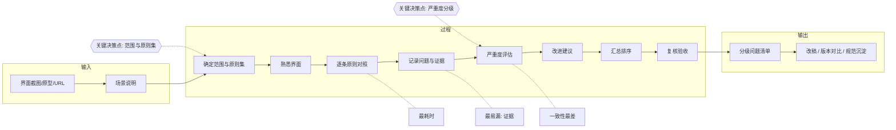
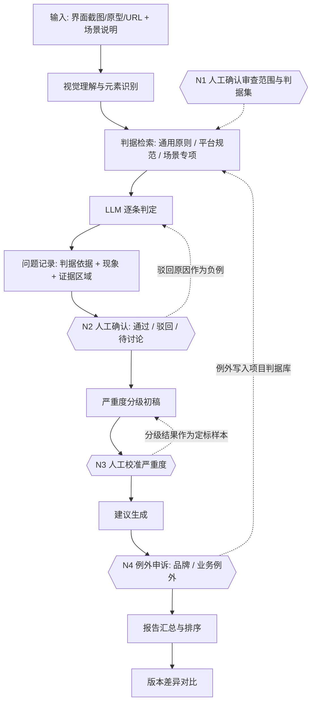

# 中期进展报告

《智能设计系统与管理策略》 ｜ 2026 秋季 ｜ 覆盖第 1–4 周

> 本文件为报告正文草稿。带【待补】的地方需要组内确认后填写。

---

## 第一部分 项目概览

### 1.1 小组信息

**成员与分工（4 人）**

| 成员 | 角色 | 负责范围 |
| --- | --- | --- |
| 【待补：姓名】 | 方法专家（组长） | 方法解构、判据库内容、人机分工设计、对外沟通 |
| 【待补：姓名】 | Vibe Coder（主） | 视觉理解与元素识别、模型接入、结构化输出 |
| 【待补：姓名】 | Vibe Coder（兼接口） | 判据检索、报告生成、API 封装 |
| 【待补：姓名】 | 测试与文档 | 测试方案与数据收集、文档撰写、演示材料 |

**分工轮换**：第 1–4 周按上表固定分工，未轮换。计划第 5 周起轮换：两位 Vibe Coder 互换模块（谁的代码谁负责讲清楚，避免出现只有一个人能维护的部分）；方法专家与测试互换一部分工作（方法专家负责测试数据收集，测试负责判据库整理），理由是判据库质量与测试结果互为验证，两个角色都需要熟悉对方的工作内容。轮换效果在第 8 周报告中说明。

**所选方法**：启发式评估（Heuristic Evaluation），课程方法池「原型与评估」类。

**项目仓库**：https://github.com/disordering/design-research-skill

### 1.2 项目定义

**一句话目标**：把启发式评估方法重构为一个 Skill——输入交互设计稿（截图 / 可交互原型 / 线上页面），输出按判据分级的问题清单，每条问题附界面证据、判据来源与修改建议。

**核心问题**：

1. 结论不可复现。同一份界面，不同评审者、不同轮次给出的问题集合与严重度差异明显，评审结果难以复用，也无法用于版本对比。
2. 遗漏。审查依赖记忆逐条对照原则，界面状态与边界情况（空、加载、错误、权限不足）最容易漏。
3. 现有工具解决了"更快"，没有解决"更可靠"。我们调研了 3 个同类商业产品与 4 个开源项目，它们能在几十秒内给出问题清单和评分，但结论普遍不引用判据，用户无法判断某条结论该不该信，也无法向他人解释。

这三点中，前两点适合由 AI 做初筛、人做判定；第三点决定了本项目的判据设计：**每条结论必须能指出它依据的是哪条原则或哪条规范**。

---

## 第二部分 方法解构与重构方案

### 2.1 方法的五要素拆解

#### 输入

| 项目 | 说明 |
| --- | --- |
| 数据类型 | 界面视觉与结构信息；可选附带使用场景说明 |
| 规模 | 单次 5–20 屏（一个流程或一个页面组） |
| 来源 | 设计执行者产出的设计稿；后续可对接 Figma 文件 |
| 格式 | 截图（PNG/JPG）、原型链接、线上页面 URL；场景说明为一段文字 |

输入描述是 Skill 设计的第一道边界，原因很直接：传统表述中的"界面"是模糊的。静态截图看不到交互过程与状态变化，可交互原型能看到点击流程，线上页面能看到真实数据和边界状态。Skill 只能检测它"看得见"的内容，如果输入没有写清楚哪些状态不在截图里，工具会把"没看到"当成"没问题"，产生假阴性。因此我们在输入环节要求：明确界面类型、明确覆盖的流程、明确本次不覆盖的状态。

#### 过程

启发式评估的完整步骤共 8 步。下表用「步骤 / 操作对象 / 操作方式」描述，并在备注中标注传统流程里容易被省略的中间动作。

| # | 步骤 | 操作对象 | 操作方式 | 备注 |
| --- | --- | --- | --- | --- |
| 1 | 确定审查范围与原则集 | 页面清单 + 使用场景 | 人工判断 | 常被跳过，但决定了后续结论的覆盖范围 |
| 2 | 熟悉界面与使用场景 | 界面 + 场景说明 | 通读、试用 | **易被省略**；实际影响"算不算违反原则"的判断 |
| 3 | 逐条原则对照检查 | 界面元素 × 原则 | 逐条核对 | 最耗时的一步 |
| 4 | 记录问题 | 问题条目 | 记录位置、现象、违反的原则 | **易被省略**：只写现象，不留证据（具体到元素或区域） |
| 5 | 严重度评估 | 问题条目 | 分级（高 / 中 / 低） | 依赖经验，一致性差 |
| 6 | 给出改进建议 | 问题条目 | 撰写建议 | **易被省略**：不检查建议的可执行性 |
| 7 | 汇总与排序 | 问题清单 | 汇总、按严重度排序 | — |
| 8 | 复核与验收 | 报告 | 交叉复核 | 决定最终交付质量 |

#### 输出

- 格式：结构化问题清单，每条包含「位置 / 现象 / 违反的原则 / 严重度 / 改进建议 / 证据」。
- 消费者：设计执行者（改稿）、项目决策者（排优先级）、团队其他角色（对齐）。
- 下游用途：版本迭代、改版前后的对比、设计规范沉淀。

#### 决策点

| 决策点 | 类型 | 出错后果 | AI 胜任可能性 |
| --- | --- | --- | --- |
| 审查范围与原则集的选择 | 方向性 | 高（漏审整类问题） | 低（依赖项目上下文） |
| "是否违反原则"的判定 | 解释性 | 中 | 中高（有明确判据时） |
| 严重度分级 | 评估性 | 中（影响改稿优先级） | 中（需要定标样本） |
| 品牌 / 业务例外判定 | 边界性 | 高（把刻意设计误判为问题） | 低（需要内部知识） |

两个关键决策点：

1. **审查范围与原则集的选择**。它决定了这次审查覆盖什么、不覆盖什么，是唯一无法交给 AI 的环节。
2. **严重度分级**。它直接决定人机分工：AI 可以产出初稿分级，但终审必须由人来做，否则改稿优先级会被系统性误导。

#### 痛点

| 痛点 | 类型 | 严重程度 | AI 重构价值 |
| --- | --- | --- | --- |
| 一次完整审查需 2–4 小时，多屏时更长 | 时间消耗 | 高 | 高（初筛可自动化） |
| 同时对照多条原则并保持全局一致 | 认知过载 | 中高 | 高（模型可并行对照） |
| 不同评审者、不同轮次的结论不一致 | 一致性 | 高 | 高（固定判据可提高一致性） |
| 状态与边界情况容易漏 | 遗漏风险 | 高 | 中高（元素识别可辅助枚举） |

#### 拆解后我们注意到的两点

第一，启发式评估的瓶颈不在"找不到问题"，而在**结论缺少依据、且不可复现**。我们最初的想法是"做一个更快的问题清单工具"，但同类产品已经在做这件事。真正没被解决的是：这条结论凭什么成立、换个人做会不会得到同样的结论。因此我们把设计重点放在判据来源与重复评审一致性上。

第二，被省略的三个中间动作（第 2 步熟悉界面、第 4 步记录证据、第 6 步检查建议可执行性）恰好是 AI 既能帮上忙又容易出问题的位置。模型可以稳定执行这些动作，但一旦省略证据，报告就失去可复核性——这也是我们在第三部分把"证据"写进输出契约的原因。

#### 五要素示意（Mermaid）

### 2.2 AI 能力映射

| 步骤 | 能力类别 | 推荐技术方案 | 可行性判断 |
| --- | --- | --- | --- |
| 熟悉界面 | 视觉处理 | 多模态视觉理解（Qwen-VL / GPT-4V / Claude Vision）；必要时加界面元素检测 | 高。截图即可使用；元素识别精度取决于模型，v1 允许粗粒度 |
| 逐条原则对照 | 知识推理 | 判据知识库（把 HIG、Material、WCAG 等规范整理为可检索语料）+ LLM 逐条判定 | 中高。上限由判据质量决定，不由模型决定 |
| 记录问题与证据 | 语言处理 + 视觉处理 | 结构化输出（JSON）+ 区域回填 | 中。v1 用"元素描述 + 截图区域标注"，不做像素级定位 |
| 严重度评估 | 知识推理 | LLM 按规则打分 + 人工定标 | 中。需要先建立 20–30 条定标样本 |
| 改进建议 | 创意生成 + 语言处理 | LLM 生成建议 + 规范约束（尺寸、对比度阈值等） | 高 |
| 汇总与排序 | 语言处理 | LLM 摘要 + 模板渲染 | 高 |
| 复核与验收 | 暂缺 | 需要人的经验判断 | 低 |

**暂时找不到合适 AI 技术的步骤**：复核验收、品牌与业务例外判定。这两处依赖项目内部知识和对"这个设计是否有意为之"的判断，目前没有可靠的技术方案。

**对 MVP 范围的影响**：MVP 只做「元素识别 → 判据对照 → 问题记录 → 建议生成 → 报告输出」这条主链，复核与例外判定保留人工，不纳入 MVP。这样 MVP 的三个验证条件（可运行、端到端、有意义）都能满足，不需要等到判据库完整。

### 2.3 Vibe Coding 初步实践

**第 2 周脚本的功能与运行结果**

脚本位置：`scripts/week2_feedback_analysis.py`。功能是读入若干条用户反馈，一次模型调用完成情感分类、关键句抽取与主题归类，输出 JSON 结果并打印主题汇总。

2026-10-15 实际运行：输入 20 条模拟用户反馈，模型 qwen-plus，一次调用完成，无重试，消耗 1316 tokens。结果如下。

| 类别 | 结果 |
| --- | --- |
| 情感分布 | 负面 13 条、正面 6 条、中性 1 条（负面占比 65%） |
| 主题聚类 | 得到 15 个主题，其中 11 个只包含 1 条反馈 |
| 条数最多的主题 | 界面设计 4 条（负面占比 0.50）、登录问题 2 条（负面占比 1.00）、数据同步 2 条 |

**最有效的一条提示词策略**

把输出契约写死，具体包括四点：指定 JSON 结构；把 sentiment 限定为三选一枚举；要求 key_phrase 必须是原文中的连续片段（不允许改写）；明确"同类问题必须使用完全相同的标签"。这四点写清后，模型返回的内容一次解析成功，没有出现格式返工。相比之下，第一版提示词只说"做情感分析和主题聚类"，返回的是带解释的自然语言段落，无法直接统计。

**最意外的 AI 行为**

模型把 20 条反馈切成了 15 个主题，其中 11 个是单条主题，粒度远细于预期。分析原因是：把"分类"和"聚类"放在同一次调用里做，模型倾向于给每条数据一个具体的标签，而不是合并成少数主题。这条经验直接影响第三部分的架构设计——聚类必须作为独立一步处理，并加入"合并相似主题"的回路，不能依赖模型在一次调用里自行完成抽象。

---

## 第三部分 Skill 架构设计

### 3.1 架构模式选择与理由

**选择：混合式（管道 + 交互）**。主链用管道串联，在出错代价高的环节插入交互确认。

用"AI 独立完成度 × 出错代价"对每一步打分：

| 步骤 | AI 独立完成度 | 出错代价 | 架构决策 |
| --- | --- | --- | --- |
| 元素识别 | 高 | 低 | 管道（自动） |
| 判据检索 | 高 | 低 | 管道（自动） |
| 逐条判定 | 中高 | 中 | 管道 + 人工抽检 |
| 严重度分级 | 中 | 高 | 交互（人工校准） |
| 建议生成 | 中高 | 中 | 交互（人工采纳） |
| 报告汇总 | 高 | 低 | 管道（自动） |

不能全部管道化的原因有两个。第一，严重度与"是否违反"的判定依赖项目上下文（例如某个"不一致"是刻意的品牌规则），AI 判错的代价高，会误导改稿优先级。第二，用户的驳回与校准本身就是提高后续准确率的数据；如果做成纯管道，这些信息无法被收集和利用。

**架构图（Mermaid）**

### 3.2 Human-in-the-Loop 设计

共设置 4 个人工介入节点。

| 节点 | 位置 | 交互模式 | 用户操作 | 修改如何反馈给 AI |
| --- | --- | --- | --- | --- |
| N1 范围确认 | 评审开始前 | 引导 | 勾选页面与流程、选择适用的判据集 | 决定判据检索范围与权重 |
| N2 问题确认 | 每条问题 | 审核 | 通过 / 驳回 / 标记待讨论 | 驳回原因作为负例，降低同类误报 |
| N3 严重度校准 | 问题清单 | 协作 | 调整分级（高 / 中 / 低） | 作为定标样本，用于后续自动分级 |
| N4 例外申诉 | 报告输出前 | 申诉 | 标记品牌规则或业务例外 | 写入项目判据库，同类问题后续不再报出 |

选择这四个位置而不是其他位置的理由：

1. **介入点少而精**。只在两类位置设点：出错代价高（严重度、例外）、AI 无法判断（范围与原则集）。逐条判定这类"AI 能做得不错、错了也容易发现"的环节只做抽检，不设强制确认，避免打断节奏。
2. **每次修改都有明确的回写路径**。四个节点的产出分别落到判据权重、负例库、定标样本和项目判据库，都参与后续计算，而不是只留在一份报告里。

### 3.3 评估框架

按课程的五维框架（准确性、一致性、可解释性、效率、体验）制定评估方案：

| 维度 | 量化指标 | 数据收集方式 | 计划样本量 |
| --- | --- | --- | --- |
| 准确性 | 问题召回率、误报率 | 请 3 位有项目经验的设计师对同一批界面独立评审，取并集作为参照 | 15–20 张界面稿 |
| 一致性 | 同一输入重复评审的问题集合一致率（Jaccard 相似度） | 同一批界面重复运行 3 次，两两比较 | 同上 |
| 可解释性 | 结论中给出判据或规范依据的比例 | 统计报告中字段完整率 | 全量报告 |
| 效率 | 单稿评审耗时（人工 / 工具） | 计时实验，同批稿子两种方式各做一次 | 10 张稿 × 2 组 |
| 体验 | 建议采纳率、SUS 问卷得分 | 5–8 位同学试用后填写，统计采纳条目数 | 5–8 人 |

**关于"信效度如何转化为对 AI Skill 的测试要求"**

设计研究中的信度指结果的可重复性，效度指结论与实际现象的对应关系。转化到本项目的测试要求是两句话：

- 信度 → 可重复。同一份输入重复评审，问题集合应基本一致；多位评审者使用工具时，结论之间的差异应可度量（用 Cohen's Kappa 计算一致性）。
- 效度 → 有外部标准。工具的判断必须与一个独立于工具的标准相关。我们采用的标准是真人短时识别实验：从评审结果中取"工具判定高风险"和"低风险"的界面各若干张，做 300ms 短时呈现测试，如果两组被试的识别正确率存在差异，说明工具的判定与实际使用表现相关；如果没有差异，说明工具的风险分级只是内部自洽，不能作为改稿依据。

### 3.4 Skill 设计文档 v1.0（核心决策摘录）

设计文档全文见附录 A，这里只列出三个影响最大的决策：

1. **判据分三层且可配置**：通用交互原则（跨端）、平台规范（HIG / Material / WCAG 等，按品类切换）、场景专项（由品类决定）。品类不写死在流程里，换判据库即可换品类。
2. **每条问题固定四段式**：判据依据 → 检测结果 → 现象描述 → 修改建议。缺任何一段，该条问题不允许进入报告。
3. **只设 4 个人工介入节点**，且每个节点都有数据回写路径（见 3.2）。

**原型的生成方式**：采用自然语言描述输入、输出与交互流程，由 AI 生成 Gradio 界面骨架，再手工调整布局与文案。【待补：原型截图与生成时的对话轮数】

---

## 待确认与待补清单（组内过一遍）

1. 成员姓名与角色对应（1.1 表格）。
2. 原型截图、生成方式的具体对话轮数（3.4）。
3. GitHub 仓库地址是否需要匿名处理。
4. 附录：同类产品与开源项目的调研结果（3 个商业产品、4 个开源项目，链接与截图已整理）需要并入附录。
5. 第四部分（MVP）与第五部分（Vibe Coding 经验总结）尚未撰写，需按同样格式补齐；2.3 的脚本运行结果可直接用于第四部分。
