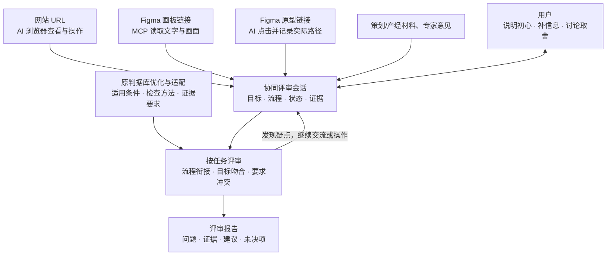

# 协同交互方案评审：一周开发计划

> 2026-10-28，本地讨论草案。只有一次开发周期；未实现、未分派、未提交。

## 任务

**用户给链接和设计目的，AI 自己读取或操作方案，通过多轮交流，检查流程、初心和跨职能要求，形成有证据的评审。** 复用现有单图 MVP，不要求用户先整理截图或手工评完方案。

## 架构草图

具体评审方法与编排由 A 先定，B/C 细化实现。

本质为不同应该场景下的评审方式。可以利用 AI 运行环境已有的 MCP、浏览器操作能力；但不能假定当前 Python 服务已经具备这些能力，接入与权限在需要实测。

## 任务与验收

| 负责人 / 任务 | 必须完成的工作 | 交付与完成标准 |
| --- | --- | --- |
| A1 原判据库修订 | 逐条检查现有 24 条判据，结合 D 已发现的问题修正适用条件、检查方法、报问题/弃权条件和去重边界，保留来源与编号关系 | 版本化判据库及逐条变更对照；说明保留、修改、拆分或停用的理由；已有单图能力仍有方法依据 |
| A2 新场景适配 | 为多页流程、同页状态、实际操作、目标吻合和跨职能要求定义评审方法；明确复用哪些旧判据、扩展哪些、新增哪些 | 每项方法有检查对象、所需上下文、证据、判定条件和正反例；区分静态可见、文档描述与操作验证；不把个案业务规则直接塞进通用判据 |
| A3 方法执行架构 | 定义三类入口到材料理解、任务规划、判据选择/执行、证据核验、综合判断、复审和报告的技术路径及 AI/程序分工 | 架构/流程图及步骤规格；每步输入输出、选择理由、失败处理明确；B/C 不必重设计如何利用判据做评审 |
| A4 评审交互与评价 | 定义何时提问、如何澄清/讨论、目标或材料变化后重查什么、如何结束；制定严重度、未决、冲突及效果评价口径 | 用户/AI 流程、会话状态/变更规则和验收标准；B/C 可实现，D 可测试；A 随开发和测试修订方法，不交库后退出 |
| B1 三类入口接入 | 实现网站浏览与操作、Figma MCP 读取、原型操作；保留文字/画面/节点和动作结果；处理访问、登录和工具异常 | 可运行接入代码及真实日志；不把打开链接当作已检查、不把静态图当操作；权限失败明确返回 |
| B2 方法与评审实现 | 按 A 的架构实现材料分块关联、任务/状态恢复、判据适用与执行、跨页/目标/要求核对、证据绑定与问题整理 | 引擎代码、输入输出契约和自动化测试；执行范围、判据版本、判断依据和未知项可追溯，覆盖上述评审能力 |
| B3 会话与复审实现 | 保存目标、事实、计划、发现和未决；处理补充/异议/范围变化；重查受影响部分，生成可恢复的报告版本 | 会话编排、存储与重评代码及回归；回复实际改变下游，旧证据不充当新版事实，漏报不自动等于解决 |
| C1 输入与运行交互 | 按 A 的流程实现链接/材料入口、任务沟通、阶段进度、访问异常和操作授权，并接真实引擎 | 可操作界面及联调记录；用户不先手工整理流程，知道 AI 正在读什么、做什么、等待什么 |
| C2 对话与证据交互 | 实现共享目标/范围、问答/异议/补材料、跨页证据定位、问题审核和严重度/冲突处理 | 对话与结构化结果联动；用户可看依据并表达取舍，变更调用 B 重评，不只改显示或增加聊天框 |
| C3 版本与交付交互 | 实现会话暂存/恢复、方案版本与逐问题复审、报告导出；保留模型判断、人工决定和未决项 | 真实浏览器全流程测试；刷新/恢复/导出一致，不丢上下文、不误标来源或解决状态 |
| D1 测试设计与执行 | 使用 Page 2 原始材料和网站测试环境，覆盖三种入口、方法适配、跨页/状态、目标/要求、多轮交流及异常；准备隔离的参考与期望 | 用例、测试脚本、原始输入/版本和结果；分别定位读取、判断、会话与界面故障，不把正常用户交流视为答案泄漏 |
| D2 效果与缺陷回归 | 测准确性、一致性、效率、健壮性和体验；复用旧单图回归；记录提问质量、范围变化、盲从、证据错误和恢复问题 | 分母与条件明确的结果表；缺陷有复现、期望、修复前后和回归；离线程序通过不等于 AI 效果通过 |
| D3 归档与统稿 | 统一代码/方法/判据版本、运行证据、数据包、使用文档、录屏与报告引用；各成员提供自己的主责内容 | 交付可复现且来源一致；密钥/权限检查通过；未完成和限制如实列出，不以材料数量代替验收 |

A 保留方法论责任，并新增架构与流程主责。B/C 校核模型、工具、接口和交互的可行性并细化实现；改变核心方法时与 A 对齐。D 的独立参考不进入 AI 输入，真实业务取舍由使用者决定。

## 排期

| 时间 | 本次开发周期内的安排 |
| --- | --- |
| 第 1 天 | A 给判据修订/适配清单、方法架构和交互流程的开发稿；B/C 实测三种入口并校核契约；D 据任务表建立测试覆盖。当天确认依赖、负责人和验收口径 |
| 第 2–5 天 | A 完善版本化判据与步骤/交互规格；B/C 并行完成各项实现；D 同步测入口、接口、完整会话和效果，缺陷当天回流 |
| 第 6 天 | 跑完整会话、修关键缺陷、回归；不再新增大功能 |
| 第 7 天 | 验收、归档、录屏与终期报告；确认定稿后才提交 |

## 本周验收

- A 的原判据修订、新场景适配、执行架构与交互规则均已进入对应实现和测试，不是只交文档。
- 网站、Figma 画板、Figma 原型的读取/操作、证据记录和异常处理均通过测试；网站由 D 选可访问测试环境，原型可用 Flex。
- 覆盖跨页衔接、状态切换、原始目标、跨职能要求与意见；用户补信息、改关注点或质疑后，AI 更新判断而非复述。
- 发现有原文、节点/画面或操作记录；区分设计描述、实际观察和未知，不编造未检查路径。
- 会话可保存、恢复、导出；D 同时测效果、交流成本与旧能力回归。源码、判据、测试材料和录屏对齐同一版本。

网站使用只读范围或测试账号；购买、发送、删除等实际副作用须另获确认。读取画板不改源稿；原型操作与修改 Figma 设计分开。缺访问权或关键材料时询问用户。

[Page 2 样本简表](E:/MyItem/design-research-skill/docs/2026-10-28-page2-sample-review-plan-draft.md)。这里只做规划，三种入口尚未在项目中实现或验收。
