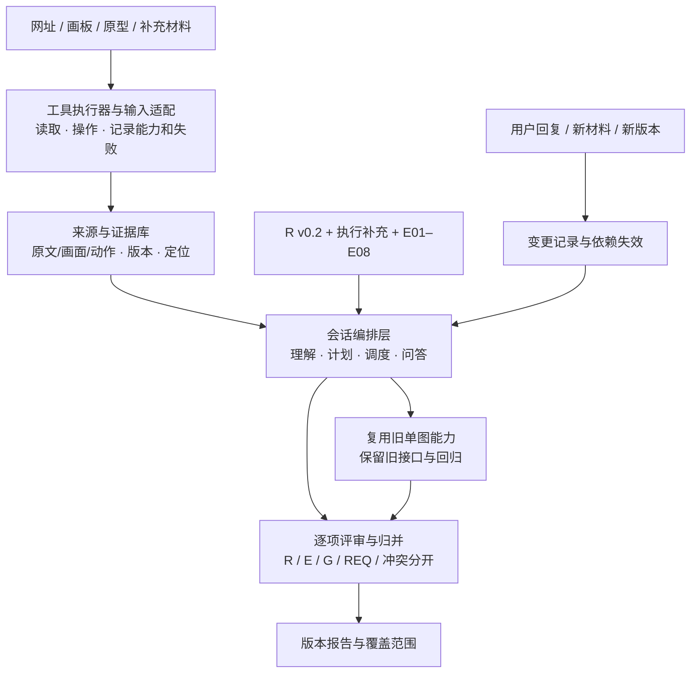

# A 初步验收与 B 实现计划

> 2026-11-01，Asia/Shanghai。本地讨论稿，未提交。
> 本轮已拉取 `bae849b -> 2407945`，2 个提交；未覆盖原有本地素材。只验收和规划，不改 A 原稿、判据或功能代码。

## 验收结论

**建议 A 的方法设计交付初步通过，可作为 B 开发基线；归档问题补正后冻结版本。** 这是可开发性与结构检查，不是新工具效果验收。

| README 要求 | 实际交付 | 判断 |
| --- | --- | --- |
| A1 原判据优化 | 24 条完整修订，编号/原则/标题保留；补上下文、正反例、边界；120 处字段变更 | 已覆盖，CSV 的旧/新值与两版 JSON 逐项一致 |
| A2 新场景适配 | E01–E08：路径、对象一致性、反馈、恢复、异常、条件、目标要求、职能冲突 | 已覆盖，与 R、G/REQ 分层，不冒充官方原判据 |
| A3 技术与执行架构 | 三类入口、T01–T10 步骤、输入输出、证据类型、失败处理、模型/程序分工及旧引擎衔接 | 足以开始 B 工程设计，不再只有判据库 |
| A4 会话、复审与评价 | 问答、变更、依赖失效、恢复、人工决定、严重度、评价与验收规格 | 已覆盖；实际代码、模型和用户效果仍待执行 |

本轮实际核对：JSON 结构、编号/引用、24 条执行补充、8 方法必填项、32 QA 规格均无结构问题。新版核心库通过**原 `CriteriaLibrary.load` 的隔离加载**；没有启动模型或服务。

### 需补正与注意

1. **[P2] 归档清单与仓库不完全对应。** [校验清单](E:/MyItem/design-research-skill/方法专家开发交付-v0.2/11-交付校验结果.json:239) 仍写 `00-阅读与开发交接.md`，实际已改名；内容哈希匹配。另有 6 个 `参考来源/` 快照未上传，[来源索引](E:/MyItem/design-research-skill/方法专家开发交付-v0.2/10-来源索引.json:4) 也指向它们。正文/JSON/CSV 的 12 项哈希匹配，根仓库的 6 项来源按 LF 规范化后匹配；这不是核心方法丢失，但包内来源路径不能独立复现。建议 A 更新清单并补快照，或改成准确的仓库路径与固定提交引用。
2. **用例是规格，不是可执行测试或通过成绩。** 32 项 QA 加前文 10 项 C 用例，需要 B/C/D 转成真实测试。A 的“42 项交付结构校验”不能当这些产品用例已通过。
3. **评估资源要与 D 确认。** A 提出的 54 次模型运行、6 位真人及试行阈值都明确是计划，不是成绩；需要受控网站/原型、隔离参考、预算与参与者。不因时间压力擅自改分母，也不把它们当 B 写代码前的前置。

环境说明：常规导入现有引擎因 bundled Python 缺少 `httpx` 失败；隔离加载只验证原判据/契约/错误模块。未重跑后端全套测试、未调用付费模型、未验证三类接入或真实用户效果。

## B 的实现方向

**在现有单图引擎外新增会话编排层，不把 E 方法和跨材料结果硬塞进旧接口。** 按 A 的方法执行，不重新发明评审流程。

### 推荐工程方案

- **服务与状态**：继续 Python/FastAPI/Pydantic；会话、事件、检查结果用 SQLite 事务保存，原始响应与证据文件放 `out/sessions/`。不是把整段聊天继续塞进 2000 字 `scenario`。
- **模型编排**：复用现有模型客户端、解析与结构修复，新增理解/规划/执行/判断的结构化调用；模型提议动作，程序检查权限、参数和状态后执行。
- **实际工具**：网站/原型优先采用成熟浏览器执行能力（可由 Playwright 提供）；画板使用官方 Figma MCP 客户端。宿主已有工具可复用，但必须有真实可调用的执行桥。当前聊天能用 MCP 不等于 Python 服务能用，首先验证连接、授权及执行模式。
- **不可静默降级**：缺工具或权限时明确 blocked/failed；静态材料可以另作有限审查，不算网站/原型操作验收成功。未授权副作用不执行，点击超时先核对是否生效再决定重试。

以上是 B 的工程建议，不是已实现能力。模型/依赖/工具连接方式在接入验证后选定；影响方法的变更与 A 对齐。

## B 工作清单与实现顺序

这是同一次开发中的依赖顺序，不重开一个一周周期；接入验证、契约与 C/D 对齐可并行。

| 工作 | 具体实现与文件边界（建议） | 完成标准 / A 用例 |
| --- | --- | --- |
| 运行环境与三类工具验证 | 补齐项目开发依赖；验证浏览器网站、Figma 画板 MCP、原型操作；输出 capability 清单和限制 | 真读/真操作日志与前后证据；失败分类、授权边界；C02–C04/C08，QA12–QA17 |
| 方法资产加载与旧能力适配 | 复用 `engine/criteria.py`；新增 `engine/methods.py` 读取核心库、执行补充和 E 方法；版本/引用校验；明确选择新版，不覆盖根目录原库 | 执行补充进入提示与判断流程；全 R 适用性检查，排序不等于通过；QA01–QA11、QA27；旧回归仍可跑 |
| 新会话与证据契约 | 新增 `engine/session_contracts.py`、`engine/evidence_store.py`；定义 Session/Run、Source/Evidence、PageState/Transition、CheckItem、Finding/Conflict、ChangeEvent、ReportVersion | 多位置/跨文件证据、空 decision、R/E/G 分层；版本与定位可验，缺证据不伪造；QA18–QA19/QA28–QA29 |
| 工具执行与计划调度 | 新增 `engine/adapters/`；每步返回材料/动作/执行结果，不直接判好坏；会话服务调度 A 的 T01–T10 | 分块/跨页对象不丢来源；工具失败不判产品错误；未知不装作已操作；资源限制形成 partial |
| 方法执行与报告 | 在 `engine/session_service.py` 编排理解、判据适用、R/E/G 检查、证据核验、去重、严重度和覆盖；静态子任务调用旧引擎 | 每个 check 有执行状态与独立判断；E07 用目标三状态、E08 单独 conflict；未执行不计通过；QA27–QA32 |
| 会话事件与复审 | 结构化保存事实/目标/材料/范围/审核/授权等事件；依赖失效、保守扩大重查、旧新 run 分离、恢复和幂等 | 事件重复不重复执行；旧结果 stale 不覆盖；新问题不继承旧确认；无新版证据不自动解决；QA20–QA26 |
| 新接口与联调 | 在 `engine/api.py` 加 session 创建、读取快照/增量进度、提交事件接口；保留旧 `/api/review-audit`；与 C 定契约并给 D 受控用例 | 长任务不依赖一次 180 秒请求；能暂停/继续/导出；真实会话和接口回归通过 |

**建议先写新契约与方法加载，再写会话服务骨架；同时验证真实工具。** 不先改 UI，也不等用户逐条人工确认材料后才运行。

### 和 C/D 先对齐的接口

建议以 3 类接口起步，具体字段共同确认：

- `POST /api/review-sessions`：入口、目的、材料与操作限制，返回 session/run 标识及状态。
- `GET /api/review-sessions/{id}`：任务、能力、阶段、待答/授权项、检查范围、证据、发现、当前报告和事件序号；支持按序号取更新。
- `POST /api/review-sessions/{id}/events`：用户回复、补材料、改目标/范围、审核、授权、取消/继续或新版复审；携带事件 ID 与预期上下文版本。

新事件立即确认接收，实际重查由后台调度；不因接收成功就说重查完成。恢复 running 项时重新核对外部状态，不能盲用旧坐标。

开始编码前确定：`execution_status` 与 `decision` 分离；范围排除单列 `scope_status`；E08 冲突状态/业务裁决与实现符合性分开；人工身份、等级、风险接受和复审分别保存。旧单图 F001 不是跨会话稳定 ID，新层使用独立 ID 并保留旧报告映射。

## 这次先不做的事

不覆盖 A 文件、不直接把 root 判据库换成 v0.2、不重写旧单图 API、不修改 C 界面、不运行付费评估、不把 A 的公开 QA 期望作为正式模型输入。不提交本计划或更新 README 的完成状态。

A 的主故事仍是明确标为假设的角色试用扩展，不能当成已有完整测试环境；实际任务和权限按已有材料及受控环境建立。评估完整性由 D 的真实结果决定，不靠 B 自评代替。
