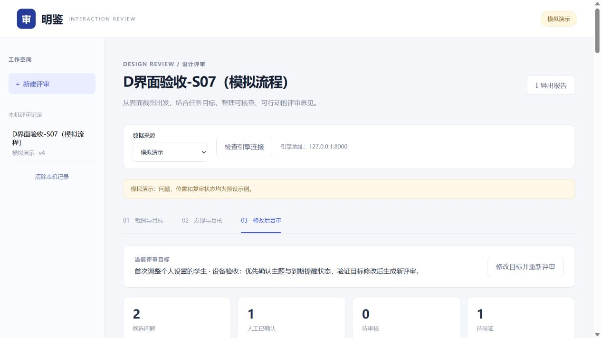

# C 前端浏览器操作验收

已在 `9780c03` 版本的本地前端完成 S07 模拟流程验收，形成 v1—v4 四份导出。**11 项保存与字段核对通过**，刷新后从侧栏打开 v4，目标、审核状态、严重度、理由及逐问题复审记录均恢复。

| 操作 | 实际结果 | 文件 |
|---|---|---|
| 上传 S07，填写用户与任务，开始模拟评审 | 生成 v1，页面标明模拟演示 | [v1 导出](D-发布索引.md#f402) |
| 确认字段示例、驳回主操作示例，严重度由高调低 | 确认、驳回、原等级、新等级和审核理由进入导出 | [v1 导出](D-发布索引.md#f402) |
| 提交反馈并重评 | 生成 v2；原审核选择与理由保留；操作记录包含反馈原文 | [v2 导出](D-发布索引.md#f403) |
| 修改任务并重新评审 | 生成 v3；新的任务进入目标摘要及导出 | [v3 导出](D-发布索引.md#f404) |
| 将同一 S07 作为复审输入 | 生成 v4，展示逐问题复审表单 | [v4 导出](D-发布索引.md#f405) |
| 选择关联、填写理由和新版观察、保存人工结论 | 已保存“无法判断／人工已确认”，关联 issue-02，原话进入导出 | [v4 导出](D-发布索引.md#f405) |
| 刷新页面并重新打开记录 | v4 及人工记录完整恢复 | [页面状态](D-发布索引.md#f399) |

这次执行验证前端操作与数据保存。四轮使用模拟服务和同一张 S07；开发样本的 Codex 视觉评审单独统计。模拟服务沿用同一记录 ID，版本号依次增加；四个版本已分别导出归档。

## 下一次前端对齐

1. 修改任务后，模拟任务摘要更新，问题描述保留初次任务文案。演示说明按当前模拟行为写入。
2. v4 同时导出预设复审标签与人工逐问题结论。下一次修订以人工确认结论统一卡片与导出显示。
3. 模拟导出的“本轮上下文”和“版本对照”为默认文本；本轮反馈与版本事件保存在操作记录。真实引擎模式接续核对这些字段。

## 验收证据

[机器核对与文件哈希](D-发布索引.md#f400) · [C 代码及自动化测试验收](D-C前端交付验收.md)

