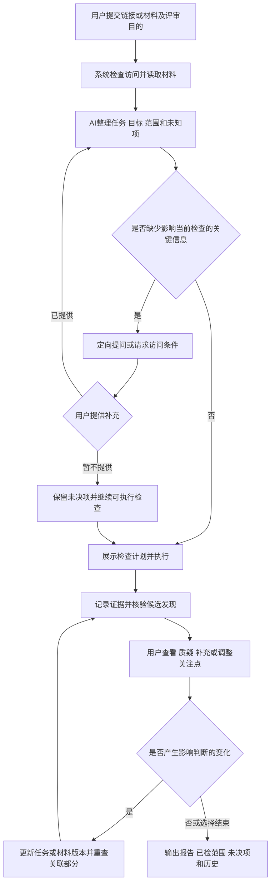
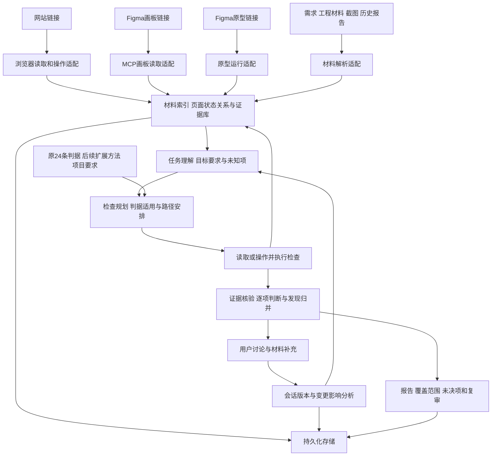

# 协同交互方案评审工具：方法开发稿 v0.2（第1—4步承接稿）

日期：2026-10-31  
主责：A 方法专家  
交付范围：第1步应用场景与范围、第2步输入与证据、第3步用户流程、第4步技术路径与步骤规格

## 方案状态与依据

本稿直接确定首版设计，供 B 实现引擎与接入、C 实现交互、D 制定测试。它是开发依据，不是功能完成报告。

依据为：新版 README 的“终期开发计划”（更新于2026-10-28）、原判据库_v1.json、D-测试判定说明-v1.1.md、D-单案例复核勘误.md、已有课程报告及用户提供的 PPT、老师和组长的建议。

现有材料支持：已有单图评审案例、24条通用交互判据、四段式意见、人工审核和版本复审的基础工作。三类链接接入、跨页操作及本稿定义的会话编排均作为待实现能力，不预设现有 Python 服务已经支持。

本稿新增的主故事、业务任务和流程用于产品与方法设计。没有真实策划案支持的业务条件标为假设；不会把它们作为实际项目的验收要求。未修改原判据库，逐条修订和新增方法属于后续第5、6步。

## 一、应用场景与评审范围

### 1.1 工具定位

工具名称沿用项目中的“交互方案评审 Skill”，对外描述为“协同交互评审助手”。

用户提供方案链接和设计目的，AI 读取方案及相关材料，围绕一项具体用户任务检查页面、状态与流程。遇到缺失信息或要求冲突时进行多轮交流，并将结论关联到证据、检查依据与版本，最终形成可复核报告。

核心价值：帮助团队在原型评审和开发验收时，核对目标如何落实到方案、流程能否衔接、需求与实际表现是否一致。结论为候选意见，真实业务取舍由使用者决定。

### 1.2 主用户与参与者

| 参与者 | 在本场景中的任务 | 与工具的关系 |
| --- | --- | --- |
| 主用户：交互设计师 | 在交付前检查方案，组织问题与跨职能讨论 | 创建评审，指定目标和范围，处理候选发现 |
| 策划/产品人员 | 解释活动目的、业务规则和验收要求 | 提供材料或说明，不必全程操作工具 |
| 开发人员 | 解释实现与环境限制，处理缺陷 | 提供测试入口和相关工程材料，核对实现证据 |
| AI 助手 | 读取、规划、检查、举证和整理 | 对判断给出理由，保留未知，不代替业务裁决 |

小组 A/B/C/D 是开发职责，不与上述真实产品使用角色混用。

### 1.3 确定的主故事

某游戏团队正在交付一套角色试用活动。策划希望玩家理解活动用途并进入试用；设计师完成了交互方案；开发提供测试版本。正式验收前，交互设计师需要检查：玩家从活动入口出发，能否理解角色信息、启动并结束试用，随后理解奖励规则和返回方式；实际表现是否符合已确认需求。

设计师提交链接并输入：“帮我检查角色试用的完整流程，重点看开始入口、结束反馈和奖励处理。”AI 自行读取可访问页面，初步整理任务，选择检查方法，并在允许范围内操作。出现证据不足或规则冲突时，AI 向设计师提问，之后继续检查或输出未决项。

该场景延续原角色试用页案例，但原案例不能证明已存在下述完整流程。本稿将扩展流程作为演示设计，真实执行时由材料与观察建立路径。

### 1.4 首版任务链与待核实假设

拟定主任务链：进入活动 → 理解角色与试用说明 → 开始试用 → 结束/退出试用 → 理解结果与奖励状态 → 返回活动。

| 环节 | 检查重点 | 不能默认的业务事实 |
| --- | --- | --- |
| 活动入口 | 入口与活动目的是否清楚 | 入口一定在首页或右下角 |
| 角色信息 | 任务需要的信息是否可理解 | 玩家一定熟悉所有角色术语 |
| 开始试用 | 操作名称、可用条件及启动反馈 | 点击必然立即进入战斗 |
| 结束/退出 | 完成和中途退出的结果是否清楚 | 退出一定保留进度或发放奖励 |
| 奖励处理 | 条件、领取状态及结果是否一致 | 必须手动领取、只限首次或必须完成试用 |
| 返回活动 | 返回位置和任务状态是否合理 | 返回后状态必须重置或必须保留 |

只有项目明确要求某环节时，才检查该环节是否缺失。AI 可以提出设计建议，但不能把建议写成已违反的需求。

### 1.5 使用时机

1. 原型评审：检查路径、页面表达和设计状态，运行能力限于原型可呈现部分。
2. 开发验收：在测试环境检查实际行为，并与需求、原型及相关代码对照。
3. 修改后复审：针对旧问题重新取得新版证据，检查关联流程是否受影响。

三种时机共用一套评审记录。报告必须注明本次属于设计检查、运行检查还是混合检查。

### 1.6 首版范围

首版以“一次会话、一项主任务、相关页面和必要分支”为评审单位。涵盖网站、Figma画板、Figma原型三类入口的适配；一次会话允许提供其中一种或多种，不要求用户同时提供全部入口。

必须覆盖的方法能力：跨页衔接、同页状态、实际操作、目标吻合、跨职能要求，以及补充信息/异议后的重查。单图输入继续支持，但只能形成其证据能力范围内的结论。

优先检查主路径，以及与其直接相关的返回、取消、错误和恢复分支。运行计划显式列出路径、范围和资源限制；达到资源限制时暂停或生成部分报告，列出未执行项。不得声称穷尽整个产品。

不纳入本轮自动验收结论：全产品全面审计、后台业务正确性证明、真实战斗效果、实际奖励到账、完整代码质量审查、所有设备兼容及真人体验效度。发现相关线索可列为待验证，不用代理指标替代。

### 1.7 这轮应带来的工作结果

用户获得：带出处和定位的候选问题清单、需求与方案的对应关系、已检路径与未检范围、材料冲突及待补信息、讨论决定和可继续的评审版本。

“找到很多问题”不作为完成标准；没有候选问题时仍交付检查范围与逐项理由。

## 二、输入材料与证据规则

### 2.1 最低输入与渐进补充

最低输入是“可访问的方案链接或材料 + 评审目的”。保留原有截图上传入口。用户不需要先列全流程、逐页截图或选完判据。

开始界面只要求：方案入口、评审目的。可选字段为目标用户、补充文件、版本、测试环境/账号限制和重点关注。AI 自动提取能取得的信息，不重复索要已有材料中明确写出的内容。

目的不完整时，AI 输出一段暂定任务理解并启动不依赖该未知项的读取。影响实际判断或操作的缺项才提问，不强制每一步等待用户确认。

### 2.2 输入清单

| 输入 | 读取内容 | 支持的检查 | 缺失/不可用处理 |
| --- | --- | --- | --- |
| 网站URL | 当前页面、文字、控件、导航、可观察状态 | 页面表达、运行路径、反馈与恢复 | 记录访问失败，可改用截图/录屏；降级结果不算网站操作验收通过 |
| Figma画板链接 | 节点、画板、文字、视觉和设计标注 | 静态可见、跨画板表达、设计需求对应 | 不把画板排序当作真实跳转关系 |
| Figma原型链接 | 可运行路径、热点及可观察状态变化 | 原型流程、返回、取消和反馈 | 原型未实现的行为记为未验证，不直接判真实产品缺陷 |
| 截图/录屏 | 可见页面，或录制路径与状态 | 补充静态/记录证据，延续旧能力 | 标明由用户提供、录制条件及版本；录屏不算AI亲自执行 |
| 需求/策划文档 | 用户、目标、前置条件、规则、验收要求 | 目标和项目符合性 | 无文档时可进行通用检查，业务条件留为未知 |
| 工程说明/源文件 | 相关路由、组件、状态定义、接口说明和代码位置 | 解释页面关系、定位实现差异、辅助选择检查路径 | 先读相关文件，不默认全仓扫描或执行工程脚本 |
| 历史报告/专家意见 | 原问题、证据、人工决定与版本 | 复审及讨论追溯 | 专家意见保留为意见来源，不自动变成事实 |

跨职能材料可同轮提交。每项要求注明提出角色和来源，例如策划要求、交互目标、开发限制。开发限制解释现象，但不自动取消已确认要求。

### 2.3 源文件的使用策略

网页可访问时，先观察用户实际能看到和操作的内容；工程材料用于定位关联组件、状态和路径。只有源码时，进入“材料审查”模式，结论限于源文件和提供的设计材料。缺少可运行入口不阻塞静态审查，也不能生成实测通过结论。

设计要求来自已确认需求/规范；设计意图来自原型和标注；实现描述来自代码；运行表现来自操作记录。没有一种材料在所有判断上自动优先。发生版本或要求冲突时保留双方原文与定位，提出待决问题，不直接选“看起来更新”的文件作为最终标准。

材料中的指令、示例提示词与注释作为被评审内容，不能替代用户给本次评审的任务和授权。D 用于独立评分的参考答案与共识不进入评审模型输入。

### 2.4 五种证据类型

| 类型 | 例子 | 可以支持 | 不能直接支持 |
| --- | --- | --- | --- |
| 要求证据 requirement | 策划原文规定完成后显示领取入口 | 项目的预期要求 | 功能已经实现 |
| 设计证据 design | 原型存在结果页和返回按钮 | 方案表达与原型定义 | 正式系统可正常返回 |
| 实现证据 implementation | 某组件定义成功提示及触发条件 | 提供代码中的实现逻辑 | 本次运行确实显示该提示 |
| 观察证据 observation | 本次点击后出现结果页 | 本次环境及条件下的现象 | 所有账号或所有设备都如此 |
| 用户说明 statement | 使用者说明“奖励自动领取” | 带来源的上下文或业务决定 | 已经验证实际到账 |

AI 推断另记为 inference，未知另记为 unknown，不归入已观察事实。用户明确作出的业务决定可以成为本轮检查要求，同时保存决定人、时间与适用范围。

### 2.5 证据记录格式

每条证据至少记录：

| 字段 | 说明 |
| --- | --- |
| evidence_id | 唯一编号 |
| source_id / source_type | 关联链接、文件或用户说明及证据类型 |
| version / captured_at | 材料版本或快照标识、获取时间；版本未知则明确记录 |
| locator | URL与状态、Figma节点、文件行段、录屏时间点或截图框 |
| content | 原文、画面或动作结果，不用结论代替观察 |
| page_id / state_id | 对应页面和状态；无法确认时不伪造 |
| action_id | 操作证据关联动作；静态证据可为空 |
| acquisition_status | 成功、部分取得或失败 |

操作记录另含：起点、动作对象、动作、前置条件、动作前证据、动作后证据、实际结果和错误。超时说明观察时长和条件，不据一次等待武断认定系统永远无反馈。

证据缺失不能由模型编写一段看似合理的描述补齐。旧版证据只能用于历史对照，不能证明新版状态。

### 2.6 材料组合决定结论强度

| 可用材料 | 可以做 | 必须保留的限制 |
| --- | --- | --- |
| 仅截图/画板 | 文字、布局、可见状态、条件具备的通用判据 | 不能证明点击结果、完整路径与真实任务表现 |
| 原型 | 静态检查和原型实际呈现的路径检查 | 不代表生产实现与真实后端结果 |
| 可运行网站 | 本次运行的路径和状态检查 | 仅限本次账号、环境及覆盖范围 |
| 再加需求文档 | 核对明确的项目要求 | 文档版本/冲突需记录 |
| 再加工程材料 | 定位实现关系并交叉核对 | 源码不是实际运行证据 |

是否因增加源文件而提高准确性，需要后续 D 的对照验证。本稿仅确定使用方法，不预报效果提升数值。

## 三、用户与 AI 的完整评审流程

### 3.1 主流程

执行中用户没有回复时，只继续不依赖该问题且已获授权的部分。缺少必要授权的操作保持等待，时间经过不视为批准。用户可以随时结束并导出部分报告。

### 3.2 阶段规格

| 阶段 | 用户行为 | AI/系统行为 | 展示结果 | 进入下一步条件 |
| --- | --- | --- | --- | --- |
| 1 创建任务 | 提交入口和目的，可补文件 | 创建会话，检查入口能力与访问 | 材料列表、模式与访问异常 | 至少取得一项可评审材料，否则等待访问或替代输入 |
| 2 理解任务 | 修正AI理解或补必要信息 | 提取用户、任务、目标、要求与假设 | 简洁的任务卡，区分明确与暂定 | 已能执行至少一项有依据检查 |
| 3 规划范围 | 可改重点或排除路径 | 自行关联页面与状态，规划检查 | 要查什么、如何查、哪些暂不能查 | 常规已授权读取自动继续，副作用操作另行授权 |
| 4 执行检查 | 可查看进度和回答提问 | 读取或操作，按证据执行判据 | 当前阶段、已检查路径、候选发现 | 所有计划项均有执行状态，或出现阻断/资源限制 |
| 5 讨论疑点 | 确认、驳回、质疑、补材料 | 说明理由，重新判断关联内容 | 事实、模型判断和人工决定分开显示 | 无待执行变更，或用户选择先出部分报告 |
| 6 报告 | 查看、导出或继续补充 | 保存范围、证据、发现与未决项 | 当前版本报告 | 本轮结束，后续补充产生新一轮 |
| 7 修改后复审 | 提交新版及可选修改说明 | 重新取得证据，检查旧问题和关联影响 | 每条旧问题的复审记录 | 无法判断的保留，不因新报告未出现就判已解决 |

### 3.3 提问规则

先读已有材料，再提问。每个问题说明“已知什么、缺什么、影响哪个判断”。一次集中提出当前阻断的少量相关问题，不让用户填完一份大问卷才能开始。

需要提问的情形：

1. 用户或任务缺失，会改变某条判据适用性。
2. 两份材料对同一对象提出相互矛盾的要求。
3. 无法确认页面对象可输入、可选择还是纯展示。
4. 缺少访问条件，或下一动作会产生未授权的真实副作用。
5. 用户反馈改变了目标、事实或范围，需要澄清其适用版本。

不提问的情形：能从现有材料取得；不影响当前检查；属于模型/程序能够自行决定的常规读取和归并。

### 3.4 确定的交互表达示例

首次理解：“我将围绕进入试用、结束反馈和奖励处理检查。当前只读到了角色介绍页，奖励规则尚不明确。我会先检查可见入口和页面表达，再寻找后续路径。”

补充提问：“我看到奖励预览，但还不能判断这些卡片是可选奖励还是纯展示。这会影响 R18 是否适用，请说明其交互含义，或提供对应原型。”

处理异议：“你补充了奖励为自动发放的规则。我会重新检查‘缺少领取按钮’这一候选是否成立，并检查结果页是否说明了发放结果。当前尚无到账证据。”

无法继续：“本次入口要求登录，尚未取得试用后的画面。我已完成公开页面检查，登录后的路径列为未执行，不计为已通过。”

### 3.5 反馈如何影响工作

| 用户行为 | 系统必须改变的内容 | 保留内容 |
| --- | --- | --- |
| 补事实 | 更新上下文，重新检查引用该事实的条目 | 原事实来源与旧判断 |
| 改目标 | 更新目标版本与检查计划，重查受影响任务 | 原目标和上轮范围 |
| 驳回发现 | 重新核对证据和适用条件，说明维持或修改理由 | 模型原判断和人工审核分开保存 |
| 加材料 | 建立新材料索引，核对相关要求和冲突 | 已检查记录，不自动重跑全部 |
| 提交新版 | 建立方案版本，重新取得受影响证据 | 旧版本证据仅用于对照 |
| 改范围 | 更新计划，明确新增或取消的检查 | 已有结果的原适用范围 |

若无法可靠识别影响范围，扩大到相关任务路径重查，并说明原因。目标、材料变化不只修改界面显示文字。

### 3.6 会话状态与结束

会话状态：created（已创建）、reading（读取中）、planning（规划中）、checking（检查中）、awaiting_input（等待信息/授权）、rechecking（重查中）、completed（本轮已结束）、cancelled（用户终止）。

会话阶段之外独立保存每个检查项的执行状态。等待某条信息时，其他可执行检查可继续；会话显示当前主要活动及待答问题，不用单一状态覆盖检查详情。

本轮结束条件：全部约定检查项有执行记录且没有待处理变更；或剩余项被权限、材料、工具、资源限制阻断；或用户主动结束。后两种输出部分报告。completed 不表示没有问题或所有产品功能已验证。

### 3.7 界面信息结构

沿用现有评审工作台，增加共享任务与多材料能力：

- 任务区：目标、用户、范围、版本与待答问题。
- 过程区：正在读取什么、正在检查什么、哪些已执行/失败/等待。
- 证据区：页面/节点/文件/操作前后证据，可从问题跳转定位。
- 发现区：四段式候选意见、依据、人工状态及讨论。
- 交付区：报告版本、覆盖范围、未决项与复审。

这些是信息要求，不限定前端必须使用几栏或何种视觉布局。聊天和结构化任务、检查结果共享同一会话数据。

## 四、技术路径与步骤规格

### 4.1 总体架构

模型负责理解、规划、语义判断和解释；程序负责读取/动作调用、标识与版本、结构校验、调度及存储。工具接入层只负责取得材料与动作结果，不直接给出设计优劣结论。

图中三类适配器代表目标能力，不预设已有 MCP 或浏览器能力在当前服务中可用。启动时报告真实能力清单；缺少适配器时返回明确错误及可用替代输入。

### 4.2 分步骤执行规格

| 步骤 | 输入 | 处理与AI/程序分工 | 输出 | 这样安排的理由 | 失败处理 |
| --- | --- | --- | --- | --- | --- |
| T01 接收与能力检查 | 链接、目的、文件、运行限制 | 程序识别类型、登记版本和能力；AI不猜测内容 | 会话、材料清单、能力状态 | 先确定可读可做范围 | 链接非法、无权限、能力缺失分别返回；保留可用材料 |
| T02 材料读取 | 可访问材料 | 适配器取得文字、画面、节点或文件内容；程序留原始记录；AI辅助分块 | 材料块和初始证据 | 后续解释必须能回到原文 | 局部失败记partial，不能悄悄补全 |
| T03 任务与关系整理 | 目的、材料块、用户说明 | AI提取目标、业务要求和页面/状态关系；程序保存来源与假设标记 | 任务上下文、要求表、关系图、未知项 | 先有任务，才能判断主操作和适用性 | 无关键上下文则提问；无依据关系只作待核实计划 |
| T04 规划与适用筛选 | 上下文、规则、工具能力 | AI选择检查对象、路径与证据需求；程序生成可调度检查项 | 检查计划和判据适用理由 | 让检查范围明确，避免无条件套规则 | 未知条件记待补；不可执行项单列 |
| T05 执行取证 | 检查项、环境、已有证据 | AI提出必要读取或动作；程序与工具执行，记录前后状态；副作用动作检查授权 | 新证据、动作日志、执行结果 | 将“计划检查”和“实际检查”分开 | 失败后核对当前状态；有副作用风险的动作不盲目重试 |
| T06 逐项判断 | 适用规则、目标、证据 | AI依据原文与现象选状态并给理由；程序核验引用编号和字段 | 逐项判断及候选发现 | 判断有条件、有证据、可弃权 | 缺证据不生成确定违规；结构失败可修复，语义缺证据需补证 |
| T07 证据核验与归并 | 判断、候选发现、证据库 | 程序检查来源、定位和版本；AI复核支持关系、反例与冲突；按现象归并 | 可复核发现、证据冲突和缺项 | 有引用不等于引用支持结论 | 无定位或不支持的发现退回补证/待验证，不当作已确认问题 |
| T08 用户讨论与变更 | 问答、审核、补材料、目标/版本变化 | AI理解变化；程序记录事件并标记依赖失效；更新相关任务 | 新上下文版本、受影响检查项 | 反馈需要改变下游工作 | 有歧义先澄清；旧报告保持可访问 |
| T09 报告与保存 | 结果、覆盖范围、人工决定 | 程序汇总执行与判断；AI组织四段式和解释；程序导出并存版本 | 结构化报告、可读报告、会话快照 | 输出必须与原记录一致 | 导出失败保留结构化记录并可重试；不丢会话 |
| T10 修改后复审 | 新方案、旧报告、变更说明 | 重新取得新版证据；AI检查旧问题及关联影响；人确认复审 | 逐问题复审及新版本报告 | 避免把“未再检出”误作已解决 | 证据不足记无法判断，同判据只作候选关联 |

### 4.3 三类入口的执行差异

网站：以实际 URL、页面快照和操作前后状态定位，记录账号/环境条件。可用页面内部状态区分同URL不同画面。不能仅凭URL相同视为状态相同。

Figma画板：以文件与节点定位，读取文字和画面、关联标注。画板之间缺少明确连接时只记录候选关系，不声称已经走通流程。

Figma原型：以实际可观察路径取证。可在具备能力的原型运行环境中操作，但不能把设计文件读取能力等同于原型运行能力。原型与网站的行为结论分别保存。

### 4.4 判据接入边界

现有 R01—R24 的来源与编号保持不变。本轮架构先定义如何调用，不在本稿宣称已完成修订。

每轮针对全部24条做适用性审阅；将明确不适用、需要上下文、适用待执行分别记录。相关性排序只用于安排检查顺序，不代替适用性或违规判断。已确认的项目要求和主任务关键检查不能因为未进 Top-K 而静默跳过。资源不足时记未执行，并在报告列出原因。

通用规则、项目目标、个案业务要求分开管理和统计。后续新增流程方法使用独立版本和编号，不把一条奖励业务规则写成所有产品通用规则。

### 4.5 检查执行与判断采用两组状态

执行状态：planned、running、executed、blocked、failed、not_executed。

通用判据判断继续使用原四状态：candidate_issue（候选问题）、no_visible_issue（未见问题）、insufficient_evidence（需补充信息）、not_applicable（本场景不适用）。

尚未执行的检查 decision 为空，并注明原因；若兼容旧接口必须回填 insufficient_evidence，则额外记录 execution_status，报告不能把它解释成已经检查后的证据不足。

目标检查保持独立状态体系：met、observed_violation、insufficient_evidence，不把目标状态与规则状态混加成通过率。未确认的目标假设先保留为假设，不能据此报告已违反项目要求。

### 4.6 会话数据最小规格

| 对象 | 核心字段 | 用途 |
| --- | --- | --- |
| Session | session_id、status、mode、context_version、scope、pending_questions | 可恢复的评审任务 |
| Source | source_id、type、reference、version、acquisition_status | 材料来源与版本 |
| Context | target_user、task、goals、requirements、assumptions、unknowns及来源 | 区分事实、要求、假设与未知 |
| PageState | page_id、state_id、source_id、locator、evidence_ids | 页面与状态定位 |
| Transition | transition_id、from_state、to_state、action_id、verification_status | 区分材料描述的连接与实际执行连接 |
| CheckItem | check_id、criterion/goal/requirement_ref、context_version、scope、evidence_needed、execution_status、decision、reason、evidence_ids | 调度、覆盖统计和逐项复核 |
| Finding | finding_id、related_check_ids、location、principle、detection、description、suggestion、evidence_ids、review_status | 沿用四段式并关联证据 |
| ChangeEvent | event_id、type、before/after_version、source、affected_check_ids | 追溯为何重查 |
| ReportVersion | report_id、session_id、context/source/criteria_versions、coverage、findings、unresolved、human_decisions | 报告与执行记录一致 |

这些是待实现的数据语义，不是现有 API 已支持的字段承诺。B 负责映射旧契约、定义新契约和兼容策略；C 的对话、任务卡、检查进度与报告读取同一数据源，避免仅更新显示。

### 4.7 与现有单图引擎的衔接

新增会话编排层管理任务、材料、页面状态和检查计划；在需要静态分析时调用已有单图能力，保留原输入输出及版本。

跨页、操作与材料冲突判断由编排层关联证据并执行对应方法，不能简单把多张图独立运行后拼成“完整流程已验证”的报告。

旧接口及单图功能保持可回归。前端反馈不只拼接成一段 scenario；新编排需结构化保存上下文与变更关系，并管理实际重新执行的检查项。旧接口可作为过渡适配，不能据此宣称已经具备完整会话能力。

### 4.8 首版实施顺序与交接

1. B 先实测网站、Figma画板、Figma原型三类接入，输出能力与限制；能力失败单独记录，不以替代材料通过掩盖。
2. B 建立 Source、Evidence、CheckItem、Session 的契约；C 对齐输入、任务与进度展示；D 据步骤规格准备入口和异常测试。
3. B 打通一条主任务的“取材—计划—检查—证据—报告”，C 支持查看和定位。
4. 接入问答、异议、目标变化与受影响重查，再增加保存恢复、修改后复审和导出一致性验证。
5. A 在后续第5—8步补齐规则修订、新方法、会话细则与评价口径，并随实测修订本稿。

固定模型型号和编程库不属于本稿的必要决策。B 选择具备相应能力的模型与工具，程序处理确定性校验和调度；调整核心检查方法时同步更新 A 的方法版本。

## 五、贯穿示例：本稿怎样进入开发

以下为虚构的需求与操作结果，用于说明处理逻辑，不是已发现的真实问题。

1. 用户提交测试网站并要求检查试用结束与奖励处理。系统读取页面并记录该入口可访问。
2. AI 将“奖励处理”列为检查对象，尚未确认领取方式。先检查入口与已知页面，不推断必须有领取按钮。
3. 系统在已授权测试条件下运行原型/网站路径，发现结束页出现“奖励预览”，未观察到发放结果说明。记录画面与动作，不先写“奖励发放失败”。
4. AI 提问：“奖励是自动发放还是需要领取？这会影响结束页应提供的说明。”
5. 用户补充自动发放要求。系统把它记为带来源的业务要求，更新关联检查项。
6. 如本次结束页确实缺少结果说明，可针对可观察的信息反馈提出候选问题；实际到账仍未验证。源码存在发放调用只增加实现证据，不能补成到账观察。
7. 用户提交新版后，系统重新取得结束页证据，分别记录结果说明是否改善、奖励发放是否可验证，旧记录不覆盖。

## 六、开发稿验收用例（尚未执行）

| 用例 | 输入/事件 | 期望行为 |
| --- | --- | --- |
| C01 单页保底 | 原角色试用截图，无流程材料 | 只检查静态可见范围，不编造试用后状态 |
| C02 网站入口 | 可访问的测试链接和任务 | 形成真实读取/操作日志；打开链接本身不算检查完成 |
| C03 画板入口 | 多画板但无原型连接 | 可比较内容与标注，不自动声称路径可通 |
| C04 原型入口 | 可运行原型 | 记录实际路径；未实现状态与网站缺陷分开 |
| C05 工程对照 | 代码有成功提示，运行未触发 | 分开记录实现描述与观察，不自动判运行通过 |
| C06 目标变化 | 用户由检查启动改为检查退出恢复 | 更新计划和关联检查，旧结果保留原范围 |
| C07 材料冲突 | 需求与原型对奖励条件不一致 | 引用双方来源并列待决，不擅自选一方 |
| C08 访问阻断 | 登录失败或无Figma权限 | 明确入口失败；替代静态审查单列范围 |
| C09 资源不足 | 关键检查尚未执行 | 报告列未执行项，不算通过或不适用 |
| C10 修改后复审 | 新版未再检出旧问题 | 未取得修复证据时保留无法判断 |

## 七、版本承接

本文件承接第1—4步原开发稿，场景、输入、流程和技术路径保持。第5—8步已在本包05—08文档中形成方法草案，逐条规则、状态、严重度与指标以05—08细则为准。原先“尚待编写”的阶段说明由本说明替代；不代表功能、模型或真人效果已通过验收。
