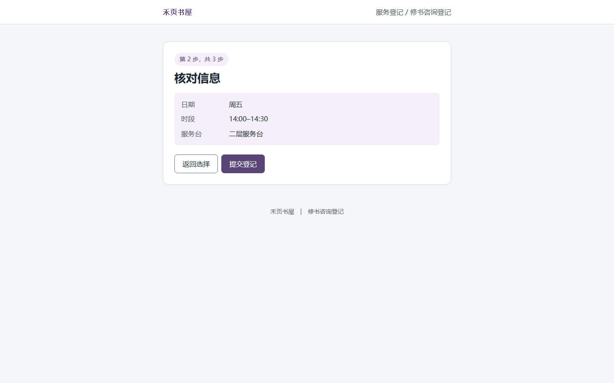
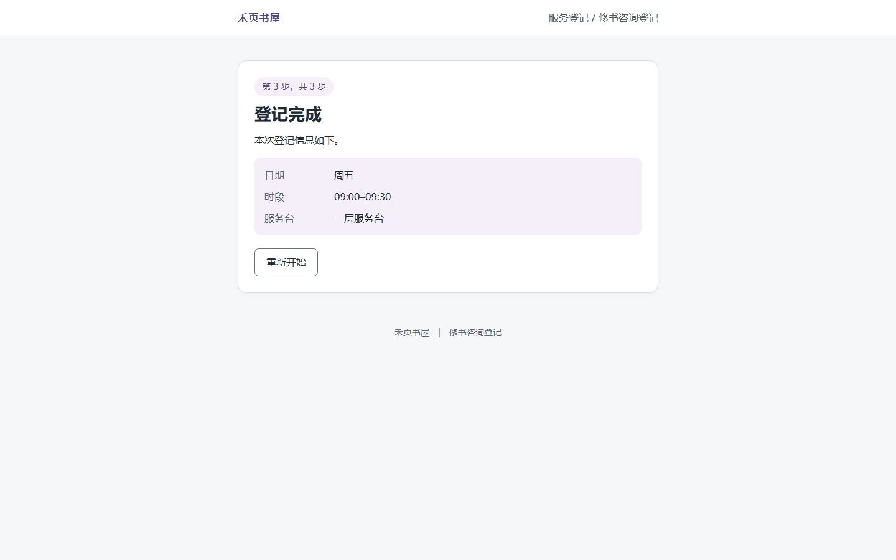

# H05 原生操作后的 D 复核

结论：**回执错配成立，判高严重度。** 复核者为 Codex，来源为 AI。

REQ3 要求完成页显示最终确认的时段和服务台。原生引擎实际执行“提交登记”前，核对页显示 **14:00–14:30、二层服务台**；动作执行成功并取得的完成页显示 **09:00–09:30、一层服务台**。两项核心结果与已确认值不同，下午二层的任务没有得到相符回执。

建议完成页按当前选项生成回执，再分别复测上午、下午路径。这个等级依据已看到的错误回执，影响范围为本机演示页面。

| 核对页 | 完成页 |
| --- | --- |
|  |  |

[复核记录](复核.json) 保存原始证据编号、时间、提交动作编号与图片指纹。该记录属于 D 的独立 AI 复核，原引擎报告及其发现计数保持原样。
