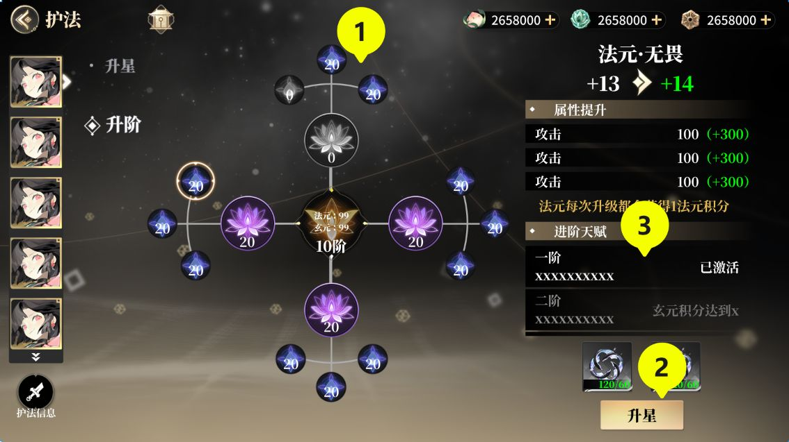
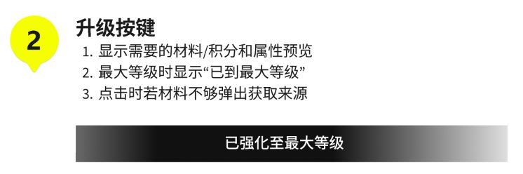

# D 案例复核表

2026-11-04 本地复核。护法和吴山石的 14 条引擎记录中，6 条确认、1 条部分成立、4 条驳回、2 条在本轮 AI 测试中未复现、1 条并入已有问题。对应 7 项设计修改。两条原先待补证的意见已完成 AI 续测，原型和新画板另列。[续测证据与六次原始回答](D-续测证据/案例/走查结论.md)

| 对象 | 复核记录 | 接下来怎么用 |
| --- | --- | --- |
| 护法 | 本页 HF-001 与[其余五项首轮记录](D-护法其余五项复核.md) | 改节点升级按钮，补碎片数单位。HF-006 在升星页的三次独立 AI 首选均落在右下主按钮。 |
| 吴山石 | [WS-001–008，含跨项候选 F001](D-吴山石案例复核.md) | 先改选中对象与详情、批量选择与数量反馈。F001 归入 WS-002，只验收一次。 |
| Flex | [FX-001，两轮空表单退出和清单页对照](D-Flex退出复核.md) | 补上新增表单的取消和返回连线。 |
| CHOPS | [五个连续操作画面及原型链接](D-复核证据/CHOPS/操作记录.json) | 商店首页点 Shop Now，选择方式弹窗能打开并用右上 × 关闭。前后节点相同，需看截图区分状态。 |

| 编号 | 案例与位置 | 引擎原判 | D 复核结论 | 建议修改 | 复测状态 |
| --- | --- | --- | --- | --- | --- |
| D-HF-001 | 护法养成 → 升阶 → 选择法元节点 → 右下主按钮 | 高 | **确认按钮命名错误；严重度调为中** | 将此状态的“升星”改为“升级节点” | 原稿已核对，修改后复测 |
| D-HF-006 | 护法养成 → 已选升星 → 第一次选择提交位置 | 中 | **AI 看图三次，均选中正确按钮** | 保留现行布局 | 三次报出的坐标均在右下按钮内。线上执行效果另验。[原回答](D-续测证据/案例/走查结论.md) |
| D-WS-007 | 吴山石包裹 → 识别选中道具等级 | 中 | **AI 在三种图宽都读出 1 级** | 保留文字及当前级别展示 | 1194、844、667 像素宽度均从绿色主标题读对。目标设备上的阅读体验单列。[原回答](D-续测证据/案例/走查结论.md) |

**新增 Figma 开发走查。** 报名成功示例使用两位数手机号，车机抽屉首项保留灰色「APP」占位。Flex 两次从空表单保存均跳向预置器材清单。CHOPS 可选配送地址，自提日历点 24 日与 PM 后仍显示 23 日与 AM。[四个任务、截图与验收建议](D-续测证据/案例/走查结论.md#四个-figma-任务)

## D-HF-001｜节点升级按钮写成了“升星”

**复核日期：** 2026-11-04　**复核方式：** D 部分，Codex 对照 Figma 静态原稿与策划条款。  
**对应引擎记录：** 2026-11-02 护法评审，画面 EV07（Slide 16:9 - 37），对象 E12（选中页签）、E33（主按钮），关联判据 R06、R12。[引擎原判与对象定位](../deliverables/2026-11-02-hufa-review/report-showcase.md#L346)

| 核对点 | 从材料中读到什么 | 对判断的作用 |
| --- | --- | --- |
| [组内 Figma 原图：数据集 → 交互稿 → Slide 16:9 - 37](https://www.figma.com/design/j9Z5Y839AREXf0OPysbbJ7/?node-id=2118-11712) | 左侧“升阶”带白色菱形，“升星”呈暗色。中间是节点树，右侧显示法元节点的“+13 → +14”和属性预览。标号 ② 所指的金色按钮写着“升星”。 | 在玩家准备升级选中节点的位置，按钮给出了另一项养成操作的名称。 |
| 同一 Figma 画板，编号 ② 的设计说明 | 设计者将 ② 命名为“升级按钮”，并写明此处显示所需材料或积分、属性预览及满级状态。 | 通过同一编号，可以直接确认按钮的设计用途。 |
| [策划 §3.2.2.3「节点升级」](examples/hufa-plan-text.md#L153) | 法元是小节点；升级小节点获得 1 点法元积分。区域 6 明确写为“节点升级按钮”。 | 按钮应说清本次动作：“升级节点”。 |
| [策划 §2.2.1「升级、进阶逻辑」](examples/hufa-plan-text.md#L38) 与 [§2.2.2.1「升星逻辑」](examples/hufa-plan-text.md#L42) | 玄元积分达到条件后，护法自动进阶；升星则消耗护法自身的胚子碎片。 | “升阶”是页签名称，“升星”是另一项业务动作。直接把按钮改成“升阶”也会让人以为需要手动进阶。 |

**为什么判中：** 玩家正要确认一次养成操作。预览承诺提升节点等级，主按钮却承诺提升星级，两处给出不同结果，直接影响点击前的判断。节点名称、等级变化和同板说明能帮助辨认设计意图。按[项目严重度标准](../方法专家开发交付-v0.2/08-问题表达严重度与评价验收.md#L37)，本次证据支持“明显增加理解成本”。画面记录止于点击前，没有显示错误扣料、实际升错对象，或节点升级被阻断，因此不维持高等级。

**两批交叉核对：** 相同 T07 材料在六个独立 Codex 会话中都报出命名错配。第一批分级为中、中、高；第二批为中、中、中。六次均未观察到误扣材料或执行了错误动作，D 维持中等级。另在真正的升星页做的三次首选测试对应 HF-006，单独统计。[第一批逐条映射](D-续测证据/批次/结果比较/逐条映射.json) · [第二批原意见与等级](D-三项修复证据/同批54次/候选对照/逐条映射.json)

**修改后怎么验：** 在“升阶”页签选中法元节点，核对按钮显示“升级节点”，并与右侧等级预览一致；切到“升星”页签，核对其主操作仍写“升星”。拿到可操作版本后，记录点击前后的节点等级、星级和材料数量。若复现错误执行升星、错误扣料造成严重结果，或节点升级无法完成且没有合理替代，再按高等级复核。

**原图留存（本地截取）**

