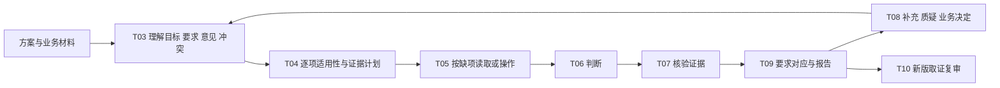

# B 会话评审后端：运行与联调

> 按 A 的 v0.2 方法实现。旧单图接口保留；本页描述新后端，不代表 C 界面已接入或工具效果已验收。

## 启动

```powershell
python -m venv .venv
.\.venv\Scripts\python.exe -m pip install -r requirements-session.txt
.\.venv\Scripts\python.exe -m playwright install chromium
.\.venv\Scripts\python.exe -m engine session-capabilities
.\.venv\Scripts\python.exe -m engine serve --port 8000
```

API 文档：<http://127.0.0.1:8000/docs>。数据与原始响应存于 `out/sessions/`，默认不入 Git。

### 上一轮验证记录（2026-11-01）

- `python -m pytest -q`：**150 项通过**，包括原有 64 项与新增 86 项。新模型测试夹具只证明契约/控制流程，不证明准确率。
- 受控浏览器测试启动了真实 Chromium，取得非空画面、输入状态、点击结果，并拒绝过期状态和危险动作。公开网站已成功取得文字与截图。
- 使用真实 `qwen3.8-flash` 完成合成材料的理解和 8 项判断，未使用 stub；剩余 25 项保留未执行，报告为 partial。一次较早探测因 180 秒限制超时，记录保留；降低长思考开销后再次完成。不是正式效果成绩。
- 千问/DeepSeek 的模型列表接口均返回 200。简单颜色/JSON 探测中，千问识别正确，DeepSeek 返回 unknown；不据此排名，也不把 DeepSeek 视为已验证视觉模型。
- Figma 官方桌面 MCP 已在 `http://127.0.0.1:3845/mcp` 连通。实际读到 `skill / Page 2` 的节点目录，并取得 Flex 区块 `173:1100` 的文字、链接和截图；未调用模型或修改设计。Page 2 的完整元数据超过 43 万字符，目录读取标为 partial，具体区块通过 `inspect_node` 继续读取，不导出整页大图。
- Figma 现场读取受桌面 MCP 的“当前激活标签页”限制。后端现支持用 `figma_snapshot_id` 回放同一 MCP 取得的元数据和逐节点截图；快照路径与文件键写入证据，现场读取失败不会被悄悄替换成旧证据。
- Flex 已经由真实千问模型自主执行 `Dashboard → Wishlist → Add Item`，保存动作前后截图与实际状态变化；不是人工指定坐标的唯一证据。一次长运行完成 31 项判断、1 项未可靠完成，报告为 partial。返回/取消未验收：人工复核发现模型曾把 Save 附近误当 Cancel，虽回到列表且呈现预设数据，也不能说取消成功。原记录保留，不当正式成果或修复成绩。
- 为上述问题新增点击前定位核对：程序在原图上标出拟点击点，再由模型核对实际控件。真实模型已在存档截图中正确拒绝“想点 Cancel、实际落到 Save 附近”的坐标，此探测没有执行任何 UI 动作。
- 最新带定位核对的真实运行再次走到 `Dashboard → Wishlist → Add Item`，拦住一次落在状态栏而非返回箭头的提案；完成 12 项判断，其余 20 项因本次限额未执行。取消和返回点击仍未观察到可靠退出，动态“任务死路”候选被程序退回补证；报告为 partial，不宣称取消成功或原型存在确定缺陷。记录为 `out/session-probes/session-75203d31f162448eaa84eab183e911ea/`。整体稳定性与准确性仍需 D 独立验收，不据几次不同条件的运行给模型排名。
- `/healthz` 与会话 capability 接口均返回 200，响应未暴露 Key。C 界面尚未接入；正式多任务、真人和本地模型效果尚未验证。

### 本轮增量（2026-11-02）

上一轮重点是接入和操作取证，本轮推进多材料、目标/要求核对及讨论后的实际重查；不宣称完整产品已验收。



| 本轮能力 | 实现与边界 |
| --- | --- |
| 文档接入 T02 | PDF/DOCX/文本/Markdown/HTML；原文件、解析全文、带位置的分块分开保存；8 MB、100 页、15 万字符及会话分块限额。扫描 PDF 缺文字时明确需 OCR，不补造内容 |
| 材料理解 T03 | 正式 G/REQ 保留逐字引用；评审委托、专家意见或实现描述不能单独成为正式要求；材料关系与实测跳转分开 |
| 检查计划 T04 | 32 条 R/E 加项目目标/要求均登记适用性、对象和缺项；每批 8 项；未见相关对象不等于不适用；G/REQ 优先，限额保留未执行项 |
| 判断与核验 T06/T07 | 计划所需证据未满足时不能判通过/违规；要求文字不能证明实现；正式要求冲突未决时不擅自选择一方；核验中断不能输出未核验违规 |
| 讨论与重查 T08 | 新材料/回复更新上下文；`resolve_conflict` 保存决定者、理由、采纳/排除声明；按原文与来源版本限定排除范围，不把决定当修复 |
| 报告与复审 T09/T10 | 报告包列 T01–T10 输入输出、目标/要求对应、检查计划、判断与证据定位、模型原始响应、方法文件与哈希；保留历史版本；同文档 URL 新版会重新获取，不使用旧缓存证明新版 |

合成夹具回归证明契约和控制流程，真实模型联调只证明当前输入下的执行记录；两者都不是 D 的准确率或真人效果成绩。用户样本关联的 Medium 说明文档读取返回 403，未绕过权限，未据此编造 Flex 的原设计目的。

本轮验证：

- 全仓 `python -m pytest -q`：**183 项通过**；`compileall` 通过。增加原文/权威边界、正式冲突、决定后的要求排除、计划完整性、材料总限额、同 URL 新版读取、文件上传/API 展示、核验中断、真实 Figma 局部画面、方法哈希校验、评审委托不得冒充专家意见、会话视觉指标/叠加图和近义问答归并等回归。
- 真实 `qwen3.8-max-0902` 在合成四材料输入上完成 T03、逐项计划、34 项判断、发现核验和报告。REQ1 与方案标注的静态矛盾为设计不符合；G1 的真实用户理解仍为证据不足；专家建议分歧保持 open，不代用户作业务决定。没有操作实际原型，不代表 Flex 产品效果。
- 较早运行因 420 秒限额止于计划，部分报告保留；恢复会话后完成判断。随后使用新程序的绑定校验生成报告 v3，未新增模型调用或伪造人工审核。模型曾接受“材料未给传达细节就是设计缺陷”的候选，程序因 G1 证据不足、不能借整体 E07 支撑而退回补证；原候选保留于程序拒绝记录和历史报告。
- 记录：`out/context-probes/session-c6e3f61127074218a57acfcd276bc986/`。最新 `report-v3.md` 与 `probe.json` 不入 Git；报告的 complete 只表示本次登记项均执行过，不表示结论全正确或产品完整验收。历史超时 warning 保留，不代表恢复后的运行再次超时。
- 最新后端已重启，`/healthz`、capabilities 与 OpenAPI 均为 200；新字段在 schema 中可见。

接续重点：

- B：加强跨批次的候选与业务问题归并。真实联调仍有同一矛盾被不同检查重复提出、近义问题重复询问；现有精确键去重不等于语义归并，不能仅凭同名自动合并不同对象的问题。
- C：接共享理解、检查计划、证据模式、业务决定和版本报告。后端完成不等于工作台界面完成。
- D：用真实多页面任务及业务材料做独立工具测试，重点查适用性、误报、补充后的判断变化与新版复审。联调样本不能替代真实效果评价。

### Figma 多界面真实材料（2026-11-02）

已用 Figma `Page 2` 中的“吴山石回收”材料做真实接入：

- `173:7593 / 策划案` 以 `product_spec` 输入；
- `173:7654 / 交互案` 以 `design` 输入；
- 根画板保留可见/隐藏文本节点、节点 ID、层级和画面索引；
- 交互案自动展开 6 张屏幕图，长流程总图不再只交给模型一张缩略图；
- 局部画面只作为 T05/T06 证据，不触发 T03 重抽取；恢复运行时不重复读取已成功画板。

本次会话的完整记录和已知限制见 [`wushanshi-figma-integration.md`](wushanshi-figma-integration.md)。千问权限恢复后补齐了 45 项判断，识别出一条排序规则与界面布局不一致的候选发现；近义问题从 21 条归并为 10 条。报告仍明确区分静态设计结论与运行待验证项。

## 本地配置

`config/reviewer.toml` 已被 Git 忽略，API Key 只保存在该文件。公开模板 `config/reviewer.example.toml` 不含密钥。

| 配置 | 用途 |
| --- | --- |
| `sessions.method_root` | A 的核心判据、执行补充和 E 方法目录，不覆盖原判据库 |
| `sessions.storage_dir` | SQLite、原始响应、截图与报告版本 |
| `providers.qwen` / `providers.deepseek` | 云端模型；创建会话时可选 `provider` 和 `model_name` |
| `providers.local` | Ollama/LM Studio 的 OpenAI-compatible 视觉模型；未部署时保持 disabled，不暗中转云端 |
| `tools.figma_mcp` | 后端独立的 MCP 地址与授权 |
| `tools.browser.allow_local_network` | 明确获准的本机/内网测试入口；默认关闭 |

DeepSeek 暂按纯文本配置，未接收画面时必须保留视觉证据限制；支持视觉的型号需先验证再配置 `vision=true`。本地候选为 Qwen3-VL-8B 的量化版本，目前没有安装本地推理服务或模型，不冒充已部署。

已核对当前机器：RTX 5070 12GB、Ryzen 9 9900X、约 64GB RAM。与原有 5070 Ti/16GB 的计划配置不同。仓库中的 D 报告只记录“Codex 会话”，未记录具体底层型号；C 联调使用 stub，不据此认定同事模型更好。

## Figma 接入

### 桌面本地 MCP（本机已连通）

在 Figma 桌面端打开目标设计文件，按 `Ctrl+K` 搜索 `MCP`，勾选 `Enable desktop MCP server`。当前版本也可从左上角 Figma 菜单的 `Actions...` 打开搜索；右侧 `Clients → Codex` 只是客户端记录，不是本地服务开关。

本地配置已切换为以下设置，无需再登录、提供密码或复制 Codex 凭据：

```toml
[tools.figma_mcp]
enabled = true
url = "http://127.0.0.1:3845/mcp"
bearer_token = ""
```

桌面工具只接受节点 ID，不接受 `fileKey`。必须保持目标文件在 Figma 桌面端打开；它不能凭任意文件链接切换文件，也不能独立验证当前文件身份。证据记录 `file_scope=active_desktop_document`、`requested_file_key` 和 `file_identity_verified=false`，不把请求的文件 Key 冒充为服务端验证结果。远程和桌面工具参数按实际 schema 传递。

实际能力探测可执行：

```powershell
.\.venv\Scripts\python.exe scripts/probe_review_sessions.py --kind figma_board --url "https://www.figma.com/design/dAWQ1dG8pOh5RBHa3CFZ7t/skill?node-id=173-1100"
```

探测证据保存在 `out/session-probes/`，不入 Git。安装过 Figma 不等于本地端点已启动；关闭服务后应明确报告连接受限，不回退假数据。读取画板不改源稿，运行原型使用独立浏览器上下文，不进入设计编辑器。

### 远程 MCP（当前后端未获准接入）

Figma 官方远程地址为 `https://mcp.figma.com/mcp`。本机的独立后端客户端注册返回 403；官方文档说明远程服务有客户端准入限制，不能保证执行一行登录命令就能获准。Codex 自己的连接不能直接继承，也不应复制其 OAuth 凭据。

只有客户端已获准接入远程服务时，才使用 `python -m engine figma-login` 开始独立 OAuth。回调端口为 8766，取得的凭据保存在 `out/credentials/figma-oauth.dat`，Windows 下以当前用户 DPAPI 加密。当前实际运行走桌面本地服务。

## C 可调用的接口

| 接口 | 作用 |
| --- | --- |
| `GET /api/review-sessions/capabilities` | 方法、工具与模型配置状态；installed/configured 不等于 verified |
| `POST /api/review-sessions` | 创建会话；`auto_run=true` 开始后台处理，可能产生模型费用 |
| `GET /api/review-sessions/{id}` | 当前共享目标、材料、证据、状态/路径、检查、发现与未决 |
| `GET /api/review-sessions/{id}/updates?after_sequence=...` | 增量轮询；无变化不返回重复快照 |
| `POST /api/review-sessions/{id}/events` | 回复、改变目标/范围、补材料、审核、授权、取消/继续或新版复审 |
| `GET /api/review-sessions/{id}/reports/{version}` | 不可覆盖的历史报告 |
| `GET /api/review-sessions/{id}/export` | 默认导出人审 Markdown；`format=summary` 为摘要，`format=audit` 为完整逐步审计 |
| `GET /api/review-sessions/{id}/structured-report` | 返回完整结构化报告；含逐阶段、逐检查、证据链、模型调用和原始响应引用 |
| `GET /api/review-sessions/{id}/package` | 下载可移动的 ZIP 报告包；含 Markdown、JSON、阶段文件、方法原文和证据附件 |
| `GET /api/review-sessions/{id}/artifacts/{artifact_id}` | 读取本会话的截图/响应，不允许任意路径或跨会话文件 |

输入支持 `website`、`figma_board`、`figma_prototype`、`document` 和 Base64 `image`。文档可通过 `content`、HTTP(S) `reference` 或 `document_base64` + `filename` 提供；上传原件可从本会话 artifact 接口下载。长文档自动有界分块读取，AI 可使用 `inspect_document` 继续读取；画板可用 `inspect_node` 阅读已发现节点。

材料可标注 `role`：`design_brief`、`product_spec`、`design`、`implementation`、`expert_opinion`，以及 `declared_by`。这是用户声明的材料角色，不自动验证其权威性。不标注也可输入；缺少业务要求时仍能做证据允许的通用检查，不把评审委托当原始设计目的。

### 输入与过程字段

- `purpose` 是这次评审委托；`design_purpose` 可选，专门记录使用者提供的原始设计目的。也可由需求/方案材料提取业务目标，不要求用户先写判据表。只有评审委托依据的 G/REQ 不可作为正式项目约束。
- `allow_interaction=true` 允许任务内普通交互；危险动作仍需单独批准。`auto_run=false` 仅创建，`true` 才后台运行并可能产生模型费用。[Flex 请求示例](examples/flex-review-session.json)默认不会自动调用模型。
- `Action.outcome` 分开记录 `state_changed`、`no_observed_change`、`read`、`observation_incomplete`。executed 只表示动作执行，不表示任务达成。实际状态变化才进入 `transitions`；无效果点击不画成走通路径。
- 坐标相对模型实际看到的截图，按 `image_geometry.region` 映射回浏览器。Figma 外壳不进入产品画面/控件；只裁掉完全同色背景，不丢可见内容。scroll 以 `scroll_x/scroll_y` 表示有界像素量，正值向右/下。
- 坐标提案须依据本次实际传给模型的最新图片，并提供 `target_label`。`target_marker_artifact_id` 为预执行定位标记，`observed_target` 是模型核对结果；两者不伪装成已执行证据或真实热点配置。目标不符则阻断并重新规划，不能盲点。
- `Question.kind` 区分 `context/access/authorization/tool_recovery`。访问恢复由程序关联来源结案；技术恢复问题不能阻断等待人给坐标。自然回复可由 AI 通过 `question_resolutions` 引用真实证据更新业务问题，标记 `answer_actor=program`，不冒充人工确认；授权只能由明确事件决定。
- 规划检查实际执行已有条目的优先级；资源限额不静默删规则。上下文/目标变化仍按保守影响范围重查。格式、状态编号或定位参数无效允许一次有依据的纠错；规划不可靠时停止自动操作，仍可对现有证据做有限检查，报告保留 partial。
- 完整 MCP 原文存为 `Evidence.raw_artifact_id`，供复核下载；模型只接收有界片段/索引，并能继续读取已发现的兄弟节点。版本或入口变化会清掉旧节点授权范围。

事件包含 `event_id`、`expected_context_version`、`type`、`payload` 和 `actor`。重复事件不重复执行，过期版本返回 409；接收事件成功不表示重查已经完成。人工确认、改级和风险决定保留理由和身份。

新增 `material_understanding`、`conflict_dispositions`、`active_phase` 和 `review_mode` 供 C 展示共享理解、业务决定、T01–T10 当前阶段及实际证据模式；`review_mode` 按有效证据标为 `materials/design/runtime/mixed`，不表示全部已检查。设计标注与要求不符可以报告设计不符合，不能写成实测失败；实际表现和真实用户理解仍需观察证据。`CheckItem` 中的 `applicability/plan_reason/object_refs/evidence_needed/required_evidence_kinds` 是计划，不是已执行结果。`constraint_refs` 可关联 OP，但 OP 只作为讨论背景，不生成要求检查或进入目标统计。

`resolve_conflict` 的 payload 包括 `conflict_id`、`decision`、`reason`、`accepted_claim_ids`、`rejected_claim_ids`；必须提供明确 `actor`。决定可以解除材料冲突，实际方案是否符合仍需重新检查。

当前依赖影响不保证精确，变更会保守重查当前任务范围；历史模型判断与人工决定保留，新发现不继承旧确认。动态复审需要新版相关证据，新报告没再出现问题不能自动判修复。

CLI 的 `session-create` 不调用模型；`session-run` 才实际执行。`session-event --run` 在事件后继续处理，`session-status` 与 `session-export` 查看或导出。

完整报告包使用：

```powershell
.\.venv\Scripts\python.exe -m engine session-export <session_id> --package --zip
```

包内至少包含 `report-showcase.md`（人审）、`report-summary.md`（一页摘要）、`report-details.md`（完整逐步审计）、`report.json`、`process.json`、`checks.json`、`evidence.json`、`findings.json`、`stages/T01.json`–`T10.json`、`method/`、`raw/`、`artifacts/` 和 `SHA256SUMS.txt`。人审版使用中文状态和 `EV01` 证据别名；完整证据 ID、模型原文和全部 45 项检查保留在审计版与 JSON。

新运行还会在人审稿中分开列出直接读取的 Figma 文本节点、独立子界面截图、连线节点及其邻近画板，并附逐屏截图和 `overlay-flow.png`。专用 OCR 模型尚未启用；没有 Figma 文本节点的位图不会被程序假装识别出文字。

2026-11-02 的吴山石回收快照重跑使用 14 条有效证据、63 个文本节点、7 个连接线和 12 张带分析的截图。两张低于模型图像下限的裁片没有被送入视觉模型，也没有被当作已查看。材料理解中来源错误的“专家意见”和模型草稿式假设会确定性剔除并留下警告，不再让一个可恢复字段导致整轮会话失败。最新报告包为 `out/context-probes/session-4e516ac98d834d6c9ddfb9bfff3a3fc2/package-v3/`。

逐屏技术审查是对上述全局会话链的补充，不替代流程评审。每个完整局部界面单独执行 OCR、UI 元素识别、视觉统计和屏内规则审查；结果写入 `screen_reviews`，并从模型预算中单独计费。全局判断仍负责跨屏路径、状态切换、职能要求一致性和目标/规范符合性。

2026-11-02 的逐屏版重跑覆盖 7 个完整界面，累计识别 154 个 UI 元素、281 个 OCR 文本块，得到 2 条屏内技术候选；全局流程另得到 1 条候选问题。专用 GUI 模型返回空结果时，系统会明确警告并改用多模态审查模型重试；仍无法恢复的屏标为“部分完成”。最终人审稿用标准 Markdown 图片语法引用报告包内的真实 PNG 文件，同时保留原图链接和完整 artifact。

报告现可转换为 Figma 原生交付。程序生成 `figma-report-plan.json` 和 `figma-report-plugin.js`，发布时复制交互案并在副本上叠加高对比标注，再生成独立报告画板。当前吴山石样本的原稿 `173:7654` 未修改；审查标注容器为 `201:1203`，报告画板为 `200:1263`，位于 Figma `skill / Page 2`。

```powershell
.\.venv\Scripts\python.exe -m engine session-create docs/examples/flex-review-session.json
# 使用输出的 session_id 运行；这一步会调用模型：
.\.venv\Scripts\python.exe -m engine session-run <session_id>
```

联调探测可用 `scripts/probe_review_sessions.py --run-model --allow-interaction`，并显式设置 `--max-actions/--max-model-calls/--max-checks/--max-seconds`。输出包含模型来源、原始响应、前后证据、状态轨迹及 `report.md`。`scripts/probe_action_grounding.py` 仅核对存档截图坐标，不执行 UI 操作。探测不是正式效果对照试验。

多材料链路可运行以下真实模型探测，会产生模型费用；合成材料不作为实际产品成绩。文件中的限额控制调用量和时间，结果保存在被忽略的 `out/context-probes/`。

```powershell
.\.venv\Scripts\python.exe scripts/probe_context_review.py docs/examples/multimaterial-review-session.json
```

## 安全与验收边界

- 模型只能提议受限动作，程序执行并校验。普通交互需任务授权；危险动作、密码输入和网站坐标点击须明确确认。
- 网站默认阻止非只读请求；明确授权的动作才临时放行。点击超时先重新观察，不自动重复；外部状态变更拒绝旧动作。
- 登录/权限/浏览器/MCP故障不判产品缺陷，不回退 mock 冒充接入成功。资源限制产生 partial，并显示未执行项。
- 无效果点击不能直接证明原型导航/反馈/恢复失败；仅此依据的动态候选会退回补证。同状态同定位不机械重试，定位已核对为其他控件也不重复。同 URL 的画面变化仍可记录，不只靠 URL 判状态。
- 上下文、执行、判断、审核、风险决定和复审分开保存；复合目标任一子项违反/未知不能被整体 met 覆盖。
- 测试夹具与真实模型来源分开标记。回归通过、供应商模型列表可访问，都不等于模型准确率或用户体验已验证。

## 还需要的用户材料

模型 Key 已写入本地配置，Figma 桌面 MCP 已连通，无需再发送密钥或密码。还需：一个可访问的网站测试入口及允许操作范围；如需登录，优先测试账号/受控环境。设计目的、策划/产经材料和专家意见可在会话中补充，不要求你先写规则表或评完方案。
