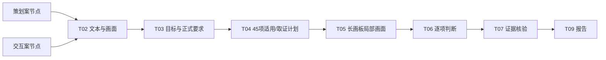

# 吴山石回收 Figma 多界面接入记录

日期：2026-11-02
用途：B 后端真实材料联调，不是准确率、真人体验或产品验收成绩。

## 输入

文件：`skill`（Figma 桌面当前文件，`dAWQ1dG8pOh5RBHa3CFZ7t`）

| 材料 | 节点 | 角色 | 读取结果 |
| --- | --- | --- | --- |
| 吴山石回收 · 策划案 | `173:7593` | `product_spec` | 42 个可见文本节点；根画板 + 9 个可检查画面节点 |
| 吴山石回收 · 交互案 | `173:7654` | `design` | 21 个可见文本节点、3 个隐藏文本节点；自动取得 6 张核心界面图 |

请求示例：[`examples/wushanshi-figma-review-session.json`](examples/wushanshi-figma-review-session.json)。

## 本轮已打通

- 正式要求只来自 `design_brief/product_spec/user_statement`。交互案的文字是方案证据，不能自己变成正式产品要求；隐藏节点和美术占位也不作为已实现功能。
- T03 第二次校验后得到 2 个目标、11 项正式要求，覆盖入口、8–15 级/强化套装限制、筛选记忆、排序、积分商店、NPC、获取途径和定价约束。
- T04 为 2 个目标、11 项要求、E01–E08、R01–R24 共 45 项登记适用性与证据需求。
- T05 已能对长流程图中的局部屏幕继续调用 `inspect_node`。当前请求明确禁止副作用操作，不能据此声称原型点击或真实运行通过。

## 已知限制

- 该材料是静态 Figma 交互案。方案文字和画面可以支持“设计是否覆盖要求”，不能证明筛选记忆、跳转、消耗、到账或错误恢复在真实环境生效。
- 模型曾把“交互案文字复述要求”统一判为证据不足。修正判断口径后，静态设计符合与运行待验证已分开；这仍需 D 用独立样本检查误报和漏报。
- 过程中千问曾返回 `AccessDenied.Unpurchased`，旧失败记录保留在会话历史中。充值恢复后完成 45 项判断，确认 1 条排序布局不符合策划案要求的候选发现；没有把它升级成运行时缺陷。
- 近义问题会按同一检查编号、主题相似度和明确问题族归并。本次由 21 条归并为 10 条，原始候选与历史报告仍保留。
- 最新完整报告包位于忽略目录 `out/context-probes/session-be7ebae9bc374699b222b69435fbe6a2/report-package-v10-final/`，压缩包为 `report-package-v10-final.zip`。报告包含人审稿、逐步审计、T01–T10 输入输出、45 项检查证据链、确定性视觉指标、模型原始响应、方法原文和 SHA-256。旧截图通过当时保存的 Figma MCP 原始层级重算绝对坐标；长流程总图会明确标注缩放限制。
- Figma 桌面 MCP 不接受文件 Key 时，只能证明读到了当前打开的桌面文件；后端记录 `file_identity_verified=false`，不能把请求 URL 的 Key 冒充服务端确认结果。

## 下一轮开发优先级

1. 把“设计符合 / 运行符合 / 真实用户理解”变成更清楚的报告状态，避免统一使用 `met` 引起误读。
2. 对跨批次重复发现和近义提问做语义归并，并保留原候选与人工取舍。
3. 用可访问的测试网站或获准 Figma 原型补动态证据；没有授权或访问失败时继续输出未执行范围。
4. C 接共享理解、检查计划、证据模式、问题审核与报告版本；D 用独立样本检验适用性、漏报、误报和统计口径。
